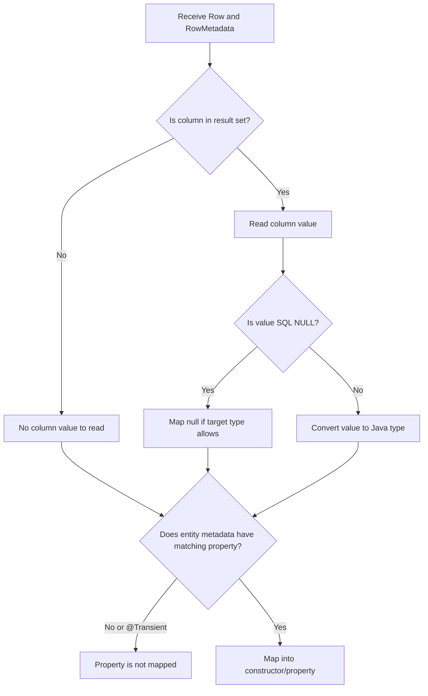

# Distinguishing Omitted Columns, Null Values, and Unmapped Properties

When Spring Data R2DBC converts SQL results into entities or DTOs, three situations are easily confused:

1. **Column omitted from the query result**: the `SELECT` statement did not return that column, so `Row` has no metadata for it.
2. **Column present in the result with SQL `NULL` value**: the column exists in the result set, but its value for the current row is null.
3. **Unmapped Java property**: entity metadata does not associate that property with any result column—for example, a property annotated with `@Transient` or a column name mismatch.

These three cases have distinct meanings. A column omitted from `SELECT` does not automatically become SQL `NULL`; a SQL `NULL` column is still present in the result set; and an unmapped property cannot receive a value simply because the SQL returns a similarly named column.

Understanding the differences prevents incomplete entities, accidental overwrites, constructor mapping failures, and subtle bugs when using projections, joins, or custom SQL.

## 1. Viewing Across Three Layers: Result Set, SQL Value, and Entity Metadata

Let us start with a table:

```sql
CREATE TABLE customers (
    id BIGINT PRIMARY KEY,
    name VARCHAR(120) NOT NULL,
    email VARCHAR(180),
    phone VARCHAR(30),
    note VARCHAR(500)
);
```

Suppose there is one row:

| id | name | email | phone | note |
| ---: | --- | --- | --- | --- |
| 10 | Lan | `lan@example.com` | `NULL` | Loyal customer |

The following queries produce different result sets:

```sql
-- A: phone is not selected
SELECT id, name, email FROM customers WHERE id = 10;

-- B: phone is selected and has SQL NULL value
SELECT id, name, email, phone FROM customers WHERE id = 10;

-- C: phone is selected but the result column is renamed
SELECT id, name, email, phone AS contact_number
FROM customers WHERE id = 10;
```

| Case | Is `phone` in result metadata? | Column value |
| --- | --- | --- |
| Query A | No | No value to read |
| Query B | Yes | SQL `NULL` |
| Query C | No longer named `phone`; result has `contact_number` | SQL `NULL` in the aliased column |

In Query A, the database does not send the `phone` column to the application. In Query B, the database sends `phone` and its value is null. In Query C, the column is present under a different name; mapping may fail to associate `contact_number` with the `phone` property without suitable configuration or aliases.

## 2. Columns Omitted in the `SELECT` Statement

An omitted column is a column that does not appear in the query's projection list. For example:

```sql
SELECT id, name, email
FROM customers
WHERE id = :id;
```

The result contains only three columns: `id`, `name`, and `email`. `Row` has no metadata for `phone` or `note`.

### 2.1. What Happens When Mapping into a Full Entity?

Suppose the entity is:

```java
@Table("customers")
public class Customer {

    @Id
    private Long id;
    private String name;
    private String email;
    private String phone;
    private String note;

    // Constructors, getters, and setters omitted.
}
```

If the query selects only `id`, `name`, and `email`, Spring Data has no column data to populate `phone` and `note`. For properties assigned after construction, they may retain the object's default values. For a persistence constructor expecting corresponding parameters, values absent from the result may be supplied as null depending on the mapping path and metadata.

Crucially, do not rely on those default values as part of a data contract. An entity designed to represent a full record may no longer be complete after a query selects only a subset of columns.

Dangerous example:

```java
@Query("SELECT id, name, email FROM customers WHERE id = :id")
Mono<Customer> findSummaryAsCustomer(@Param("id") Long id);
```

The method declares `Customer` as the return type, yet the SQL returns only partial data. Callers may receive an object with uninitialized `phone` and `note`. If that object is later treated as a full entity or saved, missing data can cause errors or unintended overwrites depending on how writes are performed.

### 2.2. Use Projections or DTOs for Partial Results

If a query needs only ID and name, define a result type representing strictly those two properties:

```java
public record CustomerSummary(Long id, String name) {
}
```

Repository:

```java
@Query("SELECT id, name FROM customers WHERE id = :id")
Mono<CustomerSummary> findSummary(@Param("id") Long id);
```

The return type accurately reflects the data supplied by the query. Callers cannot mistake `CustomerSummary` for a full entity containing `email`, `phone`, and `note`.

With an interface projection:

```java
public interface CustomerNameView {
    Long getId();
    String getName();
}
```

```java
@Query("SELECT id, name FROM customers WHERE id = :id")
Mono<CustomerNameView> findNameView(@Param("id") Long id);
```

Column names in the result set must correspond to the properties/accessors required by the projection under Spring Data's mapping rules. For DTOs or records, constructors must also be compatible with the selected columns.

### 2.3. Columns Omitted from `SELECT` Do Not Receive Database Defaults

Database defaults apply during write operations when a column is omitted from `INSERT` or when the statement uses the `DEFAULT` keyword per database syntax. They do not mean that omitting a column from `SELECT` causes the database to substitute its default value.

Example:

```sql
INSERT INTO customers (id, name, email)
VALUES (11, 'Minh', 'minh@example.com');
```

If `phone` has a default declared in the schema, the database may apply that default upon insert. However:

```sql
SELECT id, name FROM customers WHERE id = 11;
```

still returns only `id` and `name`. `phone` is not in the result set, even though the row in the database may store a default phone value.

## 3. Column Present with SQL `NULL` Value

SQL `NULL` represents an unknown, nonexistent, or intentionally empty value per schema semantics. The column is still present in the result set metadata.

Example:

```sql
SELECT id, name, phone
FROM customers
WHERE id = 10;
```

If `phone` for that row is SQL `NULL`, the result set contains the `phone` column with a null value.

### 3.1. Mapping SQL `NULL` to Java Types

For nullable properties, use reference types:

```java
private String phone;
private Long secondaryNumber;
private LocalDateTime verifiedAt;
```

Reference types can represent null. Conversely, primitives such as `long`, `int`, and `boolean` cannot hold null.

```java
private long score;
private boolean verified;
```

If `score` or `verified` in the database can be null, mapping to primitives loses the ability to represent the null state and can trigger conversion/assignment errors depending on the mapping mechanism. Use `Long` or `Boolean` when null is a valid state, or ensure schema and queries always provide non-null values.

### 3.2. SQL `NULL` Differs from Empty String and Zero

The following values are not equivalent:

| Value | Meaning |
| --- | --- |
| SQL `NULL` | No specific value under SQL semantics |
| `''` | Empty string |
| `' '` | String containing a space |
| `0` | Number zero |
| `false` | Boolean false value |

Do not automatically convert null to an empty string or zero if business logic needs to distinguish them. When a fallback value is required, express it explicitly in SQL or the domain layer.

### 3.3. Using `COALESCE` When Substituting Null

SQL `COALESCE` returns the first non-null expression:

```sql
SELECT id,
       name,
       COALESCE(phone, 'Not provided') AS phone
FROM customers
WHERE id = :id;
```

Here the query intentionally replaces SQL `NULL` with `'Not provided'`. Mapping into `String phone` yields that string rather than null.

Use this approach only when the fallback value makes sense for the business logic. If null signifies "unverified", "not applicable", or "deleted by user", substituting a default string can erase information.

### 3.4. Filtering with `NULL`

In SQL, do not check for null using regular comparison operators:

```sql
-- Incorrect for finding rows where phone is NULL
SELECT * FROM customers WHERE phone = NULL;

-- Correct approach
SELECT * FROM customers WHERE phone IS NULL;
```

Similarly, use `IS NOT NULL` to find rows with values. SQL's three-valued logic makes `phone = NULL` evaluate to UNKNOWN rather than TRUE.

## 4. Unmapped Java Properties

An unmapped property is one that Spring Data's mapping metadata does not link to a stored column. Common causes include:

- The property is annotated with `@Transient`.
- The result column name does not match the column name expected by the entity.
- The query returns an incompatible alias.
- The property does not belong to the entity's persistent model.
- The result column is an extra column produced by an expression, join, or aggregate, and the entity lacks a corresponding property.

### 4.1. Using `@Transient` for Properties Not Stored in the Database

Spring Data provides the `@Transient` annotation to exclude a property from persistent mapping:

```java
import org.springframework.data.annotation.Transient;

@Table("customers")
public class Customer {

    @Id
    private Long id;
    private String name;

    @Transient
    private String displayLabel;

    // Constructors, getters, and setters omitted.
}
```

`displayLabel` is not treated as a column to read/write in standard entity mapping. Its value can be computed in the domain/service after loading the entity:

```java
customer.setDisplayLabel(customer.getName() + " (#" + customer.getId() + ")");
```

Do not expect a query returning a column named `display_label` to automatically populate a `displayLabel` property marked `@Transient`. If you want to receive computed data from a query, use a projection/DTO or map manually.

### 4.2. Column Name Does Not Match Property

Suppose the entity declares:

```java
@Column("email_address")
private String email;
```

Mapping metadata links property `email` to column `email_address`. If a query returns:

```sql
SELECT id, name, email_address AS contact
FROM customers;
```

then the result set has column `contact`, not `email_address`. Without a matching mapping, the `email` property may remain unpopulated.

Fix the query to return the expected column name:

```sql
SELECT id, name, email_address
FROM customers;
```

Or if the target is a DTO with a `contact` property, declare the appropriate DTO and intentionally use the `contact` alias.

### 4.3. Naming Strategy and `@Column`

Spring Data Relational uses a naming strategy to map Java property names to default column names. For instance, `firstName` typically maps to `first_name` under the default naming strategy.

If the schema uses a different column name, declare it explicitly:

```java
@Column("customer_full_name")
private String name;
```

With handwritten SQL queries, keep in mind the column names expected by mapping metadata. `@Column` describes how a property maps to a database column; it does not automatically translate an arbitrary alias back into the declared column name.

### 4.4. Extra Columns in the Result Set

A query can return more columns than the entity requires:

```sql
SELECT id, name, email_address, CURRENT_TIMESTAMP AS queried_at
FROM customers;
```

If the `Customer` entity has no persistent property corresponding to `queried_at`, that extra column does not automatically become a new property on the entity. It is generally ignored during entity mapping.

If the application needs `queriedAt`, create a projection/DTO with the matching property or read the column via `DatabaseClient` and map manually.

## 5. Comparing All Three Cases in One Example

Suppose the entity is:

```java
@Table("customers")
public class Customer {

    @Id
    private Long id;
    private String name;
    private String phone;

    @Transient
    private String displayLabel;

    // Constructors and accessors omitted.
}
```

| Situation | SQL/Result Set | Mapping to `phone` | Mapping to `displayLabel` |
| --- | --- | --- | --- |
| Omitted column | `SELECT id, name` | No column value; property may remain unassigned | Not mapped due to `@Transient` |
| SQL NULL column | `SELECT id, name, phone`, phone value is NULL | Receives null if Java type/converter allows | Not mapped due to `@Transient` |
| Unmapped property | Query returns `display_label`, entity marks property `@Transient` | Depends on whether `phone` column is selected | Still unmapped per entity metadata |
| Wrong alias | `phone AS contact` | Does not match column `phone`, may remain unassigned | Unrelated |

Identify the cause at the right layer. If the result set lacks the column, fix `SELECT`; if the column holds SQL NULL, handle nullability; if mapping metadata excludes the property or column names mismatch, fix the entity mapping or use a different result type.

## 6. Constructor Mapping and Property Population

Spring Data R2DBC can instantiate entities via a persistence constructor or factory method, then populate remaining properties using mapping metadata.

### 6.1. Properties as Constructor Parameters

Example:

```java
@Table("customers")
public class Customer {

    @Id
    private final Long id;
    private final String name;
    private final String phone;

    @PersistenceCreator
    public Customer(Long id, String name, String phone) {
        this.id = id;
        this.name = name;
        this.phone = phone;
    }
}
```

If the query returns only `id` and `name`, the constructor still requires the `phone` parameter. The framework has no `phone` value from the result set; the passed argument may be null depending on the mapping path. Hence, a full entity's constructor should be used with queries that return all columns required by the entity.

If only partial data is needed, create a DTO/record whose constructor accepts only the queried columns:

```java
public record CustomerContact(Long id, String name) {
}
```

### 6.2. Properties Assigned After Construction

For mutable entities with a no-arg constructor, properties omitted from the result set are typically skipped during property population and retain Java defaults, such as `null` for references or `0` for primitives.

This is another reason full entities are a poor choice for queries selecting only a subset of columns. An object that looks valid while holding uninitialized fields can cause errors in the business layer.

### 6.3. Constructor Parameters and SQL `NULL`

If a column is present in the result set with a SQL `NULL` value, the corresponding constructor parameter receives `null` if its type and converter allow it. Primitives cannot represent null; use wrappers or enforce non-null data rules.

Thus, "missing column" and "present column with null" differ at the metadata level, even though both can sometimes yield a Java `null` in the final object. If business logic must distinguish the two, inspect result set metadata or design dedicated projections/queries.

## 7. Working with Joins and Aliases

Joins often produce result sets with columns from multiple tables. If tables share column names such as `id`, `name`, or `created_at`, the result set may contain duplicate or ambiguous names for mapping.

Example:

```sql
SELECT c.id,
       c.name,
       p.id,
       p.display_name
FROM customers c
JOIN profiles p ON p.customer_id = c.id
WHERE c.id = :id;
```

Both tables have an `id` column. Mapping directly into an entity can lead to ambiguous or overwritten column values depending on how the driver and mapper process metadata.

Use explicit aliases:

```sql
SELECT c.id AS customer_id,
       c.name AS customer_name,
       p.id AS profile_id,
       p.display_name AS profile_display_name
FROM customers c
JOIN profiles p ON p.customer_id = c.id
WHERE c.id = :id;
```

Then map into a dedicated DTO:

```java
public record CustomerProfileRow(
        Long customerId,
        String customerName,
        Long profileId,
        String profileDisplayName
) {
}
```

For complex joins, DTOs/projections are usually much clearer than trying to pack columns from multiple tables into a single aggregate entity.

## 8. Checking Column Presence Using R2DBC `RowMetadata`

When using repositories and automatic mapping, Spring Data handles `Row`/metadata according to entity mapping. If you need to clearly distinguish a column absent from the result set from a column holding null, use `DatabaseClient` to inspect metadata directly.

Example:

```java
return databaseClient.sql("SELECT id, name, phone FROM customers WHERE id = :id")
        .bind("id", customerId)
        .map((row, metadata) -> {
            boolean phoneColumnPresent = metadata.getColumnMetadatas().stream()
                    .anyMatch(column -> column.getName().equalsIgnoreCase("phone"));

            String phone = phoneColumnPresent
                    ? row.get("phone", String.class)
                    : null;

            return new CustomerPhoneResult(
                    row.get("id", Long.class),
                    row.get("name", String.class),
                    phoneColumnPresent,
                    phone
            );
        })
        .one();
```

The DTO captures both column presence and value:

```java
public record CustomerPhoneResult(
        Long id,
        String name,
        boolean phoneColumnPresent,
        String phone
) {
}
```

The result distinguishes:

- `phoneColumnPresent == false`: the query did not return the `phone` column.
- `phoneColumnPresent == true` and `phone == null`: the `phone` column was present, but its SQL value was NULL.
- `phoneColumnPresent == true` and `phone != null`: the column was present and held a value.

Column names in metadata can depend on the driver, dialect, and aliases. If the query uses aliases, check against the alias name. For results with duplicate column names, assign unique aliases before reading.

## 9. When to Use `COALESCE`, Aliases, or DTOs?

| Need | Suitable Approach |
| --- | --- |
| Turn SQL NULL into a default value | `COALESCE` in SQL, if changing semantics is intentional |
| Query selects only a few columns | DTO or projection containing strictly those columns |
| Physical column differs from property name | `@Column` or matching alias |
| Multi-table join has duplicate column names | Unique aliases and a dedicated DTO |
| Need to distinguish omitted column from SQL NULL | Read `RowMetadata` alongside `Row` values |
| Property used only in application, not persisted | `@Transient` and compute/assign in application code |
| Want to update a nullable field to SQL NULL | Use an explicit update with null value and verify schema |

Do not use `COALESCE` merely to hide mapping errors caused by missing query columns. Fix the result set or return type to reflect the intended data.

## 10. Impact on Data Updates

A common mistake is selecting only a subset of columns, mapping into a full entity, mutating one property, and calling `save()`.

Example:

```java
@Query("SELECT id, name FROM customers WHERE id = :id")
Mono<Customer> findPartial(@Param("id") Long id);
```

```java
return repository.findPartial(id)
        .map(customer -> {
            customer.setName("Lan Nguyen");
            return customer;
        })
        .flatMap(repository::save);
```

The entity may lack `email`, `phone`, or other properties. When `save()` persists the entity per mapping, unloaded values may become null or defaults and overwrite existing database data depending on the generated SQL. This is a serious data-loss bug.

If the goal is changing a single column, use an explicit partial update:

```java
return template.update(Customer.class)
        .matching(query(where("id").is(id)))
        .apply(Update.update("name", "Lan Nguyen"));
```

Or load the full entity before modifying and calling `save()` if business rules require validating the entire aggregate.

## 11. Testing the Three Cases Separately

Prepare test fixtures with at least one nullable column so you can test both SQL NULL and omitted-column cases.

Example schema and fixture:

```sql
CREATE TABLE customers (
    id BIGINT PRIMARY KEY,
    name VARCHAR(120) NOT NULL,
    phone VARCHAR(30),
    note VARCHAR(500)
);

INSERT INTO customers (id, name, phone, note)
VALUES (10, 'Lan', NULL, 'VIP');
```

### 11.1. Testing a Column Omitted from the Result Set

```java
@Query("SELECT id, name FROM customers WHERE id = :id")
Mono<CustomerSummary> findSummary(@Param("id") Long id);
```

The test verifies the projection provides only the selected fields:

```java
StepVerifier.create(repository.findSummary(10L))
        .assertNext(summary -> {
            assertThat(summary.id()).isEqualTo(10L);
            assertThat(summary.name()).isEqualTo("Lan");
        })
        .verifyComplete();
```

### 11.2. Testing a Column with SQL `NULL`

```java
@Query("SELECT id, name, phone FROM customers WHERE id = :id")
Mono<CustomerPhoneView> findPhone(@Param("id") Long id);
```

The test verifies the column is present with a null value:

```java
StepVerifier.create(repository.findPhone(10L))
        .assertNext(view -> {
            assertThat(view.getId()).isEqualTo(10L);
            assertThat(view.getPhone()).isNull();
        })
        .verifyComplete();
```

### 11.3. Testing a `@Transient` Property

```java
@Transient
private String displayLabel;
```

This property is not mapped by Spring Data as a persistent column. Tests should verify it is computed/assigned in the application layer as intended, rather than expecting the query to populate it automatically.

### 11.4. Additional Scenarios

- Query selects all columns required for the persistence constructor.
- Query omits a constructor parameter.
- SQL NULL mapped to wrapper vs. primitive types.
- Correct alias vs. incorrect alias relative to `@Column`.
- Join query with duplicate column names.
- Extra column in the result set with no matching property.
- Projection returning fewer fields than the entity.
- Avoiding saving an entity materialized from a partial SELECT.
- `COALESCE` substituting null with a default value per business rules.

## 12. Common Mistakes and Fixes

| Symptom | Possible Cause | Fix |
| --- | --- | --- |
| Property is null despite database having data | Column not selected or alias mismatches mapping | Check SELECT, metadata, and `@Column` |
| Property is null even though query selects column | Column value is actually SQL NULL | Check data, nullability, and business rules |
| Entity missing many fields after query | Query selects partial columns while returning full entity | Use a DTO/projection or select all columns |
| Computed property is not populated | Property is annotated with `@Transient` | Compute in application or map manually to a DTO |
| Mapping failure on primitive | Column can be null, but Java primitive cannot hold null | Use wrapper types or guarantee non-null data |
| Data lost after calling save | Entity loaded with missing columns and saved back | Do not save partial entities; use partial update or load full entity |
| Join returns wrong ID/name | Duplicate column names across tables | Use unique aliases and a dedicated DTO |
| Default value does not appear | Confusing INSERT default with a column omitted in SELECT | Check schema and select columns explicitly |

## 13. Process for Designing Clear Mappings

When writing queries and result types, follow this sequence:

1. List the columns that the SQL actually returns.
2. Identify which columns can contain SQL NULL.
3. Determine the exact column names/aliases provided by the result set.
4. Cross-check against `@Column`, naming strategy, and target constructor parameters.
5. If the query returns only partial data, create a corresponding projection/DTO.
6. If a property is not stored in the database, mark it `@Transient` and manage its value explicitly.
7. Use wrapper types for nullable properties.
8. Avoid saving entities instantiated from partial result sets.
9. Write integration tests for missing columns, SQL NULL, aliases, and unmapped properties.

## 14. Flow for Distinguishing Missing Columns, SQL NULL, and Unmapped Properties



## 15. Conclusion

A column omitted from `SELECT`, a column holding SQL `NULL`, and an unmapped property are three distinct states. An omitted column does not appear in the result set; SQL NULL is a present column whose value is null; an unmapped property is excluded from or mismatched with entity metadata.

Choose a result type matching the data returned by the query. Use DTOs/projections for partial column sets, `@Column` or aliases to align names, `@Transient` for non-persistent properties, and wrappers for nullable values. When you need to distinguish an absent column from a column holding null, inspect `RowMetadata` alongside `Row` values. Above all, avoid calling `save()` on entities materialized from partial SELECTs, because unloaded fields can overwrite and destroy existing data.
