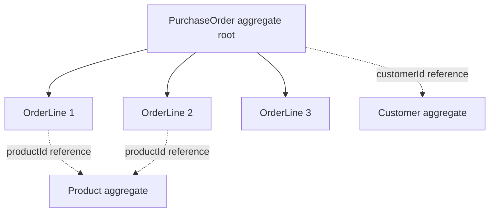

# Do Not Assume Lazy Loading, Cascades, or Dirty Checking Like JPA

Spring Data R2DBC works with relational databases in a reactive model, but how it manages objects and relationships differs from JPA/Hibernate. An entity read from the database is not held inside a persistence context for the framework to automatically track every change. A property referencing another entity also does not automatically load data when accessed. Save and delete operations must be expressed explicitly in code or handled according to the aggregate boundaries supported by Spring Data Relational.

Three JPA behaviors commonly misunderstood when moving to R2DBC are **lazy loading**, **cascade operations**, and **dirty checking**. Spring Data Relational has aggregate mapping and manages members belonging to an aggregate, but it does not provide JPA's full persistence context model. Understanding these differences helps prevent hidden queries, missing writes, unintended deletions, or false assumptions about transactions.

## 1. Why Not Carry JPA Thinking Directly into R2DBC?

In a JPA application, `EntityManager` manages a persistence context. When an entity is loaded, the provider can retain its state, track property mutations, and emit SQL on flush. Relationships can be configured as lazy/eager; cascades define which operations propagate from a parent entity to related entities.

Spring Data R2DBC does not use that kind of persistence context. Repositories, `R2dbcEntityTemplate`, and `DatabaseClient` execute reactive database operations. When a query completes, the application receives objects mapped from the results. The framework does not continue holding an object graph in memory to detect future mutations automatically.

| Capability | JPA/Hibernate | Spring Data R2DBC / Relational |
|---|---|---|
| Persistence context | Yes; manages entities within a persistence context scope | No JPA-style persistence context |
| Lazy loading | Configurable for supported relationships | No automatic lazy-loading proxies |
| Dirty checking | Tracks changes on managed entities | No automatic change tracking; must call write operations explicitly |
| Cascade annotations | Has JPA annotations and `CascadeType` | Does not use JPA's cascade annotation model |
| Data relationships | Object relationships like `@ManyToOne`, `@OneToMany` | Aggregate-based mapping and table relationships; requires explicit queries across aggregates |
| Write timing | May flush at transaction commit or per flush mode | Write publishers execute on subscription; application explicitly calls `save`, `insert`, `update`, or SQL |

Spring Data Relational still supports mapping data belonging to an aggregate, such as an order along with its order lines. That does not turn it into an ORM with JPA-like lazy loading and dirty checking.

## 2. Understanding Aggregate Boundaries in Spring Data Relational

Spring Data Relational organizes data around **aggregates**. An aggregate root is the entry point for reading and modifying a group of objects that must be managed as a single business unit. Objects belonging to the same aggregate can map to multiple tables, yet they share a single consistency boundary.

For example, a `PurchaseOrder` has `OrderLine`s. Order lines make sense only inside an order and are typically created, modified, or deleted together with the order. This is an appropriate case for modeling order lines as members of the `PurchaseOrder` aggregate.

Conversely, `Customer` and `Product` are usually independent aggregates. An order should store customer and product identifiers rather than pulling entire customer and product object graphs into the same aggregate. When customer names or product details are needed for display, the application queries them explicitly for the read use case.



The diagram shows two distinct kinds of relationships:

- `OrderLine` is a managed member inside the `PurchaseOrder` aggregate.
- `Customer` and `Product` are separate aggregates referenced by ID.

Aggregate boundaries are a business design decision. Foreign keys in the database protect referential integrity, but they do not automatically decide whether two objects belong to the same aggregate.

## 3. Mapping Aggregate Members with @MappedCollection

Spring Data Relational provides `@MappedCollection` to map child objects stored in a separate table and owned by the aggregate root.

Example:

```java
@Table("purchase_order")
public class PurchaseOrder {

    @Id
    private Long id;

    private String orderNo;
    private String status;

    @MappedCollection(idColumn = "order_id")
    private Set<OrderLine> lines = new LinkedHashSet<>();

    // Constructors, getters, and business methods.
}
```

```java
@Table("order_line")
public class OrderLine {

    @Id
    private Long id;

    private Long productId;
    private Integer quantity;
    private BigDecimal unitPrice;

    // Constructors, getters, and business methods.
}
```

In the schema, the child table has a foreign key column pointing to the aggregate root:

```sql
CREATE TABLE purchase_order (
    id BIGINT GENERATED BY DEFAULT AS IDENTITY PRIMARY KEY,
    order_no VARCHAR(40) NOT NULL UNIQUE,
    status VARCHAR(30) NOT NULL
);

CREATE TABLE order_line (
    id BIGINT GENERATED BY DEFAULT AS IDENTITY PRIMARY KEY,
    order_id BIGINT NOT NULL REFERENCES purchase_order(id),
    product_id BIGINT NOT NULL,
    quantity INTEGER NOT NULL CHECK (quantity > 0),
    unit_price NUMERIC(19, 2) NOT NULL CHECK (unit_price >= 0)
);
```

`idColumn = "order_id"` tells Spring Data which column in the child table links to the aggregate root's ID. When loading the aggregate root, the mapping can load members declared as part of the aggregate. That does not mean relationships to other aggregates are loaded automatically alongside it.

If the collection uses `List` or `Map`, you may also need `keyColumn` to store element position or key according to supported mappings. Check the Spring Data Relational documentation for your exact version to pick the right collection configuration.

## 4. Referencing Other Aggregates by ID

For relationships to an independent aggregate, typically store an ID rather than embedding the entity into an object graph:

```java
@Table("purchase_order")
public record PurchaseOrder(
    @Id Long id,
    String orderNo,
    Long customerId,
    String status
) {}
```

`customerId` is just a reference value. When reading `PurchaseOrder`, Spring Data does not automatically call `CustomerRepository.findById(customerId)` when code accesses that property. If customer information is needed, the application must query explicitly.

Example for a single order:

```java
public Mono<OrderDetail> findOrderDetail(Long orderId) {
    return orderRepository.findById(orderId)
        .flatMap(order -> customerRepository.findById(order.customerId())
            .map(customer -> new OrderDetail(
                order.id(),
                order.orderNo(),
                order.status(),
                customer.displayName()
            )));
}
```

This is a clear read for one order detail. However, using the exact same pattern for a list of 100 orders causes N+1 queries: one query for orders followed by one customer query per order.

For lists, consider a join projection query via `DatabaseClient`, or collect the customer ID set and query by ID batch. Choose based on cardinality, data size, and consistency needs.

## 5. No Automatic Lazy Loading

Lazy loading in JPA allows an unloaded association to be fetched when code reads the association property. The provider can use a proxy to emit SQL at that moment, provided the entity remains within an active persistence context.

Spring Data R2DBC does not create such lazy proxies. Accessing an ID field or a mapped object never triggers a new query. There is no `FetchType.LAZY` to defer relationship loading the way JPA does.

Example pattern that does not apply directly:

```java
// Illustrative JPA model, not an R2DBC relationship mapping approach.
@ManyToOne(fetch = FetchType.LAZY)
private Customer customer;
```

In Spring Data Relational, represent cross-aggregate references by ID and query explicitly when needed. If a combined result is desired, construct a DTO from a join query.

### Strategy 1: Explicit Step-by-Step Loading

Suitable when reading a single object or a small number of relationships:

```java
public Mono<OrderDetail> getDetail(Long orderId) {
    return orderRepository.findById(orderId)
        .flatMap(order -> customerRepository.findById(order.customerId())
            .map(customer -> new OrderDetail(
                order.id(),
                order.orderNo(),
                customer.displayName(),
                order.status()
            )));
}
```

### Strategy 2: Join and Projection

Suitable for list screens requiring data from multiple tables:

```java
public record OrderListItem(
    Long orderId,
    String orderNo,
    String status,
    String customerName
) {}
```

```java
public Flux<OrderListItem> findOrderList(String status) {
    return databaseClient.sql("""
            SELECT o.id AS order_id,
                   o.order_no,
                   o.status,
                   c.display_name AS customer_name
            FROM purchase_order o
            JOIN customer c ON c.id = o.customer_id
            WHERE o.status = :status
            ORDER BY o.id DESC
            """)
        .bind("status", status)
        .map((row, metadata) -> new OrderListItem(
            row.get("order_id", Long.class),
            row.get("order_no", String.class),
            row.get("status", String.class),
            row.get("customer_name", String.class)
        ))
        .all();
}
```

### Strategy 3: Loading by ID Set

If you prefer not to join while still avoiding N+1, fetch orders first, gather unique `customerId` values, and load customers in one `IN` query. Watch ID batch size limits, collection binding support for your API/driver, and in-memory result assembly. For large datasets, paginate the parent list before loading related data.

## 6. No Automatic Dirty Checking

In JPA, an entity loaded in a persistence context can be mutated directly:

```java
// Familiar JPA usage; do not expect R2DBC to save changes automatically.
Person person = entityManager.find(Person.class, id);
person.setStatus("ACTIVE");
// Dirty checking can detect the change and write on flush/commit.
```

In Spring Data R2DBC, mutating a Java object only mutates the object in memory. The framework does not track that object to automatically detect and flush changes to the database when the transaction ends.

The application must invoke a write operation explicitly, for example:

```java
public Mono<Person> activate(Long id) {
    return personRepository.findById(id)
        .switchIfEmpty(Mono.error(new PersonNotFoundException(id)))
        .map(person -> person.withStatus("ACTIVE"))
        .flatMap(personRepository::save);
}
```

This example assumes `Person` is a record with a `withStatus` method returning a new instance. With a mutable class, the service can call a setter and then pass the modified entity to `save`. The core point is that you must explicitly call `save` or an update operation.

### Caveats When Using save

`save(entity)` persists the aggregate/entity according to Spring Data rules; it is not a "write only mutated fields" command like JPA dirty checking. Do not assume the framework knows which attributes were modified in memory.

When saving an aggregate, Spring Data Relational manages root and aggregate-member data according to its mapping. Exact SQL behavior depends on entity type, new/existing state, mapping, and version. Therefore, avoid passing a partially loaded entity into `save` if missing values must not affect existing persisted data.

If you only need to change a few columns, an explicit partial update is often better than loading and re-saving the whole entity. This is particularly helpful when a table has many columns or concurrent requests update different fields.

## 7. Partial Updates with R2dbcEntityTemplate

`R2dbcEntityTemplate` supports conditional updates that modify only the target columns:

```java
import static org.springframework.data.relational.core.query.Criteria.where;
import static org.springframework.data.relational.core.query.Query.query;
import static org.springframework.data.relational.core.query.Update.update;

public Mono<Long> changePersonStatus(Long id, String status) {
    return template.update(Person.class)
        .matching(query(where("id").is(id)))
        .apply(update("status", status));
}
```

The result emits the affected row count. This avoids loading the entity first and makes clear exactly which columns are updated.

When concurrency control is needed, include version in the condition and increment version according to application rules or use an appropriate optimistic locking mechanism. Never omit tenant, status, or ownership conditions when building partial updates.

## 8. Partial Updates with DatabaseClient

For custom SQL, use `DatabaseClient`:

```java
public Mono<Long> updateStatus(Long id, String status) {
    return databaseClient.sql("""
            UPDATE person
            SET status = :status,
                updated_at = CURRENT_TIMESTAMP
            WHERE id = :id
            """)
        .bind("status", status)
        .bind("id", id)
        .fetch()
        .rowsUpdated();
}
```

Bind parameters for all input values. `rowsUpdated()` indicates how many rows were affected; the service can translate 0 rows into not-found or no-op depending on the business contract.

For optimistic concurrency, add a version predicate:

```sql
UPDATE person
SET status = :status,
    version = version + 1
WHERE id = :id
  AND version = :expectedVersion;
```

If updated row count is 0, either the ID does not exist or the version changed. The application must decide whether to run an extra check to distinguish them or return a general conflict error. Test version incrementing and mapping against your project's Spring Data configuration.

## 9. Cascades in JPA vs. Aggregate Semantics in Spring Data Relational

JPA provides `CascadeType.PERSIST`, `MERGE`, `REMOVE`, `REFRESH`, `DETACH`, and `ALL` to propagate operations from a parent entity to related entities. Spring Data R2DBC does not use these cascade annotations.

That does not mean Spring Data Relational ignores all child objects. Objects mapped as members of the same aggregate are managed via the aggregate root. When saving or deleting the aggregate root, Spring Data Relational handles aggregate members according to its mapping and semantics.

Distinguish clearly:

- **Aggregate members:** e.g., `OrderLine` in `PurchaseOrder`, declared via `@MappedCollection`.
- **Referenced independent aggregates:** e.g., `Customer` or `Product`, held by ID with separate lifecycles.
- **Database cascades:** foreign key behaviors such as `ON DELETE CASCADE`, enforced by the database.
- **JPA cascade annotations:** not a mapping mechanism of Spring Data R2DBC.

Do not treat an ID reference to another aggregate as a cascade relationship. Deleting `PurchaseOrder` does not mean the application wants to delete the referenced `Customer` or `Product`.

## 10. Deleting the Aggregate Root and Child Members

For an aggregate mapped with `@MappedCollection`, Spring Data Relational treats child rows as part of the aggregate root. When deleting the aggregate root via a repository or template, the framework manages deleting aggregate members according to the mapping.

Example:

```java
public interface PurchaseOrderRepository
        extends ReactiveCrudRepository<PurchaseOrder, Long> {
}
```

```java
public Mono<Void> cancelAndDeleteOrder(Long id) {
    return orderRepository.findById(id)
        .switchIfEmpty(Mono.error(new OrderNotFoundException(id)))
        .flatMap(order -> {
            if (!"CANCELLED".equals(order.getStatus())) {
                return Mono.error(new IllegalStateException(
                    "Only cancelled orders can be deleted"));
            }
            return orderRepository.delete(order);
        });
}
```

This example illustrates checking a business rule before deleting. Child rows mapped within the aggregate are handled according to Spring Data Relational semantics. You do not need and should not rely on JPA's `CascadeType.REMOVE`.

Rows belonging to other aggregates referenced by ID do not automatically become targets for deletion. If database foreign keys block deleting the root, design the relationships and operation ordering appropriately.

## 11. Distinguishing Aggregate Delete from ON DELETE CASCADE

`ON DELETE CASCADE` is a database feature:

```sql
CREATE TABLE order_line (
    id BIGINT GENERATED BY DEFAULT AS IDENTITY PRIMARY KEY,
    order_id BIGINT NOT NULL,
    product_id BIGINT NOT NULL,
    quantity INTEGER NOT NULL,
    CONSTRAINT fk_order_line_order
        FOREIGN KEY (order_id)
        REFERENCES purchase_order(id)
        ON DELETE CASCADE
);
```

When a SQL statement deletes a `purchase_order` row, the database automatically deletes related `order_line` rows via the foreign key. This works regardless of whether the statement came from Spring Data, `DatabaseClient`, a SQL tool, or another application.

By contrast, aggregate semantics is how Spring Data Relational manages child objects declared in entity mappings. Both mechanisms can coexist, so understand which part the database handles versus what the framework handles to avoid redundant deletes, constraint conflicts, or surprises in SQL execution order.

Do not configure delete cascades on every foreign key. Transaction data, payment history, or audit records often must be retained even when a parent entity is no longer active. Use `RESTRICT`, soft deletes, or business statuses instead of physical deletion.

## 12. Do Not Confuse Database Relationships with Automatic Object Graphs

A foreign key states that one row references another row. It does not force the application to model that relationship as an auto-loading object property.

Example schema:

```sql
CREATE TABLE purchase_order (
    id BIGINT PRIMARY KEY,
    customer_id BIGINT NOT NULL REFERENCES customer(id)
);
```

The entity can simply hold the ID:

```java
@Table("purchase_order")
public record PurchaseOrder(
    @Id Long id,
    Long customerId
) {}
```

When customer information is needed, choose the read mechanism explicitly:

- Query `CustomerRepository` by `customerId` when only one customer is needed.
- Use `DatabaseClient` to join orders and customers for a list.
- Batch-load customers by ID and assemble in memory when counts are bounded.

This design keeps query counts under the application's control and prevents a getter from silently triggering I/O. It also makes clear which data belongs to the current aggregate versus another aggregate.

## 13. Avoiding N+1 Without Lazy Loading

Having no lazy loading does not mean the application should call a repository once per relationship. N+1 can still occur if a service loops through a list and queries each related record individually.

Inefficient example:

```java
public Flux<OrderListItem> listOrders() {
    return orderRepository.findAll()
        .flatMap(order -> customerRepository.findById(order.customerId())
            .map(customer -> new OrderListItem(
                order.id(),
                order.orderNo(),
                customer.displayName()
            )));
}
```

With N orders, this stream issues one order query and N customer queries. At scale, this increases round trips and database load.

One alternative is joining directly into a projection:

```java
public Flux<OrderListItem> listOrders() {
    return databaseClient.sql("""
            SELECT o.id AS order_id,
                   o.order_no,
                   c.display_name AS customer_name
            FROM purchase_order o
            JOIN customer c ON c.id = o.customer_id
            ORDER BY o.id DESC
            """)
        .map((row, metadata) -> new OrderListItem(
            row.get("order_id", Long.class),
            row.get("order_no", String.class),
            row.get("customer_name", String.class)
        ))
        .all();
}
```

For one-to-many relationships, paginate the parent set before joining collections or batch-loading children by ID set. Never apply `LIMIT` directly to a join result if the goal is limiting aggregate roots, because one root can produce multiple result rows.

## 14. Managing Collection Changes Within an Aggregate

For aggregates owning a child collection, the application modifies the collection through business methods and then explicitly persists the aggregate. There is no dirty checking to detect which individual elements were added, edited, or removed.

Example:

```java
public Mono<PurchaseOrder> addLine(Long orderId, AddOrderLine command) {
    return orderRepository.findById(orderId)
        .switchIfEmpty(Mono.error(new OrderNotFoundException(orderId)))
        .map(order -> {
            order.addLine(new OrderLine(
                null,
                command.productId(),
                command.quantity(),
                command.unitPrice()
            ));
            return order;
        })
        .flatMap(orderRepository::save);
}
```

This assumes `PurchaseOrder.addLine` is a domain method updating the collection. Calling `save` is mandatory to persist changes to the database.

For large aggregates or collections with many rows, evaluate the cost of saving the entire aggregate. If an operation only updates one child row, a dedicated command/query repository can update that row by ID and business conditions, provided aggregate invariants remain intact. This is an intentional design choice; never bypass the aggregate root purely to optimize one query without understanding consistency rules.

When Spring Data saves an aggregate with a collection, it manages child rows according to aggregate mapping. Do not assume it emits only a single targeted `UPDATE` for the changed item like a dirty-tracking ORM. Check documentation for your version and inspect actual SQL if collection update cost matters.

## 15. Optimistic Locking Instead of Assuming Loaded Entities Are Always Fresh

Having no persistence context or dirty checking means a loaded object can become stale while another request updates the same row. Spring Data Relational supports optimistic locking via `@Version` to detect certain write conflicts.

```java
@Table("purchase_order")
public record PurchaseOrder(
    @Id Long id,
    String orderNo,
    String status,
    @Version Long version
) {}
```

When reading the entity, the application receives the current version. When updating or deleting by entity, the framework can include version in the predicate to detect concurrent changes. If no row matches both ID and expected version, the operation raises an optimistic locking failure.

Optimistic locking does not replace transactions and does not resolve every business conflict on its own. Services must decide how to respond: return a conflict error, reload fresh data, safely retry under business rules, or ask the user to confirm.

With custom SQL updates, if optimistic concurrency is required, include the version check in the condition and increment version consistently. Never drop `@Version` from an entity and assume an unversioned update protects against concurrent modifications.

## 16. A Reactive Transaction Is Not a Persistence Context

`@Transactional` in Spring Data R2DBC manages reactive transactions via Reactor Context and a reactive transaction manager. It does not create a persistence context tracking entities like JPA.

Example reactive transaction:

```java
@Service
public class OrderService {

    private final PurchaseOrderRepository orders;
    private final OrderLineRepository lines;

    public OrderService(
            PurchaseOrderRepository orders,
            OrderLineRepository lines) {
        this.orders = orders;
        this.lines = lines;
    }

    @Transactional
    public Mono<Void> deleteOrder(Long orderId) {
        return lines.deleteByOrderId(orderId)
            .then(orders.deleteById(orderId));
    }
}
```

This illustrates explicit operations chained reactively. If order lines are aggregate members managed by Spring Data alongside the root, consider deleting the aggregate root rather than manually deleting children; the snippet above applies only when repositories and schema rules are designed for manual deletion.

Transactions require `R2dbcTransactionManager` bound to the same `ConnectionFactory` used by the repositories/`DatabaseClient`. Do not call `subscribe()` or `block()` inside a service/repository; operations must stay in the returned publisher so the transaction manager properly governs the subscription.

A transaction ensures multiple statements commit or roll back together. It does not auto-load relationships, auto-track object mutations, or automatically cascade operations to other aggregates.

## 17. JPA Annotations Not to Carry Over to R2DBC

When porting code from JPA, review these annotations and assumptions:

| JPA/Hibernate | In Spring Data Relational/R2DBC |
|---|---|
| `@Entity` | Use Spring Data mapping annotations like `@Table` and `@Column` |
| `@ManyToOne` / `@OneToOne` | Design ID references across aggregates or explicit join queries |
| `@OneToMany` | Use aggregate mappings like `@MappedCollection` for root-owned members |
| `FetchType.LAZY` | No lazy auto-loading proxies; query related data explicitly |
| `FetchType.EAGER` | Do not expect automatic object-graph assembly; design explicit queries |
| `CascadeType.PERSIST` / `REMOVE` | Use aggregate semantics, explicit operations, or designed database constraints/cascades |
| Dirty checking | Call `save`, template updates, or explicit SQL |
| `EntityManager.flush()` | No JPA persistence context to flush; database publishers execute upon subscription |
| `EntityGraph` | Write explicit queries/projections using repositories, templates, or `DatabaseClient` |

Do not leave JPA annotations around just to make code look familiar. Use annotations from the right packages and framework. While shared Spring Data annotations like `@Id` and `@Version` work in relational mapping, that does not mean JPA annotations are supported.

## 18. When to Use Repository, Template, or DatabaseClient?

| Need | Suitable API | Reason |
|---|---|---|
| CRUD for aggregate roots and aggregate members | `ReactiveCrudRepository` | Reactive CRUD API, aggregate-aware mapping |
| Reading/writing entities with dynamic conditions | `R2dbcEntityTemplate` | Uses mapping metadata and `Criteria`/`Query` |
| Partial column updates, joins, or custom projections | `DatabaseClient` | Full control over SQL and affected row counts |
| Reading data from another aggregate | Separate repository, join query, or ID-batch query | Makes loading related data explicit |
| Partial update without loading entity | Template update or `DatabaseClient` | Avoids reading and rewriting the whole entity |
| Business workflows spanning multiple aggregates | Service coordinating multiple repositories in a transaction or workflow | Keeps business boundaries clear |

Do not use `DatabaseClient` for every simple CRUD operation if a repository suffices. Conversely, do not force a join query or aggregate into an entity just to use `findBy...`.

## 19. Common Mistakes When Migrating from JPA to R2DBC

| Symptom | Common False Assumption | How to Fix |
|---|---|---|
| Reading `order.customer` lacks customer info | Expected relationship to lazy-load | Store `customerId` and query explicitly or use a join projection |
| Modifying entity leaves database unchanged | Expected dirty checking to auto-flush | Call `save`, template update, or explicit SQL |
| Deleting root leaves unexpected related state | Expected JPA `CascadeType.REMOVE` to work | Clarify aggregate members, foreign keys, and explicit delete behavior |
| Calling `save` with partial object wipes fields | Assumed framework only updates changed fields | Load complete entity or use a partial update statement |
| Lists trigger huge numbers of queries | Queried relationships one item at a time | Use join projections or batch queries by ID set |
| Updates overwrite another request's changes | Assumed loaded object stays up-to-date | Use `@Version`, versioned update conditions, or appropriate transactions |
| Transaction does not cover operations | Created detached subscription with `subscribe()` | Return one reactive chain and configure the right reactive transaction manager |

## 20. Testing Behaviors Explicitly

Because there is no automatic lazy loading or dirty checking, tests should verify the exact operations the application invokes.

For aggregate mapping:

- Read the aggregate root and verify mapped members contain expected data.
- Add, update, and remove child items, call `save`, and verify database reflects desired state.
- Delete the aggregate root and verify aggregate-owned rows follow your version's semantics.
- Verify other aggregates referenced by ID are not accidentally deleted.

For cross-aggregate references:

- Reading the root does not silently fire queries to other aggregates.
- Services or query repositories load related data per use case.
- Lists do not produce N+1 queries.

For updates and concurrency:

- Mutating an object without calling `save` leaves the database unchanged.
- Calling `save` or `update` writes expected changes.
- Stale entity versions are detected under concurrent updates.
- Partial updates modify only the specified columns.
- Transactions roll back when a step in the reactive chain fails.

Use Testcontainers or a database matching production to test foreign keys, cascades, data types, and SQL. H2 can differ from PostgreSQL, SQL Server, or Oracle in syntax and constraint behavior.

## 21. Workflow for Designing Data Relationships in R2DBC

When designing a relational model, make these decisions explicit:

**Step 1 — Identify aggregate roots.** Group objects that must change together to enforce business invariants. Avoid pulling every foreign key relationship into one giant aggregate.

**Step 2 — Distinguish members from references.** Use mappings like `@MappedCollection` for aggregate-owned members; store IDs for independent aggregates.

**Step 3 — Design reads.** Identify which use cases need related data; choose separate queries, join projections, or ID-batch loading. Never rely on lazy loading.

**Step 4 — Design writes.** Call `save` for aggregate persistence; use template/SQL partial updates when only a few columns change.

**Step 5 — Define delete behavior.** Distinguish aggregate members, referenced aggregates, and database cascades. Do not rely on JPA cascade annotations.

**Step 6 — Handle concurrent updates.** Use `@Version` or versioned update predicates whenever business rules must detect stale writes.

**Step 7 — Preserve the reactive chain.** Compose operations using `flatMap`, `then`, `zip`, or appropriate operators; never `block()`/`subscribe()` in data access layers.

**Step 8 — Test on a real database.** Verify aggregate mappings, actual SQL, transactions, foreign keys, and concurrency.

## 22. Conclusion

Spring Data R2DBC does not work like JPA/Hibernate: there is no persistence context to lazy-load associations or dirty-check objects, and it does not use JPA `CascadeType`. Instead, Spring Data Relational maps around aggregates. Aggregate members are managed through the aggregate root; references to independent aggregates are normally stored as IDs and loaded via explicit queries.

When modifying data, explicitly invoke `save`, `R2dbcEntityTemplate`, or `DatabaseClient`. When reading relationships, choose separate queries, join projections, or ID-batch queries to control query counts. When deleting, distinguish aggregate semantics from database `ON DELETE CASCADE`. Combining `@Version`, reactive transactions, and integration tests lets applications preserve consistency without relying on ORM behaviors that do not exist in R2DBC.
