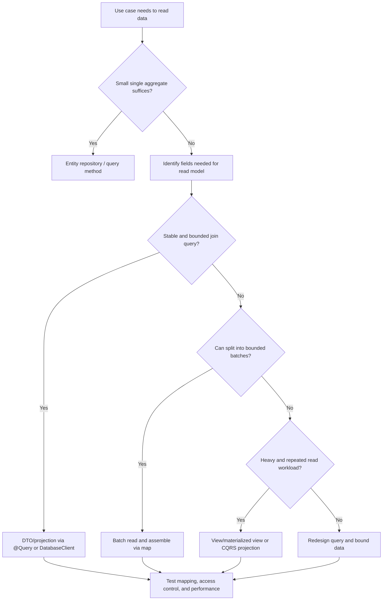

# Choosing a Dedicated Read Model When the Data Graph Is Too Complex

In Spring Data R2DBC, the write data model is typically organized around aggregate roots to protect business consistency boundaries. However, a screen or read API may require data from multiple aggregates, multiple tables, and multiple aggregations at once. Trying to reuse the write model's exact entity graph for every query easily leads to complex queries, over-fetching, excessive round trips, or hard-to-maintain object structures.

When the data graph for reading grows complex, consider creating a **dedicated read model**: a DTO, projection, or data structure tailored to the needs of each screen or use case. A read model can be populated via a SQL join, batched queries, `R2dbcEntityTemplate`, `DatabaseClient`, a database view, or a separately maintained projection.

The key is separating the write model from the read model. Aggregates remain responsible for enforcing business rules on state changes; read models combine information across aggregates to answer a specific read question without forcing the application to load and assemble the entire domain object graph.

## 1. Why Does a Large Data Graph Cause Friction?

Suppose a retail system has these data groups:

```text
Customer
  └── Orders
        └── OrderItems
              └── Product

Order
  ├── Payment
  ├── Shipment
  └── StatusHistory
```

An order detail page might need:

- Order number, creation date, and status.
- Customer name, email, and address.
- List of products, quantities, unit prices, and line totals.
- Payment and shipment status.
- Total amount, amount paid, and last updated timestamp.

This data may reside across multiple tables or aggregates. An `Order` entity does not need to embed every piece of information needed to render the entire detail page.

Building one massive object graph and loading it for every API leads to several issues:

1. **Over-fetching**: queries load many columns or relationships not needed by the current use case.
2. **Excessive round trips**: services call repositories one by one for each relationship.
3. **N+1 queries**: loading a parent list and querying children individually for each item.
4. **Mapping complexity**: join results contain duplicate column names, and one-to-many relationships multiply rows.
5. **Coupling**: API DTOs become tightly coupled to internal aggregate or entity shapes.
6. **Inconsistent snapshots**: separate queries executed at different moments may see different data states.

A dedicated read model defines the exact shape required for a read question rather than forcing an entity graph to serve as a one-size-fits-all structure.

## 2. Aggregates in Spring Data Relational and Limits of Automatic Relationship Loading

Spring Data Relational (covering Spring Data JDBC and Spring Data R2DBC) encourages aggregate-oriented design. An aggregate root is the entry point for operating on a group of objects sharing a business consistency boundary.

For example, `Order` can be an aggregate root containing `OrderItem`s belonging to the order. `Customer`, `Product`, `Payment`, and `Shipment` can be independent aggregates with their own lifecycles and rules.

In this model:

- The aggregate root manages members within its aggregate.
- References to other aggregates are typically expressed via IDs or reference keys.
- Aggregate boundaries define which operations require protection inside a business transaction.
- Read queries can combine multiple aggregates without altering write boundaries.

### 2.1. Do Not Treat Spring Data R2DBC Like JPA/Hibernate

Spring Data R2DBC does not provide a JPA/Hibernate-style persistence context with automatic lazy loading of associations. Do not expect declaring a relationship on an entity to make the framework automatically load the full object graph when calling a getter.

For example, if `Order` stores `customerId`, reading an `Order` does not automatically load `Customer`. The application must explicitly query the customer when the use case needs that data.

Similarly, do not design services assuming that reading a list of orders and calling `order.getItems()` will automatically issue a query to fetch items. In Spring Data Relational, explicitly specify what data is read and by which query.

### 2.2. Reading Multiple Aggregates Does Not Mean Merging Them into One Aggregate

A detail page may need data from `Order`, `Customer`, `Payment`, and `Shipment`. That is a read requirement. It is no reason to merge all those objects into one giant aggregate or let one entity own the lifecycles of the others.

Keep the write model aligned with business boundaries and build a dedicated read model for the screen. The read model can combine related data without altering how each aggregate writes and enforces consistency.

## 3. What Is a Read Model?

A read model is a data structure designed to answer a specific read use case. It is usually a DTO or projection, not necessarily an entity persisted directly in the database.

For example, an order list API may need only:

```java
public record OrderListItem(
        Long orderId,
        String orderNumber,
        String customerName,
        String status,
        BigDecimal totalAmount,
        LocalDateTime placedAt
) {
}
```

This read model can be built from `orders`, `customers`, and `order_items`. It does not need full `Customer`, `OrderItem`, `Payment`, or `Shipment` entities.

### 3.1. Read Models Are Usually Scoped per Use Case

A system can have multiple read models:

| Use Case | Possible Read Model |
| --- | --- |
| Order list | `OrderListItem` |
| Order details | `OrderDetailView` |
| Revenue dashboard | `RevenueSummary` |
| Customer search | `CustomerSearchResult` |
| Shipment tracking | `ShipmentTrackingView` |

There is no need for one catch-all DTO containing every field in the system. Each read model should have a purpose-driven name and hold only the fields required by its use case.

### 3.2. A Read Model Does Not Have to Be a Separate Table

There are several ways to build a read model:

- Direct SQL joins and projections from existing tables.
- A few batched queries assembled in the service.
- Database views or materialized views.
- Projection tables updated by events or synchronization workflows.
- Use-case-tailored caches.

Start with the simplest approach that satisfies latency, consistency, and operational requirements. Not every read model requires CQRS or a separate database.

## 4. Building a Read Model with Repository `@Query`

For queries with a stable shape, repository `@Query` methods can join multiple tables and return a DTO/projection directly.

Suppose the schema is:

```sql
CREATE TABLE customers (
    id BIGINT PRIMARY KEY,
    full_name VARCHAR(160) NOT NULL
);

CREATE TABLE orders (
    id BIGINT PRIMARY KEY,
    order_number VARCHAR(40) NOT NULL,
    customer_id BIGINT NOT NULL,
    status VARCHAR(30) NOT NULL,
    placed_at TIMESTAMP NOT NULL
);

CREATE TABLE order_items (
    id BIGINT PRIMARY KEY,
    order_id BIGINT NOT NULL,
    product_name VARCHAR(160) NOT NULL,
    quantity INTEGER NOT NULL,
    unit_price DECIMAL(18, 2) NOT NULL
);
```

List read model:

```java
public record OrderListItem(
        Long orderId,
        String orderNumber,
        String customerName,
        String status,
        BigDecimal totalAmount,
        LocalDateTime placedAt
) {
}
```

Query:

```java
public interface OrderReadRepository
        extends Repository<Order, Long> {

    @Query("""
           SELECT o.id AS order_id,
                  o.order_number AS order_number,
                  c.full_name AS customer_name,
                  o.status AS status,
                  COALESCE(SUM(i.quantity * i.unit_price), 0) AS total_amount,
                  o.placed_at AS placed_at
           FROM orders o
           JOIN customers c ON c.id = o.customer_id
           LEFT JOIN order_items i ON i.order_id = o.id
           WHERE o.status = :status
           GROUP BY o.id, o.order_number, c.full_name, o.status, o.placed_at
           ORDER BY o.placed_at DESC, o.id DESC
           """)
    Flux<OrderListItem> findOrderList(@Param("status") String status);
}
```

This example illustrates building a flat read model with a join and aggregation. Alias syntax, DTO/record mapping, and projection support depend on the Spring Data R2DBC version. Verify actual mapping behavior with integration tests on your project's version.

### 4.1. Why Use `LEFT JOIN` for Items?

`LEFT JOIN` preserves the order even when it has no item rows yet. `COALESCE(SUM(...), 0)` converts a null aggregate result to 0 when there are no items.

Using `INNER JOIN` would exclude orders with no items from the result. Pick the join type based on business semantics.

### 4.2. Why Is `GROUP BY` Required?

An order can have multiple item rows. Joining directly produces one row per item. When you want one read-model row per order, you must use an aggregate like `SUM` and `GROUP BY` all non-aggregated columns.

On databases with strict `GROUP BY` rules, list every non-aggregated column explicitly. Syntax and alias support inside `GROUP BY` vary by database engine.

### 4.3. Do Not Return Full Entities for a Summary Screen

`OrderListItem` carries only what the screen needs. It does not require Spring Data to assemble an `Order` nested with `Customer`, `OrderItem`, and `Payment`. This reduces coupling and makes the API reflect the query's actual data.

## 5. Using `DatabaseClient` for Finer Mapping Control

For complex queries or when explicit control over reading each column is desired, `DatabaseClient` lets you map `Row` to a DTO manually.

```java
public Flux<OrderListItem> findOrderList(String status) {
    return databaseClient.sql("""
            SELECT o.id AS order_id,
                   o.order_number AS order_number,
                   c.full_name AS customer_name,
                   o.status AS status,
                   COALESCE(SUM(i.quantity * i.unit_price), 0) AS total_amount,
                   o.placed_at AS placed_at
            FROM orders o
            JOIN customers c ON c.id = o.customer_id
            LEFT JOIN order_items i ON i.order_id = o.id
            WHERE o.status = :status
            GROUP BY o.id, o.order_number, c.full_name, o.status, o.placed_at
            ORDER BY o.placed_at DESC, o.id DESC
            """)
            .bind("status", status)
            .map((row, metadata) -> new OrderListItem(
                    row.get("order_id", Long.class),
                    row.get("order_number", String.class),
                    row.get("customer_name", String.class),
                    row.get("status", String.class),
                    row.get("total_amount", BigDecimal.class),
                    row.get("placed_at", LocalDateTime.class)
            ))
            .all();
}
```

Advantages of manual mapping:

- Makes clear which column maps to which property.
- Easy to handle aliases, data types, and computed columns.
- No need to force join results into an aggregate entity.
- Full control over nulls or special data formats.

In return, mapping code must be maintained when the SQL or DTO changes. Keep SQL and mappers close together, use clear aliases, and cover them with integration tests.

## 6. Batch Reading Instead of N+1 Queries

Not every read model suits one big join query. Another option is fetching a list of IDs first and loading related data in batches.

Poor example:

```java
return orderRepository.findRecentOrders()
        .flatMap(order -> customerRepository.findById(order.getCustomerId())
                .map(customer -> toListItem(order, customer)));
```

With 100 orders, this executes one list query plus roughly 100 customer lookups. That is the N+1 problem.

### 6.1. Batch Read Flow

A better approach:

1. Fetch a page of orders and their unique `customerId` values.
2. Load all needed customers in a single query by ID set.
3. Build a `customerId -> CustomerSummary` map in memory.
4. Pair each order with its customer summary to construct the read model.

Sketch example:

```java
public Mono<List<OrderListItem>> findRecentPage() {
    return orderRepository.findRecentPage()
            .collectList()
            .flatMap(orders -> {
                if (orders.isEmpty()) {
                    return Mono.just(List.of());
                }

                Set<Long> customerIds = orders.stream()
                        .map(Order::getCustomerId)
                        .collect(Collectors.toSet());

                return customerReadRepository.findByIds(customerIds)
                        .collectMap(CustomerSummary::id)
                        .map(customersById -> orders.stream()
                                .map(order -> toListItem(
                                        order,
                                        customersById.get(order.getCustomerId())))
                                .toList());
            });
}
```

`findByIds` is an illustrative method; it can be implemented with `R2dbcEntityTemplate` using an `IN` criterion, `DatabaseClient`, or a driver/database-appropriate query. Handle cases where a customer was deleted or is no longer accessible between steps.

### 6.2. Benefits and Limits of Batch Reading

Batch reading cuts round trips from one query per order down to one query per data group. It also keeps individual table queries relatively simple.

However, bound both page size and ID count per batch. Databases cap bind parameters and statement sizes. For huge ID sets, split into smaller batches.

### 6.3. Assembling Data in Memory

When combining results, build a map by key to avoid linear scans per order. Explicitly handle missing related data, access permissions, and null values.

Never use `collectList()` on an unbounded result set. Batch reading fits bounded pages or explicitly capped ID groups.

## 7. Handling One-to-Many Relationships in a Read Model

An order detail page usually needs a list of items. Joining `orders` with `order_items` produces multiple rows per order. Two common approaches exist:

- Return a flat DTO per result row if the API also consumes row-shaped data.
- Group rows by order ID into a nested DTO if the API needs an order with an item list.

### 7.1. DTO per Join Row

```java
public record OrderItemRow(
        Long orderId,
        String orderNumber,
        String customerName,
        Long itemId,
        String productName,
        Integer quantity,
        BigDecimal unitPrice
) {
}
```

SQL:

```sql
SELECT o.id AS order_id,
       o.order_number AS order_number,
       c.full_name AS customer_name,
       i.id AS item_id,
       i.product_name AS product_name,
       i.quantity AS quantity,
       i.unit_price AS unit_price
FROM orders o
JOIN customers c ON c.id = o.customer_id
LEFT JOIN order_items i ON i.order_id = o.id
WHERE o.id = :orderId
ORDER BY i.id;
```

### 7.2. Grouping Rows into a Nested DTO

Target DTOs:

```java
public record OrderItemView(
        Long itemId,
        String productName,
        Integer quantity,
        BigDecimal unitPrice
) {
}

public record OrderDetailView(
        Long orderId,
        String orderNumber,
        String customerName,
        List<OrderItemView> items
) {
}
```

If the query is sorted by `order_id`, consecutive rows for the same order can be grouped with `bufferUntilChanged`:

```java
return orderItemRowFlux
        .bufferUntilChanged(OrderItemRow::orderId)
        .map(rows -> {
            OrderItemRow first = rows.get(0);

            List<OrderItemView> items = rows.stream()
                    .filter(row -> row.itemId() != null)
                    .map(row -> new OrderItemView(
                            row.itemId(),
                            row.productName(),
                            row.quantity(),
                            row.unitPrice()))
                    .toList();

            return new OrderDetailView(
                    first.orderId(),
                    first.orderNumber(),
                    first.customerName(),
                    items);
        });
```

The query must include `ORDER BY o.id` so rows for the same order arrive consecutively. For an order with no items, `LEFT JOIN` produces a row with null `item_id`; the code filters that row out of the items list.

`bufferUntilChanged` buffers only the current group, though a large group still consumes memory. If a query returns many orders or an order has millions of items, paginate or fetch per order/batch instead of buffering everything.

## 8. Choosing One Join Query vs. Multiple Batch Queries?

Neither approach is universally better. The choice depends on data size, join complexity, round trips, consistency, and database optimization.

| Criterion | Single Join Query | Multiple Batch Queries |
| --- | --- | --- |
| Round trips | Usually fewer | More, though bounded per group |
| Mapping | Can get complex with one-to-many relationships | Each result is usually simpler to map |
| Repeated data | Can repeat parent entity columns on every child row | Avoids repeating parent data |
| SQL optimization | Database optimizes joins and aggregates | Service assembles results after reading |
| Result size | Can explode via row multiplication | Controllable per batch |
| Consistency | Single statement has database snapshot semantics | Multiple statements may observe data at different times |
| Best suited for | Clear joins/aggregates, bounded datasets | Complex relationships requiring separate queries per data type |

Measure with production-like data. One join query can outperform multiple queries; conversely, a massive join across multiple one-to-many branches can produce huge intermediate rows and consume excessive resources.

## 9. Paginating Read Models

List read models should always be bounded. Avoid returning an entire large table over a `Flux` merely because a reactive API can stream many items.

Example offset pagination:

```sql
SELECT o.id, o.order_number, c.full_name AS customer_name, o.status
FROM orders o
JOIN customers c ON c.id = o.customer_id
WHERE o.status = :status
ORDER BY o.placed_at DESC, o.id DESC
LIMIT :limit OFFSET :offset;
```

`ORDER BY` needs deterministic ordering. Add a unique key such as `o.id` as a tie-breaker to avoid non-deterministic ordering across rows sharing the same `placed_at`.

### 9.1. Offset Pagination

Offset pagination is simple for numbered-page UIs, but the database may have to scan and discard many rows at large offsets. Data mutations between reads can also cause rows to repeat or skip across pages.

### 9.2. Keyset Pagination

For large lists, keyset pagination uses the last values of the previous page as a cursor:

```sql
SELECT o.id, o.order_number, c.full_name AS customer_name, o.status,
       o.placed_at
FROM orders o
JOIN customers c ON c.id = o.customer_id
WHERE o.status = :status
  AND (o.placed_at, o.id) < (:lastPlacedAt, :lastId)
ORDER BY o.placed_at DESC, o.id DESC
LIMIT :limit;
```

Tuple comparison syntax above is supported by some databases, though not all. If unsupported, express the cursor predicate with equivalent branches:

```sql
AND (
    o.placed_at < :lastPlacedAt
    OR (o.placed_at = :lastPlacedAt AND o.id < :lastId)
)
```

The cursor must contain enough sort values to identify the next position uniquely. Validate cursors and cap `limit` on the server.

## 10. Read Models from Database Views or Materialized Views

When an expensive join/aggregate query runs frequently, consider a database view or materialized view.

### 10.1. Database Views

A view stores a query definition in the database. The application can query the view as a read source:

```sql
CREATE VIEW order_list_view AS
SELECT o.id AS order_id,
       o.order_number,
       c.full_name AS customer_name,
       o.status,
       COALESCE(SUM(i.quantity * i.unit_price), 0) AS total_amount,
       o.placed_at
FROM orders o
JOIN customers c ON c.id = o.customer_id
LEFT JOIN order_items i ON i.order_id = o.id
GROUP BY o.id, o.order_number, c.full_name, o.status, o.placed_at;
```

Repositories can read the view via queries or a dedicated mapping type. Standard views compute results at query time; they do not pre-store results.

### 10.2. Materialized Views

A materialized view stores precomputed results according to database-supported mechanisms. Reads can be faster, though data must be refreshed on a schedule or trigger. Thus, lag may exist between source data and the read model.

Consider:

- How often source data changes.
- Acceptable staleness tolerated by the business.
- Refresh cost and locking/impact on the database.
- Handling refresh failures.
- Indexing and pagination support on the view.

Not all databases support materialized views with identical semantics. Choose mechanisms supported by your actual database.

## 11. CQRS and Separately Maintained Read Models

When read and write requirements diverge significantly, CQRS (Command Query Responsibility Segregation) can apply:

- **Write model** handles commands and enforces business rules inside aggregates.
- **Read model** serves queries with structures tailored to screens, reports, or search.

A read model can be updated from domain events, outbox events, or sync pipelines. For instance, when an order is created, the system emits an `OrderCreated` event; a projection handler updates an `order_list_projection` table with the order and customer info needed by the list page.

```text
Command API
    |
    v
Write model / Aggregate
    |
    v
Database transaction + Outbox
    |
    v
Event publisher
    |
    v
Projection handler
    |
    v
Read model table
    |
    v
Query API
```

### 11.1. When Is CQRS Warranted?

CQRS is worth considering when:

- Queries involve heavy joins/aggregates and high call frequency.
- Read data shapes differ substantially from the write model.
- Eventual consistency is acceptable on certain screens.
- Read workloads must scale or optimize independently of write workloads.
- Multiple distinct projections serve different query patterns.

Do not adopt CQRS just to add layers of code. For a simple join query or DTO, repository `@Query` or `DatabaseClient` is usually sufficient.

### 11.2. Eventual Consistency

When a read model updates asynchronously from events, data can lag behind the write model for some interval. Immediately after a command succeeds, an instant query might not yet see the updated projection.

The application must clarify:

- Which screens tolerate stale data.
- Which screens must see freshly written data immediately.
- Whether to return a version/event ID so clients can track projection catch-up.
- Retry strategies and duplicate event handling.
- How to rebuild projections when schemas or read logic change.

For flows requiring immediate confirmation of written data, return the command result directly, read from the write model, or design explicit read-your-writes handling. Never assume an asynchronous projection updates instantaneously.

### 11.3. Idempotency and Event Ordering

Projection handlers must handle duplicate events safely. Store processed event IDs, use upserts keyed by projection ID, or design idempotent updates.

If event ordering matters, check aggregate versions or sequences. An older out-of-order event must never overwrite newer state in the read model.

## 12. Consistency When Combining Multiple Queries

When a read model assembles data from multiple queries, data may mutate between queries. For example:

1. First query reads an order with `status = 'PAID'`.
2. Another transaction updates the order to `CANCELLED`.
3. Subsequent query reads payment or shipment after that change.

The assembled result may reflect two different points in time.

If requirements demand a consistent snapshot, consider running queries in the same reactive transaction with an appropriate isolation level. Actual snapshot capabilities and isolation semantics depend on the database. A `READ COMMITTED` transaction allows successive statements to see newly committed writes between reads; `REPEATABLE READ` or snapshot isolation carries engine-specific semantics.

If read data tolerates lag, asynchronous projections can be used with eventual consistency clearly reflected in the API contract.

## 13. Choosing a Read Model by Complexity Level

| Need Complexity | Approach to Consider |
| --- | --- |
| Reading a single entity or small aggregate | Repository `findById`, derived query methods |
| Reading a few columns for one screen | DTO/projection |
| Stable join across a few tables | Repository `@Query` or `DatabaseClient` |
| Predicates and columns vary at runtime | `R2dbcEntityTemplate` or `DatabaseClient` |
| One-to-many needing nested DTO assembly | Flat join then group, or batch reads |
| Multiple related queries with bounded IDs | Batch read and assemble via maps |
| Heavy aggregate query reused repeatedly | View/materialized view after benchmarking |
| Heavy read workloads differing from writes, lag acceptable | CQRS / dedicated read projection |

Do not pick a model more complex than needed. One DTO for one endpoint does not require a projection table or event synchronization pipeline.

## 14. Common Mistakes When Designing Read Models

| Symptom | Possible Cause | How to Fix |
| --- | --- | --- |
| One API fires excessive queries | Querying each relationship per entity, causing N+1 | Join or batch-read by ID set |
| DTO carries many unused fields | Reusing one shared entity graph across all screens | Build per-use-case read models |
| Join returns duplicate parent instances | One-to-many relationship multiplies rows | Aggregate/group by parent key or batch query |
| Columns map to wrong fields | Join has colliding column names or missing aliases | Use unique aliases and flat DTOs |
| Query is too heavy | Joining multiple one-to-many branches or aggregating huge sets | Inspect execution plans, split queries, add indexes, or use projections |
| Read screen misses newly written data | Async read model has not updated yet | Define eventual consistency and read-your-writes rules |
| Combined results are inconsistent | Separate queries ran across different snapshots | Use suitable transactions/isolation or versioned projections |
| High memory spikes | Unbounded `collectList()` or grouping full result sets | Paginate, use small batches, and bound group sizes |
| Projections go stale after schema changes | No projection versioning/rebuild process | Add migrations and projection rebuild workflows |

## 15. Measure Before Separating Read Models

Before introducing a separate read structure, measure the current bottleneck:

- Queries executed per request.
- Total round trips and database wait time.
- Rows and columns fetched.
- Intermediate data size after joins.
- p50, p95, and p99 latencies.
- CPU, memory, connection pool, and database load.
- Cache hit ratio if caching is used.
- Staleness tolerance of the use case.

Once the new read model is in place, run the same workload and compare. Do not measure SQL execution time alone; measure mapping, data assembly, response serialization, and end-to-end API latency.

## 16. Example API Design for Order List and Order Details

A clean package organization might look like:

```text
order/
  domain/
    Order.java
    OrderItem.java
  write/
    OrderRepository.java
    OrderCommandService.java
  read/
    OrderListItem.java
    OrderDetailView.java
    OrderReadRepository.java
    OrderQueryService.java
```

Write side:

```java
public interface OrderRepository
        extends ReactiveCrudRepository<Order, Long> {
}
```

Read side:

```java
public interface OrderReadRepository {

    Flux<OrderListItem> findRecentOrders(
            Long tenantId,
            int limit);

    Mono<OrderDetailView> findDetail(
            Long tenantId,
            Long orderId);
}
```

Query service:

```java
@Service
public class OrderQueryService {

    private final OrderReadRepository readRepository;

    public OrderQueryService(OrderReadRepository readRepository) {
        this.readRepository = readRepository;
    }

    public Flux<OrderListItem> recentOrders(Long tenantId, int limit) {
        int safeLimit = Math.max(1, Math.min(limit, 100));
        return readRepository.findRecentOrders(tenantId, safeLimit);
    }

    public Mono<OrderDetailView> detail(Long tenantId, Long orderId) {
        return readRepository.findDetail(tenantId, orderId);
    }
}
```

These query interfaces illustrate separation of responsibilities. Implementations can use `@Query`, `DatabaseClient`, `R2dbcEntityTemplate`, or views. Capping page sizes in the service protects database and memory against oversized client limits.

## 17. Testing Read Models

Read models require integration tests against the database because joins, aggregates, aliases, data types, and SQL semantics depend on the real engine.

Cases to test:

1. Orders with one item and multiple items.
2. Orders with no items when using `LEFT JOIN`.
3. Missing customers or missing links in legacy data.
4. Multiple orders sharing identical timestamps with deterministic pagination.
5. Cross-tenant isolation preventing access outside tenant scope.
6. Aggregate totals computed accurately from quantity and unit price.
7. Queries without extra columns or colliding aliases causing mis-mapping.
8. Batch reads handling duplicate IDs and deleted IDs.
9. Transactions/isolation meeting snapshot expectations when combining queries.
10. Projections rebuilding or updating properly under duplicate and out-of-order events.

Example reactive test with `StepVerifier`:

```java
@DataR2dbcTest
class OrderReadRepositoryTest {

    @Autowired
    OrderReadRepository repository;

    @Test
    void shouldReturnOrderListWithCustomerAndTotal() {
        StepVerifier.create(repository.findRecentOrders(10L, 20))
                .assertNext(item -> {
                    assertThat(item.orderNumber()).isEqualTo("ORD-001");
                    assertThat(item.customerName()).isEqualTo("Lan Nguyen");
                    assertThat(item.totalAmount())
                            .isEqualByComparingTo("250.00");
                })
                .verifyComplete();
    }
}
```

Tests should prepare fixtures with deterministic data and item counts. If the read model uses projections or custom repository implementations, test configuration must load the corresponding beans and database schema.

## 18. Workflow for Choosing a Dedicated Read Model

1. Identify the read question that the endpoint or screen must answer.
2. List source data and aggregates without starting by loading the full entity graph.
3. Determine data volume, relationship cardinality, and pagination needs.
4. Design a DTO/projection with only the required output fields.
5. Choose a join query, batch read, view, or separate projection based on metrics and consistency needs.
6. Assign clear aliases to joined columns and map results into the read model.
7. Include tenant, access-control, and status predicates in the query.
8. Bound result sizes and prevent N+1 queries.
9. Define consistency guarantees when combining multiple queries or using asynchronous projections.
10. Write integration tests and measure latency, query count, and memory on production-like workloads.

## 19. Overall Decision Flow



## 20. Conclusion

When the data graph for reading becomes complex, design use-case-specific read models rather than forcing the write model's entity graph to serve every screen. Spring Data R2DBC does not automatically lazy-load relationships like JPA/Hibernate; applications must select data intentionally using repository queries, `@Query`, `DatabaseClient`, `R2dbcEntityTemplate`, or dedicated projections.

For stable join queries, DTOs/projections are usually the clearest choice. For reading multiple relationships, batch reading prevents N+1. For heavy, repetitive read workloads, views, materialized views, or CQRS projections can work well when data lag is acceptable and managed. Keep write aggregates aligned with business boundaries, cap result sizes, check consistency when combining queries, and benchmark on realistic workloads before adding architectural complexity.
