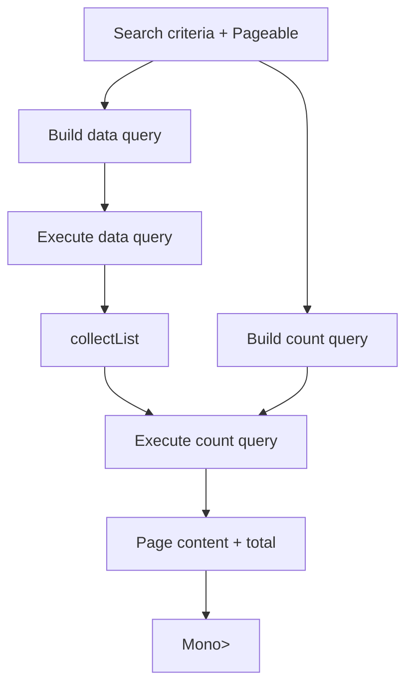

# Separating the Data Query from the Total Count Query

In pagination, an application often needs two different results: the list of records for the current page and the total number of records matching the search criteria. These two results are related but serve different purposes. The data query returns the rows to display; the total count query returns a single number to compute total pages, check for the last page, and show result counts.

In Spring Data Relational R2DBC, the two queries are typically executed separately because the application follows a reactive model. Fetching data can return `Flux<T>`, whereas the count query returns `Mono<Long>`. When the UI needs an exact total, the application combines both publishers to construct a `Mono<Page<T>>` or an equivalent result object.

Separating the two queries lets each part be optimized independently: the data query focuses on ordering, projection, and page bounds; the count query only counts rows matching the filter. However, both statements must represent the exact same logical dataset. If their filter conditions differ, pagination metadata will be inaccurate.

## 1. Why Are Both a Data Query and a Count Query Needed?

Suppose an order management screen displays 20 orders per page. A user filters by customer and status. To show "Page 2 of 8 — 153 orders", the application needs:

- The rows belonging to the current page, sorted and bounded by the page size.
- The total number of rows matching the filter, unbounded by the current page.

The data query might look like:

```sql
SELECT id, customer_id, status, created_at, total
FROM orders
WHERE customer_id = :customerId
  AND status = :status
ORDER BY created_at DESC, id DESC
LIMIT :limit OFFSET :offset;
```

The corresponding count query:

```sql
SELECT COUNT(*) AS total_count
FROM orders
WHERE customer_id = :customerId
  AND status = :status;
```

Key differences:

| Aspect | Data Query | Count Query |
| --- | --- | --- |
| Purpose | Returns rows for the current page. | Counts all rows matching the filter. |
| Projection | Columns to display or map to entities. | A single numeric value. |
| ORDER BY | Usually required for stable page ordering. | Usually not needed. |
| LIMIT/OFFSET | Present to bound the page. | Absent, since the full matching set must be counted. |
| JOIN | Keep only joins needed for data or filtering. | Unnecessary joins can be dropped, while preserving exact semantics. |
| Reactive return type | Typically `Flux<T>`. | Typically `Mono<Long>`. |

Never include `LIMIT` or `OFFSET` in the count query when the goal is the total result count. The `COUNT(*)` query must count the logical record set prior to pagination.

## 2. Distinguishing Total Records from Records on the Page

Three numbers commonly appear in pagination:

- **Total elements:** total number of rows matching the filter.
- **Page size:** maximum number of rows the application wants per page.
- **Number of elements:** actual number of rows present on the current page.

For example, with 153 total orders and page size 20, the last page has 13 rows:

| Property | Value |
| --- | ---: |
| Total elements | 153 |
| Page size | 20 |
| Total pages | 8 |
| Rows on last page | 13 |

Total pages is typically calculated as:

```java
long totalPages = (totalElements + pageSize - 1) / pageSize;
```

Alternatively, `Math.ceil` can be used after converting to floating-point, but the integer arithmetic above avoids floating-point rounding issues. Ensure `pageSize` is strictly greater than 0.

The number of rows on the current page cannot substitute for the total row count. If the first page returns 20 records, that does not mean the result set contains only 20 records. A separate count query supplies the required total.

## 3. Count Query Semantics Must Match the Data Query

The most important rule is that both queries must apply the same business filter conditions.

For example, a data query filtering orders by customer, statuses, and time range:

```sql
SELECT id, customer_id, status, created_at, total
FROM orders
WHERE customer_id = :customerId
  AND status IN (:statuses)
  AND created_at >= :from
  AND created_at < :to
ORDER BY created_at DESC, id DESC
LIMIT :limit OFFSET :offset;
```

The count query must apply the exact same filters:

```sql
SELECT COUNT(*) AS total_count
FROM orders
WHERE customer_id = :customerId
  AND status IN (:statuses)
  AND created_at >= :from
  AND created_at < :to;
```

The two statements may differ in projection, ORDER BY, and page limits. However, they must not differ in the conditions defining the result set.

If the data query adds `deleted_at IS NULL` while the count query forgets this condition, the total page count will include soft-deleted records. Users may encounter an empty last page or see more total pages than actually exist.

A good practice is defining the filter once at the application layer and reusing the same criteria object to bind parameters for both SQL statements. If the WHERE clause must be written in two separate SQL strings, write tests to catch cases where one side misses a condition.

## 4. Removing ORDER BY, LIMIT, and OFFSET from the Count Query

The count query normally does not need sorting because ordering does not affect the row count.

```sql
-- Data query
SELECT id, status, created_at
FROM orders
WHERE customer_id = :customerId
ORDER BY created_at DESC, id DESC
LIMIT :limit OFFSET :offset;

-- Count query
SELECT COUNT(*) AS total_count
FROM orders
WHERE customer_id = :customerId;
```

Keeping `ORDER BY` in a count query generally offers no benefit and can cause extra work. Likewise, never put `LIMIT` or `OFFSET` into the count query.

In some queries, `ORDER BY` sits inside a subquery because it affects row selection, such as queries using window functions or `FETCH FIRST` to pick one row per group. In such cases, you cannot mechanically strip every `ORDER BY` from the count query. Always count the exact logical result of the data query.

## 5. Counting Accurately When Queries Have JOINs

When the data query uses a JOIN, a single root record may appear multiple times in the intermediate result set. This commonly happens with one-to-many or many-to-many relationships.

For example, a product has multiple tags. Joining products with the tag mapping table can produce multiple rows for the same product:

```sql
SELECT p.id, p.name
FROM products p
JOIN product_tags pt ON pt.product_id = p.id
WHERE pt.tag_id IN (:tagIds);
```

If a product matches two tags in the list, it can appear twice. If the UI displays each product once, the data query needs `DISTINCT` or a different query structure to deduplicate:

```sql
SELECT DISTINCT p.id, p.name
FROM products p
JOIN product_tags pt ON pt.product_id = p.id
WHERE pt.tag_id IN (:tagIds)
ORDER BY p.name, p.id
LIMIT :limit OFFSET :offset;
```

The count query must count the same unit of results:

```sql
SELECT COUNT(DISTINCT p.id) AS total_count
FROM products p
JOIN product_tags pt ON pt.product_id = p.id
WHERE pt.tag_id IN (:tagIds);
```

Using `COUNT(*)` here would count post-JOIN rows rather than unique products. Total pages would be inflated above the actual product count.

### Using EXISTS to Avoid Row Multiplication

If the JOIN is only used to check whether a relationship exists, `EXISTS` can express the intent more directly:

```sql
SELECT p.id, p.name
FROM products p
WHERE EXISTS (
    SELECT 1
    FROM product_tags pt
    WHERE pt.product_id = p.id
      AND pt.tag_id IN (:tagIds)
)
ORDER BY p.name, p.id
LIMIT :limit OFFSET :offset;
```

Corresponding count query:

```sql
SELECT COUNT(*) AS total_count
FROM products p
WHERE EXISTS (
    SELECT 1
    FROM product_tags pt
    WHERE pt.product_id = p.id
      AND pt.tag_id IN (:tagIds)
);
```

Because the outer query still yields one row per product, `COUNT(*)` counts products accurately. `EXISTS` is not always faster than `JOIN`; inspect actual query plans and indexes.

### Preserving Filter Placement Between ON and WHERE

With `LEFT JOIN`, where a condition is placed changes the outcome. A condition in `ON` preserves unmatched left-side rows; a condition in `WHERE` can filter them out after the JOIN.

For example:

```sql
SELECT p.id, r.rating
FROM products p
LEFT JOIN reviews r
  ON r.product_id = p.id
 AND r.approved = TRUE;
```

Products without approved reviews still appear. If `r.approved = TRUE` is moved into `WHERE`, rows without reviews get filtered out. The count query must preserve the exact JOIN and predicate semantics, otherwise the total will not match the list.

## 6. Counting GROUP BY and HAVING Results

When a data query returns aggregated groups, the unit to count is the number of returned groups, not the number of source rows.

Example report of order count and total amount per customer:

```sql
SELECT
    customer_id,
    COUNT(*) AS order_count,
    SUM(total) AS total_amount
FROM orders
WHERE created_at >= :from
  AND created_at < :to
GROUP BY customer_id
HAVING SUM(total) >= :minimumTotal
ORDER BY total_amount DESC
LIMIT :limit OFFSET :offset;
```

The count query must count the groups matching `HAVING`. You cannot simply count rows in the `orders` table:

```sql
SELECT COUNT(*) AS total_count
FROM (
    SELECT customer_id
    FROM orders
    WHERE created_at >= :from
      AND created_at < :to
    GROUP BY customer_id
    HAVING SUM(total) >= :minimumTotal
) grouped_customers;
```

The subquery produces the exact set of groups the data query returns; the outer query counts the rows in that set. Subquery naming and structure can be adjusted, but filter conditions, `GROUP BY`, and `HAVING` must stay aligned.

If a query includes `DISTINCT`, window functions, or top-N-per-group selection, identify the exact result unit before writing the count query. Sometimes the count must wrap the entire logical result-producing query in a subquery. You cannot always replace the `SELECT` projection with `COUNT(*)` and drop the rest.

## 7. COUNT(*), COUNT(column), and COUNT(DISTINCT ...)

Counting expressions do not share identical semantics:

| Expression | What It Counts |
| --- | --- |
| COUNT(*) | Every row in the result set, including rows with NULL columns. |
| COUNT(column) | Rows where the `column` expression is not NULL. |
| COUNT(DISTINCT column) | Number of distinct, non-NULL values of `column`. |
| COUNT(DISTINCT a, b) | Multi-column distinct count syntax varies by database; do not assume portability. |

For typical pagination count queries, `COUNT(*)` is the natural choice when each row of the result set corresponds to one displayed item.

Use `COUNT(column)` when the business genuinely wants to count non-null occurrences in that column. If the column can be NULL, the result may be lower than the row count.

Use `COUNT(DISTINCT id)` when a JOIN multiplies rows for an entity while the screen displays each entity once. When multiple columns form the grouping key, consider wrapping the grouped query in a subquery rather than relying on vendor-specific multi-column distinct syntax.

## 8. Combining Both Queries in a Reactive Flow

A common implementation executes the data query and count query as two publishers, then combines the results.

- The data query returns `Flux<T>`; use `collectList()` to gather a single page's rows into `Mono<List<T>>`.
- The count query returns `Mono<Long>`.
- Combine both publishers using `Mono.zip` or sequential `flatMap`, then construct page metadata.

`Mono.zip` subscribes to both publishers and can run both SQL statements concurrently. This works when each query can acquire an independent connection and is not bound to the same connection within a transaction. If both statements share one connection via a reactive transaction context, execute them sequentially with `flatMap` unless the driver/database explicitly supports multiple concurrent statements on that connection.

Flow diagram:



`Page<T>` contains page content, `Pageable` information, and total element count. `PageImpl` itself is a synchronous metadata object; placing it inside a `Mono` ensures page construction happens only after both the data query and count query finish.

In reactive repositories, do not assume every method can return `Page<T>` like blocking repositories. Supported return types and pagination depend on the Spring Data API/version. When exact totals are needed, a custom repository method returning `Mono<Page<T>>` that explicitly combines two queries is a transparent implementation.

### Example with DatabaseClient

Suppose a screen searches products by status and price range. The data query uses `LIMIT`/`OFFSET` syntax common in PostgreSQL and MySQL:

```java
private static final String DATA_SQL = """
    SELECT p.id, p.name, p.status, p.price
    FROM products p
    WHERE p.status = :status
      AND p.price >= :minimum
      AND p.price <= :maximum
    ORDER BY p.created_at DESC, p.id DESC
    LIMIT :limit OFFSET :offset
    """;

private static final String COUNT_SQL = """
    SELECT COUNT(*) AS total_count
    FROM products p
    WHERE p.status = :status
      AND p.price >= :minimum
      AND p.price <= :maximum
    """;
```

Both statements apply identical status and price range conditions. The data query adds ordering and page limits; the count query only computes the total.

A custom repository fragment can be implemented as follows:

```java
import java.math.BigDecimal;
import java.util.Objects;
import java.util.UUID;

import org.springframework.data.domain.Page;
import org.springframework.data.domain.PageImpl;
import org.springframework.data.domain.Pageable;
import org.springframework.r2dbc.core.DatabaseClient;

import reactor.core.publisher.Mono;

public class ProductSearchRepositoryImpl {

    private final DatabaseClient databaseClient;

    public ProductSearchRepositoryImpl(DatabaseClient databaseClient) {
        this.databaseClient = databaseClient;
    }

    public Mono<Page<ProductSummary>> search(
            ProductSearchCriteria criteria,
            Pageable pageable) {

        if (!pageable.isPaged()) {
            return Mono.error(
                new IllegalArgumentException("A paged request is required")
            );
        }

        var dataQuery = databaseClient.sql(DATA_SQL)
            .bind("status", criteria.status().name())
            .bind("minimum", criteria.minimum())
            .bind("maximum", criteria.maximum())
            .bind("limit", pageable.getPageSize())
            .bind("offset", pageable.getOffset())
            .map((row, metadata) -> new ProductSummary(
                row.get("id", UUID.class),
                row.get("name", String.class),
                row.get("status", String.class),
                row.get("price", BigDecimal.class)
            ))
            .all()
            .collectList();

        var countQuery = databaseClient.sql(COUNT_SQL)
            .bind("status", criteria.status().name())
            .bind("minimum", criteria.minimum())
            .bind("maximum", criteria.maximum())
            .map((row, metadata) ->
                Objects.requireNonNull(
                    row.get("total_count", Long.class)
                )
            )
            .one();

        return dataQuery.flatMap(content ->
            countQuery.map(total -> new PageImpl<>(
                content,
                pageable,
                total
            ))
        );
    }
}
```

This illustrative example assumes `DATA_SQL`, `COUNT_SQL`, `ProductSearchCriteria`, and `ProductSummary` are declared in the appropriate scope. `ProductSearchCriteria.status` is an enum stored by name in a `VARCHAR` column; hence the code binds `status.name()`. Status and price range values are required; if they can be NULL, clarify semantics and use `bindNull` with the appropriate data type.

`pageable.getOffset()` returns the offset as a `long`; `getPageSize()` returns the maximum rows per page. SQL uses named parameters via `DatabaseClient` so Spring translates them into driver-appropriate bind markers. `LIMIT`/`OFFSET` syntax remains database-dependent; for SQL Server or other engines, row limiting requires an appropriate implementation. The example uses `flatMap` to run the two queries sequentially, which works even when sharing a connection inside a transaction. If no transaction is needed and parallel execution is desired, consider `Mono.zip` when `ConnectionFactory` provides an independent connection per query.

## 9. When Total Count Is Not Needed: Use Slice or hasNext

Not every screen needs to know the total number of records. If the UI only needs a "Next" button or infinite scroll, running a count query on every request can create unnecessary overhead.

In that case, use the `Slice` pattern. A `Slice` only needs to know whether a next page follows the current page. A simple implementation fetches one row more than the page size:

```sql
SELECT id, status, created_at
FROM orders
WHERE customer_id = :customerId
ORDER BY created_at DESC, id DESC
LIMIT :limitPlusOne OFFSET :offset;
```

If page size is 20, the query fetches at most 21 rows:

- At most 20 rows: no next page exists.
- 21 rows: a next page exists; discard the 21st row from the returned content.
- No count query needs to run.

Example processing the fetched list:

```java
List<OrderSummary> rows = fetchedRows;

boolean hasNext = rows.size() > pageable.getPageSize();

List<OrderSummary> content = hasNext
    ? rows.subList(0, pageable.getPageSize())
    : rows;

Slice<OrderSummary> slice =
    new SliceImpl<>(content, pageable, hasNext);
```

In a reactive repository, you can return `Mono<Slice<OrderSummary>>` after collecting a `Flux` of at most `page size + 1` rows. This saves a count query, though it does not provide total pages or total elements.

| UI Requirement | Suitable Approach |
| --- | --- |
| Display total results and total pages | `Page` with an exact count query. |
| Only need to know if more data follows | `Slice` with page size plus one row. |
| Continuous scrolling on large datasets | Keyset/cursor pagination, usually without total count. |
| Total count is purely informational | Cached/estimated figures may be used if business permits and semantics are documented. |

Do not run a count query just because a UI component has a default placeholder for totals. Verify whether users and the business truly need an exact count.

## 10. Cost and Optimization of Count Queries

A count query can be more expensive than fetching a single page, especially when filters have low selectivity or involve JOIN, DISTINCT, GROUP BY, and HAVING.

Optimization directions:

- Remove unnecessary `ORDER BY` clauses from the count query.
- Remove JOINs used only to fetch display columns if they do not affect filter conditions or row multiplicity.
- Use `EXISTS` instead of `JOIN` when only checking relationship existence with equivalent semantics.
- Use `COUNT(DISTINCT id)` when the display result is unique entities after a JOIN.
- Create indexes matching filter conditions and join keys.
- Keep the count query as simple as possible while still counting the exact logical result set.
- Measure execution plans with realistically distributed data.

For example, the data query needs to JOIN the customers table to fetch the display name:

```sql
SELECT o.id, o.status, o.created_at, c.display_name
FROM orders o
JOIN customers c ON c.id = o.customer_id
WHERE o.status = :status
ORDER BY o.created_at DESC, o.id DESC
LIMIT :limit OFFSET :offset;
```

If counting only filters by status and the `customer_id` foreign key is always valid thanks to a foreign key constraint, the customer JOIN may not be needed:

```sql
SELECT COUNT(*) AS total_count
FROM orders o
WHERE o.status = :status;
```

Only drop a JOIN when it does not affect filter criteria or result set multiplicity. If the data query uses `INNER JOIN` to exclude orders without a valid customer, or filters by a customer attribute, the count query must retain the equivalent condition.

### Indexes for Count Queries

A count query still has to locate matching rows. Indexes on filter columns can help the database read less data, though there is no rule that merely adding an index always makes counts fast.

Common filter example:

```sql
WHERE customer_id = :customerId
  AND status = :status
```

Consider a composite index on `(customer_id, status)` if it aligns with frequent queries. Column order, selectivity, number of distinct values, and other queries all affect index choices. Check query plans rather than relying solely on WHERE structure.

For count distinct or grouped counts, the database may need to sort or hash to deduplicate/group data. Measure these queries separately; a simple single-table count does not represent the cost of every count query.

## 11. Consistency When Two Queries Run Separately

The data query and count query are two separate statements. If data changes between the moments they read the database, page content and total count may not align strictly.

For example:

1. Data query reads 20 orders.
2. Another transaction inserts 5 matching orders.
3. Count query runs afterward and returns the new total.

The current page reflects an earlier point in time, while the total reflects a later point. The reverse can also happen if records are deleted between the two statements.

This is a consequence of isolation levels and how the database provides snapshots. If the UI tolerates counts shifting over time, this behavior is usually acceptable. If the business requires page content and total count to be consistent under the same snapshot, run both queries in the same transaction with a suitable isolation level.

In reactive Spring, transactions can be managed via `TransactionalOperator` or reactive transaction configuration matching the `ConnectionFactory`:

```java
return transactionalOperator.transactional(
    searchRepository.search(criteria, pageable)
);
```

This example assumes the `search` method executes both queries within the transaction context propagated through the Reactor context. Merely opening a default transaction does not automatically guarantee a consistent snapshot across every database; choose the right isolation level and check RDBMS semantics. For instance, `READ COMMITTED` can yield a fresh snapshot per statement in some databases, whereas `REPEATABLE READ` generally offers more stable snapshot semantics at its own cost and constraints.

Do not elevate isolation levels for every paginated query without evaluating load, locks, and contention risk. Use higher levels only when business requirements demand that consistency.

## 12. Handling Empty Pages and Boundary Values

The count query also helps handle zero-result cases or out-of-range page requests properly.

| Scenario | Data Query | Count Query | Expected Result |
| --- | --- | --- | --- |
| No rows match filter | No rows | Returns 0 | Empty page, total is 0. |
| First page has data | Returns up to page size | Returns matching total | Page with content and metadata. |
| Last page smaller than page size | Returns remaining rows | Returns matching total | Last page has fewer rows than page size. |
| Offset past the last row | No rows | Still returns total | Empty page, yet total remains accurate. |
| Invalid or malformed filter | May not run query | May not run query | Return validation error per API contract. |

Rules to enforce before querying:

- Page number must not be negative.
- Page size must be greater than 0.
- Page size should have a maximum cap to prevent clients from asking for too many rows.
- Compute offset with a sufficiently wide type; `Pageable.getOffset()` returns `long`.
- Sorting must be deterministic and should include a unique key tie-breaker.
- Validate lower/upper bounds and filter lists prior to binding.

If the requested page exceeds the total, do not treat it as a database error. Returning an empty page alongside the total count is a valid outcome; the API can decide on appropriate presentation.

## 13. Reusing Filter Conditions Without Two Sources of Truth

A common maintenance bug is having data SQL and count SQL hold two copies of a WHERE clause that evolve independently over time. When adding a filter, a developer updates the data query but forgets the count query.

Reduce this risk by using a single criteria object and a shared parameter-binding function:

```java
public record OrderSearchCriteria(
    Long customerId,
    OrderStatus status,
    LocalDateTime from,
    LocalDateTime to
) {}
```

Shared binding helper:

```java
private DatabaseClient.GenericExecuteSpec bindCriteria(
        DatabaseClient.GenericExecuteSpec spec,
        OrderSearchCriteria criteria) {

    return spec
        .bind("customerId", criteria.customerId())
        .bind("status", criteria.status().name())
        .bind("from", criteria.from())
        .bind("to", criteria.to());
}
```

Both the data query and count query call this helper, then each binds limit/offset if needed. This example assumes all criteria fields are required and non-null. If optional filters exist, bind via explicit branches or build appropriate SQL statements; never call `.bind` with null.

For dynamic SQL, construct a filter object containing a WHERE clause built from allowed choices and a parameter map. Never concatenate raw user input into SQL. If sharing a WHERE fragment, ensure the appended SQL contains only application-controlled syntax and all values remain bound.

Sharing an entire SQL string between data and count is not necessary. The two statements differ in projection and structure. What must be shared is the definition of the result set: filters, access controls, soft-delete rules, and relational logic.

## 14. Testing Data Queries and Count Queries

Do not test only the data query or only the total value. Integration tests must prove that both queries describe the same result set and produce accurate page metadata.

Cases to verify:

| Case | What to Verify |
| --- | --- |
| More rows than page size | Data query returns at most page size rows; total count exceeds page row count. |
| Last page | Data query returns remaining rows; count still reflects overall total. |
| No results | Data query is empty; count returns 0; `Page` is still constructed. |
| Offset beyond total | Content is empty while total count remains accurate. |
| One-to-many JOIN | Count does not multiply rows by child relationships when each entity is displayed once. |
| DISTINCT | Count accurately counts distinct rows returned by the data query. |
| GROUP BY/HAVING | Count counts groups remaining after HAVING. |
| Optional filters | Both data and count apply every selected filter. |
| Soft delete or tenant filter | Count obeys the exact same authorization and soft-delete conditions. |
| Concurrent data changes | Consistency behavior matches isolation level and business requirements. |

Example test for a page with total count:

```java
@Test
void returnsPageWithMatchingContentAndTotal() {
    Pageable pageable = PageRequest.of(0, 2);

    StepVerifier.create(
            searchRepository.search(criteria, pageable)
        )
        .assertNext(page -> {
            assertEquals(2, page.getContent().size());
            assertEquals(5, page.getTotalElements());
            assertEquals(3, page.getTotalPages());
        })
        .verifyComplete();
}
```

The example assumes test fixtures created exactly five matching records and the query has stable ordering. Also verify the specific items on the page, not just sizes and totals.

For JOINs with multiple child rows, set up data where one entity matches multiple related rows. Tests will catch bugs if count uses `COUNT(*)` while the data query uses `DISTINCT`.

For `GROUP BY`, seed multiple source rows yielding fewer groups than rows. Verify count returns the number of groups after `HAVING`. This catches the common bug of simply swapping projection for `COUNT(*)`.

### Testing Count Independently

If a count query can be reused, test it independently across diverse filters:

- A customer with multiple orders.
- A customer with no orders.
- Multiple different statuses.
- A date range containing no data.
- Combined filters yielding an empty result.
- Soft-deleted rows or rows outside the current tenant.

When verifying the SQL sent to the database, enable query logging in the test environment or use query inspection tools. Avoid asserting on exact generated SQL strings if what needs verification is semantics and outcomes; generated SQL may change across framework versions without changing behavior.

## 15. Common Mistakes When Separating Count Queries

| Mistake | Consequence | Fix |
| --- | --- | --- |
| Count query keeps LIMIT/OFFSET | Total reflects only a slice of data. | Remove page bounds from the count query. |
| Count query misses a WHERE predicate | Total pages disagree with content. | Share criteria and test each filter. |
| Using COUNT(*) after one-to-many JOIN | Counts joined rows instead of unique entities. | Use COUNT(DISTINCT id) or EXISTS. |
| Counting source rows when data query returns groups | Total exceeds displayed group count. | Count a subquery containing GROUP BY/HAVING. |
| Count query keeps unnecessary ORDER BY | May cause extra sorting or wasted work. | Drop ORDER BY that doesn't affect semantics. |
| Count query drops a filtering JOIN | Counts rows excluded by the data query. | Keep equivalent filtering, possibly converting to EXISTS. |
| Data and count use different parameter bindings | Wrong page metadata or binding errors. | Use a shared criteria object and binder. |
| Always running count when UI doesn't need total | Increases database load and latency. | Use Slice or keyset pagination. |
| Assuming two queries always read the same snapshot | Total and content can diverge when data mutates. | Choose transaction/isolation based on consistency needs. |
| Testing only with mocks | Misses SQL errors, join multiplicity, or mapping bugs. | Run integration tests against a real database. |

## 16. Choosing the Count Mechanism Based on Repository Contract

Not every query needs the same counting strategy.

- Simple single-table query: use `COUNT(*)` with identical filters.
- JOIN query returning unique entities: use `COUNT(DISTINCT primary_key)` or `EXISTS` where suitable.
- Grouped query: count rows of a subquery containing `GROUP BY` and `HAVING`.
- Query with top-N selection or window functions: count the logical result after selection.
- Screen needing only whether a next page exists: omit count and use `Slice`.
- Large dataset queries with cursors: consider keyset pagination instead of offset and total count.

Spring Data R2DBC and its versions may offer varying levels of support for query methods, pagination, and declarative annotations. Do not assume all `countQuery` features from Spring Data JPA exist and behave identically in R2DBC. Check the API for your exact dependency version. When separate control over two SQL statements or complex count semantics is needed, a custom repository fragment using `DatabaseClient` is transparent.

## 17. Workflow for Implementing Two-Query Pagination

When implementing an endpoint requiring an exact total, follow this sequence:

1. **Identify the result unit:** entity, projection, or aggregated group.
2. **Define filters:** including access control, tenant, soft delete, status, and date ranges.
3. **Write the data query:** select needed columns, deterministic ordering, limit, and offset.
4. **Write the count query:** count the same logical set, omitting unnecessary sorting and page limits.
5. **Handle JOINs:** determine whether rows multiply; pick `COUNT DISTINCT` or `EXISTS` when needed.
6. **Handle GROUP BY:** count groups after `HAVING` using a subquery.
7. **Bind shared criteria:** reuse parameter bindings for both queries.
8. **Compose reactively:** gather page data and count using sequential `flatMap` or `Mono.zip` when both queries use independent connections, then build the `Page`.
9. **Consider Slice:** omit count if the UI only needs `hasNext`.
10. **Test and measure:** verify page boundaries, totals, query plans, and behavior under concurrent data changes.

Separating the data query from the total count query keeps reactive pagination clear and independently optimizable. The data query is responsible for fetching the right page rows; the count query is responsible for counting the right logical result set before pagination. When both statements share the same filters, handle JOIN multiplicity and aggregated groups properly, and are tested against a real database, page metadata will accurately reflect the data users are viewing.
