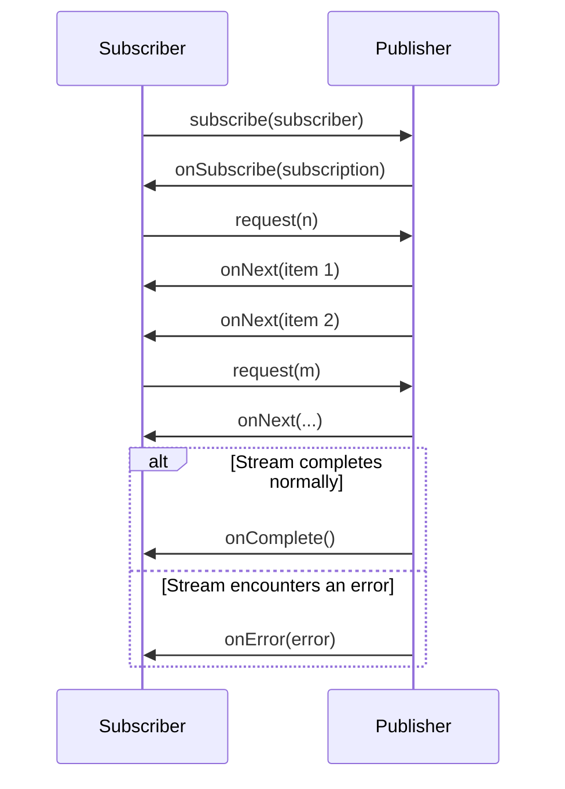

# Reactive Streams and the Roles of Publisher, Subscriber, and Subscription

## 1. What Problem Does Reactive Streams Solve?

When an application reads data from a database, results can arrive as a stream of multiple items. If the application receives data faster than it can process it, items can accumulate in memory. If the application has to wait synchronously for each I/O operation to finish, the execution thread can remain tied up waiting on the network or database.

Reactive Streams is a specification for exchanging an asynchronous stream of data between a producer and a consumer. It defines a standard protocol for both sides to coordinate when data, errors, completion, and demand are signaled. The most important mechanism in the protocol is **backpressure**: the consumer can signal in advance how many items it is ready to receive.

In Spring Data Relational R2DBC, reactive data-access APIs typically return Project Reactor's `Mono<T>` or `Flux<T>`. Both types implement the Reactive Streams `Publisher<T>` interface. Thus, a repository call can return a publisher representing a query result; the publisher coordinates with a subscriber once someone subscribes and requests data.

Reactive Streams is a communication specification, not a database library or a new way to write SQL. R2DBC provides the reactive database access SPI; an R2DBC driver handles communication with the database system; Spring Data R2DBC provides abstractions such as repositories and templates; Reactor provides `Mono`, `Flux`, and operators for composing data streams.

## 2. Four Core Concepts in the Reactive Streams Model

The Reactive Streams specification defines four core interfaces in the `org.reactivestreams` package:

| Interface | Role | Question It Answers |
| --- | --- | --- |
| `Publisher<T>` | The party capable of emitting items of type `T` | Who supplies the data? |
| `Subscriber<T>` | The party that subscribes and receives signals from a publisher | Who consumes the data? |
| `Subscription` | Represents a specific subscription relationship; enables requesting or canceling data | How much does the subscriber want, and does it want to stop? |
| `Processor<T, R>` | Acts as both a subscriber of `T` and a publisher of `R` | Who receives data, transforms it, and emits it onward? |

In this lesson, the focus is on `Publisher`, `Subscriber`, and `Subscription`, because those three components form the fundamental protocol of a data stream.

### 2.1. Publisher — The Data Producer

`Publisher<T>` describes a source that can emit zero, one, or more items of type `T` to a subscriber. Its core interface has one method:

```java
public interface Publisher<T> {
    void subscribe(Subscriber<? super T> subscriber);
}
```

A publisher does not need to know where the subscriber will store the data or how it will display it. It only needs to obey the Reactive Streams protocol: signal subscription, emit items within the bounds of requested demand, and terminate normally or with an error.

In Spring Data R2DBC, a publisher is typically created from a read or write operation. For example, with a repository extending `ReactiveCrudRepository`:

```java
public interface PersonRepository
        extends ReactiveCrudRepository<Person, Long> {
}
```

The following methods return publishers:

```java
Flux<Person> allPeople = personRepository.findAll();
Mono<Person> onePerson = personRepository.findById(42L);
Mono<Person> savedPerson = personRepository.save(person);
```

`Flux<T>` is a publisher that can emit from 0 to many items. `Mono<T>` is a publisher that can emit at most one item. A `Mono` can also complete without emitting any item, such as when `findById` finds no matching record.

A publisher is not synonymous with its own dedicated thread. Reactive Streams specifies how signals are transmitted and demand is regulated; it does not require every publisher to spawn a new thread or always emit on a specific thread. Whether execution is synchronous or asynchronous, and which thread handles signals, depends on the publisher, driver, and operators used.

### 2.2. Subscriber — The Data Consumer

`Subscriber<T>` receives signals from a publisher. The interface has four callbacks:

```java
public interface Subscriber<T> {
    void onSubscribe(Subscription subscription);
    void onNext(T item);
    void onError(Throwable throwable);
    void onComplete();
}
```

Meaning of each callback:

- `onSubscribe(subscription)`: the publisher notifies the subscriber that it is subscribed and supplies the object controlling that subscription relationship.
- `onNext(item)`: the publisher emits an item. One subscription can receive multiple `onNext` calls.
- `onError(throwable)`: the publisher signals that the stream terminated due to an error. This is a terminal signal.
- `onComplete()`: the publisher signals that the stream has finished normally. This is also a terminal signal.

The subscriber typically decides how to process each item. For instance, a subscriber might log the item, transform it, store it in a data structure, or forward the result to another component. The subscriber is also responsible for requesting data via the `Subscription` received in `onSubscribe`.

A subscriber can receive only one of the two terminal signals: `onComplete` or `onError`. After a terminal signal, the publisher must not emit further `onNext` calls or another terminal signal for that subscription.

### 2.3. Subscription — Flow Control Handle

A `Subscription` is passed to the subscriber by the publisher in `onSubscribe`. This interface has two methods:

```java
public interface Subscription {
    void request(long n);
    void cancel();
}
```

`request(n)` signals demand for up to `n` additional items. `cancel()` asks the publisher to stop emitting data for the current subscription.

A `Subscription` belongs to a specific subscription instance. If two subscribers subscribe to the same publisher, each subscription gets its own `Subscription`. Each subscriber can request different numbers of items or cancel at different times.

Demand accumulates across `request` calls. For example, `request(2)` followed by `request(3)` creates a total demand of 5 items, assuming no items were emitted in between. `Long.MAX_VALUE` is conventionally used to signify effectively unbounded demand. Calling `request` with zero or a negative number violates the protocol; the publisher must terminate the stream via `onError` with an `IllegalArgumentException`.

`cancel()` is a cancellation request. A subscriber can call it when it no longer needs data—for instance, when a user closes an HTTP connection or an operator only needs a fixed number of items. Stopping underlying resources may take time to finish; applications should not assume every in-flight operation disappears instantaneously at the exact moment `cancel()` is called.

### 2.4. Processor — An Intermediate Component

`Processor<T, R>` combines the roles of subscriber and publisher: it receives items of type `T`, processes them, and can emit items of type `R`. This concept is useful when building an intermediate pipeline stage. In typical Spring Data R2DBC applications, developers usually use Reactor operators like `map`, `filter`, and `flatMap` rather than implementing `Processor` manually.

## 3. Lifecycle Sequence of a Subscription

A publisher and subscriber interact following this general sequence:



The sequence should be understood as follows:

1. The subscriber calls `publisher.subscribe(this)` to register for data.
2. The publisher calls `onSubscribe` and passes a subscription. This must be the first signal the subscriber receives from the publisher.
3. The subscriber calls `subscription.request(n)` to declare demand. Until the subscriber requests items, the publisher is not permitted to emit `onNext`.
4. The publisher emits no more than the number of requested items. Each item is delivered via `onNext`.
5. The subscriber can request additional data during or after processing an item. New demand is added to remaining demand.
6. When no more data remains, the publisher calls `onComplete`. If an error occurs, the publisher calls `onError`. Both terminate the subscription.

A publisher may emit signals synchronously inside the `subscribe` call, or later depending on the implementation. Therefore, application code should not rely on the assumption that `subscribe` always returns before the first callback fires.

Signals on a single subscription must be serialized: the subscriber must not receive overlapping signal callbacks in a way that breaks protocol ordering. Still, do not infer that the entire application runs on a single thread; different subscriptions and different parts of a pipeline may execute on different threads.

## 4. Backpressure: Subscriber-Controlled Emission Rate

Backpressure is the subscriber's ability to control how much data a publisher is allowed to emit. This helps the system respond when the consumer processes items more slowly than the producer generates them.

Suppose a publisher has 1,000 records. If the subscriber requests only 10 items, the publisher may emit at most 10 items via `onNext` until it receives more demand. Once the subscriber finishes processing an item and calls `request(1)`, demand increases by one item.

Example of a subscriber requesting one item at a time:

```java
import org.reactivestreams.Subscriber;
import org.reactivestreams.Subscription;

public final class OneAtATimeSubscriber<T> implements Subscriber<T> {

    private Subscription subscription;

    @Override
    public void onSubscribe(Subscription subscription) {
        this.subscription = subscription;
        subscription.request(1);
    }

    @Override
    public void onNext(T item) {
        System.out.println("Received: " + item);
        subscription.request(1);
    }

    @Override
    public void onError(Throwable error) {
        System.err.println("Stream failed: " + error.getMessage());
    }

    @Override
    public void onComplete() {
        System.out.println("Stream completed");
    }
}
```

When this subscriber registers with a publisher, it requests one item in `onSubscribe`. After receiving and processing that item, it requests another item in `onNext`. This clearly demonstrates subscriber-driven demand control. In real applications, a subscriber also needs to handle errors and subscription cancellation in accordance with task lifecycles.

Backpressure does not mean the database is guaranteed to read strictly one row per `request(1)`. The driver may prefetch a batch of rows, use buffers, or employ its own fetch mechanism depending on the protocol and implementation. Operators in the pipeline can also have their own prefetch sizes. Reactive Streams governs the number of items emitted under the protocol; low-level data reading from the server is determined by the driver and underlying layers.

Backpressure also does not replace SQL query limits. If a business requirement is to retrieve only 20 records, express that limit in the query or via an appropriate API. `take(20)` can stop the stream after 20 items by canceling upstream, but by itself it does not necessarily turn a SQL query into `LIMIT 20`.

## 5. Reactive Streams in Spring Data R2DBC

Spring Data R2DBC brings the Reactive Streams protocol into data-access APIs via Reactor. Common return types include:

| Return Type | Maximum Items | Example Operation |
| --- | ---: | --- |
| `Mono<Person>` | 1 | Find a person by ID, save an entity |
| `Flux<Person>` | No fixed limit | Read a list of people, run a multi-row query |
| `Mono<Void>` | 0 | Complete an operation returning no entity, such as delete |

Example repository:

```java
public interface PersonRepository
        extends ReactiveCrudRepository<Person, Long> {
}
```

Calling `findAll` returns a `Flux<Person>`. Calling `findById` returns a `Mono<Person>`:

```java
Flux<Person> people = personRepository.findAll();
Mono<Person> person = personRepository.findById(42L);
```

These variables hold publishers. With Spring Data R2DBC reactive sources, the data-access operation typically runs when the publisher is subscribed to. Simply calling `findAll()` and discarding the publisher usually does not execute the query. A framework such as Spring WebFlux can subscribe to the publisher returned by a controller while handling an HTTP request.

Example controller returning publishers to WebFlux:

```java
@RestController
@RequestMapping("/people")
public class PersonController {

    private final PersonRepository repository;

    public PersonController(PersonRepository repository) {
        this.repository = repository;
    }

    @GetMapping
    public Flux<Person> findAll() {
        return repository.findAll();
    }

    @GetMapping("/{id}")
    public Mono<Person> findById(@PathVariable Long id) {
        return repository.findById(id);
    }
}
```

The controller does not need to call `subscribe()` itself. WebFlux receives the returned publisher, manages the subscription across the HTTP lifecycle, and writes items to the response. When the client disconnects, the framework can cancel the subscription to signal upstream that it no longer needs to keep emitting data.

### 5.1. Composing Multiple Operations Without Blocking Threads

Publishers can be composed into a pipeline. For example, finding an entity, updating it, and saving it back:

```java
public Mono<Person> renamePerson(Long id, String newName) {
    return personRepository.findById(id)
            .flatMap(person -> {
                person.setName(newName);
                return personRepository.save(person);
            });
}
```

`flatMap` receives the entity from `findById`, invokes the save operation, and merges the resulting publisher into the pipeline. The entire chain remains represented as a `Mono<Person>`. There is no need to extract the result with `block()` before calling `save`.

Common operators:

- `map`: transforms each item into another value without creating nested publishers.
- `flatMap`: transforms an item into a publisher and merges that publisher's results into the stream.
- `concatMap`: executes inner publishers sequentially in order, useful when sequential ordering must be preserved.
- `filter`: passes through only items matching a predicate.
- `switchIfEmpty`: provides an alternative publisher if the source completes without emitting an item.
- `onErrorResume`: switches to another publisher upon a matching error.
- `retryWhen`: re-subscribes to the source according to a retry policy; use caution because write operations might be re-executed.
- `take(n)`: forwards at most `n` items and then cancels the upstream source.

These operators still produce publishers. When a subscriber is attached at the end of the pipeline, demand and signals flow through the operators toward the source as implemented by each operator.

### 5.2. Errors Are Stream Signals

In Reactive Streams, errors are delivered via `onError` and terminate the current subscription. With Reactor, errors can be handled with operators such as `onErrorReturn`, `onErrorResume`, or `retryWhen`:

```java
public Mono<Person> findPersonOrDefault(Long id) {
    return personRepository.findById(id)
            .switchIfEmpty(Mono.error(
                    new IllegalArgumentException("Person not found: " + id)
            ))
            .onErrorResume(DatabaseException.class, error -> {
                // Choose a handling strategy appropriate for the business logic.
                return Mono.empty();
            });
}
```

In this example, `switchIfEmpty` handles the case where no record exists; `onErrorResume` handles a specific error type. Distinguish between a publisher that completes normally with no items and a publisher that terminates with an error.

Retries typically create a new subscription to the source. For read queries, re-running may be acceptable depending on the situation. For write operations, consider idempotency and whether the previous attempt may have already committed in the database before automatically retrying.

### 5.3. Subscription Cancellation and Request Lifecycle

Subscribers call `cancel()` when data is no longer needed. In a WebFlux application, a client closing the connection can trigger cancellation of the publisher producing the response. The cancel signal can propagate back through operators to the R2DBC driver so the driver stops or frees query resources to the extent it supports.

This is especially helpful for queries returning many rows. If the client is no longer receiving the response, the application should allow the stream to cancel rather than continuing to consume and hold unneeded data. Side tasks such as logging or emitting events also need to align with the proper lifecycle; a detached subscription may keep running after the original request has ended.

## 6. Manual Subscriptions vs. Reactor's `subscribe`

At the raw Reactive Streams level, a subscriber receives a `Subscription` directly and calls `request(n)`. When using Reactor, developers commonly use convenience `subscribe` methods:

```java
personRepository.findAll()
        .subscribe(person -> System.out.println(person));
```

Reactor's common `subscribe` overloads manage data requests automatically and typically request unbounded demand. Thus, the example above differs from the manual subscriber shown earlier: application code does not explicitly call `request(1)` for each item.

In a reactive controller or service, you should usually return the publisher or combine it with other publishers rather than calling `subscribe()` inside the method. Subscribing manually creates an execution flow detached from the returned publisher; errors, cancellation, and completion timing may no longer tie to the caller's request lifecycle. Use direct subscription only when you truly need to launch an independent task and have explicitly defined how its errors, resources, and lifecycle are managed.

Similarly, `block()` waits for a result by blocking the thread. Calling `block()` inside a WebFlux/R2DBC pipeline defeats non-blocking benefits and can stall request-handling threads. Prefer `map`, `flatMap`, and publisher composition operators. `block()` may appear at controlled imperative boundaries or in test code, but it should not be the way operations are chained in the application's reactive flows.

## 7. Common Misconceptions

### Calling a Repository Method Means the Query Has Already Run

Normally, a reactive repository call creates and returns a publisher. The query executes when subscribed to. If the publisher is never subscribed to by the application or framework, the pipeline may never run.

### `Mono` Always Holds a Value

`Mono<T>` can emit one value and complete, complete empty without emitting a value, or terminate with an error. Therefore, handle the empty case whenever business rules require it.

### Reactive Streams Automatically Spawns a Thread for Every Operation

The specification does not guarantee that each publisher runs on its own thread. Reactive describes how signals are exchanged and demand is regulated. Inspect drivers, schedulers, and operators when controlling where execution occurs.

### Backpressure Is Equivalent to a SQL Query with `LIMIT`

Backpressure regulates how many items a publisher may emit according to demand. It does not automatically rewrite SQL into a `LIMIT` query, nor does it guarantee the driver will not prefetch data.

### Canceling a Subscription Always Stops All Work Immediately

`cancel()` requests stopping the stream. The driver and underlying resources handle cancellation or cleanup via their own mechanisms; some work may still be in progress at the instant the cancel signal is sent.

### `subscribe()` Can Be Used Anywhere

Direct subscription creates a new subscription and typically detaches the pipeline from the caller. In reactive architectures, return publishers and let the calling layer manage subscriptions unless you intentionally want an independent task.

## 8. How to Read an R2DBC Pipeline

When reading a Spring Data R2DBC method returning `Mono` or `Flux`, you can identify each aspect in turn:

1. **Where is the publisher?** Locate the source such as `findById`, `findAll`, `save`, or an `R2dbcEntityTemplate` operation.
2. **Where is the subscriber?** Identify the final component subscribing—usually WebFlux, a reactive adapter, or an application-created subscriber.
3. **How is demand managed?** Check operators and the terminal subscriber; watch for operators that prefetch or rate-limit.
4. **How does the stream terminate?** Check empty completion paths, errors, retries, and cancellation when the caller no longer needs results.
5. **Are there blocking operations?** Look for `block()`, `blockFirst()`, `blockLast()`, `toIterable()`, or synchronous I/O calls inside the pipeline.

Example:

```java
public Flux<Person> findActivePeople() {
    return personRepository.findAll()
            .filter(Person::isActive)
            .take(100);
}
```

In this pipeline, `findAll()` is the source publisher; `filter` filters each entity; `take(100)` limits forwarded items and cancels upstream once the limit is reached. The caller of the method subscribes to the resulting publisher. If the requirement is to limit the number of rows the database returns, consider adding an appropriately bounded query or repository method.

Understanding the three roles `Publisher`, `Subscriber`, and `Subscription` makes the lifecycle of reactive data clear: the source provides data, the consumer subscribes to receive it, and the subscription is the channel used to regulate demand and request cancellation. In Spring Data R2DBC, Reactor implements this protocol via `Mono` and `Flux`, allowing database operations to be composed into pipelines without blocking threads to wait for each result.
