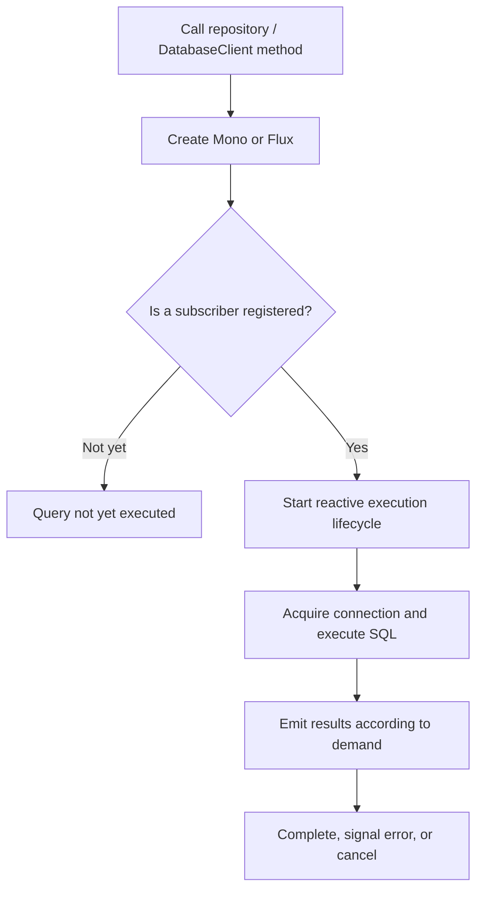

# Cold Streams, Execution Subscriptions, and Query Laziness

In Spring Data Relational R2DBC, database read and write operations typically return a Reactor publisher, such as `Mono<T>` or `Flux<T>`. When calling a repository method or building an operation with `DatabaseClient`, the application is primarily **constructing a description of a processing flow**. The query is executed within the subscription lifecycle once a subscriber attaches to the publisher.

This characteristic is foundational to reactive programming: building the pipeline and actually fetching the data are separated into two distinct moments. Understanding this boundary properly helps prevent cases where queries never run because there is no subscription, queries run multiple times unexpectedly, or an operation detaches from a transaction by calling `subscribe()` manually.

## 1. What Is a Publisher in an R2DBC Query?

R2DBC provides a database access API based on the reactive model. Spring Data R2DBC uses Reactor to represent results and asynchronous processing steps. Two commonly encountered types are:

| Return Type | Cardinality | Common Examples |
| --- | --- | --- |
| `Mono<T>` | Zero or one item | `findById`, `save`, `count` (numeric type), a query expected to return one record |
| `Flux<T>` | Zero, one, or many items | `findAll`, queries returning multiple records, `DatabaseClient` result streams |

Example of a reactive repository:

```java
public interface CustomerRepository
        extends ReactiveCrudRepository<Customer, Long> {

    Flux<Customer> findByStatus(String status);
}
```

The following call returns a `Flux<Customer>`:

```java
Flux<Customer> activeCustomers =
        customerRepository.findByStatus("ACTIVE");
```

The variable `activeCustomers` holds a publisher representing the query operation. Assigning a publisher to a variable, passing it between methods, or chaining operators such as `map` and `filter` does not automatically create a subscriber. Therefore, at this point the database query has not yet been requested to execute.

A publisher is a contract describing how data will be emitted to a subscriber. A subscriber registers with the publisher and receives reactive signals such as `onNext`, `onError`, or `onComplete`. For `Mono`, at most one `onNext` signal is emitted; for `Flux`, multiple `onNext` signals may be emitted.

## 2. Cold Streams (Cold Publishers)

A cold publisher creates or fetches data independently for each subscription. Query publishers provided by Spring Data R2DBC and `DatabaseClient` are generally cold and defer communicating with the database until a subscription occurs.

You can visualize the workflow with the following diagram:



Example:

```java
Flux<Customer> customers = customerRepository.findByStatus("ACTIVE");

// Only builds the pipeline; no subscriber yet.
// The query is not requested to execute here.
```

If nothing subscribes to `customers`, the publisher has no consumer for the results and the query operation never starts. This commonly happens when a service method creates and returns a publisher, yet the caller never subscribes or passes the publisher to a framework that manages subscriptions.

In a Spring WebFlux application, a controller usually just returns the publisher to the framework:

```java
@GetMapping("/customers/active")
public Flux<Customer> activeCustomers() {
    return customerRepository.findByStatus("ACTIVE");
}
```

WebFlux subscribes to and consumes the publisher while handling the HTTP response. Hence, the controller does not need to call `subscribe()` itself.

### Why Is It Called "Cold"?

With a cold publisher, each independent subscription typically initiates a fresh execution. The same publisher variable can be subscribed to multiple times:

```java
Flux<Customer> customers = customerRepository.findByStatus("ACTIVE");

customers.subscribe(customer -> log.info("Subscriber A: {}", customer));
customers.subscribe(customer -> log.info("Subscriber B: {}", customer));
```

These two subscribers will normally cause the query to execute twice. Each subscriber receives the result stream from its corresponding execution. Reusing the same `Flux` object does not mean query results are automatically shared or cached.

The same applies when a publisher is re-subscribed due to operators like `retry` or `repeat`:

- `retry` re-subscribes to upstream after an error to try executing again. For read queries, that usually means re-sending the query. For write operations, consider the possibility that the previous attempt was partially processed or completed by the database before the error was observed; retrying can cause duplicate side effects.
- `repeat` re-subscribes after upstream completes, so the query can run again after each completion.

Do not generalize that every `Publisher` in Reactive Streams is cold. Publishers from event sources, `Sinks`, or certain time-based sources can be hot, meaning data can be emitted independently of when a subscriber subscribes. Coldness here describes the typical behavior of database operation publishers in Spring Data R2DBC.

## 3. Subscription Is the Boundary That Starts Execution

In Reactive Streams, a subscriber calls `subscribe` to register with a publisher. The subscription establishes the data-consumption relationship; afterward, the subscriber can request item counts via the demand mechanism. For an R2DBC query publisher, subscribing starts the query execution lifecycle: the framework/driver acquires an appropriate connection, prepares and executes the SQL statement, and emits results down the reactive stream.

A subscription typically goes through the following stages:

1. **Registration:** the subscriber connects to the publisher. The publisher supplies a `Subscription` via the `onSubscribe` signal.
2. **Database operation startup:** the query publisher begins acquiring a connection and executing the statement. The connection may come from a connection pool; if inside a reactive transaction, the connection bound to that transaction can be used.
3. **Receiving results:** data is mapped to Java objects and emitted via `onNext`. `Mono` emits at most one item, while `Flux` can emit multiple items.
4. **Lifecycle termination:** the publisher emits `onComplete`, emits `onError`, or receives a cancellation signal (`cancel`). The framework and driver manage resource cleanup according to the operation's lifecycle.

This is a conceptual description. Exact details of when SQL is sent, how rows are read, and how data is buffered depend on Spring Data, Reactor, and the R2DBC driver. Subscribing initiates the processing lifecycle, while the amount of data consumed is influenced by demand and the prefetch/buffering mechanisms of underlying components.

### Manual Registration with `subscribe()`

You can call `subscribe()` directly to start processing:

```java
customerRepository.findByStatus("ACTIVE")
        .subscribe(
                customer -> log.info("Customer: {}", customer),
                error -> log.error("Unable to load customer", error),
                () -> log.info("Finished loading customer list")
        );
```

As soon as `subscribe()` is called, a subscription is created and the reactive operation begins. This is useful at certain application boundaries where an independent task must be proactively launched, provided errors and subscription lifecycle are properly managed. `subscribe()` typically returns a `Disposable`, allowing the subscription to be canceled when needed.

In a normal reactive service, return the publisher to the caller so the caller manages the subscription:

```java
public Flux<Customer> findActiveCustomers() {
    return customerRepository.findByStatus("ACTIVE")
            .filter(Customer::isEnabled)
            .sort(Comparator.comparing(Customer::getName));
}
```

Operators are chained into the pipeline and will run when the publisher is subscribed to. There is no need to call `subscribe()` manually inside the service.

### Operations That Commonly Create a Subscription

Besides `subscribe()`, several operations subscribe to a publisher internally:

| Operation | Behavior |
| --- | --- |
| `block()` | Subscribes and waits synchronously for the result; for `Mono`, returns the value or `null` if empty |
| `toFuture()` | Creates a `CompletableFuture` and subscribes to the publisher to complete the future |
| `StepVerifier.verify()` | Subscribes to the publisher while running a test scenario |
| Spring WebFlux response handling | The framework subscribes to the publisher to write data into the response |

For example, each call to `block()` triggers one subscription:

```java
Mono<Customer> customer = customerRepository.findById(10L);

Customer first = customer.block();  // First subscription
Customer second = customer.block(); // Second subscription
```

With a cold query publisher, these two lines can execute the query twice. `block()` also turns the calling thread into a synchronous blocking wait, making it unsuitable inside reactive processing chains or on WebFlux non-blocking threads.

## 4. Laziness When Building and Composing Queries

Laziness allows an application to assemble processing steps in advance and let the subscriber decide when execution begins. Example:

```java
public Mono<CustomerView> findCustomerView(Long id) {
    return customerRepository.findById(id)
            .map(customer -> new CustomerView(
                    customer.getId(),
                    customer.getName()
            ));
}
```

When `findCustomerView(id)` is called, the method constructs and returns a `Mono<CustomerView>`. `map` describes how to convert `Customer` into `CustomerView`. Both the query and the mapping belong to the pipeline and will run when a subscription occurs and data flows through the pipeline.

Common composition operators:

```java
return customerRepository.findById(id)
        .filter(Customer::isEnabled)
        .flatMap(customer -> addressRepository.findByCustomerId(customer.getId())
                .map(address -> new CustomerView(customer, address)))
        .switchIfEmpty(Mono.error(new CustomerNotFoundException(id)));
```

- `filter` lets an item continue only if the predicate holds.
- `flatMap` chains another publisher after upstream emits an item. The address query is subscribed to only when the `flatMap` branch receives a customer.
- `switchIfEmpty` switches to a fallback publisher if upstream completes without emitting an item.
- `Mono.error` creates a publisher that terminates with an error; the error is emitted when that publisher is subscribed to in the pipeline.

It is important to distinguish **creating a publisher** from **executing the operation inside the publisher**. Some Java expressions still run immediately when the method is called. For example, evaluating arguments, instantiating objects, or calling a factory to obtain a publisher may happen at assembly time. R2DBC's laziness primarily ensures that database communication is tied to subscription; it does not mean every Java statement in the method is automatically deferred.

### Using `defer` When Publisher Creation Itself Must Be Deferred

`Mono.defer` and `Flux.defer` take a supplier that produces a fresh publisher for each subscription. They are useful when creating the publisher itself or computing its inputs also needs to happen at subscription time:

```java
Mono<Customer> customer = Mono.defer(() ->
        customerRepository.findById(resolveCustomerId())
);
```

`resolveCustomerId()` is called at subscription time. If the publisher is subscribed to multiple times, the supplier is invoked again for each subscription. Query publishers returned by repositories already defer SQL execution; `defer` adds an extra layer of deferral around calling the repository and computing arguments.

Another example is generating fresh data per execution:

```java
Mono<AuditRecord> saveAudit = Mono.defer(() -> {
    AuditRecord record = new AuditRecord(UUID.randomUUID(), "CUSTOMER_READ");
    return auditRepository.save(record);
});
```

Each subscription creates a new `AuditRecord` and then subscribes to the corresponding save operation. If `AuditRecord` were created outside `defer`, the UUID would be generated during pipeline assembly and the same object could be reused across multiple subscriptions.

`defer` can also wrap a fallback branch when you want the fallback publisher created only if that branch is actually selected:

```java
return customerRepository.findById(id)
        .switchIfEmpty(Mono.defer(() ->
                customerRepository.findById(DEFAULT_CUSTOMER_ID)
        ));
```

In this example, the publisher looking up the default customer is only created when the first query completes empty. Since the repository operation is also cold, the fallback branch's SQL runs only when that branch is subscribed to.

## 5. Multiple Subscribers, Caching, and Sharing Results

With a cold query publisher, each subscriber normally triggers an independent execution. If multiple components need the same result and repeating the query is undesirable, explicitly choose a sharing or caching strategy.

Example with `Mono.cache()`:

```java
Mono<Customer> cachedCustomer = customerRepository.findById(10L).cache();
```

The first subscription triggers the query and caches the terminal signal of the `Mono`. Subsequent subscriptions receive the cached signal instead of re-executing the query while the cache remains valid. Cache expiration can be configured using TTL overloads.

Points to consider:

- Reactor's cache stores signals in application memory; it is not an automatic database cache or a Hibernate-level cache.
- For `Mono`, the cached signal may be a value, empty completion, or an error. Thus, an empty result or error can also be replayed.
- `Flux.cache()` can retain emitted items to replay them for later subscribers. For large or unbounded streams, retaining all items can consume substantial memory.
- Cached data can become stale after records change. Define TTL and invalidation policies matching consistency requirements.

Reactor also provides sharing operators such as `share` or `publish().refCount()`. They have specific lifecycle and subscription-timing semantics; choose according to actual needs and carefully review behavior when subscribers arrive late or leave early. Do not add caching or sharing solely to avoid calling a repository multiple times without clearly validating data freshness requirements.

## 6. Demand, Backpressure, and Subscription Cancellation

Reactive Streams includes backpressure: subscribers can request the number of items they are ready to receive. With `Flux`, demand influences emission and coordination between pipeline steps. The R2DBC driver and Spring components may use prefetching or buffering, so do not assume one `request(1)` always corresponds strictly to reading a single row from the database.

Example:

```java
return customerRepository.findAll()
        .take(100)
        .map(this::toView);
```

`take(100)` limits the number of items forwarded down the rest of the pipeline. Once 100 items arrive, the operator can cancel the upstream subscription. This is a reactive-stream limit; if you want to limit the number of rows the database must search or return, use a query with `LIMIT`, pagination, or an appropriate query mechanism. Client-side cancellation does not guarantee every driver/database stops work instantaneously.

When a subscriber cancels a subscription, the publisher receives a `cancel` signal. For R2DBC queries, the framework and driver perform cancellation and resource cleanup to the extent supported. This matters when an HTTP client disconnects or when a pipeline only needs part of the result set.

## 7. Subscriptions and Reactive Transactions

A reactive transaction has a lifecycle bound to the subscription. When using `@Transactional` on a method returning `Mono` or `Flux`, an appropriate reactive transaction manager—typically `R2dbcTransactionManager`—must be configured. The transaction is managed within the subscription's reactive context; repository operations in the same pipeline can share the connection bound to that transaction.

Example:

```java
@Transactional
public Mono<Void> renameCustomer(Long id, String newName) {
    return customerRepository.findById(id)
            .switchIfEmpty(Mono.error(new CustomerNotFoundException(id)))
            .flatMap(customer -> {
                customer.setName(newName);
                return customerRepository.save(customer);
            })
            .then();
}
```

The method returns a pipeline. When the pipeline is subscribed to, the reactive transaction mechanism wraps execution and concludes the transaction based on completion or error signals. The lookup and save operations are chained in the same reactive sequence.

Avoid calling `subscribe()` manually inside a method that needs a transaction:

```java
// Avoid doing this in a transactional reactive service.
public Mono<Void> renameCustomer(Long id, String newName) {
    customerRepository.findById(id)
            .flatMap(customer -> {
                customer.setName(newName);
                return customerRepository.save(customer);
            })
            .subscribe();

    return Mono.empty();
}
```

`subscribe()` creates an independent subscription on the spot. The returned publisher is `Mono.empty()` and does not represent the customer lookup/save work. The manually created subscription may also run outside the framework-managed pipeline's transaction context, causing transactions, error handling, and completion timing to no longer coordinate as expected.

Return the publisher from the service so the framework or caller subscribes once at the proper boundary. If explicit transaction orchestration is needed, wrap the publisher with `TransactionalOperator`; the rule remains to keep related operations inside the same reactive pipeline.

## 8. Tests Are Subscribers Too

Reactor testing tools such as `StepVerifier` subscribe to publishers when verification runs. Thus, a query in a test is triggered only when the verifier performs the subscription:

```java
StepVerifier.create(customerRepository.findByStatus("ACTIVE"))
        .expectNextCount(2)
        .verifyComplete();
```

`verifyComplete()` starts consuming the publisher, checks that two items arrive, and confirms normal stream completion. If you construct a publisher without calling the corresponding verification or subscribe method, the query will not execute yet.

When testing multi-subscription behavior, create each subscriber intentionally and remember that cold query publishers normally re-execute each time. If `cache` is used, test results will reflect caching semantics rather than default cold behavior.

## 9. Common Errors and How to Fix Them

| Symptom | Common Cause | Fix |
| --- | --- | --- |
| Query never appears to run | Publisher created but has no subscriber | Return the publisher to WebFlux or subscribe at an appropriate application boundary |
| Query runs twice | Same publisher subscribed twice, or unexpected `block()`/`toFuture()` | Trace where subscriptions are created; maintain a single consumption flow if required by business logic |
| Service returns empty despite query having data | Service calls `subscribe()` itself and returns another publisher, often `Mono.empty()` | Chain operations with `map`/`flatMap` and return the complete publisher |
| Fallback query runs unnecessarily | Fallback publisher created or arguments computed too early | Use `Mono.defer`/`Flux.defer` when creation of the fallback branch needs deferral |
| Transaction does not cover an operation | Subscription created separately from the transaction pipeline | Return publishers throughout and let the reactive transaction manager manage subscription |
| Application blocks or errors on `block()` | Blocking inside a reactive processing flow | Use reactive operators and let the framework layer subscribe |
| Query re-executes after an error | `retry` creates a new subscription | Check whether the operation is safe to rerun; bound retries and handle idempotency for writes |

When investigating, trace the following points:

1. Which publisher does the repository method or `DatabaseClient` return?
2. Where is the publisher subscribed to? Is a framework managing the subscription?
3. Are there multiple calls to `subscribe`, `block`, `toFuture`, `retry`, or `repeat`?
4. Is the publisher cached or shared, changing execution count from default cold behavior?
5. If a transaction is involved, do all operations remain in the same pipeline and same reactive context?

## 10. Key Takeaways for Working with Spring Data R2DBC

- Calling a repository method normally creates a `Mono` or `Flux`; the call itself does not mean SQL has already executed.
- R2DBC query publishers are generally cold and lazy: a subscription initiates an execution; each new subscription normally re-executes.
- Operators like `map`, `filter`, `flatMap`, and `switchIfEmpty` describe how data is processed in the pipeline. They do not create subscriptions on their own.
- `defer` defers both calling the publisher factory and evaluating code inside the supplier until each subscription.
- `subscribe`, `block`, `toFuture`, `StepVerifier`, and frameworks like WebFlux can create subscriptions. Always know which component owns publisher consumption.
- Do not subscribe manually inside a reactive service that must return results or participate in a transaction; return the fully composed publisher.
- Each subscription can re-execute the query. Use caching or sharing only when sharing results is an explicit requirement and its data semantics are acceptable.
- Backpressure and cancellation coordinate stream consumption; they do not replace database-level query limits such as `LIMIT` or pagination.

Mastering the relationship between publishers, subscriptions, and execution timing is essential for writing repositories, services, and reactive transactions properly with Spring Data R2DBC. Whenever reading a piece of reactive code, trace where the publisher is created, which operators are attached to it, and where the subscription actually starts; from there, you can determine precisely when queries run and why they may execute once or multiple times.
