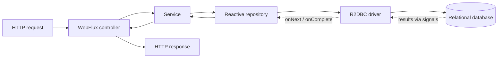

# Non-Blocking Processing Flows and the Harm of Blocking Operations

In Spring Data Relational R2DBC, database access is designed around the reactive model and non-blocking I/O. This model enables an application to handle many concurrent requests without tying up a thread waiting for the database to respond. However, those benefits hold only when the entire processing chain respects non-blocking execution. A synchronous call such as `block()`, `Thread.sleep()`, or JDBC can monopolize a thread serving multiple requests and severely degrade application responsiveness.

## 1. Why Is R2DBC Tied to Non-Blocking Processing?

Traditional JDBC exposes a synchronous API. When an application executes a JDBC query, the calling thread typically waits until the database returns results or throws an error. During that wait, the thread cannot proceed with other work.

R2DBC (Reactive Relational Database Connectivity) provides a reactive API for accessing relational databases. Spring Data R2DBC builds repositories and data-access operations on top of this API. Methods usually return reactive types such as `Mono<T>` or `Flux<T>` rather than returning a fully loaded object directly.

The core difference lies in how application threads wait for I/O:

| Access Approach | Behavior While Waiting on Database | Effect on Calling Thread |
| --- | --- | --- |
| Synchronous JDBC | Call normally waits for query results | Thread is held until the call finishes |
| Reactive R2DBC | Driver performs non-blocking I/O and emits signals when results arrive | Thread can continue handling other work while waiting on I/O |

Non-blocking does not mean SQL queries run instantaneously, the database needs no resources, or the application can serve an infinite number of requests. The database still must execute queries, acquire locks, read data, and send results over the network. The benefit of non-blocking I/O is that the application does not have to dedicate a thread to sit idle waiting for that I/O.

## 2. Reactive Data Types in Spring Data R2DBC

The two types seen most often in an R2DBC processing flow are:

- `Mono<T>` represents zero or one result. Examples: finding a record by primary key, saving an entity, or retrieving an aggregate value.
- `Flux<T>` represents zero to many results. Examples: querying a list of orders or reading a stream of records.

These types implement the Reactive Streams model. Instead of returning data immediately when the method is invoked, a repository normally returns a `Publisher`. The pipeline is described upfront; execution begins when a subscriber subscribes. Thereafter, the publisher emits signals such as `onNext`, `onError`, and `onComplete` under Reactive Streams rules.

Example repository:

```java
import org.springframework.data.repository.reactive.ReactiveCrudRepository;
import reactor.core.publisher.Flux;

public interface OrderRepository
        extends ReactiveCrudRepository<Order, Long> {

    Flux<Order> findByStatus(OrderStatus status);
}
```

`findByStatus` returns `Flux<Order>`. When the method is called, the application obtains a pipeline description. The query runs when the pipeline is subscribed to—for example, when Spring WebFlux processes the controller's return value.

## 3. How Does a Request Flow Through the System?

In an application using Spring WebFlux, Spring Data R2DBC, and an R2DBC driver, a typical flow can be pictured as follows:



The flow generally consists of the following steps:

1. **Receive request:** the server receives an HTTP request. In a WebFlux setup based on Reactor Netty, event-loop threads accept and multiplex many connections.
2. **Build pipeline:** the controller calls the service; the service calls the repository and chains operators such as `map`, `flatMap`, `filter`, or `switchIfEmpty`. Most of this work merely describes how results should be handled.
3. **Subscribe for execution:** the framework subscribes to the returned publisher to start the data flow.
4. **Send query:** the repository passes the request down to Spring Data R2DBC and the R2DBC driver. The driver sends the statement to the database using non-blocking I/O.
5. **Wait on I/O without holding threads:** while data has not arrived yet, the event-loop thread does not have to sit idle waiting for the reply. It can handle events for other connections or requests.
6. **Receive signals:** when the driver receives data, it emits signals into the pipeline. Subsequent operators transform results or handle errors.
7. **Send response:** WebFlux writes the results as an HTTP response once the publisher completes.

The diagram depicts responsibilities conceptually. Which actual threads execute each operator depends on the server, driver, schedulers, and thread-switching boundaries configured by the application. Do not assume every step always runs on the same thread or that every driver shares identical internal implementation.

### Example Keeping Reactive Types from Controller to Repository

```java
@Service
public class OrderService {

    private final OrderRepository repository;

    public OrderService(OrderRepository repository) {
        this.repository = repository;
    }

    public Mono<OrderDto> findById(Long id) {
        return repository.findById(id)
                .map(OrderDto::from);
    }
}
```

```java
@RestController
@RequestMapping("/orders")
public class OrderController {

    private final OrderService service;

    public OrderController(OrderService service) {
        this.service = service;
    }

    @GetMapping("/{id}")
    public Mono<ResponseEntity<OrderDto>> findById(@PathVariable Long id) {
        return service.findById(id)
                .map(ResponseEntity::ok)
                .defaultIfEmpty(ResponseEntity.notFound().build());
    }
}
```

The service returns `Mono<OrderDto>` and the controller continues returning `Mono<ResponseEntity<OrderDto>>`. Spring WebFlux manages subscribing and converting the result into an HTTP response. There is no need to wait synchronously for the result in the controller.

## 4. What Counts as a Blocking Operation?

A blocking operation prevents the current thread from doing other work until that operation finishes. Common examples include:

- Calling `Mono.block()`, `Flux.blockFirst()`, or `Flux.blockLast()` to wait synchronously for reactive results.
- Calling `Future.get()` or `CompletableFuture.join()` to wait for another task to finish.
- Calling `Thread.sleep()` or using `wait()`/synchronized locks along a request-handling path.
- Calling synchronous I/O APIs such as JDBC, `RestTemplate`, synchronous file reads, or a networking library that only supports blocking calls.
- Waiting on a resource via a synchronous operation, such as a lock held by another thread.

The example below turns a reactive pipeline into a synchronous call:

```java
public OrderDto findOrder(Long id) {
    Order order = orderRepository.findById(id).block();
    return OrderDto.from(order);
}
```

`block()` subscribes to the publisher and holds the calling thread until a result arrives, the publisher completes empty, or an error occurs. If `Mono` completes with no item, `block()` can return `null`, so the snippet also risks failing when passing that value to `OrderDto.from`. Using `block(Duration)` only adds a wait timeout; the operation is still blocking.

One distinction to make: not every synchronous calculation is a blocking operation in the I/O sense. A tiny transformation inside `map` normally runs fast and is not an issue. However, a long-running CPU computation also occupies a thread for the entire calculation duration. It needs appropriate resource allocation, even though the cause is CPU consumption rather than waiting on I/O.

## 5. The Harm of Blocking Threads in a Reactive Application

### 5.1. Stalling the Event Loop

In WebFlux running on Reactor Netty, a relatively small pool of event-loop threads coordinates many connections. Each thread can process events from multiple requests. If one request calls `block()`, runs a JDBC query, or sleeps with `Thread.sleep()` right on the event loop, that thread cannot process other events while it is held.

For example, suppose a request spends two seconds waiting on a synchronous call. During those two seconds, the event-loop thread executing that call may delay reading incoming data, writing outgoing data, and firing callbacks for other connections assigned to it. Consequently, a blocking operation in one request can impact many unrelated requests.

### 5.2. Reduced Throughput and Higher Latency

Throughput is the number of requests a system can process per unit of time. When event-loop threads are frequently blocked, events processed per second drop. Requests wait longer in queues, increasing average latency and especially tail latencies such as p95 or p99.

An application may appear to work correctly under light testing yet degrade sharply under high concurrency. That is why code using `block()` sometimes causes no immediate functional bug while still creating severe performance and scalability issues.

### 5.3. Thread and Resource Exhaustion

When many blocking tasks run simultaneously, the application may have to spawn more threads or queue tasks. If threads are held too long, fewer threads remain available for new work. Once a pool reaches its limit, new tasks must wait or fail.

For database operations, synchronous waiting can also keep connections held longer than necessary. Exhausting the connection pool prevents other requests from acquiring connections. When queues, wait times, and retry counts rise together, the system can enter cascading degradation.

### 5.4. Losing the Benefits of Backpressure

Backpressure lets subscribers express demand and helps regulate item flow rate in a Reactive Streams pipeline. However, backpressure cannot unstick a thread trapped inside a blocking call.

If a `map` operator makes a synchronous API call taking several seconds, the subscriber must still wait for that call to finish before processing the next signal. Throttling item counts helps control data volume, but it does not turn a blocking call into non-blocking I/O.

### 5.5. Triggering Timeouts and Cascading Failures

When event loops are stalled, HTTP responses arrive late and exceed timeouts on clients, gateways, or load balancers. Clients may retry requests while old requests are still running. Uncontrolled retries amplify load on the database and downstream services, worsening congestion.

### 5.6. Breaking Pipeline Lifecycle

Calling `subscribe()` manually inside a service usually detaches the task from the pipeline returned by the controller:

```java
public Mono<String> createOrder(Order order) {
    orderRepository.save(order).subscribe();
    return Mono.just("Request received");
}
```

This method can return the message before the save operation completes. Errors from saving no longer propagate naturally to the HTTP request's subscriber; request cancellation also does not necessarily cancel the detached work. Transaction boundaries and error handling become difficult to control.

Normally, return the publisher so the framework or upstream caller manages subscribing:

```java
public Mono<Order> createOrder(Order order) {
    return orderRepository.save(order);
}
```

## 6. Ways to Avoid Blocking

### 6.1. Preserve Reactive Types Across Layers

When using Spring Data R2DBC, let repositories, services, and controllers exchange `Mono` or `Flux`. Use reactive operators to chain work:

```java
public Mono<OrderDto> findOrder(Long id) {
    return orderRepository.findById(id)
            .switchIfEmpty(Mono.error(new OrderNotFoundException(id)))
            .map(OrderDto::from);
}
```

`switchIfEmpty` handles the missing-record case; `map` transforms the item when it arrives. Both keep the result inside the same pipeline. There is no need to call `block()` to extract an intermediate object.

### 6.2. Prefer Non-Blocking APIs for Dependent Services

If a service needs to call HTTP endpoints, caches, or messaging systems, prefer clients with reactive or non-blocking APIs. For example, in a WebFlux application, `WebClient` provides a reactive API for composing HTTP calls into pipelines.

If a component only offers a blocking API and cannot yet be replaced, isolate that call on a scheduler meant for blocking tasks. Isolation keeps the event loop from directly waiting on synchronous calls.

### 6.3. Isolating Blocking Libraries with `boundedElastic`

Reactor provides `Schedulers.boundedElastic()` for bounded blocking tasks. Synchronous calls can be wrapped in `Mono.fromCallable` with an explicit execution scheduler:

```java
public Mono<Quote> getQuote(String productCode) {
    return Mono.fromCallable(() -> legacyPricingClient.fetch(productCode))
            .subscribeOn(Schedulers.boundedElastic());
}
```

`fromCallable` defers invoking the call until the publisher is subscribed to. `subscribeOn` schedules the source on `boundedElastic`, keeping the blocking call off WebFlux's event loop.

When combining an R2DBC result with a synchronous library, wrap only the blocking portion:

```java
public Mono<OrderView> getOrderView(Long id) {
    return orderRepository.findById(id)
            .flatMap(order ->
                    Mono.fromCallable(() ->
                                    legacyPricingClient.fetch(order.getProductCode()))
                            .subscribeOn(Schedulers.boundedElastic())
                            .map(quote -> OrderView.from(order, quote))
            );
}
```

The R2DBC query still runs reactively. Only `legacyPricingClient.fetch` is offloaded to the blocking scheduler. If no record is found, `flatMap` never invokes the dependent client and the publisher completes empty.

`boundedElastic` is an isolation zone for blocking work; it does not turn a synchronous library into a non-blocking one. This scheduler has bounded resources; sending too many slow tasks onto it can still build queues and force tasks to wait. Do not treat it as a default wrapper for every operator or every R2DBC query.

### 6.4. Choosing a Scheduler by Work Type

Reactor offers schedulers tailored to different purposes. Choose a scheduler based on the actual work:

| Type of Work | Appropriate Approach | Notes |
| --- | --- | --- |
| Queries via R2DBC driver | Keep the pipeline reactive using the default scheduler managed by the driver and runtime | Do not wrap R2DBC queries in `boundedElastic` just because they access a database |
| Synchronous I/O from legacy libraries | Isolate with `Mono.fromCallable` or appropriate `Flux.fromIterable` paired with `subscribeOn(Schedulers.boundedElastic())` | Monitor wait times and bound concurrent blocking tasks |
| Heavy CPU computation | Move processing onto `Schedulers.parallel()` when appropriate | Avoid blocking I/O on this scheduler |
| Small, fast data transformations | Use `map`, `filter`, or corresponding operators directly | No need to switch schedulers without a reason |

Example offloading a CPU-heavy step to `parallel`:

```java
public Mono<Report> createReport(Long id) {
    return reportRepository.findById(id)
            .publishOn(Schedulers.parallel())
            .map(this::calculateExpensiveReport);
}
```

`publishOn` creates a scheduler-switching boundary for operators downstream of it in the pipeline. Therefore, `calculateExpensiveReport` runs on the chosen scheduler. This is intended for CPU computation; do not use `parallel` to wait on JDBC, file I/O, or synchronous HTTP.

### 6.5. Understanding `subscribeOn` vs. `publishOn`

Both operators affect where execution happens, but they have different scopes:

- `subscribeOn(scheduler)` affects subscription at the source and is typically used to move a blocking source such as `fromCallable` onto an appropriate scheduler.
- `publishOn(scheduler)` introduces a thread switch for operators located downstream of it. It is commonly used when a later processing step needs to run on another scheduler.

Ordering matters greatly. The following example fails to fix the blocking call positioned before `publishOn`:

```java
return orderRepository.findById(id)
        .map(order -> legacyClient.fetch(order.getProductCode()))
        .publishOn(Schedulers.boundedElastic());
```

`map` sits before the `publishOn` boundary, so `legacyClient.fetch` already executes on whatever thread emits signals into `map`. Switching schedulers afterward cannot retroactively move the already-executed call to another thread.

Place the boundary before the blocking part or wrap the call in its own publisher:

```java
return orderRepository.findById(id)
        .flatMap(order -> Mono.fromCallable(
                        () -> legacyClient.fetch(order.getProductCode()))
                .subscribeOn(Schedulers.boundedElastic()));
```

## 7. Backpressure and Processing Large Data Streams

With `Flux`, subscribers can request items according to demand. This helps when working with large result sets because producer and consumer can coordinate pace instead of forcing the application to load all data into memory.

For instance, records can be transformed incrementally in the pipeline:

```java
public Flux<OrderDto> findRecentOrders() {
    return orderRepository.findByStatus(OrderStatus.OPEN)
            .filter(Order::isRecent)
            .map(OrderDto::from);
}
```

Avoid collecting an entire result set into a large list when unnecessary:

```java
// Use only when the result set size fits comfortably in memory.
Mono<List<Order>> allOrders = orderRepository.findAll().collectList();
```

Backpressure regulates item flow through the pipeline, yet it does not replace pagination, query limits, or proper handling of blocking calls. For large datasets, consider filtered queries, pagination appropriate to the API in use, batch processing, and avoiding holding entire results in memory.

## 8. Blocking and Reactive Transactions

Spring Data R2DBC supports reactive transactions. In a reactive transaction, transaction context is attached to publisher execution via Reactor Context. Consequently, operations inside the transaction must be chained in the same pipeline so Spring can manage the execution lifecycle.

Example using `TransactionalOperator`:

```java
public Mono<Order> createOrder(Order order) {
    return transactionalOperator.transactional(
            orderRepository.save(order)
                    .flatMap(saved -> auditRepository.save(AuditEntry.forOrder(saved))
                            .thenReturn(saved))
    );
}
```

In this example, saving the order and saving the audit entry are composed inside the same publisher wrapped by `TransactionalOperator`. When the publisher completes successfully, the transaction can commit; when an error occurs, the transaction manager handles rollback according to transaction rules.

Do not call `block()` or manually call `subscribe()` mid-transaction. Doing so can detach work from the Spring-managed transaction context and lifecycle, while breaking consistent propagation of errors and cancellation signals. When using `@Transactional` on a reactive method, return `Mono` or `Flux` so the transaction manager oversees that publisher.

## 9. How to Identify Blocking Operations

When investigating a slow R2DBC application, start from these signals:

1. **Search for synchronous calls on request paths:** look for `block()`, `blockFirst()`, `blockLast()`, `Thread.sleep()`, `Future.get()`, `join()`, and synchronous JDBC or HTTP APIs.
2. **Inspect thread dumps:** if threads named such as `reactor-http-nio-*` frequently appear waiting inside JDBC, blocking sockets, or `Thread.sleep()`, that indicates event loops are being blocked. Exact thread names depend on runtime and configuration.
3. **Monitor latency and pools:** compare p95/p99 latency, active connection counts, task queues, and active thread counts as load increases.
4. **Use blocking detection tools in test environments:** BlockHound can help catch certain blocking calls running on threads marked non-blocking. It assists early detection, though it does not replace reading execution flows and profiling the application.
5. **Verify scheduler boundaries:** confirm blocking calls actually sit after an appropriate `publishOn` or are wrapped with `fromCallable`/`subscribeOn`; merely seeing `boundedElastic` at the end of a pipeline does not prove proper isolation.

An application can pass functional checks with a few requests yet degrade rapidly as concurrent load climbs. Test behavior under load and inspect latency distributions rather than relying solely on an endpoint returning correct output for single requests.

## 10. Practical Guidelines

- Keep `Mono` and `Flux` end to end across repositories, services, and controllers when using WebFlux with Spring Data R2DBC.
- Never call `block()` on reactive request-processing paths. Consider switching to blocking only at controlled integration boundaries, such as applications or jobs designed synchronously.
- Prefer non-blocking drivers and clients for databases, HTTP, and dependent services.
- When calling a blocking library is unavoidable, isolate only that call with `boundedElastic`; do not place entire R2DBC pipelines onto it arbitrarily.
- Use a CPU scheduler for heavy computation; never use event loops or CPU schedulers to wait on synchronous I/O.
- Return publishers from services and controllers; avoid calling `subscribe()` manually inside the business layer.
- Keep operations sharing a transaction inside one continuous reactive pipeline.
- Control data volume with query predicates, pagination, and backpressure; never assume `Flux` automatically makes arbitrary dataset sizes memory-safe.
- Measure latency, connection usage, and thread behavior under load to pinpoint real bottlenecks.

## 11. Conclusion

R2DBC allows applications to access relational databases using the reactive model and non-blocking I/O. While a request awaits data from the database, processing threads can serve other work; results continue flowing through the pipeline via reactive signals. This advantage depends on how the whole application is written: even a single blocking call placed on an event loop can stall many requests, spike latency, and exhaust resources.

Keep pipelines reactive from end to end, favor non-blocking APIs, and isolate blocking libraries only when truly necessary. Selecting appropriate schedulers, preserving transaction lifecycles, and controlling data flow allow Spring Data R2DBC to deliver scalability and responsiveness under load.
