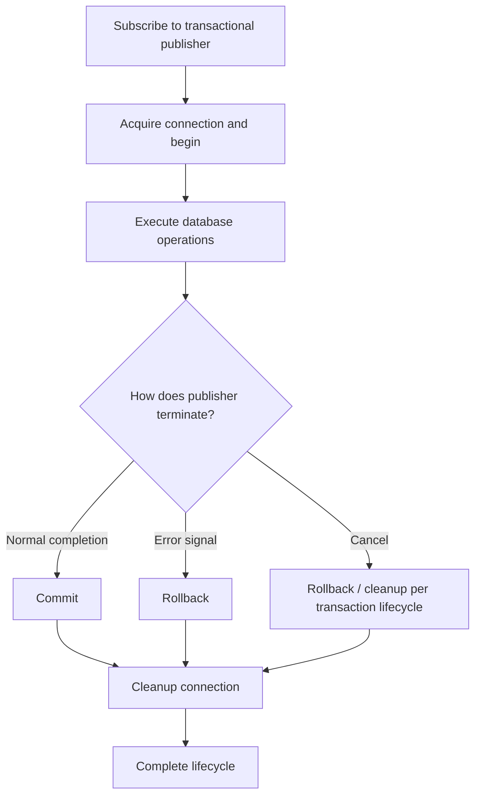

# ReactiveTransactionManager and the Role of R2dbcTransactionManager

## 1. Transactions in reactive applications

A business operation may require multiple database statements yet still need to be treated as a single unit of work. For example, when creating an order, the application might need to save the order, save the order lines, and write an audit record. If saving the order succeeds while saving the order lines fails, the system could end up in an inconsistent state if the statements do not share the same transaction.

Transactions provide four ACID properties:

- **Atomicity:** changes within a transaction are committed together or rolled back together.
- **Consistency:** the transaction moves data from one valid state to another according to the applied constraints and rules.
- **Isolation:** concurrent transactions are isolated according to the database's isolation level.
- **Durability:** committed changes are guaranteed by the database to be persisted durably according to the database engine's configuration.

With Spring Data R2DBC, database operations return `Mono` or `Flux`. Therefore, transactions must also be managed according to the publisher lifecycle rather than holding a thread throughout execution. Spring provides the `ReactiveTransactionManager` abstraction for this purpose; `R2dbcTransactionManager` is the implementation for R2DBC.

## 2. What is ReactiveTransactionManager?

`ReactiveTransactionManager` is Spring Framework's abstraction for managing transactions reactively. It defines a common contract for starting or participating in a transaction, committing, and rolling back without requiring a thread to block while waiting for the result.

The interface resides in package:

```java
org.springframework.transaction.ReactiveTransactionManager
```

The core contract has three operations:

```java
public interface ReactiveTransactionManager extends TransactionManager {

    Mono<ReactiveTransaction> getReactiveTransaction(
            TransactionDefinition definition);

    Mono<Void> commit(ReactiveTransaction transaction);

    Mono<Void> rollback(ReactiveTransaction transaction);
}
```

Meaning:

- `getReactiveTransaction(...)` obtains a transaction matching the requested definition. Depending on the propagation behavior, Spring may create a new transaction or participate in an existing one.
- `commit(...)` requests committing the transaction and returns a publisher that completes when the operation finishes.
- `rollback(...)` requests rolling back the transaction and returns a publisher that completes when the operation finishes.

These methods return publishers because acquiring a connection, starting a transaction, committing, and rolling back can all be asynchronous operations. Spring can compose them into the pipeline and manage errors without calling `block()`.

`ReactiveTransactionManager` is only an abstraction. It does not inherently know how to open a PostgreSQL, MySQL, or H2 connection. A concrete implementation connects this abstraction to the transaction API of the underlying resource.

## 3. What is R2dbcTransactionManager?

`R2dbcTransactionManager` is the `ReactiveTransactionManager` implementation for an `io.r2dbc.spi.ConnectionFactory`. This class belongs to Spring Framework R2DBC, in package:

```java
org.springframework.r2dbc.connection.R2dbcTransactionManager
```

Its main role is to manage an R2DBC `Connection` for the current transaction:

1. Receive a request to start or participate in a transaction.
2. Acquire a connection from the `ConnectionFactory`, or use the connection already bound to the current transaction.
3. Begin a transaction on the connection when needed.
4. Bind the connection to the reactive transaction context so subsequent database operations can reuse it.
5. Commit or roll back when the publisher terminates according to the corresponding outcome.
6. Clean up resources and close/return the connection to the factory or pool.

`R2dbcTransactionManager` works with a single `ConnectionFactory`. It is a local transaction manager for one R2DBC resource, not a distributed transaction coordinator across multiple databases or multiple remote systems.

## 4. Distinguishing abstraction from implementation

| Component | Role | Example |
| --- | --- | --- |
| `ReactiveTransactionManager` | Reactive transaction management contract | Spring's common API |
| `R2dbcTransactionManager` | Manages transactions on an R2DBC `ConnectionFactory` | Begin/commit/rollback on an R2DBC connection |
| `PlatformTransactionManager` | Imperative transaction management contract | `DataSourceTransactionManager` for JDBC |
| `DataSourceTransactionManager` | Transaction manager for a JDBC `DataSource` | Manages JDBC connections |
| `TransactionalOperator` | Programmatic API wrapping a publisher in a transaction | `operator.transactional(publisher)` |
| `@Transactional` | Declares transaction boundaries on a method/class | Spring transaction interceptor |

`ReactiveTransactionManager` allows Spring to provide a consistent mechanism across multiple types of reactive resources. `R2dbcTransactionManager` implements that contract for R2DBC. When using Spring Data R2DBC, this is usually the appropriate transaction manager for the `ConnectionFactory` used by repositories and `DatabaseClient`.

Do not confuse `R2dbcTransactionManager` with `DataSourceTransactionManager`. A JDBC transaction manager manages JDBC connections; an R2DBC transaction manager manages R2DBC connections. These two managers do not automatically coordinate into a single atomic transaction just because they connect to the same database.

## 5. Architecture and flow of a reactive transaction

A typical transaction flow can be visualized as follows:

```mermaid
flowchart TD
    A[Controller / Caller] --> B[Application Service]
    B --> C[@Transactional or TransactionalOperator]
    C --> D[ReactiveTransactionManager]
    D --> E[R2dbcTransactionManager]
    E --> F[ConnectionFactory]
    F --> G[R2DBC Connection]
    G --> H[Database Transaction]
    B --> I[Repository / DatabaseClient]
    I --> J[ConnectionFactoryUtils]
    J --> G
    H --> K[Commit or Rollback]
```

In the diagram:

- The application service describes the use case and composes the publishers.
- `@Transactional` or `TransactionalOperator` defines the transaction scope.
- `ReactiveTransactionManager` orchestrates the transaction lifecycle.
- `R2dbcTransactionManager` works with the R2DBC connection.
- Repositories and `DatabaseClient` obtain connections through Spring's mechanism so they can participate in the current transaction.
- The database executes the commit or rollback on the server side.

These layers separate responsibilities. A repository does not manage transactions across an entire use case on its own; the transaction manager handles linking multiple persistence operations into the same transaction.

## 6. Why do reactive transactions use Reactor Context?

In imperative programming, many transaction managers bind the connection or transaction resource to the current thread using `ThreadLocal`. That approach works when an operation typically runs on the same thread throughout the transaction.

A reactive pipeline can switch across multiple threads when using schedulers, `publishOn`, `subscribeOn`, or asynchronous operators. A transaction cannot simply depend on whichever thread happens to be executing a callback at a given moment.

Spring manages reactive transaction resources in the **Reactor Context** attached to the subscription. The transaction's connection is bound to the reactive context so database operations in the same pipeline can look up the right connection, even when the pipeline switches threads.

This means:

- A transaction is bound to the subscription/reactive context, not merely to a thread.
- Standard Reactor operators preserve the context according to Reactor's mechanics.
- Repository and `DatabaseClient` operations in the same pipeline can share the connection bound by the transaction manager.
- An independent subscription created via `subscribe()` inside a use case may not inherit the outer publisher's transaction context.

### 6.1. Switching threads does not automatically lose the transaction

For example, a pipeline may use a scheduler:

```java
return customerRepository.findById(customerId)
        .publishOn(Schedulers.parallel())
        .flatMap(customer -> {
            customer.setStatus("ACTIVE");
            return customerRepository.save(customer);
        });
```

Using `publishOn` does not automatically lose the reactive transaction because the Reactor Context is propagated with the subscription. However, custom libraries or async mechanisms not integrated with Reactor can lose the context if they create separate subscriptions or fail to propagate context properly.

Do not use `ThreadLocal` to manually hold an R2DBC connection in reactive code. Let the Spring transaction manager and Spring-integrated APIs manage resources.

### 6.2. Why not call subscribe() inside a transaction?

An anti-pattern to avoid:

```java
@Transactional
public Mono<Void> createOrder(Order order) {
    orderRepository.save(order).subscribe();
    return auditRepository.save(new AuditEntry("ORDER_CREATED"));
}
```

Calling `subscribe()` creates a new subscription for saving the order. That subscription has its own lifecycle and may run outside the transaction context of the returned publisher. The Spring transaction interceptor only manages the publisher returned by the method; it does not wait for the inner independent subscription to complete.

Instead, compose the publishers:

```java
@Transactional
public Mono<Void> createOrder(Order order) {
    return orderRepository.save(order)
            .flatMap(saved -> auditRepository.save(
                    new AuditEntry("ORDER_CREATED", saved.getId())))
            .then();
}
```

Then both operations are chained in the same pipeline and can participate in the same reactive transaction.

## 7. Configuring R2dbcTransactionManager

In a Spring application without auto-configuration, you can declare a transaction manager bean:

```java
import io.r2dbc.spi.ConnectionFactory;
import org.springframework.context.annotation.Bean;
import org.springframework.context.annotation.Configuration;
import org.springframework.r2dbc.connection.R2dbcTransactionManager;
import org.springframework.transaction.ReactiveTransactionManager;

@Configuration
public class R2dbcTransactionConfiguration {

    @Bean
    ReactiveTransactionManager transactionManager(
            ConnectionFactory connectionFactory) {
        return new R2dbcTransactionManager(connectionFactory);
    }
}
```

The bean receives the same `ConnectionFactory` used by repositories and `DatabaseClient`. If the transaction manager is created from a different factory, repository operations may not participate in that transaction.

### 7.1. Spring Boot auto-configuration

With Spring Boot and the appropriate Spring Data R2DBC dependencies, Boot can typically auto-configure the `ConnectionFactory` and reactive transaction manager when auto-configuration conditions are met. When the application has only one `ConnectionFactory` and needs no special customization, declaring a manager bean manually is usually unnecessary.

If the application declares its own `R2dbcTransactionManager`, Spring Boot typically backs off according to existing bean conditions. Check your actual configuration and auto-configuration logs when unsure which bean is being used.

### 7.2. Multiple ConnectionFactories

If an application has multiple R2DBC databases, it may need multiple `ConnectionFactory` beans and multiple transaction managers. In that case, specify the manager explicitly for each use case:

```java
@Transactional(transactionManager = "ordersTransactionManager")
public Mono<Void> processOrder(...) {
    // Repositories for the orders database participate in the corresponding manager.
}
```

The bean name in the annotation must match the declared bean name. Each `R2dbcTransactionManager` manages only the resources of the `ConnectionFactory` it receives.

## 8. Using @Transactional on reactive methods

Spring supports `@Transactional` on methods returning reactive types such as `Mono` or `Flux`, provided an appropriate `ReactiveTransactionManager` is available.

Example:

```java
@Service
public class OrderService {

    private final OrderRepository orderRepository;
    private final OrderLineRepository orderLineRepository;

    public OrderService(
            OrderRepository orderRepository,
            OrderLineRepository orderLineRepository) {
        this.orderRepository = orderRepository;
        this.orderLineRepository = orderLineRepository;
    }

    @Transactional
    public Mono<Order> createOrder(Order order) {
        return orderRepository.save(order)
                .flatMap(saved -> orderLineRepository
                        .saveAll(saved.getLines())
                        .then(Mono.just(saved)));
    }
}
```

This example illustrates a use case with multiple repository operations. With an aggregate managed by Spring Data Relational, the root and collection might already be saved together via a single `save`, in which case a separate repository for child lines is unnecessary. This example only serves to illustrate a transaction wrapping multiple publishers.

When the method is called through a Spring proxy, the transaction interceptor starts or joins a transaction, executes the publisher, and decides whether to commit or roll back when the publisher terminates.

### 8.1. Method boundaries and proxies

In proxy-based transaction management configuration, the call must go through the Spring proxy for `@Transactional` to take effect. Calling another transactional method within the same object via `this.someMethod()` is typically self-invocation and bypasses the proxy, so the annotation on the called method may not be triggered.

Place transaction boundaries on a service bean called from another bean, or use `TransactionalOperator` when you need to define a transaction scope directly inside a pipeline.

### 8.2. Methods must return a Publisher

Reactive transactions are managed according to the publisher lifecycle. A reactive method should return `Mono` or `Flux` so Spring can track execution.

Do not write a method returning `void` that manually subscribes to an R2DBC publisher inside and expect `@Transactional` to manage those operations. When a method returns `void`, Spring treats it as imperative processing and requires an appropriate imperative transaction manager; a self-created subscription is not part of the interceptor's reactive lifecycle.

## 9. Using TransactionalOperator programmatically

`TransactionalOperator` is an abstraction that wraps a publisher in a reactive transaction without requiring an annotation on the method.

It resides in package:

```java
org.springframework.transaction.reactive.TransactionalOperator
```

You can create an operator from a transaction manager:

```java
@Configuration
public class TransactionOperatorConfiguration {

    @Bean
    TransactionalOperator transactionalOperator(
            ReactiveTransactionManager transactionManager) {
        return TransactionalOperator.create(transactionManager);
    }
}
```

Then:

```java
@Service
public class TransferService {

    private final AccountRepository accountRepository;
    private final TransactionalOperator transactionalOperator;

    public TransferService(
            AccountRepository accountRepository,
            TransactionalOperator transactionalOperator) {
        this.accountRepository = accountRepository;
        this.transactionalOperator = transactionalOperator;
    }

    public Mono<Void> transfer(
            Long fromId,
            Long toId,
            BigDecimal amount) {

        Mono<Void> work = accountRepository.debit(fromId, amount)
                .then(accountRepository.credit(toId, amount));

        return transactionalOperator.transactional(work);
    }
}
```

`transactional(work)` returns a publisher wrapped in a transaction. If an operation emits an error, the transaction can roll back; if the entire publisher completes normally, the transaction commits.

### 9.1. Using execute when a callback is needed

`execute` lets you write a callback that receives a `ReactiveTransaction`:

```java
Flux<Result> results = transactionalOperator.execute(status ->
        repository.findAll()
                .flatMap(this::processOne)
);
```

The callback returns a `Publisher`, while `execute` returns a `Flux` representing the results. This form is useful when you need to interact with the transaction status or build a publisher within the transaction scope.

When you already have a publisher, `transactional(publisher)` is usually more readable. Choose the API based on how your pipeline is structured; there is no need to use programmatic transactions just because the application uses Reactor.

## 10. Choosing @Transactional or TransactionalOperator?

| Criterion | `@Transactional` | `TransactionalOperator` |
| --- | --- | --- |
| Declaration style | Annotation on class/method | Wraps publisher in code |
| Best suited for | Use cases with clear method boundaries | Transaction boundaries needed inside part of a pipeline |
| Readability | Expresses transaction at the service method level | Expresses transaction directly at the reactive expression |
| Propagation/isolation config | Annotation attributes | Uses `TransactionDefinition` when creating the operator |
| Proxy dependency | Yes in proxy-based annotation configuration | No transaction proxy needed for wrapping a publisher |
| Ergonomics in functional pipelines | Less direct | More natural |

Annotation example:

```java
@Transactional
public Mono<Order> placeOrder(PlaceOrderCommand command) {
    return validate(command)
            .flatMap(this::saveOrderAndLines);
}
```

Operator example:

```java
public Mono<Order> placeOrder(PlaceOrderCommand command) {
    return validate(command)
            .flatMap(this::saveOrderAndLines)
            .as(transactionalOperator::transactional);
}
```

Both approaches can manage reactive transactions. Avoid accidentally wrapping the same publisher in multiple unnecessary transaction boundaries, as propagation behavior may create nested transactions or join the current one depending on configuration.

## 11. TransactionDefinition and transaction attributes

`ReactiveTransactionManager` accepts a `TransactionDefinition`, which contains properties determining how a transaction is created or joined:

- Propagation behavior.
- Isolation level.
- Timeout.
- Read-only hint.
- Transaction name.

With `@Transactional`, these attributes can be declared directly:

```java
@Transactional(
        propagation = Propagation.REQUIRED,
        isolation = Isolation.READ_COMMITTED,
        timeout = 10,
        readOnly = false
)
public Mono<Void> updateOrder(...) {
    // Reactive database operations
}
```

The values in this example only illustrate configuration. Actual applicability depends on the database, R2DBC driver, and Spring Framework version.

### 11.1. Propagation

Propagation determines how a method participates in an existing transaction or creates a new one.

| Propagation | General meaning |
| --- | --- |
| `REQUIRED` | Join the current transaction if one exists; otherwise create a new one |
| `REQUIRES_NEW` | Create a new transaction independent of the current one, as supported by the manager |
| `SUPPORTS` | Join a transaction if one exists; otherwise run without a new transaction |
| `MANDATORY` | Require an existing current transaction |
| `NOT_SUPPORTED` | Run without a transaction, potentially suspending the current transaction |
| `NEVER` | Require that no current transaction exists |
| `NESTED` | Use a nested transaction/savepoint if supported by the manager and driver |

`REQUIRED` is the common choice for use cases that should join the caller's transaction or create their own when called standalone.

`REQUIRES_NEW` may require an additional connection while the outer transaction is suspended. With a small pool or long-running outer transactions, this can increase connection demand. Check the specific behavior of your manager and driver.

`NESTED` generally depends on connection/driver savepoint capabilities and the implementation. Do not assume all R2DBC drivers support nested transactions identically.

### 11.2. Isolation level

The isolation level controls the extent to which a transaction sees changes made by other transactions. Commonly known levels:

| Isolation | General meaning |
| --- | --- |
| `READ_UNCOMMITTED` | Can read uncommitted changes if the database supports this level literally |
| `READ_COMMITTED` | Reads only committed data; two reads may observe different results |
| `REPEATABLE_READ` | Stronger guarantee for data already read within the transaction; details depend on the database |
| `SERIALIZABLE` | High isolation level attempting to produce results equivalent to serial execution; may cause serialization failures |

Databases may not support every isolation level or may map them in their own way. For example, some database engines use MVCC with different semantics. Check your database and driver documentation rather than relying solely on enum names.

### 11.3. Read-only

`readOnly = true` indicates a read-only transaction. This is typically a hint to the transaction manager/database; you should not assume by default that it always strictly prevents every write statement. Enforcement depends on the manager, driver, and database; some setups may require the database to explicitly put the transaction in read-only mode.

Example:

```java
@Transactional(readOnly = true)
public Flux<OrderSummary> findRecentOrders() {
    return orderRepository.findRecentSummaries();
}
```

This signals the intent of the use case and may help the database optimize or reject write operations if configured to support it. Do not use `readOnly` as an authorization measure or a replacement for permission checks.

### 11.4. Timeout

`timeout` in a transaction definition limits duration according to the mechanism supported by the transaction manager. It is not necessarily the same as a database statement timeout and does not guarantee that every running SQL query will be stopped immediately by the server upon expiration.

Coordinate timeouts across transactions, statements, connection acquisition, and HTTP requests. If an outer-layer timeout is shorter than inner layers, the caller may cancel the publisher before the operation finishes; cancellation affects the transaction lifecycle.

## 12. Commit and rollback driven by reactive signals

In a reactive transaction, the publisher's outcome determines how the transaction ends:



### 12.1. Normal completion leads to commit

If the publisher inside the transaction completes normally, the transaction manager commits. Only after the commit finishes are the changes confirmed successful on the database side.

### 12.2. Error signals lead to rollback

If the publisher emits an error and the error crosses the transaction boundary, the transaction manager rolls back the transaction according to the rollback policy. Spring's default is to roll back on `RuntimeException` and `Error`; checked exceptions do not automatically trigger rollback in every annotation configuration unless `rollbackFor` is configured appropriately.

Example:

```java
@Transactional(rollbackFor = Exception.class)
public Mono<Void> processOrder(Order order) throws Exception {
    return orderRepository.save(order)
            .then(Mono.error(new Exception("A later step failed")));
}
```

In reactive code, it is crucial that the exception is emitted as an error signal in the publisher so the transaction interceptor can observe it.

### 12.3. Handling errors inside the pipeline can cause the transaction to commit

Consider this example:

```java
@Transactional
public Mono<Void> updateOrder(Order order) {
    return orderRepository.save(order)
            .then(auditRepository.save(createAudit(order)))
            .onErrorResume(error -> Mono.empty());
}
```

`onErrorResume` turns the error into normal completion before the publisher reaches the transaction boundary. The transaction manager may see the publisher complete successfully and commit, even though a step failed.

If you want a rollback, let the error propagate through the transaction boundary or mark the transaction rollback-only using the appropriate API. If you need to convert the error into a business result after rollback, place error handling outside the transaction boundary:

```java
public Mono<String> updateOrder(Order order) {
    return transactionalOperator.transactional(
                    orderRepository.save(order)
                            .then(auditRepository.save(createAudit(order)))
                            .thenReturn("updated"))
            .onErrorResume(error -> Mono.just("update failed"));
}
```

In this example, the error is handled after the publisher wrapped by the operator. The transaction boundary gets a chance to observe the error and roll back before the outer layer turns the error into an alternative result.

### 12.4. Cancellation

Reactive Streams allows subscribers to cancel a subscription. For example, an HTTP client disconnecting, a caller-level timeout, or an operator taking only part of the data can cancel the upstream publisher.

In a reactive transaction, cancellation is an important signal because the transaction should not be committed as if the entire work had completed normally. Spring transaction infrastructure performs rollback/cleanup according to the lifecycle when a publisher is cancelled. Therefore, do not abandon a transactional publisher or create detached subscriptions.

With `Flux`, if a consumer takes only part of the results and then cancels, the transaction may roll back. If you need a read-only transaction to consume all results, ensure the subscriber reads through to completion.

## 13. R2dbcTransactionManager and ConnectionFactoryUtils

`R2dbcTransactionManager` binds a connection to the reactive transaction context. For other operations to use that same connection, they must access the connection through a Spring-aware mechanism.

Spring provides `ConnectionFactoryUtils` to obtain the connection bound to the current transaction. Abstractions like `DatabaseClient` and Spring Data R2DBC use this mechanism to participate in transactions.

For custom persistence code, do not routinely call directly:

```java
connectionFactory.create();
```

because doing so may obtain a new connection not bound to the current transaction. Instead, use `ConnectionFactoryUtils.getConnection(connectionFactory)` or built-in Spring APIs appropriate for your version.

Conceptual example:

```java
Mono<Connection> connection = ConnectionFactoryUtils.getConnection(connectionFactory);
```

`ConnectionFactoryUtils` handles looking up a connection already bound in the context or acquiring a new connection when no transaction is active. Releasing the connection must also follow the proper Spring API to avoid prematurely closing a connection owned by the transaction manager.

### 13.1. Connection pools still work with the transaction manager

If you use R2DBC Pool, the `ConnectionFactory` the application receives may be a pooled factory. `R2dbcTransactionManager` borrows a connection from the pool when starting a transaction and holds that connection for the scope of the transaction. When commit/rollback and cleanup finish, the connection is returned to the pool.

A transaction typically holds one connection for its entire active duration. Consequently, long-running transactions can keep connections occupied for a long time and starve the pool for other requests.

### 13.2. Do not hold a transaction while waiting on work outside the database

Avoid this pattern:

```java
@Transactional
public Mono<Void> checkout(CheckoutCommand command) {
    return orderRepository.save(command.toOrder())
            .flatMap(order -> paymentClient.charge(command.payment()))
            .then();
}
```

In this example, the database transaction may hold a connection while waiting for an HTTP call to the payment service. An R2DBC transaction cannot roll back a charge on a remote system simply by rolling back the database.

Separate the database step and the remote call into an appropriate workflow—for instance, writing a pending status and then issuing a command, processing the outcome in a subsequent step, and using outbox/saga when reliability is needed. This reduces connection hold time and clarifies cross-system error handling.

## 14. Single-ConnectionFactory boundary and distributed transaction limits

`R2dbcTransactionManager` manages a single `ConnectionFactory`. If a use case writes to two independent databases, a single R2DBC manager does not automatically create an atomic transaction across both.

For example:

- `ordersConnectionFactory` manages the orders database.
- `billingConnectionFactory` manages the billing database.

Two connection factories may have two separate `R2dbcTransactionManager` instances. Having two write operations in one method does not mean both operations commit or roll back together.

If database A commits successfully while database B fails, data can be left in a partial state. For distributed systems, you typically need:

- A Saga/process manager to coordinate steps and compensating actions.
- A transactional outbox to store events alongside local changes in a single transaction.
- Idempotency to handle duplicate messages or requests.
- Bounded retries with error classification.
- Intermediate business states so workflows can resume or recover.

Do not call this a distributed ACID transaction if the infrastructure has no true distributed transaction mechanism. The R2DBC SPI and `R2dbcTransactionManager` do not inherently provide XA across multiple resources.

## 15. Propagation in multi-layer use cases

Suppose `OrderService.placeOrder()` calls `InventoryService.reserve()`, and both are annotated with `@Transactional`.

```java
@Transactional
public Mono<Order> placeOrder(PlaceOrderCommand command) {
    return orderRepository.save(command.toOrder())
            .flatMap(order -> inventoryService.reserve(command.items())
                    .thenReturn(order));
}
```

If the inner method uses `Propagation.REQUIRED` and the same reactive transaction manager, it generally joins the current transaction. If the inner method uses `REQUIRES_NEW`, it requests a new transaction as supported by the manager and may suspend the outer transaction.

Consider business boundaries rather than placing `@Transactional` on every method. Typically, the application service defines the transaction for a use case, and repository methods participate in that transaction.

## 16. Testing reactive transactions

Transactions must be tested against a real database and transaction manager. Unit tests with mocked repositories only test orchestration logic; they do not verify database commits or rollbacks.

Example testing rollback with `TransactionalOperator`:

```java
Mono<Void> work = transactionalOperator.transactional(
        customerRepository.save(customer)
                .then(Mono.error(new IllegalStateException("force rollback")))
                .then()
);

StepVerifier.create(work)
        .expectError(IllegalStateException.class)
        .verify();
```

After the publisher emits an error, the test can query again to confirm the customer does not exist:

```java
StepVerifier.create(customerRepository.existsById(customer.getId()))
        .expectNext(false)
        .verifyComplete();
```

Adjust the example according to how IDs are generated and how test fixtures create data. If an ID is generated inside a rolled-back transaction, you may need to store a pre-known ID or query by a business key.

Scenarios worth testing:

- Multiple repository operations in the same transaction commit together.
- An error in a later operation rolls back earlier operations.
- Whether converting an error to empty inside a transaction causes an unintended commit.
- Whether cancellation triggers appropriate cleanup/rollback.
- `REQUIRED` propagation joins the current transaction.
- `REQUIRES_NEW` and nested/savepoint are only used if properly supported by the manager/driver.
- Whether the actual isolation level satisfies concurrent read/write requirements.
- Connections are returned to the pool after commit, rollback, and errors.

## 17. Common mistakes

| Symptom | Possible cause | Resolution |
| --- | --- | --- |
| Two repository operations do not roll back together | They use different connection factories/transaction managers or are subscribed separately | Use the same `ConnectionFactory`, chain publishers, and check the manager |
| `@Transactional` has no effect | Self-invocation, method not invoked through proxy, or method does not return a reactive publisher | Place boundary on a proxied bean and return `Mono`/`Flux` |
| Transaction lost when switching threads | Using an async mechanism that creates its own subscription or drops Reactor Context | Keep the Reactor pipeline intact and avoid nested `subscribe()` |
| Calling `subscribe()` causes the transaction to finish early | Independent subscription does not belong to the publisher returned by the method | Chain with `flatMap`, `then`, and return the publisher |
| Error swallowed but data still commits | `onErrorResume` turns error into completion before the transaction boundary | Let error cross the boundary or handle after the transaction operator |
| Connection pool exhausted | Long-running transactions, waiting on HTTP, or publishers never completing | Shorten transactions, remove remote calls from transactions, and ensure cleanup |
| `readOnly = true` still allows writes | Read-only is only a hint or database/driver does not enforce it | Check driver/database support and use DB permissions/constraints when needed |
| Isolation level does not behave as expected | Database/driver does not support it or maps it differently | Test against the actual database engine |
| Nested transactions do not work | Driver or manager does not support savepoints in the required way | Check R2DBC SPI/driver and Spring version |
| Two databases do not roll back together | One `R2dbcTransactionManager` only manages one `ConnectionFactory` | Use saga/outbox or an appropriate distributed transaction solution |

## 18. Choosing ReactiveTransactionManager in an application

When building a Spring Data R2DBC application, you can follow this sequence:

1. Identify which R2DBC `ConnectionFactory` your persistence operations use.
2. Choose `R2dbcTransactionManager` for that factory, or use Spring Boot's auto-configured bean if appropriate.
3. Ensure repositories, `R2dbcEntityTemplate`, and `DatabaseClient` all use the corresponding factory.
4. Place transaction boundaries at the application service using `@Transactional`, or use `TransactionalOperator` for a specific publisher scope.
5. Keep database operations in the same reactive pipeline; avoid `block()` and standalone `subscribe()`.
6. Choose propagation, isolation, read-only, and timeout based on business needs and database/driver capabilities.
7. Define how error signals, cancellation, commits, and rollbacks are handled.
8. Do not assume a single R2DBC manager can manage multiple databases or HTTP services in one transaction.
9. Test commits, rollbacks, cancellation, propagation, and pool cleanup against a real database.

`ReactiveTransactionManager` is Spring's asynchronous transaction management contract. `R2dbcTransactionManager` implements that contract by managing an R2DBC connection and binding it to the reactive transaction context. When using the same `ConnectionFactory`, repositories and `DatabaseClient` can participate in a transaction without blocking threads. Understanding context, publisher lifecycle, propagation, and single-resource limits helps place transaction boundaries properly, avoid losing transactions due to standalone subscriptions, and ensure data operations commit or roll back as intended by business logic.
