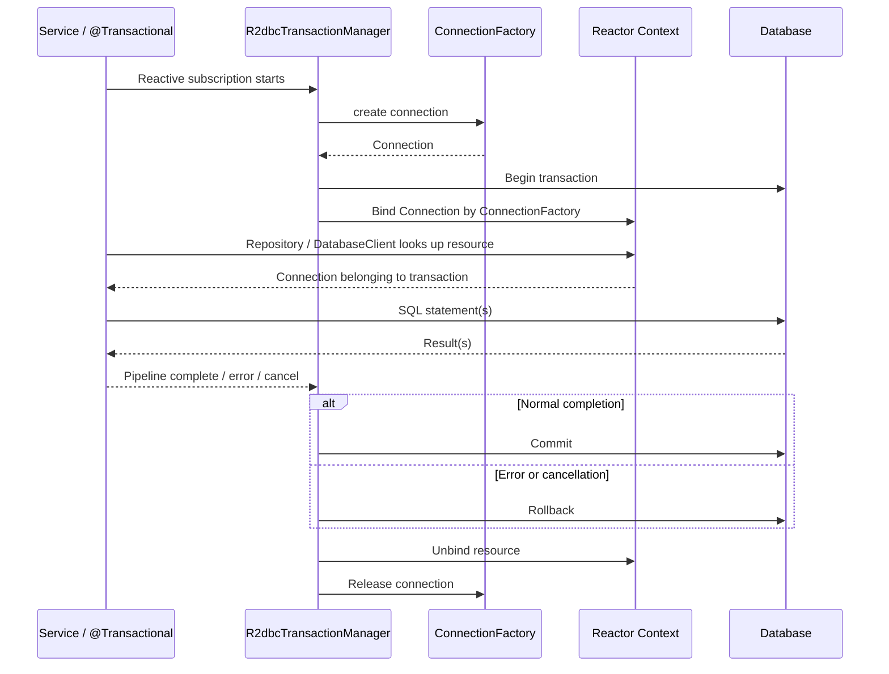

# Binding Transaction Connections via Reactor Context

In Spring Data Relational R2DBC, a reactive transaction must ensure that database operations belonging to the same transaction share the same R2DBC connection. Spring accomplishes this by binding the `Connection` to Reactor's transaction context. `R2dbcTransactionManager` opens the transaction and places the connection into the subscriber's context; Spring data-access components such as `DatabaseClient`, repositories, and `R2dbcEntityTemplate` look up that connection when executing SQL. When the transaction ends, Spring commits or rolls back, unbinds the connection from the context, and releases resources.

Reactor Context is a mechanism for propagating state along a reactive subscription. It does not depend on a fixed thread like `ThreadLocal`. Therefore, a pipeline can switch across multiple threads via `publishOn` or `subscribeOn` and still retain the transaction context, provided operations remain in the same reactive chain. Conversely, manually calling `subscribe()`, `block()`, or creating an independent subscription can detach database operations from the original transaction context.

Understanding this binding explains why two repository calls can share the same connection inside one transaction, why calling `ConnectionFactory.create()` directly can escape Spring's transaction, and why reactive transactions must be structured as one continuous pipeline.

## 1. Why does a transaction need to bind to a connection?

A database transaction is a scope within which multiple SQL operations are coordinated under transactional properties such as atomicity, consistency, isolation, and durability. With R2DBC, SQL operations execute over a `Connection`.

For example, a money transfer requires two operations:

```sql
UPDATE account SET balance = balance - 100 WHERE id = 1;
UPDATE account SET balance = balance + 100 WHERE id = 2;
```

Both statements must belong to the same transaction. If the second statement fails, the database needs to roll back the change from the first statement. This only works when both statements execute on the same connection and within the same transaction started on that connection.

If each statement acquires an independent connection, the debit may run in transaction A while the credit runs outside or in transaction B. In that case, the transaction manager cannot guarantee that both operations commit or roll back as one unit.

With Spring Data R2DBC, `R2dbcTransactionManager` manages connections per `ConnectionFactory` and binds the connection to the reactive transaction context. Data access operations participating in the transaction must obtain connections through Spring's transaction-aware mechanism.

## 2. What is Reactor Context?

Reactor Context is an immutable key/value store attached to the subscriber of a reactive pipeline. It is used to pass state down a reactive flow without relying on the current thread.

In synchronous programming, a framework may use `ThreadLocal` to bind a transaction to a thread. That works when an operation starts and finishes on the same thread. A reactive pipeline can switch threads during execution, so transaction state cannot rely solely on the current thread.

Reactor Context solves this by attaching transaction resources and synchronization state to the subscriber context. Reactor operators forward the context according to their rules, allowing the transaction to remain identifiable when the pipeline runs on another thread.

### Context follows the subscription, not the thread

Example:

```java
Mono<String> pipeline = Mono.just("start")
        .publishOn(Schedulers.boundedElastic())
        .map(value -> value + " -> worker thread");
```

`publishOn` can move downstream processing to a different thread. Reactor Context still belongs to the pipeline's subscription; it is not lost merely because the thread changed.

In contrast, the following code creates a new subscription:

```java
someRepository.save(entity).subscribe();
```

The new subscription does not automatically inherit the transaction context of the pipeline that called it. As a result, the save operation may acquire a different connection and run outside the transaction the caller intended.

### Context is immutable

Reactor Context is modified by creating a new context via operators such as `contextWrite`; values inside it propagate along the subscription. Spring manages the keys holding transaction resources itself. Applications typically do not need to write, delete, or modify transaction resources in the context directly.

Do not try to manually put a connection or transaction manager state into Reactor Context under an arbitrary key as a replacement for `R2dbcTransactionManager`. Resource binding must follow Spring's mechanism to acquire, synchronize, commit, roll back, and release connections properly.

## 3. How does `R2dbcTransactionManager` bind a connection?

`R2dbcTransactionManager` is the reactive transaction manager for a `ConnectionFactory`. When a reactive transaction starts, the general sequence is:

1. Spring intercepts a subscription crossing a transaction boundary, such as a `@Transactional` method returning `Mono` or `Flux`.
2. The transaction manager acquires a `Connection` from the configured `ConnectionFactory`.
3. The connection is placed into the appropriate transactional mode and a transaction is started via the R2DBC API.
4. Spring creates a transaction resource holder and binds it to the subscriber's reactive transaction context, keyed by the `ConnectionFactory`.
5. Spring data-access operations look up the bound resource instead of creating a new connection.
6. When the pipeline completes normally, the transaction manager commits; if the pipeline errors or is cancelled under reactive transaction semantics, the transaction manager rolls back.
7. Spring unbinds the resource from context, performs necessary cleanup, and returns the connection to the pool or releases it.

General sequence diagram:



This is a conceptual model. Details of begin/commit/rollback, connection reset, and release depend on the driver, pool, and Spring Framework version. The main takeaway is that the connection is bound to the reactive transaction context so operations in the same transaction look up the exact same resource.

## 4. Configuring the transaction manager

In a Spring application using a single `ConnectionFactory`, you can declare an `R2dbcTransactionManager`:

```java
@Configuration
public class R2dbcTransactionConfiguration {

    @Bean
    public ReactiveTransactionManager transactionManager(
            ConnectionFactory connectionFactory
    ) {
        return new R2dbcTransactionManager(connectionFactory);
    }
}
```

`R2dbcTransactionManager` needs the same `ConnectionFactory` used by the R2DBC operations participating in the transaction. Spring Boot can auto-configure the transaction manager when auto-configuration conditions match; if the application declares multiple factories or multiple transaction managers, specify explicitly which manager is used.

With one `ConnectionFactory`, the configuration typically looks like:

```text
ConnectionFactory
       |
       +--> R2dbcTransactionManager
       |
       +--> DatabaseClient
       |
       +--> R2dbcEntityTemplate
       |
       +--> Spring Data R2DBC repositories
```

Components that need to participate in the same transaction must use the corresponding factory. If a repository is configured with factory A while the transaction manager manages factory B, that repository will not automatically use the connection bound for B.

## 5. `@Transactional` with reactive return types

Spring supports reactive transactions for methods returning reactive types such as `Mono` or `Flux`, provided an appropriate reactive transaction manager exists.

Example:

```java
@Service
public class TransferService {

    private final AccountRepository accountRepository;

    public TransferService(AccountRepository accountRepository) {
        this.accountRepository = accountRepository;
    }

    @Transactional
    public Mono<Void> transfer(Long fromId, Long toId, BigDecimal amount) {
        return accountRepository.debit(fromId, amount)
                .then(accountRepository.credit(toId, amount))
                .then();
    }
}
```

When the method is called, Spring returns a publisher wrapped by the transaction interceptor. The transaction actually begins when the publisher is subscribed. Repository operations in the pipeline use the same reactive transaction context if they share the same `ConnectionFactory` and Spring-aware data access.

### Reactive transactions start upon subscription

With reactive methods, do not infer that the transaction is already open at the line invoking the method:

```java
Mono<Void> transfer = transferService.transfer(1L, 2L, amount);
```

That line creates/receives a publisher. The transaction and database I/O are triggered when the publisher is consumed. Without subscribing, the operations do not run.

A cold publisher can be subscribed to multiple times. Each subscription may re-execute the pipeline and start a new transaction. Avoid sharing a write publisher and accidentally subscribing multiple times if the operation is not idempotent.

### Must use a reactive transaction manager

Methods returning `Mono`/`Flux` need to be managed by a reactive transaction manager like `R2dbcTransactionManager`. If an application has both imperative and reactive transaction managers, check which manager is selected by configuration/annotations. A JDBC/JPA transaction manager does not manage R2DBC connections.

## 6. `DatabaseClient`, repositories, and templates participating in transactions

Spring's data-access components are designed to recognize bound connections:

- `DatabaseClient` uses Spring's connection lookup mechanism.
- Spring Data R2DBC repositories execute operations through Spring's R2DBC infrastructure.
- `R2dbcEntityTemplate` uses `DatabaseClient`/corresponding mapping infrastructure.
- These operations can participate in the same reactive transaction if they use the same `ConnectionFactory` and are invoked in the same pipeline.

Example combining a repository and `DatabaseClient`:

```java
@Transactional
public Mono<Void> renameAndAudit(Long customerId, String newName) {
    return customerRepository.findById(customerId)
            .switchIfEmpty(Mono.error(
                    new IllegalArgumentException("Customer does not exist")
            ))
            .flatMap(customer -> {
                customer.setName(newName);
                return customerRepository.save(customer);
            })
            .flatMap(saved -> databaseClient.sql("""
                        INSERT INTO audit_log (customer_id, action)
                        VALUES (:customerId, :action)
                        """)
                    .bind("customerId", saved.getId())
                    .bind("action", "CUSTOMER_RENAMED")
                    .fetch()
                    .rowsUpdated()
                    .then());
}
```

If both the repository and `DatabaseClient` use the same factory managed by the transaction manager, both the customer update and the audit insert can execute on the same transactional connection. If the audit operation errors and the error propagates outside the transaction boundary, Spring rolls back both changes.

The critical requirement is that the publishers must be chained together. Merely calling `databaseClient.sql(...)` and discarding the returned publisher does not execute SQL and does not join the transaction.

## 7. `ConnectionFactoryUtils` and transaction-aware connection acquisition

When using the R2DBC SPI directly inside a Spring application, acquire connections via `ConnectionFactoryUtils` instead of calling `ConnectionFactory.create()` directly:

```java
import org.springframework.r2dbc.connection.ConnectionFactoryUtils;

Mono<Connection> connectionMono =
        ConnectionFactoryUtils.getConnection(connectionFactory);
```

`ConnectionFactoryUtils.getConnection(...)` looks up the connection bound to the current transaction. If a connection exists in the reactive context, it returns that connection; if there is no transaction-bound resource, it can acquire a new connection from the factory.

When finished with manual operations, use `ConnectionFactoryUtils.releaseConnection(...)`:

```java
Mono<Void> release = ConnectionFactoryUtils.releaseConnection(
        connection,
        connectionFactory
);
```

If the connection belongs to an active transaction, Spring does not release that connection early; the transaction manager still owns it and will release it at the end of the transaction. If the connection is not managed by a transaction, the helper performs the appropriate release.

Asynchronous connection management example:

```java
public Mono<Long> updateStatus(Long id, String status) {
    return Mono.usingWhen(
            ConnectionFactoryUtils.getConnection(connectionFactory),
            connection -> Mono.from(connection.createStatement(
                            "UPDATE customer SET status = $1 WHERE id = $2"
                    ).bind(0, status)
                     .bind(1, id)
                     .execute())
                    .flatMap(result -> Mono.from(result.getRowsUpdated())),
            connection -> ConnectionFactoryUtils.releaseConnection(
                    connection, connectionFactory
            ),
            (connection, error) -> ConnectionFactoryUtils.releaseConnection(
                    connection, connectionFactory
            ),
            connection -> ConnectionFactoryUtils.releaseConnection(
                    connection, connectionFactory
            )
    );
}
```

This example uses `$1`, `$2` placeholders in PostgreSQL syntax; other drivers may use different parameter markers. When running inside a Spring transaction with the same factory, the connection obtained from `ConnectionFactoryUtils` can be the bound connection. When running outside a transaction, the helper acquires and releases the connection as an independent operation.

In typical application code, `DatabaseClient` is simpler and carries less resource-management risk. Use the raw SPI directly only when you genuinely need low-level statement/connection control.

## 8. Why can calling `ConnectionFactory.create()` directly escape the transaction?

`ConnectionFactory.create()` instructs the factory to create a new connection. That call does not look up any connection already bound to Spring's reactive transaction context.

Error-prone example:

```java
@Transactional
public Mono<Void> updateTwoTables(Long id) {
    return customerRepository.updateStatus(id, "ACTIVE")
            .then(Mono.from(connectionFactory.create())
                    .flatMap(connection ->
                            Mono.from(connection.createStatement(
                                    "INSERT INTO audit_log(customer_id) VALUES ($1)"
                            ).bind(0, id).execute())
                                    .then(Mono.from(connection.close()))
                    ))
            .then();
}
```

The repository update may use the transaction-bound connection, whereas `connectionFactory.create()` acquires a different connection. The audit insert therefore sits outside the transaction. If the second statement fails, the customer update may still commit.

When direct SPI operations are needed inside a Spring transaction, use `ConnectionFactoryUtils.getConnection(...)` and release via the corresponding helper, or move the SQL into `DatabaseClient`.

### When is calling `create()` directly appropriate?

Calling it directly is not wrong in every situation. It is appropriate when the application intentionally manages connections and transactions at the SPI level, or when you want an independent connection outside any Spring transaction. However, do not call it inside a reactive transaction expecting it to automatically participate in resource binding.

## 9. `ConnectionFactory` must be consistent

`R2dbcTransactionManager` binds connections keyed by the `ConnectionFactory` it manages. Database operations needing to participate in the transaction must use the matching factory.

Common misconfigurations:

- Repository uses factory A; transaction manager uses factory B.
- `DatabaseClient` is built from a different factory than the transaction manager's factory.
- The application constructs a new `ConnectionFactory` in a service instead of injecting the configured bean.
- Some operations use another proxy/wrapper or pool, causing resource lookup to miss the resource key used by the transaction manager.
- Multiple databases exist, yet only one transaction manager is specified without selecting the right manager per repository.

Declare and inject the exact same `ConnectionFactory` bean into the transaction manager, `DatabaseClient`, template, and repository configuration. With multiple factories, explicitly configure each group of repositories and its transaction manager.

A single `R2dbcTransactionManager` manages local transactions for one `ConnectionFactory`. It does not automatically create atomic distributed transactions across multiple independent databases/factories. If business logic writes to multiple databases, design an explicit coordination mechanism such as outbox/saga or an appropriate distributed transaction solution; do not assume a single `@Transactional` spans every resource.

## 10. Reactor Context and thread switching

The transaction context is tied to the subscriber and thus does not require a fixed thread. Standard Reactor operators propagate context according to Reactor's rules.

Example:

```java
@Transactional
public Mono<Void> updateCustomer(Long id) {
    return customerRepository.findById(id)
            .publishOn(Schedulers.parallel())
            .flatMap(customer -> {
                customer.setStatus("ACTIVE");
                return customerRepository.save(customer);
            })
            .then();
}
```

`publishOn` moves downstream processing to another scheduler. Switching threads itself does not drop the transaction context. However, code must still avoid concurrent access to mutable state and must not run multiple operations on the same connection in ways unsupported by the driver.

### Do not use ThreadLocal to find a reactive transaction

Avoid writing logic like:

```java
// Not the way to look up an R2DBC transaction.
Connection connection = myThreadLocal.get();
```

The current thread can change between operators. Transaction resources are stored by Spring in Reactor Context and accessed through reactive transaction infrastructure.

### Do not create new subscriptions manually

The following operations risk detaching from the transaction context:

```java
repository.save(entity).subscribe();
repository.findById(id).block();
```

`subscribe()` creates a new subscription. `block()` also consumes the publisher with a separate subscription and blocks the calling thread. Neither is a way to chain an operation into the current pipeline.

Use operators such as `flatMap`, `concatMap`, `then`, `zip`, or `when` to chain publishers and return the final publisher to the framework/caller.

## 11. Reactive Context does not propagate automatically across boundaries outside Reactor

Standard Reactor operators preserve subscriber context. However, when the application offloads work to a non-Reactor callback API, creates another subscription, or dispatches work through a system lacking context-propagation integration, the transaction context is not carried along automatically.

Anti-pattern:

```java
return customerRepository.findById(id)
        .doOnNext(customer -> externalExecutor.execute(() -> {
            // This callback is not part of the original reactive pipeline.
            // Do not perform R2DBC transaction work here.
            customerRepository.save(customer).subscribe();
        }))
        .then();
```

The callback submitted to the executor is no longer part of the same subscription. The `save` publisher is subscribed separately and may use a new connection.

If you need to switch schedulers, use Reactor operators like `publishOn` or `subscribeOn`. If you must integrate with an external callback API, cross that boundary cleanly with data and return to the reactive chain explicitly; do not assume transaction resources move automatically with callbacks.

## 12. `TransactionalOperator` for programmatic transactions

In addition to `@Transactional`, Spring provides `TransactionalOperator` to wrap a publisher in a transaction:

```java
@Configuration
public class TransactionConfiguration {

    @Bean
    public TransactionalOperator transactionalOperator(
            ReactiveTransactionManager transactionManager
    ) {
        return TransactionalOperator.create(transactionManager);
    }
}
```

Usage:

```java
public Mono<Void> updateCustomerAndAudit(Long id, String status) {
    Mono<Void> work = customerRepository.updateStatus(id, status)
            .then(auditRepository.insertStatusChange(id, status))
            .then();

    return transactionalOperator.transactional(work);
}
```

`transactional(...)` wraps the publisher so inner operations execute inside the reactive transaction context. The transaction begins when the publisher is subscribed and ends according to the publisher's terminal signal.

You can use the `execute` callback when you need to interact with the transaction status:

```java
return transactionalOperator.execute(status ->
        customerRepository.updateStatus(id, statusValue)
                .then(auditRepository.insertStatusChange(id, statusValue))
                .then()
).then();
```

Inside the callback, operations still need to be returned/chained into the publisher. Do not call `subscribe()` inside the callback.

### When to use annotations vs. the operator?

| Approach | Best suited for |
| --- | --- |
| `@Transactional` | Transaction is the boundary of a service method and declarative config is easy to read |
| `TransactionalOperator` | Wrapping a specific pipeline segment, flexible transaction boundaries, or programmatic rollback-only control |

Both rely on the reactive transaction manager and Reactor Context. Do not nest multiple unnecessary transaction operators without determining the intended propagation and semantics.

## 13. Errors, cancellation, and rollback

The transaction manager decides commit/rollback based on the reactive pipeline's signals and rollback rules.

### Pipeline completes normally

If the pipeline completes normally, the transaction is usually committed:

```java
return customerRepository.updateStatus(id, "ACTIVE")
        .then(auditRepository.insertStatusChange(id, "ACTIVE"));
```

### Error propagates out of the transaction boundary

If a publisher emits an error and the error propagates outside the transaction boundary, the transaction manager rolls back according to rollback rules:

```java
@Transactional
public Mono<Void> updateThenFail(Long id) {
    return customerRepository.updateStatus(id, "ACTIVE")
            .then(Mono.error(new IllegalStateException("Cannot proceed")));
}
```

### Swallowing errors can cause the transaction to commit

If the application turns an error into normal completion inside the transaction, the transaction manager may observe the pipeline completing successfully and commit:

```java
@Transactional
public Mono<Void> updateAndIgnoreError(Long id) {
    return customerRepository.updateStatus(id, "ACTIVE")
            .then(auditRepository.insertStatusChange(id, "ACTIVE"))
            .onErrorResume(error -> Mono.empty());
}
```

If rollback is required, do not swallow the error before the transaction manager observes the error signal. With `TransactionalOperator`, you can call `status.setRollbackOnly()` when you need to handle the error yet still return a fallback result. With declarative transactions, let the error propagate out or configure an appropriate rollback rule.

### Cancellation

In reactive transactions, cancellation is a meaningful terminal signal. If the subscriber cancels the pipeline, the transaction manager can roll back the transaction. Operators such as `take(n)`, `next()`, `timeout`, or client disconnects can trigger cancellation. Be careful when using them around a write publisher or a long transactional `Flux`.

Do not treat the fact that a subscriber received partial data from a `Flux` as proof that the transaction committed. With transactions, understand when the entire publisher completes and the transaction manager performs the commit.

## 14. Propagation and multiple transaction contexts

Spring's propagation attributes remain meaningful for reactive transactions, though behavior occurs via the reactive context rather than thread-bound state.

Common propagation modes:

| Propagation | General meaning |
| --- | --- |
| `REQUIRED` | Join existing transaction; create a new one if none exists |
| `REQUIRES_NEW` | Suspend current transaction and create a new one if the transaction manager supports that coordination |
| `SUPPORTS` | Join if a transaction exists; otherwise run without a transaction |
| `MANDATORY` | Require an existing current transaction |
| `NOT_SUPPORTED` | Run without a transaction, suspending the current transaction if present |
| `NEVER` | Fail if a transaction is currently active |

Example:

```java
@Transactional(propagation = Propagation.REQUIRED)
public Mono<Void> updateAccount(...) {
    // Join existing transaction or open a new transaction.
}
```

When `REQUIRES_NEW` is needed, the transaction manager must be able to suspend the current resource and create a new one; test with your Spring version and driver. Each new transaction may hold a separate connection, so deep nesting can increase connection pool demand.

`R2dbcTransactionManager` manages one connection per `ConnectionFactory`. Transactions on different factories do not automatically merge into a single distributed transaction.

## 15. One connection per transaction and concurrency

Normally, a reactive transaction is bound to a single connection. Operations in the pipeline participating in the transaction share that connection. This lets them share transaction state, yet it does not mean every driver permits running arbitrary concurrent statements on the same connection.

Example:

```java
return Mono.when(
        repository.updateA(),
        repository.updateB()
);
```

`Mono.when` subscribes to the input publishers concurrently. If both share a single transaction-bound connection, the driver may have to serialize them, disallow it, or handle concurrency according to its own rules. For order-dependent operations or drivers that do not support concurrent statements on one connection, use:

```java
return repository.updateA()
        .then(repository.updateB());
```

or:

```java
return repository.findAllInputs()
        .concatMap(repository::save);
```

Do not increase concurrency with `flatMap` inside a transaction just to try to go faster. Check driver capabilities and measure in practice. If true parallelism is needed, you may need to split work into independent transactions, each using its own connection; in that case they are no longer atomic as a single transaction.

## 16. Connection pools and transaction hold time

When using a pool, the connection is acquired from the pool by the transaction manager and held throughout the transaction. After commit/rollback and cleanup, the connection is returned to the pool.

This means long transactions hold connections longer and reduce connections available to other requests. If the pool has a small `maxSize` and many transactions run long, new requests may wait to acquire connections or time out.

Keep transactions short:

- Put only database operations that need atomicity into the same transaction.
- Avoid HTTP calls, sending emails, or waiting on external services while holding a transaction.
- Avoid heavy CPU processing inside a transaction if there is no need to hold the connection.
- Do not hold transactions open across user interactions or multi-page browsing.
- Monitor transaction duration, pool acquired/idle/pending counts, and acquire latency.

If you need to send messages after commit, consider the outbox pattern or appropriate transaction synchronization instead of holding a connection while calling an external broker.

## 17. Multiple `ConnectionFactory` instances and multiple databases

A single R2DBC reactive transaction manager manages one `ConnectionFactory`. If an application has a customer database and an analytics database with two different factories, one transaction manager does not bind both connections into a single shared ACID transaction.

You can declare multiple transaction managers:

```java
@Bean
ReactiveTransactionManager customerTransactionManager(
        @Qualifier("customerConnectionFactory") ConnectionFactory factory
) {
    return new R2dbcTransactionManager(factory);
}

@Bean
ReactiveTransactionManager analyticsTransactionManager(
        @Qualifier("analyticsConnectionFactory") ConnectionFactory factory
) {
    return new R2dbcTransactionManager(factory);
}
```

Services must select the transaction manager matching the repository/factory they use, for example via qualifier/transaction manager name in `@Transactional` per Spring configuration. Operations across the two databases will belong to two separate local transactions if opened separately; one transaction can commit while the other fails.

If business logic needs to coordinate multiple resources, design around eventual consistency, outbox/saga, or an appropriate distributed solution. Do not assume Reactor Context automatically turns multiple connections into a single shared transaction.

## 18. Checking transaction context during debugging

When two operations do not share a transaction as expected, check in order:

1. Does the method return `Mono`/`Flux` or an appropriate reactive publisher?
2. Is there a reactive transaction manager such as `R2dbcTransactionManager`?
3. Does the transaction manager use the exact same `ConnectionFactory` as repositories/`DatabaseClient`?
4. Are all database operations inside the same publisher chain?
5. Is `subscribe()`, `block()`, or a new subscription being called anywhere?
6. Is `ConnectionFactory.create()` being called directly instead of `ConnectionFactoryUtils.getConnection()` in SPI code?
7. Is self-invocation causing a `@Transactional` method to bypass the proxy?
8. Is `onErrorResume` swallowing errors before the transaction boundary?
9. Is cancellation happening via `take`, `next`, `timeout`, or client disconnect?
10. Are multiple factories or transaction managers causing the wrong manager to be chosen?

### Self-invocation and proxies

In proxy-based transaction configuration, calling a `@Transactional` method from another method on the same instance (`this.someTransactionalMethod()`) typically bypasses the proxy. Therefore, the interceptor may not open a new transaction for the internally called method. If a transaction was already opened by an outer caller, the operation can still participate in that transaction; however, do not rely on annotations on self-invoked methods to create a new boundary.

The solution is to place the transaction boundary on a method called through a Spring proxy, split service beans, or use `TransactionalOperator` when wrapping a pipeline directly.

### Connection and transaction logging

You can enable appropriate logging for Spring transactions, the R2DBC driver, and the pool to observe acquire, begin, commit, rollback, and release events. Avoid logging passwords, tokens, or sensitive payloads. Connection object identity in logs can help compare connections, but should not be used as application logic to verify transactions; rely on the transaction manager, factory, and database behavior.

## 19. Testing connection binding via Reactor Context

An integration test should prove that repository and `DatabaseClient` operations participate in the same transaction, and that rollback occurs when the pipeline fails.

Service example:

```java
@Transactional
public Mono<Void> updateAndFail(Long id) {
    return customerRepository.updateStatus(id, "CHANGED")
            .then(databaseClient.sql("""
                        INSERT INTO audit_log (customer_id, action)
                        VALUES (:id, :action)
                        """)
                    .bind("id", id)
                    .bind("action", "TEST")
                    .fetch()
                    .rowsUpdated())
            .then(Mono.error(new IllegalStateException("force rollback")));
}
```

Test:

```java
StepVerifier.create(service.updateAndFail(10L))
        .expectError(IllegalStateException.class)
        .verify();

StepVerifier.create(customerRepository.findById(10L))
        .assertNext(customer ->
                assertThat(customer.getStatus()).isEqualTo("ACTIVE")
        )
        .verifyComplete();

StepVerifier.create(auditRepository.countByCustomerId(10L))
        .expectNext(0L)
        .verifyComplete();
```

This test assumes initial data has status `ACTIVE`, and the transaction manager and data access components share the same factory. If both the customer update and the audit insert roll back, that demonstrates both operations participated in a shared transaction boundary.

### Testing the bug caused by acquiring a connection directly

You can create a control integration test where one operation uses `ConnectionFactory.create()` independently. That operation does not automatically join the bound connection. The result can show changes on the transaction-bound connection rolling back while the operation on the independent connection commits on its own. Only run such a control test against a test database with controlled transaction boundaries.

### Testing cancellation

With a `Flux` publisher wrapped in a reactive transaction, test cancellation from operators like `take(1)` or timeouts to confirm the transaction rolls back under Spring's semantics. Avoid writing tests that only verify the subscriber received the first item and conclude the transaction committed.

## 20. Common mistakes

| Symptom | Possible cause | Resolution |
| --- | --- | --- |
| Partial changes commit despite a later operation failing | An operation acquires a new connection outside the transaction context | Use the same factory and `ConnectionFactoryUtils`/`DatabaseClient` |
| Repository and custom SQL do not roll back together | Both sides use different `ConnectionFactory` beans | Configure the same factory and reactive transaction manager |
| `@Transactional` does not open a transaction | Method does not return a suitable reactive type or bypasses proxy | Use a reactive return type and check proxy/configuration |
| Transaction does not execute when method is called | Publisher is never subscribed | Return the publisher to the caller and let it be consumed |
| Write operation runs outside transaction | Calling `subscribe()` or `block()` manually | Chain publishers using Reactor operators |
| Code fails after `publishOn` | Mistakenly assuming transaction context depends on thread | Use Reactor pipeline; do not use `ThreadLocal` for reactive resources |
| Direct SPI uses a different connection | Calling `ConnectionFactory.create()` | Use `ConnectionFactoryUtils.getConnection()` |
| Error swallowed yet data still commits | `onErrorResume` turns error into normal completion | Let error propagate or mark rollback-only |
| Transaction rolls back when client cancels | Cancellation is treated as a rollback signal | Design publisher/cancellation and transaction scope clearly |
| Pool runs out of connections | Long transactions or deeply nested transactions | Shorten transactions, limit concurrency, and monitor pool |
| Two operations on same connection fail concurrently | Driver does not support concurrent statements on one connection | Serialize with `then`/`concatMap` or check driver support |
| Writes to two databases are not atomic | One transaction manager only manages one factory | Design eventual consistency/outbox/saga or suitable solution |

## 21. Reactive transaction design workflow

When a service needs multiple R2DBC operations in the same transaction, follow this sequence:

1. Identify which database operations must commit or roll back together.
2. Choose one `ConnectionFactory` and reactive transaction manager for that resource.
3. Ensure relevant repositories, `DatabaseClient`, and templates use the same factory.
4. Set the boundary with `@Transactional` on a reactive method or `TransactionalOperator`.
5. Chain all operations using Reactor operators and return the final publisher.
6. If using the SPI directly, acquire/release connections via `ConnectionFactoryUtils` to recognize bound resources.
7. Do not self-subscribe, block, or move R2DBC work into callbacks outside the pipeline.
8. Define rollback rules, error handling, cancellation, and retries.
9. Keep transactions short so connections are not held in the pool for too long.
10. Test rollback across repositories and `DatabaseClient`, cancellation, and multi-factory scenarios.

## 22. Key takeaways

- Spring R2DBC reactive transactions bind connections to Reactor's subscriber context rather than relying on a fixed thread.
- `R2dbcTransactionManager` acquires a connection from `ConnectionFactory`, begins a transaction, and binds the resource into Reactor Context keyed by factory.
- Spring's `DatabaseClient`, repositories, and `R2dbcEntityTemplate` can look up the bound connection if they use the same factory.
- Calling `ConnectionFactory.create()` directly creates a new connection and does not look up a transaction-bound connection.
- When using the R2DBC SPI inside a Spring transaction, use `ConnectionFactoryUtils.getConnection()` and `releaseConnection()`.
- Reactive transactions begin when the publisher is subscribed; creating a `Mono`/`Flux` does not open a transaction or execute SQL.
- Reactor Context follows the subscription, so switching threads via Reactor operators does not automatically lose the transaction context.
- `subscribe()`, `block()`, or callbacks creating separate subscriptions can detach operations from the current transaction.
- Errors crossing a transaction boundary typically lead to rollback per rollback rules; swallowing errors into completion can cause the transaction to commit.
- Cancellation can lead to rollback; watch out for `take`, `next`, `timeout`, and client disconnects around transactional `Flux` streams.
- An R2DBC transaction typically holds one connection; do not assume drivers allow concurrent statements on that connection.
- The connection is held until the transaction ends; long transactions reduce connection pool capacity.
- One `R2dbcTransactionManager` manages one `ConnectionFactory`; multiple factories do not automatically form one distributed transaction.

When you need to ensure multiple R2DBC operations share a transaction, keep them in the same reactive pipeline and ensure all data access goes through Spring's connection lookup mechanism with the proper `ConnectionFactory`. Reactor Context preserves the link between subscriber and connection; the transaction manager uses that link to commit or roll back the right resource when the pipeline ends.
