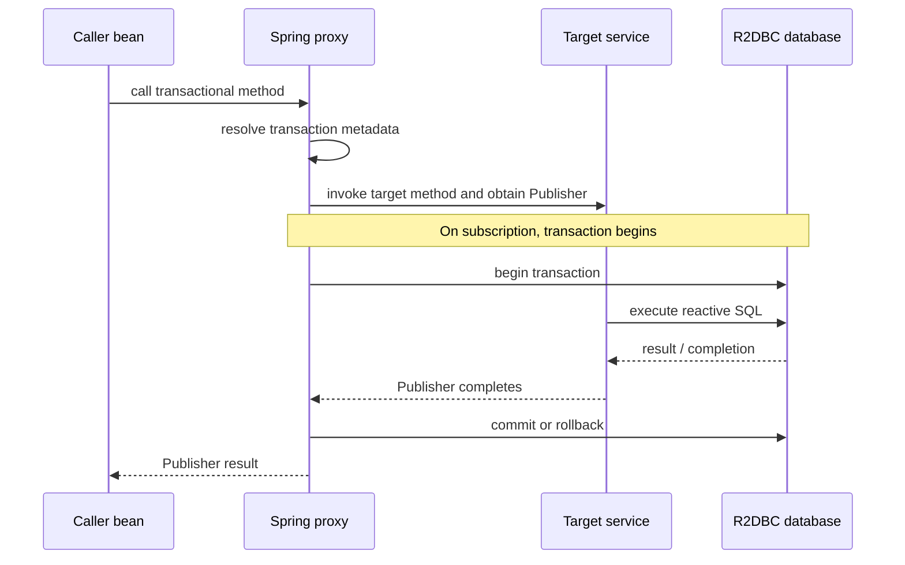
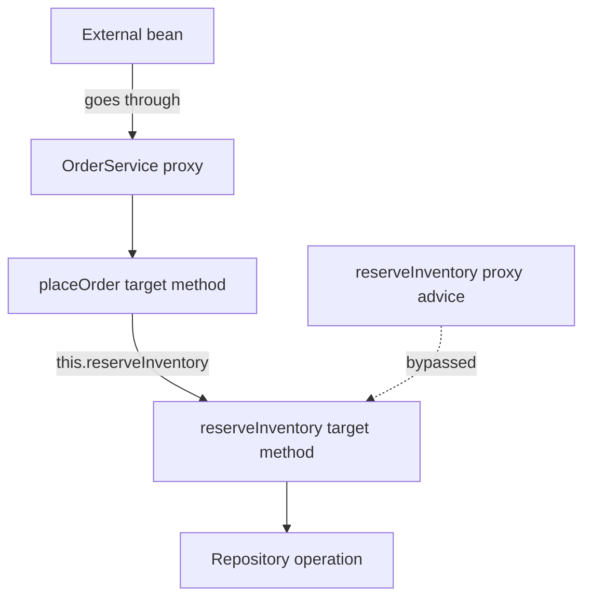

# Proxy-Based Transaction Boundaries and the Self-Invocation Problem

Spring manages transactions by intercepting method calls through an intermediary mechanism. With default proxy-based transaction configuration, a call from another bean goes through the proxy and receives the `@Transactional` attributes. A call from one method to another method on the same object goes directly through `this`, bypassing the proxy. This is a common reason why transaction annotations on self-invoked methods do not take effect as expected.

In Spring Data Relational R2DBC, this issue must be understood alongside the reactive model. Transactions are tied to subscription and the Reactor Context rather than relying on a single thread holding transaction state. The transaction boundary must cover the entire publisher containing the database operations that need to commit or roll back together.

This lesson explains how proxies apply transaction advice, why self-invocation bypasses advice, how to structure services so transaction boundaries work properly with R2DBC, and how to test commit/rollback behavior.

## 1. How does @Transactional work through a proxy?

In default proxy-based mode, Spring creates a proxy wrapping a bean that has transaction-managed methods. When another bean calls a method via the reference provided by Spring, the proxy can:

1. Read `@Transactional` metadata.
2. Select the appropriate transaction manager.
3. Start a transaction or join an existing transaction according to propagation.
4. Invoke the method on the target object.
5. Observe the outcome to commit or roll back.
6. Return the result to the caller.

General model:



The proxy is the point where Spring can apply transaction advice. The target object does not automatically inspect annotations every time a Java method is invoked.

### Calling through a proxy

Suppose we have two beans:

```java
@Service
public class CheckoutControllerService {

    private final OrderService orderService;

    public CheckoutControllerService(OrderService orderService) {
        this.orderService = orderService;
    }

    public Mono<Order> checkout(CheckoutCommand command) {
        return orderService.placeOrder(command);
    }
}
```

```java
@Service
public class OrderService {

    private final OrderRepository orders;

    public OrderService(OrderRepository orders) {
        this.orders = orders;
    }

    @Transactional
    public Mono<Order> placeOrder(CheckoutCommand command) {
        Order order = Order.from(command);
        return orders.save(order);
    }
}
```

`CheckoutControllerService` receives the `OrderService` bean from Spring. That reference is typically a proxy. When `checkout` calls `orderService.placeOrder`, the call passes through the proxy, so transaction metadata is applied if the transaction manager is configured properly.

## 2. Why does self-invocation bypass the proxy?

Self-invocation occurs when one method invokes another method on the same instance via an internal call, such as `this.reserveInventory(...)` or calling `reserveInventory(...)` directly.

Consider this service:

```java
@Service
public class OrderService {

    @Transactional
    public Mono<Order> placeOrder(CheckoutCommand command) {
        return reserveInventory(command)
            .then(saveOrder(command));
    }

    @Transactional(propagation = Propagation.REQUIRES_NEW)
    public Mono<Void> reserveInventory(CheckoutCommand command) {
        return inventoryRepository.reserve(command);
    }
}
```

An external caller may invoke `placeOrder` through the proxy, so `placeOrder`'s transaction is applied. However, when code inside `placeOrder` calls `reserveInventory`, that call goes straight to the method on the same target object. It does not go back through the proxy.

Consequences:

- The annotation on `reserveInventory` is not read for that internal call.
- `Propagation.REQUIRES_NEW` is not applied.
- Method-specific attributes such as isolation, timeout, `readOnly`, or rollback rules also do not establish a new boundary through the internal call.
- If `placeOrder` already has a transaction, repository operations inside `reserveInventory` typically still execute within the outer transaction via Reactor Context; what gets bypassed is the method-specific metadata of `reserveInventory`.

Self-invocation does not mean all transactions disappear. If the caller already entered a transactional method through a proxy, the outer transaction still covers the returned publisher. The problem is that annotations on the self-invoked method are not activated as a fresh proxy interception.

### Call path illustration



When `placeOrder` calls `reserveInventory` on itself, the proxy advice branch for `reserveInventory` is not traversed. This is a rule of proxy-based AOP, not behavior specific to R2DBC.

## 3. Distinguishing the outer transaction from the self-invoked method's annotation

Two questions must be separated:

- Is there already a transaction surrounding the current call?
- Is the annotation on the method just invoked being applied by a proxy?

For example, a caller invokes `placeOrder` through a proxy, and `placeOrder` has `@Transactional`. A transaction begins for the publisher returned by `placeOrder`. When that publisher calls repositories and subsequent reactive steps, they can participate in that transaction.

If `placeOrder` self-invokes `reserveInventory` annotated with `REQUIRES_NEW`, the `REQUIRES_NEW` part is not applied. `reserveInventory` runs inside `placeOrder`'s existing transaction context if one exists, or without a transaction if the outer caller also created none.

| Invocation pattern | Is transaction metadata applied? |
| --- | --- |
| Bean A calls bean B through Spring proxy reference | Yes, if the method is proxy-supported and transaction config is valid. |
| Method in bean calls `this.otherMethod()` | Does not apply `otherMethod`'s own metadata via proxy. |
| Method in bean calls `otherMethod()` without `this` | Still self-invocation; does not go through proxy. |
| Another bean calls a method on bean B | Can go through proxy as normal. |
| Calling a method from constructor or `@PostConstruct` on the same instance | Does not go through proxy like a call from another bean. |

The key is to design transaction boundaries around business flows rather than putting annotations on every method and assuming they always open independent transactions.

## 4. Preferred fix: move the work into another bean

The clearest and easiest-to-test approach is moving the part that needs its own transaction boundary into another collaborator. Calls between the two beans pass through the target bean's proxy.

For example, suppose the business requirement is creating the order in the main transaction while inventory reservation must run in a new transaction:

```java
@Service
public class InventoryReservationService {

    private final InventoryRepository inventory;

    public InventoryReservationService(InventoryRepository inventory) {
        this.inventory = inventory;
    }

    @Transactional(propagation = Propagation.REQUIRES_NEW)
    public Mono<Void> reserve(CheckoutCommand command) {
        return inventory.reserve(
            command.productId(),
            command.quantity()
        );
    }
}
```

Orchestrating service:

```java
@Service
public class OrderService {

    private final InventoryReservationService reservations;
    private final OrderRepository orders;

    public OrderService(
            InventoryReservationService reservations,
            OrderRepository orders) {
        this.reservations = reservations;
        this.orders = orders;
    }

    @Transactional
    public Mono<Order> placeOrder(CheckoutCommand command) {
        return reservations.reserve(command)
            .then(Mono.defer(() -> orders.save(Order.from(command))));
    }
}
```

`OrderService` calls the `InventoryReservationService` bean through the Spring-injected reference. If `REQUIRES_NEW` is supported by the transaction manager and the call goes through the proxy, Spring can suspend the current transaction, open a new transaction for the reservation operation, and then return to the outer transaction.

The new transaction typically needs a separate connection while the outer transaction's connection is still held. Therefore, the connection pool must have enough capacity for transactions nested this way. If the pool has only one connection, the `REQUIRES_NEW` call may end up waiting for the connection held by the outer transaction and eventually time out. Account for concurrent transactions and nesting depth when sizing the pool.

Determine business semantics before choosing `REQUIRES_NEW`. If the inventory reservation transaction commits successfully while the order creation transaction fails, the reservation may remain in place. That could require a release step, retries, or a compensating workflow. If both operations must succeed or roll back together, they should usually share the same transaction rather than being split with `REQUIRES_NEW`.

### Splitting beans by responsibility

Do not create a bean solely to trick the proxy. Split when the work genuinely has its own responsibility or transaction boundary, such as:

- Reserving or releasing inventory.
- Writing an independent audit record.
- Saving a separate aggregate.
- Executing an operation requiring different propagation or timeout.
- Coordinating a step with a distinct rollback policy.

This structure clarifies dependencies and makes each service independently testable.

## 5. Alternative: using TransactionalOperator for explicit boundaries

With reactive R2DBC, `TransactionalOperator` is a good choice when you need precise control over which publisher runs inside a transaction. Instead of relying solely on annotations through proxies, code wraps reactive chains directly with the operator.

Configuring the transaction manager:

```java
@Configuration
public class R2dbcTransactionConfiguration {

    @Bean
    ReactiveTransactionManager transactionManager(
            ConnectionFactory connectionFactory) {
        return new R2dbcTransactionManager(connectionFactory);
    }

    @Bean
    TransactionalOperator transactionalOperator(
            ReactiveTransactionManager transactionManager) {
        return TransactionalOperator.create(transactionManager);
    }
}
```

Service using the operator:

```java
@Service
public class OrderService {

    private final OrderRepository orders;
    private final OrderLineRepository orderLines;
    private final TransactionalOperator tx;

    public OrderService(
            OrderRepository orders,
            OrderLineRepository orderLines,
            TransactionalOperator tx) {
        this.orders = orders;
        this.orderLines = orderLines;
        this.tx = tx;
    }

    public Mono<Order> placeOrder(CheckoutCommand command) {
        Mono<Order> work = orders.save(Order.from(command))
            .flatMap(saved ->
                orderLines.saveAll(
                    OrderLine.from(saved.id(), command.items())
                )
                .then(Mono.just(saved))
            );

        return tx.transactional(work);
    }
}
```

`tx.transactional(work)` wraps the combined publisher of saving the order and saving order lines. If the publisher completes normally, the transaction commits. If the publisher emits an error, the transaction rolls back according to the transaction manager's policy.

This approach is useful when:

- Only part of a method needs a transaction.
- There are multiple reactive chains with different boundaries.
- You want to avoid depending on whether a method is invoked through a proxy.
- You want to express the transaction boundary right next to the wrapped publisher chain.

Do not wrap individual repository commands separately if those commands must be atomic together. Wrap the entire publisher representing a unit of work.

## 6. Reactive transactions are tied to subscription and Reactor Context

With R2DBC, transactions are not maintained by pinning a fixed thread. Spring manages transaction resources in Reactor Context so subsequent reactive operations can reuse the same connection bound to the transaction.

A reactive method may construct a publisher first, yet SQL only executes when the publisher is subscribed. The transaction interceptor or `TransactionalOperator` coordinates the transaction lifecycle with subscription:

1. Subscriber subscribes to the publisher.
2. Transaction manager acquires a connection and begins the transaction.
3. Publisher executes database operations inside the transaction context.
4. Publisher completes -> commit.
5. Publisher emits an error -> roll back according to rollback rules.

Therefore, a `@Transactional` method should return `Mono`, `Flux`, or a reactive `Publisher` supported by the transaction manager. If the method calls `subscribe()` internally, the work chain can detach from the publisher managed by the proxy.

### Do not self-subscribe inside services

Avoid writing:

```java
@Transactional
public Mono<Order> placeOrder(CheckoutCommand command) {
    orders.save(Order.from(command)).subscribe();

    return Mono.just(Order.pending(command));
}
```

`subscribe()` creates an independent subscription. Transaction advice tracks the returned publisher, yet the save operation has been detached from that publisher. It may run outside the transaction, errors will not propagate to the caller, and the method may complete before the insert finishes.

Chain operations with operators instead:

```java
@Transactional
public Mono<Order> placeOrder(CheckoutCommand command) {
    return orders.save(Order.from(command))
        .flatMap(saved ->
            orderLines.saveAll(
                OrderLine.from(saved.id(), command.items())
            )
            .thenReturn(saved)
        );
}
```

All operations that must share a transaction must be inside the same publisher composition and use the same transaction manager/`ConnectionFactory` setup.

### Avoid block() in reactive flows

Calling `block()` in a reactive service interrupts the non-blocking chain and can cause deadlocks or incorrect transaction context usage. Compose publishers using `flatMap`, `then`, `zip`, or other suitable operators. Only bridge to blocking at a clearly designed application boundary—not inside a transaction-managed reactive flow.

## 7. Configuring the right transaction manager for R2DBC

For `@Transactional` or `TransactionalOperator` to control R2DBC transactions, the application needs a `ReactiveTransactionManager`, typically `R2dbcTransactionManager` tied to the active `ConnectionFactory`.

```java
@Bean
ReactiveTransactionManager transactionManager(
        ConnectionFactory connectionFactory) {
    return new R2dbcTransactionManager(connectionFactory);
}
```

Keep these points in mind:

- Repositories, `DatabaseClient`, and `R2dbcEntityTemplate` must use the `ConnectionFactory` matching the transaction manager.
- With multiple databases, specify the transaction manager for each service or annotation.
- Do not assume a JDBC `PlatformTransactionManager` can manage R2DBC connections.
- If a method returns a reactive publisher, use a reactive transaction manager.
- When configuring multiple transaction managers, specify the bean name in `@Transactional(transactionManager = "...")`.

Example specifying a manager:

```java
@Transactional(transactionManager = "ordersTransactionManager")
public Mono<Order> placeOrder(CheckoutCommand command) {
    return orders.save(Order.from(command));
}
```

A transaction does not automatically span an operation using a different `ConnectionFactory`. If a service calls two independent databases, a regular `R2dbcTransactionManager` does not turn them into a distributed transaction.

## 8. Effective scope of @Transactional

`@Transactional` can be placed on a class or a method. Method-level annotations typically override the corresponding metadata from the class for that method.

```java
@Service
@Transactional(readOnly = true)
public class OrderQueryService {

    public Flux<Order> findRecent() {
        return orders.findRecent();
    }

    @Transactional
    public Mono<Order> create(Order order) {
        return orders.save(order);
    }
}
```

This example illustrates a read-only class default and a `create` method declaring a write transaction. Specific `readOnly` behavior depends on the transaction manager and database; do not treat it as an absolute safeguard preventing writes.

Proxy notes:

- The method must be invoked through the proxy.
- With JDK proxies, callers typically invoke through an interface implemented by the proxy.
- With class-based proxies, `final` methods cannot be overridden to intercept via normal subclass proxying.
- `private` methods are not normal entry points for proxy transactions.
- Prefer placing transaction boundaries on `public` service methods called from another bean.
- Do not rely on annotations on `private` helpers or methods that are only self-invoked.

Exact visibility constraints depend on proxy type and Spring version. The most reliable design is placing transaction boundaries on `public` service APIs and invoking them from other beans, or wrapping publishers with `TransactionalOperator`.

## 9. Propagation and self-invocation

Propagation determines behavior when a transactional call occurs while a transaction is already active. Common modes:

| Propagation | Meaning |
| --- | --- |
| REQUIRED | Join the current transaction; create a new one if none exists. |
| REQUIRES_NEW | Suspend the current transaction and create a new transaction. |
| SUPPORTS | Join a transaction if one exists; otherwise run without a transaction. |
| MANDATORY | Require an existing current transaction. |
| NOT_SUPPORTED | Suspend the current transaction and run without a transaction. |
| NEVER | Fail if a transaction is currently active. |

With proxy-based AOP, propagation is only processed when the call goes through the proxy. If `placeOrder` self-invokes `reserveInventory` annotated with `REQUIRES_NEW`, that annotation does not create a new transaction. `reserveInventory` continues running inside the active transaction if the publisher runs within that transaction.

This also holds for `REQUIRED`: if a self-invoked method has `REQUIRED`, the proxy does not need to step in to create a separate transaction; the publisher can still participate in the outer transaction. However, the internal call's own metadata is ignored—for instance, timeout, isolation, or rollback rules declared specifically on the self-invoked method will not apply to that call.

### When REQUIRES_NEW is genuinely needed

If an operation must commit independently of the outer transaction, place it in another bean and invoke it through the proxy, or set up a separate `TransactionalOperator` chain with an appropriate transaction manager.

Weigh the business consequences: the new transaction can commit even if the outer transaction rolls back. Using it for audits or reservations can leave data needing compensation workflows. Do not use `REQUIRES_NEW` just to guarantee a transaction without defining the commit relationship between the two parts.

## 10. Rollback and reactive error handling

With `@Transactional`, Spring decides commit versus rollback based on the publisher outcome and rollback rules. By default, unchecked exceptions and `Error` trigger rollback; checked exceptions do not roll back by default unless a corresponding rule is declared.

You can declare this explicitly:

```java
@Transactional(rollbackFor = BusinessRuleException.class)
public Mono<Order> placeOrder(CheckoutCommand command) {
    return orders.save(Order.from(command))
        .flatMap(saved ->
            validateAndReserve(saved, command)
                .thenReturn(saved)
        );
}
```

In a reactive flow, errors travel via the error signal. If code turns an error into a normal result before the transaction boundary sees it, the transaction may commit.

Example:

```java
@Transactional
public Mono<Order> placeOrder(CheckoutCommand command) {
    return orders.save(Order.from(command))
        .onErrorResume(error -> Mono.just(Order.fallback(command)));
}
```

`onErrorResume` turns an error signal into normal completion if the fallback emits a value. The transaction manager may consider the publisher successful and commit. If you want rollback, let the error propagate outside the transaction boundary or mark rollback-only via the appropriate API.

With `TransactionalOperator`, you can set rollback-only inside an `execute` callback:

```java
return transactionalOperator.execute(status ->
    orders.save(order)
        .onErrorResume(error -> {
            status.setRollbackOnly();
            return Mono.error(error);
        })
).single();
```

This example illustrates marking rollback-only and then continuing to emit the error. With `TransactionalOperator.transactional(publisher)`, usually it suffices to let the error escape the wrapped publisher. Avoid swallowing errors inside the chain when rollback is intended.

## 11. Self-invocation through an example with two transaction policies

Suppose a service has two operations:

- `createOrder`: creates an order and writes order lines in one transaction.
- `writeAudit`: writes an independent audit record, intended to run with `REQUIRES_NEW`.

Error-prone design:

```java
@Service
public class OrderService {

    @Transactional
    public Mono<Order> createOrder(CheckoutCommand command) {
        return orders.save(Order.from(command))
            .flatMap(order ->
                writeAudit(order)
                    .thenReturn(order)
            );
    }

    @Transactional(propagation = Propagation.REQUIRES_NEW)
    public Mono<Void> writeAudit(Order order) {
        return auditRepository.save(AuditEntry.created(order))
            .then();
    }
}
```

`writeAudit` is called internally. `REQUIRES_NEW` is not applied, so the audit record can end up inside the order-creation transaction. If order creation rolls back, the audit also rolls back.

If the audit must genuinely commit independently, extract it into a bean:

```java
@Service
public class AuditService {

    private final AuditRepository auditRepository;

    public AuditService(AuditRepository auditRepository) {
        this.auditRepository = auditRepository;
    }

    @Transactional(propagation = Propagation.REQUIRES_NEW)
    public Mono<Void> recordOrderCreated(Order order) {
        return auditRepository.save(AuditEntry.created(order))
            .then();
    }
}
```

```java
@Service
public class OrderService {

    private final OrderRepository orders;
    private final AuditService auditService;

    public OrderService(
            OrderRepository orders,
            AuditService auditService) {
        this.orders = orders;
        this.auditService = auditService;
    }

    @Transactional
    public Mono<Order> createOrder(CheckoutCommand command) {
        return orders.save(Order.from(command))
            .flatMap(order ->
                auditService.recordOrderCreated(order)
                    .thenReturn(order)
            );
    }
}
```

The call from `OrderService` to `AuditService` passes through the proxy. However, remember: if the audit transaction commits first and then the order transaction rolls back, the audit records "order created" even though the order does not exist. That may be incorrect business semantics.

If audits must accurately reflect committed events, consider writing an outbox record inside the order transaction and publishing events after commit. Do not use `REQUIRES_NEW` mechanically for every audit log.

## 12. Calling through a proxy can alter reactive execution timing

When a method returns `Mono` or `Flux`, the proxy typically returns a transaction-wrapped publisher. The actual transaction starts when that publisher is subscribed, not necessarily at the moment the method is called to obtain the publisher.

Example:

```java
Mono<Order> result = orderService.placeOrder(command);
// At this point the publisher is created; reactive operations have not necessarily executed.

return result;
```

When the web framework or another subscriber subscribes to `result`, the transaction lifecycle occurs. If the same publisher is subscribed multiple times, each subscription can trigger a separate execution and transaction. Avoid sharing a publisher with side effects among multiple subscribers unless explicitly intended.

Operators such as `defer` are helpful when you need to construct objects or read state at subscription time:

```java
@Transactional
public Mono<Order> placeOrder(CheckoutCommand command) {
    return Mono.defer(() -> {
        Order order = Order.from(command);
        return orders.save(order);
    });
}
```

`defer` does not create a transaction itself; the transaction still comes from the proxy or `TransactionalOperator`. It only delays creating the inner publisher until subscription occurs.

## 13. Other workarounds and when to avoid them

Besides extracting a bean and `TransactionalOperator`, several other options exist:

### Self-injection

A bean can inject its own proxy and call methods through that reference. This can route calls through the proxy, yet it easily introduces circular dependencies, obscures code readability, and blurs responsibility boundaries. Do not choose it as a default solution.

### Retrieving the current proxy

Spring can allow obtaining the current proxy if expose-proxy is enabled and `AopContext` is used. This couples code to AOP infrastructure, reduces independence, and makes testing harder. Consider it only when clearly justified and clean refactoring is infeasible.

### AspectJ weaving

AspectJ weaving mode can apply advice at the bytecode level and handle self-invocation in ways proxies cannot. However, it requires separate weaving/build/runtime configuration and increases operational complexity. Use it only if the project deliberately adopts that model; Spring's default transaction setup is typically proxy-based.

### Calling methods through an interface or another bean

This is usually the clearest approach when an independent transaction boundary is needed. Extracting a collaborator makes contracts, dependencies, and business units explicit.

## 14. Transaction boundaries inside reactive chains

The transaction must wrap the entire publisher representing the unit of work. Wrapping only part of it allows subsequent operations to execute outside the transaction.

Example needing a shared commit:

```java
public Mono<Order> placeOrder(CheckoutCommand command) {
    Mono<Order> work = orders.save(Order.from(command))
        .flatMap(order ->
            orderLines.saveAll(
                OrderLine.from(order.id(), command.items())
            )
            .thenReturn(order)
        )
        .flatMap(order ->
            paymentIntentRepository.save(
                PaymentIntent.pending(order.id())
            ).thenReturn(order)
        );

    return transactionalOperator.transactional(work);
}
```

The order, order lines, and payment intent are all inside the wrapped publisher. If one operation emits an error, the transaction manager can roll back all operations in the same transaction.

An incomplete wrapping example:

```java
public Mono<Order> placeOrder(CheckoutCommand command) {
    return transactionalOperator.transactional(
        orders.save(Order.from(command))
    )
    .flatMap(order ->
        orderLines.saveAll(
            OrderLine.from(order.id(), command.items())
        ).thenReturn(order)
    );
}
```

In this example, the first transaction finishes after saving the order. Saving order lines occurs after that transaction boundary and is therefore not atomic with the first operation.

If two steps must succeed or roll back together, place both inside the same wrapped publisher.

## 15. Testing proxies and self-invocation

Transaction tests must verify outcomes in the database, not merely check that annotations exist or methods were invoked.

### Testing rollback through a proxy

Example service saving an order and then emitting an error:

```java
@Transactional
public Mono<Order> createThenFail(Order order) {
    return orders.save(order)
        .flatMap(saved ->
            Mono.error(new IllegalStateException("force rollback"))
        );
}
```

An integration test calls the method through the Spring bean and, after the publisher terminates with an error, verifies the record does not exist:

```java
@Test
void rollsBackWhenReactivePublisherFails() {
    Order order = sampleOrder();

    StepVerifier.create(orderService.createThenFail(order))
        .expectError(IllegalStateException.class)
        .verify();

    StepVerifier.create(orderRepository.findById(order.id()))
        .verifyComplete();
}
```

The test must use a real database and reactive transaction manager. If the test framework automatically wraps the test method in a transaction, beware that the test transaction can skew observed results. Design clear setup/cleanup or verify after the service's transaction completes.

### Testing self-invocation

To demonstrate that `REQUIRES_NEW` is not applied via self-invocation, create a scenario:

1. Outer method opens a transaction through the proxy.
2. Outer method internally invokes a method annotated with `REQUIRES_NEW`.
3. Outer method emits an error after the internal call.
4. Check whether data written by the internal method rolled back together with the outer transaction.

If the internal call bypassed the proxy, the internal operation typically joined the outer transaction and rolled back with it. After moving it to another bean and calling through the proxy, the new transaction can commit independently. Tests must reflect the exact semantics the business requires.

### Checking transaction context

If a reactive chain spans multiple repositories, verify that the operations genuinely share the same transaction. You can test this by forcing the final operation to error and verifying all earlier changes roll back. This provides much stronger evidence than merely mocking `TransactionalOperator`.

## 16. Common mistakes

| Mistake | Cause | Resolution |
| --- | --- | --- |
| `@Transactional` on self-invoked method has no effect | Call does not pass through proxy. | Extract a bean or use `TransactionalOperator`. |
| `REQUIRES_NEW` does not create a new transaction | Metadata on self-invoked method is ignored. | Call collaborator through proxy or place explicit transaction boundary. |
| Some repository operations run outside transaction | Publisher was detached or subscribed independently. | Chain publishers in one flow and wrap the entire unit of work. |
| Method returns early before SQL finishes | Manual `subscribe()` call. | Return the publisher and let the caller subscribe. |
| Error does not trigger rollback | Error converted by `onErrorResume` into normal completion. | Let error escape or mark rollback-only. |
| `@Transactional` does not open R2DBC transaction | Misconfigured transaction manager or JDBC manager used. | Configure `ReactiveTransactionManager` bound to the right `ConnectionFactory`. |
| Transaction does not span multiple databases | Operations use different `ConnectionFactory`/managers. | Design separate consistency, outbox, or distributed transactions if truly needed. |
| Audit commits while primary data rolls back | Using `REQUIRES_NEW` with mismatched semantics. | Consider outbox or compensating workflows. |
| Tests pass but production fails to roll back | Tests only mock or an outer test transaction masks results. | Use integration tests with a real database and inspect after commit/rollback. |

## 17. Workflow for selecting and placing transaction boundaries

When designing a reactive service, follow this sequence:

1. **Identify the atomic business unit:** which changes must commit together or roll back together?
2. **Choose the service boundary:** place annotations on `public` methods called by other beans, or wrap publishers with `TransactionalOperator`.
3. **Verify the call path:** check whether the call passes through a proxy or is self-invocation.
4. **Choose propagation:** only use `REQUIRES_NEW` when independent commit is a genuine business requirement.
5. **Configure the reactive manager:** bind `R2dbcTransactionManager` to the right `ConnectionFactory`.
6. **Keep the publisher continuous:** do not self-subscribe or block inside services.
7. **Set rollback rules:** decide which errors must roll back and avoid accidentally swallowing error signals.
8. **Respect Reactor Context:** keep database operations in the same reactive chain and transaction context.
9. **Test with a real database:** verify commit, rollback, self-invocation, and propagation.
10. **Evaluate cross-system consistency:** if multiple databases or services are involved, consider outbox, saga, or compensating mechanisms rather than assuming one local transaction covers everything.

In Spring Data Relational R2DBC, `@Transactional` applies only when calls pass through the appropriate interception mechanism. Proxy-based transactions do not intercept internal calls on the same instance. When a separate boundary is needed, extract the responsibility into another bean or use `TransactionalOperator` to wrap the publisher. Combining this with a reactive transaction manager, Reactor Context, and commit/rollback testing against a real database gives transactions clear scopes and predictable behavior.
