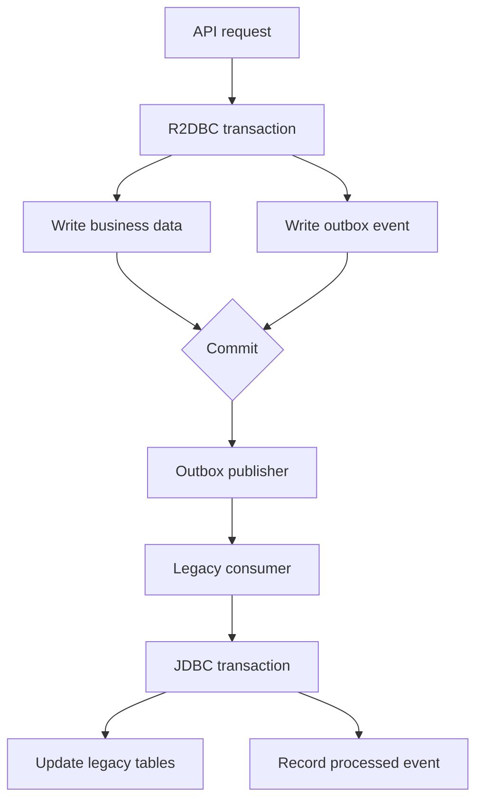

# Distinguishing R2DBC Transactions from JDBC Transactions in the Same Application

A Spring application can use Spring Data R2DBC and JDBC simultaneously—for example, a new module using reactive repositories while a reporting module or legacy library still uses `JdbcTemplate`. Both technologies access relational databases and both support transactions in Spring, yet they manage connections and transaction contexts under two different models.

JDBC typically uses an imperative transaction manager that binds connections to the execution thread via a thread-bound mechanism. R2DBC uses a reactive transaction manager that binds connections to the Reactor Context so the transaction travels along the publisher chain. Therefore, an application using both technologies normally needs two separate transaction managers. Having both connect to the same database does not automatically combine two transactions into one atomic transaction.

To design this cleanly, identify which transaction manager owns each write operation, where each transaction begins and ends, and what happens if one part of the workflow succeeds while another fails. When atomicity across both JDBC and R2DBC is required, you need an explicit coordination strategy; you cannot simply put a single `@Transactional` annotation on a method containing both calls and assume the database will roll everything back.

## 1. Two database access models in the same application

JDBC is a synchronous database access API. A call such as `jdbcTemplate.query(...)` performs work on the calling thread and returns the result once the operation finishes. Connections are usually obtained from a `DataSource` and can be bound to the current thread by a transaction manager.

R2DBC is a reactive database access API. Operations are represented as `Mono` or `Flux`; SQL executes only when the publisher is subscribed. Connections come from a `ConnectionFactory`, while a reactive transaction manager binds resources to the Reactor Context so operations in the same reactive chain can participate in the transaction.

| Criterion | JDBC | R2DBC |
|---|---|---|
| Connection API | `DataSource` and `Connection` | `ConnectionFactory` and `Connection` from R2DBC SPI |
| Execution model | Synchronous, blocking | Reactive, non-blocking when supported by the driver |
| Common templates | `JdbcTemplate`, `NamedParameterJdbcTemplate` | `DatabaseClient`, `R2dbcEntityTemplate` |
| Repositories | Spring Data JDBC or custom repositories | Spring Data R2DBC reactive repositories |
| Transaction manager | `PlatformTransactionManager`, typically `JdbcTransactionManager` or `DataSourceTransactionManager` | `ReactiveTransactionManager`, typically `R2dbcTransactionManager` |
| Context holding transaction | Typically bound to current thread | Bound to Reactor Context |
| Return types | Direct values, `List`, objects, or exceptions | `Mono`, `Flux`, and reactive signals |
| Operation completion | When synchronous call returns or transaction commits | When publisher is subscribed and completes, errors, or is cancelled per transaction lifecycle |

Both stacks can coexist in the same process and even connect to the same database server. They still use separate connections, transaction managers, and propagation mechanisms.

## 2. JDBC transactions: connections bound to threads

In a Spring application using JDBC, the transaction manager acquires a connection from `DataSource`, puts the connection into the appropriate transactional mode, and binds it to the thread running the transaction. Operations via `JdbcTemplate` use Spring's support mechanism to look up the transaction-managed connection.

Transaction manager configuration example:

```java
@Configuration
public class JdbcTransactionConfiguration {

    @Bean("jdbcTransactionManager")
    public PlatformTransactionManager jdbcTransactionManager(
            DataSource dataSource) {
        return new JdbcTransactionManager(dataSource);
    }
}
```

`JdbcTransactionManager` is the dedicated JDBC transaction manager in modern Spring Framework. You can use `DataSourceTransactionManager` if your project or version requires that class; both implement `PlatformTransactionManager`.

A JDBC service can use `@Transactional`:

```java
@Service
public class JdbcAccountService {

    private final JdbcTemplate jdbcTemplate;

    public JdbcAccountService(JdbcTemplate jdbcTemplate) {
        this.jdbcTemplate = jdbcTemplate;
    }

    @Transactional(transactionManager = "jdbcTransactionManager")
    public void transfer(Long fromId, Long toId, BigDecimal amount) {
        int debited = jdbcTemplate.update("""
                UPDATE account
                SET balance = balance - ?
                WHERE id = ? AND balance >= ?
                """,
            amount, fromId, amount);

        if (debited != 1) {
            throw new IllegalStateException("Insufficient balance or source missing");
        }

        int credited = jdbcTemplate.update("""
                UPDATE account
                SET balance = balance + ?
                WHERE id = ?
                """,
            amount, toId);

        if (credited != 1) {
            throw new IllegalStateException("Target account not found");
        }
    }
}
```

Both update statements use the JDBC connection managed by the transaction manager. If the method throws a runtime exception and the transaction is not configured otherwise, Spring rolls back that JDBC transaction.

The key point is that `JdbcTemplate` participates in the transaction thanks to integration with Spring and the matching `DataSource`. If code manually calls `dataSource.getConnection()` and manages the connection itself, it may bypass the open transaction. For Spring-based JDBC code, prefer `JdbcTemplate`, `DataSourceUtils`, or framework-supported connection-aware mechanisms.

## 3. R2DBC transactions: connections bound to Reactor Context

In Spring Data R2DBC, `R2dbcTransactionManager` manages a connection from a `ConnectionFactory`. The transaction context propagates via Reactor Context rather than relying on the current thread.

Configuration example:

```java
@Configuration
public class R2dbcTransactionConfiguration {

    @Bean("r2dbcTransactionManager")
    public ReactiveTransactionManager r2dbcTransactionManager(
            ConnectionFactory connectionFactory) {
        return new R2dbcTransactionManager(connectionFactory);
    }
}
```

A reactive service using that transaction manager:

```java
@Service
public class ReactiveOrderService {

    private final PurchaseOrderRepository orderRepository;
    private final OrderLineRepository lineRepository;

    public ReactiveOrderService(
            PurchaseOrderRepository orderRepository,
            OrderLineRepository lineRepository) {
        this.orderRepository = orderRepository;
        this.lineRepository = lineRepository;
    }

    @Transactional(transactionManager = "r2dbcTransactionManager")
    public Mono<PurchaseOrder> createOrder(CreateOrder command) {
        PurchaseOrder order = new PurchaseOrder(
            null,
            command.orderNo(),
            command.customerId(),
            "PENDING"
        );

        return orderRepository.save(order)
            .flatMap(saved -> Flux.fromIterable(command.lines())
                .map(line -> new OrderLine(
                    null,
                    saved.id(),
                    line.productId(),
                    line.quantity(),
                    line.unitPrice()
                ))
                .concatMap(lineRepository::save)
                .then(Mono.just(saved)));
    }
}
```

The transaction is applied when the publisher is subscribed. Repository operations in the same reactive chain participate in the transaction through Reactor Context, provided they share the `ConnectionFactory` infrastructure managed by the transaction manager.

Do not call `subscribe()` or `block()` inside a transactional reactive method. If you subscribe to another publisher manually, that publisher may run outside the current flow's transaction context. Return and compose publishers with `flatMap`, `then`, `zip`, or suitable Reactor operators.

## 4. Why does an application need two transaction managers?

A transaction manager manages a specific type of resource. `JdbcTransactionManager` manages connections from a `DataSource`; `R2dbcTransactionManager` manages connections from a `ConnectionFactory`.

When an application uses both stacks, configure two separate beans:

```java
@Configuration
public class TransactionManagersConfiguration {

    @Bean("jdbcTransactionManager")
    public PlatformTransactionManager jdbcTransactionManager(
            DataSource dataSource) {
        return new JdbcTransactionManager(dataSource);
    }

    @Bean("r2dbcTransactionManager")
    public ReactiveTransactionManager r2dbcTransactionManager(
            ConnectionFactory connectionFactory) {
        return new R2dbcTransactionManager(connectionFactory);
    }
}
```

When a project has multiple transaction managers, specify the exact bean to use in `@Transactional`:

```java
@Transactional(transactionManager = "jdbcTransactionManager")
public void updateLegacyData() {
    // JDBC operations
}

@Transactional(transactionManager = "r2dbcTransactionManager")
public Mono<Void> updateReactiveData() {
    // R2DBC operations
}
```

If omitted, Spring has to pick a default transaction manager according to configuration and resolution rules. When multiple managers exist, leaving it ambiguous easily leads to picking the wrong manager or failing to find a suitable manager. Using explicit qualifiers makes it clear which transaction is being managed.

Spring Boot can auto-configure certain transaction managers based on dependencies and existing beans. If declaring beans manually, check auto-configuration conditions to avoid accidentally creating two managers for the same resource. Bean names in the example are application-chosen names; your actual configuration must stay consistent with your annotations.

## 5. Same database does not mean same transaction

This is the most important point when combining JDBC and R2DBC.

Suppose both `DataSource` and `ConnectionFactory` point to `jdbc:postgresql://.../app_db` and `r2dbc:postgresql://.../app_db`. A JDBC transaction opens a JDBC connection. An R2DBC transaction opens an R2DBC connection. These two connections are two independent sessions on the database server.

If the JDBC transaction commits while the R2DBC transaction rolls back, the database only rolls back changes belonging to the R2DBC transaction. Committed JDBC changes remain. Writing to the same database, same schema, or even the same table does not make the database merge them into one transaction.

| Scenario | Outcome |
|---|---|
| JDBC transaction rolls back | JDBC operations on the JDBC connection are rolled back |
| R2DBC transaction rolls back | R2DBC operations on the R2DBC connection are rolled back |
| JDBC commits, R2DBC rolls back | JDBC changes remain; R2DBC changes are rolled back |
| R2DBC commits, JDBC rolls back | R2DBC changes remain; JDBC changes are rolled back |
| Both commit | Both sets of changes persist, without a single shared atomic commit |

`@Transactional` manages the transaction of the selected manager. It does not discover every connection pointing to the same database and merge them into a distributed transaction.

## 6. Do not rely on one default @Transactional for both stacks

A method might call both `JdbcTemplate` and `DatabaseClient`, yet the annotation selects only one transaction manager at a time. Example:

```java
@Transactional(transactionManager = "r2dbcTransactionManager")
public Mono<Void> process() {
    return r2dbcRepository.save(...)
        .then(Mono.fromRunnable(() -> jdbcTemplate.update(...)));
}
```

This code does not make the JDBC statement join the R2DBC transaction. JDBC uses a `DataSource` and its own thread-bound mechanism. Moreover, callbacks in a reactive chain may run on a different thread than the thread that built the publisher; R2DBC transactions propagate via Reactor Context, not via the `ThreadLocal` used by `JdbcTemplate`.

Similarly, choosing the JDBC transaction manager for a method returning `Mono` does not make R2DBC operations join the JDBC transaction. An imperative transaction is normally opened when the method is called and finalized when the method returns. If the method only constructs and returns a deferred publisher, the R2DBC SQL may run only after the JDBC transaction has already ended.

Example to avoid:

```java
@Transactional(transactionManager = "jdbcTransactionManager")
public Mono<Person> createLater(String name) {
    return Mono.fromCallable(() -> jdbcTemplate.queryForObject(
        "SELECT ...", personRowMapper
    ));
}
```

Here `Mono.fromCallable` defers the JDBC call until subscription. The annotation-managed JDBC transaction may have already completed right after the method returned the publisher. Place transaction boundaries right where synchronous work actually runs, or isolate imperative JDBC methods separately.

## 7. Separating services by technology and transaction boundary

A clear organization splits JDBC and R2DBC operations into services with explicit transaction managers:

```java
@Service
public class LegacyCustomerService {

    private final JdbcTemplate jdbcTemplate;

    public LegacyCustomerService(JdbcTemplate jdbcTemplate) {
        this.jdbcTemplate = jdbcTemplate;
    }

    @Transactional(transactionManager = "jdbcTransactionManager")
    public void recordLegacyAudit(Long customerId, String action) {
        jdbcTemplate.update("""
                INSERT INTO legacy_audit(customer_id, action)
                VALUES (?, ?)
                """,
            customerId, action);
    }
}
```

```java
@Service
public class ReactiveCustomerService {

    private final CustomerRepository repository;

    public ReactiveCustomerService(CustomerRepository repository) {
        this.repository = repository;
    }

    @Transactional(transactionManager = "r2dbcTransactionManager")
    public Mono<Customer> updateName(Long id, String name) {
        return repository.findById(id)
            .switchIfEmpty(Mono.error(new CustomerNotFoundException(id)))
            .map(customer -> customer.withName(name))
            .flatMap(repository::save);
    }
}
```

Each service owns the transaction for its respective stack. If a use case needs to call both, an orchestration layer can coordinate the two services, but must treat them as two independent transactions unless an explicitly supported transaction coordination mechanism is in place.

Splitting services also avoids Spring proxy self-invocation pitfalls. Calling another `@Transactional` method on the same instance via `this.someMethod()` usually bypasses the proxy, so the annotation on the called method may not take effect. Moving transaction boundaries to separate beans or using `TransactionalOperator` keeps execution flow clear.

## 8. Calling JDBC from a reactive flow

JDBC is blocking. If you must call JDBC inside a WebFlux application or reactive pipeline, do not run it directly on an event-loop thread. Offload the blocking work to `Schedulers.boundedElastic()`:

```java
public Mono<LegacyReport> loadLegacyReport(Long customerId) {
    return Mono.fromCallable(() -> legacyReportService.load(customerId))
        .subscribeOn(Schedulers.boundedElastic());
}
```

`legacyReportService.load(...)` is an imperative method managed by a Spring proxy and can use `@Transactional(transactionManager = "jdbcTransactionManager")`. The actual JDBC call executes on a bounded elastic worker; the JDBC transaction starts and finishes within that call on the same thread.

This ensures the JDBC part runs inside its own JDBC transaction. It does not make the JDBC transaction join an R2DBC transaction wrapping the reactive pipeline.

Orchestration example:

```java
public Mono<CombinedResult> updateAndRead(Long customerId, String name) {
    return reactiveCustomerService.updateName(customerId, name)
        .flatMap(updated ->
            Mono.fromCallable(() -> legacyReportService.load(customerId))
                .subscribeOn(Schedulers.boundedElastic())
                .map(report -> new CombinedResult(updated, report))
        );
}
```

If the R2DBC update commits successfully and then the JDBC report fails, the R2DBC update does not automatically roll back. If the JDBC report succeeds yet a subsequent R2DBC operation fails and rolls back, the committed JDBC changes remain. These are two transactions with two independent outcomes.

If JDBC is only used for reading, write atomicity issues may not arise, yet the JDBC read's snapshot can still differ from the R2DBC transaction's snapshot. If a consistent view is required, choose a single access path or an appropriate isolation strategy instead of assuming two connections observe the exact same state.

## 9. Do not block R2DBC to call JDBC, and do not assume JDBC becomes truly reactive

Some applications call `block()` on an R2DBC publisher and then continue with JDBC. This forfeits reactive benefits, risks deadlocks or stalling event-loop threads, and still does not combine two transactions into one.

```java
// Avoid: blocking inside a reactive pipeline.
Customer customer = customerRepository.findById(id).block();
jdbcTemplate.update("UPDATE ...", ...);
```

Likewise, wrapping `JdbcTemplate` in `Mono.fromCallable` merely integrates blocking work into reactive composition and moves it to an appropriate scheduler; JDBC remains blocking and still uses the JDBC transaction manager.

If most of a use case is reactive, prefer R2DBC for all database operations in that transaction. If a legacy library requires JDBC, isolate the call and define its separate transaction explicitly. Do not mix both APIs inside one transaction expecting them to share a connection.

## 10. Using TransactionalOperator for R2DBC

Besides annotations, reactive transactions can be managed explicitly with `TransactionalOperator`:

```java
@Configuration
public class ReactiveTransactionOperatorConfiguration {

    @Bean
    public TransactionalOperator r2dbcTransactionalOperator(
            @Qualifier("r2dbcTransactionManager")
            ReactiveTransactionManager transactionManager) {
        return TransactionalOperator.create(transactionManager);
    }
}
```

Usage:

```java
public Mono<Void> createOrder(CreateOrder command) {
    Mono<Void> work = orderRepository.save(toOrder(command))
        .flatMap(order -> saveLines(order, command.lines()))
        .then();

    return r2dbcTransactionalOperator.transactional(work);
}
```

`TransactionalOperator` is helpful when you want a transaction boundary around a specific publisher or when reactive orchestration is complex. It still manages R2DBC transactions—not JDBC transactions.

When explicit JDBC transactions are needed, you can use `TransactionTemplate` with `PlatformTransactionManager` inside an imperative call. Do not run `TransactionTemplate.execute(...)` on an event-loop thread if it contains blocking JDBC; offload the entire call to an appropriate scheduler.

## 11. Propagation and isolation do not bridge two transaction managers

Attributes such as `REQUIRED`, `REQUIRES_NEW`, `NESTED`, isolation levels, and timeouts apply within the scope of whichever transaction manager handles the call.

Example:

```java
@Transactional(
    transactionManager = "r2dbcTransactionManager",
    propagation = Propagation.REQUIRES_NEW
)
public Mono<Void> writeReactiveRecord() {
    // New or independent R2DBC transaction per this manager's propagation.
}
```

Here `REQUIRES_NEW` instructs the R2DBC transaction manager to create an independent R2DBC transaction as supported by it. It does not mean opening a shared transaction with the JDBC manager. If another method uses `jdbcTransactionManager`, JDBC propagation is handled separately.

Nested transaction/savepoint support depends on the transaction manager, R2DBC driver, and database. Do not assume `NESTED` or savepoints behave identically in JDBC and R2DBC. Verify version documentation, driver capabilities, and integration tests.

Isolation levels are also configured per connection. A JDBC transaction and an R2DBC transaction can have different isolation levels even when accessing the same database. If business logic requires an invariant across both flows, two separate isolation settings do not create a single shared atomic snapshot.

## 12. Can JTA/XA be used for coordination?

In enterprise systems, JTA/XA can coordinate multiple XA-capable resource managers for distributed commit or rollback via the two-phase commit protocol. However, do not assume every JDBC driver, R2DBC driver, or transaction manager supports XA identically.

JDBC has a long-standing XA ecosystem through `XADataSource`. The standard R2DBC SPI does not provide a universal XA abstraction equivalent to JDBC allowing every R2DBC driver to enlist in JTA transactions. Whether R2DBC can coordinate with a transaction coordinator depends on specific vendor implementations and must be verified.

If atomic commit across JDBC and R2DBC is strictly mandatory, check specifically:

- Whether both resources support XA.
- Whether the transaction coordinator has adapters for the exact resources and drivers.
- Whether the database and drivers support prepare/commit/rollback appropriately.
- How recovery is handled if the process or coordinator crashes between phases.
- The latency, locking, and operational costs of distributed transactions.

Without verified XA support, do not build a homemade "combined transaction manager" by calling two managers sequentially and manually rolling back. That approach cannot guarantee atomicity when processes crash, connections drop, or one commit already succeeded.

## 13. Common coordination pattern: Transactional Outbox

When a use case writes data with R2DBC and then needs a JDBC component or another system to process follow-up work, a transactional outbox is often a reliable choice.

Inside the same R2DBC transaction, the application writes business data and an outbox record:

```java
@Transactional(transactionManager = "r2dbcTransactionManager")
public Mono<Order> createOrder(CreateOrder command) {
    return orderRepository.save(toOrder(command))
        .flatMap(order -> outboxRepository.save(
            OutboxEvent.orderCreated(order.id(), command.requestKey())
        ).thenReturn(order));
}
```

Because the order and outbox record share the same R2DBC transaction manager/connection factory, both commit or roll back together. An outbox worker later reads and forwards the event to consumers. A consumer can use its own JDBC transaction to update legacy tables and mark the event processed.

General flow:



Outbox does not create a distributed transaction. It guarantees the event is persisted alongside source data; delivery may occur more than once. Consumers should therefore be idempotent, typically using a unique `event_id` or an inbox/processed-event table to prevent duplicate processing.

## 14. Sagas and compensating actions for multi-step coordination

If a workflow consists of multiple independent transactions, it can be modeled as a Saga. Each step commits in its own transaction. If a later step fails, the system executes compensating actions to bring business state back to an acceptable state.

Example order-creation workflow:

1. R2DBC creates an order in `PENDING` state.
2. JDBC updates a legacy system or creates an integration record.
3. The payment service processes payment.
4. R2DBC transitions the order to `CONFIRMED`.

If payment fails, the application can cancel the order or release reservations according to business rules. Compensation is not a physical rollback of a committed transaction; it is a new business action.

Sagas fit long-running processes spanning multiple services or resources without distributed transaction support. You must store workflow progress state, idempotency keys, retry policies, timeouts, and compensating actions. Do not use a Saga for small operations that can be performed atomically inside a single database transaction.

## 15. When should you pick one technology for the entire transaction?

When multiple operations must commit or roll back together, the simplest solution is usually using one stack inside that transaction boundary:

- Use `DatabaseClient`, `R2dbcEntityTemplate`, and R2DBC repositories for all operations inside a reactive transaction.
- Or use `JdbcTemplate`/JDBC repositories for all operations inside a JDBC transaction.

Stack selection depends on workload, drivers, existing libraries, and non-blocking requirements. Do not pick R2DBC just because an endpoint returns `Mono` if most inner work remains blocking JDBC. Conversely, there is no need to rewrite a stable JDBC module to R2DBC simply because both coexist in the same application.

If you must call a legacy system, separate the transactions and use outbox/Saga when state coordination is needed. If two operations are read-only and do not need a shared snapshot, both can be called as long as you understand data may be read at different points in time.

## 16. Separate DataSource and ConnectionFactory configurations

JDBC and R2DBC typically require two separate connection configurations, even against the same database:

```yaml
spring:
  datasource:
    url: jdbc:postgresql://localhost:5432/app_db
    username: app_user
    password: change_me
    hikari:
      maximum-pool-size: 10

  r2dbc:
    url: r2dbc:postgresql://localhost:5432/app_db
    username: app_user
    password: change_me
    pool:
      enabled: true
      max-size: 20
```

This example illustrates two independent connection pools. Pool property names can vary with Spring Boot version and installed dependencies. Total connections seen by the database can approach the sum of JDBC and R2DBC pool sizes multiplied by application instances, plus other tools or services.

Do not pass a JDBC URL to `ConnectionFactory` or an R2DBC URL to `DataSource`. Each stack needs its own driver and configuration. A migration tool may still use JDBC while runtime queries use R2DBC; that does not cause the two transaction managers to share connections.

## 17. Controlling transaction managers when multiple beans exist

When an application has multiple managers, give beans stable names and specify the manager explicitly wherever important:

```java
@Transactional(transactionManager = "jdbcTransactionManager")
public void updateLegacyRecord() {
    // Imperative JDBC transaction.
}

@Transactional(transactionManager = "r2dbcTransactionManager")
public Mono<Void> updateReactiveRecord() {
    // Reactive R2DBC transaction.
}
```

Use `@Qualifier` when injecting managers into `TransactionalOperator` or `TransactionTemplate`:

```java
@Bean
public TransactionTemplate jdbcTransactionTemplate(
        @Qualifier("jdbcTransactionManager")
        PlatformTransactionManager transactionManager) {
    return new TransactionTemplate(transactionManager);
}

@Bean
public TransactionalOperator r2dbcTransactionalOperator(
        @Qualifier("r2dbcTransactionManager")
        ReactiveTransactionManager transactionManager) {
    return TransactionalOperator.create(transactionManager);
}
```

`TransactionTemplate` is an imperative API; `TransactionalOperator` is a reactive API. Do not use `TransactionTemplate` to wrap a deferred R2DBC publisher expecting the transaction to stay alive after the callback returns. Similarly, do not use `TransactionalOperator` to wrap a blocking JDBC call expecting the JDBC connection to join the reactive transaction.

## 18. Notes on @Transactional and proxies

`@Transactional` is typically applied through Spring AOP proxies. Therefore:

- Beans must be managed by Spring.
- Calls must go through the proxy for the transaction interceptor to trigger.
- Self-invocation inside the same class typically bypasses the proxy.
- Select the exact transaction manager via qualifier when multiple managers exist.
- For reactive methods, return `Mono`/`Flux` so the transaction manager governs the publisher lifecycle.
- Do not spawn side subscriptions with `subscribe()` inside the method.

Misleading self-invocation example:

```java
public Mono<Void> outer() {
    return inner(); // Direct call on the same object; may bypass the proxy.
}

@Transactional(transactionManager = "r2dbcTransactionManager")
public Mono<Void> inner() {
    return repository.save(...).then();
}
```

If a transaction needs to start at `inner`, move that method into a separate bean or use `TransactionalOperator` directly in the publisher.

## 19. Error handling and rollback in reactive transactions

A reactive transaction manager tracks publisher signals. When a publisher emits an error, the transaction can roll back per rollback rules. If the publisher completes normally, the transaction can commit. Cancellation is also part of the reactive lifecycle, and the transaction manager must release/roll back resources under corresponding semantics.

Do not swallow errors inside a transaction if rollback is wanted:

```java
// Can cause the transaction to see the publisher complete normally.
return repository.save(entity)
    .onErrorResume(error -> Mono.empty());
```

If you want the transaction to roll back before turning an error into a business result, place error handling outside the transaction boundary:

```java
Mono<Entity> transactionalWork = transactionalOperator.transactional(
    repository.save(entity)
);

return transactionalWork
    .map(saved -> SaveOutcome.success(saved.id()))
    .onErrorResume(error -> Mono.just(
        SaveOutcome.failure(classify(error))
    ));
```

With imperative JDBC, the transaction interceptor watches exceptions escaping the method to decide commit/rollback. If code catches an exception and does not rethrow it, the transaction manager may treat the method as completing normally and commit, unless the transaction was already marked rollback-only. Place error handling to align with each stack's transaction boundary.

By default, Spring usually rolls back on unchecked exceptions and `Error`; checked exceptions do not necessarily roll back unless `rollbackFor` is configured. Declare rollback rules according to business requirements and your Spring version.

## 20. Isolation, timeouts, and connection pools

JDBC and R2DBC transactions can have separate isolation and timeout settings. One transaction manager setting `READ_COMMITTED` isolation does not automatically configure isolation on the other manager's transactions.

When a single request opens both a JDBC transaction and an R2DBC transaction, each transaction can hold a connection. If one part blocks or waits long on a publisher, pools can become exhausted. Avoid holding transactions open while:

- Calling HTTP or external services.
- Waiting on users or messages.
- Performing heavy CPU work unrelated to the database.
- Waiting for another transaction manager to finish without a clear atomicity need.

Monitor JDBC and R2DBC pools separately: active/idle connections, acquire latency, timeouts, transaction duration, and query latency. Total connections across both pools must stay within database limits, even when running multiple application replicas.

## 21. Testing applications using both JDBC and R2DBC

Testing each stack in isolation is not enough when orchestration use cases call both. Include these test groups:

**JDBC transaction test:** verify multiple JDBC statements commit together and runtime exceptions trigger rollback.

**R2DBC transaction test:** use `StepVerifier` to verify multiple R2DBC publishers share a transaction and errors trigger rollback.

**Manager selection test:** verify JDBC methods use `jdbcTransactionManager` and reactive methods use `r2dbcTransactionManager`.

**Mixed workflow test:** deliberately let JDBC succeed while R2DBC fails (and vice versa) to confirm the two transactions are independent rather than assuming shared atomicity.

**Thread/context test:** verify blocking JDBC work runs on an appropriate scheduler and its JDBC transaction begins and ends inside the imperative call; verify the R2DBC chain preserves reactive transaction context across operators.

**Outbox/idempotency test:** if using outbox, verify business rows and outbox rows commit/roll back together; verify consumers handle duplicate events without duplicate side effects.

**Integration test on a real database:** use Testcontainers or a test database matching production to verify drivers, isolation, locking, generated values, and real errors.

Do not rely solely on mocked transaction managers to conclude that the database rolls back properly. Mocks help test orchestration logic in unit tests, while atomicity must be proven by integration tests.

## 22. Common mistakes when combining JDBC and R2DBC

| Symptom | Cause | Resolution |
|---|---|---|
| JDBC update does not roll back when R2DBC fails | Two independent transaction managers and connections | Accept separate transactions or use outbox/Saga/XA if supported |
| R2DBC query runs after JDBC transaction already committed | Deferred publisher returned from a method using an imperative manager | Use a reactive manager for reactive chains; isolate JDBC calls into separate imperative methods |
| `@Transactional` fails to find a manager or picks the wrong one | Multiple manager beans exist without qualifiers | Specify `transactionManager` explicitly on the annotation |
| Blocking JDBC slows down the event loop | Calling JDBC directly inside a reactive pipeline | Offload blocking calls to `Schedulers.boundedElastic()` |
| R2DBC operation does not join the transaction | Using a different connection factory or self-subscribing | Use the right `ConnectionFactory`, return continuous publishers, and avoid separate subscriptions |
| Transaction annotation has no effect | Self-invocation or object not obtained through Spring proxy | Split beans or use `TransactionalOperator` |
| Connection pool exhausted | Both stacks open two pools and hold transactions too long | Size total pools, shorten transaction duration, and cap concurrency |
| Tests pass but production fails | H2/mocks differ from actual driver/database | Run integration tests with production-equivalent database and driver |

## 23. Transaction design workflow for mixed applications

When an application uses both JDBC and R2DBC, follow this sequence:

**Step 1 — Inventory resources.** Identify `DataSource`, `ConnectionFactory`, database servers, drivers, and corresponding pools.

**Step 2 — Define transaction managers.** Configure `PlatformTransactionManager` for JDBC and `ReactiveTransactionManager` for R2DBC; give beans clear names.

**Step 3 — Attach transaction boundaries.** Specify the manager explicitly in `@Transactional` or use `TransactionTemplate`/`TransactionalOperator` accordingly.

**Step 4 — Keep one stack per transaction.** If multiple operations must be atomic, prefer keeping them on the same JDBC or R2DBC connection within that transaction.

**Step 5 — Isolate blocking work.** When calling JDBC from a reactive pipeline, offload the call to bounded elastic and let the JDBC transaction complete fully inside the imperative method.

**Step 6 — Handle multi-resource coordination.** If eventual consistency is acceptable, use outbox or Saga. Only use XA/JTA when both resources and the coordinator explicitly support it.

**Step 7 — Verify error handling and rollback.** Place error handling outside the transaction boundary when rollback is required; avoid swallowing errors early.

**Step 8 — Measure operations.** Monitor each pool, transaction duration, timeouts, deadlocks, and partial failure outcomes.

**Step 9 — Integration test.** Test each manager and scenarios where one transaction commits while the other rolls back.

## 24. Conclusion

Both JDBC and R2DBC support transactions in Spring, yet they use different resources and contexts. JDBC transactions typically bind connections to threads via `PlatformTransactionManager`; R2DBC transactions bind connections to Reactor Context via `ReactiveTransactionManager`. An application using both should configure separate managers and specify the manager explicitly for each service or transaction boundary.

Two local transaction managers do not automatically coordinate into one atomic transaction, even when connecting to the same database. If operations must commit or roll back together, keep statements on the same stack/connection. If coordinating multiple independent transactions is required, consider transactional outbox or Saga; only use XA/JTA when specific support has been verified. Clearly separating these boundaries prevents partial-data bugs and keeps application rollback behavior predictable.
