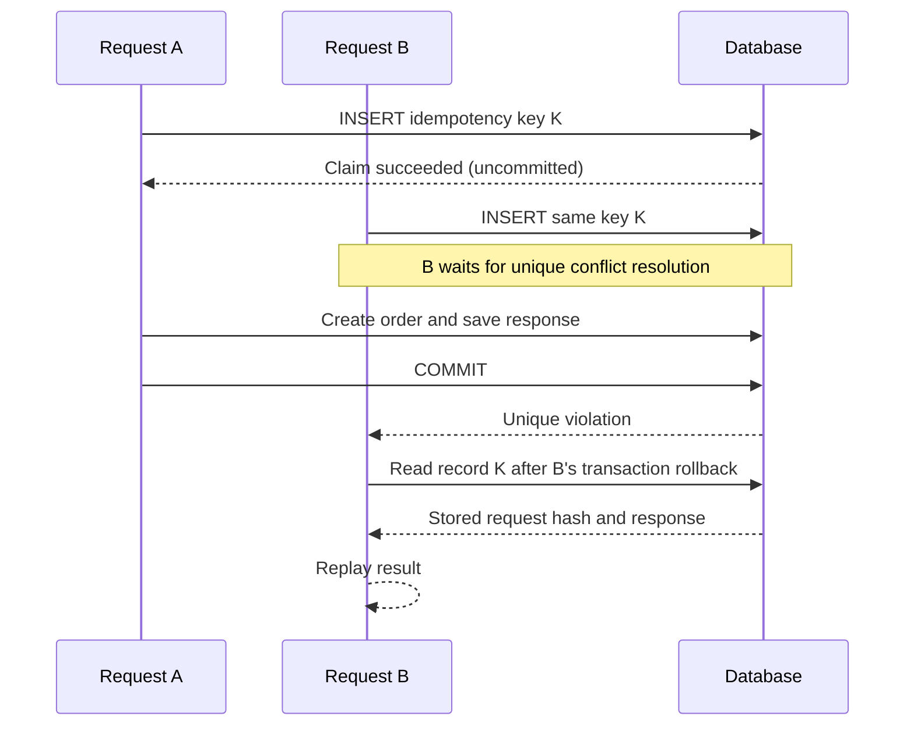

# Designing Idempotent Operations to Tolerate Repeated Requests

In a Spring Data Relational R2DBC application, a write operation typically executes asynchronously via `Mono` or `Flux`. A client may resend the same request on timeout, connection drop, or missing response; a gateway may also retry, and a message broker may redeliver a message. Consequently, the same business intent can reach the application multiple times, even when a prior attempt already wrote data successfully.

Idempotent design guarantees that executing the same operation again produces no unintended extra business effects. For creating an order, processing a payment, or making a booking, this usually means a request is identified by an idempotency key, creates only one business outcome, and can return the stored result when the client resends the request.

In R2DBC, the foundation of this design rests on database constraints, reactive transactions, conditional update operations, and error handling when requests contend. Checking only in memory or calling `exists` before inserting is insufficient against concurrent repeated requests.

## 1. What Is Idempotency?

An operation is idempotent if executing it once or multiple times with the same intent leads to the same final business state. You can visualize it as:

\[
f(f(x)) = f(x)
\]

For example, setting an account status to `SUSPENDED` can be idempotent: calling it once or repeatedly still yields `SUSPENDED`. Conversely, increasing a balance by 100 on every call is non-idempotent: a retry can credit the money twice.

| Operation | Naturally idempotent? | Reason |
| --- | --- | --- |
| `PUT /customers/42` setting name to a fixed value | Usually yes | Resending the same value yields the same state |
| `DELETE /sessions/abc` | Usually yes if repeated deletes count as success | After the first call, subsequent calls make no further state change |
| `POST /orders` creating a new order | Not naturally | Each call could create a distinct order |
| `UPDATE wallet SET balance = balance + 100` | No | Each execution adds another 100 |
| `UPDATE customer SET status = 'ACTIVE' WHERE id = :id` | Usually yes | Setting the same status repeatedly creates no extra effect |
| Sending an email or calling a payment service | Not naturally | Resending could trigger another email or transaction |

Idempotency does not mean every repeated request must return the exact same HTTP status code or response timing. What must be preserved is that business effects are never duplicated and the API contract clearly specifies how results are returned on resubmission.

## 2. Why Can Requests Be Resent?

Retries commonly arise from failures at network boundaries where the client cannot be sure how far the server progressed:

1. The client sends a request to create an order.
2. The server writes the order successfully in the database.
3. The connection drops before the response reaches the client.
4. The client observes a timeout and resends the request.
5. If the server does not recognize the previous request, it may create a second order.

A timeout does not prove the database operation failed. The request might never have reached the server, the transaction might have rolled back, or the transaction might have committed while the response was lost. Therefore, the client needs a way to resend the same intent, and the server needs to look up prior results.

Common sources of retries include:

- Users clicking a button multiple times while the UI appears unresponsive.
- Mobile clients resending after switching networks or reopening the app.
- HTTP clients, API gateways, or load balancers retrying transient errors.
- Message brokers redelivering messages when consumers do not acknowledge in time.
- Background jobs re-running after a process restarts.
- A service unsure whether a prior request committed due to connection loss while awaiting the result.

Idempotent design must account for concurrent retries, not merely two requests spaced seconds apart. Two copies can hit two application instances at the exact same moment.

## 3. Idempotency Keys in APIs

For creation operations or operations whose effects cannot be repeated arbitrarily, the client can send an idempotency key in a header, for example:

```http
POST /orders
Idempotency-Key: 2a97f6c0-1c7d-4fd4-a4df-7f0cbb6a62ab
Content-Type: application/json

{
  "customerId": 42,
  "items": [
    { "productId": 7, "quantity": 2 }
  ]
}
```

The server uses this key to recognize resubmissions of the same operation. If the first request already completed, a subsequent request with the same key and same content receives the stored result rather than creating a new order.

An idempotency key should:

- Be generated once per business intent, then kept identical across all retries of that intent.
- Have sufficient randomness, typically a client-generated UUID or random token.
- Be length-bounded and format-validated at the API boundary.
- Be scoped by tenant/user and operation type to avoid cross-context collisions.
- Never contain secrets or predictable personal data.
- Be retained long enough to cover the product's retry window.

Do not generate a new key for each HTTP retry. If the client changes the key on every attempt, the server treats them as brand-new operations and cannot deduplicate them.

## 4. Key Uniqueness Scope

Do not mechanically put `UNIQUE(idempotency_key)` if the system has multiple tenants or multiple operation types. The uniqueness scope typically combines tenant/user, operation, and key:

```text
(tenant_id, operation, idempotency_key)
```

For example, the same key string can be used for an order-creation request by tenant A and a support-ticket request by tenant B without conflict if the two operations belong to different scopes.

Scope must be defined by the API contract. Some systems use `(account_id, idempotency_key)`; others use `(tenant_id, endpoint, idempotency_key)`. Whichever you choose, derive tenant or account from the server-verified authenticated identity—never trust a scope value self-declared by the client.

## 5. Persisting Idempotency Keys with a Unique Constraint

An idempotency table can store processing state and the generated outcome. PostgreSQL DDL example:

```sql
CREATE TABLE idempotency_record (
    id BIGINT GENERATED BY DEFAULT AS IDENTITY PRIMARY KEY,
    tenant_id BIGINT NOT NULL,
    operation VARCHAR(100) NOT NULL,
    idempotency_key VARCHAR(200) NOT NULL,
    request_hash CHAR(64) NOT NULL,
    state VARCHAR(20) NOT NULL,
    resource_id BIGINT,
    response_status INTEGER,
    response_body TEXT,
    created_at TIMESTAMPTZ NOT NULL DEFAULT CURRENT_TIMESTAMP,
    completed_at TIMESTAMPTZ,
    expires_at TIMESTAMPTZ,
    CONSTRAINT uq_idempotency_scope
        UNIQUE (tenant_id, operation, idempotency_key),
    CONSTRAINT ck_idempotency_state
        CHECK (state IN ('PROCESSING', 'COMPLETED'))
);
```

Key columns:

| Column | Purpose |
| --- | --- |
| `tenant_id` | Scoped to the authenticated tenant |
| `operation` | Distinguishes operation/API types |
| `idempotency_key` | Key kept stable by the client across retries |
| `request_hash` | Detects same key with a different payload |
| `state` | Processing state, e.g., processing or completed |
| `resource_id` | ID of the created business resource |
| `response_status`, `response_body` | Replayable response details |
| `created_at`, `completed_at`, `expires_at` | Tracks lifecycle and retention policy |

The unique constraint is the final barrier ensuring two competing requests cannot both claim a key in the same scope. Checking in Java prior to inserting cannot replace this constraint.

The DDL above uses `TIMESTAMPTZ` and PostgreSQL identity syntax. For other databases, adjust timestamp types, ID types, and identity syntax to match the target database system.

## 6. Why Store a Request Hash?

A client might accidentally send the same idempotency key with a different payload. For example, first key K creates an order for customer 42, and later the same key K is sent for customer 99. If the server inspects only the key, it could return the first order's result for a request with an entirely different meaning, causing severe confusion.

The server should compute a hash from a canonicalized representation of the business request, scoped by operation and API version if needed. When the key already exists:

- Same key and same request hash: treat as a retry of the original operation, returning the stored result or processing status per the API contract.
- Same key but different request hash: reject, typically with HTTP `409 Conflict` or an equivalent error.

Do not hash raw JSON strings if field ordering, whitespace, or number formatting can vary without changing request meaning. Parse and canonicalize the relevant fields before hashing. Also determine which fields carry business meaning; omit random/transient metadata like request timestamps or trace IDs from the hash.

Hashing does not replace validation. The server must still validate permissions, formats, limits, and business rules before processing.

## 7. Two Models for Storing Idempotency State

Two design patterns are common, suited to operations of different durations and characteristics.

### Model A: Claim, Execute Business Logic, and Complete in the Same Transaction

Inside one reactive transaction:

1. Insert the idempotency record in state `PROCESSING`.
2. Perform the business mutation, e.g., create an order.
3. Save the resource ID and response into the idempotency record, transitioning state to `COMPLETED`.
4. Commit the transaction.

Because the `PROCESSING` record is uncommitted, other requests do not see a separate committed processing state. When a second request inserts the same unique key, the database arbitrates the conflict against the first transaction. If the first transaction commits, the second request receives a unique violation; if the first transaction rolls back, the second request can claim the key and perform the business operation.

The advantage is that claiming, business mutations, and the idempotency result commit or roll back atomically. You never end up with a completed record lacking an order, or a committed order lacking a stored result for retries to retrieve.

This model suits short database operations that can finish within a single transaction. Do not hold a transaction open while waiting on an HTTP call or user response.

### Model B: Persist PROCESSING State Separately for Long-Running Work

For long-running or asynchronous work, a system can commit a `PROCESSING` record first, after which a worker executes and updates it to `COMPLETED`. This requires additional mechanisms:

- Leases or expiration timestamps to detect stalled workers.
- Owner/token checks so only the worker holding ownership can update state.
- Conditional state transitions, e.g., updating from `PROCESSING` to `COMPLETED` only while the lease remains valid.
- Retry/recovery policies when a worker crashes midway.
- An outbox or durable queue so work is not lost after committing the initial state.

This model can return `202 Accepted` or an "in progress" status for duplicate requests. It is more complex because `PROCESSING` records can linger after a process crashes. Recovery workers and clear lease-handling rules are required.

Do not mix both models arbitrarily. For short database operations, a single transaction makes atomicity much easier to guarantee. For long workflows, state machines and recovery must be fully designed.

## 8. Atomic Flow in Spring Data R2DBC

The example below illustrates Model A. Repository and DTO names are application-defined; claim/complete operations can be implemented using `DatabaseClient`, a custom repository, or a template.

```java
public Mono<OrderResponse> createOrder(
        AuthenticatedTenant tenant,
        String idempotencyKey,
        CreateOrderRequest request) {

    String requestHash = requestHasher.hashCanonical(request);

    return transactionalOperator.transactional(
            idempotencyStore.claim(
                            tenant.id(),
                            "CREATE_ORDER",
                            idempotencyKey,
                            requestHash)
                    .onErrorMap(
                            this::isIdempotencyKeyConflict,
                            error -> new DuplicateIdempotencyKeyException(error))
                    .then(orderRepository.save(Order.from(tenant.id(), request)))
                    .flatMap(savedOrder -> {
                        OrderResponse response = OrderResponse.from(savedOrder);

                        return idempotencyStore.complete(
                                        tenant.id(),
                                        "CREATE_ORDER",
                                        idempotencyKey,
                                        requestHash,
                                        savedOrder.getId(),
                                        response)
                                .thenReturn(response);
                    })
    ).onErrorResume(
            DuplicateIdempotencyKeyException.class,
            error -> replayExisting(
                    tenant.id(),
                    "CREATE_ORDER",
                    idempotencyKey,
                    requestHash));
}
```

Important points in this example:

- `claim`, `save(order)`, and `complete` share the same `TransactionalOperator`.
- Unique errors from claiming are mapped to a dedicated exception to distinguish them from constraint violations when saving the order.
- `onErrorResume` sits outside the transactional publisher. The first transaction rolls back before reading the existing result.
- `replayExisting` reads the record in a new operation after the claim transaction fails.
- Every branch returns a `Mono`; there are no `block()` or manual `subscribe()` calls inside the service.

`isIdempotencyKeyConflict` must accurately identify the `uq_idempotency_scope` unique constraint based on the exception/SQLSTATE emitted by the driver. Do not convert every `DuplicateKeyException` across the whole flow into a duplicate idempotency key, because the order itself might violate a different constraint.

## 9. Claiming and Completing with `DatabaseClient`

A custom store can insert the claim using bind parameters:

```java
public Mono<Void> claim(
        Long tenantId,
        String operation,
        String key,
        String requestHash) {

    return databaseClient.sql("""
            INSERT INTO idempotency_record
                (tenant_id, operation, idempotency_key,
                 request_hash, state, created_at)
            VALUES
                (:tenantId, :operation, :key,
                 :requestHash, 'PROCESSING', CURRENT_TIMESTAMP)
            """)
            .bind("tenantId", tenantId)
            .bind("operation", operation)
            .bind("key", key)
            .bind("requestHash", requestHash)
            .fetch()
            .rowsUpdated()
            .then();
}
```

To complete, update the record within the same transaction:

```java
public Mono<Void> complete(
        Long tenantId,
        String operation,
        String key,
        String requestHash,
        Long resourceId,
        OrderResponse response) {

    return databaseClient.sql("""
            UPDATE idempotency_record
            SET state = 'COMPLETED',
                resource_id = :resourceId,
                response_status = :responseStatus,
                response_body = :responseBody,
                completed_at = CURRENT_TIMESTAMP
            WHERE tenant_id = :tenantId
              AND operation = :operation
              AND idempotency_key = :key
              AND request_hash = :requestHash
              AND state = 'PROCESSING'
            """)
            .bind("tenantId", tenantId)
            .bind("operation", operation)
            .bind("key", key)
            .bind("requestHash", requestHash)
            .bind("resourceId", resourceId)
            .bind("responseStatus", 201)
            .bind("responseBody", responseSerializer.serialize(response))
            .fetch()
            .rowsUpdated()
            .flatMap(updated -> updated == 1
                    ? Mono.empty()
                    : Mono.error(new IllegalStateException(
                            "Idempotency record was not completed")));
}
```

This example uses `response_body TEXT` to store serialized JSON; applications may choose database- and driver-specific JSON/JSONB types. If responses contain important headers, store replayable headers via an allowlist. Never arbitrarily store hop-by-hop headers, sensitive cookies, or authentication tokens.

Checking `rowsUpdated == 1` verifies that completion updated the exact record in `PROCESSING` state. If it failed to update, the transaction should fail so preceding business mutations roll back together.

## 10. Replaying a Completed Result

When claiming fails because the unique key already exists, the service reads the existing record:

```java
public Mono<OrderResponse> replayExisting(
        Long tenantId,
        String operation,
        String key,
        String requestHash) {

    return idempotencyStore.find(tenantId, operation, key)
            .switchIfEmpty(Mono.error(
                    new IllegalStateException("Conflicting key was not found")))
            .flatMap(existing -> {
                if (!existing.requestHash().equals(requestHash)) {
                    return Mono.error(new IdempotencyKeyReuseException());
                }

                if (!existing.isCompleted()) {
                    return Mono.error(new RequestStillProcessingException());
                }

                return Mono.just(responseSerializer.deserialize(
                        existing.responseBody()));
            });
}
```

With Model A, duplicate requests typically read the record only after the first transaction commits, at which point it is already `COMPLETED`. `PROCESSING` may appear if the system uses Model B or another processing path; the API contract must specify whether to return `202`, `409`, `Retry-After`, or an appropriate status.

If the key matches but the request hash differs, do not replay the old response as if the new payload were processed. Return a clear conflict error telling the client not to reuse a key for a different intent.

## 11. What Happens When Two Requests with the Same Key Arrive Concurrently?

The unique constraint resolves the race in the database, where all instances observe shared state.



If A commits, B cannot claim the same key and reads A's result instead. If A rolls back, B's insert can succeed and B becomes the request that executes the business logic. Exact wait and error-reporting details depend on isolation and the database, while the unique constraint remains the final arbitrator.

In PostgreSQL, after a constraint error inside a transaction, the transaction enters an aborted state and cannot run further normal queries until rolled back. Therefore, place the replay-read branch after `TransactionalOperator` finishes and rolls back, as in the example above. Do not catch a duplicate error and immediately query the record inside the same aborted transaction.

## 12. Why `exists` Then `save` Is Not Enough

An easy-to-write yet unsafe implementation:

```java
return idempotencyRepository.existsByTenantIdAndKey(tenantId, key)
        .flatMap(exists -> {
            if (exists) {
                return Mono.error(new DuplicateRequestException());
            }

            return orderRepository.save(order);
        });
```

Two concurrent requests can both receive `exists = false` and both create orders. This is a race condition between the check step and the write step.

Even when adding a transaction, the default isolation level does not automatically turn two separate statements into a single atomic operation. The solution requires a unique constraint on the key and explicit handling of competing inserts. You can use `exists` as an optimization in some cases, while a unique-constrained insert remains the final arbiter.

## 13. Idempotency via Conditional Updates

Not every operation needs an idempotency table. Some business actions can be made idempotent with an update statement setting a deterministic state:

```sql
UPDATE shipment
SET status = 'CANCELLED'
WHERE id = :shipmentId
  AND status <> 'CANCELLED';
```

This statement causes no extra effect when re-run after status is already `CANCELLED`. However, if you need to distinguish among not found, already cancelled, and not eligible for cancellation, the service must interpret affected rows or read the status per business rules.

For state transitions, include the expected current state in the condition:

```sql
UPDATE payment
SET status = 'CAPTURED', captured_at = CURRENT_TIMESTAMP
WHERE id = :paymentId
  AND status = 'AUTHORIZED';
```

Only one request can transition from `AUTHORIZED` to `CAPTURED`. Subsequent retries update zero rows. Define the response when affected rows equals 0: an already-transitioned state may be treated as an idempotent success, while another state may be a business conflict.

## 14. Why Are Addition and Subtraction Typically Non-Idempotent?

Relative operations such as incrementing, decrementing, adding loyalty points, or deducting stock are generally not idempotent:

```sql
UPDATE inventory
SET reserved_quantity = reserved_quantity + :quantity
WHERE product_id = :productId;
```

If the same request runs twice, the reserved quantity doubles. Adding a guard like `reserved_quantity + quantity <= available_quantity` still does not stop a valid request from being applied multiple times on retry; it only enforces the inventory ceiling.

To make it idempotent, tie the effect to a unique operation ID:

```sql
CREATE TABLE inventory_reservation_operation (
    operation_id VARCHAR(100) PRIMARY KEY,
    product_id BIGINT NOT NULL,
    quantity INTEGER NOT NULL,
    created_at TIMESTAMP NOT NULL DEFAULT CURRENT_TIMESTAMP
);
```

Inside a transaction, claim `operation_id` via a unique-constrained insert before updating inventory. If the operation ID already exists, do not apply the increment again. The claim and inventory update must share the same transaction so you never get an operation record without an inventory update or vice versa.

For financial operations, record a business ledger/transaction with a unique reference key instead of only mutating a balance. A ledger supports auditing, reconciliation, and detecting whether a command was already applied.

## 15. How Idempotency Keys Differ from Optimistic Locking

Optimistic locking commonly uses a version field (`@Version`) to detect two transactions concurrently updating the same entity. It prevents overwriting each other's changes, but does not automatically deduplicate a retried business command.

For example, the first request adds points successfully and bumps version from 3 to 4. The client misses the response and resends a new command. If the retry reads version 4 and applies the addition again, optimistic locking does not know this is the same previous intent; it can increment the points a second time.

| Mechanism | What does it protect? |
| --- | --- |
| Unique idempotency key | Prevents the same intent from being claimed and executed twice in the same scope |
| Optimistic locking/version | Detects updates based on stale versions and prevents lost updates |
| Transaction | Groups database changes into a single commit/rollback unit |
| Unique business constraint | Protects a data invariant such as unique transaction codes |

These mechanisms can be combined. For instance, request idempotency keys stop duplicates; versions control concurrent updates on aggregates; unique constraints protect transaction codes.

## 16. Reactive Transaction Boundaries

Spring Data R2DBC supports reactive transactions through `R2dbcTransactionManager` and `TransactionalOperator` or `@Transactional` on publisher-returning methods. Transaction context propagates through Reactor Context, so database operations must be chained within the same reactive pipeline.

Example:

```java
public Mono<OrderResponse> createOrder(CreateOrderRequest request) {
    return transactionalOperator.transactional(
            orderRepository.save(Order.from(request))
                    .flatMap(saved ->
                            idempotencyRepository.save(
                                    IdempotencyRecord.completedFor(saved))
                                    .thenReturn(OrderResponse.from(saved)))
    );
}
```

This sketch holds only when saving the idempotency record and saving the order share the same transaction manager and connection factory. A complete design must claim the key prior to creating the order and handle unique conflicts as shown earlier.

Do not call `block()` or manual `subscribe()` inside a transaction. Doing so can detach operations from Reactor Context, breaking transaction coverage over the full work and losing consistent error/cancellation propagation.

A transaction also does not cover external HTTP services, email systems, or brokers. Calling external services while holding a database transaction can pin connections for a long time and still fails to provide cross-system atomicity.

## 17. Handling External Side Effects with Transactional Outbox

Suppose creating an order must publish an `OrderCreated` event to a broker. If the order commits and publishing fails, the system has an order with no event. If the event is sent first and the database transaction rolls back, consumers may receive an event for a non-existent order.

Transactional Outbox bridges this gap by writing business data and an outbox row in the same transaction:

```sql
CREATE TABLE outbox_event (
    id BIGINT GENERATED BY DEFAULT AS IDENTITY PRIMARY KEY,
    event_key VARCHAR(200) NOT NULL UNIQUE,
    aggregate_id BIGINT NOT NULL,
    event_type VARCHAR(100) NOT NULL,
    payload TEXT NOT NULL,
    created_at TIMESTAMP NOT NULL DEFAULT CURRENT_TIMESTAMP,
    published_at TIMESTAMP
);
```

Inside the order-creation transaction:

```java
return transactionalOperator.transactional(
        orderRepository.save(order)
                .flatMap(saved -> outboxRepository.save(
                                OutboxEvent.orderCreated(saved))
                        .thenReturn(saved))
);
```

A worker reads unpublished outbox rows and publishes events. If the worker publishes successfully but crashes before marking `published_at`, the event may be resent. Therefore, consumers must also be idempotent, typically via a `processed_event` table with a unique constraint on `event_id` or an equivalent business key.

An outbox ensures events are not lost once the business transaction commits; it generally provides at-least-once delivery rather than end-to-end exactly-once delivery. Consumers must tolerate duplicate messages.

## 18. Calling Payment Services or External Services

An R2DBC transaction cannot automatically roll back a payment already processed by a payment gateway. For external side effects:

- Pass the same idempotency key when calling the provider if supported by the provider.
- Store request status and the provider reference ID.
- Use an outbox to issue payment commands reliably if the workflow is asynchronous.
- Handle duplicate callbacks/webhooks using unique event IDs or transaction references.
- Reconcile status on timeout when it is unclear whether the provider processed the request.
- Do not call the provider again with a new key simply because the previous attempt timed out.

If a provider does not support idempotency, design a reconciliation or status-lookup check by reference ID before retrying. No local transaction can guarantee an external service executes only once.

## 19. Retries in Reactive Pipelines

Reactor can retry a publisher on eligible errors, but retrying means re-subscribing. If the publisher contains non-idempotent writes, retrying can duplicate effects.

Example that should not be blindly retried:

```java
return walletRepository.addFunds(accountId, amount)
        .retryWhen(Retry.max(3));
```

If the first attempt committed while the client/driver saw an error at the response boundary, retrying can credit funds twice. Attach an operation ID / idempotency key and guard it with a unique constraint inside the transaction.

When retrying:

- Retry only transient recoverable errors, never validation errors or business violations.
- Keep the exact same idempotency key and request hash across all attempts.
- Use backoff and jitter to avoid thundering-herd retries.
- Bound both retry count and overall deadline.
- Ensure each retry creates a new transaction if the previous transaction rolled back.
- Never retry an error with an unknown commit outcome unless the operation has an idempotency mechanism.

Do not use `retryWhen` to mask all errors by unconditionally re-executing. Understand whether an error happened before commit, during commit, or after the server committed and the connection dropped.

## 20. Idempotency Record Retention Period

Idempotency records do not necessarily need to be kept forever, though retention must exceed the retry window of clients/gateways and align with business requirements.

When designing retention, determine:

- How long can clients retry after a timeout?
- Can gateways, mobile apps, or background jobs retry late?
- Can keys be reused after a record expires?
- Does response data contain personal or sensitive information?
- Do audit or reconciliation rules require keeping operation IDs longer?
- Could cleanup delete records currently in progress or still needed for retries?

If records are purged too early, a late retry can create a new duplicate operation. For payments or financial flows, you may need to retain operation ledgers long-term even if response caches expire sooner.

Cleanup should delete in batches using explicit status and timestamp conditions. Never delete `PROCESSING` records solely because `created_at` is old unless a lease/recovery mechanism has confirmed the worker lost ownership.

## 21. Security and Access Control

An idempotency key is an operation identifier, not an authorization credential. Users must never obtain another tenant's response simply by guessing or knowing a key.

Every replay must:

- Authenticate the caller like a fresh request.
- Derive tenant/account scope from the server-side principal.
- Look up the record using the matching scope and operation.
- Check current resource access permissions if the response contains data whose permissions may have changed.
- Avoid logging raw keys if keys could be treated as sensitive data; log a safe hash or truncated fingerprint instead.
- Never store access tokens, cookies, or secret headers in response snapshots.

If an old response contains sensitive data, replay policy must consider current permissions. You can store only the resource ID and rebuild the response after checking permissions, rather than storing the full response body.

## 22. Which Response Should Be Returned for Repeated Requests?

The API must define consistent behavior when a key already exists:

| State | Recommended behavior |
| --- | --- |
| New key, valid payload | Claim key and execute operation |
| Existing key, same payload, completed | Replay stored status/body or resource |
| Existing key, different payload | Return conflict error, typically `409 Conflict` |
| Existing key, still processing under Model B | Return `202 Accepted`, `409`, or retry status per API contract |
| Expired and purged key | May be treated as a new key; must be documented in the contract |
| Caller no longer authorized to view resource | Reject per current authorization policy |

Replaying a response does not require identical timestamp headers or trace IDs. Business payload fields such as order ID, amount, status, and location should remain stable. If responses include `Location`, `ETag`, or essential business headers, store/restore them via an allowlist.

## 23. Testing Idempotency and Concurrent Contention

Unit tests can verify how a service handles keys and request hashes, but cannot prove the unique constraint actually resolves race conditions. Integration tests on a production-compatible database are required.

Critical scenarios:

1. Submit a new key: only one resource is created and the record transitions to `COMPLETED`.
2. Resubmit the same key and payload after completion: returns the same resource ID/response without creating another resource.
3. Submit the same key with a different payload: returns a conflict error without changing data.
4. Submit two concurrent requests with the same key: only one business operation is applied.
5. Force the first transaction to roll back: another request can claim the key and succeed.
6. Simulate lost response after commit: retry reads the completed record and replays the result.
7. Verify different tenants have separate scopes as designed.
8. Verify retention and cleanup do not delete active records.
9. Verify outbox holds exactly one business event per event key and consumers tolerate duplicate deliveries.
10. Verify retries apply only to transient errors and preserve the same idempotency key.

Illustrative test outline for two concurrent requests:

```java
Mono<OrderResponse> first = service.createOrder(tenant, key, request);
Mono<OrderResponse> second = service.createOrder(tenant, key, request);

StepVerifier.create(Mono.zip(first, second))
        .assertNext(pair -> {
            assertThat(pair.getT1().orderId())
                    .isEqualTo(pair.getT2().orderId());
        })
        .verifyComplete();

StepVerifier.create(orderRepository.countByTenantId(tenant.id()))
        .expectNext(1L)
        .verifyComplete();
```

This is a test outline; fixtures must ensure the table is clean for the tenant and both subscriptions genuinely contend. Use `Mono.when`/`zip` or barriers to increase concurrency overlap. Final verification must read the database to confirm only one business effect occurred.

## 24. Observability and Operations

Idempotency should be monitored as part of the workflow:

| Metric / log | What to observe |
| --- | --- |
| New claim count | Volume of fresh operations accepted |
| Replay count | Frequency of clients/gateways resending completed requests |
| Key conflicts with differing payloads | Client bugs or improper key reuse |
| Time spent in processing state | Detects stalled workflows when using Model B |
| Transaction rollback rate | Detects failures in the claim-and-write sequence |
| Pending outbox count and event age | Detects slow publishers or brokers |
| Duplicate events at consumer | Evaluates downstream deduplication effectiveness |

Do not log raw idempotency keys, full payloads, or sensitive responses. Use a correlation ID and a safe fingerprint to link related log entries.

If replay rates spike suddenly, inspect API latency, gateway/client timeouts, and connection errors. Retry storms can increase database load; backoff, rate limits, and deadlines must be tuned together.

## 25. Common Design Pitfalls

| Mistake | Consequence | Remedy |
| --- | --- | --- |
| Generating a new key on each retry | Every attempt is treated as a brand-new operation | Client generates one key per intent and keeps it constant |
| Checking only `exists` before insert | Two concurrent requests can both pass the check | Use unique constraint and handle duplicate claim |
| Not storing request hash | Same key with a different payload treated as valid retry | Hash canonicalized payload and return conflict on mismatch |
| Claiming key outside transaction with business mutation | Possible claim record without resource, or vice versa | Claim, mutate, and complete inside the same short transaction |
| Catching duplicate error inside aborted transaction and querying again | Subsequent query can fail because transaction is in error state | Let transaction roll back, then read record outside transaction |
| Treating every duplicate key as duplicate idempotency | Masks unique constraint violations on business tables | Identify the exact idempotency table constraint |
| Calling `block()`/`subscribe()` inside services | Breaks reactive flow, potentially detaching transaction and errors | Chain publishers with `flatMap`, `then`, and return `Mono`/`Flux` |
| Calling external services inside long transactions | Holds connections with no cross-system atomicity | Use outbox/saga and provider/consumer idempotency |
| Retrying add/subtract without operation ID | Effects get doubled | Use an operation ledger/unique key in the same transaction |
| Assuming optimistic locking stops duplicate requests | A fresh retry can still re-apply the business action | Combine idempotency keys with versions when needed |
| Purging records too early | Late retries create duplicate resources | Design retention around retry windows and business rules |
| Treating keys as authorization proof | Risks data leaks across tenants/users | Authenticate and check scope/permissions on every request |

## 26. Process for Designing an Idempotent Operation

When adding idempotency to an endpoint or consumer, follow these steps:

1. Identify which business effects must never repeat, such as creating orders, reserving inventory, writing ledgers, or issuing payments.
2. Define key scope: tenant/account, operation, and contract version.
3. Specify how clients generate and preserve keys across retries.
4. Canonicalize requests and compute hashes to detect key reuse with differing payloads.
5. Create an idempotency/operation ledger table with a database unique constraint.
6. Choose between short single-transaction execution or long `PROCESSING` workflows with lease/recovery.
7. For short transactions, claim the key, write business data, and save the response within the same reactive transaction.
8. Move duplicate handling outside the rolled-back transaction, then read and replay the outcome.
9. Use outbox and idempotent consumers for side effects outside the database.
10. Define retention, response replay, authorization, and error codes.
11. Test sequential retries, concurrent retries, rollbacks, lost responses after commit, and payload mismatches.
12. Monitor replay rates, conflicts, processing latencies, and outbox backlogs in production.

## 27. Practical Guidelines

- Treat retries as normal behavior in distributed systems; never assume a request arrives at the server only once.
- Use stable idempotency keys for operations whose effects are not naturally idempotent.
- Scope keys by tenant/account and operation using server-authenticated identity.
- Use unique constraints to arbitrate competing requests; never rely solely on `exists` checks.
- Store request hashes to reject same-key requests carrying different payloads.
- For short database operations, claim the key, write business data, and store the outcome within the same reactive transaction.
- Handle unique claim errors after transaction rollback before reading the existing record.
- Replay results only when the request hash matches and the caller still has proper permissions.
- Use conditional updates or operation ledgers for additions, subtractions, and relative mutations.
- Distinguish idempotency keys from optimistic locking, unique business constraints, and transactions.
- Use an outbox for post-commit events; make consumers idempotent because delivery can repeat.
- Do not call `block()` or detached `subscribe()` inside reactive services.
- Do not hold database transactions open while waiting on external services.
- Define retention, cleanup, retries, backoff, and in-progress status handling.
- Test contention on a real database and verify the final count of business effects.

## 28. Conclusion

Idempotent design enables applications to tolerate repeated requests caused by timeouts, retries, or message redeliveries without duplicating business effects. For non-naturally-idempotent creations or updates, idempotency keys must be clearly scoped, paired with request hashes, and protected by database unique constraints. In Spring Data R2DBC, the reliable pattern for short operations is claiming the key, writing business data, and persisting the result inside the same reactive transaction; on conflict, roll back the transaction and then read the completed record to replay the response.

Local transactions do not make external side effects exactly-once. Use Transactional Outbox, idempotent consumers, and provider keys for cross-system workflows. Combining constraints, transactions, controlled retry handling, authorization, and concurrent integration tests keeps write operations safe under network failures or heavy load.
