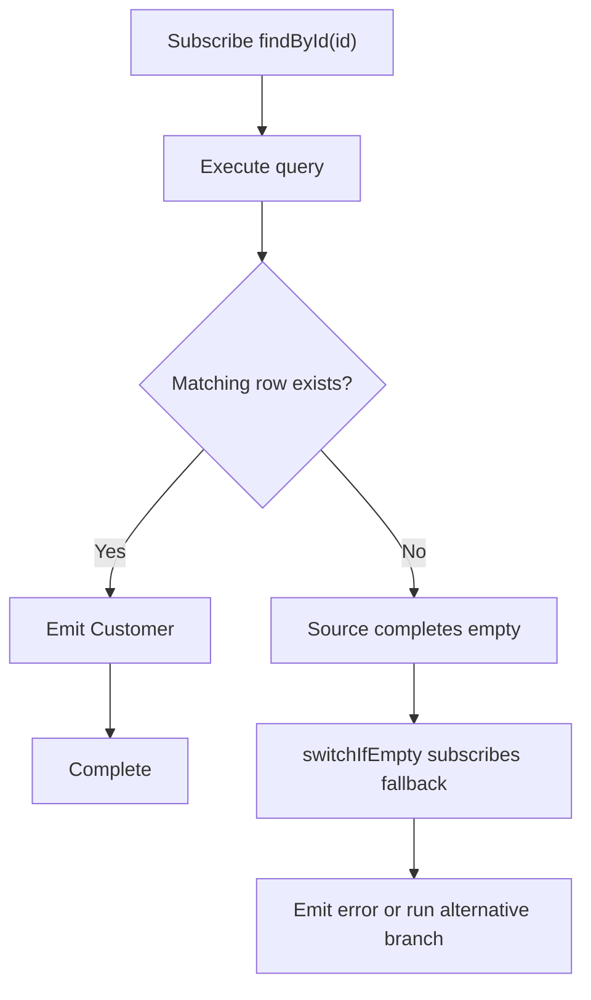

# Using `switchIfEmpty` and `defer` for Missing Data Branches

In Spring Data Relational R2DBC, many read operations return `Mono<T>` or `Flux<T>`. When a query finds no matching rows, the publisher typically completes without emitting any elements. This is Reactor's *empty completion* state. The application can use `switchIfEmpty` to transition to an alternative branch, such as emitting a 404 error, creating a new record, reading default data, or calling a fallback source.

`defer` adds the ability to delay creating the publisher until that branch is actually subscribed to. This is useful when creating the publisher involves computation, reading context, generating values, or invoking a function with side effects. Combining the two operators clearly expresses the flow: try reading first; only when data does not exist should the alternative branch be built and executed.

It is important to distinguish three points in time: pipeline assembly, source empty completion, and fallback subscription. `switchIfEmpty` only switches branches when the source completes without emitting any elements. `defer` delays calling the publisher-creating supplier; it does not automatically run work on another thread and does not subscribe to the publisher on its own.

## 1. Empty completion when an R2DBC query finds no rows

A reactive repository typically declares:

```java
public interface CustomerRepository
        extends ReactiveCrudRepository<Customer, Long> {
}
```

When calling:

```java
Mono<Customer> customer = customerRepository.findById(42L);
```

If the database has a row with ID `42`, the publisher emits one `Customer` and then completes. If no row matches, the publisher completes without emitting an element. It does not emit `null` and does not automatically throw an exception merely because no row was found.

Two outcomes to distinguish:

| Case | Reactive signal |
| --- | --- |
| Found one customer | `onNext(customer)` then `onComplete` |
| Customer not found | `onComplete` without `onNext` |
| Connection or SQL error | `onError(error)` |

Empty completion is a valid state of a reactive stream. It is distinct from a query error. If you need to turn “not found” into a business error, convert empty to an error explicitly.

## 2. `switchIfEmpty` switches to an alternative publisher

`switchIfEmpty` takes an alternative publisher. If the source publisher emits at least one element, the alternative branch is not subscribed to. If the source publisher completes without emitting any elements, Reactor subscribes to the alternative publisher.

Example emitting an error when a customer is not found:

```java
public Mono<Customer> getCustomer(Long id) {
    return customerRepository.findById(id)
            .switchIfEmpty(Mono.error(
                    new CustomerNotFoundException(id)
            ));
}
```

Execution flow:

1. The repository executes the query when the publisher is subscribed to.
2. If a customer exists, that element is emitted and the stream completes; the fallback does not run.
3. If no customer exists, the source completes empty.
4. `switchIfEmpty` switches to `Mono.error(...)` and downstream receives the `CustomerNotFoundException` error.

Diagram:



### The fallback can be a default value

If you want to return a default object instead of an error:

```java
Mono<CustomerView> findCustomerView(Long id) {
    return customerRepository.findById(id)
            .map(CustomerView::from)
            .switchIfEmpty(Mono.just(CustomerView.notFound(id)));
}
```

`Mono.just(...)` emits a single value and completes. The default value is only emitted when the source is empty.

If you only need to replace an empty publisher with a simple value, `defaultIfEmpty(value)` may also be suitable:

```java
Mono<String> name = customerRepository.findById(id)
        .map(Customer::getName)
        .defaultIfEmpty("Unknown customer");
```

`defaultIfEmpty` takes a value; `switchIfEmpty` takes a publisher, so it can be used to run another query, create data, or emit an error.

## 3. `switchIfEmpty` does not handle errors

`switchIfEmpty` only reacts to empty completion. If the source emits `onError`, the alternative branch is not called:

```java
return customerRepository.findById(id)
        .switchIfEmpty(Mono.defer(() -> createDefaultCustomer(id)));
```

If the query encounters a connection failure, timeout, or SQL error, that error goes straight downstream. `switchIfEmpty` does not turn errors into “not found”.

Distinguishing the operators:

| Operator | Triggered when | Purpose |
| --- | --- | --- |
| `switchIfEmpty` | Source completes without emitting elements | Switch to an alternative publisher |
| `defaultIfEmpty` | Source completes without emitting elements | Emit a default value |
| `onErrorResume` | Source emits an error | Switch error to another publisher |
| `onErrorReturn` | Source emits an error | Emit a fallback value |
| `onErrorMap` | Source emits an error | Transform error type |

Do not use `onErrorResume` to handle missing rows when the repository already represents missing rows via empty completion. Conversely, do not use `switchIfEmpty` to mask database errors.

If business logic wants a fallback when a backup source errors, define the error rule separately with `onErrorResume`; do not conflate technical errors with missing data.

## 4. Why combine `switchIfEmpty` with `defer`?

Consider the example:

```java
return customerRepository.findById(id)
        .switchIfEmpty(createDefaultCustomer(id));
```

Java evaluates the argument `createDefaultCustomer(id)` immediately when building the `switchIfEmpty` call. This means the Java method is invoked at pipeline assembly time, even though the alternative publisher may never be subscribed to.

If `createDefaultCustomer` only returns a cold publisher and performs no side effects when called, that may not cause an issue. However, if the method performs computation, generates IDs, reads mutable state, writes logs, calls an eager API, or builds a publisher with assembly-time behavior, that work still happens even when the source later emits a customer.

Use `Mono.defer` to delay invoking the method:

```java
return customerRepository.findById(id)
        .switchIfEmpty(Mono.defer(() -> createDefaultCustomer(id)));
```

The supplier inside `defer` is only invoked when the fallback is subscribed to. If the source finds a customer, the fallback is not subscribed to, so `createDefaultCustomer` is never called.

### Distinguishing publisher creation from publisher execution

Many Spring Data reactive APIs return cold publishers: calling `repository.save(entity)` usually only constructs a publisher, while the SQL runs when the publisher is subscribed to. Therefore, it should be stated precisely:

- `switchIfEmpty(fallbackPublisher)` does not subscribe to the fallback if the source has data.
- However, the Java expression creating `fallbackPublisher` is evaluated before `switchIfEmpty` is called.
- `Mono.defer(() -> fallbackPublisher)` delays even calling the supplier that creates the publisher until the fallback is subscribed to.

`defer` is especially important when publisher creation is impure or needs data at subscription time. If you are only creating a cold, side-effect-free publisher with fixed parameters, adding `defer` may not be necessary.

## 5. Creating a record if it does not exist

A common pattern is reading first; if not found, creating a new record:

```java
public Mono<Customer> findOrCreate(String email, String name) {
    return customerRepository.findByEmail(email)
            .switchIfEmpty(Mono.defer(() ->
                    customerRepository.save(new Customer(email, name))
            ));
}
```

When a customer already exists, the repository emits the existing entity and the `save` branch does not run. When absent, the supplier creates a new customer and the save publisher is subscribed to.

`defer` is also helpful when you want to generate values only inside the creation branch:

```java
public Mono<ApiKey> findOrCreateApiKey(Long customerId) {
    return apiKeyRepository.findByCustomerId(customerId)
            .switchIfEmpty(Mono.defer(() -> {
                String key = secureKeyGenerator.generate();
                ApiKey newKey = new ApiKey(customerId, key);
                return apiKeyRepository.save(newKey);
            }));
}
```

If the key were generated outside `defer`, the generator would run even when the customer already had a key. Putting value generation inside the supplier ensures it only runs when the fallback branch executes.

### `findOrCreate` does not guarantee creating only one row by itself

The read-then-create pattern has a race condition when multiple requests run concurrently:

1. Request A queries and finds no row.
2. Request B also queries and finds no row.
3. A creates and saves the row.
4. B also creates and saves the row.

Without a unique constraint, the database could end up containing two rows representing the same business entity. `switchIfEmpty` and `defer` only control reactive branching; they do not lock non-existent rows and do not turn a read-then-insert sequence into an atomic operation.

Add a unique constraint on the business key, for example:

```sql
ALTER TABLE customer
ADD CONSTRAINT uk_customer_email UNIQUE (email);
```

Then you can handle duplicate key conflicts by re-reading the row created by the other request:

```java
public Mono<Customer> findOrCreate(String email, String name) {
    return customerRepository.findByEmail(email)
            .switchIfEmpty(Mono.defer(() ->
                    customerRepository.save(new Customer(email, name))
            ))
            .onErrorResume(DuplicateKeyException.class,
                    error -> customerRepository.findByEmail(email));
}
```

This is a conceptual pattern; exception translation and duplicate error types depend on the driver/database. Only catch the specific unique/duplicate error anticipated by business logic. Do not use `onErrorResume(Exception.class, ...)` to hide all connection, timeout, or programming errors. If the database supports `INSERT ... ON CONFLICT` or an appropriate upsert, a single atomic statement may be a better option.

## 6. Using `switchIfEmpty` to return a business error

A service often needs to turn empty into a meaningful error:

```java
public Mono<Customer> requireCustomer(Long id) {
    return customerRepository.findById(id)
            .switchIfEmpty(Mono.error(
                    () -> new CustomerNotFoundException(id)
            ));
}
```

`Mono.error(Supplier)` creates the error when the error publisher is subscribed to. You can also use:

```java
.switchIfEmpty(Mono.defer(() ->
        Mono.error(new CustomerNotFoundException(id))
))
```

Both approaches delay exception instantiation in the alternative branch. For an already constructed exception with no significant side effects, `Mono.error(exception)` is usually sufficient. Use a supplier when you need a fresh exception per subscription or when the constructor contains data/logic that should be evaluated lazily.

At the WebFlux layer, `CustomerNotFoundException` can be mapped to HTTP 404 via `@ExceptionHandler`, `ResponseStatusException`, or a shared error handling mechanism. Repositories should represent missing data with empty; the service decides whether that becomes a 404, a default value, or a create action according to business rules.

## 7. Using fallback to read from another source

Another use case is reading the cache first, and if missing from the cache, reading the database:

```java
public Mono<ProductView> getProduct(Long id) {
    return cacheRepository.findProduct(id)
            .switchIfEmpty(Mono.defer(() ->
                    productRepository.findById(id)
                            .map(ProductView::from)
            ));
}
```

When the cache emits data, the database query is not subscribed to. When the cache is empty, the fallback begins reading from the database.

If you want to populate the cache after the database returns data, you can chain another step:

```java
public Mono<ProductView> getProduct(Long id) {
    return cacheRepository.findProduct(id)
            .switchIfEmpty(Mono.defer(() ->
                    productRepository.findById(id)
                            .map(ProductView::from)
                            .flatMap(product ->
                                    cacheRepository.putProduct(product)
                                            .thenReturn(product)
                            )
            ));
}
```

This example assumes `putProduct` returns a publisher that completes when the cache write finishes. If the cache operation errors, you must explicitly decide whether that error should fail the request or be handled separately. Do not swallow cache errors by default if the cache is a required component of the business flow.

### Empty cache differs from a failing cache

If the cache lacks the key and emits empty, `switchIfEmpty` reads the database. If the cache times out or fails to connect, that is `onError`, not empty. If policy requires falling back to the database when the cache errors, add `onErrorResume` intentionally:

```java
return cacheRepository.findProduct(id)
        .onErrorResume(CacheUnavailableException.class,
                error -> Mono.empty())
        .switchIfEmpty(Mono.defer(() -> productRepository.findById(id)
                .map(ProductView::from)));
```

Here only selected cache errors are converted to empty to trigger the database fallback. Do not convert all exceptions to empty because that can hide programming or data bugs.

## 8. `defer` delays publisher creation

`Mono.defer` accepts a supplier returning a `Mono`. The supplier is called when a subscriber subscribes to the publisher created by `defer`:

```java
Mono<Customer> deferred = Mono.defer(() -> {
    log.info("Creating customer read branch at subscribe time");
    return customerRepository.findById(10L);
});
```

When merely declaring `deferred`, the supplier does not run yet. Each subscription to `deferred` invokes the supplier to obtain the source publisher for that subscription.

`Flux.defer` has similar semantics, with the supplier returning a `Publisher`/`Flux` suited for multi-element streams:

```java
Flux<Customer> deferredCustomers = Flux.defer(() ->
        customerRepository.findByStatus(currentStatus())
);
```

If `currentStatus()` reads mutable state, `defer` ensures the value is read at subscription time rather than assembly time.

### `defer` is not a scheduler

`defer` does not switch work to another thread. The supplier runs during subscription on the execution thread of the subscription. If the supplier performs blocking work, `defer` does not make that work non-blocking:

```java
Mono.defer(() -> Mono.just(blockingFileRead()));
```

The snippet above still calls `blockingFileRead()` synchronously when the supplier runs. If a blocking API must be used, isolate it on an appropriate scheduler, such as `subscribeOn(Schedulers.boundedElastic())`, though with R2DBC non-blocking APIs should be preferred.

### `defer` does not cache results

Each subscription invokes the supplier again. If the publisher is subscribed to twice, the supplier may create two source publishers and execute two queries:

```java
AtomicInteger calls = new AtomicInteger();

Mono<Integer> deferred = Mono.defer(() ->
        Mono.just(calls.incrementAndGet())
);
```

The first subscription emits `1`, and the second subscription emits `2`. If you want to share/cache results across subscribers, use an appropriate caching/sharing mechanism; `defer` itself does not do this.

## 9. Comparing `defer`, `just`, `fromSupplier`, and `fromCallable`

These operators can all defer parts of the work, but their inputs and purposes differ:

| Operator | Input | Behavior |
| --- | --- | --- |
| `Mono.just(value)` | An existing value | Evaluates `value` immediately when calling `just`; emits that value on subscribe |
| `Mono.defer(supplier)` | Supplier returning a publisher | Calls supplier on subscribe to obtain the publisher for that subscription |
| `Mono.fromSupplier(supplier)` | Supplier returning a value | Calls supplier on subscribe and emits the value if non-null |
| `Mono.fromCallable(callable)` | Callable returning a value or throwing an exception | Calls callable on subscribe; exceptions are emitted as `onError` |

Examples:

```java
Mono<Customer> just = Mono.just(buildCustomer());

Mono<Customer> fromSupplier = Mono.fromSupplier(
        () -> buildCustomer()
);

Mono<Customer> fromCallable = Mono.fromCallable(
        () -> loadCustomerFromLegacyApi()
);

Mono<Customer> defer = Mono.defer(
        () -> customerRepository.findById(10L)
);
```

`buildCustomer()` inside `Mono.just(buildCustomer())` runs immediately at assembly time. With `fromSupplier`, the object factory runs on subscribe. With `fromCallable`, synchronous exceptions from the callable are converted into error signals. With `defer`, the supplier must return a publisher; it is appropriate when choosing or composing another publisher.

Do not use `fromCallable` to directly wrap an R2DBC call that already returns a `Mono`; when the supplier returns a publisher, use `defer` or appropriate operator composition. `fromCallable` is for synchronous values, not for automatically flattening nested reactive publishers.

## 10. `switchIfEmpty` with `Mono` and `Flux`

With `Mono<T>`, the source has at most one element. If there is no element, the fallback is subscribed to:

```java
Mono<Customer> customer = repository.findById(id)
        .switchIfEmpty(Mono.defer(() -> repository.save(new Customer(...))));
```

With `Flux<T>`, the fallback is only subscribed to if the entire source completes without emitting any elements at all:

```java
Flux<Customer> customers = repository.findByStatus("ACTIVE")
        .switchIfEmpty(Flux.defer(() -> repository.findDefaultCustomers()));
```

If the source emits one or more customers and then completes, the fallback does not run. `switchIfEmpty` does not insert fallbacks for gaps or for individual non-matching elements. It checks whether the source publisher emitted at least one element.

If you want to substitute missing values per element in a stream, use `flatMap`, `defaultIfEmpty` inside the inner publisher, or equivalent logic, rather than placing `switchIfEmpty` around the entire `Flux`.

## 11. Easily misunderstood cases

### `collectList()` emits an empty list, not an empty Mono

This is a very important distinction:

```java
Mono<List<Customer>> customers = repository.findByStatus("UNKNOWN")
        .collectList();
```

If there are no customers, `collectList()` still emits one element, `List.of()`, and then completes. Therefore:

```java
repository.findByStatus("UNKNOWN")
        .collectList()
        .switchIfEmpty(Mono.just(List.of(defaultCustomer)));
```

does not trigger the fallback simply because the list is empty. `Mono<List<Customer>>` emitted a list, so the source is not empty.

If you want a fallback when the list has no elements, check the list:

```java
return repository.findByStatus("UNKNOWN")
        .collectList()
        .flatMap(customers -> customers.isEmpty()
                ? loadDefaultCustomers()
                : Mono.just(customers));
```

Or keep the data as a `Flux` and use `switchIfEmpty` before `collectList`:

```java
return repository.findByStatus("UNKNOWN")
        .switchIfEmpty(Flux.defer(() -> repository.findDefaultCustomers()))
        .collectList();
```

### `Mono<Void>` completes successfully without emitting an element

`Mono<Void>` represents a task where only the completion signal matters and no value is emitted. Thus, a normally completing `Mono<Void>` is also empty as far as `switchIfEmpty` is concerned:

```java
repository.deleteById(id)
        .switchIfEmpty(Mono.error(new IllegalStateException("Could not delete")));
```

This snippet cannot be used to determine whether the delete found a row or not. If the delete succeeds, `Mono<Void>` still completes empty, so the fallback will run. Use an API returning an update count or check existence first if business logic needs to know whether a row was deleted.

Similarly, `.then()` discards the previous publisher's value and keeps only completion. After `.then()`, the publisher emits no element, so a trailing `switchIfEmpty` will trigger on normal completion:

```java
repository.findById(id)
        .then()
        .switchIfEmpty(Mono.defer(this::doFallback));
```

Do not use this construct to detect that the initial `findById` found no data, because `.then()` turns both the found case and the empty case into an empty `Mono<Void>`. Place `switchIfEmpty` before `.then()` if you want to distinguish the read result.

### `Mono.justOrEmpty(null)` creates empty

Reactor does not emit `null` as an element. `Mono.justOrEmpty(value)` creates `Mono.empty()` if `value` is null:

```java
Mono<Customer> customer = Mono.justOrEmpty(optionalCustomer);
```

Therefore, `switchIfEmpty` can be used to handle nullable Java values converted into an empty publisher. However, you should represent absence explicitly using `Optional` or reactive empty rather than passing null through the pipeline.

### `Mono<List<T>>` and `Flux<T>` have different semantics

| Publisher | No source elements | Does `switchIfEmpty` trigger? |
| --- | --- | --- |
| `Mono<Customer>` from `findById` | `Mono.empty()` | Yes |
| `Flux<Customer>` from query with no rows | `Flux.empty()` | Yes |
| `Flux<Customer>.collectList()` | `Mono.just(emptyList())` | No |
| `Mono<Void>` completing normally | Complete without `onNext` | Yes |
| `Mono<Long>` emitting `0L` | Emits one value | No |
| `Mono<Boolean>` emitting `false` | Emits one value | No |

`switchIfEmpty` checks the count of emitted elements; it does not interpret the business meaning of values like `0`, `false`, or an empty list.

## 12. `defer` with per-subscription varying data

`defer` is useful when input values need to be captured at subscription time:

```java
public Mono<AuditRecord> createAuditRecord() {
    return Mono.defer(() -> {
        Instant now = clock.instant();
        String actor = currentActor();
        return auditRepository.save(new AuditRecord(actor, now));
    });
}
```

If `now` or `actor` were computed outside `defer`, they would be captured at the time the method was called. When the publisher is subscribed to later or multiple times, the values might no longer reflect the desired moment. Putting them inside the supplier causes each subscription to obtain fresh values.

### Reading Reactor Context with `deferContextual`

If the fallback branch needs data from the Reactor Context, you can use `Mono.deferContextual`:

```java
return customerRepository.findById(id)
        .switchIfEmpty(Mono.deferContextual(context -> {
            String tenantId = context.get("tenantId");
            return customerRepository.findByTenantAndExternalId(
                    tenantId, externalId
            );
        }));
```

The supplier only runs when the fallback is subscribed to and can read the subscriber's context. This is the way to work with context in a reactive pipeline; do not retrieve tenant/transaction state from `ThreadLocal`.

You should not manually put transaction connections into the context. Spring manages transaction resources with its own mechanism; `deferContextual` only reads context values that the application intentionally propagates.

## 13. Combining with reactive transactions

A fallback branch subscribed within the same reactive pipeline can participate in the active transaction context:

```java
@Transactional
public Mono<Customer> findOrCreate(String email, String name) {
    return customerRepository.findByEmail(email)
            .switchIfEmpty(Mono.defer(() ->
                    customerRepository.save(new Customer(email, name))
            ));
}
```

When the method is called through a Spring transaction proxy and the publisher is subscribed to, the transaction context is attached to the subscriber. When the source is empty, `switchIfEmpty` subscribes to the publisher from `defer` within the same chain; the save operation can use the bound connection if the repository uses the matching `ConnectionFactory`.

Do not call `subscribe()` inside the fallback:

```java
// Avoid: creates an independent subscription.
.switchIfEmpty(Mono.defer(() -> {
    customerRepository.save(new Customer(email, name)).subscribe();
    return Mono.empty();
}));
```

Here the save publisher is no longer part of the chain managed by the transaction manager. Return the publisher directly:

```java
.switchIfEmpty(Mono.defer(() ->
        customerRepository.save(new Customer(email, name))
));
```

## 14. Laziness and argument evaluation

Compare two approaches:

```java
return repository.findById(id)
        .switchIfEmpty(createFallbackPublisher(id));
```

```java
return repository.findById(id)
        .switchIfEmpty(Mono.defer(() -> createFallbackPublisher(id)));
```

In the first approach, `createFallbackPublisher` is called immediately when the Java expression is evaluated. In the second approach, the method is only called when the fallback subscription begins.

However, if `createFallbackPublisher` merely returns a cold publisher and calling the method has no side effects, the database work inside that publisher still will not run before subscription. There is no need to mechanically wrap `defer` around every publisher.

Use `defer` when:

- You want to create objects or publishers only in the branch that is actually chosen.
- You need to read context or state at subscription time.
- You need to generate fresh values for each subscription.
- Calling the publisher-creating method has side effects or eager computation.
- You need to postpone choosing an alternative publisher.

You do not necessarily need `defer` when:

- The fallback is a constant publisher with no assembly-time side effects.
- The fallback value was intentionally constructed beforehand and needs to be reused.
- You do not need to read fresh state per subscription.

## 15. Common code patterns

### Find or return error

```java
Mono<Customer> requireCustomer(Long id) {
    return repository.findById(id)
            .switchIfEmpty(Mono.error(
                    () -> new CustomerNotFoundException(id)
            ));
}
```

### Find or create

```java
Mono<Customer> findOrCreate(String email) {
    return repository.findByEmail(email)
            .switchIfEmpty(Mono.defer(() ->
                    repository.save(new Customer(email))
            ));
}
```

### Read cache, then database

```java
Mono<Product> getProduct(Long id) {
    return cache.find(id)
            .switchIfEmpty(Mono.defer(() -> database.findById(id)));
}
```

### Use a default value

```java
Mono<String> getDisplayName(Long id) {
    return repository.findById(id)
            .map(Customer::getName)
            .defaultIfEmpty("Guest");
}
```

### Flux query with no rows falls back to another list

```java
Flux<Product> products = repository.findFeatured()
        .switchIfEmpty(Flux.defer(() -> repository.findPopular()));
```

### Only execute side effect if source is empty

```java
Mono<Customer> customer = repository.findByEmail(email)
        .switchIfEmpty(Mono.defer(() -> {
            metrics.increment("customer.missing");
            return repository.save(new Customer(email));
        }));
```

Here the side effect only happens when the fallback is subscribed to. If the metric needs to record every query miss even when the fallback later fails, placing the metric in the supplier as above works. If you want to measure fallback errors separately, use `doOnError` in the right scope.

## 16. Testing empty branches and defer

When testing, verify not only the final result but also whether the fallback was actually invoked or not.

### Source has data: fallback does not run

```java
AtomicBoolean fallbackCalled = new AtomicBoolean(false);

Mono<String> result = Mono.just("found")
        .switchIfEmpty(Mono.defer(() -> {
            fallbackCalled.set(true);
            return Mono.just("fallback");
        }));

StepVerifier.create(result)
        .expectNext("found")
        .verifyComplete();

assertThat(fallbackCalled).isFalse();
```

### Source is empty: fallback is invoked on subscribe

```java
AtomicBoolean fallbackCalled = new AtomicBoolean(false);

Mono<String> result = Mono.<String>empty()
        .switchIfEmpty(Mono.defer(() -> {
            fallbackCalled.set(true);
            return Mono.just("fallback");
        }));

assertThat(fallbackCalled).isFalse();

StepVerifier.create(result)
        .expectNext("fallback")
        .verifyComplete();

assertThat(fallbackCalled).isTrue();
```

### Source errors: empty fallback does not run

```java
AtomicBoolean fallbackCalled = new AtomicBoolean(false);

Mono<String> result = Mono.<String>error(new IllegalStateException("DB down"))
        .switchIfEmpty(Mono.defer(() -> {
            fallbackCalled.set(true);
            return Mono.just("fallback");
        }));

StepVerifier.create(result)
        .expectError(IllegalStateException.class)
        .verify();

assertThat(fallbackCalled).isFalse();
```

### `defer` supplier is called on every subscription

```java
AtomicInteger calls = new AtomicInteger();

Mono<Integer> result = Mono.defer(() ->
        Mono.just(calls.incrementAndGet())
);

StepVerifier.create(result)
        .expectNext(1)
        .verifyComplete();

StepVerifier.create(result)
        .expectNext(2)
        .verifyComplete();
```

### Testing `collectList` and `Mono<Void>`

Include tests confirming that `collectList()` emits an empty list without triggering an outer `switchIfEmpty`, and that a normally completing `Mono<Void>` does trigger `switchIfEmpty`. These are two scenarios that frequently cause bugs in services.

With real repositories, integration tests need an appropriate database/driver and must subscribe to the publisher via `StepVerifier`. Mocks can test service branching, but they do not prove that the R2DBC query actually returns empty when no rows exist.

## 17. Common mistakes and fixes

| Symptom | Possible cause | How to fix |
| --- | --- | --- |
| Fallback method called even when source has data | Publisher-creating method called eagerly at assembly time | Wrap the call in `Mono.defer`/`Flux.defer` |
| Fallback runs after source errors | Using `onErrorResume` or error was converted to empty | Clearly separate empty and error; only convert allowed error types |
| Fallback not triggered when list query returns no rows | Called `collectList()`, which emits an empty list | Use `switchIfEmpty` before `collectList` or check `list.isEmpty()` |
| Fallback always runs after `.then()` | `.then()` returns `Mono<Void>` which emits no value | Place `switchIfEmpty` before `.then()` or check update count |
| Fallback runs after successful delete | Delete returns `Mono<Void>` so it completes empty | Use an API returning rows updated if distinguishing is required |
| No fallback when count is 0 | `Mono<Long>` emits `0L`, which is not empty | Use `filter(count -> count > 0)` or business condition |
| Duplicate records created in `findOrCreate` | Two requests both see empty then insert | Use unique constraint, upsert, or handle duplicate race |
| Newly generated value is identical across subscriptions | Value computed outside `defer` | Generate value inside supplier if needed per subscription |
| Fallback publisher does not run | Fallback publisher created but not properly chained/subscribed | Return publisher from `switchIfEmpty`, do not call `subscribe()` manually |
| Transaction does not cover fallback | Fallback self-subscribes as a separate pipeline | Return fallback publisher directly in the same chain |
| `defer` still blocks threads | Supplier runs blocking work | Use non-blocking APIs; if unavoidable, isolate blocking work on proper scheduler |

## 18. Operator selection process

When handling the case where a repository finds no data, you can decide using these steps:

1. Determine whether the source represents “not found” via empty completion or by emitting an error.
2. If a business error should be returned, use `switchIfEmpty(Mono.error(...))`.
3. If a simple value is needed, consider `defaultIfEmpty(value)`.
4. If another publisher needs to run, use `switchIfEmpty(fallbackPublisher)`.
5. If constructing the fallback must be delayed, wrap it with `Mono.defer` or `Flux.defer`.
6. If the source is a `Flux`, verify that the fallback should only run when the entire source emits zero elements.
7. Check whether an earlier operator like `collectList()` or `then()` has already transformed the source into a publisher emitting another value or `Mono<Void>`.
8. Keep database errors separate from empty; only use `onErrorResume` for errors with an explicit fallback policy.
9. If the fallback creates records, protect uniqueness with constraints or upserts to handle concurrent requests.
10. Chain all publishers in the same reactive chain to preserve backpressure, cancellation, and transaction context.

## 19. Takeaways

- R2DBC queries finding no rows typically complete empty; that is a different state from a database error.
- `switchIfEmpty` only switches to the alternative publisher when the source completes without emitting elements.
- `switchIfEmpty` does not handle `onError`; use `onErrorResume` separately for errors permitted to fall back.
- Java evaluates the argument to `switchIfEmpty(...)` at assembly time; `Mono.defer`/`Flux.defer` delays invoking the publisher supplier.
- `defer` does not subscribe automatically, does not cache results, and does not move work to another scheduler.
- The `Mono.defer` supplier is called per subscription; values or publishers created inside it can differ across subscriptions.
- A normally completing `Mono<Void>` is empty to `switchIfEmpty`; do not use it to detect whether a write affected rows.
- `collectList()` always emits a list, even an empty list; place `switchIfEmpty` before `collectList` if you want a fallback when a `Flux` has no rows.
- `Mono<Long>` emitting `0L` and `Mono<Boolean>` emitting `false` are still publishers with an element; `switchIfEmpty` does not trigger.
- `findOrCreate` has a race condition; unique constraints, upserts, or controlled duplicate key handling are required.
- A fallback branch inside the same reactive chain can join the transaction context; do not call `subscribe()` separately inside the supplier.
- Use `fromSupplier`/`fromCallable` for synchronous values; use `defer` when you need to return or choose a publisher.

When building missing-data handling flows in Spring Data R2DBC, let the repository represent missing results via empty, use `switchIfEmpty` to pick the alternative action, and add `defer` when you need to delay creating that branch. Pay special attention to operators that alter empty semantics such as `collectList()` and `then()`, as well as race conditions when the fallback creates new data.
