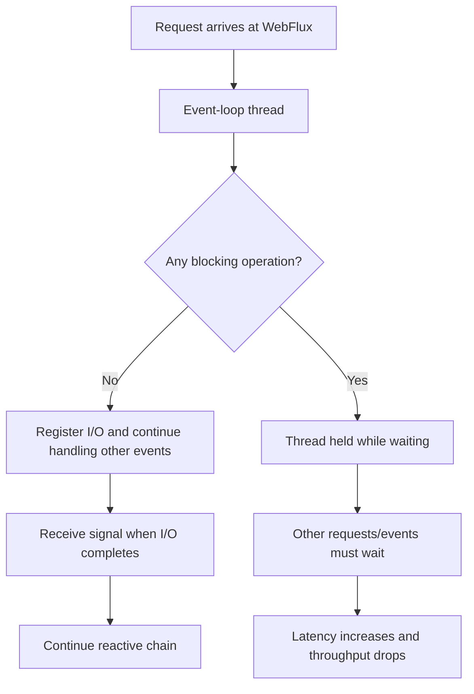

# Avoiding block, toFuture().get, and Blocking Operations on Event-Loop Threads

Spring Data R2DBC is designed to perform database access reactively. Operations return `Mono` or `Flux`, allowing the application to describe work without holding a thread while waiting for I/O results. This benefit is preserved only when the entire request path avoids blocking threads responsible for handling multiple events.

Calls such as `block()`, `toFuture().get()`, `CompletableFuture.join()`, `Thread.sleep()`, synchronous JDBC, or blocking HTTP clients can hold an event-loop thread while waiting. When that happens on WebFlux/Reactor Netty, the thread cannot process other requests and signals assigned to it. The typical consequences are rising latency, falling throughput, request timeouts, and growing work queues even while the database still has capacity.

The core principle is to keep the reactive chain continuous, return `Mono`/`Flux` to the calling layer, and isolate any unavoidable blocking work onto a scheduler dedicated to blocking tasks. If an API already has an asynchronous counterpart such as `WebClient` or `CompletableFuture`, convert it into Reactor instead of waiting synchronously for the result.

## 1. The event loop and why blocking one thread has wide impact

In a Spring WebFlux application running Reactor Netty, a small group of event-loop threads handles network activity for many connections. One event loop can read socket data, decode requests, invoke handlers, write responses, and process I/O callbacks. This model works efficiently because threads usually do not sit idle waiting for a network operation to finish.

When code invokes a blocking method on an event loop, that thread stops processing other work until the call returns. During the wait, other connections and requests assigned to that event loop are delayed.

For example, if an event-loop thread is blocked for 500 ms waiting on a JDBC query, every other event assigned to that thread must wait as well. If multiple requests do this concurrently, all event-loop threads can become occupied. The application can start showing high latency across many endpoints, even endpoints that never touch the database.



Not every wait is blocking. R2DBC drivers and `WebClient` wait for database or HTTP responses using asynchronous I/O: the thread is released to handle other work, and the publisher emits a signal when data arrives. The problem is a synchronous call that holds a thread until a result is returned.

## 2. Common blocking operations

The APIs below can block threads:

| Category | Examples | Why avoid on the event loop |
|---|---|---|
| Reactor blocking APIs | `Mono.block()`, `Flux.blockFirst()`, `Flux.blockLast()`, `blockOptional()` | Subscribe and wait for the publisher to emit a result |
| Futures | `Future.get()`, `CompletableFuture.get()`, `join()` | Wait for another task to finish |
| Thread/lock waits | `Thread.sleep()`, `CountDownLatch.await()`, `Semaphore.acquire()`, `Object.wait()`, `Lock.lock()` when contested | Hold the thread while waiting for a timer, signal, or lock |
| JDBC | `JdbcTemplate.query(...)`, `PreparedStatement.execute()` | JDBC is a blocking API |
| Synchronous HTTP clients | `RestTemplate`, synchronous HTTP clients from third-party libraries | Wait on network and response on the calling thread |
| Synchronous file I/O | `Files.readAllBytes(...)`, `FileInputStream.read(...)`, synchronous file APIs | Wait on the filesystem or storage device |
| Synchronous process/commands | Waiting for a process to exit or reading pipes in a blocking way | Thread is held while the process runs |
| Third-party libraries | Synchronous networking SDKs, blocking cache or messaging libraries | May wait on I/O internally even if method signatures do not show it |

Some operations are not blocking I/O yet can still make the event loop unresponsive, such as long CPU computations, infinite loops, lock contention, or processing very large datasets on one thread. For such tasks, select an appropriate scheduler or processing strategy instead of looking solely at API names.

## 3. Why avoid calling block() inside a reactive chain?

`Mono.block()` subscribes to a publisher and waits until it emits a value, completes empty, or errors. `Flux.blockFirst()` and `blockLast()` similarly wait for the corresponding element or signal. These methods are useful at certain imperative boundaries, but they do not belong inside WebFlux handlers, reactive services, or callbacks running on an event loop.

Example to avoid:

```java
@Service
public class PersonService {

    private final PersonRepository repository;

    public PersonService(PersonRepository repository) {
        this.repository = repository;
    }

    public Person findPerson(Long id) {
        // Avoid: blocks thread waiting for R2DBC result.
        return repository.findById(id).block();
    }
}
```

This method turns a reactive operation into a synchronous call. If called from a WebFlux event loop, the thread can be held until the database responds. Reactor may throw `IllegalStateException` when detecting `block()` on a thread marked as non-blocking, but do not rely on that exception to catch every case: on an unmarked thread, the call can still block and cause harm.

The right approach is to keep the return type reactive:

```java
public Mono<Person> findPerson(Long id) {
    return repository.findById(id);
}
```

Controllers also return publishers:

```java
@RestController
@RequestMapping("/people")
public class PersonController {

    private final PersonService service;

    public PersonController(PersonService service) {
        this.service = service;
    }

    @GetMapping("/{id}")
    public Mono<Person> getById(@PathVariable Long id) {
        return service.findPerson(id);
    }
}
```

WebFlux subscribes and writes the response when the publisher emits signals. There is no need to call `block()` yourself to extract an object before returning a response.

### Every block() call can create a new subscription

Reactor publishers are typically lazy. Each subscription can re-trigger the underlying work. Calling `block()` on a publisher that was already subscribed to elsewhere does not mean reading an existing cached result; it can create another subscription and re-execute the query.

Example:

```java
Mono<Person> personMono = repository.findById(id);

Person first = personMono.block();
Person second = personMono.block(); // May trigger another query execution.
```

With cold publishers from a Repository, each subscription typically re-executes the database operation. This both blocks and can generate unintended duplicate queries.

## 4. Avoid toFuture().get() and CompletableFuture.join()

Reactor lets you convert a publisher into a `CompletableFuture` using `toFuture()`. `toFuture()` itself is not a synchronous wait like `get()` or `join()`, though it does subscribe to the publisher and return a future. When you call `get()` or `join()`, the current thread waits for the future to complete.

Example to avoid:

```java
public Person load(Long id) throws Exception {
    return repository.findById(id)
        .toFuture()
        .get();
}
```

Or:

```java
public Person load(Long id) {
    return repository.findById(id)
        .toFuture()
        .join();
}
```

Both approaches turn a reactive flow synchronous. `get()` also wraps errors in `ExecutionException` and can throw `InterruptedException`; `join()` typically wraps errors in `CompletionException`. Changing exception types does not make the operation non-blocking.

Keep the publisher if the caller can work reactively:

```java
public Mono<Person> load(Long id) {
    return repository.findById(id);
}
```

If an external API requires a `CompletableFuture`, you can return the future without calling `get()`:

```java
public CompletableFuture<Person> loadAsync(Long id) {
    return repository.findById(id).toFuture();
}
```

When you need to use an asynchronous API that already returns `CompletionStage` or `CompletableFuture`, convert it back into Reactor:

```java
public Mono<RemoteProfile> loadRemoteProfile(Long id) {
    CompletableFuture<RemoteProfile> future = remoteClient.fetchAsync(id);
    return Mono.fromFuture(future);
}
```

Converting between two asynchronous abstractions makes sense. What to avoid is waiting synchronously with `.get()` or `.join()` on an event-handling thread.

## 5. Do not call subscribe() inside a service to run work and return a result

`subscribe()` is not the same as `block()`: it does not wait for a result. However, self-subscribing inside a service typically detaches the work from the reactive chain managed by the caller.

Example to avoid:

```java
public Mono<Void> createPerson(Person person) {
    repository.save(person).subscribe();
    return Mono.empty();
}
```

The method can return completion before the insert finishes. Errors from the insert are not propagated to the caller as an error on the returned publisher. A reactive transaction wrapping the method can also finish before that independent subscription completes. The caller cannot compose ordering, cancellation, or backpressure on the write operation.

Return the publisher instead:

```java
public Mono<Person> createPerson(Person person) {
    return repository.save(person);
}
```

If multiple chained operations are required:

```java
public Mono<Person> createWithAudit(Person person) {
    return repository.save(person)
        .flatMap(saved -> auditRepository.save(AuditEntry.created(saved.id()))
            .thenReturn(saved));
}
```

The publishers stay in the same chain, so the caller can observe results/errors and the reactive transaction manager can manage the entire unit of work when configured properly.

`subscribe()` is appropriate at specific intentional background-task entry points, provided you explicitly design lifecycle, error monitoring, retries, shutdown, and task durability. Do not use it to avoid returning a publisher from a normal reactive service.

## 6. Do not use Thread.sleep() to wait for tasks or simulate delays

`Thread.sleep()` holds the current thread for the specified duration. Do not use it to wait for a database, wait for messages, or introduce delays in a reactive pipeline.

Example to avoid:

```java
public Mono<String> getStatus() {
    try {
        Thread.sleep(1000);
    } catch (InterruptedException ex) {
        Thread.currentThread().interrupt();
        return Mono.error(ex);
    }
    return Mono.just("READY");
}
```

If the goal is a non-blocking delay, Reactor has `delayElement` or `Mono.delay`:

```java
public Mono<String> getStatus() {
    return Mono.delay(Duration.ofSeconds(1))
        .thenReturn("READY");
}
```

`Mono.delay` schedules emitting a signal after the specified duration; no thread sleeps during the wait. In business code, do not insert delays just to “give the database time to catch up”; wait for the database operation's publisher to complete using reactive operators.

## 7. JDBC is blocking: isolate it when it cannot yet be replaced

`JdbcTemplate` and JDBC drivers are blocking. If a WebFlux application still has to call a legacy JDBC module, do not call JDBC directly on the event loop. You can wrap the synchronous call in `Mono.fromCallable(...)` and offload it to `Schedulers.boundedElastic()`.

```java
public Mono<LegacyCustomer> findLegacyCustomer(Long id) {
    return Mono.fromCallable(() -> jdbcCustomerService.findById(id))
        .subscribeOn(Schedulers.boundedElastic());
}
```

`Mono.fromCallable` defers invoking `findById` until subscribe time. `subscribeOn` moves subscription and the callable source execution onto the bounded elastic scheduler, which is better suited for blocking work.

If the JDBC call returns `void`, use `Mono.fromRunnable`:

```java
public Mono<Void> writeLegacyAudit(AuditEntry entry) {
    return Mono.fromRunnable(() -> jdbcAuditService.insert(entry))
        .subscribeOn(Schedulers.boundedElastic())
        .then();
}
```

`boundedElastic` isolates the blocking call from the event loop; it does not make JDBC non-blocking. The call still occupies a worker thread while JDBC waits on the database. The scheduler has thread and queue bounds, so you still need concurrency limits, timeouts, and load monitoring.

If the JDBC method has `@Transactional(transactionManager = "jdbcTransactionManager")`, place the transaction boundary on a separate imperative bean so the call executes completely inside that method on the worker thread. Wrapping JDBC in `Mono.fromCallable` does not make it join an active R2DBC reactive transaction.

## 8. Do not use Mono.just() to wrap a blocking call

A common mistake is calling the blocking method first and then passing the result to `Mono.just()`:

```java
// Wrong: blockingClient.fetch() runs immediately when the method is called.
return Mono.just(blockingClient.fetch(id))
    .subscribeOn(Schedulers.boundedElastic());
```

By the time `Mono.just(...)` is created, `fetch(id)` has already finished or blocked the calling thread. `subscribeOn` cannot retroactively move a call that already occurred onto another scheduler.

Use `fromCallable` instead:

```java
return Mono.fromCallable(() -> blockingClient.fetch(id))
    .subscribeOn(Schedulers.boundedElastic());
```

Or `defer` when you need to create a publisher inside the scheduler:

```java
return Mono.defer(() -> Mono.just(blockingClient.fetch(id)))
    .subscribeOn(Schedulers.boundedElastic());
```

`fromCallable` is usually more concise for a synchronous call returning a value. If the method can return null, `Mono.fromCallable` completes empty when the Callable returns null; make sure that matches the contract.

## 9. Distinguishing subscribeOn and publishOn

These two operators control schedulers at different points:

**`subscribeOn(scheduler)`** affects where subscription and source execution begin. It is commonly used to move a blocking source onto an appropriate scheduler.

**`publishOn(scheduler)`** switches downstream signals after the operator's position to the specified scheduler. It does not retroactively move a blocking call that already happened earlier.

Example:

```java
Mono<LegacyData> source = Mono.fromCallable(() -> blockingClient.fetch(id))
    .subscribeOn(Schedulers.boundedElastic());
```

This is the standard pattern for blocking sources.

`publishOn` example:

```java
return repository.findById(id)
    .publishOn(Schedulers.boundedElastic())
    .map(person -> legacyFormatter.formatBlocking(person));
```

Here, the `map` after `publishOn` runs on the bounded elastic scheduler, isolating the `formatBlocking` call. However, `publishOn` is unnecessary if you can encapsulate the blocking operation separately with `fromCallable`.

Misplaced example:

```java
return Mono.just(blockingClient.fetch(id))
    .publishOn(Schedulers.boundedElastic());
```

The blocking call already executed before `publishOn`, so the event loop can still be blocked.

| Operator | Affected part | Typical scenario |
|---|---|---|
| `subscribeOn` | Subscription and upstream source | Wrapping JDBC or a blocking SDK with `fromCallable` |
| `publishOn` | Downstream operators from the operator's position onward | Moving a subsequent processing stage to another scheduler |

There is no need to place `subscribeOn(boundedElastic())` at every layer. Place it right next to the blocking source so intent and isolation scope are clear.

## 10. Choosing a scheduler by workload type

Reactor provides schedulers for different purposes:

| Scheduler | Purpose | Should not be used for |
|---|---|---|
| `Schedulers.parallel()` | Short, non-blocking CPU-bound work | JDBC, `Future.get()`, synchronous file I/O, or waiting on locks |
| `Schedulers.boundedElastic()` | Blocking work with wait times, with bounded workers and queues | An unlimited catch-all for all work or unbounded heavy CPU work |
| `Schedulers.single()` | One sequential worker for short, non-blocking tasks | Blocking I/O, which stalls all other tasks on that scheduler |
| Custom scheduler | Isolating a workload with specific characteristics and explicit resource caps | Using without a plan for disposal, capacity, and monitoring |

`boundedElastic` is the common choice for isolating blocking libraries in a reactive application. However, if a blocking SDK has long wait times or high load, you can create a dedicated scheduler with appropriate thread/queue caps so it does not exhaust shared resources.

Example creating a dedicated scheduler:

```java
@Configuration
public class BlockingSchedulerConfiguration {

    @Bean(destroyMethod = "dispose")
    public Scheduler legacyIoScheduler() {
        return Schedulers.newBoundedElastic(
            20,
            500,
            "legacy-io"
        );
    }
}
```

Usage:

```java
public Mono<LegacyData> loadLegacyData(Long id) {
    return Mono.fromCallable(() -> legacyClient.load(id))
        .subscribeOn(legacyIoScheduler);
}
```

The thread cap and queue cap above are only examples. Choose based on JDBC connection pools, external service limits, latency, and concurrent requests. The scheduler should be disposed when the application context stops; `destroyMethod` supports that lifecycle.

## 11. Handling CPU-bound work differs from blocking I/O

Not all time-consuming work belongs on bounded elastic. If a task is mainly CPU computation such as encryption, image processing, compression, or numerical calculation, it is not waiting on I/O but is consuming CPU. `Schedulers.parallel()` is generally better suited for finite CPU-bound tasks:

```java
public Mono<Report> buildReport(Input input) {
    return Mono.fromCallable(() -> cpuIntensiveCalculation(input))
        .subscribeOn(Schedulers.parallel());
}
```

If CPU work is long-running and could saturate workers, limit concurrency or use a dedicated scheduler. Do not run infinite loops or unbounded data processing on the event loop.

Conversely, `Schedulers.parallel()` is not the place for JDBC or synchronous HTTP waits. A blocked worker reduces the remaining workers available for CPU tasks.

## 12. Use asynchronous APIs instead of wrapping blocking APIs

If a library already provides a reactive or asynchronous API, prefer that API:

| Need | Preferred API in a reactive application |
|---|---|
| Database access | Spring Data R2DBC, `DatabaseClient`, `R2dbcEntityTemplate` |
| HTTP calls | `WebClient` or a client returning `CompletionStage` |
| Calling an API returning `CompletableFuture` | `Mono.fromFuture(...)` or `Mono.fromCompletionStage(...)` |
| Waiting for a duration | `Mono.delay`, `delayElement`, `timeout` |
| Reading large files | Asynchronous NIO APIs or appropriate reactive utilities |
| Sending messages | Reactive messaging client if supported by the stack |

Example using `WebClient`:

```java
public Mono<RemoteProfile> fetchProfile(Long id) {
    return webClient.get()
        .uri("/profiles/{id}", id)
        .retrieve()
        .bodyToMono(RemoteProfile.class);
}
```

There is no need to wrap `WebClient` in `fromCallable` or move it to bounded elastic just because it is an HTTP call. `WebClient` is designed for reactive I/O; keep its publisher in the chain.

## 13. Timeouts are not a reason to block

Some code calls `block()` because it wants to wait at most a certain amount of time. Reactor has the `timeout` operator to set a deadline without blocking a thread:

```java
public Mono<Person> findWithDeadline(Long id) {
    return repository.findById(id)
        .timeout(Duration.ofSeconds(2));
}
```

If the publisher does not emit a signal within the deadline, Reactor emits a timeout error and sends cancellation upstream per the publisher's semantics. This differs from `block(Duration)`, which still holds the calling thread waiting until a result arrives or time expires.

Cancellation does not guarantee every database server immediately aborts the SQL statement. Statement cancellation depends on the driver and database. If you need to cap SQL execution time, configure statement/query timeouts at the driver or database level alongside application deadlines.

Do not use `Thread.sleep()` after sending SQL to “wait for the database”. Compose the publisher and handle completion signals.

## 14. Impact on reactive transactions

Spring's reactive transactions use the Reactor Context to associate a connection with a publisher chain. Therefore, standard Reactor operators can switch threads across schedulers while preserving context when the subscription is chained properly.

However, calling `block()` inside a reactive transaction can create nested or independent subscriptions. It is not the way to read a result within the current transaction. If code creates another publisher and calls `subscribe()` itself, that operation may not participate in the transaction context managed by the caller.

Example to avoid:

```java
@Transactional(transactionManager = "r2dbcTransactionManager")
public Mono<Void> createWithAudit(Person person) {
    Person saved = repository.save(person).block();
    auditRepository.save(AuditEntry.created(saved.id())).subscribe();
    return Mono.empty();
}
```

This snippet both blocks and creates an independent subscription. The transaction manager may not cover the operations as intended.

Keep a single reactive chain:

```java
@Transactional(transactionManager = "r2dbcTransactionManager")
public Mono<Person> createWithAudit(Person person) {
    return repository.save(person)
        .flatMap(saved -> auditRepository.save(
            AuditEntry.created(saved.id())
        ).thenReturn(saved));
}
```

If you need to call a blocking library that does not access the database, you can isolate it with bounded elastic within the reactive chain. Reactor Context is preserved across standard scheduler operators, whereas an imperative library's `ThreadLocal` does not automatically become Reactor Context. If a library relies on `ThreadLocal` such as security context or JDBC transactions, design propagation explicitly and do not assume a reactive transaction will manage that resource.

## 15. Calling JDBC in WebFlux without blocking the event loop

If a JDBC module cannot yet be migrated to R2DBC, keep the JDBC call inside an imperative method with its own JDBC transaction and invoke that method on bounded elastic:

```java
@Service
public class LegacyReportService {

    private final JdbcTemplate jdbcTemplate;

    public LegacyReportService(JdbcTemplate jdbcTemplate) {
        this.jdbcTemplate = jdbcTemplate;
    }

    @Transactional(transactionManager = "jdbcTransactionManager")
    public LegacyReport load(Long customerId) {
        return jdbcTemplate.queryForObject("""
                SELECT customer_id, total_orders, total_spend
                FROM legacy_customer_report
                WHERE customer_id = ?
                """,
            legacyReportRowMapper,
            customerId);
    }
}
```

```java
public Mono<LegacyReport> loadReport(Long customerId) {
    return Mono.fromCallable(() -> legacyReportService.load(customerId))
        .subscribeOn(Schedulers.boundedElastic());
}
```

Calling through the `LegacyReportService` bean lets the Spring proxy apply the JDBC transaction while the imperative method runs. Do not manually acquire a JDBC connection inside a reactive transaction expecting it to join the R2DBC transaction.

If a use case needs to write to both JDBC and R2DBC, remember that two local transaction managers do not automatically create shared atomicity. Offloading the blocking call to bounded elastic only protects the event loop; it does not coordinate commit/rollback across two resources. For cross-stack consistency requirements, consider a transactional outbox, Saga, or a specifically supported distributed mechanism.

## 16. Do not turn a reactive flow blocking just to share code

Sometimes a service class has a method returning a synchronous entity because an older MVC module calls it. When a WebFlux module wants to reuse it, do not call `block()` to extract the result. You can:

- Separate pure business logic from the data access layer.
- Create a reactive service returning `Mono`/`Flux` for R2DBC.
- Keep a separate imperative JDBC service for synchronous modules.
- Offload mandatory JDBC calls to bounded elastic if invoked from WebFlux.

Do not create a “shared repository” abstraction that sometimes returns `Person` and sometimes returns `Mono<Person>` depending on the caller. The two models have different semantics and transaction boundaries; keeping contracts explicit helps avoid accidental thread blocking.

## 17. Backpressure and avoiding loading all data into memory

Avoiding `block()` is not enough for a reactive application to run stably. A pipeline can be non-blocking yet still consume large amounts of memory if it loads an entire dataset into a `List`:

```java
// May hold the entire result set in memory.
return repository.findAll()
    .collectList();
```

For large tables, paginate, process in bounded groups, or stream data to the consumer. Backpressure lets a consumer regulate signal delivery rate, but it does not replace database query limits or application memory limits.

Avoid APIs that convert a `Flux` into blocking forms such as `toIterable()` or `toStream()` inside WebFlux handlers. Iterating over an iterable/stream can block waiting for the next element from the publisher. If you need to export large datasets, use a reactive streaming response or a dedicated export job.

## 18. Detecting blocking with BlockHound

BlockHound is a tool that detects certain blocking calls executed on threads marked as non-blocking. It can help uncover code accidentally calling `Thread.sleep`, `Future.get`, file I/O, or blocking APIs inside a reactive pipeline.

Add the test dependency matching your project's Reactor/JDK version, for example:

```gradle
testImplementation("io.projectreactor.tools:blockhound:<version>")
```

In test setup:

```java
@BeforeAll
static void installBlockHound() {
    BlockHound.install();
}
```

Example test intentionally invoking a blocking call on a non-blocking scheduler:

```java
StepVerifier.create(
        Mono.delay(Duration.ofMillis(10))
            .publishOn(Schedulers.parallel())
            .map(value -> {
                Thread.sleep(50);
                return value;
            })
    )
    .expectError()
    .verify();
```

When BlockHound detects a blocking call, the test can fail with an error rather than silently blocking the thread. This is an illustrative example; configuration and compatibility must be verified for your project's JDK, Reactor, and library versions.

BlockHound does not detect every cause of slowdown. Excessive CPU computation is not a blocking call by the tool's definition, and certain libraries/native calls may need additional integrations or configuration. Use BlockHound alongside metrics, logs, and profiling; do not treat it as sole proof that the application has no bottlenecks.

Do not add allow-list entries to ignore a blocking call merely to make tests green. If a specific call must be permitted, explain why it is safe on that thread and verify it does not block the event loop under realistic workloads.

## 19. Testing reactive code without blocking

In unit tests, `StepVerifier` allows asserting signals of `Mono`/`Flux` without calling `block()` in application code:

```java
@Test
void returnsPerson() {
    StepVerifier.create(personService.findPerson(10L))
        .expectNextMatches(person -> person.id().equals(10L))
        .verifyComplete();
}
```

For WebFlux endpoints, `WebTestClient` can test HTTP responses in a manner suited to the reactive stack:

```java
webTestClient.get()
    .uri("/people/10")
    .exchange()
    .expectStatus().isOk()
    .expectBody()
    .jsonPath("$.id").isEqualTo(10);
```

In imperative tests or test harnesses, `block(Duration)` is sometimes acceptable at the test boundary to obtain a result. Still, prefer `StepVerifier` to verify completion/error/cancel and prevent tests from hanging indefinitely. Never call `block()` on an event-loop thread inside WebFlux tests.

Some integration tests can run with `@SpringBootTest` and `WebTestClient`; testing endpoints over HTTP helps verify both how the framework subscribes to the publisher and how the response is written.

## 20. Observing signs of a blocked event loop

Operational symptoms can include:

- Request latency rises across multiple endpoints at the same time.
- Throughput drops even though CPU or database capacity has not reached its limit.
- Thread dumps show `reactor-http-nio-*` stuck in `Future.get`, `Socket.read`, a JDBC driver, `Thread.sleep`, or file I/O.
- Event-loop threads stay busy for long periods and fail to service many channels.
- Queues on bounded elastic grow, worker counts hit limits, or tasks are delayed.
- Request timeouts increase while database-side query latency does not explain the full delay.
- Connection pool connections are held too long due to synchronous processing after a query completes.

When investigating, capture thread dumps while the system is slow, inspect stack traces of event-loop threads, and look for blocking calls. Also examine database latency, connection pool metrics, scheduler queues, and CPU processing time to pinpoint the bottleneck source.

Thread names can help identify schedulers, though you should not rely solely on names. Threads can be renamed or custom schedulers may be in use. Inspect both stack traces and where schedulers are created.

## 21. Common mistakes and fixes

| Problematic practice | Consequence | Alternative |
|---|---|---|
| `repository.findById(id).block()` in handler | Blocks event loop and creates synchronous subscription | Return `Mono<Person>` |
| `toFuture().get()` or `.join()` | Waits on future on current thread | Return `Mono`/`CompletableFuture` to caller or use `Mono.fromFuture` |
| `Mono.just(blockingCall())` | Call already blocked before publisher is subscribed to | `Mono.fromCallable(...).subscribeOn(boundedElastic())` |
| `Thread.sleep()` | Holds thread while waiting | `Mono.delay` or appropriate delay operator |
| Direct JDBC inside WebFlux | Blocks Netty event loop | Isolate on bounded elastic or use R2DBC |
| `subscribe()` inside a service | Work detached from caller's error, cancellation, and transaction flow | Compose and return publisher |
| `publishOn` placed after blocking call | Blocking call already ran on old thread | Wrap source with `fromCallable` and `subscribeOn` |
| Using `parallel()` for JDBC | CPU workers are held by blocking I/O | Use `boundedElastic` or a dedicated scheduler |
| `collectList()` on unbounded data | High memory growth and retention | Paginate or use bounded streaming |
| Wrapping blocking JDBC in an R2DBC transaction expecting joint rollback | Two independent transaction managers | Separate transactions; use outbox/Saga if coordination is needed |

## 22. Checklist for designing a reactive request

When writing an endpoint using Spring Data R2DBC, check:

1. Do controllers and services return `Mono`/`Flux` instead of calling `block()`?
2. Are there any `toFuture().get()`, `join()`, `await()`, or `Thread.sleep()` calls on the execution path?
3. Are any synchronous libraries called directly on the event loop?
4. If a blocking library must be called, is it wrapped in `fromCallable`/`fromRunnable` and moved to bounded elastic?
5. Is `Mono.just(blockingCall())` used anywhere, causing the call to run before subscription?
6. Is there any manual `subscribe()` breaking the link to the caller's publisher?
7. Are `subscribeOn` and `publishOn` placed in the right positions?
8. Are CPU-bound work and blocking I/O routed to appropriate schedulers?
9. Are page sizes, concurrency, and payload sizes bounded to avoid holding resources too long?
10. Are reactive transactions kept within the same chain and using the proper `ConnectionFactory`?
11. Are there tests with `StepVerifier`, `WebTestClient`, and BlockHound where appropriate?
12. Do metrics and thread dumps provide enough visibility to spot event-loop blocking in production?

## 23. Process for handling a blocking library in an R2DBC application

When encountering a blocking API that cannot be replaced immediately, follow this sequence:

**Step 1 — Pinpoint the exact blocking call.** Read API docs, thread dumps, or profiles to see which call waits on I/O, locks, or processes.

**Step 2 — Look for an asynchronous alternative.** Prefer `WebClient`, an R2DBC driver, `CompletionStage`, or NIO APIs if the library provides them.

**Step 3 — If no async API exists, wrap the call.** Use `Mono.fromCallable` for value-returning methods or `Mono.fromRunnable` for void methods.

**Step 4 — Move onto a blocking scheduler.** Use `Schedulers.boundedElastic()` or a dedicated scheduler with appropriate thread/queue limits.

**Step 5 — Keep the reactive chain.** Do not call `block()` or `subscribe()` to fetch intermediate results; combine publishers using appropriate operators.

**Step 6 — Clarify transactions.** If the call is JDBC, use a separate JDBC transaction manager inside an imperative method; do not assume it joins an R2DBC transaction.

**Step 7 — Test and observe.** Use BlockHound, thread dumps, scheduler metrics, and load tests to confirm the event loop is no longer blocked.

## 24. Conclusion

Reactive applications can only serve high request volumes efficiently when event-handling threads are not tied up by synchronous waits. `block()`, `toFuture().get()`, `join()`, `Thread.sleep()`, JDBC, and blocking clients all belong off the event-loop path. Never self-subscribe to publishers inside services, because that detaches work from the error, cancellation, and transaction chain managed by the caller.

Keep `Mono`/`Flux` flowing across controllers and services. If calling a blocking library is unavoidable, wrap the call in `fromCallable` or `fromRunnable` and offload it to `boundedElastic` or a dedicated scheduler; use `subscribeOn` at the blocking source and remember `publishOn` only affects downstream stages. Prefer asynchronous APIs, use `StepVerifier`/`WebTestClient` for testing, and use BlockHound to catch accidental blocking calls. These practices protect the event loop, keep reactive transactions properly scoped, and make Spring Data R2DBC application latency far more predictable.
