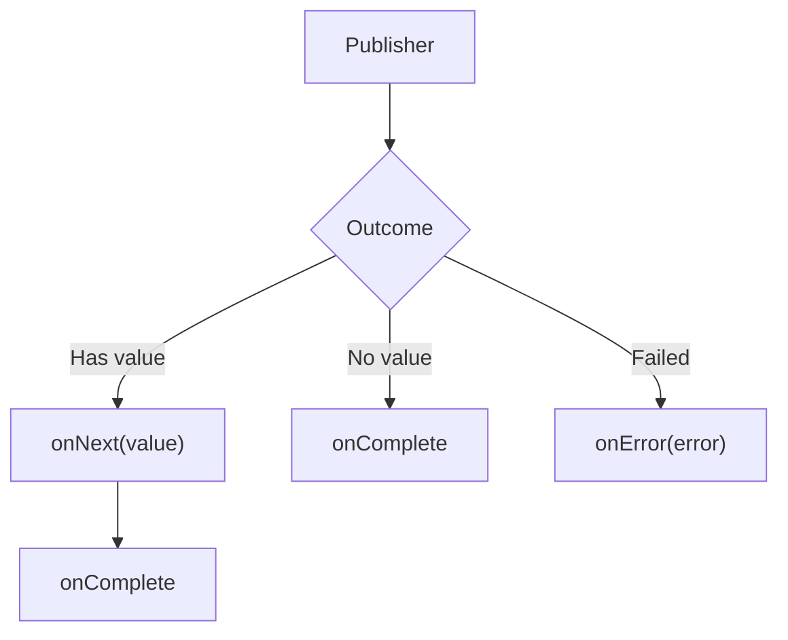

# Never Use null to Represent an Element in a Reactive Stream

In Spring Data Relational R2DBC, data flows through Project Reactor's `Mono` and `Flux`. A reactive stream expresses outcomes via `onNext`, `onComplete`, and `onError` signals. Under Reactive Streams, an element emitted via `onNext` must never be `null`. Therefore, you cannot use `Mono.just(null)` or emit a `null` element in a `Flux` to mean “a result exists, but its value is empty”.

Instead, clearly distinguish three situations: having a value, having no elements, and having an error. In database-access applications, you must also distinguish a missing row from an existing row where a column holds SQL `NULL`. Nullable values can be represented using `Mono.justOrEmpty`, `Optional`, a DTO/record with nullable properties, or a dedicated result type. Choosing the right representation keeps reactive pipeline semantics accurate and prevents `NullPointerException` during mapping.

## 1. Why does Reactive Streams disallow null elements?

Reactive Streams defines a publisher emitting elements through the `onNext(T)` signal. This signal must carry a valid element; `null` cannot serve as a placeholder value for an element. Ending the stream and signaling errors already have dedicated signals:

| Signal | Meaning |
| --- | --- |
| `onNext(value)` | A valid element is emitted; `value` must be non-null |
| `onComplete()` | The stream ended normally; zero or more elements may have been emitted |
| `onError(error)` | The stream terminated due to an error |

Consequently, a `Mono<T>` can emit at most one value, complete empty, or emit an error. It has no state for “emit a null value”. A `Flux<T>` can emit zero, one, or many non-null elements and complete, or terminate with an error.



There is no `onNext(null)` branch. If an external data source can return null, the application must translate that state into a valid representation before emitting into the pipeline.

## 2. `Mono.just(null)` is invalid

`Mono.just(value)` creates a `Mono` emitting the given value. This value must be non-null:

```java
String name = null;

Mono<String> result = Mono.just(name); // Throws NullPointerException
```

The error happens immediately when creating `Mono.just(...)`, because Reactor validates the input value. Do not write code assuming `Mono` will emit null for downstream subscribers to inspect.

If a value can be null, use `Mono.justOrEmpty(...)`:

```java
String name = findNameOrNull();

Mono<String> result = Mono.justOrEmpty(name);
```

- If `name` is non-null, `Mono` emits that value and completes.
- If `name` is null, `Mono` completes empty.

`justOrEmpty` has an overload accepting `Optional<T>`:

```java
Optional<String> name = findOptionalName();

Mono<String> result = Mono.justOrEmpty(name);
```

If `Optional` holds a value, the publisher emits the inner value. If `Optional.empty()`, the publisher completes empty.

## 3. Distinguishing values, empty streams, and errors

These three cases have distinct semantics and should be handled separately:

```java
Mono<String> found = Mono.just("An");
Mono<String> missing = Mono.empty();
Mono<String> failed = Mono.error(new IllegalStateException("Database unavailable"));
```

| Publisher | Behavior on subscribe | Common meaning |
| --- | --- | --- |
| `Mono.just("An")` | `onNext("An")`, then `onComplete` | Result present |
| `Mono.empty()` | `onComplete`, without `onNext` | Not found or no value per the method's contract |
| `Mono.error(...)` | `onError` | Operation failed |

Do not convert database errors into `Mono.empty()` just to avoid exceptions. For instance, losing database connectivity is an operational error, not “record not found”. If the two situations are conflated, the caller might return HTTP 404 when the real cause is that the database is down.

Similarly, never use null to represent an error. Use `Mono.error(...)` or let exceptions propagate through the publisher appropriately.

## 4. `Mono.empty()` is not `Mono.just(null)`

The following two expressions are not equivalent:

```java
Mono<String> absent = Mono.empty();
Mono<String> invalid = Mono.just(null); // Throws NullPointerException
```

`Mono.empty()` is a valid publisher emitting zero elements. `Mono.just(null)` fails to create a valid publisher. Subscribers can distinguish `onComplete` with no elements from `onNext` with data; there is no null value to check.

For `Mono<T>`, empty completion typically represents no result. For `Flux<T>`, empty completion means zero elements in the stream. Define that meaning clearly per method: entity not found, no search results, or a completed `Mono<Void>` operation.

`Mono<Void>` normally completes without emitting a value because the `Void` type is not used to carry a result object. This is an operation-completion contract, not a way to represent a null data field.

## 5. `map` must not return null

The `map` operator transforms one element into another element. The mapper function must return a non-null value:

```java
Mono<String> result = Mono.just("An")
        .map(name -> lookupNicknameOrNull(name));
```

If `lookupNicknameOrNull` returns null, Reactor does not emit null; the pipeline terminates with a `NullPointerException`. Convert nullable values into an empty `Mono` or a non-null wrapper.

If the goal is to omit null values:

```java
Mono<String> result = Mono.just("An")
        .flatMap(name -> Mono.justOrEmpty(lookupNicknameOrNull(name)));
```

If you need to preserve the distinction between “row exists with null column” and “no row exists”, use a wrapper:

```java
Mono<Optional<String>> result = Mono.just("An")
        .map(name -> Optional.ofNullable(lookupNicknameOrNull(name)));
```

In the second example, `map` always returns a non-null `Optional`. `Optional.empty()` is a valid element, not null.

## 6. `flatMap` must not return a null publisher either

`flatMap` receives an element and transforms it into another publisher. The mapper function must return a valid `Publisher`, never null:

```java
Mono<Customer> result = customerRepository.findById(42L)
        .flatMap(customer -> loadDetailsOrNull(customer));
```

If `loadDetailsOrNull` returns null instead of a `Mono`, Reactor emits an error. When no dependent result exists, return `Mono.empty()`:

```java
Mono<CustomerDetails> result = customerRepository.findById(42L)
        .flatMap(customer -> loadDetails(customer));
```

`loadDetails` should return `Mono<CustomerDetails>` and use `Mono.empty()` when details do not exist. If the underlying method only returns a synchronous nullable value, convert it with `Mono.justOrEmpty`:

```java
Mono<CustomerDetails> result = customerRepository.findById(42L)
        .flatMap(customer -> Mono.justOrEmpty(loadDetailsOrNull(customer)));
```

Never `return null` in branches of `flatMap`, `switchIfEmpty`, `onErrorResume`, or callbacks expecting a publisher.

## 7. `Mono.fromCallable` and null return values

When wrapping a synchronous call that might return null, `Mono.fromCallable` has useful semantics: if the callable returns a non-null value, `Mono` emits that value; if the callable returns null, `Mono` completes empty.

```java
Mono<String> name = Mono.fromCallable(() -> findNameOrNull());
```

This differs from `Mono.just(findNameOrNull())`: the argument expression to `just` is evaluated before calling `just`, and `just(null)` throws. `fromCallable` executes the callable on subscribe and translates null results to an empty stream.

`Mono.fromSupplier(...)` can also be used for suppliers returning nullable values and completes empty if the supplier returns null. Even so, only use these synchronous sources for appropriate work; do not wrap a blocking database/JDBC call inside `fromCallable` and consider it non-blocking. R2DBC repositories already return reactive publishers, so chain those publishers directly.

## 8. `Mono.justOrEmpty` and `Optional`

`Optional<T>` represents a potentially absent value in Java. It does not hold null itself: an `Optional` is either `Optional.of(value)` or `Optional.empty()`.

```java
Optional<String> maybeName = Optional.ofNullable(findNameOrNull());

Mono<String> namePublisher = Mono.justOrEmpty(maybeName);
```

Another usage is emitting `Optional` as the element of `Mono` itself:

```java
Mono<Optional<String>> result = Mono.fromSupplier(
        () -> Optional.ofNullable(findNameOrNull()));
```

The two return types express different contracts:

| Type | Meaning |
| --- | --- |
| `Mono<String>` via `justOrEmpty` | If name exists, emit name; if absent, empty publisher |
| `Mono<Optional<String>>` | Publisher emits an `Optional`; the element may be `Optional.empty()` |

`Mono<Optional<T>>` is useful when an emitted element is needed to distinguish states, though you should not wrap every value mechanically. When `Optional.empty()` simply means no result, an empty `Mono<T>` is usually more natural.

## 9. Distinguishing a missing row from a SQL NULL column

In R2DBC queries, distinguish two cases:

1. No row matches the `WHERE` condition.
2. A matching row exists, but one of its columns contains SQL `NULL`.

For example, table `customer` has a nullable `phone_number` column:

```sql
CREATE TABLE customer (
    id BIGINT PRIMARY KEY,
    name VARCHAR(200) NOT NULL,
    phone_number VARCHAR(30)
);
```

A row can exist with `phone_number = NULL`. That differs from having no customer with the queried ID.

Repository `findById(id)` typically returns `Mono<Customer>`: if no customer exists, the publisher completes empty; if a customer exists and `phone_number` is SQL `NULL`, the entity is still emitted and its `phoneNumber` property can be null if the Java type allows it.

```java
public class Customer {
    @Id
    private Long id;

    private String name;

    @Column("phone_number")
    private String phoneNumber; // Nullable
}
```

Do not confuse `Mono.empty()` with an entity having a null property. One null field does not turn the entire entity into null.

## 10. Representing rows with nullable columns via DTOs or records

If a query reads only partial data and must distinguish an existing row from a null column, a DTO/record is a clean option:

```java
public record CustomerContact(
        Long id,
        String name,
        String phoneNumber
) {
}
```

The query can map each row into a `CustomerContact`. The record itself is a non-null object, even though its `phoneNumber` component may be null:

```java
Mono<CustomerContact> contact = databaseClient.sql("""
        SELECT id, name, phone_number
        FROM customer
        WHERE id = :id
        """)
        .bind("id", customerId)
        .map((row, metadata) -> new CustomerContact(
                row.get("id", Long.class),
                row.get("name", String.class),
                row.get("phone_number", String.class)))
        .one();
```

There are three possible outcomes:

- No row: `Mono.empty()`.
- Row exists and `phone_number` is SQL `NULL`: `Mono` emits `CustomerContact` with `phoneNumber == null`.
- Row exists and phone number has a value: `Mono` emits `CustomerContact` with that string.

The mapper returns a non-null record, so it satisfies Reactor rules. Do not write `.map((row, metadata) -> row.get("phone_number", String.class))` if the column can be null and the contract needs to distinguish row presence; the mapper could then return null and violate Reactor's element emission rules.

## 11. Using `Optional` to retain SQL NULL state individually

If you only need to read a single nullable column while still distinguishing “no row” from “row exists, column is null”, wrap the column value with `Optional`:

```java
Mono<Optional<String>> phoneNumber = databaseClient.sql("""
        SELECT phone_number
        FROM customer
        WHERE id = :id
        """)
        .bind("id", customerId)
        .map((row, metadata) ->
                Optional.ofNullable(row.get("phone_number", String.class)))
        .one();
```

Semantics:

| Database state | Publisher outcome |
| --- | --- |
| Customer not found | `Mono.empty()` |
| Customer exists, phone is SQL `NULL` | `Mono.just(Optional.empty())` |
| Customer exists, phone has a value | `Mono.just(Optional.of(phone))` |

This is a clear representation when a method must preserve both dimensions of information. However, if the application also needs the row's ID, name, or status, a record with nullable fields is usually easier to use than `Mono<Optional<String>>`.

## 12. `Row.get(...)` can return null

The R2DBC SPI allows SQL `NULL` column values to be read as Java null via `Row.get(...)`. That does not mean a publisher is allowed to emit null. Null is only intermediate data inside the mapper; the mapper must turn it into a non-null result object or choose not to emit an element.

Safe example when creating a DTO:

```java
.map((row, metadata) -> new CustomerContact(
        row.get("id", Long.class),
        row.get("name", String.class),
        row.get("phone_number", String.class)))
```

Safe example when only needing the string if present:

```java
.map((row, metadata) ->
        Optional.ofNullable(row.get("phone_number", String.class)))
```

Potentially failing example if the column is nullable:

```java
.map((row, metadata) -> row.get("phone_number", String.class))
```

In the last example, the mapper can return null. Choose the result type according to the use case, and never let null go straight into `onNext`.

## 13. Binding SQL NULL when writing with DatabaseClient

A Java null value also cannot be bound using standard `bind(name, value)`. With `DatabaseClient`, use `bindNull(name, type)` to explicitly indicate a parameter should be bound as SQL `NULL`:

```java
public Mono<Long> insertCustomer(String name, String phoneNumber) {
    DatabaseClient.GenericExecuteSpec spec = databaseClient.sql("""
            INSERT INTO customer (name, phone_number)
            VALUES (:name, :phoneNumber)
            """)
            .bind("name", name);

    if (phoneNumber == null) {
        spec = spec.bindNull("phoneNumber", String.class);
    } else {
        spec = spec.bind("phoneNumber", phoneNumber);
    }

    return spec.fetch().rowsUpdated();
}
```

`bindNull` requires the matching Java class so the driver knows the type of the null parameter. Pick the class matching the column and driver, such as `String.class` for string columns or `LocalDate.class` for date columns.

With the R2DBC SPI directly, use `Statement.bindNull(index, type)`:

```java
Statement statement = connection.createStatement(
        "INSERT INTO customer (name, phone_number) VALUES ($1, $2)");

statement.bind(0, name);
if (phoneNumber == null) {
    statement.bindNull(1, String.class);
} else {
    statement.bind(1, phoneNumber);
}
```

Never pass null directly to `Statement.bind(...)`. Placeholders, parameter indexes, and types must match the driver in use.

## 14. `null` differs from a database default

Sending SQL `NULL` and omitting a column from an `INSERT` statement are two different behaviors:

```sql
-- Store SQL NULL into the column if the schema allows
INSERT INTO customer (name, status)
VALUES ('An', NULL);

-- Omit the status column so the database applies DEFAULT if configured
INSERT INTO customer (name)
VALUES ('An');
```

If the `status` column has `DEFAULT 'NEW'`, the second statement can receive `'NEW'`; the first writes SQL `NULL` if the column is nullable. Never assume binding null triggers a database default.

In Spring Data R2DBC, how an entity translates into an insert statement depends on mapping metadata and the API used. If you want the database to apply defaults, inspect the actual SQL generated and use an insert mechanism that omits the column. If you want to store null, bind/write null explicitly and ensure the column is nullable.

## 15. Using `Criteria` to query for SQL NULL

Do not use equality comparison with null:

```sql
WHERE phone_number = NULL
```

SQL uses three-valued logic; this comparison does not return `TRUE` for rows containing null. Use `IS NULL`:

```sql
WHERE phone_number IS NULL
```

With `R2dbcEntityTemplate`, you can express a null condition using `Criteria`:

```java
Criteria criteria = where("phoneNumber").isNull();

return template.select(Customer.class)
        .matching(Query.query(criteria))
        .all();
```

To find rows with non-null values, use `isNotNull()` if supported by your version of Spring Data Relational:

```java
Criteria criteria = where("phoneNumber").isNotNull();
```

Property names in `Criteria` are entity property names; mapping translates them to the `phone_number` column. Cross-check the API with your project's Spring Data version if signatures differ.

## 16. `switchIfEmpty` and `defaultIfEmpty`

When a publisher completes empty, you can choose a default value or switch to an alternative publisher.

`defaultIfEmpty` emits a default value if the source emits no elements:

```java
Mono<String> displayName = customerRepository.findById(id)
        .map(Customer::getName)
        .defaultIfEmpty("Unknown customer");
```

`switchIfEmpty` switches to another publisher:

```java
Mono<Customer> customer = customerRepository.findById(id)
        .switchIfEmpty(Mono.defer(() -> loadFromArchive(id)));
```

`Mono.defer` constructs the alternative publisher only when actually needed. This is useful if building the fallback is expensive or has side effects to avoid running eagerly.

The default value in `defaultIfEmpty` must also be non-null:

```java
Mono<String> result = Mono.<String>empty()
        .defaultIfEmpty(null); // Invalid
```

If you need to represent a nullable fallback value, wrap it with `Optional` or a DTO:

```java
Mono<Optional<String>> result = Mono.<String>empty()
        .defaultIfEmpty(Optional.empty());
```

Do not use `defaultIfEmpty` to mask errors. This operator only reacts to empty completion; it does not handle `onError`.

## 17. `switchIfEmpty` differs from `onErrorResume`

These two operators handle different signals:

```java
Mono<Customer> result = customerRepository.findById(id)
        .switchIfEmpty(Mono.error(new CustomerNotFoundException(id)))
        .onErrorResume(DatabaseUnavailableException.class,
                error -> fallbackRepository.findById(id));
```

- `switchIfEmpty` runs when the publisher completes normally without emitting elements.
- `onErrorResume` runs when the publisher emits an error signal and can switch to another publisher.

Do not use `onErrorResume(error -> Mono.empty())` for all database errors when business logic needs to distinguish operational failures from not-found. Doing so turns connection errors, mapping errors, or constraint errors into empty results and loses critical information.

## 18. Operators that can drop or omit elements

Several operators can produce an empty stream without using null:

| Operator | Related behavior |
| --- | --- |
| `filter(predicate)` | Drops element if predicate returns false |
| `filterWhen(predicate)` | Drops element if predicate publisher emits false |
| `flatMap(mapper)` | Inner publisher may be `Mono.empty()`, producing no corresponding output element |
| `then()` | Discards source elements and emits only completion/error signal |
| `take(n)` | Keeps at most `n` elements |
| `next()` | Takes the first element of a `Flux` as a `Mono`; empty source gives empty `Mono` |

Example of `flatMap` dropping a secondary lookup:

```java
Flux<CustomerDetails> details = customerRepository.findAll()
        .flatMap(customer -> detailsRepository.findByCustomerId(customer.getId()));
```

If a customer has no details and the repository returns `Mono.empty()`, that customer produces no element in `details`. That is valid semantics, though if every customer must stay in the result, return a DTO containing the customer and an optional field rather than dropping elements.

## 19. `zip` and empty publishers

`Mono.zip(a, b)` requires each source to emit one element to build a tuple. If one source completes empty, `zip` cannot form a tuple and the result typically completes empty:

```java
Mono<Customer> customer = customerRepository.findById(id);
Mono<Preferences> preferences = preferencesRepository.findByCustomerId(id);

Mono<Tuple2<Customer, Preferences>> combined =
        Mono.zip(customer, preferences);
```

If the customer exists yet has no preferences, `preferences` may be empty, making the entire `combined` empty. If business logic wants to keep the customer and use default preferences, handle the potentially empty source before zipping:

```java
Mono<Preferences> preferencesOrDefault = preferencesRepository.findByCustomerId(id)
        .defaultIfEmpty(Preferences.defaults());

Mono<Tuple2<Customer, Preferences>> combined =
        Mono.zip(customer, preferencesOrDefault);
```

If you need to distinguish missing preferences from preferences explicitly set to default values, use `Optional` or an explicit status DTO instead of substituting a dummy value.

## 20. Do not use `filter(Objects::nonNull)` to sanitize nulls in a stream

A misleading pattern is:

```java
Flux<String> names = source
        .filter(Objects::nonNull);
```

`filter` receives elements already emitted validly; it is not a standard way to fix a `Publisher` violating Reactive Streams by emitting null. Reactor usually rejects null at the source or prior operator, so the predicate may never even see null.

If initial data is a Java collection that may contain nulls, clean or map it before creating the `Publisher`:

```java
List<String> nonNullNames = namesFromLegacySource.stream()
        .filter(Objects::nonNull)
        .toList();

Flux<String> names = Flux.fromIterable(nonNullNames);
```

If you want to preserve slots for missing items, do not filter them out; wrap them:

```java
List<Optional<String>> wrappedNames = namesFromLegacySource.stream()
        .map(Optional::ofNullable)
        .toList();

Flux<Optional<String>> names = Flux.fromIterable(wrappedNames);
```

You must wrap values before building the `Flux`, because `Flux.fromIterable` cannot emit a null element for a later `map` to convert. Every element of `wrappedNames` is a non-null `Optional`, even when the original value was null.

## 21. Use `handle` when needing to emit or skip an element

`handle` lets one input element produce either one output element or zero elements. This expresses a transformation that may yield no result without returning null:

```java
Flux<String> validNames = source.handle((raw, sink) -> {
    String normalized = normalizeOrNull(raw);

    if (normalized != null) {
        sink.next(normalized);
    }
});
```

If `normalized` is null, the callback does not invoke `sink.next`, so the element is skipped. If a value exists, it emits a non-null element.

Never call `sink.next(null)`. If you need to represent rejected elements as a status for auditing, emit a result wrapper:

```java
public record NormalizationResult(
        String original,
        String normalized,
        boolean accepted
) {
}
```

Then every input yields a non-null `NormalizationResult`; its `normalized` field can be null if that state is meaningful and well-defined.

## 22. Use explicit result types for multiple states

`Optional<T>` expresses presence or absence, yet some business flows have more than two states. For example, checking a customer ID could result in: not found, found but locked, or found and active.

Do not use null, empty strings, or sentinel values to represent those states. Define an explicit result type:

```java
public sealed interface CustomerLookupResult {

    record NotFound() implements CustomerLookupResult {}

    record Inactive(Customer customer) implements CustomerLookupResult {}

    record Active(Customer customer) implements CustomerLookupResult {}
}
```

The service can turn repository output into an unambiguous result element:

```java
public Mono<CustomerLookupResult> lookup(Long id) {
    return customerRepository.findById(id)
            .map(customer -> customer.isActive()
                    ? new CustomerLookupResult.Active(customer)
                    : new CustomerLookupResult.Inactive(customer))
            .defaultIfEmpty(new CustomerLookupResult.NotFound());
}
```

Every branch emits a non-null object. Callers can handle each state without guessing from null or exceptions. If a database error happens, the publisher still emits `onError`; `NotFound` represents only a normally completed query with no matching row.

## 23. Partial updates (PATCH)

In PATCH APIs, a field can carry three meanings:

1. Client omitted the field: keep the current value.
2. Client sent the field with null: clear the current value if business rules permit.
3. Client sent a value: update to that value.

A nullable Java `String` property is not enough to distinguish cases 1 and 2 after deserialization if framework/API binding does not preserve field presence. Plain `Optional<String>` also only expresses presence/absence after construction; it does not automatically define a PATCH contract across all serializers.

Use a DTO/command with explicit presence tracking, such as a `FieldUpdate<T>` wrapper:

```java
public record FieldUpdate<T>(boolean supplied, T value) {
    public static <T> FieldUpdate<T> absent() {
        return new FieldUpdate<>(false, null);
    }

    public static <T> FieldUpdate<T> supplied(T value) {
        return new FieldUpdate<>(true, value);
    }
}
```

When applying the command:

```java
if (command.phoneNumber().supplied()) {
    customer.setPhoneNumber(command.phoneNumber().value());
}
```

If `supplied` is false, leave unchanged. If true and `value` is null, clear the value. If true and `value` is populated, update. This is a modeling example; the JSON decoder must be configured to distinguish omitted fields from fields present with a null value.

When persisting to the database, bind null values using `bindNull` or proper entity mapping. Never use null inside a `Mono` to express PATCH state.

## 24. Primitive types and nullable properties

Java primitives cannot hold null. If a database column allows null, the entity/DTO needs the corresponding wrapper type:

| Primitive | Nullable wrapper |
| --- | --- |
| `int` | `Integer` |
| `long` | `Long` |
| `boolean` | `Boolean` |
| `double` | `Double` |
| `float` | `Float` |
| `short` | `Short` |
| `byte` | `Byte` |
| `char` | `Character` |

For example, if `middle_name` is nullable, use `String`; if `age` is nullable, use `Integer` instead of `int`. If a field is mandatory, declare `NOT NULL` in the schema and validate at the application layer.

Do not silently convert null to `0`, `false`, or `''` merely to avoid mapping errors. Those values have distinct meanings and can corrupt business data.

## 25. SQL NULL and conditions in Criteria

When reading nullable data, entities can contain null fields. When querying, use proper SQL semantics:

```java
Criteria missingPhone = where("phoneNumber").isNull();
Criteria hasPhone = where("phoneNumber").isNotNull();
```

Do not use:

```java
Criteria wrong = where("phoneNumber").is(null);
```

`is(null)` may not be supported as an expression for `IS NULL` and should not replace dedicated null operators. Use the `isNull()`/`isNotNull()` API of your Spring Data Relational version or SQL `IS NULL` in `@Query`/`DatabaseClient`.

In dynamic filters, distinguish between a client omitting a filter and a request asking for rows with null columns. If null means “ignore”, add no condition. If null means “match null”, add an explicit `IS NULL` condition.

## 26. Testing: verifying null does not enter the Publisher

Reactor Test's `StepVerifier` helps verify these semantics:

```java
@Test
void justOrEmptyCompletesWhenValueIsNull() {
    String value = null;

    StepVerifier.create(Mono.justOrEmpty(value))
            .verifyComplete();
}

@Test
void fromCallableCompletesWhenCallableReturnsNull() {
    StepVerifier.create(Mono.fromCallable(() -> (String) null))
            .verifyComplete();
}

@Test
void mapReturningNullSignalsError() {
    StepVerifier.create(Mono.just("input")
                    .map(value -> (String) null))
            .expectError(NullPointerException.class)
            .verify();
}
```

These tests confirm the difference between a nullable source converted to empty and a mapper violating the contract by returning null.

You can test wrappers:

```java
@Test
void optionalPreservesPresentElementWhenValueIsNull() {
    StepVerifier.create(Mono.just(Optional.<String>empty()))
            .expectNext(Optional.empty())
            .verifyComplete();
}
```

Here the publisher emits one `Optional.empty()` element and completes. This differs from `Mono.<String>empty()`, which emits no elements at all.

## 27. Integration testing with R2DBC and SQL NULL

Reactor unit tests do not prove the driver maps SQL NULL accurately against the schema. Write integration tests using a database and R2DBC driver matching production.

Cases to verify:

1. Reading a non-existent ID returns an empty publisher.
2. Reading a row with `phone_number IS NULL` returns a DTO/record with `phoneNumber == null`.
3. Reading a row with a phone number returns a DTO with the expected string.
4. Nullable scalar queries use `Optional` if distinguishing missing rows from null columns is required.
5. Binding null with `DatabaseClient.bindNull` persists SQL NULL.
6. Binding null with SPI `Statement.bindNull` uses the right Java type.
7. `NOT NULL` columns reject null and errors propagate via `onError`.
8. `IS NULL` and `IS NOT NULL` return the right row sets.
9. Database defaults are applied only when the column is omitted from insert per proper SQL, not when intentionally writing SQL NULL.
10. DTOs with primitives are never used for nullable columns.

An integration test should seed at least two rows: one row with a value and one row with SQL NULL. Also test the zero-row case to verify all three states remain distinct.

## 28. Common mistakes

| Mistake | Consequence | How to fix |
| --- | --- | --- |
| Calling `Mono.just(nullableValue)` when value is null | `NullPointerException` when creating `Mono` | Use `Mono.justOrEmpty` or a wrapper |
| `map` mapper returns null | Pipeline emits `onError` with NPE | Switch to `flatMap` + `justOrEmpty`, or return DTO/`Optional` |
| `flatMap` mapper returns null publisher | Pipeline errors | Return `Mono.empty()`, `Mono.error(...)`, or a valid publisher |
| Using `Mono.empty()` to represent database error | Hides operational failure as not found | Keep `onError` or map to an appropriate domain error |
| Reading a nullable column directly into a scalar `Mono` | Can create a mapper returning null and violate contract | Map into a DTO or `Optional` |
| Using primitives for nullable columns | Cannot represent SQL NULL | Use wrapper types or change schema nullability |
| Calling `bind(name, null)` | Parameter binding error | Use `bindNull(name, type)` |
| Using `= NULL` in SQL | Condition fails to match as expected | Use `IS NULL` or `IS NOT NULL` |
| Using `defaultIfEmpty(null)` | Invalid default value | Use a non-null value or wrapper |
| Using `filter(Objects::nonNull)` to fix a violating source | Null may already be rejected by Reactor before `filter` | Sanitize source before creating `Publisher` or map to wrapper |
| Using `zip` with a potentially empty source | Entire `zip` can complete empty | Handle empty before `zip` or use explicit result types |
| Conflating omitted PATCH field with null field | Cannot distinguish keep-existing from clear-value | Use a wrapper representing field presence |

## 29. Process for handling nullable values in R2DBC

When a source or column may lack a value, determine semantics first:

1. Does null mean no result, or an existing row with a blank column?
2. If no result, return `Mono.empty()` or `Flux.empty()` per contract.
3. If a row exists with a null column, map to an entity/DTO with nullable properties or `Optional`.
4. If a synchronous source returns nullable, use `Mono.justOrEmpty`, `Mono.fromCallable`, or a suitable wrapper.
5. If writing SQL NULL, use `bindNull` with the matching type or proper entity mapping.
6. If needing database defaults, omit the column from the statement via the right mechanism instead of binding null.
7. Keep database errors in `onError`; do not convert them to empty when semantics are not “no result”.
8. Test values, empty, SQL NULL, and errors using `StepVerifier` and integration tests.

## 30. Practical principles

- Never emit `null` via `onNext`; `Mono` and `Flux` emit only non-null elements.
- Use `Mono.justOrEmpty(value)` when an input may be null and null means no element.
- Use `Mono.empty()` for contractual absence of results, and `Mono.error(...)` for errors.
- Never return null from a `map` mapper or a `flatMap` publisher mapper.
- Use `Mono.fromCallable`/`fromSupplier` for nullable synchronous sources when null-to-empty semantics fit; do not use them to turn blocking I/O into non-blocking.
- Distinguish missing rows from existing rows containing SQL NULL.
- Map rows with nullable columns into non-null entities/DTOs with nullable fields, or wrap scalars in `Optional` when both states must be preserved.
- Use wrapper types for Java properties that can receive SQL NULL.
- Use `DatabaseClient.bindNull` or `Statement.bindNull` to bind SQL NULL; never pass null into ordinary `bind`.
- Use `IS NULL`/`IS NOT NULL`, never `= NULL`.
- Distinguish SQL NULL from database defaults, empty strings, `0`, and `Mono.empty()`.
- Use `switchIfEmpty` for empty streams and `onErrorResume` for errors; never conflate the two signals arbitrarily.
- Check the semantics of `zip`, `flatMap`, `then`, and other operators that can drop elements.
- For PATCH, represent omitted fields separately from fields explicitly sent as null.
- Test null/empty/error at the Reactor level and test SQL NULL against a real database/driver.

## 31. Conclusion

Reactive Streams forbids a publisher from emitting null as an element. `Mono` represents a single non-null value, empty completion, or error; `Flux` emits zero or more non-null values and then completes or errors. Accordingly, use `Mono.justOrEmpty` or `Mono.empty` when there is no element, use `Mono.error` for errors, and ensure `map`/`flatMap` mappers never return null.

In Spring Data R2DBC, SQL NULL remains valid data at the column level. A row with a null column must be mapped to a non-null entity/DTO with nullable properties, or wrapped with `Optional` when it must remain clearly distinct from a missing row. When writing, use `bindNull` to send SQL NULL and understand the difference between null and database defaults. Accurately distinguishing values, empty, and errors keeps reactive pipelines faithful to their contracts, prevents NPEs, and avoids masking database errors.
