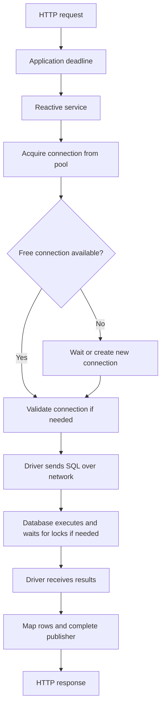

# Coordinating Timeouts Across the Application, Pool, and Database

A request using Spring Data R2DBC can wait in multiple places: waiting to acquire a connection from the pool, waiting to open a new connection, waiting for the database to execute SQL, waiting for locks, waiting for the driver to receive data over the network, and waiting for the entire reactive pipeline to complete. If you place a timeout only at the controller or configure only a database timeout, the application can still hold resources for too long at another layer.

Timeout design requires looking at the entire request path. Each layer serves a distinct purpose and needs an appropriate limit: application timeouts protect response latency; pool timeouts cap how long callers wait for a connection; connect timeouts bound session establishment; statement timeouts cap SQL execution time; lock timeouts cap lock wait time. These limits complement each other rather than replacing one another.

## 1. Layers Where Waiting Can Occur

A query operation through R2DBC typically passes through these steps:



Common time limits:

| Layer | What does the timeout control? | Example error or symptom |
|---|---|---|
| Request/service | Total time the application is willing to wait for a use case | API deadline exceeded |
| Reactive publisher | Time waiting for a `Mono`/`Flux` to emit a signal | Reactor `TimeoutException` |
| Pool acquire | Time waiting for a free connection from the pool | Acquire timeout, rising pending acquisitions |
| Connection creation | Time spent opening a new connection to the database | Connect/create timeout |
| Connection validation | Time validating a connection before lending it | Validation timeout |
| Driver/network | Time waiting on sockets, handshakes, or network replies | Socket timeout, connection reset |
| SQL statement | Time the database executes a single statement | Statement/query timeout |
| Lock wait | Time waiting to acquire a row/table lock | Lock timeout or deadlock |
| Transaction | Total lifetime a transaction is permitted to stay open | Transaction timeout or aborted transaction |

Not all timeouts share the same scope. For instance, a pool acquire timeout does not bound how long an already-running SQL query runs; a statement timeout does not bound waiting for a connection before SQL is sent; a publisher timeout bounds how long the application waits for signals, not whether every database server stops work immediately.

## 2. Distinguishing Timeouts from Deadlines

A **timeout** is typically a limit on a single specific operation, such as waiting at most 300 ms for a connection or running a SQL statement for at most 1 second.

A **deadline** is the absolute point by which the entire unit of work must finish. A request's deadline must account for pool waiting, queries, mapping, external calls, and response serialization.

For example, suppose an endpoint has a 2.5-second deadline. If a database query consumes 2.3 seconds, only 200 ms remain for everything else. A service running two sequential queries, each allowed 2 seconds, can exceed the overall deadline even though neither individual query timed out.

Therefore, avoid setting the exact same number at every layer. Divide the time budget across the use case and ensure inner operation timeouts do not push past the outer deadline.

## 3. Setting Application-Layer Timeouts with Reactor

Reactor provides `timeout(Duration)` to cap how long a publisher waits. If the source emits no signal within that duration, the downstream publisher emits a timeout error and Reactor sends cancellation upstream per the publisher's semantics.

Repository example:

```java
public Mono<Person> findPerson(Long id) {
    return personRepository.findById(id)
        .timeout(Duration.ofSeconds(2));
}
```

Multi-step use case example:

```java
public Mono<OrderDetail> getOrderDetail(Long orderId) {
    return orderRepository.findById(orderId)
        .switchIfEmpty(Mono.error(new OrderNotFoundException(orderId)))
        .flatMap(order -> customerRepository.findById(order.customerId())
            .map(customer -> new OrderDetail(
                order.id(),
                order.orderNo(),
                customer.displayName()
            )))
        .timeout(Duration.ofSeconds(3));
}
```

A timeout at the end of the chain bounds the entire use case, including sequential steps. If individual steps need tighter bounds, attach timeouts to those publishers while retaining an overall deadline so wait times do not accumulate unexpectedly.

### Translating timeouts into business errors or HTTP responses

You can map Reactor timeout errors into application exceptions:

```java
public Mono<Person> findPerson(Long id) {
    return personRepository.findById(id)
        .timeout(Duration.ofSeconds(2))
        .onErrorMap(TimeoutException.class,
            error -> new DatabaseOperationTimeoutException(id, error));
}
```

At the WebFlux layer, `@RestControllerAdvice` can map this exception to HTTP `504 Gateway Timeout` when the request depends on a backend service and API policy selects that status. If the timeout enforces an internal processing budget or reflects client cancellation, the response may differ. Keep the API contract consistent instead of turning every timeout into the same status code.

Never return stack traces, sensitive SQL, or connection details in responses. Internal logs should preserve the original cause for investigation.

## 4. Request and Service Timeouts

A single request may query multiple sources: R2DBC, an HTTP client, a cache, and a synchronous module. The overall deadline must cover the entire use case.

Example:

```java
public Mono<OrderView> loadOrderView(Long orderId) {
    return orderRepository.findById(orderId)
        .flatMap(order -> webClient.get()
            .uri("/customers/{id}", order.customerId())
            .retrieve()
            .bodyToMono(CustomerView.class)
            .map(customer -> new OrderView(order, customer)))
        .timeout(Duration.ofSeconds(3));
}
```

The outermost `timeout` bounds the whole chain. Even if `WebClient` configures its own response timeout, that timeout bounds only one HTTP exchange; it does not replace the use case deadline.

For sequential steps, assign shorter per-source timeouts and a slightly larger total timeout—for example, 1 second for the HTTP call, 1.2 seconds for the R2DBC query, and 2.5 seconds overall. Base actual figures on real latency distributions and SLAs rather than copying sample numbers blindly across systems.

If a client disconnects, WebFlux can cancel the subscription. Cancellation can propagate down the reactive chain, yet whether the database server halts the SQL query immediately depends on the driver and database. Server-side database timeouts are still required to protect database resources.

## 5. Pool Connection Acquisition Timeouts in R2DBC Pool

A pool caps how many connections are opened and reused. When all connections are busy, new requests wait for one to be returned or for the pool to open a new connection if below max capacity.

`r2dbc-pool`'s `maxAcquireTime` bounds how long callers wait for a connection. If time expires without acquiring one, acquisition fails. This is a critical signal that the pool is overloaded, connections are being held too long, or pool sizing is misconfigured.

Spring Boot configuration example:

```yaml
spring:
  r2dbc:
    url: r2dbc:postgresql://localhost:5432/app_db
    username: app_user
    password: change_me
    pool:
      enabled: true
      initial-size: 5
      max-size: 20
      max-acquire-time: 500ms
      max-create-connection-time: 2s
      max-idle-time: 10m
      max-life-time: 30m
      max-validation-time: 1s
```

This illustrates configuration for Spring Boot supporting the corresponding pool properties and the `r2dbc-pool` dependency. Verify property names, binding behavior, and defaults against your project's Spring Boot and `r2dbc-pool` versions.

Each property serves a distinct role:

- `max-size`: maximum number of connections in the pool.
- `initial-size`: number of connections created initially when the pool starts or initializes.
- `max-acquire-time`: maximum time to wait to acquire a connection.
- `max-create-connection-time`: maximum time to create a new connection.
- `max-validation-time`: maximum time to validate a connection.
- `max-idle-time`: how long a connection can remain idle before eviction under pool policy.
- `max-life-time`: maximum lifetime of a connection before pool eviction.

`max-idle-time` and `max-life-time` govern connection lifecycle, not the execution timeout of a running query. Never use them as substitutes for statement timeouts.

### Programmatic Java configuration

When configuring the pool directly, use `r2dbc-pool`'s builder:

```java
ConnectionPoolConfiguration poolConfiguration =
    ConnectionPoolConfiguration.builder(connectionFactory)
        .initialSize(5)
        .maxSize(20)
        .maxAcquireTime(Duration.ofMillis(500))
        .maxCreateConnectionTime(Duration.ofSeconds(2))
        .maxValidationTime(Duration.ofSeconds(1))
        .maxIdleTime(Duration.ofMinutes(10))
        .maxLifeTime(Duration.ofMinutes(30))
        .build();

ConnectionPool connectionPool = new ConnectionPool(poolConfiguration);
```

This shows the `r2dbc-pool` API; include the dependency and close the pool when the application context shuts down. If Spring Boot already manages a pool, avoid creating a second independent pool for the same workload without clear justification. Two parallel pools can push total connections past database limits.

## 6. Connection Creation Timeouts and Driver Connect Timeouts

Pool acquisition and connection creation are related yet distinct:

- Acquire timeout caps waiting for a connection from the pool.
- Create connection timeout caps how long the pool/driver takes to create a new connection.
- Driver connect timeout can bound TCP setup, TLS handshake, authentication, or protocol handshake depending on driver support.

If the pool has capacity yet the database does not respond while opening a new connection, create/connect timeouts ensure failure instead of hanging forever. Option names and units for connect timeouts depend on the R2DBC driver. No single URL parameter works across all drivers; consult the documentation for PostgreSQL, SQL Server, MySQL, or your target database driver.

Connection timeouts do not bound SQL execution after the connection opens. A connection can open instantly while a query runs for minutes; that scenario requires statement or publisher timeouts.

## 7. Pool Connection Validation Timeouts

The pool can validate a connection before lending it to a caller to avoid handing out dead or broken connections. `maxValidationTime` caps the validation step when validation is performed by the pool/driver.

Validation timeout is not a business query timeout. Slow validation may indicate an overloaded database, unstable network, or an unsuitable validation query. Never raise validation timeouts indefinitely, as that makes requests stall before business SQL is even sent.

Pools and drivers use varying validation strategies, such as checking connection state or executing a validation query. Check configuration and metrics to understand how your pool validates connections.

## 8. Database-Side Timeouts: Statement Timeouts

Database-side timeouts bound how long the server executes a SQL statement. This is an essential safeguard because an application may cancel a request while the database continues executing the query depending on driver cancellation support.

For example, PostgreSQL supports `statement_timeout` to abort statements exceeding the configured duration. It can be set at the role, database, or session level, or scoped temporarily inside a transaction.

```sql
SET LOCAL statement_timeout = '1500ms';
```

`SET LOCAL` applies only within the current transaction and resets when the transaction ends. It must run on the exact same connection and inside the same transaction as the SQL statement being bounded. Never run `SET LOCAL` in a standalone publisher and assume a later query shares the same connection without an active transaction context.

In PostgreSQL, defaults can also be set at the database or role level, such as:

```sql
ALTER ROLE app_user SET statement_timeout = '2s';
```

Role-level settings affect new sessions for that role. Account for differing workloads: sharing a role across fast read APIs and long-running reporting jobs may call for separate timeout policies.

`statement_timeout` is PostgreSQL-specific, not a portable Spring Data R2DBC property. Use the equivalent query timeout mechanism for other database engines.

## 9. Lock Wait Timeouts Differ from Statement Timeouts

A SQL statement can stall because it is waiting on another transaction's lock, rather than due to heavy computation or table scans.

PostgreSQL provides `lock_timeout` to cap lock wait duration:

```sql
SET LOCAL lock_timeout = '300ms';
```

`lock_timeout` bounds only lock wait time, whereas `statement_timeout` bounds total statement execution time. When both are configured, whichever limit expires first triggers the failure.

For example, a query can wait 300 ms for a lock and abort due to `lock_timeout` even when `statement_timeout` is 1.5 seconds. Distinguish this failure from slow query plans so you investigate the right root cause: check lock-holding transactions, row update ordering, and transaction duration.

PostgreSQL also offers `idle_in_transaction_session_timeout` to terminate sessions sitting idle while a transaction remains open. This helps catch leaked transactions or connections held too long, though it does not replace statement timeouts.

## 10. Transaction Timeouts

A transaction can stay open too long due to many statements, business logic running between statements, or waiting on another publisher. Long-lived transactions hold connections and can hold locks or snapshots, adding database load.

Spring allows declaring a timeout in transaction definitions, for example:

```java
@Transactional(
    transactionManager = "r2dbcTransactionManager",
    timeout = 3
)
public Mono<Void> updateOrder(Long orderId) {
    return orderRepository.findById(orderId)
        .flatMap(order -> orderRepository.save(order.withStatus("PAID")))
        .then();
}
```

The `timeout` value in the annotation is in seconds in this example. Enforcement and exact behavior depend on the reactive transaction manager, Spring version, and driver. Do not treat a transaction timeout as proof that the database immediately killed every running statement at that instant. Pair publisher deadlines with database-side statement and lock timeouts.

Never hold a transaction open while making HTTP calls, waiting for user input, performing heavy CPU work, or awaiting unrelated tasks. Run non-transactional steps before or after the transaction whenever business rules permit.

## 11. Coordinating Timeouts Using a Time Budget

Layer timeouts must work together so a request stays inside its overall deadline. Illustrative example:

| Layer | Example limit | Purpose |
|---|---:|---|
| Request/use case | 2.5 s | Maximum total processing time |
| Pool acquire | 300 ms | Avoid waiting too long for a connection |
| Connection creation | 700 ms | Cap opening a new connection |
| Database lock wait | 200 ms | Detect lock contention early |
| SQL statement | 1.2 s | Bound database execution time |
| Reactive operation | 1.5 s | Covers acquire, query, mapping, and app overhead |

These numbers merely illustrate budget allocation. Real configurations must rely on latency percentiles, SLAs, workload profiles, and connection setup costs. An operation that must open a new connection consumes both connection creation time and query time, so budget for the slowest path.

Useful design rules:

- Pool acquire timeout should be shorter than the database operation deadline so pool saturation surfaces early.
- Connection creation needs its own cap so network issues do not stall requests indefinitely.
- Lock timeout can be shorter than statement timeout when lock contention should fail fast.
- Statement timeout should be short enough that the database does not keep burning resources past the request budget.
- Reactive operation timeout must encompass acquisition, SQL execution, mapping, and required overhead.
- Request deadline must exceed the sum of inner step budgets plus response handling time.

Do not set every timeout to the exact same 2 seconds. If every layer expires simultaneously, logs obscure which layer failed, and outer layers can cancel requests before inner layers report meaningful diagnostics.

## 12. Driver Socket and Read Timeouts

Socket or read timeouts cap how long the driver waits for network bytes. They protect against hung connections, dropped packets, or unresponsive databases and networks.

Drivers may offer dedicated options for:

- TCP connect timeout.
- TLS handshake timeout.
- Socket read timeout.
- Network timeout or response wait time.
- Keepalives and dead connection detection.

These options are not standardized across R2DBC drivers. Check documentation and option names for your exact driver/version; never copy URL parameters blindly from one driver to another.

Socket timeouts usually serve as a fallback for network failures. If shorter than statement timeout, the application may drop the connection before the database returns a statement timeout error. If too long, requests hit their deadlines while connections linger waiting. Coordinate socket timeouts with database and request timeouts so cancellations are observable and handled cleanly.

## 13. WebClient Timeouts Are Not R2DBC Timeouts

A service can both query R2DBC and issue HTTP calls via `WebClient`. `WebClient` has its own response timeout or publisher timeouts. Those bounds apply solely to HTTP exchanges, not to database pools or SQL statements.

Example:

```java
public Mono<OrderView> getOrder(Long id) {
    Mono<Order> order = orderRepository.findById(id)
        .timeout(Duration.ofSeconds(1));

    Mono<CustomerView> customer = order.flatMap(value ->
        webClient.get()
            .uri("/customers/{id}", value.customerId())
            .retrieve()
            .bodyToMono(CustomerView.class)
            .timeout(Duration.ofSeconds(1))
    );

    return Mono.zip(order, customer)
        .map(tuple -> new OrderView(tuple.getT1(), tuple.getT2()))
        .timeout(Duration.ofSeconds(2));
}
```

This snippet illustrates publisher-level timeouts only. Because `order` is referenced in two branches, a cold publisher may be subscribed twice and trigger two queries. In production code, use `flatMap` to reuse the single result or explicitly share the publisher; avoid duplicating cold publishers just to demonstrate timeouts.

A cleaner version:

```java
public Mono<OrderView> getOrder(Long id) {
    return orderRepository.findById(id)
        .timeout(Duration.ofSeconds(1))
        .flatMap(order -> webClient.get()
            .uri("/customers/{id}", order.customerId())
            .retrieve()
            .bodyToMono(CustomerView.class)
            .timeout(Duration.ofSeconds(1))
            .map(customer -> new OrderView(order, customer)))
        .timeout(Duration.ofSeconds(2));
}
```

Here the outermost timeout caps the overall use case, while the inner timeouts bound the database publisher and HTTP publisher separately.

## 14. Timeout and Cancellation Do Not Mean the Database Stopped

When `Mono.timeout(...)` emits an error, Reactor sends cancellation upstream. The driver may translate cancellation into statement cancellation or closing/releasing the connection. Still, whether and how fast the SQL actually stops depends on the driver, protocol, and database server.

Distinguish these possibilities:

- The application stops waiting, yet the database keeps running the query.
- The driver sends a cancel signal, yet the database receives it late.
- The connection closes to free resources, causing the server to detect disconnect later.
- The query committed right before the response was lost, leaving the client unaware of the final outcome.

For read queries, timeouts typically return an error to callers and may be retried per policy. For writes, outcomes can be ambiguous: the database may have committed before the connection dropped. Never assume a timeout guarantees transaction rollback.

To protect the database, configure server-side or driver-supported statement and lock timeouts, and monitor canceled queries and long-running transactions.

## 15. Timeouts Inside Reactive Transactions

With `@Transactional` or `TransactionalOperator`, a publisher executing inside a transaction can time out. If the timeout error escapes the transaction boundary, the transaction manager can roll back the transaction. Place error handling at the proper position.

Example:

```java
Mono<Order> work = orderRepository.save(order)
    .timeout(Duration.ofSeconds(2));

return transactionalOperator.transactional(work)
    .onErrorMap(TimeoutException.class,
        error -> new OrderWriteTimeoutException(error));
```

Here the timeout sits inside the transaction-wrapped publisher; the error propagates through the transaction operator and can trigger rollback before being translated into a business error outside.

Never swallow timeouts inside a transaction:

```java
// Avoid if rollback is required when save times out.
return transactionalOperator.transactional(
    orderRepository.save(order)
        .onErrorResume(TimeoutException.class, error -> Mono.empty())
);
```

If an error turns into normal completion before reaching the transaction manager, the transaction may commit or terminate in an unexpected state. Let errors cross the transaction boundary before translating them into responses.

## 16. Retrying After Timeouts: Only When Safe

A timeout does not automatically mean the operation failed in the database. For inserts/updates, the server may have executed and committed while the client lost the response. Blind retrying can duplicate data or apply an operation twice.

Classify before retrying:

| Scenario | Typically appropriate policy |
|---|---|
| Pool acquire timeout due to full pool | Do not retry relentlessly; reduce concurrency, investigate held connections, and return overload error |
| Connect timeout due to transient network error | May retry with bounded backoff after confirming transient cause |
| Statement timeout due to slow query | Prioritize query/index optimization or workload tuning; immediate retries usually increase load |
| Lock timeout/deadlock | May retry in a new transaction if idempotent and bounded |
| Read timeout during reads | May retry if query is safe and request budget permits |
| Write timeout with ambiguous outcome | Look up via idempotency key or correlation key before resending |
| Invalid SQL, missing privileges, constraint violation | Never retry as-is; fix bug or handle conflict |

### Retry the entire transaction, not statements inside a failed transaction

When a statement fails, some databases mark the transaction as failed. In PostgreSQL, after a statement error inside a transaction, rollback is required before running any further statements. Thus, retries usually require opening a fresh transaction per attempt.

Example using `TransactionalOperator`:

```java
public Mono<Order> createWithRetry(Order order) {
    Mono<Order> oneAttempt = Mono.defer(() ->
        transactionalOperator.transactional(
            orderRepository.save(order)
        )
    );

    return oneAttempt.retryWhen(
        Retry.backoff(2, Duration.ofMillis(100))
            .maxBackoff(Duration.ofSeconds(1))
            .filter(this::isRetryableTransientFailure)
    );
}
```

`Mono.defer` starts a new transaction execution on each retry resubscription. `isRetryableTransientFailure` must classify real failures from the driver/exception translator and never return `true` for all errors.

Do not place `retryWhen` inside the transaction wrapper when the goal is a fresh transaction per attempt:

```java
// May retry multiple times inside the same transaction.
transactionalOperator.transactional(
    orderRepository.save(order)
        .retryWhen(retryPolicy)
);
```

For `@Transactional` methods, if retry operators sit inside the publisher wrapped by the annotation, resubscriptions may remain inside the same transaction boundary depending on composition. Wrap each attempt with `TransactionalOperator` when you need explicit control over fresh transactions.

## 17. Idempotency for Writes That Can Time Out

For order creation or payment APIs, require a unique client- or server-generated idempotency key per business request. Store the key with the record or in a request log table backed by a unique constraint.

Example:

```sql
CREATE TABLE payment_request (
    id BIGINT GENERATED BY DEFAULT AS IDENTITY PRIMARY KEY,
    idempotency_key UUID NOT NULL UNIQUE,
    order_id BIGINT NOT NULL,
    status VARCHAR(30) NOT NULL,
    created_at TIMESTAMP WITH TIME ZONE NOT NULL DEFAULT CURRENT_TIMESTAMP
);
```

When a request times out and the client resends the same key, the service looks up the existing record or applies policy-defined upsert logic. That lets the application return the previously created outcome instead of repeating side effects.

Bind the idempotency key to the payload or a content fingerprint to catch clients reusing the same key for a different request. If the payload differs, return a conflict instead of silently returning the stale result.

## 18. A Full Pool Does Not Always Mean Increasing `max-size`

Acquire timeouts signal that no free connection was available within the wait limit. Possible causes include:

- Concurrent requests exceed pool capacity.
- Slow queries or long transactions hold connections too long.
- Publishers are not subscribed/consumed or connections leak.
- Blocking work holds a connection while doing unrelated processing.
- The database hit its connection limit or slowed down.
- Pool `max-size` is too small for the workload, or too large for database capacity.

Increasing `max-size` may ease wait times briefly while increasing active database sessions and contention. If the database is already saturated, enlarging the pool makes queries slower and causes even more timeouts.

Before raising pool size, inspect acquisition times, acquired/idle/pending counts, query durations, transaction durations, and server-side connection counts. Fix why connections are held too long rather than blindly raising limits.

## 19. Calculating Total Connections Across Multiple Instances

Database connection limits must be budgeted across the entire system, not a single process.

Example:

- 4 application instances.
- Each instance has an R2DBC pool with `max-size = 20`.
- Each instance also has a JDBC pool with `maximum-pool-size = 10`.

Theoretical maximum across both application pools:

\[
4 \times (20 + 10) = 120 \text{ connections}
\]

This excludes migration tools, background workers, monitoring, admin sessions, and other services. If the database permits only 100 connections, this setup can exceed capacity.

Allocate connection budgets across every service and environment, sizing pools by actual concurrency, connection hold times, and database capacity. Having 1,000 concurrent requests does not mean you need 1,000 connections; reactive applications handle high concurrency while only a small fraction actively touch the database at once.

## 20. Bulkheads and Concurrency Limits

Timeouts cap how long work waits, while bulkheads limit how much concurrent work starts so one workload cannot starve shared resources. In reactive pipelines, use `flatMap` with bounded concurrency:

```java
Flux.fromIterable(orderIds)
    .flatMap(orderRepository::findById, 16);
```

16 is an example. Choose values based on pool size, query latency, competing workloads, and database capacity. If every request fires 100 parallel queries, a per-request limit can still generate massive aggregate load; enforce service- or gateway-level limits when needed.

Bulkheads can separate read, write, reporting, and cleanup workloads so long reporting queries never exhaust connections needed by interactive APIs. Separate pools can be used when operationally justified, provided total database connections stay within budget.

Timeouts and bulkheads reinforce each other: bulkheads cap concurrent starts; timeouts cap waiting duration. Using timeouts without concurrency limits still allows huge waves of concurrent requests to queue until they all time out.

## 21. Circuit Breakers and Timeouts

Circuit breakers stop sending requests to a persistently failing dependency, avoiding further overload. Timeouts bound a single call's wait; circuit breakers track outcomes across many calls and trip once failure thresholds are crossed.

With R2DBC, a circuit breaker can wrap service operations. Choose carefully which exceptions count as failures. Validation errors or not-found errors do not indicate a broken database. Pool acquire timeouts, connection failures, and certain statement timeouts should be classified intentionally.

Never use a circuit breaker to hide slow queries caused by missing indexes or poorly designed transactions. Combine metrics, query plans, and database monitoring to fix root causes.

## 22. Measuring and Observing Timeouts

To pinpoint which layer timed out, collect separate metrics:

| Metric/observation | What it reveals |
|---|---|
| Pool allocated/acquired connections | Connections currently in use |
| Pool idle connections | Connections ready to lease |
| Pool pending acquisitions | Requests waiting for a connection |
| Acquire duration and acquire timeout count | Pool contention or insufficient capacity |
| Connection create/validation duration | Slow network, authentication, or validation |
| Query duration by operation type | Slow SQL or unusual workload spikes |
| Statement timeout/lock timeout count | Database aborting queries or lock contention |
| Transaction duration | Transactions staying open too long |
| Request latency p50/p95/p99 | User experience and tail latency |
| Cancellation count | Canceled requests or timed-out publishers |
| Retry count and retry outcome | Transient errors, retry storms, or poorly tuned policies |

Timeout logs should include:

- Correlation ID/request ID.
- Operation or repository method name.
- Timeout layer: request, pool acquire, connect, validation, statement, lock, or transaction.
- Actual elapsed duration and configured limit.
- Database/driver name and safe connection state details.
- SQL state or error code if supplied by the driver.
- Retry attempt number and non-sensitive idempotency key.

Never log passwords, URLs with credentials, tokens, personal data, or sensitive bind parameters. Enable SQL logging selectively in appropriate environments following security policies.

## 23. Testing Timeouts Across Layers

Pure unit tests cannot verify all timeout behavior. Combine publisher tests with integration tests against a real database and driver.

### Testing Reactor timeouts

For database-independent timeout logic, use virtual time:

```java
StepVerifier.withVirtualTime(() ->
        Mono.never().timeout(Duration.ofSeconds(2))
    )
    .thenAwait(Duration.ofSeconds(2))
    .expectError(TimeoutException.class)
    .verify();
```

Virtual time tests Reactor operators without sleeping for real seconds. It does not simulate pools, networks, or database servers.

### Testing statement timeouts on the database

In PostgreSQL, create a controlled slow query in test environments:

```sql
SELECT pg_sleep(3);
```

Then configure a shorter `statement_timeout` and verify the driver receives the database error. `pg_sleep` is PostgreSQL-specific; do not use it in portable tests targeting other database engines.

### Testing pool acquire timeouts

Set a tiny pool size in tests, hold connections open with an uncompleted publisher, then trigger another acquisition and verify it fails within `maxAcquireTime`. Always release publishers and connections afterward to prevent resource leaks.

### Testing transactions and cancellation

Verify that timeouts inside transactions roll back data as expected, return connections to the pool, and leave the pool usable for subsequent requests. Also check whether the driver actually cancels the running statement or merely terminates the application-side publisher.

## 24. Common Configuration Mistakes

| Symptom | Possible cause | Fix |
|---|---|---|
| Request times out yet database query keeps running | Only publisher timeout configured; driver/database did not cancel statement in time | Configure database/driver statement timeouts and verify cancellation |
| Pool acquire timeout despite fast SQL queries | Connections leaked/held elsewhere, pool too small, or concurrency too high | Inspect pending acquisitions, connection lifecycle, and transaction duration |
| Enlarging pool slows the database further | Database already saturated on connections or lock contention | Reduce concurrency, optimize queries, and allocate pool budgets |
| Connection creation timeout | Unresponsive database/network/authentication | Check connect options, DNS, TLS, firewall, and database capacity |
| Timeouts occur only in long transactions | Connections and locks held during non-database work | Narrow transaction boundaries |
| Every layer times out at the exact same mark | Identical timeout values obscure root cause | Allocate layered time budgets and add metrics |
| Retries amplify load and trigger more timeouts | Retrying all errors or lacking backoff/concurrency caps | Retry only transient failures, cap attempts, and add jitter |
| Write timeouts cause duplicate data on client retries | Ambiguous commit outcome without idempotency | Use idempotency keys and unique constraints |

## 25. Timeout Design Workflow for a Use Case

When building an endpoint or job with Spring Data R2DBC, follow these steps:

**Step 1 — Define the overall deadline.** Base it on SLAs, client/gateway timeouts, and remaining application processing budget.

**Step 2 — Measure per-step latency.** Separate pool wait, connection setup, SQL, locks, mapping, and external dependency calls.

**Step 3 — Configure the pool.** Set appropriate `maxAcquireTime`, `maxCreateConnectionTime`, `maxValidationTime`, `maxSize`, and connection lifetimes.

**Step 4 — Configure driver/network.** Set connect and socket timeouts using options supported by your driver.

**Step 5 — Configure the database.** Set statement timeouts, lock timeouts, and transaction/idle-in-transaction limits aligned with workload and server policy.

**Step 6 — Set reactive timeouts.** Apply `Mono.timeout`/`Flux.timeout` for individual operations and the overall use case deadline.

**Step 7 — Keep transactions short.** Never wait on HTTP calls, user input, or heavy CPU work while holding connections or locks.

**Step 8 — Decide retry rules.** Classify errors, retry inside fresh transactions only when safe, and protect writes with idempotency keys.

**Step 9 — Cap concurrency.** Use bulkheads and pool budgets to stop excessive parallel work from queuing.

**Step 10 — Test and monitor.** Test each timeout independently, verify rollback/cancellation behavior, and track metrics in production-like environments.

## 26. Conclusion

Timeouts in Spring Data R2DBC must be designed across multiple layers. Reactive timeouts cap how long the application waits; pool acquire and create timeouts bound leasing or opening connections; driver timeouts guard the network transport; statement and lock timeouts cap database-side work; transaction timeouts help bound transaction lifetimes per manager capabilities.

Allocate budgets under an overall deadline, keep inner timeouts short enough that requests have time to finish, and never confuse a publisher timeout with proof that the database halted SQL execution or rolled back a write. Combining pool metrics, query/lock monitoring, concurrency limits, conditional retries, and idempotency lets applications detect overload early, protect the database, and handle failures predictably.
