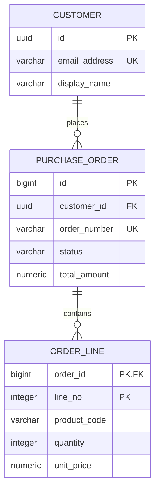

# Creating an Initial Schema for the Development Environment

## 1. What Role Does the Schema Play in a Spring Data R2DBC Application?

Spring Data R2DBC maps Java objects to existing tables and columns in a relational database. Repositories can generate `SELECT`, `INSERT`, `UPDATE`, or `DELETE` statements based on mapping metadata, but annotations such as `@Table`, `@Column`, and `@Id` do not automatically create the entire database schema.

The schema defines the data structure and the rules that the database must enforce:

- Tables and columns that store data.
- Data types, lengths, precision, and scale.
- Primary keys and generated identities.
- Foreign keys between tables.
- `NOT NULL`, `UNIQUE`, and `CHECK` constraints.
- Default values and generated columns.
- Indexes supporting frequently used queries.

When starting a new application, an initial schema must be created so that repositories can connect and perform CRUD operations. For the development environment, the schema also needs to be easy to re-initialize, easy to observe, and close enough to the structure the application will use in other environments.

Spring Data R2DBC does not require an ORM to automatically generate the schema from entities. Therefore, manage DDL using SQL scripts or a database migration tool, then ensure the Java mapping matches the database structure.

## 2. Distinguishing Between Schema, Sample Data, and Entity Mapping

These three components are related but have different responsibilities:

| Component | Content | Example |
| --- | --- | --- |
| Schema (DDL) | Database structure and constraints | `CREATE TABLE customer (...)` |
| Sample data (DML) | Records used for development or testing | `INSERT INTO customer (...) VALUES (...)` |
| Entity mapping | How Spring Data converts between Java and SQL columns | `@Table`, `@Column`, `@Id` |

For example, an entity:

```java
@Table("customer")
public class Customer {

    @Id
    private UUID id;

    @Column("email_address")
    private String email;

    @Column("display_name")
    private String displayName;
}
```

The schema needs a `customer` table and columns `id`, `email_address`, and `display_name` with appropriate SQL types. Annotations describe the mapping; they do not guarantee those columns have already been created.

Similarly, sample data is not the schema. `data.sql` can only insert data after the required tables and constraints already exist.

## 3. Initial Schema Creation Workflow

A typical development workflow includes:

1. Identify the entities and aggregate boundaries that need to be persisted.
2. Choose a database and SQL types suitable for the data.
3. Design primary keys, foreign keys, and constraints.
4. Create DDL for the tables and indexes.
5. Place the scripts in the resources folder or migration folder.
6. Configure Spring Boot to connect R2DBC to the development database.
7. Initialize the schema before the application runs repository queries.
8. Load sample data if development use cases require initial records.
9. Verify the schema and mapping with integration tests.
10. Record all subsequent schema changes using versioned migrations.

You should create the schema from readable and reviewable DDL. Do not rely on running the application and waiting for "table does not exist" errors to add tables piecemeal.

## 4. Choosing a Database for the Development Environment

The development environment can use PostgreSQL, MySQL, MariaDB, SQL Server, or another database with an appropriate R2DBC driver. Choose the same database type as the deployment environment if possible, because SQL dialects, data types, constraints, and transaction behaviors can differ.

This example uses PostgreSQL for illustration. PostgreSQL provides `UUID`, `NUMERIC`, `TIMESTAMPTZ`, identity columns, and constraints suitable for many business applications.

An R2DBC URL configuration looks like:

```text
r2dbc:postgresql://localhost:5432/orders_dev
```

This is a connection URL through the R2DBC driver. It differs from a JDBC URL:

```text
jdbc:postgresql://localhost:5432/orders_dev
```

An application using Spring Data R2DBC to access the database at runtime requires an R2DBC driver. If using Flyway or Liquibase via JDBC, the migration tool also requires a JDBC driver and the corresponding JDBC connection.

## 5. Designing the Schema Before Writing DDL

Before creating tables, answer the following questions:

- Which entity is the aggregate root?
- Does child data belong to the root's lifecycle?
- Are identifiers generated in Java or by the database?
- Which columns are required and which columns are allowed to be `NULL`?
- Which values must be unique?
- Are there domain value rules that need a `CHECK` constraint?
- Which queries frequently filter, join, or sort on which columns?
- Which data needs exact storage such as currency or rates?
- Is soft delete or history tracking needed?

For example, an initial ordering application has three tables:



The diagram only shows initial relationships. Actual tables can add timestamps, audit columns, indexes, or other business statuses as requirements become clearer.

## 6. Sample DDL for an Initial Schema

A PostgreSQL script can create the three tables as follows:

```sql
CREATE TABLE customer (
    id UUID PRIMARY KEY,
    email_address VARCHAR(320) NOT NULL,
    display_name VARCHAR(150) NOT NULL,
    created_at TIMESTAMPTZ NOT NULL DEFAULT CURRENT_TIMESTAMP,
    CONSTRAINT uk_customer_email UNIQUE (email_address)
);

CREATE TABLE purchase_order (
    id BIGINT GENERATED BY DEFAULT AS IDENTITY PRIMARY KEY,
    customer_id UUID NOT NULL,
    order_number VARCHAR(40) NOT NULL,
    status VARCHAR(20) NOT NULL,
    total_amount NUMERIC(19, 2) NOT NULL DEFAULT 0,
    created_at TIMESTAMPTZ NOT NULL DEFAULT CURRENT_TIMESTAMP,
    CONSTRAINT uk_purchase_order_number UNIQUE (order_number),
    CONSTRAINT ck_purchase_order_total_nonnegative
        CHECK (total_amount >= 0),
    CONSTRAINT fk_purchase_order_customer
        FOREIGN KEY (customer_id) REFERENCES customer(id)
);

CREATE TABLE order_line (
    order_id BIGINT NOT NULL,
    line_no INTEGER NOT NULL,
    product_code VARCHAR(60) NOT NULL,
    quantity INTEGER NOT NULL,
    unit_price NUMERIC(19, 2) NOT NULL,
    CONSTRAINT pk_order_line PRIMARY KEY (order_id, line_no),
    CONSTRAINT ck_order_line_number_nonnegative CHECK (line_no >= 0),
    CONSTRAINT ck_order_line_quantity_positive CHECK (quantity > 0),
    CONSTRAINT ck_order_line_price_nonnegative CHECK (unit_price >= 0),
    CONSTRAINT fk_order_line_order
        FOREIGN KEY (order_id)
        REFERENCES purchase_order(id)
        ON DELETE CASCADE
);

CREATE INDEX ix_purchase_order_customer_created
    ON purchase_order(customer_id, created_at DESC);

CREATE INDEX ix_order_line_product_code
    ON order_line(product_code);
```

In this example:

- `customer.id` uses a UUID provided by the application.
- `purchase_order.id` is assigned by the database using identity.
- `order_line` belongs to `purchase_order` and uses a composite primary key `(order_id, line_no)`.
- `NUMERIC(19, 2)` stores monetary amounts as exact decimals.
- `NOT NULL`, `UNIQUE`, and `CHECK` protect data rules.
- Foreign keys ensure orders reference an actual customer.
- `ON DELETE CASCADE` deletes order lines when an order is physically deleted; only use it if the data policy allows it.
- Indexes support queries by customer, creation time, and product code.

### 6.1. Choosing a Primary Key

A primary key is the stable identifier of a row. You can use:

- UUID if the ID is generated in the application or needs to be shared across multiple systems.
- Identity/sequence if the database is the source of numeric IDs.
- Natural key only when the value is truly stable and has appropriate uniqueness rules.

Do not use email as the primary key just because emails are currently unique. Emails can change over time. A stable surrogate key generally makes foreign keys and data relationships easier to manage.

### 6.2. NOT NULL and DEFAULT

These two attributes have different meanings:

- `NOT NULL` prohibits storing SQL NULL.
- `DEFAULT` provides a value when an INSERT statement omits the column or specifies `DEFAULT`.

For example:

```sql
status VARCHAR(20) NOT NULL DEFAULT 'PENDING'
```

If an INSERT omits the `status` column, the database uses `PENDING`. If the INSERT sends `NULL`, the database rejects it because of `NOT NULL`; default does not automatically replace SQL NULL.

### 6.3. Data Types Should Match the Domain

Some common choices in PostgreSQL:

| Data | Suggested SQL Type | Common Java Type |
| --- | --- | --- |
| UUID | `UUID` | `java.util.UUID` |
| Short string | `VARCHAR(n)` | `String` |
| Long content | `TEXT` | `String` |
| Integer | `INTEGER`, `BIGINT` | `Integer`, `Long` |
| Currency | `NUMERIC(p, s)` | `BigDecimal` |
| Date/time with time zone | `TIMESTAMPTZ` | `Instant`, `OffsetDateTime` |
| Boolean | `BOOLEAN` | `Boolean`, `boolean` |

Do not use `REAL` or `DOUBLE PRECISION` for monetary amounts requiring decimal precision. Choose precision/scale based on the value domain and rounding rules.

## 7. Mapping DDL to Spring Data Relational Entities

Entities need to match the table and column names in the DDL:

```java
@Table("customer")
public class Customer {

    @Id
    private UUID id;

    @Column("email_address")
    private String email;

    @Column("display_name")
    private String displayName;

    @Column("created_at")
    private OffsetDateTime createdAt;
}
```

Order:

```java
@Table("purchase_order")
public class PurchaseOrder {

    @Id
    private Long id;

    @Column("customer_id")
    private UUID customerId;

    @Column("order_number")
    private String orderNumber;

    private String status;

    @Column("total_amount")
    private BigDecimal totalAmount;

    @Column("created_at")
    private OffsetDateTime createdAt;
}
```

Mapping metadata specifies how to convert between Java properties and SQL columns. DDL remains the source defining the actual structure of the database.

### 7.1. One-to-Many Relationships with @MappedCollection

If `OrderLine` belongs to the `PurchaseOrder` aggregate, you can map the collection:

```java
@Table("purchase_order")
public class PurchaseOrder {

    @Id
    private Long id;

    @MappedCollection(idColumn = "order_id", keyColumn = "line_no")
    private List<OrderLine> lines = new ArrayList<>();
}
```

```java
public class OrderLine {
    @Column("product_code")
    private String productCode;

    private Integer quantity;

    @Column("unit_price")
    private BigDecimal unitPrice;
}
```

`idColumn` must match the foreign key column `order_line.order_id`; `keyColumn` must match the column used to store the collection position/key `line_no`. The composite primary key in the DDL ensures each line has a unique position within an order.

Do not use the JPA `@OneToMany` annotation for this mapping. Spring Data Relational uses `@MappedCollection` for collection members belonging to an aggregate.

## 8. Placing Schema Scripts in the Project

For a Spring Boot project, you can place SQL scripts in `src/main/resources`:

```text
src/
  main/
    java/
      ...
    resources/
      application.yml
      application-dev.yml
      db/
        schema.sql
        data.sql
```

`schema.sql` contains DDL to create tables, constraints, and indexes. `data.sql` contains INSERT statements for sample data in the development environment.

Keeping DDL separate from sample data makes initialization errors easier to diagnose. If a table has not been created, the error belongs to schema initialization; if the table exists but an insert has the wrong type or violates a constraint, the error belongs to data initialization.

For small applications or practice exercises, these two scripts may be sufficient to create the initial development database. When the schema begins changing across multiple versions, switch to a migration tool with history tracking.

## 9. Configuring Spring Boot to Initialize the Schema with SQL Scripts

Spring Boot supports running SQL scripts on application startup. Example configuration for R2DBC and SQL initialization in `application-dev.yml`:

```yaml
spring:
  r2dbc:
    url: r2dbc:postgresql://localhost:5432/orders_dev
    username: ${DB_USERNAME:app}
    password: ${DB_PASSWORD:app}

  sql:
    init:
      mode: always
      schema-locations: classpath:db/schema.sql
      data-locations: classpath:db/data.sql
      continue-on-error: false
```

Key properties:

- `spring.r2dbc.url`: R2DBC URL of the database.
- `spring.r2dbc.username` and `password`: login credentials.
- `spring.sql.init.mode`: decides when to run initialization scripts.
- `schema-locations`: location of the DDL.
- `data-locations`: location of sample data.
- `continue-on-error`: whether to continue when a script encounters an error.

With `mode: always`, Spring Boot runs initialization scripts as configured even when the database is not an embedded database. This is useful in the development environment, but needs careful management to avoid accidentally running reset/initialization scripts unexpectedly in other environments.

### 9.1. Values of spring.sql.init.mode

| Value | Meaning |
| --- | --- |
| `embedded` | Only initialize for embedded databases; this is the common default behavior |
| `always` | Run scripts regardless of whether the database is embedded |
| `never` | Do not run SQL initialization scripts |

If using PostgreSQL in local development, `embedded` usually does not run scripts because PostgreSQL is an external database. Configuring `always` in the development profile ensures the scripts are executed.

### 9.2. Order of Schema and Data

The schema must exist before running sample data. Spring Boot SQL initialization executes schema scripts before data scripts according to the configured initialization mechanism.

If `data.sql` inserts into a table that does not exist yet, startup will fail. Keeping DDL in `schema.sql` and DML in `data.sql` keeps the order clear.

### 9.3. Stopping on Error

In development, keep `continue-on-error: false` so the application reports an error immediately if DDL or DML fails to run. Continuing after an error can allow the application to start with a partially created schema, causing errors to appear later in repositories.

Do not set `continue-on-error: true` just to hide duplicate table, wrong column, or constraint errors. Identify why the script is incompatible with the current database state.

## 10. Dedicated Profile for the Development Environment

Do not enable `spring.sql.init.mode=always` in shared configuration if other environments may use a database managed by migrations. Place this configuration in the development profile:

`application.yml`:

```yaml
spring:
  application:
    name: orders-service
```

`application-dev.yml`:

```yaml
spring:
  r2dbc:
    url: r2dbc:postgresql://localhost:5432/orders_dev
    username: ${DB_USERNAME:app}
    password: ${DB_PASSWORD:app}
  sql:
    init:
      mode: always
      schema-locations: classpath:db/schema.sql
      data-locations: classpath:db/data.sql
      continue-on-error: false
```

Activate the profile when running:

```bash
SPRING_PROFILES_ACTIVE=dev ./mvnw spring-boot:run
```

Or pass JVM/application arguments appropriate for how the project is run. On Windows PowerShell, you can set the environment variable for the current session:

```powershell
$env:SPRING_PROFILES_ACTIVE = "dev"
.\mvnw spring-boot:run
```

The profile name is `dev`; how environment variables or run arguments are passed depends on the shell and build tool. Do not commit real passwords to the repository. Use environment variables or the runtime environment's secret management.

## 11. Sample Data for the Development Environment

`data.sql` can create a few records for testing repositories and APIs:

```sql
INSERT INTO customer (id, email_address, display_name)
VALUES
    ('10000000-0000-0000-0000-000000000001', 'lan@example.com', 'Lan Nguyen'),
    ('10000000-0000-0000-0000-000000000002', 'minh@example.com', 'Minh Tran');

INSERT INTO purchase_order (
    customer_id,
    order_number,
    status,
    total_amount
)
VALUES
    ('10000000-0000-0000-0000-000000000001', 'PO-DEV-001', 'PENDING', 250.00),
    ('10000000-0000-0000-0000-000000000002', 'PO-DEV-002', 'CONFIRMED', 75.50);

INSERT INTO order_line (
    order_id,
    line_no,
    product_code,
    quantity,
    unit_price
)
VALUES
    (1, 0, 'BOOK-001', 2, 125.00),
    (2, 0, 'MUG-001', 1, 75.50);
```

The example assumes a fresh database assigns IDs `1` and `2` to the two orders. Do not rely on fixed identity values like this in a database that already has data from previous runs. If stable sample data is needed, use explicit IDs when the schema allows it, or use a dedicated seed script with a clear data checking/locking strategy.

### 11.1. Avoiding Duplicate Inserts When Scripts Re-run

`data.sql` may run every time the application starts if configured with `mode: always`. If the script inserts the same email or order number a second time, unique constraints will cause startup to fail.

There are several ways to handle this:

- Use a fresh database or reset the dev database before running the script.
- Use `INSERT ... ON CONFLICT DO NOTHING` on PostgreSQL when sample data only needs to exist.
- Use `ON CONFLICT ... DO UPDATE` if you want the seed to always update sample data to a desired state.
- Use a migration/seed tool that tracks what has run instead of re-running DML on every startup.

PostgreSQL example:

```sql
INSERT INTO customer (id, email_address, display_name)
VALUES (
    '10000000-0000-0000-0000-000000000001',
    'lan@example.com',
    'Lan Nguyen'
)
ON CONFLICT (id) DO NOTHING;
```

`ON CONFLICT` is PostgreSQL syntax. For other databases, use the corresponding syntax or choose a suitable seeding approach. Do not use `DO NOTHING` to mask unexpected data conflicts; clearly identify which key is the idempotent key for the sample data.

## 12. Table and Column Naming Conventions

Naming conventions should be consistent between DDL and entities:

- Use singular or plural table names consistently.
- Use `snake_case` for table/column names if that is the project convention.
- Name constraints meaningfully, such as `pk_...`, `fk_...`, `uk_...`, `ck_...`.
- Avoid names that collide with SQL keywords or require quoting in many places.
- Name indexes after the table and indexed columns.

For example:

```sql
CONSTRAINT fk_purchase_order_customer
    FOREIGN KEY (customer_id) REFERENCES customer(id)
```

And the entity:

```java
@Column("customer_id")
private UUID customerId;
```

Java property names can use camelCase while SQL columns use snake_case. Use `@Column` when explicit mapping is needed or when the naming strategy does not automatically generate the desired name.

## 13. Initial Indexes Should Be Based on Queries

Indexes should not be created just because a column exists. Base them on the query workload:

| Query | Potentially Suitable Index |
| --- | --- |
| Find customer by email | Unique index/constraint on `email_address` |
| Find orders by customer and sort newest first | Index `(customer_id, created_at DESC)` |
| Load order lines of an order by position | Primary key/index `(order_id, line_no)` |
| Find order by order number | Unique index on `order_number` |
| Find order lines by product code | Index on `product_code` if workload requires |

Primary keys and unique constraints usually create corresponding indexes in the database. Do not create duplicate indexes if a constraint already provides the needed index.

Indexes can make read queries faster, but they increase storage size and INSERT/UPDATE/DELETE overhead. For the development environment, start with the primary queries and examine execution plans once data volume is large enough.

## 14. Initializing the Schema with Flyway or Liquibase

`schema.sql` and `data.sql` are suitable for small projects, learning examples, or local environments needing simple initialization. When the schema changes over multiple versions, use database migrations to record each change in order.

Example Flyway structure:

```text
src/main/resources/
  db/
    migration/
      V1__create_initial_schema.sql
      V2__add_customer_status.sql
      V3__add_order_search_index.sql
```

Each migration file is assigned a version number. Flyway stores migration history in a schema history table and only runs unapplied migrations according to its rules.

Example contents of `V1__create_initial_schema.sql`:

```sql
CREATE TABLE customer (
    id UUID PRIMARY KEY,
    email_address VARCHAR(320) NOT NULL UNIQUE,
    display_name VARCHAR(150) NOT NULL,
    created_at TIMESTAMPTZ NOT NULL DEFAULT CURRENT_TIMESTAMP
);
```

Afterward, new schema changes are added via subsequent migrations; do not modify migrations that have already run in shared environments without a controlled repair process.

### 14.1. Flyway/Liquibase Typically Use JDBC

An application can use R2DBC for runtime database access while still using JDBC for migrations. These serve two different purposes:

- The R2DBC driver serves reactive repositories and `DatabaseClient`.
- A JDBC driver/connection serves migration tools like Flyway or Liquibase in common configurations.

Therefore, a project that only has an R2DBC driver may need to add a JDBC driver if using Flyway/Liquibase with JDBC integration. Configure migrations to connect to the exact database and run before the application starts querying repositories.

Do not assume `spring.r2dbc.url` is automatically the URL used by Flyway/Liquibase. Flyway typically needs a JDBC URL/driver and can be configured via `spring.flyway.*` properties; Liquibase has corresponding connection settings. Exact configuration details depend on Spring Boot, the tool version, and the database.

### 14.2. Do Not Unintentionally Mix Multiple Schema Creation Mechanisms

If using Flyway to manage the schema, do not simultaneously let `schema.sql` recreate the same tables on application startup. Two mechanisms can conflict in ordering, causing "table already exists" errors or leaving the schema inconsistent with migration history.

Choose a single authoritative source for the schema:

- SQL initialization scripts for small projects or simple exercises.
- Flyway/Liquibase for schemas needing versioned change history and deployment across multiple environments.

If a separate seed script is needed after migrations, explicitly configure the execution order and scope of the sample data.

## 15. How Do Schema Scripts Differ from Migrations?

| Criterion | `schema.sql` | Versioned migration |
| --- | --- | --- |
| Goal | Initialize initial structure | Manage schema evolution over time |
| Execution | May run on every application startup depending on configuration | Runs only unapplied new migrations |
| History | Does not track version history | Has a migration history table |
| Best suited for | Local dev, demos, small projects | Teams, CI/CD, staging, and production |
| Schema changes | Usually edits existing script or resets DB | Adds a new versioned migration |
| Environment control | Requires careful profile and mode handling | Has an environment-aware application process |

An important rule: migrations that have already run in shared environments should be treated as immutable. If the schema needs to change, create a new migration so others can reproduce the exact history.

## 16. Using Docker Compose for the Development Database

Docker Compose helps team members spin up the same database type with nearly identical configuration. PostgreSQL example:

```yaml
services:
  postgres:
    image: postgres:16
    container_name: orders-postgres-dev
    environment:
      POSTGRES_DB: orders_dev
      POSTGRES_USER: app
      POSTGRES_PASSWORD: app
    ports:
      - "5432:5432"
    volumes:
      - orders-postgres-data:/var/lib/postgresql/data
    healthcheck:
      test: ["CMD-SHELL", "pg_isready -U app -d orders_dev"]
      interval: 5s
      timeout: 3s
      retries: 10

volumes:
  orders-postgres-data:
```

Run:

```bash
docker compose up -d postgres
```

Once the database is ready, run the application with the dev profile so Spring Boot initializes the schema or lets the migration tool apply migrations.

This example is for the development environment only. Do not use sample passwords in production. Image tags should be managed consistently across the project; if exact environment reproducibility is needed, pin versions or digests according to team policy.

### 16.1. Volumes Preserve Data Across Runs

The named volume `orders-postgres-data` preserves database data when the container is stopped or recreated. Consequently, a `schema.sql` script with regular `CREATE TABLE` statements may fail on subsequent startups because the tables already exist.

`CREATE TABLE IF NOT EXISTS` can be used for some simple development scripts, but this statement does not update table structure if the old table has different columns or constraints. It does not replace migrations.

If a clean environment is needed, use a dedicated dev database/volume and reset it via a controlled procedure. Do not run commands that delete volumes or drop schemas in environments with data that must be kept.

## 17. Creating an Idempotent Schema in the Development Environment

An idempotent script can be re-run without breaking state if the structure already exists. PostgreSQL example:

```sql
CREATE TABLE IF NOT EXISTS customer (
    id UUID PRIMARY KEY,
    email_address VARCHAR(320) NOT NULL UNIQUE,
    display_name VARCHAR(150) NOT NULL
);

CREATE INDEX IF NOT EXISTS ix_customer_display_name
    ON customer(display_name);
```

`IF NOT EXISTS` only avoids errors when an object already exists. It does not verify that the existing object matches the desired definition. If a column is missing or a data type is wrong, the script above does not automatically fix the structure.

For migrations with history, use versioned migrations to change the schema explicitly. Do not rely on `IF NOT EXISTS` to mask mismatches between the database and new DDL.

## 18. Configuring R2DBC and SQL Initialization Across Environments

An application usually has different configurations across dev, test, and production:

| Environment | Connection | Typical Schema Management Approach |
| --- | --- | --- |
| Local development | Local/Docker PostgreSQL | Simple `schema.sql` or migrations |
| Automated test | Test database or Testcontainers | Migrations or test-specific schema script |
| Staging | Dedicated staging database | Versioned migrations |
| Production | Production database with restricted privileges | Controlled migrations prior to/coordinated with app rollout |

Do not let production automatically run arbitrary initialization scripts every time an application instance starts. With multiple instances, instances may initialize the schema simultaneously or contend on DDL. Use a migration deployment step or controlled database release process.

### 18.1. Configuring the Test Profile

Tests can use a dedicated database or Testcontainers. Example test configuration receiving URLs via dynamic properties:

```java
@Testcontainers
@SpringBootTest
class CustomerRepositoryIntegrationTest {

    @Container
    static PostgreSQLContainer<?> postgres =
            new PostgreSQLContainer<>("postgres:16")
                    .withDatabaseName("orders_test")
                    .withUsername("test")
                    .withPassword("test");

    @DynamicPropertySource
    static void configure(DynamicPropertyRegistry registry) {
        registry.add("spring.r2dbc.url", () ->
                "r2dbc:postgresql://" + postgres.getHost() + ":" +
                        postgres.getFirstMappedPort() + "/orders_test");
        registry.add("spring.r2dbc.username", postgres::getUsername);
        registry.add("spring.r2dbc.password", postgres::getPassword);
    }
}
```

This is an R2DBC configuration example for tests. If the migration tool uses JDBC, provide the corresponding JDBC URL/driver for the same container or initialize the schema in a way suited to the test setup.

## 19. Verifying the Schema After Initialization

After the application runs scripts or migrations, confirm that tables and constraints actually exist.

With PostgreSQL, you can use psql:

```sql
\dt
\d customer
\d purchase_order
\d order_line
```

Or query the catalog:

```sql
SELECT table_name
FROM information_schema.tables
WHERE table_schema = 'public'
ORDER BY table_name;
```

Check columns:

```sql
SELECT table_name, column_name, data_type, is_nullable
FROM information_schema.columns
WHERE table_schema = 'public'
ORDER BY table_name, ordinal_position;
```

Check constraints:

```sql
SELECT conname, contype, conrelid::regclass AS table_name
FROM pg_constraint
WHERE connamespace = 'public'::regnamespace
ORDER BY table_name, conname;
```

The catalog commands above are for PostgreSQL. Other databases have their own metadata views and syntax.

## 20. Testing Repositories After Schema Creation

A simple integration test can confirm that the table exists and mapping works:

```java
@SpringBootTest
class CustomerRepositoryIntegrationTest {

    @Autowired
    CustomerRepository customerRepository;

    @Test
    void shouldSaveAndReadCustomer() {
        Customer customer = new Customer(
                UUID.randomUUID(),
                "dev@example.com",
                "Dev User");

        StepVerifier.create(customerRepository.save(customer)
                .flatMap(saved -> customerRepository.findById(saved.getId())))
                .assertNext(loaded -> {
                    assertEquals("dev@example.com", loaded.getEmail());
                    assertEquals("Dev User", loaded.getDisplayName());
                })
                .verifyComplete();
    }
}
```

The example assumes appropriate constructors and getters. The test requires the database schema to be initialized before running.

Scenarios worth testing:

- The repository can insert and read back the entity.
- IDs are generated or assigned according to design.
- Column names map correctly.
- `NOT NULL`, `UNIQUE`, `CHECK`, and foreign keys work.
- `NUMERIC` maps accurately to `BigDecimal`.
- Database defaults are applied when INSERT omits a column.
- `@MappedCollection` reads/writes the foreign key and key column properly.
- Indexes are created as expected in the DDL.

Entity unit tests cannot confirm that the schema has been created. Integration tests against a real database and driver are needed to verify DDL together with mapping.

## 21. Common Errors During Schema Initialization

| Symptom | Possible Cause | Resolution |
| --- | --- | --- |
| `relation does not exist` or table not found | Schema script did not run or wrong schema/search path | Check SQL initialization, migrations, and table names |
| Script does not run with PostgreSQL | `spring.sql.init.mode` is still `embedded` | Set `always` in the dev profile if using script initialization |
| App starts but repository fails | Schema does not match entity mapping | Check DDL, `@Table`, `@Column`, and data types |
| `data.sql` fails | Runs before schema or data violates constraints | Create tables first, check ordering and seed data |
| Duplicate key on restart | `data.sql` re-runs on a database that already has data | Reset dev database, use idempotent seeding, or use migrations |
| Table exists but missing new column | `CREATE TABLE IF NOT EXISTS` does not update old tables | Create an ALTER TABLE migration |
| Flyway cannot connect | Only R2DBC driver present or missing JDBC URL/driver | Configure JDBC migration connection and appropriate driver |
| Wrong UUID/NUMERIC type used | DDL does not match driver or Java type | Align SQL types, Java types, and converters |
| Foreign key insert error | Parent row does not exist or referenced ID is wrong | Insert in order and verify foreign keys |
| Multiple instances run DDL concurrently | Schema initialization placed in startup of every instance | Use a migration deployment step or suitable locking/workflow |
| Script fails yet app keeps running | `continue-on-error` is enabled | Set to false in dev to catch errors immediately |

## 22. Protecting the Development Environment

The dev environment usually contains test data, yet several dangerous habits should still be avoided:

- Do not use production credentials in `application-dev.yml`.
- Do not commit real passwords or secrets into Git.
- Do not let development scripts automatically drop a shared database.
- Do not run `schema.sql` containing data-deletion statements in staging/production environments.
- Use a separate database per developer or per test suite when data isolation is needed.
- Limit database privileges of the application user; do not grant database admin privileges if runtime does not need them.
- Use reviewed migrations for schema changes shared across the team.

A database user for local development might need privileges to create tables. A runtime user in production should generally only have the necessary DML privileges, while DDL privileges are granted to a separate migration process according to deployment policy.

## 23. Workflow for Evolving a Schema from the Beginning

A maintainable workflow:

1. Design tables and constraints from the domain/aggregate model.
2. Write `schema.sql` or migration `V1__create_initial_schema.sql`.
3. Map entities with `@Table`, `@Column`, `@Id`, and `@MappedCollection` as needed.
4. Configure R2DBC URL and credentials for the dev profile.
5. Choose one initialization mechanism: SQL initialization or a migration tool.
6. Load sample data separately from DDL if needed.
7. Start the local database using Docker or a development service.
8. Run the application and verify scripts/migrations complete.
9. Verify catalog metadata, constraints, indexes, and repository integration tests.
10. When schema changes are needed, add a new migration and update entities and corresponding tests.

## 24. When Should You Switch from schema.sql to Migrations?

`schema.sql` is an easy-to-understand way to initialize a fresh development database. However, once multiple people collaborate or the application has data that must be preserved, editing the initial script cannot accurately express the transition steps from the old schema to the new schema.

Use Flyway or Liquibase when:

- Multiple developers or multiple environments need the same schema.
- The schema changes frequently across application versions.
- You need to track which migrations have run in which databases.
- Schema deployments must run before or coordinated with application rollouts.
- Data changes require backfilling, renaming, or step-by-step transformations.
- DDL needs to be reviewed as part of source code changes.

A migration must consider compatibility between the old schema and the new application. For zero-downtime deployments, an expand-and-contract strategy may be necessary: add compatible new structures first, deploy the application gradually, and only drop old columns in a later migration.

## 25. Summary of Initial Schema Creation

The initial schema is the contract between entity mapping and the database. In Spring Data R2DBC, annotations describe how objects are mapped, whereas DDL creates the actual tables, data types, constraints, and indexes.

For a simple development environment, you can place `schema.sql` and `data.sql` in resources, configure `spring.sql.init.mode=always` in the dev profile, and use an R2DBC URL to connect to the database. When a project needs change history and deployment across multiple environments, use versioned migrations such as Flyway or Liquibase; in common configurations, these tools use a separate JDBC connection even though the application accesses data via R2DBC.

Schema design should begin with primary keys, foreign keys, nullability, uniqueness, check constraints, and appropriate data types. After initialization, verify the structure using database metadata and repository integration tests with the real driver. This approach keeps the development environment reproducible, keeps entity mapping aligned with the schema, and keeps future database changes orderly.
