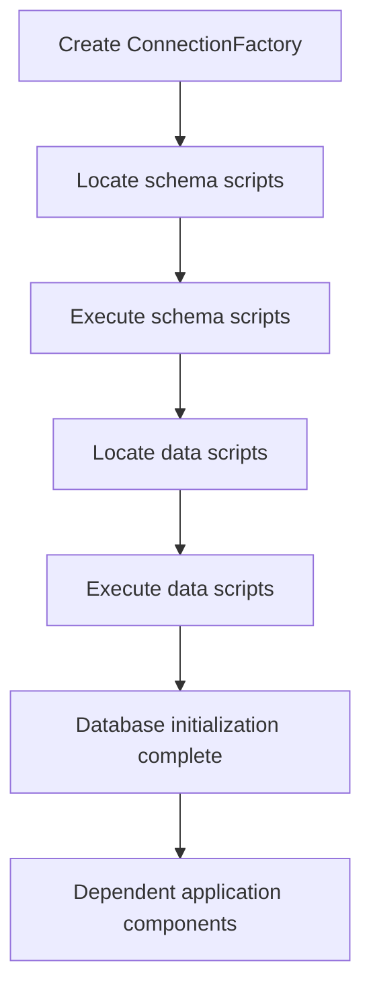

# Spring Boot SQL Initialization and Initialization Order

Spring Boot provides an SQL initialization mechanism to run schema-creation and data-loading scripts when the application starts. For Spring Data Relational R2DBC applications, this mechanism can use `ConnectionFactory` and the R2DBC driver to execute SQL files such as `schema.sql` and `data.sql`. Proper configuration ensures tables are created before sample data is inserted and guarantees application components only use the database after the required initialization steps have completed.

SQL initialization is especially useful for embedded databases, development environments, and testing. For shared databases or production, use caution because scripts may re-run on every startup. When a schema needs to evolve across multiple application versions, migration tools like Flyway or Liquibase are generally more appropriate.

## 1. What Is SQL Initialization in Spring Boot?

SQL initialization is the process where Spring Boot reads configured SQL resources and sends statements to the database during application startup. Common scripts include:

- `schema.sql`: creates tables, indexes, constraints, views, or required structures.
- `data.sql`: adds initial data or reference data.
- `schema-${platform}.sql`: structure specific to a database system, such as PostgreSQL.
- `data-${platform}.sql`: data specific to a database system.

Example directory structure:

```text
src/main/resources/
  schema.sql
  data.sql
  schema-postgresql.sql
  data-postgresql.sql
```

Spring Boot supports database initialization for both JDBC and R2DBC. For R2DBC applications, connection configuration is provided via `spring.r2dbc.*`; scripts are executed through the SQL initialization infrastructure corresponding to `ConnectionFactory` and the R2DBC driver.

SQL initialization only executes SQL statements. It does not infer DDL from `@Table`, `@Column`, `@Id`, or Spring Data Relational entities. Mapping annotations describe how Java maps to an existing schema; creating and modifying the schema requires scripts, migrations, or a separate schema tool.

## 2. Configuring the R2DBC Connection

Before running scripts, the application needs a working `ConnectionFactory`. In Spring Boot, this can be configured in `application.yml`:

```yaml
spring:
  r2dbc:
    url: r2dbc:postgresql://localhost:5432/shop
    username: app_user
    password: ${DB_PASSWORD}
```

The example above uses the PostgreSQL R2DBC driver. The URL and driver must correspond to the actual database. Do not use a JDBC URL `jdbc:postgresql://...` for the `spring.r2dbc.url` property.

If using a pool, configure it via `spring.r2dbc.pool.*` properties when the R2DBC pool dependency and Spring Boot version support it. Enabling pooling does not change the SQL initialization principle: the initializer needs to obtain connections from the `ConnectionFactory` configured by the application.

If the application declares its own `ConnectionFactory` bean, verify whether auto-configuration and the SQL initializer are still created as expected. Manual configuration can cause some auto-configurations to back off; do not assume that merely adding a bean leaves all automatic initialization steps intact.

## 3. Key `spring.sql.init.*` Properties

Spring Boot provides the `spring.sql.init` property group to control script execution.

| Property | Purpose |
| --- | --- |
| `spring.sql.init.mode` | Selects when scripts run: `embedded`, `always`, or `never` |
| `spring.sql.init.schema-locations` | Locations of schema creation scripts |
| `spring.sql.init.data-locations` | Locations of data loading scripts |
| `spring.sql.init.platform` | Platform name used to select database-specific scripts |
| `spring.sql.init.continue-on-error` | Whether to continue when a script statement fails |
| `spring.sql.init.encoding` | Encoding of the SQL files |
| `spring.sql.init.separator` | SQL statement delimiter in scripts |

Default values may vary by Spring Boot version and environment configuration. Check the application properties of the exact dependency version when details need adjustment. These properties are shared across the SQL initialization mechanism; in applications with both JDBC and R2DBC, it is essential to understand which initializer is configured and which connection will run the scripts.

## 4. Choosing Execution Mode with `spring.sql.init.mode`

The `spring.sql.init.mode` property determines whether SQL scripts run at application startup:

| Value | Behavior |
| --- | --- |
| `embedded` | Runs when the database is recognized as embedded; this is the common default mode |
| `always` | Always runs scripts, including with external databases such as PostgreSQL or MySQL |
| `never` | Disables automatic script execution |

Example when developing with local PostgreSQL:

```yaml
spring:
  sql:
    init:
      mode: always
```

If using an embedded database like H2 and relying on the default, declaring `mode` may not be necessary. With an external database, if `always` is not set, scripts may not run because the default mode applies only to embedded databases.

In production, do not enable `always` casually. On every application startup, scripts may be re-executed. If a script contains non-idempotent `CREATE TABLE` statements, the next startup may fail because the table already exists. Even with `IF NOT EXISTS`, scripts still do not manage schema change history and can mask an incorrect legacy structure.

## 5. Default Locations of `schema.sql` and `data.sql`

Under common default configurations, Spring Boot looks for scripts on the classpath, including:

```text
optional:classpath*:schema.sql
optional:classpath*:schema-${platform}.sql
optional:classpath*:data.sql
optional:classpath*:data-${platform}.sql
```

The `optional:` prefix allows the application to start without failing solely because a corresponding file is missing. `classpath*:` can search resources across multiple classpath locations, including JAR dependencies; this is useful in certain modular setups, though you must avoid accidentally loading duplicate scripts from multiple libraries.

For simple projects, placing `schema.sql` and `data.sql` in `src/main/resources` is sufficient. For larger projects, organize scripts into a clear folder such as `db/init/` and configure locations explicitly.

## 6. Configuring Custom Locations

Script paths can be specified explicitly:

```yaml
spring:
  sql:
    init:
      mode: always
      schema-locations: classpath:db/init/schema.sql
      data-locations: classpath:db/init/data.sql
      continue-on-error: false
```

When setting `schema-locations` or `data-locations`, specify all files that need to run. Do not assume default files are still automatically included in the overridden list.

If PostgreSQL-specific scripts are needed, configure locations explicitly:

```yaml
spring:
  sql:
    init:
      mode: always
      platform: postgresql
      schema-locations:
        - classpath:db/init/schema.sql
        - classpath:db/init/schema-postgresql.sql
      data-locations:
        - classpath:db/init/data.sql
        - classpath:db/init/data-postgresql.sql
```

The example above intentionally lists both generic and platform-specific files. If platform statements are already consolidated into a single script, configure only that script. Avoid declaring the same file twice or creating two scripts that execute the same non-idempotent statement.

## 7. Selecting Scripts by Database Platform

`spring.sql.init.platform` enables using a platform name in the file naming convention. For example:

```yaml
spring:
  sql:
    init:
      platform: postgresql
```

Files can be named:

```text
schema.sql
schema-postgresql.sql
data.sql
data-postgresql.sql
```

Generic scripts contain portable structures or data; platform scripts contain database-specific syntax. For example, PostgreSQL supports `JSONB`, `UUID`, `TIMESTAMPTZ`, and `ON CONFLICT`; other databases have different data types and upsert syntax.

Do not use a generic platform name if the SQL content is not truly compatible. A `CREATE INDEX` statement or data type may be valid on one database engine and fail on another. Test scripts against the exact target database and driver.

## 8. Execution Order of Schema and Data

In the standard SQL initialization mechanism, schema scripts run before data scripts. This allows tables to be created before inserting data:



For example:

`schema.sql`

```sql
CREATE TABLE customer (
    id BIGINT PRIMARY KEY,
    name VARCHAR(200) NOT NULL
);
```

`data.sql`

```sql
INSERT INTO customer (id, name)
VALUES (1, 'An Nguyen');
```

If the order were reversed, `data.sql` would fail because the table does not yet exist. Spring Boot separates the two script types to make this dependency explicit.

When there are multiple files in `schema-locations` or `data-locations`, declare the order explicitly and avoid unpredictable cross-file dependencies. If one script creates a table referenced by another script, place it earlier in the appropriate list and verify the startup logs. Schema-before-data ordering does not mean Spring Boot automatically infers every dependency between custom files.

## 9. Sample Schema and Seed Data for R2DBC

A simple PostgreSQL schema:

```sql
CREATE TABLE customer (
    id BIGINT GENERATED BY DEFAULT AS IDENTITY PRIMARY KEY,
    email VARCHAR(320) NOT NULL,
    display_name VARCHAR(200) NOT NULL,
    active BOOLEAN NOT NULL DEFAULT TRUE,
    created_at TIMESTAMPTZ NOT NULL DEFAULT CURRENT_TIMESTAMP,
    CONSTRAINT uq_customer_email UNIQUE (email)
);

CREATE TABLE orders (
    id BIGINT GENERATED BY DEFAULT AS IDENTITY PRIMARY KEY,
    customer_id BIGINT NOT NULL,
    total NUMERIC(12, 2) NOT NULL,
    created_at TIMESTAMPTZ NOT NULL DEFAULT CURRENT_TIMESTAMP,
    CONSTRAINT fk_orders_customer
        FOREIGN KEY (customer_id) REFERENCES customer(id),
    CONSTRAINT ck_orders_total CHECK (total >= 0)
);

CREATE INDEX ix_orders_customer_created
    ON orders(customer_id, created_at DESC, id DESC);
```

`data.sql`:

```sql
INSERT INTO customer (email, display_name)
VALUES
    ('an@example.com', 'An Nguyen'),
    ('binh@example.com', 'Binh Tran');

INSERT INTO orders (customer_id, total)
SELECT id, 125.50
FROM customer
WHERE email = 'an@example.com';
```

This example uses PostgreSQL syntax. On repeated runs, the insert statements may fail due to unique constraints. If this is sample data for a dev environment, reset the database before running or use deliberate upsert syntax. Do not turn seed scripts into a production update mechanism lacking migration history.

## 10. When Are Scripts Re-run?

SQL initialization is a startup script runner, not a migration version-tracking tool. With `mode=always`, scripts are re-applied on every application startup. Spring Boot does not automatically record that `V1` has run and skip it like Flyway does.

Therefore, classify scripts by purpose:

- **Bootstrap script:** creates initial schema or sample data for a new database.
- **Seed script:** loads reference data or fixtures with an explicit re-run policy.
- **Migration:** versioned schema/data changes applied once according to stored history.

Do not use `schema.sql` as a long-term migration sequence. For example, changing `schema.sql` from `VARCHAR(100)` to `VARCHAR(200)` does not automatically alter an existing table. A `CREATE TABLE IF NOT EXISTS` statement skips the existing table and does not apply column changes.

## 11. `continue-on-error` and Behavior When Scripts Fail

By default, the application usually stops startup if an SQL initialization statement fails. You can configure:

```yaml
spring:
  sql:
    init:
      continue-on-error: false
```

`false` preserves fail-fast behavior: errors creating tables, constraints, or loading data cause initialization to fail and prevent the application from starting normally. This is usually the safest choice because the application should not serve requests when the schema is invalid.

`continue-on-error: true` lets the initializer continue after script errors. This can be useful for certain fixtures or optional data, but it is dangerous if the error occurs in a required schema. The application may start with missing tables or data, leading to errors during real requests.

Do not enable `continue-on-error` merely to hide `table already exists`, syntax errors, or constraint violations. Fix the order, execution conditions, or use proper migrations. When needing to skip an existing seed record, use database-specific idempotent syntax or design separate sample data.

## 12. Separator and Encoding

Scripts usually use a semicolon `;` to terminate statements. You can change the separator using `spring.sql.init.separator` if scripts have special structures:

```yaml
spring:
  sql:
    init:
      separator: ";"
      encoding: UTF-8
```

If scripts contain procedures, functions, or blocks with multiple internal semicolons, statement splitting must match the initializer's parser and database syntax. Do not assume Spring Boot's script parser is fully equivalent to the database CLI. For complex DDL or migrations with custom delimiters, a dedicated migration tool is usually more appropriate.

Encoding should be consistent, typically UTF-8, especially when seed data contains Vietnamese or Unicode characters. Avoid saving scripts with an encoding different from the configuration, which corrupts names or string values.

## 13. Separating Configuration by Profile

Development environments may need automatic schema creation and sample data loading; production usually relies on a migration tool to manage the schema. Configurations can be separated:

`application.yml`:

```yaml
spring:
  sql:
    init:
      mode: never
```

`application-dev.yml`:

```yaml
spring:
  sql:
    init:
      mode: always
      schema-locations: classpath:db/dev/schema.sql
      data-locations: classpath:db/dev/data.sql
```

Activate the `dev` profile when running locally. The test profile can use its own scripts:

`application-test.yml`:

```yaml
spring:
  sql:
    init:
      mode: always
      schema-locations: classpath:db/test/schema.sql
      data-locations: classpath:db/test/data.sql
```

Never allow the dev profile to be activated automatically in production. Use environment variables or deployment configuration to set profiles explicitly. Inspect the effective configuration of the actual environment rather than only looking at default YAML files.

## 14. Initialization Order of the Database and Application Beans

Spring Boot has dependency management so that components depending on database initialization are initialized after the SQL initialization step. For custom beans that require the database to be ready during their initialization phase, you can use `@DependsOnDatabaseInitialization` if supported by your Spring Boot version:

```java
import org.springframework.boot.sql.init.dependency.DependsOnDatabaseInitialization;
import org.springframework.stereotype.Component;

@Component
@DependsOnDatabaseInitialization
public class ReferenceDataDependentComponent {
    // This component depends on data created by the SQL initializer.
}
```

The annotation declares that the bean depends on database initialization. It does not execute queries itself or turn a blocking operation into a reactive one. If a component needs to read data at startup, design controlled reactive initialization and avoid calling `block()` arbitrarily in a constructor or `@PostConstruct`.

For Spring Boot auto-configured repositories and components, the dependency on database initialization is typically managed by auto-configuration. This annotation is mainly useful for custom beans where the framework cannot infer the dependency.

Do not apply `@DependsOnDatabaseInitialization` mechanically to every bean. Only annotate components that genuinely require scripts to finish before initialization.

## 15. SQL Initialization and `ApplicationRunner`

`ApplicationRunner` and `CommandLineRunner` execute once the application context is created and startup is nearly complete. They are typically used for application-level startup tasks, such as verifying configuration or triggering an initial use case.

Do not use runners as a substitute for schema migrations. The SQL initializer is suited for bootstrap SQL scripts; migration tools are suited for versioned schema changes; runners are suited for separately managed business startup tasks.

In a reactive application, a traditional runner does not automatically make the code inside it reactive. If a runner needs to perform R2DBC work, explicitly design how startup orchestration waits for completion or use an appropriate lifecycle mechanism. Do not call `subscribe()` and let startup continue if the application requires the data to be fully loaded before accepting requests.

## 16. `spring.jpa.defer-datasource-initialization` Is Not a Setting for R2DBC

Some Spring Boot documentation mentions `spring.jpa.defer-datasource-initialization` to control ordering between Hibernate/JPA schema generation and `data.sql`. That property belongs to JPA/Hibernate integration.

Spring Data R2DBC applications do not use Hibernate for schema generation. Do not add `spring.jpa.defer-datasource-initialization` expecting it to control R2DBC script ordering. For R2DBC, use `spring.sql.init.*` properties, schema scripts, and an appropriate migration strategy.

If an application runs both JPA/JDBC and R2DBC simultaneously, clarify which initializer uses which connection, who owns the schema, and the initialization order between components. Do not allow two mechanisms to unintentionally run scripts with overlapping effects.

## 17. Combining SQL Initialization with Flyway or Liquibase

Flyway and Liquibase are versioned migration tools that apply schema changes in order and track which migrations have already run. Spring Boot's basic SQL initialization lacks this history management feature.

Typically, choose one schema ownership mechanism:

- Small projects, embedded databases, demos, or tests: `schema.sql` and `data.sql` may suffice.
- Multi-environment applications, multiple deployment versions, or production: use Flyway or Liquibase to manage migrations.

Do not let both `schema.sql` and Flyway create the same tables. Execution ordering can cause one of them to fail or leave schema state unpredictable.

In common Spring Boot integrations, Flyway and Liquibase use JDBC. The runtime application can use R2DBC, while the migration tool typically needs a JDBC driver and a separate JDBC `DataSource` to connect during the migration phase. The JDBC migration connection must point to the same database/schema that R2DBC will use. Check the documentation for the exact tool and Spring Boot versions in use, as support can evolve.

When Flyway/Liquibase owns the schema, basic SQL initialization is usually disabled or restricted to clearly organized seed steps according to project guidelines. Avoid having two systems manage the same DDL.

## 18. Migration Ordering and Reference Data

With a migration tool, changes are divided into versioned steps. Flyway example:

```text
src/main/resources/db/migration/
  V1__create_customer.sql
  V2__create_orders.sql
  V3__add_order_status_index.sql
```

Migration `V1` creates customer; `V2` creates orders and the foreign key referencing customer; `V3` adds an index. The tool runs migrations in order and records history in its management table.

If reference data must exist before the application serves requests, it can be loaded via migrations or a deliberately managed seed step. Establish the sequence:

1. Create required tables and constraints.
2. Load mandatory baseline data.
3. Deploy the application depending on the new data.

For rolling or multi-instance deployments, migrations must be compatible with both old and new application versions while they coexist. Use the expand-and-contract strategy for major changes: add the new structure, deploy compatible code, migrate data, and then remove the old structure.

## 19. Avoiding Duplicate or Corrupting Seed Data

The `data.sql` script may re-run on startup. If inserting sample data uses fixed keys or unique values, subsequent runs can violate constraints.

With PostgreSQL, a seed statement can use deliberate upsert:

```sql
INSERT INTO customer (email, display_name)
VALUES ('support@example.com', 'Support')
ON CONFLICT (email)
DO UPDATE SET display_name = EXCLUDED.display_name;
```

Or if you only want to insert when absent:

```sql
INSERT INTO customer (email, display_name)
VALUES ('support@example.com', 'Support')
ON CONFLICT (email) DO NOTHING;
```

This is PostgreSQL syntax and is not portable. You must also decide whether seed data is allowed to overwrite manual edits. `DO UPDATE` can overwrite data adjusted by operators; `DO NOTHING` may keep outdated values. Choose behavior based on the data's purpose.

Do not use dev sample data in production. Clearly separate mandatory reference data, test fixtures, and demo data to avoid exposing or overwriting real data.

## 20. SQL Initialization with Embedded Databases and Testcontainers

With embedded databases, `mode=embedded` usually runs scripts automatically when a fresh database is created. This is convenient for demos or simple tests.

For integration tests using Testcontainers PostgreSQL, the database is not recognized as embedded. If SQL initialization scripts need to run, configure `spring.sql.init.mode=always` in the test profile/properties and point locations to the test scripts.

Example test properties:

```yaml
spring:
  r2dbc:
    url: r2dbc:postgresql://localhost:${test.postgres.port}/shop_test
    username: test_user
    password: test_password
  sql:
    init:
      mode: always
      schema-locations: classpath:db/test/schema.sql
      data-locations: classpath:db/test/data.sql
```

The `${test.postgres.port}` placeholder is illustrative only; in Testcontainers, the URL/port is typically supplied via `@DynamicPropertySource`, service connections, or the corresponding integration mechanism of the Spring Boot version.

With a test database recreated per test suite, bootstrap scripts keep the schema consistent. If tests need a clean state per method, use transaction rollback, truncate, or dedicated databases/containers depending on the test strategy. Do not assume SQL initialization automatically re-runs before every test method.

## 21. Verifying Initialization Order with Integration Tests

An integration test should verify that the application starts with the schema created and data loaded before repositories are used.

Repository example:

```java
@SpringBootTest
class SqlInitializationIntegrationTest {

    @Autowired
    CustomerRepository customerRepository;

    @Test
    void schemaAndSeedDataAreAvailable() {
        StepVerifier.create(customerRepository.findByEmail("an@example.com"))
                .assertNext(customer ->
                        assertThat(customer.getDisplayName())
                                .isEqualTo("An Nguyen"))
                .verifyComplete();
    }
}
```

The test assumes the script created the table and inserted a customer with that email. With R2DBC, use Reactor Test `StepVerifier` to verify publishers; do not call `block()` in application code just to make tests easier to write. In tests, use publisher-awaiting tools in a way appropriate to the testing framework.

Also verify:

- The application fails startup if a required schema is invalid or missing.
- Data scripts only run after tables exist.
- Foreign keys and unique constraints are properly created.
- Dev/test/prod profiles use the correct locations and modes.
- Scripts do not run unexpectedly when `mode=never`.
- When using a migration tool, the schema version and post-migration data match expectations.

## 22. Monitoring Logs and Diagnosing Startup Errors

When SQL initialization fails, check startup logs to identify:

- Which script is being read.
- Which statement failed and the underlying database error.
- Whether `ConnectionFactory` can connect.
- Whether the database user has `CREATE`, `ALTER`, `INSERT`, or required privileges.
- Whether the platform script matches the database engine.
- Whether schema/data scripts have the right dependency order.
- Whether the SQL file has an incompatible encoding, delimiter, or syntax.
- Whether another initializer or migration tool is modifying the same schema.

Some common errors:

| Error | Common Cause | Resolution |
| --- | --- | --- |
| Script does not run on PostgreSQL | `mode` is still `embedded` | Set `spring.sql.init.mode=always` in the appropriate profile |
| File not found | Incorrect classpath location or file name | Check `src/main/resources` and `schema-locations`/`data-locations` |
| Table already exists | Script re-ran or database is not clean | Use migrations or reset the database; do not merely enable continue-on-error |
| Insert fails because table does not exist | Data script ran out of order or schema location missing | Ensure schema script is configured and runs before data |
| Wrong data type/syntax | SQL from a different database engine used | Separate scripts by platform and test against the right database |
| Permission error | R2DBC user lacks required DDL/DML privileges | Grant appropriate privileges or use dedicated migration credentials |
| App runs with outdated schema | `IF NOT EXISTS` skipped structural changes | Use versioned migrations |
| Duplicate seed data | Insert script re-ran and violated unique constraints | Design idempotent seeding or create a clean database |
| Bean accesses DB too early | Initialization dependency undeclared or query ran in constructor | Use proper initialization dependencies and clear orchestration |

Do not enable `continue-on-error` to mask these errors. Find the root cause, fix configuration/scripts, or move to an appropriate migration strategy.

## 23. Security When Running Initialization Scripts

SQL initialization may require DDL privileges such as creating tables, indexes, and constraints. The runtime application account in production should typically have only the minimum privileges needed to read/write data, not necessarily schema-altering privileges.

Some systems use separate credentials for migrations:

- A migration account with DDL privileges, used only in deployment pipelines or the migration stage.
- An R2DBC runtime account with DML privileges needed by the application.
- Passwords fetched from a secret manager or environment variables, not committed in `application.yml`.
- Scripts free of real credentials or sensitive data.

If SQL initialization runs on every application startup using a runtime account with DDL privileges, the blast radius of a misconfiguration or breach is larger. For production, using a migration pipeline and separated privileges is usually safer.

## 24. Applications Using Both JDBC and R2DBC

An application may use JDBC for migrations or legacy libraries while using R2DBC for reactive requests. In that case, both a `DataSource` and a `ConnectionFactory` may exist.

Verify:

- Which connection SQL initialization applies to.
- Which JDBC `DataSource` Flyway/Liquibase uses.
- Which R2DBC `ConnectionFactory` runtime repositories use.
- Whether both connections point to the same database, schema, user, and search path.
- Whether the same `schema.sql` is accidentally run by both initializers.
- Whether migration ordering completes before R2DBC repositories start accessing the new schema.

Do not assume `spring.sql.init.*` automatically resolves all ordering between the two connection systems. In mixed setups, inspect the auto-configuration report, initializer beans, and startup logs. There should be a single schema owner to prevent two mechanisms from competing.

## 25. What SQL Initialization Does Not Do

SQL initialization is useful, but it has clear boundaries:

- Does not auto-generate DDL from Spring Data Relational entities.
- Does not track schema versions or migration history.
- Does not automatically transform an old schema into a new one simply because `schema.sql` changed.
- Does not replace domain-layer data validation.
- Does not guarantee atomic transactions across an entire script on every driver/database.
- Does not guarantee external side effects outside the database stay synchronized.
- Does not replace testing against the actual production database and R2DBC driver.

If you need versioned schema changes, rollback/forward strategies, data transformations, or safe rolling deployments, use a dedicated migration tool and design compatible migrations.

## 26. Best Practices

- Configure `spring.r2dbc.url` and driver accurately for the database; do not use a JDBC URL for R2DBC.
- Use `schema.sql` for structure and `data.sql` for simple seed data.
- Understand that Spring Boot normally executes schema scripts before data scripts.
- Use `spring.sql.init.mode=always` when scripts must run against external databases in dev/test; use `never` when a migration tool owns the schema.
- When overriding locations, list all necessary generic and platform scripts.
- Use `spring.sql.init.platform` and separate scripts when syntax differs across database engines.
- Keep `continue-on-error=false` for required schemas to fail fast.
- Use UTF-8 and an appropriate separator; avoid complex procedural scripts beyond the simple parser's capabilities.
- Separate dev/test/prod profiles to avoid loading sample data into production.
- Do not treat `IF NOT EXISTS` as a migration; it does not update old tables.
- Pick a single schema ownership mechanism: simple SQL bootstrapping or Flyway/Liquibase.
- With Flyway/Liquibase in an R2DBC app, check the need for a separate JDBC migration connection.
- Use `@DependsOnDatabaseInitialization` for custom beans that genuinely require database init to finish, if supported by your version.
- Do not perform blocking I/O in constructors or reactive callbacks just to wait on the database.
- Test schema/data order, profiles, and startup errors on a production-compatible database and driver.
- Separate migration DDL privileges from runtime privileges in production deployments.

## 27. Conclusion

Spring Boot SQL initialization enables running SQL scripts on application startup. In Spring Data Relational R2DBC applications, `spring.sql.init.*` controls execution mode, script locations, platform, and error handling; `ConnectionFactory` provides the execution connection. Schema scripts run before data scripts so tables and constraints are ready before loading data.

This mechanism fits simple bootstrapping, embedded databases, dev, and test. Because scripts can re-run on every startup and do not track version history, do not use it as a production migration tool. Separate configurations by profile, keep initialization order explicit, declare dependencies for custom beans when needed, and choose a consistent schema owner. For multi-environment systems or continuous deployment, Flyway/Liquibase with an appropriate migration connection usually provides safer control over schema changes.
