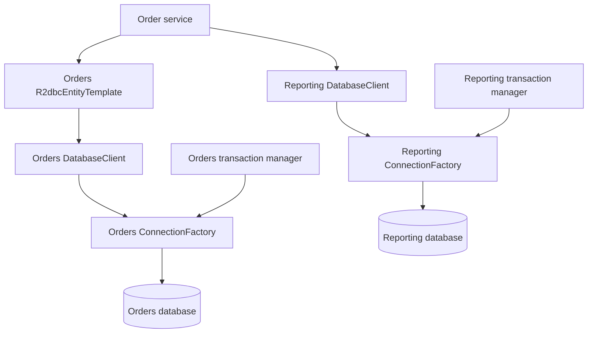
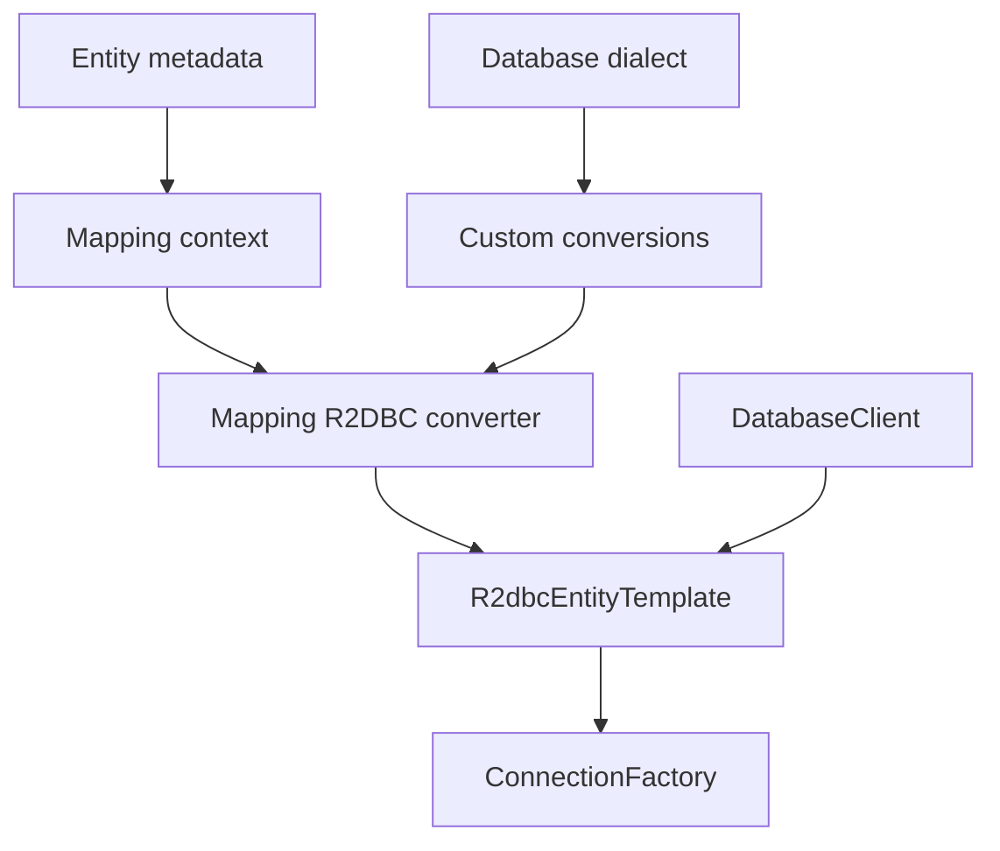

# Separating Templates, DatabaseClient, and Mappers When Needed

A Spring Data R2DBC application can connect to multiple databases, such as an orders database, a reporting database, and a historical archive database. In that situation, `R2dbcEntityTemplate`, `DatabaseClient`, and entity mappers should not be treated as shared beans across every connection. Each database may have its own `ConnectionFactory`, dialect, transaction manager, schema, naming strategy, and custom conversions.

The right design clearly separates three layers:

- **`R2dbcEntityTemplate`** performs entity operations according to Spring Data Relational mapping metadata: select, insert, update, and delete.
- **`DatabaseClient`** provides a lower-level SQL API, binds parameters, and maps each row or return value as specified by the application.
- **Mappers** consist of the mapping context, converter, custom conversions, and dialect. They determine how entities and Java types are translated into database columns and values.

When there are multiple databases, each of these sets must be bound to the right `ConnectionFactory`. If a repository writes to database A while the transaction manager manages connections for database B, the operation may not be part of the intended transaction. If the wrong converter or dialect is used, data type mapping, column names, and SQL may be incorrect even though the code still compiles.

## 1. Roles and Boundaries of Each Component

| Component | Primary Responsibility | When to Use |
|---|---|---|
| `ConnectionFactory` | Creates connections to a specific database or endpoint | Each database/connection source needs its own configuration. |
| `R2dbcTransactionManager` | Manages transactions on a single `ConnectionFactory` | When operations on the same database must commit/roll back together. |
| `DatabaseClient` | Executes SQL, binds parameters, and reads results | Custom SQL, projections, specialized queries, or operations without entity mapping. |
| `R2dbcEntityTemplate` | Entity operations based on metadata and converters | Entity-based CRUD, `Criteria`, `Query`, and Spring Data mapping. |
| `R2dbcMappingContext` | Stores metadata about entities, tables, columns, IDs, and mapping rules | When an independent mapping context is needed per database or schema. |
| `R2dbcCustomConversions` | Registers conversions between domain types and types supported by the driver/database | When a database has specialized types or domain types require conversion. |
| `R2dbcDialect` | Provides SQL and data type differences per database engine | When using PostgreSQL, H2, or another database with specific syntax. |

`R2dbcEntityTemplate` typically uses `DatabaseClient` underneath to execute SQL. However, the two abstractions serve different working levels. `DatabaseClient` does not automatically infer full entity metadata the way the template does; when using it, code typically declares SQL, binds values, and maps results manually.

Do not create a single `DatabaseClient` or `R2dbcEntityTemplate` and swap the `ConnectionFactory` implicitly on each call. Create explicit beans for each database so dependency injection shows where each operation goes.

## 2. Multi-Database Model

Suppose the application has two databases:

- `orders`: stores orders and order line items.
- `reporting`: stores aggregated data for reporting.

Each database has its own group of beans:



`orders` and `reporting` can use the same database type or two different database engines. Even if both use PostgreSQL, they remain two separate connection and transaction boundaries when configured with two independent `ConnectionFactory` beans.

## 3. Declaring Each ConnectionFactory

Each `ConnectionFactory` must point to the right database and be configured with its own URL/options. Externalized application configuration can be used, for example:

```yaml
app:
  datasource:
    orders:
      url: r2dbc:postgresql://orders-db:5432/orders
      username: ${ORDERS_DB_USER}
      password: ${ORDERS_DB_PASSWORD}
    reporting:
      url: r2dbc:postgresql://reporting-db:5432/reporting
      username: ${REPORTING_DB_USER}
      password: ${REPORTING_DB_PASSWORD}
```

This is an application-specific configuration structure; Spring Boot does not automatically understand every custom prefix unless there is a corresponding `@ConfigurationProperties` class and bean creating the `ConnectionFactory`.

The example below focuses on bean identification. Factory creation is extracted into a separate helper configured by URL/options and the driver in use:

```java
@Configuration
public class ConnectionFactoryConfiguration {

    @Bean("ordersConnectionFactory")
    @Primary
    ConnectionFactory ordersConnectionFactory(OrdersDbProperties properties) {
        return createConnectionFactory(properties);
    }

    @Bean("reportingConnectionFactory")
    ConnectionFactory reportingConnectionFactory(
            ReportingDbProperties properties) {
        return createConnectionFactory(properties);
    }

    private ConnectionFactory createConnectionFactory(DbProperties properties) {
        // Create ConnectionFactory from the corresponding database's URL/options.
        // Credentials come from secure configuration, not hard-coded in source.
        return ConnectionFactories.get(properties.getUrl());
    }
}
```

`DbProperties`, `OrdersDbProperties`, and `ReportingDbProperties` are application-defined configuration classes. The example uses `ConnectionFactories.get(url)` to illustrate creating a factory from an R2DBC URL; in real applications, `ConnectionFactoryOptions`, SSL, pooling, or driver-specific options may be needed.

`@Primary` only helps Spring pick a default bean when an injection point does not specify a qualifier. It does not mean all operations automatically go to the primary database. With multiple databases, use `@Qualifier` on dependencies to avoid picking the wrong factory.

## 4. Creating a Dedicated DatabaseClient for Each Database

`DatabaseClient` is created from a `ConnectionFactory`. Therefore, two databases need two separate clients:

```java
@Configuration
public class DatabaseClientConfiguration {

    @Bean("ordersDatabaseClient")
    DatabaseClient ordersDatabaseClient(
            @Qualifier("ordersConnectionFactory") ConnectionFactory factory) {
        return DatabaseClient.create(factory);
    }

    @Bean("reportingDatabaseClient")
    DatabaseClient reportingDatabaseClient(
            @Qualifier("reportingConnectionFactory") ConnectionFactory factory) {
        return DatabaseClient.create(factory);
    }
}
```

When injecting into a repository adapter or service, always specify the bean explicitly:

```java
@Repository
public class ReportingQueryRepository {

    private final DatabaseClient databaseClient;

    public ReportingQueryRepository(
            @Qualifier("reportingDatabaseClient") DatabaseClient databaseClient) {
        this.databaseClient = databaseClient;
    }
}
```

Do not inject a `DatabaseClient` without a qualifier in an application that has multiple beans of the same type. If `@Primary` is present, the code may compile and run yet accidentally query the default database by mistake.

## 5. Creating Separate R2dbcEntityTemplate Beans

`R2dbcEntityTemplate` must also be bound to the right database. With default mapping configuration, templates can be created from the corresponding `ConnectionFactory`:

```java
@Configuration
public class EntityTemplateConfiguration {

    @Bean("ordersEntityTemplate")
    R2dbcEntityTemplate ordersEntityTemplate(
            @Qualifier("ordersConnectionFactory") ConnectionFactory factory) {
        return new R2dbcEntityTemplate(factory);
    }

    @Bean("reportingEntityTemplate")
    R2dbcEntityTemplate reportingEntityTemplate(
            @Qualifier("reportingConnectionFactory") ConnectionFactory factory) {
        return new R2dbcEntityTemplate(factory);
    }
}
```

Constructors and template creation approaches may vary across Spring Data Relational versions. For advanced configurations, you can create a template from a `DatabaseClient` along with the corresponding dialect or converter. Check the API of the exact dependency version you are using.

In the example, the two templates are separated from bean creation onward. `ordersEntityTemplate` must not be used for entities meant to be read/written in the reporting database simply because both databases have tables with the same name.

## 6. Separating Transaction Managers by ConnectionFactory

Each database needs a corresponding transaction manager:

```java
@Configuration
public class TransactionManagerConfiguration {

    @Bean("ordersTransactionManager")
    @Primary
    ReactiveTransactionManager ordersTransactionManager(
            @Qualifier("ordersConnectionFactory") ConnectionFactory factory) {
        return new R2dbcTransactionManager(factory);
    }

    @Bean("reportingTransactionManager")
    ReactiveTransactionManager reportingTransactionManager(
            @Qualifier("reportingConnectionFactory") ConnectionFactory factory) {
        return new R2dbcTransactionManager(factory);
    }
}
```

When a service operates on the orders database:

```java
@Transactional(transactionManager = "ordersTransactionManager")
public Mono<Order> createOrder(CreateOrderCommand command) {
    return ordersRepository.save(Order.from(command));
}
```

If a service only reads reports and does not need a write transaction, it can use `reportingDatabaseClient` directly. If a transaction is needed on the reporting database, use `reportingTransactionManager`.

One R2DBC transaction manager manages one `ConnectionFactory`. Placing write operations from two databases in the same method annotated with `@Transactional(transactionManager = "ordersTransactionManager")` does not make the reporting database join the orders transaction. If both need to be coordinated, design a compatible distributed transaction or use outbox/saga and eventual consistency.

## 7. Separating Repository Packages with entityOperationsRef

If using Spring Data repositories, each repository group must be told which `R2dbcEntityOperations`/template will execute queries. Packages can be separated and configured with separate `@EnableR2dbcRepositories` annotations:

```java
@Configuration
@EnableR2dbcRepositories(
    basePackages = "com.example.orders.repository",
    entityOperationsRef = "ordersEntityTemplate"
)
public class OrdersRepositoriesConfiguration {
}

@Configuration
@EnableR2dbcRepositories(
    basePackages = "com.example.reporting.repository",
    entityOperationsRef = "reportingEntityTemplate"
)
public class ReportingRepositoriesConfiguration {
}
```

`entityOperationsRef` links repositories to the corresponding template/operations bean. Keep repository packages separated so both configurations do not scan and register the same interface twice.

If the application needs to specify a transaction manager for a service, use the explicit manager name in `@Transactional`. Check the annotation attributes and transaction manager selection behavior of your Spring Data version; do not assume `entityOperationsRef` automatically selects the right transaction manager for every service calling the repository.

## 8. When Should Mappers Be Separated?

Each `R2dbcEntityTemplate` uses converters and mapping metadata to turn entities into SQL parameters and database results into entities. Mappers must be separated when databases have one or more of the following differences:

- Different database engines, resulting in different dialects and native types.
- A domain type stored as different column types, such as JSONB in PostgreSQL and text in another database.
- Different table/column names or naming strategies.
- Different schemas and mapping rules for the same entity.
- One database needing its own custom converters, such as `Money`, enums, or temporal types.
- One database needing driver-specific handling for IDs/generated values or array types.

If both databases have the same dialect, schema, naming strategy, and conversions, similar mapping configuration can be used. Even then, bind each template to the right `ConnectionFactory` and avoid accidentally sharing beans if configuration changes later.

## 9. Mapping Context, Converter, Custom Conversions, and Dialect

The mapping components connect as follows:



- **Mapping context:** recognizes `@Table`, `@Column`, `@Id`, `@Transient`, embedded properties, and entity metadata.
- **Converter:** converts between entities/properties and R2DBC row/bind values.
- **Custom conversions:** registers read/write converters for domain types or specialized types.
- **Dialect:** provides database differences such as bind markers, data types, generated values, and SQL generation rules.

Do not take the dialect of database A and use it to build the template for database B if the two databases run different engines. Likewise, a converter using PostgreSQL-specific JSON types cannot automatically be used for MySQL or H2.

## 10. Separating Custom Conversions Per Database

Suppose the domain model has a `Money` type. The orders database stores amounts as `NUMERIC`, while the reporting database stores normalized data as `DECIMAL` alongside a separate currency column. The same domain type may need separate conversions depending on schema and driver.

Example declaring conversions tied to dialects:

```java
@Bean("ordersCustomConversions")
R2dbcCustomConversions ordersCustomConversions(
        @Qualifier("ordersDialect") R2dbcDialect dialect) {
    return R2dbcCustomConversions.of(dialect, List.of(
        new MoneyWriteConverter(),
        new MoneyReadConverter()
    ));
}

@Bean("reportingCustomConversions")
R2dbcCustomConversions reportingCustomConversions(
        @Qualifier("reportingDialect") R2dbcDialect dialect) {
    return R2dbcCustomConversions.of(dialect, List.of(
        new ReportingMoneyWriteConverter(),
        new ReportingMoneyReadConverter()
    ));
}
```

`R2dbcCustomConversions.of(dialect, converters)` is a common declaration pattern in Spring Data R2DBC versions supporting this factory method; verify the API signature in your project's version. The converter list and dialect must belong to the same database. If a converter requires a driver-specific Java type, that driver dependency must also be present in the application.

When creating converters and mapping contexts manually instead of relying on template defaults, configure a separate `R2dbcMappingContext` and `MappingR2dbcConverter` for each database, then pass the corresponding converter into `R2dbcEntityTemplate` according to the constructor/API of the version in use. Avoid creating a shared converter and mutating its dialect or simple type holder after the application has started.

## 11. Separating Mapping Contexts When Schemas or Naming Strategies Differ

Suppose the same domain concept is stored in two schemas:

```text
orders database:
  purchase_order
  order_line

reporting database:
  rpt_order
  rpt_order_item
```

If two tables have different names, an entity annotated with `@Table("purchase_order")` does not automatically become `rpt_order` simply by using `reportingEntityTemplate`. Mapping annotations remain metadata on the entity.

Design options:

1. Use separate persistence entities for each schema, such as `OrderEntity` and `ReportingOrderRow`, if the structures genuinely differ.
2. Use `DatabaseClient` with explicit SQL and map into a shared DTO if only reading reporting data.
3. Create a separate mapping context/naming strategy if the differences can be expressed via mapping mechanisms supported by your Spring Data version.
4. Use views or intermediate tables with a stable schema to reduce mapping variants.

Do not try to force one entity to use multiple different table names by mutating annotations or global mapping metadata at runtime. Mapping metadata is cached and shared across the application context; implicit mutation can cause concurrent operations to hit the wrong table.

## 12. When to Use R2dbcEntityTemplate?

`R2dbcEntityTemplate` is suitable when you want to work with entities and leverage Spring Data metadata:

```java
Mono<Order> findOrder(Long id) {
    Query query = Query.query(Criteria.where("id").is(id));
    return ordersEntityTemplate.selectOne(query, Order.class);
}

Mono<Order> saveOrder(Order order) {
    return ordersEntityTemplate.insert(Order.class).using(order);
}
```

The template is appropriate when:

- Performing CRUD on entities annotated with `@Table`, `@Id`, `@Column`.
- Wanting to use `Criteria` and `Query` instead of assembling SQL manually.
- Wanting Spring Data to handle mapping and conversions via configured converters.
- Needing insert/update/delete via entity operations.
- Wanting to reuse domain mapping in conditional queries.

The template does not automatically create full ORM relationships across aggregates. Nor does it automatically perform joins and hydrate full object graphs like JPA. SQL and aggregate models must still be designed explicitly.

## 13. When to Use DatabaseClient?

`DatabaseClient` is suitable when the SQL statement is central or the result does not need to be mapped to a full entity:

```java
Flux<OrderSummary> findDailySummary(LocalDate from, LocalDate to) {
    return reportingDatabaseClient.sql("""
            SELECT order_date, COUNT(*) AS order_count,
                   SUM(total_amount) AS total_amount
            FROM rpt_order
            WHERE order_date >= :fromDate
              AND order_date < :toDate
            GROUP BY order_date
            ORDER BY order_date
            """)
        .bind("fromDate", from)
        .bind("toDate", to)
        .map((row, metadata) -> new OrderSummary(
            row.get("order_date", LocalDate.class),
            row.get("order_count", Long.class),
            row.get("total_amount", BigDecimal.class)
        ))
        .all();
}
```

The example uses the reporting database client and maps directly to the `OrderSummary` DTO. There is no need to create an entity for an aggregated result used only for reporting.

`DatabaseClient` is appropriate when:

- Needing SQL joins, CTEs, window functions, or database-specific syntax.
- Querying aggregates returning DTOs/projections.
- Needing exact control over selected columns and aliases.
- Using dialect-specific SQL.
- Performing direct updates/deletes with `rowsUpdated()`.

When using `DatabaseClient`, bind values instead of concatenating input into SQL. Table names, column names, and sort directions cannot be bound as values; if dynamic selection is needed, use an allowlist in code. You must also map `Row` manually and handle nulls, aliases, converters, or driver-specific types.

## 14. Combining Template and DatabaseClient in the Same Application

A service can use a template for core aggregate operations and a separate client for reporting or custom SQL:

```java
@Service
public class OrderReadService {

    private final R2dbcEntityTemplate ordersTemplate;
    private final DatabaseClient reportingClient;

    public OrderReadService(
            @Qualifier("ordersEntityTemplate") R2dbcEntityTemplate ordersTemplate,
            @Qualifier("reportingDatabaseClient") DatabaseClient reportingClient) {
        this.ordersTemplate = ordersTemplate;
        this.reportingClient = reportingClient;
    }

    public Mono<Order> findOrder(Long id) {
        return ordersTemplate.selectOne(
            Query.query(Criteria.where("id").is(id)), Order.class);
    }

    public Flux<OrderSummary> findSummary(LocalDate from, LocalDate to) {
        return reportingClient.sql("""
                SELECT order_date, COUNT(*) AS order_count
                FROM rpt_order
                WHERE order_date >= :fromDate
                  AND order_date < :toDate
                GROUP BY order_date
                ORDER BY order_date
                """)
            .bind("fromDate", from)
            .bind("toDate", to)
            .map((row, metadata) -> new OrderSummary(
                row.get("order_date", LocalDate.class),
                row.get("order_count", Long.class)))
            .all();
    }
}
```

The two methods in the example read two independent sources. If a service needs to combine results from both databases, publishers can be composed using `Mono.zip`, `flatMap`, or `Flux`, but that is only coordination at the application layer. It does not create a shared transaction and does not guarantee a consistent snapshot across both databases.

If reporting data must reflect a consistent version of the orders database, design explicit data synchronization, watermarks/versions, or snapshots instead of assuming two concurrent queries observe the same point in time.

## 15. Repositories Must Be Bound to the Right Template

A repository interface does not inherently indicate its target database if the application has multiple templates. Repository package configuration determines which template is used. Therefore:

- Separate packages by bounded context/database.
- Register each package with its own `@EnableR2dbcRepositories`.
- Set `entityOperationsRef` to the exact template name.
- Avoid scanning the same repository interface in multiple configurations.
- Use explicit qualifiers when injecting templates or clients into adapters.
- Specify the transaction manager at the service according to the database the use case writes to.

Do not put all repositories in one package and expect Spring to infer the database from entity classes or table names. Routing must be declared explicitly.

## 16. Dialect and SQL Differences Between Databases

Even when separating clients, SQL still needs to match the target database. Common differences include:

| Difference | Impact |
|---|---|
| Bind markers | PostgreSQL commonly uses `$1`, other drivers may use `?`; Spring abstractions can translate named parameters per dialect. |
| Result limits | `LIMIT/OFFSET`, `FETCH FIRST`, or different syntax. |
| Generated values | `RETURNING`, generated keys, or driver-specific APIs. |
| JSON | JSON/JSONB types and Java codecs may differ. |
| Booleans and numeric types | Native types, precision, and representations differ. |
| Timestamps/time zones | Semantics for storing offsets/instants may differ. |
| Upserts | `ON CONFLICT`, `ON DUPLICATE KEY`, or proprietary syntax. |
| Identifiers/schemas | Quoting rules, casing, and default schemas differ. |

`R2dbcDialect` helps Spring Data generate appropriate SQL inside dialect-aware abstractions. It does not automatically translate arbitrary hand-written SQL in `DatabaseClient` into portable syntax. If custom SQL uses vendor-specific features, keep queries separated per database and test against the right driver.

## 17. Transactions Do Not Automatically Span Multiple Templates

Suppose a service writes an order to `ordersEntityTemplate` and writes statistics to `reportingEntityTemplate`. If the method is annotated:

```java
@Transactional(transactionManager = "ordersTransactionManager")
public Mono<Void> createOrderAndUpdateReport(...) {
    // Write orders database.
    // Write reporting database.
    return ...;
}
```

Only operations participating in `ordersTransactionManager` are managed in that transaction. `reportingEntityTemplate` uses `reportingConnectionFactory`, so reporting operations do not automatically join the orders transaction.

Options:

- Accept eventual consistency and update reporting via events/outbox after the order commits.
- Use one database as the primary source of truth, then build projection/reporting read models asynchronously.
- Use a distributed transaction coordinator if all resources genuinely support a shared protocol and operational cost is acceptable.
- If the two operations do not need to be atomic together, run separate local transactions and design appropriate retries/compensation.

Do not use `REQUIRES_NEW` as a way to automatically create an atomic commit across two databases. It only creates or joins transactions according to the semantics of the selected transaction manager, without coordinating a global commit.

## 18. Dynamic Routing and Limits of Per-Request Database Switching

Some systems want to select the database per tenant or shard. You can build a routing `ConnectionFactory` or a routing repository layer, but the database must be determined before the transaction starts.

Key principles:

- Determine the tenant/shard from server-authenticated information; do not directly trust a database key sent by the client.
- Select the `ConnectionFactory` before starting a transaction and keep the choice unchanged for the entire transaction.
- Do not switch databases midway inside the same reactive transaction context.
- Ensure the routing context is propagated in Reactor Context; do not rely on regular `ThreadLocal`.
- Check the pool/connections of the selected shard and cap total pools when there are many shards.
- Each repository/template must clearly know the routing strategy or be called through an adapter responsible for routing.

If the database is chosen after a connection has already been acquired, operations may continue on the old database. Dynamic routing must therefore be designed at the `ConnectionFactory` and transaction boundary layer, not just by adding an `if` inside a service.

## 19. Common Configuration Mistakes

| Mistake | Consequence | Prevention |
|---|---|---|
| Injecting `ConnectionFactory` without qualifier when multiple beans exist | Default bean may be chosen unintentionally or app fails to start. | Use `@Qualifier` on every bean that must target a specific database. |
| Two templates sharing one factory | Repositories may query the wrong data source. | Create separate templates and inspect the dependency graph. |
| Repository package scanned by two configurations | Duplicate repository beans or bound to wrong template. | Separate packages and specify `basePackages`. |
| Using converters/dialect of database A for B | Errors in data types, generated values, or SQL. | Separate conversions and dialects per factory. |
| Treating `@Primary` as automatic routing | Unqualified operations go to the default database. | Use qualifiers and define clear adapter boundaries. |
| Expecting one transaction manager to manage two factories | Only one database participates in the transaction. | Separate local transactions or distributed coordination mechanism. |
| Hand-written SQL assuming portable syntax | Queries fail when changing database engines. | Separate SQL by dialect and run integration tests. |
| Entity mapping using one table name for two different schemas | Template does not automatically change `@Table` per database. | Separate persistence models, naming strategy, or SQL projections. |
| Expecting raw SQL to trigger entity callbacks/auditing | Metadata may not be updated. | Update explicitly or use entity operations. |

## 20. Testing Multi-Database Configurations

Do not only check that the application starts successfully. Verify that each bean actually points to the right database:

1. Create two test databases/schemas with distinguishable data.
2. Call a repository bound to `ordersEntityTemplate` and verify only the orders database changes.
3. Call `reportingDatabaseClient` and verify the query runs on the reporting database.
4. Test custom read/write converters separately for each dialect.
5. Verify `@Transactional` rolls back operations in the specified database.
6. Cause a failure on the second operation on the same database and confirm the transaction rolls back the right scope.
7. Verify operations on the other database are not mistakenly assumed to be inside that transaction.
8. Verify repositories are not double-scanned or injected with the wrong template.
9. Test native SQL, generated values, JSON, and temporal types on the target driver.
10. For tenant/shard routing, verify database selection stays stable throughout the entire reactive chain.

Integration tests should use the actual database type and R2DBC driver deployed in production. H2 can be useful for some tests, but does not replace testing dialects, codecs, and transaction behavior of PostgreSQL, MySQL, or the real DBMS.

## 21. Design Workflow When Multiple Databases Are Needed

When adding a new database, follow this sequence:

1. Identify the bounded context and data belonging to the new database.
2. Declare a dedicated `ConnectionFactory` with its own URL, credentials, pool, and driver options.
3. Create dedicated `DatabaseClient` and `R2dbcEntityTemplate` beans bound to the right factory.
4. Determine whether a separate `R2dbcDialect`, mapping context, and custom conversions are needed.
5. If using repositories, separate packages and bind via `entityOperationsRef`.
6. Create an `R2dbcTransactionManager` for each factory and select the manager explicitly in services.
7. Keep native SQL per dialect when needed; do not assume `DatabaseClient` translates all SQL statements.
8. Clarify whether use cases read/write multiple databases and handle eventual consistency/distributed transactions accordingly.
9. Test mapping, transactions, repository routing, and connection failures against real databases.

In a multi-database application, `R2dbcEntityTemplate`, `DatabaseClient`, and mappers must be organized by their data sources. The template fits entity mapping; the client fits explicit SQL and projections; the mapping context, converters, and dialect define how data is converted. Separating beans per `ConnectionFactory`, using qualifiers, and configuring repository packages and transaction managers explicitly helps avoid querying the wrong database, mismatched data types, or false expectations about transactions spanning multiple resources.
