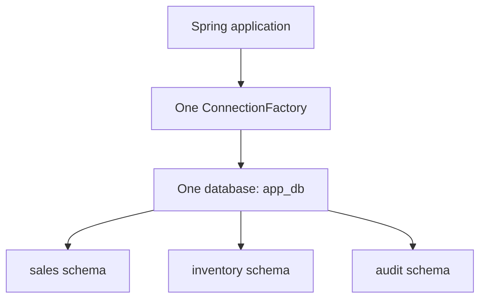
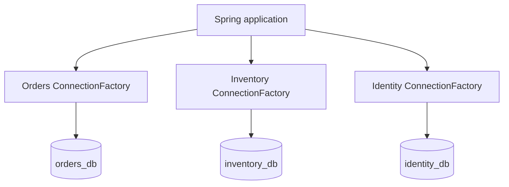

# Distinguishing Multiple Databases from Multiple Schemas

When a Spring Data R2DBC application needs to store data for multiple business domains or multiple tenants, two options are commonly discussed: creating multiple schemas within one database, or creating multiple separate databases. These two approaches are not equivalent. A schema is typically a namespace containing tables, views, sequences, and other database objects; a database is a larger storage and connection unit with its own catalog, permissions, configuration, and session scope depending on the database engine.

This difference directly affects how you configure `ConnectionFactory`, pools, `R2dbcEntityTemplate`, repositories, transaction managers, migrations, and security. Multiple schemas inside the same database can usually share one connection and one transaction. Multiple databases typically require separate connection factories and transaction managers; a normal R2DBC transaction does not automatically become an atomic transaction across those databases.

## 1. Distinguishing Database, Catalog, and Schema

Relational database management systems do not use the terms database and schema identically. Conceptually:

- **Database** is the container of data and database objects to which a client connects.
- **Catalog** is the set of metadata describing database objects; in some engines, catalog is roughly equivalent to database.
- **Schema** is a namespace used to group and distinguish objects such as tables, views, sequences, and functions.
- **Table** is the object storing data rows inside a schema or namespace.

For example, the fully qualified name of a table might be `sales.orders`, meaning the `orders` table in the `sales` schema within the current database. Some engines support three-part names such as `database.schema.table`.

### How Database Engines Use Terminology

| Engine | Database/catalog | Schema | Notes |
|---|---|---|---|
| PostgreSQL | A database within a cluster | Namespace inside a database | One connection operates in one database; schemas are typically selected via qualified names or `search_path` |
| SQL Server | Database inside a SQL Server instance | Namespace inside a database | Object names can take the form `database.schema.table`; permissions and transactions also depend on instance configuration |
| MySQL | `DATABASE` and `SCHEMA` are synonyms in many contexts | No separate schema namespace layer inside a database like PostgreSQL | Many docs refer to each database as a schema |
| Oracle | Database or pluggable database depending on architecture | Schema tied to the owning user | A schema is not simply a folder inside a database in the PostgreSQL sense |

Because terminology differs, read how your specific engine defines database/schema before designing. Do not carry PostgreSQL's `schema` concept directly over to MySQL or Oracle without verifying semantics.

## 2. What Are Multiple Schemas in One Database?

A single database can contain multiple schemas, each holding a separate group of objects. For example, in PostgreSQL:

```text
app_db
├── sales
│   ├── orders
│   ├── order_line
│   └── invoice
├── inventory
│   ├── product
│   └── stock_balance
└── audit
    ├── event_log
    └── change_record
```

The tables live in the same `app_db` database, but have distinct qualified names:

```sql
SELECT * FROM sales.orders;
SELECT * FROM inventory.product;
SELECT * FROM audit.event_log;
```

The application can use the same `ConnectionFactory` and pool to access these schemas. One transaction on that connection can read/write multiple schemas within the same database, provided permissions and the database support those operations.

## 3. What Are Multiple Databases?

Multiple databases mean the application connects to separate databases. They may reside on the same database server/cluster or on different servers, network zones, or providers.

For example:

```text
Database server A
├── orders_db
└── inventory_db

Database server B
└── identity_db
```

The application may need three `ConnectionFactory` beans or three separate connection configurations. Each database can have its own pool, credentials, transaction manager, migration lifecycle, and connection limits.

A transaction opened via `R2dbcTransactionManager` normally manages a connection from one `ConnectionFactory`. It does not automatically coordinate another transaction against a second connection factory. If writing to `orders_db` succeeds while writing to `inventory_db` fails, the first database's local transaction does not automatically roll back just because the second transaction rolled back.

## 4. Diagrams Comparing the Two Models



In the multi-schema model, one connection can reference different schemas using fully qualified object names. Schemas share the database engine, transaction boundary, and typically the same pool.



In the multi-database model, each connection factory manages a separate resource. The application must route operations to the right repository/connection factory and explicitly design how data is coordinated across databases.

## 5. When Should You Choose Multiple Schemas?

Multiple schemas are usually appropriate when:

- Table groups belong to the same application and operational lifecycle.
- Namespace separation is needed to avoid table name collisions or organize modules.
- Operations frequently need to join data across table groups.
- Business logic requires a single transaction spanning multiple table groups.
- Database server, backups, monitoring, and connection budgets can be shared.
- You want to grant schema-level permissions restricting which objects a role can access.

For example, `sales.orders` and `inventory.stock_balance` may need to be updated in the same transaction when confirming an order. If both schemas reside in the same PostgreSQL database, one connection can execute statements against both schemas in a single transaction.

However, a schema is not a complete isolation boundary. Schemas still share database resources such as CPU, memory, WAL, storage, connection limits, and database-level settings. Backups/restores are also typically managed at the database level or via specific backup tools, even if individual schemas can be exported/imported.

## 6. When Should You Choose Multiple Databases?

Multiple databases may be appropriate when:

- Modules require independent administrative permissions, backups, restores, or retention policies.
- Data has security or compliance requirements needing a stronger database boundary.
- Workloads need independent scaling, configuration, or maintenance.
- Business domains have different deployment lifecycles.
- Data lives on different servers/regions due to geographic or latency requirements.
- An application integrates with a legacy system's database or an external vendor's database.
- Fault blast radius must be bounded: an overloaded reporting database should not exhaust the transactional database's pool.

In return, the application must manage multiple connections, pools, credentials, migrations, and operational observability. Cross-database querying or updating also becomes more complex, especially when databases reside on different servers.

## 7. Multiple Schemas Do Not Automatically Mean Secure Multi-Tenancy

A separate schema per tenant can help organize data and permissions, but switching schemas alone does not guarantee tenant isolation. The application must still enforce tenant identity, allowed schemas, and database role permissions.

For example:

```text
app_db
├── tenant_001
│   ├── customer
│   └── invoice
├── tenant_002
│   ├── customer
│   └── invoice
└── tenant_003
    ├── customer
    └── invoice
```

If a request from `tenant_001` can pass an arbitrary string `tenant_002` as the schema name, missing tenant validation can leak data. Schema names must come from a trusted mapping after authenticating the tenant, never concatenated directly from untrusted input.

Besides schema-per-tenant, common multitenancy models include:

| Model | Storage Approach | Advantages | Costs/Limitations |
|---|---|---|---|
| Shared schema | One set of tables with `tenant_id` on rows | Easy schema and migration management; shared pool utilization | Every query must filter by tenant; requires proper indexes and row-level security policies |
| Schema per tenant | Each tenant has its own schema in one database | Per-schema namespaces and permissions; no table name collisions across tenants | Managing many schemas/migrations; careful schema routing |
| Database per tenant | Each tenant has its own database | Separate database isolation, backups, and credentials | Many pools/databases; higher operational and migration cost |

There is no single best model for every product. The choice depends on tenant count, data size, isolation requirements, operational capability, and scaling strategy.

## 8. Specifying a Schema via Fully Qualified Table Names

In SQL, the clearest way to access an object in a specific schema is to qualify the table name:

```sql
SELECT id, order_no, status
FROM sales.orders
WHERE id = :orderId;
```

Or join across two schemas in the same database:

```sql
SELECT o.id,
       o.order_no,
       p.sku,
       l.quantity
FROM sales.orders o
JOIN sales.order_line l ON l.order_id = o.id
JOIN inventory.product p ON p.id = l.product_id
WHERE o.id = :orderId;
```

Schema and table names are SQL identifiers, not values. You cannot protect a dynamic identifier by binding it like `:schemaName` or `:tableName`. If a schema/table must be selected per tenant or module, validate against an allow-list or retrieve it from server-managed configuration metadata.

Values such as `orderId`, status, and timestamps must still be bound as parameters. Never concatenate user input into SQL conditions.

## 9. Using Schemas in Spring Data Relational Mapping

With Spring Data Relational, `@Table` can specify both table name and schema in versions supporting the corresponding attributes:

```java
@Table(value = "orders", schema = "sales")
public class Order {

    @Id
    private Long id;

    @Column("order_no")
    private String orderNo;

    private String status;
}
```

The `Order` entity maps to the `sales.orders` table instead of `orders` in the default schema. Confirm the `@Table` API of your Spring Data Relational version; if your version or mapping does not support schema metadata as desired, you can use SQL with qualified names via `DatabaseClient` or configure the connection's default schema.

Repository example:

```java
public interface OrderRepository extends ReactiveCrudRepository<Order, Long> {
}
```

The repository still uses the same `ConnectionFactory` if entities reside in the same database. The schema is determined from mapping metadata or SQL; there is no need to create a separate connection factory just because a table lives in a different schema.

## 10. Default Schema and search_path in PostgreSQL

PostgreSQL uses `search_path` to determine which schemas are searched when an SQL statement does not qualify an object name. For example:

```sql
SHOW search_path;
SET search_path TO sales, public;
```

After setting `search_path`, the statement:

```sql
SELECT * FROM orders;
```

can look up `sales.orders` first, then look in `public`.

`search_path` is a session/connection property. With a connection pool, never assume every request always receives a fresh connection in default state. If one request alters `search_path` and the connection returns to the pool without resetting, the next request may execute against an unexpected schema.

Safe management practices:

- Use fully qualified schema names in SQL when identifying objects explicitly.
- Set a default `search_path` on the database role or configure connections in a pool-managed way.
- If schema must change per request, change and restore it within the same connection/transaction, ensuring reset even on errors or cancellation.
- Never rely on leftover session state from a prior request.

Do not run `SET search_path` via a separate publisher and assume the next query uses the same connection. When the pool issues another connection, state may differ. If session-level state is needed, manage connection lifecycle and reset explicitly.

## 11. MySQL: Database and Schema Are Often Synonymous

In MySQL, `CREATE DATABASE` and `CREATE SCHEMA` are equivalent in many contexts. A table is identified by `database.table`, for example:

```sql
SELECT * FROM sales_db.orders;
SELECT * FROM inventory_db.product;
```

Therefore, the "one database with multiple sub-schemas like PostgreSQL" model does not apply directly in the same way in MySQL. To partition namespaces, each database typically acts much like a separate schema.

MySQL can support querying tables across multiple databases on the same server using qualified names, if the connection user has sufficient privileges. However, those databases are still MySQL database namespaces; distinguish that from connecting to two separate servers or instances.

## 12. SQL Server: Schemas Within a Database and Three-Part Names

SQL Server supports multiple schemas inside a database. Tables can be qualified with `schema.table`:

```sql
SELECT * FROM sales.Orders;
SELECT * FROM inventory.Product;
```

In some cases within the same SQL Server instance, another database can be accessed using a three-part name:

```sql
SELECT * FROM InventoryDb.dbo.Product;
```

This is a SQL Server capability and also depends on permissions, instance setup, transactions, and configuration. Do not assume all database servers support such cross-database syntax.

## 13. Oracle: Schemas Tied to Users

In Oracle, a schema is the collection of objects owned by a database user. Creating a schema is typically tied to creating a user; object access privileges can be granted through grants, roles, and synonyms.

Example accessing another schema's object:

```sql
SELECT * FROM SALES.ORDERS;
```

To execute this, the current user needs appropriate privileges. The schema concept in Oracle is therefore tightly coupled to ownership and the security model. Do not apply PostgreSQL's `search_path` management patterns directly to Oracle.

## 14. Multiple Schemas in the Same Database Can Share One R2DBC Pool

If tables live in multiple schemas of the same database, one `ConnectionFactory` is usually sufficient:

```java
@Configuration
public class MainDatabaseConfiguration {

    @Bean
    ConnectionFactory connectionFactory() {
        return ConnectionFactories.get(
            "r2dbc:postgresql://localhost:5432/app_db"
        );
    }

    @Bean
    R2dbcEntityOperations r2dbcEntityOperations(
            ConnectionFactory connectionFactory) {
        return new R2dbcEntityTemplate(connectionFactory);
    }

    @Bean
    ReactiveTransactionManager transactionManager(
            ConnectionFactory connectionFactory) {
        return new R2dbcTransactionManager(connectionFactory);
    }
}
```

Entities can map to `sales.orders`, `inventory.product`, and `audit.event_log` in the same database. Since they share a transaction manager and connection factory, writes across multiple schemas can participate in the same transaction.

In real applications, do not hard-code credentials in the URL. Load connection details from externalized configuration, a secret manager, or the appropriate environment. The example above focuses on bean structure.

## 15. Configuring Multiple Databases with Multiple ConnectionFactory Beans

If `orders_db` and `inventory_db` are two independent databases, create one connection factory per database. Each factory can have its own pool and transaction manager.

Example configuration for the orders database:

```java
@Configuration
@EnableR2dbcRepositories(
    basePackages = "com.example.orders.repository",
    entityOperationsRef = "ordersR2dbcEntityOperations",
    transactionManagerRef = "ordersTransactionManager"
)
public class OrdersDatabaseConfiguration {

    @Bean("ordersConnectionFactory")
    ConnectionFactory ordersConnectionFactory() {
        return ConnectionFactories.get(
            "r2dbc:postgresql://localhost:5432/orders_db"
        );
    }

    @Bean("ordersR2dbcEntityOperations")
    R2dbcEntityOperations ordersR2dbcEntityOperations(
            @Qualifier("ordersConnectionFactory")
            ConnectionFactory connectionFactory) {
        return new R2dbcEntityTemplate(connectionFactory);
    }

    @Bean("ordersTransactionManager")
    ReactiveTransactionManager ordersTransactionManager(
            @Qualifier("ordersConnectionFactory")
            ConnectionFactory connectionFactory) {
        return new R2dbcTransactionManager(connectionFactory);
    }
}
```

The inventory database has a similar configuration but uses its own repository package and bean names:

```java
@Configuration
@EnableR2dbcRepositories(
    basePackages = "com.example.inventory.repository",
    entityOperationsRef = "inventoryR2dbcEntityOperations",
    transactionManagerRef = "inventoryTransactionManager"
)
public class InventoryDatabaseConfiguration {

    @Bean("inventoryConnectionFactory")
    ConnectionFactory inventoryConnectionFactory() {
        return ConnectionFactories.get(
            "r2dbc:postgresql://localhost:5432/inventory_db"
        );
    }

    @Bean("inventoryR2dbcEntityOperations")
    R2dbcEntityOperations inventoryR2dbcEntityOperations(
            @Qualifier("inventoryConnectionFactory")
            ConnectionFactory connectionFactory) {
        return new R2dbcEntityTemplate(connectionFactory);
    }

    @Bean("inventoryTransactionManager")
    ReactiveTransactionManager inventoryTransactionManager(
            @Qualifier("inventoryConnectionFactory")
            ConnectionFactory connectionFactory) {
        return new R2dbcTransactionManager(connectionFactory);
    }
}
```

Verify the `entityOperationsRef` and `transactionManagerRef` attributes against your version of Spring Data R2DBC. Each `@EnableR2dbcRepositories` must scan only the repository package of its corresponding database; avoid two configurations scanning the same package, which can register repositories twice or bind them to the wrong template.

`ConnectionFactories.get(...)` here illustrates creating a factory from an R2DBC URL. In production, you can create pools with `r2dbc-pool`, configure via Spring Boot, or create factories from `ConnectionFactoryOptions`; what matters is that each bean is clearly named and bound to the right entity operations/transaction manager.

## 16. Separating Repository Packages by Database

A manageable layout organizes repositories by module/database:

```text
com.example
├── orders
│   ├── domain
│   ├── repository
│   │   └── OrderRepository.java
│   └── service
├── inventory
│   ├── domain
│   ├── repository
│   │   └── ProductRepository.java
│   └── service
└── shared
    └── configuration
```

Each repository package is bound to a specific `R2dbcEntityOperations`. Services can inject `OrderRepository` and `ProductRepository` by interface, but when calling both repositories in the same use case, remember they may use two different transaction managers.

Avoid placing all repositories in a single package and letting multiple `@EnableR2dbcRepositories` annotations scan that package. Separating packages clarifies which database owns each repository and prevents overlapping configuration.

## 17. Selecting the Right Transaction Manager for Each Repository

With multiple databases, each transaction manager manages one connection factory. Transactions can be declared explicitly on services:

```java
@Service
public class OrderService {

    private final OrderRepository orderRepository;

    public OrderService(OrderRepository orderRepository) {
        this.orderRepository = orderRepository;
    }

    @Transactional(transactionManager = "ordersTransactionManager")
    public Mono<Order> create(CreateOrder command) {
        return orderRepository.save(toOrder(command));
    }
}
```

```java
@Service
public class InventoryService {

    private final ProductRepository productRepository;

    public InventoryService(ProductRepository productRepository) {
        this.productRepository = productRepository;
    }

    @Transactional(transactionManager = "inventoryTransactionManager")
    public Mono<Product> reserve(Long productId, int quantity) {
        return productRepository.reserve(productId, quantity);
    }
}
```

If a service calls both, the annotation on the service only selects one transaction manager. It does not automatically wrap transactions of repositories belonging to the other database. Design orchestration and consistency explicitly rather than relying on annotation names.

## 18. Writing Multiple Schemas in a Single Transaction

If `sales` and `inventory` are two schemas in the same PostgreSQL database using the same `ConnectionFactory`, multiple operations can run within one reactive transaction:

```java
@Transactional(transactionManager = "r2dbcTransactionManager")
public Mono<Order> createOrderAndReserveStock(CreateOrder command) {
    return orderRepository.save(toOrder(command))
        .flatMap(order -> inventoryRepository.reserveItems(command.items())
            .thenReturn(order));
}
```

The crucial condition is that both repositories are truly configured on the same connection factory/transaction manager and operations share the same transaction context. If `inventoryRepository` actually connects to another database, this transaction does not automatically manage that operation.

A transaction can guarantee rollback across schemas within the same database according to that database's transaction semantics. However, cross-schema foreign keys, permissions, and triggers must still be configured properly.

## 19. Writing Multiple Databases: Independent Transactions

Suppose a use case creates an order in `orders_db` and then deducts inventory in `inventory_db`. There are two separate transactions:

```java
public Mono<Order> placeOrder(CreateOrder command) {
    return orderService.create(command)
        .flatMap(order -> inventoryService.reserve(command.items())
            .thenReturn(order));
}
```

If `orderService.create` commits in `orders_db` and then `inventoryService.reserve` fails in `inventory_db`, the order may still exist. Inventory's R2DBC transaction manager cannot roll back a commit that already happened in orders.

Do not place a single `@Transactional` on `placeOrder` assuming both databases commit/roll back together. If multiple databases must be coordinated, you can:

- Design a Saga with steps and compensating actions.
- Use a transactional outbox to emit events after the source transaction commits.
- Use a distributed transaction coordinator only if all resources/drivers support the required protocol.
- Embrace eventual consistency and model intermediate states such as `PENDING`, `RESERVED`, and `CONFIRMED`.

## 20. Cross-Database Joins Depend on the Database Engine

There is no portable SQL syntax to join arbitrary databases across any server. Capabilities depend on the engine:

- A normal PostgreSQL connection operates within one database; accessing another database typically requires FDW, `dblink`, or a dedicated integration mechanism.
- SQL Server can use three-part names to access another database in the same instance if permissions allow.
- MySQL can reference another database on the same server via `database.table` if the user has privileges.
- Oracle has database links to access other databases through its own mechanism.

If data resides on different servers, you usually need to call separate repositories/services and combine in the application layer, or build a read model/ETL pipeline to aggregate data. Do not assume one `DatabaseClient` with one `ConnectionFactory` can directly join every database.

When combining data at the application layer, consider pagination, round-trip count, data volume, and snapshot consistency. For high-volume cross-database reporting, a read replica, data warehouse, or materialized read model may be more suitable than calling multiple repositories per request.

## 21. Dynamic Schema Routing for Tenants

If one connection factory is shared and each tenant has its own schema, the application can route schemas based on the authenticated tenant. Two common approaches:

1. Use SQL identifiers validated from an allow-list, e.g. selecting `tenant_001.orders`.
2. Set the schema/session context on the connection issued to the request, such as PostgreSQL `search_path`, then reset it before returning the connection to the pool.

The second approach requires extreme care with connection pooling. Session state lives on the connection, not automatically on the HTTP request. If `search_path` is changed without resetting, the next request may read from the wrong schema.

Do not use ThreadLocal to hold the tenant schema in a reactive application. Requests can switch threads; pass tenant context through Reactor Context or explicit parameters, and apply routing at an appropriately designed connection acquisition/session layer.

For dynamic schema names, bind parameters cannot be used for identifiers. A server-side mapping can be used:

```java
Map<String, String> tenantSchemas = Map.of(
    "tenant-a", "tenant_a",
    "tenant-b", "tenant_b"
);

String schema = Optional.ofNullable(tenantSchemas.get(tenantId))
    .orElseThrow(() -> new IllegalArgumentException("Unknown tenant"));
```

Then only use the schema looked up from trusted configuration to build identifiers according to the dialect. Quote identifiers properly per database rules if names have special characters; preferably use normalized schema names with restricted characters and never let clients supply arbitrary names.

## 22. Schema-Per-Tenant and Migrations

When there are multiple schemas, schema migrations must be applied to each managed schema. For example, `tenant_a` and `tenant_b` both need the `invoice` table, but may be on different migration versions during an asynchronous rollout.

Determine:

- Whether migrations run once per database or once per schema.
- Which schema holds the migration history table.
- Which schemas the migration role has permission to create/alter objects in.
- The workflow for provisioning schemas and running migrations for new tenants.
- Whether a migration failure on one tenant continues to other tenants or halts the entire job.
- Whether differing schema versions must be supported during rollout windows.

Flyway and Liquibase typically use JDBC to run migrations even when the runtime application uses R2DBC. These are two separate lifecycles: migrations can use a JDBC `DataSource`, while request runtime uses an R2DBC `ConnectionFactory`. There is no need to turn the migration tool into R2DBC just because repository runtime is reactive.

If each tenant is a separate database, migrations must run per database rather than only per schema. You must manage connection credentials, retries, checkpoints, and status reporting across a large number of databases.

## 23. Access Permissions and Security

Schemas and databases are two levels at which permissions can be organized, but security policies must be designed specifically:

- Create a runtime role with only necessary privileges; never use owner/superuser for the application.
- With schema-per-tenant, grant explicit privileges on the corresponding schemas and objects.
- Restrict `CREATE`, `ALTER`, and `DROP` privileges for the runtime role.
- Set a safe `search_path` and avoid untrusted user-owned schemas appearing before system schemas.
- Do not let client requests decide database URLs, schema names, or credentials.
- Use a secret manager/environment to store credentials; never commit them to source code.
- With shared schemas, every query must apply a tenant predicate or appropriate row-level security.
- Test cross-tenant access and effective permissions using the runtime database role.

Separating schemas does not replace authorization. If a role has permission to read all schemas, a routing bug in the application can still leak data. For strong isolation requirements, database-per-tenant or separate roles may be a better fit.

## 24. Connection Pools and Operations with Multiple Databases

Each `ConnectionFactory` can have its own pool. If an application connects to three databases, total maximum connections equals the sum of `max-size` across all three pools multiplied by the number of application instances.

For example:

| Database | Pool max-size per instance | Instances | Theoretical maximum total |
|---|---:|---:|---:|
| Orders | 20 | 4 | 80 |
| Inventory | 10 | 4 | 40 |
| Identity | 8 | 4 | 32 |
| **Total** | **38** | **4** | **152** |

This number excludes migration jobs, admin connections, workers, and other services. Each database has its own connection limit, so plan a pool budget for each database. A single shared pool for multiple schemas in the same database is usually simpler because they share one connection budget.

Monitor each pool separately:

- Acquired/idle connection counts.
- Pending acquires and acquire timeouts.
- Connection creation/validation failures.
- Query latency and transaction duration.
- Connection resets/closes and network errors.

If the reporting database is slow, a separate pool can prevent that workload from exhausting the transactional database's connections. However, if multiple pools point to the same server, total connections can still overload that server.

## 25. Testing Multi-Schema and Multi-Database Configurations

Integration tests should verify real routing and transactions, not just check bean names:

**Multiple schemas in the same database:**

- Repositories map to the right schema.
- Cross-schema join queries return expected data.
- A transaction writing two schemas rolls back both when a later step fails.
- `search_path` or session state is reset when connections return to the pool.
- The runtime role cannot read/write schemas outside its privileges.

**Multiple databases:**

- Each repository package uses the right `R2dbcEntityOperations`.
- Each service uses the right transaction manager.
- An error in one database is not confused with a mapping error in another database.
- Pools and credentials are configured separately.
- Migrations run on the right databases and schemas.
- Multi-database workflows handle partial success, retries, and compensation as designed.

Testcontainers can run multiple database containers or multiple databases within one container depending on the engine. With schema-per-tenant, multiple schemas can be created in one test database. With database-per-tenant, verify each connection factory actually connects to its designated database.

Do not rely solely on a mock `ConnectionFactory` to conclude cross-database transactions are atomic. Commit/rollback behavior must be verified against real databases and drivers.

## 26. Common Mistakes When Confusing Schemas with Databases

| Symptom | Cause | Fix |
|---|---|---|
| Creating multiple `ConnectionFactory` beans just because there are multiple schemas | Confusing schemas with independent databases | Use one factory for the same database; qualify schema in mapping/SQL |
| Query reads the wrong table of the same name | Relying on default schema or unclear `search_path` | Use qualified names or configure session safely |
| Request for one tenant reads another tenant's data | Schema routing based on untrusted input or unreset connection state | Validate tenant, allow-list, and reset session state |
| Repository uses the wrong database | Multiple configs scan the same package or bind wrong entity operations | Separate packages and name beans clearly |
| One transaction fails to roll back the other database | Two connection factories have two local transaction managers | Use Saga/outbox or a supported distributed transaction mechanism |
| Pool exhausts connections even though each pool looks small | Total pool size across many instances/databases is too large | Calculate system-wide connection budget |
| Migration only runs on one schema/tenant | Migration lifecycle does not cover all namespaces | Design migrations per database/schema/tenant |
| SQL fails to run on another database | Using vendor-specific cross-database syntax | Use dialect-specific queries or combine data in the application layer |

## 27. Selection and Implementation Workflow

When partitioning data, follow this sequence:

**Step 1 — Define the isolation goal.** Do you need separate namespaces, separate permissions, separate backups, independent scaling, or separate servers/regions?

**Step 2 — Understand database engine semantics.** Clarify how database/catalog/schema are defined in PostgreSQL, SQL Server, MySQL, or Oracle.

**Step 3 — Choose the model.** Use multiple schemas if within one database and convenient transactions/joins are needed; use multiple databases if stronger isolation or operational boundaries are needed.

**Step 4 — Configure connections.** One database with multiple schemas usually uses one `ConnectionFactory`; multiple databases usually have separate factories, pools, and transaction managers.

**Step 5 — Bind repositories to the right resources.** Use `@Table`/SQL schema qualification or `@EnableR2dbcRepositories` with separate packages and entity operations.

**Step 6 — Define transaction boundaries.** One R2DBC transaction manages its connection factory; do not assume it spans other databases.

**Step 7 — Design routing and security.** Allow-list schemas/tenants, manage session state, and grant least-privilege permissions.

**Step 8 — Manage migrations.** Run migrations in the right database/schema scope and track rollout state.

**Step 9 — Calculate pool budgets.** Sum total connections per database and instance count, then monitor per-pool metrics.

**Step 10 — Test on real databases.** Verify mapping, permissions, transactions, routing, migrations, and partial failures.

## 28. Conclusion

Multiple schemas and multiple databases solve different needs. Multiple schemas partition namespaces within one database; they usually share a connection factory, pool, and transaction boundary. Multiple databases are separate connection resources, typically requiring separate `ConnectionFactory`, entity operations, repository configurations, pools, and transaction managers.

In Spring Data R2DBC, use schema qualification or mapping metadata when tables reside in multiple schemas of the same database. When connecting to multiple databases, separate repository packages and bind the right `R2dbcEntityOperations`/transaction manager to each source. A local transaction does not automatically provide cross-database atomicity; use outbox, Saga, or an explicitly supported distributed transaction mechanism when business logic requires coordination. Combining the right choice with migrations, security, pool budgets, and integration tests lets a system scale cleanly without blurring data boundaries.
