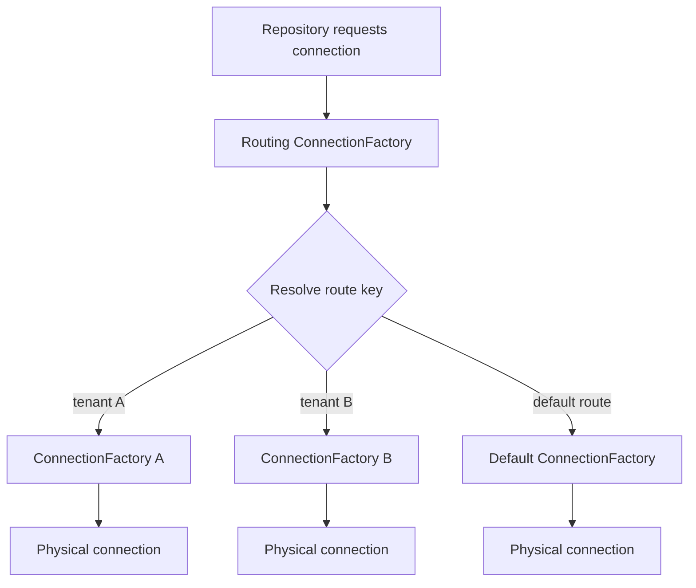
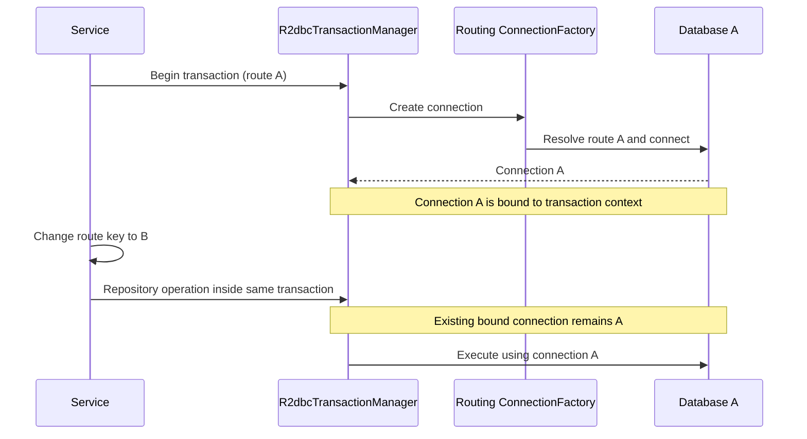
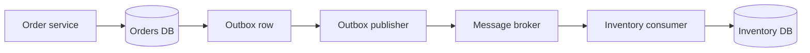

# Transaction Boundaries When Routing or Accessing Multiple Sources

Spring Data Relational R2DBC can work with multiple databases or multiple `ConnectionFactory` beans—for instance, one source for orders, one source for inventory, or a system that routes connections to databases by tenant. However, Spring R2DBC reactive transactions have an important boundary: one `R2dbcTransactionManager` manages transactions on a single `ConnectionFactory`. That transaction does not automatically cover independent connections to multiple databases.

When using a routing `ConnectionFactory`, the routing key must be resolved before the physical connection is acquired and kept stable throughout the transaction. Once the transaction has acquired a connection, changing the tenant or route in Reactor Context does not switch the connection used by that transaction to another database. When writing to multiple sources, explicit data consistency boundaries must be designed using local transactions, outbox, saga, or an appropriate distributed coordination mechanism.

## 1. Concepts to Distinguish

In multi-source R2DBC applications, several concepts are easily confused:

| Concept | Meaning |
| --- | --- |
| `ConnectionFactory` | Factory creating R2DBC connections to a data source or a routing source |
| Connection | A concrete connection to a database, used to execute statements and transactions |
| `R2dbcTransactionManager` | Reactive transaction manager managing transactions for a single `ConnectionFactory` |
| `TransactionalOperator` | Programmatic API for wrapping a publisher in a transaction managed by a transaction manager |
| Routing `ConnectionFactory` | Factory selecting a target `ConnectionFactory` based on route key, tenant, or read/write mode |
| Multiple transaction managers | Independent managers, each managing its corresponding source |
| Distributed transaction | A protocol coordinating commit/rollback across multiple independent resources |

Having multiple `ConnectionFactory` beans does not imply a shared transaction. Likewise, calling multiple repositories inside one `@Transactional` service method does not automatically make all repositories participate in the same transaction if they use different factories.

## 2. One `R2dbcTransactionManager` Manages One `ConnectionFactory`

`R2dbcTransactionManager` is configured with one `ConnectionFactory`. When starting a transaction, the manager acquires a connection from that factory, begins a transaction on the connection, and binds the resource into the reactive transaction context. Compatible R2DBC operations in the same context can then use the managed connection.

Example configuration for the orders database:

```java
@Configuration
public class OrderDatabaseConfiguration {

    @Bean
    @Primary
    ConnectionFactory orderConnectionFactory() {
        return ConnectionFactories.get(
                "r2dbc:postgresql://localhost:5432/orders");
    }

    @Bean("orderTransactionManager")
    R2dbcTransactionManager orderTransactionManager(
            @Qualifier("orderConnectionFactory") ConnectionFactory factory) {
        return new R2dbcTransactionManager(factory);
    }
}
```

A service can select a specific manager:

```java
@Service
public class OrderService {

    private final OrderRepository orderRepository;

    public OrderService(OrderRepository orderRepository) {
        this.orderRepository = orderRepository;
    }

    @Transactional(transactionManager = "orderTransactionManager")
    public Mono<Order> createOrder(Order order) {
        return orderRepository.save(order);
    }
}
```

The bean name in `transactionManager` must match a configured transaction manager bean. When the application has only one manager, Spring can automatically choose the default manager; with multiple managers, specify it explicitly to avoid running transactions on the wrong source.

The transaction manager manages connections from the factory passed to it. If another repository uses a different factory, that repository's operations are not automatically enlisted into this transaction.

## 3. Reactive Transactions Propagate via Reactor Context

R2DBC transaction management is reactive. Transaction context propagates through Reactor Context rather than relying on a specific thread holding the transaction as in the traditional imperative ThreadLocal model.

Therefore, database operations that must participate in the same transaction must be chained within the same reactive pipeline. For example:

```java
public Mono<Order> createOrder(Order order) {
    return orderRepository.save(order)
            .flatMap(saved -> orderAuditRepository.save(
                            OrderAudit.created(saved.getId()))
                    .thenReturn(saved));
}
```

If both repositories use the same `ConnectionFactory` and transaction manager, their operations can participate in the same reactive transaction when the service is invoked inside that transaction.

Do not call `subscribe()` separately inside a service:

```java
public Mono<Order> createOrder(Order order) {
    return orderRepository.save(order)
            .doOnNext(saved ->
                    orderAuditRepository.save(
                            OrderAudit.created(saved.getId())).subscribe());
}
```

Calling `subscribe()` creates an independent stream. The service does not wait for the audit to finish, does not combine audit errors into the main result, and can cause the audit operation to run outside the intended transaction context. Chain publishers with `flatMap`, `then`, `zip`, or appropriate operators.

Similarly, do not call `block()` inside a reactive service to wait for another database operation. That can block threads, break context flow, and forfeit the benefits of R2DBC.

## 4. Multiple `ConnectionFactory` Beans Mean Multiple Connection Boundaries

Suppose the application has two databases:

```text
OrderService
  ├── OrderRepository  ──> orderConnectionFactory  ──> orders database
  └── StockRepository  ──> stockConnectionFactory  ──> inventory database
```

A transaction manager configured with `orderConnectionFactory` only manages connections to the orders database. If the same method calls `stockRepository`, the inventory repository acquires a connection from `stockConnectionFactory`; the orders transaction manager does not automatically manage that connection.

Possible consequences:

- The order commits while the stock update fails.
- The stock update commits while the order creation transaction rolls back.
- One source rolls back while the other source has already committed.
- A failure after one source commits leaves the application unable to roll back that source with the remaining transaction manager.

This is a data consistency boundary that must be designed, not merely a matter of choosing annotations.

## 5. Configuring Multiple Transaction Managers

An application can declare multiple `ConnectionFactory` beans and multiple `R2dbcTransactionManager` beans, each managing one source:

```java
@Configuration
public class MultiDatabaseConfiguration {

    @Bean("orderTransactionManager")
    R2dbcTransactionManager orderTransactionManager(
            @Qualifier("orderConnectionFactory") ConnectionFactory factory) {
        return new R2dbcTransactionManager(factory);
    }

    @Bean("stockTransactionManager")
    R2dbcTransactionManager stockTransactionManager(
            @Qualifier("stockConnectionFactory") ConnectionFactory factory) {
        return new R2dbcTransactionManager(factory);
    }
}
```

Services specify the appropriate manager for each transaction:

```java
@Transactional(transactionManager = "stockTransactionManager")
public Mono<Stock> reserveStock(StockReservation reservation) {
    return stockRepository.reserve(reservation);
}
```

A method annotated with `@Transactional(transactionManager = "orderTransactionManager")` does not automatically open a transaction on `stockTransactionManager`. Choosing a manager chooses a local transaction boundary. If two sources must participate in one business workflow, you must coordinate two local transactions or use a separately supported distributed solution.

Do not place two `@Transactional` annotations on the same method expecting Spring to automatically commit both as an atomic transaction. Nesting interceptors/managers does not create a distributed coordinator and can produce hard-to-control commit/rollback ordering.

## 6. Using `TransactionalOperator` for Each Source

When programmatic transaction control is needed, create a `TransactionalOperator` from the corresponding transaction manager:

```java
@Configuration
public class TransactionOperatorConfiguration {

    @Bean("orderTransactionalOperator")
    TransactionalOperator orderTransactionalOperator(
            @Qualifier("orderTransactionManager")
            ReactiveTransactionManager manager) {
        return TransactionalOperator.create(manager);
    }

    @Bean("stockTransactionalOperator")
    TransactionalOperator stockTransactionalOperator(
            @Qualifier("stockTransactionManager")
            ReactiveTransactionManager manager) {
        return TransactionalOperator.create(manager);
    }
}
```

Using the order operator:

```java
public Mono<Order> saveOrder(Order order) {
    return orderTransactionalOperator.transactional(
            orderRepository.save(order));
}
```

Using the stock operator:

```java
public Mono<Stock> saveStock(Stock stock) {
    return stockTransactionalOperator.transactional(
            stockRepository.save(stock));
}
```

Each operator manages transactions on the factory bound to its manager. You can use them to define explicit local boundaries in reactive services. However, invoking two operators sequentially does not create a distributed transaction; the first transaction can commit before the second fails.

## 7. What Is a Routing `ConnectionFactory`?

A routing `ConnectionFactory` is an intermediary layer that selects a target factory based on a routing key. It is commonly used when:

- Each tenant has its own database.
- A system shards data by region or customer group.
- Reading from replicas and writing to primary.
- Selecting a database by business type or runtime configuration.

High-level connection flow:



Spring Framework provides the `AbstractRoutingConnectionFactory` abstraction in the R2DBC connection lookup package to support routing. The application configures target factories and provides logic to determine the route key. Exact callback signatures and context access details must be verified against your project's Spring Framework version.

The key point is that the route is chosen when the routing factory creates a connection. The transaction manager then holds that acquired connection for the current transaction. Routing is not a mechanism for switching an already-open connection to another database midway.

## 8. Determining the Route Key from Reactor Context

In reactive applications, the route key is typically propagated through Reactor Context to avoid using ThreadLocal in reactive flows. Conceptual example for a routing factory:

```java
public class TenantRoutingConnectionFactory
        extends AbstractRoutingConnectionFactory {

    public static final String ROUTE_KEY = "tenantRoute";

    @Override
    protected Mono<Object> determineCurrentLookupKey() {
        return Mono.deferContextual(context -> {
            if (!context.hasKey(ROUTE_KEY)) {
                return Mono.error(
                        new IllegalStateException("Missing tenant route"));
            }

            return Mono.just(context.get(ROUTE_KEY));
        });
    }
}
```

This example follows the R2DBC routing API with reactive lookup key resolution; verify the exact package and signature of the Spring Framework version you use. A default route can be chosen instead of failing when the key is missing, but for tenant data you should fail closed to avoid accidentally accessing another tenant's default database.

Attach the route key to the publisher at the request boundary:

```java
public Mono<Order> findOrderForTenant(String tenantRoute, Long orderId) {
    return orderRepository.findById(orderId)
            .contextWrite(context ->
                    context.put(TenantRoutingConnectionFactory.ROUTE_KEY,
                            tenantRoute));
}
```

Context must be established across the entire publisher before connection acquisition executes. With transactions, the route key must be present when the transaction manager requests a connection. Place `contextWrite` at the outer boundary of the transactional publisher and test execution ordering in the real application.

Do not take the tenant route directly from an untrusted header and treat it as access authorization. The server must authenticate the user, determine which tenants the principal is permitted to access, and map that tenant to a configured route.

## 9. The Route Must Be Chosen Before the Transaction Acquires a Connection

Suppose a transaction begins and the routing factory acquires a connection to tenant A's database. That connection is bound to the transaction context. If code subsequently changes the route key to tenant B and calls another repository using the same routing factory, the subsequent operation may still use the connection bound to tenant A's transaction.

Diagram:



This is why the route key must remain stable throughout the transaction. Do not write a pipeline that switches from tenant A to tenant B expecting the same transaction to switch databases per the new key.

If operations on both tenant A and tenant B are required, split them into two separate workflows with separate transaction boundaries and coordinate them as two local transactions. If business logic requires both changes to succeed or fail together, a distributed protocol or an appropriate saga/outbox design is needed.

## 10. Configuring a Transaction Manager on a Routing Factory

In a model where each transaction operates on only one tenant, you can configure one routing `ConnectionFactory` and create one `R2dbcTransactionManager` on that routing factory:

```java
@Bean
@Primary
ConnectionFactory tenantRoutingConnectionFactory() {
    TenantRoutingConnectionFactory routing =
            new TenantRoutingConnectionFactory();

    routing.setTargetConnectionFactories(Map.of(
            "tenant-a", tenantAConnectionFactory(),
            "tenant-b", tenantBConnectionFactory()
    ));

    routing.setLenientFallback(false);
    return routing;
}

@Bean
R2dbcTransactionManager tenantTransactionManager(
        @Qualifier("tenantRoutingConnectionFactory")
        ConnectionFactory routingFactory) {
    return new R2dbcTransactionManager(routingFactory);
}
```

This snippet only illustrates structure; target factories should be injected from separate beans rather than invoking factory methods manually in real configurations. `setTargetConnectionFactories`, `setLenientFallback`, and `determineCurrentLookupKey` must match the Spring Framework API version in use.

The transaction manager sees a single routing factory. When the transaction acquires a connection, the routing factory picks a target; that target connection is retained for the transaction. One transaction handles one tenant/route. This configuration does not create concurrent transactions across all targets.

## 11. Read/Write Routing and Read Replica Limitations

A system can route read operations to replicas and write operations to primary. However, annotating a method with `@Transactional(readOnly = true)` does not automatically guarantee Spring R2DBC selects a replica. `readOnly` is a transaction attribute/hint; routing logic must be implemented separately and resolved before connection acquisition.

Scenarios to watch out for:

- Writing to primary and reading immediately from a replica may miss the data due to replication lag.
- A transaction started with a replica route cannot automatically switch to primary midway simply because code triggers a write operation.
- Once a transaction has acquired a primary connection, subsequent operations use that connection.
- If read-after-write consistency is needed, read from primary or use a mechanism ensuring the replica has caught up.
- A read-only query is not necessarily enforced as read-only by the database merely because the transaction is marked `readOnly`.

Safer typical business flow:

1. Write requests route to primary.
2. Transaction writes and commits on primary.
3. Response returns results from primary or the saved entity.
4. Subsequent independent read requests can route to replicas under eventual consistency policy.

Do not randomly route individual queries within the same transaction. Choose the route per use case and ensure the entire transaction uses one consistent connection.

## 12. A Single Transaction Cannot Automatically Join Multiple Databases

An SQL JOIN operates within the scope of the database connection executing the SQL statement. If `customer` lives in database A and `invoice` lives in database B with two different `ConnectionFactory` beans, a regular repository query cannot automatically JOIN across those two sources.

Common approaches:

- Place data that must be queried together in the same database or same read model.
- Read each source with its own publisher and combine results at the application layer by business key.
- Use database federation, foreign data wrappers, or database links if supported by the DBMS and permitted by the architecture.
- Synchronize data into a read store/search index via events or ETL pipelines.

Combining at the application layer must consider ID counts and data sizes. Avoid loading entire tables and joining in memory. You can fetch the required key list from the first source, query in batches from the second source, and merge bounded results.

## 13. Multiple Local Transactions Are Not One Distributed Transaction

Suppose an order is created in database A and inventory is reserved in database B. If a service executes:

```text
transaction A: insert order, commit
transaction B: reserve stock, commit
```

If B fails after A commits, the order still exists. A's transaction manager cannot roll back a completed commit simply because B errored.

If the order is reversed:

```text
transaction B: reserve stock, commit
transaction A: insert order, commit
```

If A fails, inventory may remain reserved without a corresponding order. Swapping execution order only changes the kind of partial state, without creating atomicity.

Distributed transactions require a coordinator and a protocol supported by all resources, such as XA/2-phase commit in a compatible ecosystem. Standard R2DBC SPI and `R2dbcTransactionManager` do not automatically provide a distributed transaction manager across multiple `ConnectionFactory` beans. Do not assume two `TransactionalOperator` beans or two `@Transactional` annotations can substitute for that coordinator.

## 14. Transactional Outbox When Coordinating Multiple Sources

A common pattern is writing changes in the business-owning database alongside an outbox event in one local transaction. A worker reads the outbox and publishes the event to a broker; the other source's service consumes the event and updates its own database in a local transaction.



Example outbox table:

```sql
CREATE TABLE outbox_event (
    id BIGINT GENERATED BY DEFAULT AS IDENTITY PRIMARY KEY,
    event_id UUID NOT NULL UNIQUE,
    aggregate_id BIGINT NOT NULL,
    event_type VARCHAR(100) NOT NULL,
    payload TEXT NOT NULL,
    created_at TIMESTAMPTZ NOT NULL DEFAULT CURRENT_TIMESTAMP,
    published_at TIMESTAMPTZ
);
```

Inside the order transaction:

```java
public Mono<Order> createOrder(Order order) {
    return orderTransactionOperator.transactional(
            orderRepository.save(order)
                    .flatMap(saved -> outboxRepository.save(
                                    OutboxEvent.orderCreated(saved))
                            .thenReturn(saved))
    );
}
```

The order and outbox event commit or roll back together because they belong to the same database and transaction manager. The publisher reads the event after commit and sends it to the broker. If the publisher succeeds in sending but crashes before marking it sent, the event may be redelivered; consumers must be idempotent.

Outbox does not create a distributed transaction across two databases. It guarantees recording the event alongside the change in the source database and enables durable at-least-once messaging.

## 15. Consumers Must Be Idempotent

When a consumer receives an event, record the processed event ID using a unique constraint in the same transaction as the target data update:

```sql
CREATE TABLE processed_event (
    event_id UUID PRIMARY KEY,
    processed_at TIMESTAMPTZ NOT NULL DEFAULT CURRENT_TIMESTAMP
);
```

Conceptual processing flow:

1. Start a transaction on the target database.
2. Insert `event_id` into `processed_event`.
3. If the insert succeeds, apply the business change.
4. Commit both the processed marker and the business change.
5. If the event ID already exists, skip business side effects and acknowledge the message per broker semantics.

If the consumer records `processed_event` only after updating inventory in a separate transaction, a crash between the two operations can cause duplicate effects or lost tracking. Keep the deduplication marker and target data mutation in the same local transaction.

When two consumers process the same event concurrently, the unique constraint serves as the final safeguard. Handle duplicate claim errors as an already-processed message case after rolling back the failed transaction appropriately for the database.

## 16. Saga for Multi-Step Workflows

A Saga splits a long business process into multiple local transactions. Each step commits in its own database and has a compensating action if a later step fails.

Order placement example:

| Step | Local transaction | Possible compensating action |
| --- | --- | --- |
| 1 | Create order in `PENDING` status | Cancel order |
| 2 | Reserve stock | Release reservation |
| 3 | Confirm payment | Refund or void authorization per provider |
| 4 | Transition order to `CONFIRMED` | Transition to `CANCELLED`/`REQUIRES_REVIEW` if unrecoverable |

A Saga does not roll back database history like an ACID transaction. Compensation is a new business operation, which can itself fail and require retries/reconciliation. For example, a refund does not erase the original payment transaction; it creates a separate refund transaction.

A Saga can be coordinated by a central service (orchestration) or via events among services (choreography). With either approach, each step needs:

- A workflow/correlation ID for tracking.
- An idempotency key for retries.
- Durable state and explicit timeouts.
- Compensation or a manual handling state when automatic recovery is impossible.
- Logs/events for auditing and reconciliation.

## 17. Example Coordinating Order and Inventory with Local Transactions

A service can create the order first and emit a stock reservation command via outbox. The order is created in `PENDING` status:

```java
public Mono<Order> startOrder(Order order) {
    return orderTransactionalOperator.transactional(
            orderRepository.save(order.withStatus(OrderStatus.PENDING))
                    .flatMap(saved -> outboxRepository.save(
                                    OutboxEvent.reserveStockRequested(saved))
                            .thenReturn(saved))
    );
}
```

The Inventory service receives the command and processes it in its own transaction:

```java
public Mono<Void> handleReserveStock(ReserveStockCommand command) {
    return stockTransactionalOperator.transactional(
            processedEventRepository.claim(command.eventId())
                    .then(stockRepository.reserve(
                            command.productId(), command.quantity()))
                    .then(outboxRepository.save(
                            OutboxEvent.stockReserved(command)))
                    .then()
    );
}
```

This snippet illustrates local boundaries; `claim` must use a unique constraint, `reserve` must check stock conditionally, and repositories inside each operator must use the corresponding factory. The Inventory service emits a result event; the Order service consumes it and transitions the order to `CONFIRMED` or handles failure.

Do not call `stockRepository` directly inside the order transaction assuming both sources commit together. Communicating via outbox/messages makes each database's independent transaction explicit.

## 18. When to Use Two Sources Sequentially in the Same Service?

Sometimes a service needs to read two sources without mutating both. For example, fetching order details from database A and customer profile info from database B to build a response.

Publishers can be composed:

```java
public Mono<OrderDetailsResponse> getOrderDetails(Long orderId) {
    return orderRepository.findById(orderId)
            .flatMap(order -> customerRepository.findById(order.getCustomerId())
                    .map(customer -> new OrderDetailsResponse(
                            order.getId(),
                            order.getTotal(),
                            customer.getDisplayName())));
}
```

If no customer is found, the inner `flatMap` emits empty and the response is also empty. If business rules must distinguish a missing order from a missing customer reference, apply `switchIfEmpty` separately at each step and emit appropriate domain errors.

These are two independent reads. There is no shared consistent snapshot between the two databases: customer data may change after the order is read. If the response requires a consistent view, consider a synchronized read model, versioning, or an appropriate snapshot mechanism.

Do not open transactions on both sources solely for reads if there is no specific consistency requirement. Long transactions hold connections and add load; two sources still lack a shared snapshot when managers are independent.

## 19. Do Not Let the Route Key Change Between Steps of the Same Transaction

With tenant routing, a request should determine the tenant once from the authenticated principal. Put the route key into reactive context at the service/controller boundary and keep it unchanged throughout the pipeline.

Avoid doing this:

```java
return tenantAOperation()
        .contextWrite(context -> context.put(ROUTE_KEY, "tenant-a"))
        .then(tenantBOperation()
                .contextWrite(context -> context.put(ROUTE_KEY, "tenant-b")));
```

If both operations sit inside the same transaction and use the same routing factory, the connection already acquired earlier by the transaction manager may be reused. Changing context in one branch does not switch the existing connection to another target.

If two tenants are genuinely needed, split into two separate local transactions, each with its route key set before the transaction begins. Do not share one transaction manager transaction context to process multiple different tenants.

## 20. Selecting the Route Before `@Transactional` Starts

For methods using `@Transactional`, the route key must exist in reactive context at the moment the transaction manager acquires the connection. Because the annotation creates a transaction around the publisher, context propagation order must be verified.

An explicit approach is using `TransactionalOperator` and setting context on the outermost publisher:

```java
public Mono<Order> findOrder(
        String tenantRoute,
        Long orderId) {

    return tenantTransactionalOperator.transactional(
                    orderRepository.findById(orderId))
            .contextWrite(context ->
                    context.put(TenantRoutingConnectionFactory.ROUTE_KEY,
                            tenantRoute));
}
```

`contextWrite` sits at the outer boundary so the route key propagates upstream with the subscription to the transaction operator and when the connection factory determines the target. Exact placement should be tested with your Spring/Reactor version, especially when combining `@Transactional`, `publishOn`, `subscribeOn`, or publishers composed from multiple sources.

Do not store the route key in a mutable field on a singleton service or a regular ThreadLocal. Concurrent requests can overwrite each other's values, causing cross-tenant access. Use Reactor Context or a supported context-aware mechanism.

## 21. Boundary Between Transactions and `ConnectionFactoryUtils`

Spring R2DBC uses utilities such as `ConnectionFactoryUtils` to acquire connections while respecting any connection already bound in the transaction context. `DatabaseClient` and compatible Spring Data abstractions typically integrate with this mechanism.

If you call `connectionFactory.create()` directly somewhere outside Spring's connection lookup mechanism, you risk obtaining a fresh connection that does not participate in the open transaction. When using the SPI directly inside a Spring transaction, use Spring Framework's transaction-aware connection acquisition mechanism and ensure proper connection release.

Never manually close a connection managed by the transaction manager. Nor should you retain a connection in a field and share it across multiple subscriptions. Connections are resources bound to a specific transaction/lifecycle.

## 22. `readOnly`, Isolation, and Timeout Do Not Expand Source Scope

Transaction attributes such as `readOnly`, isolation level, and timeout apply to the transaction managed by the specific manager. They do not cause a transaction to automatically span another `ConnectionFactory`.

For example:

```java
@Transactional(
        transactionManager = "orderTransactionManager",
        readOnly = true,
        timeout = 5
)
public Flux<Order> findRecentOrders() {
    return orderRepository.findRecentOrders();
}
```

These attributes take effect according to the capabilities of the transaction manager and database. `readOnly` may act as a hint; timeout/isolation also depend on driver/database support. Do not deduce that a `readOnly` method automatically routes to a replica or that a second manager receives the same settings.

If a transaction is needed on another source, configure its own manager/transaction and select it explicitly. If multiple sources must be coordinated, use distributed or eventual consistency patterns.

## 23. Limits When Using Nested Transactions or `REQUIRES_NEW`

Propagation modes such as `REQUIRED` or `REQUIRES_NEW` govern how one transaction manager joins or creates a local transaction. `REQUIRES_NEW` does not mean opening transactions across all datasources, nor does it create a distributed transaction.

For example, `REQUIRES_NEW` on `orderTransactionManager` still manages only the order source. If an inner method uses `stockTransactionManager`, that is an independent transaction on stock; commit ordering and failures across both sources still must be handled.

Nested transaction/savepoint support depends on the transaction manager, driver, and database. Do not assume a propagation setting automatically creates savepoints or rolls back multiple sources. Check documentation for your exact version and write integration tests for required behavior.

## 24. Keeping Data Consistent When Writing Multiple Sources

Before selecting an architecture, determine the consistency guarantees the business actually needs:

| Requirement | Approach |
| --- | --- |
| All changes inside one database must commit/roll back together | One `R2dbcTransactionManager` on that factory |
| One request routes to exactly one tenant database | Routing factory with route key fixed before acquiring connection |
| Write one source then notify another source | Transactional Outbox and idempotent consumers |
| Multi-step workflow needing compensating actions | Saga with durable state |
| Only aggregating read data from multiple sources | Compose publishers at application layer or use a read model |
| Need atomic commit across multiple resources supporting a shared protocol | Use a compatible distributed transaction coordinator; verify driver/resource support before adopting |

Do not start by stacking multiple transaction annotations. Identify business invariants, acceptable states when one source fails, and recovery paths.

## 25. Testing Routing and Transaction Boundaries

Routing tests must verify not just returned data, but which database was actually accessed. Create at least two databases/schemas with clearly distinguishable data to catch misrouting.

Tests to include:

1. Tenant A route reads and writes only database A.
2. Tenant B route reads and writes only database B.
3. Missing route key is rejected or uses default per chosen policy.
4. Concurrent requests for tenants A and B do not leak route keys across subscriptions.
5. Route key is set before the transaction and does not change mid-transaction.
6. When a transaction rolls back, changes on the target connection are rolled back.
7. Changing route after a connection is bound does not switch the transaction to another target.
8. `@Transactional` selects the right transaction manager when multiple managers exist.
9. An operation using a second factory is not assumed to be inside the first transaction.
10. Outbox events and source business changes commit/roll back together.
11. Consumers processing duplicate events apply the business effect only once.
12. Sagas recover or compensate when a later step fails.

Use integration tests with real R2DBC drivers/databases or appropriate Testcontainers. Mocking repositories cannot prove connection routing, transaction binding, unique constraints, or real database rollback.

## 26. Monitoring and Diagnosing Failures

With multiple sources, logs and metrics should help identify routes and transaction boundaries without leaking tenant data:

- Selected datasource/route name (use config codes, never log secret URLs).
- Correlation ID and transaction/workflow ID.
- Transaction manager name or local operation type.
- Connection acquisition time, hold duration, and transaction duration.
- Counts of missing or invalid route keys.
- Commit/rollback error counts per source.
- Outbox backlog, unpublished event age, and retry counts.
- Current Saga step, wait duration, and compensation counts.
- Connection pool usage, timeouts, and driver errors per factory.

Never log credentials, URLs containing passwords, sensitive payloads, or raw tenant identifiers if security policy forbids it. Use correlation IDs and controlled route labels to trace events.

## 27. Common Mistakes

| Mistake | Consequence | Fix |
| --- | --- | --- |
| Using one manager for different `ConnectionFactory` beans | Only connections from the managed factory join the transaction | Configure separate managers and design local transaction coordination |
| Thinking two `@Transactional` annotations create a distributed transaction | One source can commit while the other rolls back | Use outbox/saga or a genuinely supported coordinator |
| Changing the route key mid-transaction | Bound connection still points to initially selected target | Choose route before acquiring connection and keep it fixed |
| Keeping route key in ThreadLocal/mutable field | Concurrent requests can access the wrong tenant | Use Reactor Context or a context-aware mechanism |
| Acquiring connections directly outside Spring transaction-aware lookup | Operations may run outside the transaction | Use `ConnectionFactoryUtils`/appropriate Spring APIs or explicit SPI transaction management |
| Calling `subscribe()` inside a service | Work detaches from transaction and main error handling | Compose publishers with reactive operators |
| Using `readOnly=true` expecting automatic replica routing | No routing logic or wrong routing | Configure dedicated routing and set the key before starting the transaction |
| Reading from replica immediately after writing primary | Hits replication lag; data not yet visible | Read primary when read-after-write consistency is required |
| Direct JOIN across two database connections | One SQL statement cannot use two independent connections | Combine data in app or use federation/read models |
| Committing database A then writing B without recovery | Partial state when B fails | Outbox, saga, retries, and compensation |
| Assuming rollback on source B undoes commit on source A | Source A data remains committed | Design compensation; do not call it ACID rollback |
| Not testing routes under concurrent requests | Tenant leak bugs only appear under load | Parallel integration tests with two different routes |

## 28. Workflow for Designing Multi-Source Applications

When a use case needs to access or route across multiple databases, follow this order:

1. List data sources, aggregate owners, and business invariants to protect.
2. Identify which operations must share a transaction; keep atomic changes within one database if possible.
3. If routing by tenant/shard/read-write, resolve the route key from authenticated context before acquiring a connection.
4. Configure `ConnectionFactory` and `R2dbcTransactionManager` explicitly per source or as a routing factory.
5. Specify the transaction manager with a qualifier when the application has multiple managers.
6. Keep the route key stable throughout the entire transaction; never change targets midway.
7. For multi-source writes, choose outbox/saga or a genuinely supported distributed transaction coordinator.
8. Make consumers and retry operations idempotent.
9. Verify connection lifecycle, pools, timeouts, isolation, and read-after-write behavior.
10. Write integration tests proving local rollback, route isolation, and recovery when one source fails.
11. Monitor commit errors, outbox backlog, saga state, and pools per source.

## 29. Practical Principles

- One `R2dbcTransactionManager` manages transactions for one `ConnectionFactory`.
- Multiple repositories in the same service do not automatically imply the same transaction; verify which factory they use.
- Use multiple transaction managers when separate local transactions are needed, and specify the manager explicitly.
- Do not expect multiple `@Transactional` or multiple `TransactionalOperator` beans to create distributed atomicity.
- With a routing factory, determine the tenant/route before the transaction acquires a connection.
- Keep the route key fixed throughout the transaction; a bound connection does not switch databases when the context key changes.
- Propagate routes through Reactor Context or a reactive context-aware mechanism, not mutable singleton state or regular ThreadLocal.
- Authenticate tenants on the server; never trust client-supplied route keys.
- `readOnly` does not automatically select replicas; read-after-write may require reading primary.
- Do not assume a single transaction can JOIN or commit multiple independent databases.
- Use outbox for events that must be written alongside source data; make consumers idempotent.
- Use saga and compensation for multi-local-transaction workflows; compensation is new business logic, not historical rollback.
- Never call detached `block()`/`subscribe()` in reactive services.
- Use transaction-aware connection lookup when accessing the SPI directly inside a Spring transaction.
- Test route isolation, rollback, concurrency, and single-source failures with real databases/drivers.

## 30. Conclusion

Transaction boundaries are a core concern when Spring Data Relational R2DBC routes across or accesses multiple sources. `R2dbcTransactionManager` manages a single `ConnectionFactory`; operations using another factory do not automatically join that transaction. With a routing factory, the route is selected upon connection acquisition, and a connection already bound to a transaction does not switch targets simply because the route key changes.

Determine the route before starting the transaction, keep the route stable throughout the pipeline, and specify transaction managers explicitly when multiple sources exist. When business logic must write to multiple databases, multiple local transactions do not form an atomic commit. Transactional Outbox, idempotent consumers, and Saga handle consistency toward eventual consistency; only use distributed transactions when all resources and drivers genuinely support an appropriate coordination protocol. Testing against real databases/drivers and monitoring each connection boundary prevents partial commits, tenant misrouting, and false assumptions about atomicity.
