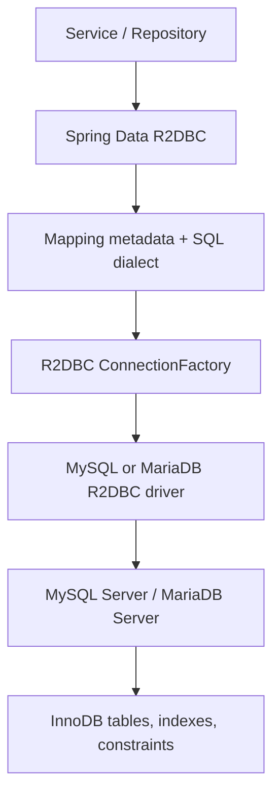

# MySQL/MariaDB: Drivers, Generated Keys, and Syntax Differences

Spring Data Relational R2DBC can work with MySQL and MariaDB through their respective R2DBC drivers. At the repository layer, many operations look similar: declaring entities with `@Table`, marking keys with `@Id`, calling `save`, using `DatabaseClient`, or writing `@Query`. However, the driver, database metadata, and SQL dialect determine how connections are created, parameters are bound, generated keys are retrieved, and engine-specific syntax is executed.

MySQL and MariaDB share a common heritage and much of their syntax, but they are not completely interchangeable database engines. Server version, storage engine, SQL mode, collation, and driver can all alter behavior. A SQL statement that runs on MySQL does not automatically behave identically on MariaDB, and one driver may support a feature that the other does not yet support.

When building an R2DBC application, choose the driver matching the actual server, configure `ConnectionFactory` properly, verify the dialect resolved by Spring Data, understand `AUTO_INCREMENT` and generated values, and write SQL tailored to the running MySQL/MariaDB version. The examples below focus on InnoDB and common syntax; engine-specific syntax should be verified against your project's exact server and driver versions.

## 1. MySQL and MariaDB in the R2DBC Architecture

R2DBC is a reactive database access API. Spring Data R2DBC uses `ConnectionFactory`, an R2DBC driver, and a dialect to perform persistence operations. For MySQL/MariaDB, the high-level architecture looks like this:



Each component has distinct responsibilities:

- **Spring Data R2DBC** maps entities, generates certain CRUD statements, handles newness detection, versioning, and repository queries.
- **R2DBC dialect** provides information about bind markers, identifiers, data types, and engine-specific capabilities that Spring Data needs when generating SQL.
- **R2DBC driver** implements the connection protocol, parameter binding, statement execution, result reading, and generated values according to its capabilities.
- **Database server** determines SQL syntax, constraints, storage engines, transactions, collations, the optimizer, and execution plans.

Java annotations cannot replace driver or database functionality. For example, `@Id` marks the identifier property in the mapping; it does not create `AUTO_INCREMENT` if the schema lacks an appropriate column definition.

## 2. Choosing an R2DBC Driver

Common driver options in the ecosystem include:

| Database | Commonly Used Driver | Typical Artifact | Notes |
| --- | --- | --- | --- |
| MySQL | Asyncer R2DBC MySQL | `io.asyncer:r2dbc-mysql` | R2DBC driver for MySQL; check server/driver compatibility matrix |
| MariaDB | MariaDB Connector/R2DBC | `org.mariadb:r2dbc-mariadb` | Driver developed by MariaDB; verify server version and required features |
| MariaDB via MySQL driver | Some MySQL R2DBC driver releases can connect to MariaDB | `io.asyncer:r2dbc-mysql` | Compatibility depends on version; do not assume all MariaDB features are supported |

The fact that MySQL and MariaDB share largely compatible wire protocols does not mean all server differences are abstracted by the driver. If production runs MariaDB, test with MariaDB Connector/R2DBC or a MySQL driver confirmed compatible with that exact MariaDB version.

### Declaring Dependencies

Gradle example when choosing the MySQL driver:

```kotlin
dependencies {
    runtimeOnly("io.asyncer:r2dbc-mysql")
}
```

Example when choosing the MariaDB driver:

```kotlin
dependencies {
    runtimeOnly("org.mariadb:r2dbc-mariadb")
}
```

Maven example:

```xml
<dependency>
    <groupId>io.asyncer</groupId>
    <artifactId>r2dbc-mysql</artifactId>
    <scope>runtime</scope>
</dependency>
```

Or:

```xml
<dependency>
    <groupId>org.mariadb</groupId>
    <artifactId>r2dbc-mariadb</artifactId>
    <scope>runtime</scope>
</dependency>
```

These examples omit versions so the project can use dependency management/BOM compatible with Spring Boot and Spring Data. If not using a BOM, declare a specific driver version per release documentation. Do not include multiple drivers simultaneously just to experiment; multiple providers can make driver/dialect selection unpredictable.

### Choosing the Right Driver for Your Server

Before deciding, verify:

- Whether the server is MySQL or MariaDB, and its exact version.
- Whether the application requires TLS, specific authentication plugins, or custom connection options.
- Whether generated keys, batch statements, JSON, cursors, or engine-specific features are needed.
- Which R2DBC SPI version the driver implements and whether it is compatible with your Spring Data/Spring Boot versions.
- Whether the driver properly supports transaction semantics, cancellation, and connection pooling under your real workload.

Do not choose a driver solely because it can open a connection. Test writes, generated values, transaction rollbacks, data types, and the SQL your application uses.

## 3. Connection Configuration in Spring Boot

Spring Boot uses `spring.r2dbc` properties, not JDBC's `spring.datasource`:

```yaml
spring:
  r2dbc:
    url: r2dbc:mysql://localhost:3306/shop
    username: app_user
    password: ${DB_PASSWORD}
```

With MariaDB Connector/R2DBC:

```yaml
spring:
  r2dbc:
    url: r2dbc:mariadb://localhost:3306/shop
    username: app_user
    password: ${DB_PASSWORD}
```

The URL scheme must match the installed provider. Do not use `jdbc:mysql:` or `jdbc:mariadb:` prefixes for R2DBC. Username and password can be passed via separate Spring Boot properties instead of embedding them directly in the URL.

### TLS Configuration and Driver Options

Drivers have their own options for SSL/TLS, timeouts, timezones, sockets, and authentication. Option names, defaults, and semantics can differ. Use the exact options for your chosen driver, enable TLS over untrusted networks, and avoid committing plaintext passwords in configuration files.

Do not copy query parameters verbatim from a JDBC URL to an R2DBC URL. R2DBC drivers have their own parsers and option sets. Check driver documentation for supported parameters.

### Connection Pooling

Applications can use R2DBC Pool to manage concurrent connections. A pool does not replace the driver; it wraps `ConnectionFactory`.

Properties to consider include:

- `initialSize`: number of connections created initially.
- `maxSize`: maximum concurrent connections.
- `maxAcquireTime`: maximum wait time to acquire a connection.
- `maxCreateConnectionTime`: time limit for creating a connection.
- `maxIdleTime`/`maxLifeTime`: connection lifecycle in the pool.

Exact property names depend on your Spring Boot/R2DBC Pool version. Size the pool based on database connection limits, application instance count, and concurrency levels; do not arbitrarily raise `maxSize` when queries are already overloading the database.

## 4. Verifying the Dialect Resolved by Spring Data

Spring Data needs a dialect to generate database-compatible SQL. The dialect can affect:

- How bind markers are represented.
- How identifiers are quoted.
- SQL for insert/update/delete and generated values.
- Supported data types.
- Pagination handling and certain query characteristics.

For MySQL, Spring Data Relational provides a MySQL dialect. For MariaDB, exact resolution depends on metadata supplied by the driver and the Spring Data version. Do not assume every MariaDB driver is always detected identically just because its syntax resembles MySQL.

At application startup, check logs and configuration if you encounter dialect resolution errors or malformed generated SQL. Use the proper `ConnectionFactory` and driver provider; avoid building a custom factory that omits metadata expected by Spring Data.

### Do Not Mix JDBC Dialects and R2DBC Dialects

JDBC drivers and R2DBC drivers are separate components. An application may use JDBC for a migration tool and R2DBC at runtime, but a `DataSource` configuration does not replace `ConnectionFactory`. Spring Data R2DBC repositories must use the corresponding R2DBC driver.

## 5. Creating Tables and `AUTO_INCREMENT` Keys

MySQL and MariaDB commonly use `AUTO_INCREMENT` for auto-incrementing numeric keys:

```sql
CREATE TABLE customer (
    id BIGINT NOT NULL AUTO_INCREMENT,
    email VARCHAR(320) NOT NULL,
    name VARCHAR(200) NOT NULL,
    PRIMARY KEY (id),
    CONSTRAINT uk_customer_email UNIQUE (email)
) ENGINE = InnoDB;
```

`AUTO_INCREMENT` is MySQL/MariaDB syntax; it is not portable across all relational databases. `ENGINE = InnoDB` specifies a storage engine supporting transactions and foreign keys suitable for typical R2DBC applications.

Corresponding entity:

```java
@Table("customer")
public class Customer {

    @Id
    private Long id;

    private String email;

    private String name;

    public Customer(String email, String name) {
        this.email = email;
        this.name = name;
    }

    // Appropriate getters/setters or constructor mapping.
}
```

When creating a new entity, leave `id` as `null` if the database should generate the ID. The wrapper `Long` represents an unassigned ID more clearly than primitive `long`, which defaults to `0`.

Repository:

```java
public interface CustomerRepository
        extends ReactiveCrudRepository<Customer, Long> {
}
```

Saving and using the resulting entity:

```java
Mono<Customer> saved = customerRepository.save(
        new Customer("lan@example.test", "Lan")
);

return saved.map(customer -> customer.getId());
```

When Spring Data detects the entity as new, it performs an insert. If the dialect/driver supports returning generated values for the ID column, the entity emitted by `save` will contain the database-generated ID. Always use the entity emitted by the publisher; do not rely on the input object being mutated in place.

## 6. Newness Detection and `@Id`

Spring Data Relational decides whether `save` executes an insert or an update based on entity state. Newness detection typically checks:

1. `Persistable.isNew()` if the entity implements `Persistable`.
2. A `@Version` property if present.
3. The `@Id` property if neither of the above applies.

For new entities using auto-increment, `id == null` is the natural representation. If an entity has a pre-assigned ID yet still requires an insert, design explicit newness detection—such as `Persistable`—rather than assuming every `save` performs an insert.

Example with version:

```java
@Table("customer")
public class Customer {

    @Id
    private Long id;

    @Version
    private Long version;

    private String name;
}
```

The schema needs a version column:

```sql
version BIGINT NOT NULL DEFAULT 0
```

With `@Version`, the version participates in newness detection and optimistic locking per Spring Data semantics. Do not set version arbitrarily if you want the framework to distinguish new versus existing entities properly.

## 7. Generated Keys via R2DBC

The R2DBC SPI provides `Statement.returnGeneratedValues(...)` to ask the driver to return database-generated values, if supported by the driver. Spring Data R2DBC can leverage the dialect and driver to retrieve generated identifiers on entity insert.

Conceptual example at the SPI layer:

```java
Statement statement = connection.createStatement(
        "INSERT INTO customer (email, name) VALUES (?, ?)"
);

statement.bind(0, "lan@example.test");
statement.bind(1, "Lan");
statement.returnGeneratedValues("id");

Flux<Long> generatedIds = Flux.from(statement.execute())
        .concatMap(result -> Flux.from(result.map((row, metadata) ->
                row.get("id", Long.class)
        )));
```

This illustrates the R2DBC SPI. Placeholder `?`, returned column name, `returnGeneratedValues` usage, and result mapping must match your specific MySQL/MariaDB driver. Some drivers may use specific metadata or conventions to return generated IDs; do not assume identical support across all drivers.

### `rowsUpdated()` Is Not a Generated Key

With `DatabaseClient`:

```java
Mono<Long> count = databaseClient.sql("""
            INSERT INTO customer (email, name)
            VALUES (:email, :name)
            """)
        .bind("email", email)
        .bind("name", name)
        .fetch()
        .rowsUpdated();
```

`rowsUpdated()` returns the affected row count. It does not return the auto-generated ID. If you need the generated ID, use entity `save`/supported template insert mappings or use the generated-values/RETURNING mechanism appropriate for your driver and database.

### `LAST_INSERT_ID()` in MySQL/MariaDB

MySQL and MariaDB provide `LAST_INSERT_ID()` to read the most recent auto-increment value on the current connection. This state is connection-scoped, not a global value safe to read from an arbitrary connection.

If you use this approach, the read statement must run on the exact same connection that performed the insert. Never grab a fresh connection from the pool and call `SELECT LAST_INSERT_ID()`, because that connection may return another operation's value or none at all. When possible, prefer generated values through the R2DBC SPI/driver or Spring Data entity inserts.

### Do Not Infer IDs of Batch-Inserted Rows

Do not take the first ID and assume subsequent rows have consecutive IDs (`firstId + index`). Auto-increment values can have gaps due to rollbacks, concurrent inserts, reservations, or increment settings. For multi-row inserts, retrieve the list of generated values as supported by the driver or re-query by business keys/known IDs.

## 8. Generated Keys and `RETURNING` Syntax

MariaDB and MySQL differ in DML `RETURNING` support.

| Capability | MySQL | MariaDB |
| --- | --- | --- |
| `AUTO_INCREMENT` | Yes | Yes |
| `LAST_INSERT_ID()` | Yes, per connection | Yes, per connection |
| `INSERT ... RETURNING` | Do not assume MariaDB-like support | Available in supported versions, starting in MariaDB 10.5 for documented forms |
| R2DBC `returnGeneratedValues` | Driver-dependent | Driver- and version-dependent |

MariaDB example supporting `INSERT ... RETURNING`:

```sql
INSERT INTO customer (email, name)
VALUES ('lan@example.test', 'Lan')
RETURNING id, email;
```

Do not use this syntax in shared SQL targeting MySQL if the server does not support it. If code must run on both, prefer driver/Spring Data generated-value abstractions when verified; otherwise split SQL by dialect/server.

Even when the server supports `RETURNING`, the driver must know how to read that result set. Server SQL support does not automatically mean the R2DBC driver maps generated values across every API.

## 9. Parameter Binding and Placeholders

At the Spring `DatabaseClient` layer, you can write named parameters:

```java
databaseClient.sql("""
        SELECT id, email, name
        FROM customer
        WHERE email = :email
        """)
    .bind("email", email)
    .map((row, metadata) -> new CustomerView(
            row.get("id", Long.class),
            row.get("email", String.class),
            row.get("name", String.class)
    ))
    .one();
```

`DatabaseClient` uses a named parameter API at the Spring layer and converts them into markers required by the dialect/driver. At the raw R2DBC SPI layer, marker syntax may be `?` or another form depending on the driver. Do not copy PostgreSQL placeholders like `$1` into MySQL/MariaDB if the driver does not support them.

Always bind data:

```java
databaseClient.sql("SELECT id FROM customer WHERE email = :email")
        .bind("email", userInput)
        .fetch()
        .all();
```

Never concatenate input into SQL:

```java
// Unsafe.
String sql = "SELECT id FROM customer WHERE email = '" + userInput + "'";
```

Parameter binding prevents input values from being interpreted as SQL syntax and handles quoting/encoding properly. Table names, column names, and sort directions generally cannot be bound as values; if dynamic selection is needed, validate against a whitelist.

## 10. Identifier Quoting and Reserved Keywords

MySQL and MariaDB commonly use backticks to quote identifiers:

```sql
SELECT `id`, `name`
FROM `customer`;
```

Double quotes (`"identifier"`) may be interpreted as identifier quotes when SQL mode `ANSI_QUOTES` is enabled; in default mode, double quotes are usually used for string literals. Do not rely on double quotes unless SQL mode is strictly controlled.

Best practice is to avoid naming tables or columns after SQL keywords or ambiguous names like `order`, `rank`, `key`, or `group`. If special names are unavoidable, quote consistently and verify how the dialect formats identifiers.

For example, a table named `order` can collide with `ORDER BY`; choose `purchase_order` or `orders` instead to reduce quoting needs.

Spring Data mappings may quote identifiers depending on dialect/configuration, whereas SQL in `@Query` or `DatabaseClient` is managed by the application. Do not expect the framework to rewrite every column name in raw SQL.

## 11. Pagination Syntax Differences

Both MySQL and MariaDB support standard `LIMIT` and `OFFSET` syntax:

```sql
SELECT id, name
FROM customer
ORDER BY id
LIMIT 20 OFFSET 40;
```

MySQL also supports the comma form:

```sql
SELECT id, name
FROM customer
ORDER BY id
LIMIT 40, 20;
```

In the comma form, the first parameter is the offset and the second is the row count. Writing `LIMIT count OFFSET offset` is usually easier to read because the order matches the labels of both clauses.

Always include a deterministic `ORDER BY` with a unique tie-breaker, such as `ORDER BY created_at DESC, id DESC`. Without deterministic ordering, pages can duplicate or skip rows even when data does not change.

### Deep Offsets

`LIMIT 20 OFFSET 500000` can force the database to scan past many entries before returning 20 rows. Reactive R2DBC does not eliminate this cost. For feeds or large sequential scans, consider keyset pagination:

```sql
SELECT id, created_at, title
FROM article
WHERE status = 'PUBLISHED'
  AND (created_at < :lastCreatedAt
       OR (created_at = :lastCreatedAt AND id < :lastId))
ORDER BY created_at DESC, id DESC
LIMIT 20;
```

A composite index `(status, created_at, id)` can support both the predicate and the sort; verify with `EXPLAIN` on the real server.

## 12. Upsert: `ON DUPLICATE KEY UPDATE`

MySQL and MariaDB commonly use `ON DUPLICATE KEY UPDATE` to insert or update upon a unique/primary key conflict:

```sql
INSERT INTO customer (email, name)
VALUES (:email, :name)
ON DUPLICATE KEY UPDATE
    name = :name;
```

This syntax differs from PostgreSQL's `ON CONFLICT (...) DO UPDATE`. Do not use `ON CONFLICT` in MySQL/MariaDB.

### MySQL/MariaDB Conflict Targets

`ON DUPLICATE KEY UPDATE` triggers when a primary key or any matching unique index is violated. Unlike PostgreSQL, it has no explicit conflict target. If a table has multiple unique keys, understand exactly which rows can conflict; there is a risk the statement updates a row matched by a different unique key than the business key the application intended.

Do not use upsert as a substitute for proper unique constraint design. If email is unique per tenant, create a unique index `(tenant_id, email)` and ensure inputs bind the correct tenant.

### `VALUES()` Function Differences Across Versions

In older MySQL syntax and MariaDB, `VALUES(column)` is commonly used in the update clause to reference the proposed insert value. MySQL deprecated using `VALUES()` inside `ON DUPLICATE KEY UPDATE` in newer 8.0 releases, recommending row aliases instead, while MariaDB has its own support history. If portability across versions is needed, verify both servers' syntax or bind repeated parameters as shown with `name = :name`.

### Upsert Does Not Automatically Return a Spring Data Entity

A `DatabaseClient` statement with `ON DUPLICATE KEY UPDATE` returns an update count when calling `.rowsUpdated()`. It does not go through `repository.save` and does not update in-memory objects. If you need the entity after an upsert, use server/driver `RETURNING`/generated-values support where available, or re-read by business key within the appropriate flow.

## 13. Use Caution With `INSERT IGNORE` and `REPLACE`

MySQL/MariaDB offer syntax such as `INSERT IGNORE` and `REPLACE`, but their semantics differ from normal inserts.

`INSERT IGNORE` can downgrade certain errors to warnings or skip rows, not only duplicate keys. That can mask unexpected data errors. Do not use it as a generic "skip if exists" mechanism without understanding its warning and conversion semantics.

`REPLACE` is not simply an update of a few columns; on a unique conflict, the server may delete the old row and insert a new row. That can affect foreign keys, triggers, auto-increment values, audit fields, and omitted columns. If business logic needs controlled updates, `ON DUPLICATE KEY UPDATE` expresses intent more clearly.

## 14. Timestamps, Timezones, and Database Defaults

MySQL and MariaDB provide `TIMESTAMP` and `DATETIME` with different semantics. `TIMESTAMP` typically converts according to the session timezone on write/read; `DATETIME` stores date-time components without an inherent timezone. Exact range, precision, and conversion details depend on version and configuration.

For Java applications:

- Use `Instant` when an absolute point in time is needed.
- Use `LocalDateTime` when the data genuinely represents a local date/time without a timezone.
- Standardize connection/session timezone conventions, typically UTC.
- Verify driver codecs and temporal round-trips via integration tests.
- Choose appropriate fractional precision, such as `DATETIME(6)` or `TIMESTAMP(6)`, when microseconds are needed.

Schema example:

```sql
created_at TIMESTAMP(6) NOT NULL DEFAULT CURRENT_TIMESTAMP(6),
updated_at TIMESTAMP(6) NOT NULL DEFAULT CURRENT_TIMESTAMP(6)
    ON UPDATE CURRENT_TIMESTAMP(6)
```

`ON UPDATE CURRENT_TIMESTAMP` is a database-side mechanism that updates the timestamp when a row changes. If you also use Spring Data auditing on the same column, establish a clear single owner to avoid overwritten values or clock skew.

Do not assume `DEFAULT CURRENT_TIMESTAMP` applies when the application binds SQL NULL. Defaults typically apply when the column is omitted from INSERT or `DEFAULT` is specified; binding NULL passes an explicit null value.

## 15. BOOLEAN, UNSIGNED, and Numeric Types

In MySQL/MariaDB, `BOOLEAN` is typically an alias for `TINYINT(1)`, rather than a distinct native boolean storage type as in some other engines. Drivers may map `Boolean` via codecs, but verify actual stored data and values outside 0/1.

MySQL/MariaDB support `UNSIGNED` for several integer types. Java `Integer` and `Long` are signed; if the database stores unsigned values exceeding the signed range, mapping can overflow or fail to represent the value. Choose compatible Java/SQL types, or avoid unsigned unless clearly needed.

For money:

```sql
amount DECIMAL(18, 2) NOT NULL
```

Java:

```java
private BigDecimal amount;
```

Do not use `double` for monetary values requiring decimal precision. Validate precision, scale, and rounding at both the database and domain layers.

## 16. Collation and String Comparison

MySQL/MariaDB often use case-insensitive collations for certain charsets and default configurations. That can affect:

- Whether `=` and `LIKE` are case-sensitive.
- Whether a unique constraint treats `Lan@example.test` and `lan@example.test` as duplicates.
- String sort order and accent sensitivity.
- Results of derived queries like `IgnoreCase`.

Example declaring table charset/collation:

```sql
CREATE TABLE customer (
    id BIGINT NOT NULL AUTO_INCREMENT PRIMARY KEY,
    email VARCHAR(320) NOT NULL,
    UNIQUE KEY uk_customer_email (email)
) CHARACTER SET utf8mb4
  COLLATE utf8mb4_0900_ai_ci;
```

The collation `utf8mb4_0900_ai_ci` is a MySQL 8 example; MariaDB has its own collation set and version support. Do not copy MySQL 8 collation names into MariaDB without verifying server support.

If emails require custom normalization semantics, store a canonical column (`email_normalized`) and place the unique index on that column. When relying on default collations, understand how the database compares Unicode, case, and accents before designing unique constraints.

## 17. JSON Differences Between MySQL and MariaDB

The two engines have notable differences regarding JSON:

- MySQL has a native `JSON` data type with dedicated binary/JSON storage and validation.
- MariaDB implements `JSON` as a compatibility alias over long text with related validation functions; storage and optimization differ from MySQL's native JSON.
- JSON functions, path expressions, indexing, and generated column syntax can differ by version.

Example JSON column declaration:

```sql
CREATE TABLE event_log (
    id BIGINT NOT NULL AUTO_INCREMENT PRIMARY KEY,
    payload JSON NOT NULL
);
```

This DDL may be accepted by both engines, yet you should not infer identical storage or optimizer semantics.

If you frequently filter on a JSON field, consider a generated/computed column or expression index per server capabilities:

```sql
-- Generated column syntax should be adjusted per server version.
ALTER TABLE event_log
ADD COLUMN event_type VARCHAR(80)
    GENERATED ALWAYS AS (JSON_UNQUOTE(JSON_EXTRACT(payload, '$.type'))) STORED;

CREATE INDEX idx_event_log_type ON event_log(event_type);
```

Verify generated column syntax, JSON functions, and index support on your exact server. If a field is frequently used in joins, filters, or sorts, a strongly typed relational column is often better than deep JSON querying.

## 18. CHECK Constraints and Version Differences

MySQL and MariaDB support CHECK constraints depending on version, though older versions could parse them without enforcing them as expected. In MySQL, CHECK constraints are enforced starting in the 8.0.16 line; MariaDB has its own version-specific support history.

Example:

```sql
CREATE TABLE orders (
    id BIGINT NOT NULL AUTO_INCREMENT PRIMARY KEY,
    total_amount DECIMAL(18, 2) NOT NULL,
    CONSTRAINT ck_orders_total CHECK (total_amount >= 0)
) ENGINE = InnoDB;
```

If a constraint protects an important invariant, verify that the server actually rejects invalid data via integration tests. Do not rely solely on migrations running without error.

## 19. Storage Engines and Transactions

In MySQL/MariaDB, transactions and foreign keys depend on the storage engine. InnoDB is the standard choice for transactional applications:

```sql
CREATE TABLE account (
    id BIGINT NOT NULL AUTO_INCREMENT PRIMARY KEY,
    balance DECIMAL(18, 2) NOT NULL
) ENGINE = InnoDB;
```

Do not assume every engine supports transactions or foreign keys like InnoDB. If a table uses a non-transactional engine, `@Transactional` at the R2DBC layer cannot provide full rollback semantics for that table.

### Reactive Transactions

Spring uses `R2dbcTransactionManager` to bind a connection to the Reactor Context. Repository and `DatabaseClient` operations must share the same `ConnectionFactory` to participate in the transaction:

```java
@Transactional
public Mono<Void> transfer(Long fromId, Long toId, BigDecimal amount) {
    return accountRepository.debit(fromId, amount)
            .then(accountRepository.credit(toId, amount))
            .then();
}
```

If the second operation fails, InnoDB can roll back both changes when they run in the same transaction. Never call `subscribe()` inside the service and never open a fresh connection via `ConnectionFactory.create()` when work must join the active transaction.

### Isolation and Locking

Default isolation levels can vary by server, version, and configuration. MySQL InnoDB typically defaults to `REPEATABLE READ`; MariaDB commonly shares a similar default, though actual session/server settings should be verified.

Syntax like `SELECT ... FOR UPDATE`, `NOWAIT`, `SKIP LOCKED`, and gap/next-key locking behavior can vary by version and engine. When using them for worker coordination or row locking, verify support and semantics on the production database.

## 20. Foreign Keys, Indexes, and InnoDB

Customer-order relationship example:

```sql
CREATE TABLE customer (
    id BIGINT NOT NULL AUTO_INCREMENT PRIMARY KEY,
    email VARCHAR(320) NOT NULL,
    UNIQUE KEY uk_customer_email (email)
) ENGINE = InnoDB;

CREATE TABLE orders (
    id BIGINT NOT NULL AUTO_INCREMENT PRIMARY KEY,
    customer_id BIGINT NOT NULL,
    order_number VARCHAR(40) NOT NULL,
    created_at TIMESTAMP(6) NOT NULL,
    CONSTRAINT fk_orders_customer
        FOREIGN KEY (customer_id) REFERENCES customer(id),
    UNIQUE KEY uk_orders_order_number (order_number),
    KEY idx_orders_customer_created (customer_id, created_at, id)
) ENGINE = InnoDB;
```

The index `(customer_id, created_at, id)` supports fetching orders by customer sorted chronologically when the order and query match. InnoDB uses the primary key as the clustered index; InnoDB secondary indexes store the primary key as the row locator. Thus, primary key size and choice also affect the footprint of all secondary indexes.

Do not mechanically add single-column indexes for every column. Inspect query plans and write workloads. Foreign keys protect referential integrity; indexing FK columns helps look up child rows and can improve joins and parent deletes.

## 21. `AUTO_INCREMENT` and Multi-Row Insert Behavior

MySQL/MariaDB assign `AUTO_INCREMENT` values when inserts omit the ID column or pass `NULL` in supported cases:

```sql
INSERT INTO customer (email, name)
VALUES ('lan@example.test', 'Lan');
```

Do not pass `0` expecting the server to generate an ID; behavior depends on the `NO_AUTO_VALUE_ON_ZERO` SQL mode. Be explicit by omitting the ID column or passing NULL per tested semantics.

With multi-row inserts:

```sql
INSERT INTO customer (email, name)
VALUES
    ('a@example.test', 'A'),
    ('b@example.test', 'B'),
    ('c@example.test', 'C');
```

The database may assign a sequence of auto-increment values, yet you should not compute each row's ID by adding to the first ID. Concurrent inserts, rollbacks, and increment/offset settings can create gaps or unexpected sequences. When mapping IDs back to inputs, use driver-supported generated-values APIs or re-query by unique business keys.

## 22. Batch Statements and Placeholder Limits

MySQL/MariaDB R2DBC drivers can support batch statements depending on driver capabilities. Distinguish:

- `Statement.add()`: multiple parameter bindings for the same SQL statement.
- Multi-row `INSERT`: one SQL statement with multiple `VALUES` tuples.
- `Connection.createBatch()`: multiple SQL statements grouped via the R2DBC SPI batch API.

Do not assume every batching style has identical update counts, generated key behavior, or transaction semantics. Placeholder counts are also constrained by the driver, server, and packet size limits. For large batches, chunk and measure.

Multi-row SQL example:

```sql
INSERT INTO inventory (sku, quantity)
VALUES (:sku1, :quantity1),
       (:sku2, :quantity2),
       (:sku3, :quantity3);
```

With dynamic row counts, build the placeholder structure only from a validated row count; all values must still be bound. Never concatenate user input directly into SQL.

## 23. SQL Modes and Behavioral Differences

SQL modes can change how MySQL/MariaDB process data and syntax. Common modes to watch:

- `STRICT_TRANS_TABLES`/`STRICT_ALL_TABLES`: affect rejection of invalid or truncated data.
- `ANSI_QUOTES`: changes the semantics of double quotes.
- `NO_ZERO_DATE`/date-related modes: affect invalid date values depending on version.
- `ONLY_FULL_GROUP_BY`: governs valid columns in `GROUP BY`.
- `NO_AUTO_VALUE_ON_ZERO`: affects how `0` is treated for `AUTO_INCREMENT`.

Do not rely on implicit SQL mode differences between developer, test, and production environments. Configure and verify modes deliberately, and run integration tests with matching server versions and settings.

## 24. SQL Syntax Differences to Remember

| Topic | MySQL | MariaDB | How to Handle |
| --- | --- | --- | --- |
| Auto-generated numeric ID | `AUTO_INCREMENT` | `AUTO_INCREMENT` | Use dedicated MySQL/MariaDB schema; Java mapping can use `@Id` |
| Upsert | `ON DUPLICATE KEY UPDATE` | `ON DUPLICATE KEY UPDATE` | Do not use PostgreSQL `ON CONFLICT` |
| Insert returning | Do not assume `INSERT ... RETURNING` | Supported in newer versions, from MariaDB 10.5 for documented forms | Check server and driver; use generated-values API where appropriate |
| Pagination | `LIMIT n OFFSET m` or `LIMIT m, n` | Both forms common | Prefer readable `LIMIT n OFFSET m` |
| Identifier quoting | Backtick; double quote depends on `ANSI_QUOTES` | Backtick; mode affects double quotes | Avoid reserved words, let dialect handle mapping |
| JSON | Native JSON type | JSON compatibility alias/text implementation | Verify functions, indexes, and storage semantics |
| CHECK constraint | Enforced from MySQL 8.0.16 | Depends on MariaDB version | Test constraints on the exact server |
| Collation | MySQL version-specific collations | MariaDB-specific collation set | Do not copy collation names without verification |
| Generated columns/indexes | Syntax and limits vary by version | Differences by version | Separate migrations if using engine-specific features |
| Locking syntax | Supported by version/engine | Supported by version/engine | Test `FOR UPDATE`, `NOWAIT`, `SKIP LOCKED` |

## 25. SQL in `@Query` and `DatabaseClient`

Derived query methods express property-based conditions, but do not automatically make all SQL portable. For MySQL/MariaDB-specific queries, declare `@Query`:

```java
public interface CustomerRepository
        extends ReactiveCrudRepository<Customer, Long> {

    @Query("""
           SELECT id, email, name
           FROM customer
           WHERE email = :email
           """)
    Mono<Customer> findByEmailAddress(String email);
}
```

Or use `DatabaseClient` when DTO mapping, joins, JSON functions, upserts, or custom syntax are required:

```java
Mono<Long> upsertCustomer(String email, String name) {
    return databaseClient.sql("""
                INSERT INTO customer (email, name)
                VALUES (:email, :name)
                ON DUPLICATE KEY UPDATE name = :name
                """)
            .bind("email", email)
            .bind("name", name)
            .fetch()
            .rowsUpdated();
}
```

This query is a MySQL/MariaDB example, not portable SQL. `rowsUpdated()` results depend on the server and driver and can differ between insert and update; do not use the count to infer IDs or business branches unless the driver guarantees those semantics.

## 26. Schema Migrations and JDBC/R2DBC

Runtime data access uses the R2DBC driver, whereas migration tools like Flyway typically use a JDBC connection. An application may need both:

- A JDBC driver for schema migrations or administrative tooling.
- An R2DBC driver for reactive repositories/runtime.

These two drivers are not interchangeable. The migration `DataSource` configuration and `spring.r2dbc` must point to the exact same database/schema and be managed clearly. If using Liquibase/Flyway over JDBC, successful migrations do not prove the R2DBC driver supports the corresponding generated keys or data types.

### Migrations for Auto-Increment and Indexes

Migration example:

```sql
CREATE TABLE customer (
    id BIGINT NOT NULL AUTO_INCREMENT,
    tenant_id BINARY(16) NOT NULL,
    email VARCHAR(320) NOT NULL,
    name VARCHAR(200) NOT NULL,
    created_at TIMESTAMP(6) NOT NULL DEFAULT CURRENT_TIMESTAMP(6),
    PRIMARY KEY (id),
    CONSTRAINT uk_customer_tenant_email UNIQUE (tenant_id, email)
) ENGINE = InnoDB;

CREATE INDEX idx_customer_tenant_created
ON customer(tenant_id, created_at DESC, id DESC);
```

`BINARY(16)` for UUID is one representation option; drivers/converters must convert `UUID` appropriately. Some applications use `CHAR(36)` or native UUID types if supported by the database/driver. Choose one consistent representation and do not mix formats across services.

### Adding Indexes on Large Tables

Index creation can affect locks, I/O, and deployment times. MySQL and MariaDB have different online DDL options depending on version and index/alter type. Keywords such as `ALGORITHM=INPLACE`, `LOCK=NONE`, or equivalent syntax are not supported uniformly in every situation.

Before running migrations on large tables:

1. Check online DDL capabilities for the exact server version.
2. Estimate index size and temporary disk space required.
3. Test the migration on production-sized data.
4. Monitor lock waits, replication lag, and I/O.
5. Prepare a rollback or recovery plan if the migration fails midway.

## 27. Checking Query Plans and Indexes

Both MySQL and MariaDB provide `EXPLAIN` to inspect how the optimizer plans to execute a query:

```sql
EXPLAIN
SELECT id, order_number, created_at
FROM orders
WHERE customer_id = 42
ORDER BY created_at DESC, id DESC
LIMIT 20;
```

Inspect:

- `key`: index chosen by the optimizer.
- `type`/access type: how rows are accessed.
- `rows`: estimated rows examined.
- `Extra`: sorting info, temporary tables, or additional filtering.
- Join order and indexes selected per table.

Output columns and formats vary by server version. MariaDB and MySQL also offer distinct `EXPLAIN`/analyze forms; consult the exact server documentation.

Candidate index for the query above:

```sql
CREATE INDEX idx_orders_customer_created
ON orders(customer_id, created_at DESC, id DESC);
```

This index can support the customer equality filter and chronological ordering. However, the optimizer may pick a different plan if the table is small, predicates are unselective, or statistics favor a cheaper approach. Do not assume an index is effective merely because it exists.

## 28. Testing on Real MySQL/MariaDB

H2 or another database cannot fully replace MySQL/MariaDB integration tests when the application relies on specific syntax, generated keys, collations, or JSON behavior.

Maintain test profiles/containers matching real servers:

- MySQL Testcontainers with exact production major/minor version.
- MariaDB Testcontainers if production runs MariaDB.
- Run the same migrations as production.
- Use the exact R2DBC driver being deployed.
- Test repository inserts/updates and generated IDs.
- Test `DatabaseClient` raw SQL, parameter binding, and upserts.
- Test transaction rollbacks on InnoDB.
- Test timezones, decimals, UUIDs, JSON, collations, and null handling.
- Test foreign keys, unique/check constraints, and SQL modes.

If the application must support both MySQL and MariaDB, run the same integration test suite on both engines. Passing tests on MySQL does not guarantee full compatibility on MariaDB, and vice versa.

### Generated ID Test Example

```java
StepVerifier.create(customerRepository.save(
                new Customer("lan@example.test", "Lan")
        ))
        .assertNext(saved -> {
            assertThat(saved.getId()).isNotNull();
            assertThat(saved.getEmail()).isEqualTo("lan@example.test");
        })
        .verifyComplete();
```

This test requires a real database with `AUTO_INCREMENT`, the matching driver, and proper mapping. If the ID remains null, check entity newness, schema, dialect resolution, and driver generated-values support.

### Transaction Rollback Test Example

Inside a `@Transactional` service, execute an insert/update and intentionally emit an error; then query back and confirm data does not exist or remains unchanged. Tables must use InnoDB and repositories/`DatabaseClient` must share the `ConnectionFactory` with `R2dbcTransactionManager`.

## 29. Common Errors

| Symptom | Possible Cause | Fix |
| --- | --- | --- |
| Spring cannot find R2DBC dialect | Driver/provider or metadata not recognized | Check dependencies, URL scheme, and ConnectionFactory metadata |
| App uses JDBC instead of R2DBC | Configured `spring.datasource` or `jdbc:` URL | Configure `spring.r2dbc` and R2DBC driver |
| `save` does not generate ID | Input ID non-null, schema missing AUTO_INCREMENT, or driver not returning generated values | Check newness, DDL, dialect, and driver |
| Input ID triggers update instead of insert | Spring treats entity as existing | Check `@Id`, `@Version`, `Persistable.isNew()` |
| `rowsUpdated()` has no ID | Update count is not a generated key | Use entity save or supported generated-values API/RETURNING |
| `LAST_INSERT_ID()` returns wrong/0 | Read on a different connection than the insert | Use the same connection or driver generated values |
| SQL `ON CONFLICT` fails | That is PostgreSQL syntax | Use `ON DUPLICATE KEY UPDATE` or separate dialects |
| `INSERT ... RETURNING` fails on MySQL | Server does not support this MariaDB syntax | Use driver generated-values API or appropriate query |
| Upsert updates the wrong row | Multiple unique keys can trigger conflict | Design unique keys carefully and understand `ON DUPLICATE KEY UPDATE` semantics |
| Pagination query fails | Unsupported LIMIT/OFFSET syntax or wrong bind markers | Use supported syntax and the right driver dialect |
| Invalid identifier | Table/column matches reserved word or wrong quote mode | Rename or use backticks/appropriate identifier mapping |
| Wrong boolean/unsigned mapping | MySQL/MariaDB types differ from Java assumptions | Choose compatible types and test codecs |
| Timestamp offset mismatch | Session timezone or `TIMESTAMP` vs `DATETIME` semantics differ | Standardize UTC, verify driver codecs |
| JSON queries behave differently | MySQL native JSON and MariaDB JSON semantics differ | Separate SQL or use portable abstractions |
| Transaction does not roll back | Table not InnoDB or operation uses another connection | Verify engine and transaction-bound ConnectionFactory |
| Unique constraint treats emails unexpectedly | Collation controls case/accent sensitivity | Choose explicit collation or normalized column |
| CHECK does not block bad data | Server version does not enforce constraints as expected | Verify version and test invalid inputs |

## 30. Implementing MySQL/MariaDB With Spring Data R2DBC

1. Identify the exact server and version: MySQL or MariaDB.
2. Select an R2DBC driver compatible with your server and Spring Data version.
3. Declare dependencies and configure `spring.r2dbc.url` with the matching scheme.
4. Verify the driver provider, `ConnectionFactory` metadata, and Spring Data dialect.
5. Design tables using InnoDB, primary keys, and `AUTO_INCREMENT` where generated numeric IDs are needed.
6. Declare foreign keys, unique/check/not-null constraints, and indexes aligned with access patterns.
7. Map entities with `@Table`, `@Column`, `@Id`, `@Version`, and suitable Java types.
8. Verify generated keys through `repository.save` and the driver; do not infer IDs from update counts.
9. Use named bind parameters via `DatabaseClient`; avoid mixing placeholders from other drivers.
10. Isolate engine-specific SQL such as upsert, JSON, RETURNING, and online DDL by server/dialect.
11. Manage schemas with migrations and keep JDBC migration config aligned with R2DBC runtime config.
12. Run integration tests against the exact server/driver, verifying transactions, collations, timezones, generated IDs, and query plans.
13. Measure performance with `EXPLAIN`, benchmarks, and pool/database monitoring in production-like environments.

## 31. Key Takeaways

- MySQL and MariaDB share much syntax yet differ by server version, SQL mode, collation, storage engine, and driver.
- Choose the R2DBC driver for the actual database; `io.asyncer:r2dbc-mysql` and `org.mariadb:r2dbc-mariadb` are common choices, and compatibility matrices must be checked.
- Configure runtime via `spring.r2dbc` and URL scheme `r2dbc:mysql:` or `r2dbc:mariadb:`; JDBC URLs are not for R2DBC.
- The Spring Data dialect and driver control bind markers, mappings, and generated-values behavior; verify dialect resolution.
- MySQL/MariaDB typically use `AUTO_INCREMENT`; new entities should keep wrapper `@Id` like `Long` as null and read the ID from the entity returned by `save`.
- R2DBC `Statement.returnGeneratedValues(...)` depends on the driver; `rowsUpdated()` returns only the update count, not a generated ID.
- `LAST_INSERT_ID()` is connection-scoped; do not read it on a different pooled connection from the insert.
- Do not assume multi-row insert IDs are sequential or compute them by addition.
- MySQL/MariaDB use `ON DUPLICATE KEY UPDATE`, not PostgreSQL `ON CONFLICT`; conflict semantics can apply to any unique key.
- MariaDB supports `INSERT ... RETURNING` in supported versions; do not assume that syntax runs on MySQL.
- Use `LIMIT n OFFSET m`, `AUTO_INCREMENT`, backticks, and SQL options matching your dialect/server.
- Verify differences in JSON, CHECK constraints, boolean/unsigned types, timestamp/timezone handling, and collations.
- Use InnoDB for transactions/foreign keys; reactive transactions require sharing `ConnectionFactory` and avoiding manual `subscribe()`.
- Manage schemas with migrations; the JDBC migration driver and R2DBC runtime driver are separate components.
- Test against exact production MySQL/MariaDB versions and R2DBC drivers; H2 does not prove syntax compatibility or generated-key behavior.

To keep Spring Data R2DBC applications reliable on MySQL or MariaDB, treat the driver and server as a paired unit to validate. Entity mappings may look identical, yet auto-generated keys, `RETURNING`, upserts, JSON, collations, and transactions depend on the specific database and driver. Designing schemas with migrations, relying on driver-supported generated values, and running integration tests against the exact engine help prevent issues that would otherwise only surface in production.
