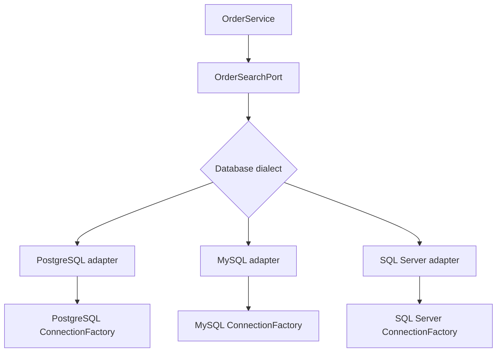

# Building Compatibility Tests Instead of Assuming the Same SQL Runs Everywhere

Spring Data R2DBC supports multiple relational database engines, yet that does not mean every SQL statement is portable. PostgreSQL, MySQL, SQL Server, Oracle, and other engines differ in pagination syntax, generated keys, upserts, data types, identifier quoting, JSON functions, locks, and transactions. A query that works on a developer's local database does not prove it will run properly in production.

To support multiple database engines reliably, explicitly declare the supported databases and versions, separate dialect-dependent SQL from business logic, and run integration tests across every engine/driver in your CI matrix. Mock tests and H2 remain useful for certain purposes, but they cannot replace testing against the real database and R2DBC driver.

## 1. Portability Is More Than Whether SQL Executes

A query can execute on two databases and still return different results due to data type, null, collation, timezone, isolation, or sort-order semantics. Compatibility testing must therefore verify both syntax and behavior.

Common categories of differences:

| Difference Area | Example | Risk |
|---|---|---|
| SQL syntax | `LIMIT`, `TOP`, `FETCH FIRST` | Query fails to parse on another engine |
| Generated keys | `RETURNING`, `OUTPUT`, driver generated keys | Missing ID or database-generated columns |
| Upsert | `ON CONFLICT`, `ON DUPLICATE KEY`, `MERGE` | Conflicting behavior and concurrency differ |
| Identifiers | `"name"`, `` `name` ``, `[name]` | Table/column names misinterpreted or case-sensitive |
| Data types | Boolean, UUID, JSON, arrays, timestamps | Different Java mappings or precision loss |
| Functions and operators | `ILIKE`, JSON operators, string/date functions | Query works on only one dialect |
| Pagination/order | Tie-breakers, null ordering, collations | Pages duplicate or skip rows |
| Locks/concurrency | `FOR UPDATE`, lock hints, isolation | Different contention behavior |
| Error reporting | SQLSTATE, vendor error codes | Broken error classification or retries |
| DDL/migrations | Identity, sequences, index syntax | Schemas do not match across engines |

Portability should be defined by application contract: identical inputs must produce equivalent outputs and side effects on every supported database, within documented semantic bounds.

## 2. Define the Supported Database Matrix

Never claim "supports all databases" if the project only tests against one engine. Specify explicitly:

- Database engine and server versions.
- R2DBC driver and driver versions.
- Spring Boot, Spring Framework, and Spring Data release train.
- SQL features used and minimum version requirements.
- Database versions still within the organization's support lifecycle.

Example project support matrix:

| Database | Server Version | R2DBC Driver | Purpose |
|---|---|---|---|
| PostgreSQL | 16.x | Pinned `r2dbc-postgresql` version | Primary production |
| MySQL | 8.4.x | Pinned R2DBC MySQL driver | Alternate customer deployments |
| SQL Server | 2022 | Pinned R2DBC SQL Server driver | Enterprise integration systems |

These versions illustrate how to structure a matrix, not a blanket compatibility claim for Spring Data R2DBC. Projects must select exact versions based on drivers, Spring release trains, and deployment environments, and record them in build/dependency management.

The matrix should reflect actually supported combinations. There is no need to test obsolete unmaintained releases, but always test at least production versions and target upgrade versions prior to changes.

## 3. Understand What Spring Data R2DBC Abstracts

Spring Data R2DBC uses `R2dbcDialect` to describe engine differences the framework needs when generating SQL from mapping metadata. Dialects supply bind markers, quoting, supported data types, generated identifiers, and certain query structures.

This lets standard Repository and Template operations work across multiple databases without rewriting all SQL manually. For instance, `ReactiveCrudRepository.save(...)` uses mapping metadata and the dialect to emit appropriate insert/update statements.

However, that abstraction does not rewrite arbitrary SQL supplied by the application. If `DatabaseClient.sql(...)` uses `LIMIT`, `RETURNING`, JSON operators, or PostgreSQL-specific functions, that SQL remains tied to PostgreSQL. `DatabaseClient` translates bind parameters per dialect, yet it does not make vendor-specific SQL clauses portable.

| API | Abstraction Level | Application Responsibility |
|---|---|---|
| `ReactiveCrudRepository` | High for entity CRUD | Design mappings and test driver/dialect behavior |
| Derived query methods | High for Spring Data-supported queries | Verify semantics and generated expression limits |
| `R2dbcEntityTemplate` + `Query`/`Criteria` | High for metadata-driven queries | Test sorting, pagination, mappings, and dialect |
| `DatabaseClient` with simple SQL | Medium | Write SQL within syntax supported by all target engines and test each |
| `DatabaseClient` with vendor-specific SQL | Low | Maintain dialect-specific implementations and test directly |
| R2DBC SPI `Connection`/`Statement` | Lower still | Manage bind markers, generated values, transactions, and driver quirks |

Do not bypass Spring Data abstractions for ordinary CRUD. Conversely, never assume the framework translates arbitrary raw SQL across dialects.

## 4. Choose SQL Strategies by Dialect Coupling

Queries can be grouped into three tiers:

**Group A — Portable SQL:** uses common constructs like `SELECT`, `INSERT`, `UPDATE`, `DELETE`, `JOIN`, `WHERE`, `GROUP BY`, `CASE`, `COALESCE`, `EXISTS`, and bind parameters. Still requires tests because data types, collations, and transactions can differ.

**Group B — Slightly Divergent SQL:** pagination, generated keys, quoting, date arithmetic, or booleans requiring a small adapter to select dialect syntax.

**Group C — Engine-Specific SQL:** JSON operators, full-text search, arrays, custom CTEs/functions, lock hints, or performance tuning. Separate implementations per database rather than forcing pseudo-portable SQL.

Architecture example:



The service depends on the business contract `OrderSearchPort`. Application configuration wires the adapter matching the deployed database. When each deployment targets one database, select the adapter via profile or conditional bean at startup; avoid branching on database names inside business code.

## 5. Pagination Syntax Differences Example

One of the most common differences involves limit and offset clauses:

### PostgreSQL and MySQL

```sql
SELECT id, order_no, created_at
FROM orders
WHERE status = :status
ORDER BY created_at DESC, id DESC
LIMIT :limit OFFSET :offset;
```

### SQL Server

```sql
SELECT id, order_no, created_at
FROM dbo.orders
WHERE status = @status
ORDER BY created_at DESC, id DESC
OFFSET @offset ROWS
FETCH NEXT @limit ROWS ONLY;
```

SQL Server requires `ORDER BY` whenever `OFFSET/FETCH` is used. Actual bind markers are managed by `DatabaseClient`/driver per configuration; the SQL Server snippet above illustrates server-side SQL syntax.

### Modern Oracle

```sql
SELECT id, order_no, created_at
FROM orders
WHERE status = :status
ORDER BY created_at DESC, id DESC
OFFSET :offset ROWS
FETCH NEXT :limit ROWS ONLY;
```

These queries look different syntactically. Yet the business contract must match: identical `status`, `offset`, and `limit` inputs must return the same results in a deterministic order.

### Always Maintain a Deterministic Order

Never paginate on a non-unique sort order:

```sql
ORDER BY created_at DESC
```

If multiple rows share the same timestamp, their relative order can shift. Add a unique key tie-breaker:

```sql
ORDER BY created_at DESC, id DESC
```

If sort keys can be null, collations differ, or string types vary across engines, define null ordering and collation rules in the contract and build matching adapters or normalized data.

## 6. Generated Key Differences Example

Databases retrieve insert-generated values differently:

### PostgreSQL

```sql
INSERT INTO orders (order_no, status)
VALUES (:orderNo, :status)
RETURNING id;
```

### SQL Server

```sql
INSERT INTO dbo.orders (order_no, status)
OUTPUT INSERTED.id
VALUES (@orderNo, @status);
```

### MySQL

MySQL typically returns generated keys via the driver's generated-keys mechanism. Usage of `Statement.returnGeneratedValues(...)` and column return support must be verified with your specific R2DBC driver. Never assume MySQL shares PostgreSQL's `RETURNING` syntax across versions.

If you only need the entity ID via `ReactiveCrudRepository.save(...)`, Spring Data R2DBC coordinates with the dialect/driver to populate it. When running raw SQL, test each driver's generated-values mechanism individually.

Never run `SELECT MAX(id)` after an insert to obtain the new ID. Concurrent requests can insert simultaneously and return another row's ID. Nor should you call `LAST_INSERT_ID()` on a separate connection acquisition after insert unless guaranteed to share the same session.

## 7. Upsert Has No Universal Syntax Across Databases

Upsert inserts if missing or updates when a key already exists. Syntax and semantics vary:

### PostgreSQL

```sql
INSERT INTO customer (external_id, display_name)
VALUES (:externalId, :displayName)
ON CONFLICT (external_id)
DO UPDATE SET display_name = EXCLUDED.display_name;
```

### MySQL

```sql
INSERT INTO customer (external_id, display_name)
VALUES (:externalId, :displayName)
ON DUPLICATE KEY UPDATE
    display_name = VALUES(display_name);
```

MySQL syntax details can change or be deprecated across versions; use the form supported by your target server version.

### SQL Server / Oracle

SQL Server and Oracle offer `MERGE` variants or update-then-insert patterns suited to their versions. `MERGE` carries engine/version-specific concurrency and error caveats; never treat it as portable simply because both products share similar keywords.

If a shared upsert contract is needed, define an interface like `CustomerUpsertPort` with per-database implementations. Integration tests must verify:

- New rows insert exactly once.
- Existing rows update only allowed columns.
- Unique constraints still protect under concurrent requests.
- Returned values reflect the latest row per contract.
- Retries after timeouts cause no duplicate side effects.

## 8. Identifier and Quoting Differences

Database engines use different identifier quoting rules:

| Database | Identifier Quoting Example |
|---|---|
| PostgreSQL | `"order"` |
| MySQL | `` `order` `` |
| SQL Server | `[order]` or `"order"` when configured appropriately |
| Oracle | `"ORDER"` or unquoted per default casing rules |

Table or column names colliding with reserved words like `order`, `user`, or `group` behave differently. Avoiding reserved words with clear, consistent naming is best.

Quoting can also alter case sensitivity. PostgreSQL folds unquoted identifiers to lowercase while quoted identifiers preserve case. SQL Server typically follows database collation; MySQL depends on OS and table-name configuration.

Never use bind parameters for identifiers:

```sql
-- Does not work as expected: bind markers represent values, not table names.
SELECT * FROM :tableName;
```

When dynamic table/schema selection is necessary, use a server-managed allowlist and quote identifiers per dialect. Never concatenate client-supplied strings into SQL.

## 9. Data Type and Java Mapping Differences

One Java type may map differently depending on driver and database:

| Meaning | PostgreSQL | MySQL | SQL Server | Java Guidance |
|---|---|---|---|---|
| Boolean | `boolean` | `BOOLEAN` often aliases `TINYINT(1)` | `bit` | `Boolean` |
| UUID | `uuid` | Often `BINARY(16)` or string | `uniqueidentifier` | `UUID` with driver/converter support |
| JSON | `json`/`jsonb` | `JSON` | Often `nvarchar(max)` or suitable type/extension | DTO/`Json`/`String` per driver and converter |
| Timestamp instant | `timestamptz` | `TIMESTAMP` follows session timezone rules | `datetimeoffset` or UTC `datetime2` | `Instant`/`OffsetDateTime` per mapping |
| Decimal | `numeric` | `DECIMAL` | `decimal`/`numeric` | `BigDecimal` |
| Array | Array type | Varying support, not equivalent to PostgreSQL | No general equivalent array type | Collection via converter or join table |

Never infer driver support from Java type names alone. Check actual SQL types, returned metadata, converters, and round-trip precision.

### Boolean

PostgreSQL has `boolean`; SQL Server uses `bit`; MySQL typically treats `BOOLEAN` as an alias for `TINYINT(1)`. When tri-state true/false/unknown is needed, use nullable `Boolean` and define null semantics explicitly.

### UUID

PostgreSQL has native `uuid`, SQL Server has `uniqueidentifier`, whereas MySQL commonly stores UUIDs as binary or text. Check whether the driver maps `UUID` natively or requires a converter. Also evaluate sort order and representation if UUIDs appear in indexes.

### Decimal

Currency and values needing exact decimal precision should use `BigDecimal`, never `double`. Define precision and scale in the schema and test round-trips on every database.

## 10. JSON, Arrays, and Engine-Specific Functions

Databases differ in JSON storage types, operators, indexes, and query functions. PostgreSQL provides `json`/`jsonb` with operators; MySQL has `JSON` and dedicated JSON functions; SQL Server commonly queries JSON with string functions; Oracle provides JSON support depending on version and column type.

PostgreSQL example:

```sql
SELECT id, payload
FROM event_log
WHERE payload ->> 'type' = :eventType;
```

MySQL example:

```sql
SELECT id, payload
FROM event_log
WHERE JSON_UNQUOTE(JSON_EXTRACT(payload, '$.type')) = :eventType;
```

Both queries express filtering by event type using different syntax. Hide them behind a query interface such as `findEventsByType`, and write integration tests verifying identical results.

If you only store and read full JSON documents, hold payloads in a driver-supported type or converter. If deep JSON querying is frequent, consider normalizing columns/indexes or providing database-specific adapters.

Arrays are also unevenly portable. PostgreSQL supports native arrays; other engines may require JSON, child tables, or join tables. Never couple domain models to a database array type if multiple engines must be supported without explicit converters/adapters.

## 11. Collations, Case-Insensitive Search, and Sorting

A query `WHERE name = :name` can be case-sensitive on one database and case-insensitive on another depending on collation and settings. Similarly, sort order for Vietnamese text, diacritics, Unicode characters, and accents can differ.

PostgreSQL offers `ILIKE` for case-insensitive matching; MySQL commonly relies on collations; SQL Server configures collations at the database/column level. Never assume `LOWER(name) = LOWER(:name)` produces identical locale results on every engine.

To keep contracts consistent:

- Define normalization rules on write.
- Configure suitable database/column collations where supported.
- When Unicode normalization matters, normalize in the application or store a dedicated normalized column.
- Test accented characters, unaccented characters, mixed casing, and non-ASCII Unicode.
- Test equality, prefix searches, and sorting.

If search is core functionality, build per-database adapters and a standard test dataset rather than assuming one short SQL query shares universal semantics.

## 12. Date/Time and Timezone Differences

Engines apply different semantics to timestamps:

- PostgreSQL `timestamp with time zone` stores an instant and displays in the session timezone; it does not retain the original zone name.
- MySQL `TIMESTAMP` converts via session timezone, whereas `DATETIME` stores date-time parts without timezone attachment.
- SQL Server provides `datetimeoffset` retaining offset and `datetime2` without offset.
- Fractional second precision and rounding/truncation can differ.

For audit events, `Instant` paired with a UTC convention exchanges cleanly across systems. For local schedules, store `ZoneId` separately if geographic timezone rules must be preserved. Integration tests should write and read back timestamps to confirm identical instants, rather than comparing formatted strings.

## 13. Lock and Transaction Differences

Certain locking clauses are non-portable:

```sql
-- PostgreSQL/MySQL support FOR UPDATE in appropriate contexts.
SELECT id, balance
FROM account
WHERE id = :id
FOR UPDATE;
```

SQL Server commonly uses table hints like `UPDLOCK` or `ROWLOCK` with its own semantics. Oracle supports `FOR UPDATE`, yet wait/skip locked details and syntax differ by version.

Even when syntax looks similar, default isolation levels, lock granularity, deadlock detection, and lock timeouts vary. Test concurrency behavior rather than merely asserting queries execute without error.

Tests should confirm:

- Two transactions updating the same row preserve invariants.
- Optimistic locking detects stale versions.
- Pessimistic locks block or reject competing transactions per contract.
- Deadlocks and serialization failures are classified and retried properly.
- Transaction rollbacks leave no partial changes.

Never embed vendor-specific lock hints in shared business logic. Encapsulate locking strategies behind repositories/adapters or use Spring Data abstractions where applicable.

## 14. Bind Markers and Parameters in DatabaseClient

R2DBC drivers use different bind marker syntax. For example, native PostgreSQL protocol uses `$1` and SQL Server uses driver-specific markers, while Spring `DatabaseClient` lets you use named parameters like `:status` and translates them per dialect.

Example:

```java
databaseClient.sql("""
        SELECT id, order_no
        FROM orders
        WHERE status = :status
        """)
    .bind("status", status)
    .map((row, metadata) -> new OrderSummary(
        row.get("id", Long.class),
        row.get("order_no", String.class)
    ))
    .all();
```

With `DatabaseClient`, use the bind API consistently and verify how the dialect translates named parameters to actual markers. When calling `Connection.createStatement(...)` directly from the R2DBC SPI, follow the active driver's marker syntax; never copy markers from another driver.

Bind parameters protect values, not schema/table/column names or SQL keywords. Dynamic identifiers require allowlists and dialect-appropriate quoting.

## 15. Defining a Common Interface and Dialect Adapters

Suppose a use case searches orders by status with pagination. Services should never contain `if (database == POSTGRES)` or concatenate SQL per request. Define a port:

```java
public interface OrderSearchPort {
    Flux<OrderSummary> findByStatus(String status, int limit, long offset);
}
```

PostgreSQL implementation:

```java
@Repository
@Profile("postgres")
public class PostgresOrderSearchAdapter implements OrderSearchPort {

    private final DatabaseClient databaseClient;

    public PostgresOrderSearchAdapter(DatabaseClient databaseClient) {
        this.databaseClient = databaseClient;
    }

    @Override
    public Flux<OrderSummary> findByStatus(String status, int limit, long offset) {
        return databaseClient.sql("""
                SELECT id, order_no
                FROM orders
                WHERE status = :status
                ORDER BY created_at DESC, id DESC
                LIMIT :limit OFFSET :offset
                """)
            .bind("status", status)
            .bind("limit", limit)
            .bind("offset", offset)
            .map((row, metadata) -> new OrderSummary(
                row.get("id", Long.class),
                row.get("order_no", String.class)
            ))
            .all();
    }
}
```

SQL Server implementation using matching pagination syntax:

```java
@Repository
@Profile("sqlserver")
public class SqlServerOrderSearchAdapter implements OrderSearchPort {

    private final DatabaseClient databaseClient;

    public SqlServerOrderSearchAdapter(DatabaseClient databaseClient) {
        this.databaseClient = databaseClient;
    }

    @Override
    public Flux<OrderSummary> findByStatus(String status, int limit, long offset) {
        return databaseClient.sql("""
                SELECT id, order_no
                FROM dbo.orders
                WHERE status = :status
                ORDER BY created_at DESC, id DESC
                OFFSET :offset ROWS FETCH NEXT :limit ROWS ONLY
                """)
            .bind("status", status)
            .bind("limit", limit)
            .bind("offset", offset)
            .map((row, metadata) -> new OrderSummary(
                row.get("id", Long.class),
                row.get("order_no", String.class)
            ))
            .all();
    }
}
```

This illustrates the adapter structure; ensure each active profile wires exactly one implementation and `DatabaseClient` binds to the matching connection factory. When using multiple databases concurrently, use `@Qualifier` or distinct bean names instead of profiles.

The service consumes the shared contract:

```java
@Service
public class OrderSearchService {

    private final OrderSearchPort searchPort;

    public OrderSearchService(OrderSearchPort searchPort) {
        this.searchPort = searchPort;
    }

    public Flux<OrderSummary> search(String status, int limit, long offset) {
        int safeLimit = Math.max(1, Math.min(limit, 100));
        long safeOffset = Math.max(0, offset);
        return searchPort.findByStatus(status, safeLimit, safeOffset);
    }
}
```

Business logic stays unaware of database syntax. Each adapter is tested against its own engine.

## 16. Do Not Create Separate Adapters for Every CRUD Query

Do not duplicate entire repositories just to support two databases. Prefer:

- `ReactiveCrudRepository` for standard CRUD.
- Derived queries or `@Query` for queries expressible portably.
- `R2dbcEntityTemplate` for `Criteria`/`Query` queries translated by Spring Data per dialect.
- Dedicated adapters only for genuinely vendor-specific SQL.

Split adapters when SQL or semantics truly diverge. If two databases run the same portable query with identical outcomes, keep one shared implementation and test it on both engines.

## 17. Migrations Must Also Be Tested Per Database

Migration SQL often contains even more engine differences than runtime queries: identity/sequences, data types, indexes, constraints, functions, triggers, generated columns, and DDL transaction semantics.

Identity examples:

```sql
-- Modern PostgreSQL
id BIGINT GENERATED BY DEFAULT AS IDENTITY PRIMARY KEY
```

```sql
-- MySQL
id BIGINT AUTO_INCREMENT PRIMARY KEY
```

```sql
-- SQL Server
id BIGINT IDENTITY(1,1) PRIMARY KEY
```

Never force non-portable DDL into one shared migration file. Organize shared and engine-specific migrations separately, for example with Flyway:

```text
src/main/resources/db/migration/
├── common/
│   ├── V001__create_reference_tables.sql
│   └── V002__add_common_indexes.sql
├── postgresql/
│   └── V003__postgres_json_index.sql
├── mysql/
│   └── V003__mysql_json_index.sql
└── sqlserver/
    └── V003__sqlserver_computed_column.sql
```

This layout is illustrative; configure Flyway locations and versioning so only migrations matching the deployed engine execute. With Liquibase, use database-scoped changelogs, contexts, or preconditions.

Applications using R2DBC at runtime do not require the migration tool itself to use R2DBC. Flyway and Liquibase commonly run over JDBC; schema migration is a deployment step separate from runtime request transactions.

## 18. Using Testcontainers to Test Real Databases

Testcontainers runs real database engines in CI or local development. This matters because H2 does not replicate the syntax, data types, locks, JSON, generated keys, or transaction semantics of PostgreSQL, MySQL, or SQL Server.

PostgreSQL integration test example:

```java
@SpringBootTest
@Testcontainers
class OrderRepositoryPostgresTest {

    @Container
    static final PostgreSQLContainer<?> POSTGRES =
        new PostgreSQLContainer<>("postgres:16-alpine");

    @DynamicPropertySource
    static void databaseProperties(DynamicPropertyRegistry registry) {
        registry.add("spring.r2dbc.url", () ->
            "r2dbc:postgresql://" + POSTGRES.getHost() + ":"
                + POSTGRES.getMappedPort(5432) + "/"
                + POSTGRES.getDatabaseName());
        registry.add("spring.r2dbc.username", POSTGRES::getUsername);
        registry.add("spring.r2dbc.password", POSTGRES::getPassword);
    }

    @Autowired
    OrderRepository orderRepository;

    @Test
    void savesAndReadsOrder() {
        Order order = new Order(null, "ORD-100", "NEW");

        StepVerifier.create(orderRepository.save(order)
                .flatMap(saved -> orderRepository.findById(saved.getId())))
            .assertNext(saved -> {
                assertThat(saved.getOrderNo()).isEqualTo("ORD-100");
                assertThat(saved.getId()).isNotNull();
            })
            .verifyComplete();
    }
}
```

This requires compatible Testcontainers PostgreSQL, JUnit integration, and R2DBC PostgreSQL driver dependencies. The container must start before the Spring context opens connections, and test migration settings must initialize the schema before repositories run.

For other engines, swap the container image, port, R2DBC URL scheme, and driver. Never swap only the image while leaving PostgreSQL URLs or drivers intact.

## 19. Testcontainers Does Not Replace Driver Verification

Testcontainers runs a real server, yet the application still talks to it through a specific driver. Therefore, compatibility integration tests must verify all of:

1. Database server version.
2. R2DBC driver version.
3. Spring Data/Spring Framework versions.
4. Schemas built from real migrations.
5. Real queries and mappings via a production-like connection factory.

For instance, `RETURNING` may be supported by the server while the R2DBC driver still has limits returning generated values for batch statements. A JSON type may store cleanly while the driver returns `String`, `Json`, or another type depending on implementation. Tests must go through the actual driver rather than running SQL via a JDBC console.

## 20. Building Shared Contract Tests Across All Databases

An effective pattern defines a contract test suite for a repository port. The exact same behavioral tests run against each database implementation.

Contract example:

```java
abstract class OrderRepositoryContract {

    protected abstract OrderSearchPort searchPort();
    protected abstract OrderRepositoryFixture fixture();

    @Test
    void filtersByStatus() {
        OrderRepositoryFixture data = fixture();
        data.insertOrder("A-1", "NEW");
        data.insertOrder("A-2", "PAID");

        StepVerifier.create(searchPort().findByStatus("NEW", 20, 0))
            .expectNextMatches(order -> order.orderNo().equals("A-1"))
            .verifyComplete();
    }

    @Test
    void returnsStablePages() {
        // Seed multiple rows with identical created_at and assert id tie-breaker.
    }
}
```

Each database test class supplies its matching adapter and fixture:

```java
class PostgresOrderRepositoryTest extends OrderRepositoryContract {
    // Initialize PostgreSQL Testcontainer, adapter, and fixture.
}

class MySqlOrderRepositoryTest extends OrderRepositoryContract {
    // Initialize MySQL Testcontainer, adapter, and fixture.
}
```

This is a test design skeleton; context and fixture setup can use Spring Boot tests, Testcontainers, or custom extensions. The goal is verifying one shared contract across every engine, rather than copying divergent assertions that accidentally verify non-equivalent behaviors.

## 21. What Should a Compatibility Test Suite Cover?

At minimum, test these behavior categories across every supported database:

| Category | Tests Needed |
|---|---|
| CRUD | Inserts, generated IDs, selects, updates, deletes |
| Nulls/defaults | Null binding, default values, nullable columns, `COALESCE` |
| Type mapping | Decimal precision, Boolean, UUID, timestamps, JSON, and enums if used |
| Pagination | Limit/offset, deterministic order, tie-breakers, last page |
| Sorting/filtering | Case sensitivity, collation, null ordering, optional filters |
| Aggregates/joins | `COUNT`, `SUM`, join cardinality, avoiding row duplication |
| Concurrency | Unique constraints, optimistic locking, lock timeouts, deadlocks |
| Transactions | Commit, rollback, multi-statement flows, cancellation, and timeouts |
| Generated values | Identity/sequences, defaults, triggers, generated columns |
| Error mapping | SQLSTATE/vendor codes, constraint violations, transient errors |
| Migrations | Fresh schema creation, upgrades from prior versions, indexes, and constraints |
| Pool/driver | Acquire timeouts, connection validation, cancellation, connection reuse |

Not every project uses JSON, arrays, or pessimistic locks. Only test features included in your application's supported contract; do not write tests for unused features.

## 22. Test Semantics, Not Just Whether a Query Returns Rows

Assertions like `expectNextCount(1)` can miss crucial discrepancies. For example:

- Case-insensitive name queries returning different rows.
- Pagination returning duplicate rows across adjacent pages.
- `NULL` sorting first on one engine and last on another.
- Decimals rounding differently.
- Timestamps losing fractional precision.
- `COUNT` after a `LEFT JOIN` counting joined rows instead of parent/child entities.
- Upserts updating unintended columns.
- Lock queries failing to actually lock as expected.

Create fixture data covering edge cases: tied sort keys, nulls, accented Unicode strings, boundary-precision decimals, midnight-boundary timestamps, unmatched optional relations, and concurrent requests.

## 23. Testing Error Mapping by SQLSTATE and Vendor Code

Never base error-handling logic solely on message strings. Databases and drivers emit different SQLSTATEs or vendor error codes.

PostgreSQL examples:

| SQLSTATE | Meaning |
|---|---|
| `23505` | Unique violation |
| `23503` | Foreign key violation |
| `23502` | Not-null violation |
| `23514` | Check constraint violation |
| `40001` | Serialization failure |
| `40P01` | Deadlock detected |

Other engines use their own codes. Create a dialect-specific error classifier or rely on Spring's exception abstractions when sufficient information is preserved:

```java
public interface DatabaseErrorClassifier {
    boolean isUniqueViolation(Throwable error);
    boolean isTransientFailure(Throwable error);
    boolean isDeadlock(Throwable error);
}
```

Provide per-database classifiers where codes differ. Tests must trigger real constraint or deadlock errors on each engine to confirm what metadata the driver attaches to the exception chain.

Never retry every `DataAccessException`. Unique violations are rarely resolved by retrying; deadlocks or serialization failures may retry the entire transaction when operations are idempotent and bounded.

## 24. Testing Migrations as Part of Compatibility

A database may execute runtime queries smoothly yet fail migrations when upgrading an older schema. CI should run:

1. Provision an empty database.
2. Execute all migrations from scratch.
3. Verify tables, indexes, constraints, sequences, and triggers.
4. Run contract and integration tests.
5. Provision a database at the previous migration version.
6. Execute upgrade migrations and verify legacy data remains valid.

When migrations contain destructive changes, test existing data and multi-step rollout strategies. Never test only fresh schemas.

When Flyway or Liquibase runs over JDBC, point the migration JDBC datasource to the same database server image. Afterward, run repository tests over the R2DBC driver. That validates both the migration engine and the runtime driver.

## 25. Organizing a CI Matrix for Multiple Databases

CI jobs can be partitioned per database:

```yaml
strategy:
  fail-fast: false
  matrix:
    database:
      - postgres
      - mysql
      - sqlserver
```

Each job:

- Starts the matching container/database version.
- Loads the matching R2DBC driver.
- Applies migrations for that engine.
- Runs the shared contract tests.
- Runs dialect-specific tests.
- Saves database/driver logs on failure.

This is a conceptual CI outline; exact workflow syntax and secret management depend on GitHub Actions, GitLab CI, Jenkins, or internal runners.

If CI runtime is constrained, run portable tests on every commit and run the full matrix periodically or before releases. Still, any change to SQL, mappings, migrations, drivers, or Spring Data versions must pass the full supported matrix prior to release.

## 26. What Role Does H2 Play in Testing?

H2 helps with quick checks on simple logic or standard SQL, yet it is no substitute for PostgreSQL, MySQL, SQL Server, or Oracle. Even with syntax compatibility modes, H2 does not fully replicate:

- Query planners and index behavior.
- Locking, isolation, and deadlock semantics.
- JSON/array/native types.
- Generated keys, identity, and sequence behavior.
- Collations, timezones, and precision.
- Driver error codes and exceptions.
- Pool, cancellation, and network behavior.
- Vendor-specific DDL and migrations.

Use H2 within its appropriate scope, never as proof of SQL portability. Compatibility tests must execute on the real target engines.

## 27. Do Not Over-Mock SQL That Needs Verification

Mocking `DatabaseClient`, `ConnectionFactory`, or repositories helps verify service orchestration, but does not verify that SQL executes cleanly. A mock can return a pristine DTO even when the SQL has syntax errors, nonexistent aliases, or unsupported generated keys.

Test breakdown:

| Test Type | Purpose | Typical Tools |
|---|---|---|
| Domain/service unit tests | Verify business rules and orchestration | JUnit, Mockito, Reactor Test |
| Repository integration tests | Verify SQL, mapping, and transactions | Testcontainers + real R2DBC driver |
| Migration tests | Verify DDL and schema upgrades | Flyway/Liquibase + database container |
| Contract tests | Identical behavior across engines | Abstract test suite + engine containers |
| Performance tests | Verify latency, throughput, and query plans | Realistic datasets, benchmarks, and DB metrics |

Keep mocked unit tests for orchestration; simply never substitute them for SQL integration tests.

## 28. Managing Driver and Database Versions

Compatibility depends on both server and driver. A newer server may support a feature while an older R2DBC driver fails to map its data types or generated values properly. Conversely, a newer driver may drop support for older server versions.

Pin versions in dependency management and upgrade deliberately:

- Upgrading a driver alone can alter bind markers, type conversions, or cancellation.
- Upgrading Spring Data can alter dialects, mappings, or query generation.
- Upgrading a database can alter optimizers, defaults, collations, or feature semantics.
- Upgrading the JDK can affect TLS and networking libraries.

Whenever changing any component, rerun the matrix across supported databases and archive the version matrix alongside release artifacts. Never rely on unpinned "latest" versions in production CI.

## 29. Separating Portable Tests From Dialect-Specific Tests

Not every test has to run on every database. Organize suites as:

**Portable contract suite:** CRUD, filtering, pagination contracts, common type mappings, and transaction behavior committed by the application.

**Dialect-specific suite:** JSON search, full-text, upserts, multi-row generated keys, lock hints, stored procedures, or engine-tuned queries.

Example layout:

```text
src/test/java/com/example/data/
├── contract/
│   ├── OrderRepositoryContract.java
│   └── CustomerRepositoryContract.java
├── postgres/
│   ├── PostgresOrderSearchTest.java
│   └── PostgresJsonQueryTest.java
├── mysql/
│   ├── MySqlOrderSearchTest.java
│   └── MySqlJsonQueryTest.java
└── sqlserver/
    ├── SqlServerOrderSearchTest.java
    └── SqlServerPaginationTest.java
```

The portable suite ensures every database honors the shared contract; dialect-specific suites confirm adapters leverage engine capabilities accurately. When one engine lacks a feature, either exclude that feature from the shared contract or supply a fallback implementation.

## 30. Compatibility Testing Checklist

Before declaring a query or module multi-database ready, confirm:

1. Supported databases, server versions, and R2DBC driver versions are documented.
2. SQL is classified as portable or vendor-specific.
3. CRUD uses Spring Data abstractions where appropriate.
4. Bind markers and data type mappings are tested on real drivers.
5. Pagination uses deterministic ordering and unique tie-breakers.
6. Generated keys and generated values are tested per engine.
7. Upsert and concurrency follow consistent business contracts.
8. Identifiers, quoting, collations, and null ordering are tested.
9. Timestamps, timezones, precision, and decimals round-trip accurately.
10. Locks, isolation, deadlocks, and rollbacks are tested.
11. SQLSTATE/vendor error codes are classified accurately.
12. Migrations run cleanly on empty databases and upgrade from prior versions.
13. Testcontainers run real servers and exact R2DBC drivers.
14. CI executes the contract suite across every supported database.
15. The version matrix is locked and re-verified before release.

## 31. Workflow for Implementing Multi-Database Support

A structured workflow for a Spring Data R2DBC module:

**Step 1 — Publish supported databases.** Specify exact server versions, drivers, and framework versions.

**Step 2 — Leverage Spring Data dialects.** Use Repositories/Templates for CRUD and queries translated by the framework.

**Step 3 — Classify custom SQL.** Keep portable queries in shared layers; isolate vendor-specific queries into adapters.

**Step 4 — Standardize business contracts.** Define semantics for pagination, nulls, sorting, upserts, generated keys, temporal values, and locking.

**Step 5 — Organize migrations per engine.** Share migrations only when truly portable and split DDL that differs.

**Step 6 — Write contract tests.** Build a shared behavioral test suite covering every database adapter.

**Step 7 — Run the Testcontainers matrix.** Use matching database images, drivers, and Spring Data versions.

**Step 8 — Add dialect-specific tests.** Verify engine-specific JSON, full-text, locking, upserts, or generated values.

**Step 9 — Gate releases in CI.** Never ship changes to SQL, drivers, or migrations without passing the supported matrix.

## 32. Conclusion

Spring Data R2DBC supplies dialect abstractions so standard Repository and Template operations adapt across database engines, yet application-written SQL can still remain engine-dependent. Differences span not only `LIMIT`, `RETURNING`, and upserts, but also identifiers, data types, collations, timezones, locking, transactions, error codes, and migrations.

Document supported databases, versions, and drivers explicitly; leverage Spring Data abstractions for CRUD; isolate vendor-specific SQL in adapters; and define clear shared behavioral contracts. Running Testcontainers alongside contract and integration tests on each real database verifies syntax, mappings, and semantics. H2 and mocks remain valuable for fast feedback, but they never replace a compatibility matrix running against the actual server and R2DBC driver your application runs in production.
