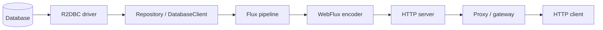
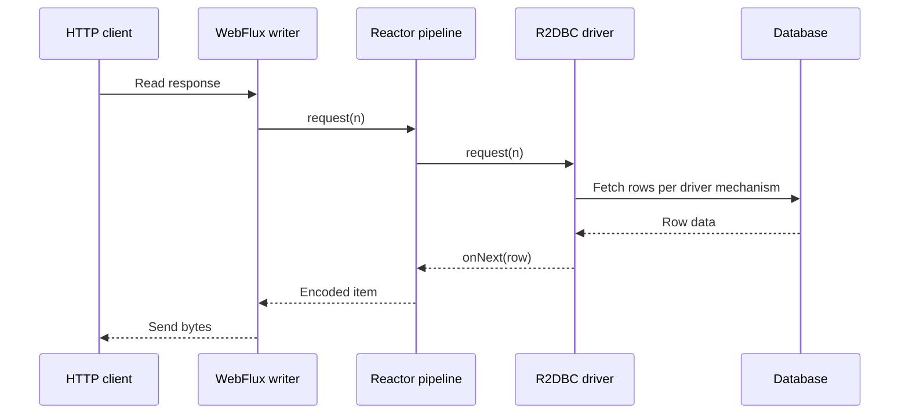

# Distinguishing HTTP Streaming from Database Result Streaming

In a Spring WebFlux application combined with Spring Data Relational R2DBC, data can be streamed from the database to the HTTP client. However, having a repository return `Flux<T>` only indicates that results are represented as a reactive stream at the application layer. It does not automatically guarantee that the client receives each record as soon as the database finishes reading it.

To achieve end-to-end streaming, both sides must be examined: whether the R2DBC driver emits rows on demand or buffers data; whether WebFlux encodes and flushes each item or collects everything into a single JSON array; and whether the HTTP server, reverse proxy, and client hold or buffer data. The two types of streaming are related, but they are distinct mechanisms.

## 1. Two Streaming Concepts at Two Layers

**Database result streaming** means reading rows from a query via R2DBC as a `Publisher`, usually `Flux<T>`. The application can process each row as it is emitted instead of waiting for all results to load into a collection.

**HTTP streaming** means sending a response in multiple parts over an HTTP connection so the client can process data before the entire response finishes. Response format, codec, flushing, transport, and intermediaries all affect this capability.

| Layer | What Streaming Means | Example |
| --- | --- | --- |
| Database/R2DBC | Rows are emitted through a reactive publisher item by item or in groups | `Flux<Order>` from a repository |
| Application pipeline | Operators process items individually and preserve the publisher | `map`, `filter`, `flatMap` |
| WebFlux encoder | Values are encoded into response units that can be sent incrementally | NDJSON or Server-Sent Events |
| HTTP transport | Bytes are transmitted over the connection as data becomes available | HTTP/1.1 chunked transfer or HTTP/2 DATA frames |
| Client | Client reads and processes received response parts | Reading line-by-line NDJSON or individual SSE events |

A pipeline can stream at the database layer without streaming at the HTTP layer. For instance, a repository emits `Flux<Order>`, the service calls `collectList()`, and the controller returns `List<Order>`; database results may be consumed reactively, yet HTTP only receives the response after the list is collected. Conversely, a controller can emit NDJSON from a non-database source; HTTP streaming still occurs even without R2DBC.

## 2. Data Flow from Database to HTTP Client

A typical streaming flow contains the following components:



Each layer can introduce buffering or alter data pacing. The database may return results in cursor/fetch batches; the driver may buffer; Reactor operators may prefetch; the WebFlux codec may aggregate data; the HTTP server or proxy may wait for enough bytes; and the client may wait for the full body before parsing.

Therefore, inspect the entire path. Looking solely at the `Flux<T>` return signature on a controller or repository is not enough to conclude an API truly streams.

## 3. Streaming Results from Spring Data R2DBC

Reactive repositories can return `Flux<T>` when a query returns multiple rows:

```java
public interface OrderRepository
        extends ReactiveCrudRepository<Order, Long> {

    Flux<Order> findByStatus(OrderStatus status);
}
```

The service can process each entity without collecting the entire result:

```java
public Flux<OrderSummary> streamOpenOrders() {
    return orderRepository.findByStatus(OrderStatus.OPEN)
            .map(OrderSummary::from);
}
```

When a subscriber demands data, the publisher is subscribed to and the query runs according to Spring Data R2DBC's mechanism. Results are mapped to entities and emitted through `Flux`.

With `R2dbcEntityTemplate`, `all()` also returns `Flux`:

```java
public Flux<Order> findRecentOrders() {
    Query query = Query.query(where("status").is(OrderStatus.OPEN))
            .sort(Sort.by(Sort.Order.desc("createdAt")))
            .limit(500);

    return template.select(Order.class)
            .matching(query)
            .all();
}
```

With `DatabaseClient`, each row can be mapped directly into a DTO:

```java
public Flux<OrderSummary> findOrderSummaries() {
    return databaseClient.sql("""
            SELECT id, order_number, total
            FROM orders
            WHERE status = :status
            ORDER BY id
            """)
            .bind("status", "OPEN")
            .map((row, metadata) -> new OrderSummary(
                    row.get("id", Long.class),
                    row.get("order_number", String.class),
                    row.get("total", BigDecimal.class)))
            .all();
}
```

`all()` emits mapped results as `Flux<OrderSummary>`. Row mapping must not return `null`; if a column is nullable, create a non-null DTO with nullable properties or use an appropriate wrapper.

## 4. `Flux` Does Not Mean the Database Always Sends One Row at a Time

`Flux<T>` is an application-level reactive abstraction. The R2DBC driver may use cursors, batch fetching, or protocol-specific mechanisms. Some drivers may buffer significant amounts of data before emitting; actual behavior depends on the database, driver, transaction, and configuration.

R2DBC SPI can accept a fetch-size hint via `Statement.fetchSize(int)` in SPI versions that support it. This is a hint to the driver, not a guarantee that every driver opens a cursor or fetches the exact specified row count.

Example using the SPI directly:

```java
Statement statement = connection.createStatement("""
        SELECT id, order_number
        FROM orders
        ORDER BY id
        """);

statement.fetchSize(200);

Flux<OrderRow> rows = Flux.from(statement.execute())
        .flatMap(result -> Flux.from(result.map((row, metadata) ->
                new OrderRow(
                        row.get("id", Long.class),
                        row.get("order_number", String.class)))));
```

This snippet illustrates setting a fetch size at the SPI level. Verify whether your R2DBC SPI version and driver support/honor this hint. With `DatabaseClient` or repositories, how fetch size is configured may depend on the API and driver; never assume every query automatically uses a cursor simply because it returns `Flux`.

## 5. `Result` and Row Consumption in R2DBC

At the SPI layer, `Statement.execute()` returns a publisher of `Result`. A `Result` may contain query rows or an affected row count. For row-based results, the application consumes them via `Result.map(...)` or equivalent APIs.

Conceptual example:

```java
Flux<OrderRow> rows = Flux.from(statement.execute())
        .concatMap(result -> Flux.from(result.map((row, metadata) ->
                new OrderRow(
                        row.get("id", Long.class),
                        row.get("order_number", String.class)))));
```

`Result` objects must be consumed per the SPI/driver contract. Never assume you can re-read the same result multiple times or retain a `Row` to use after the mapper finishes. Extract needed data into a DTO/entity inside the mapper.

When using repositories or `DatabaseClient`, Spring Data/Spring Framework handles most result-consumption details. Still, the application must keep the publisher intact in the pipeline and avoid unbounded collection when streaming is the goal.

## 6. Operations That Negate Streaming Benefits at the Application Layer

Some valid operators change how data is consumed:

```java
Mono<List<Order>> allOrders = orderRepository.findAll()
        .collectList();
```

`collectList()` waits for the source to complete before emitting a single `List`. The entire result set must fit in memory. For large tables, this can increase memory pressure or trigger `OutOfMemoryError`.

Other operations to watch out for:

| Operator/Pattern | Impact |
| --- | --- |
| `collectList()` | Collects all elements into a list and emits only after the source completes |
| `collectMap()` / `collectMultimap()` | Collects results into an in-memory map structure |
| `sort(...)` on `Flux` | Must collect all data to sort everything before emitting results |
| `reduce(...)` | Emits one aggregated result after the source completes |
| `buffer(n)` | Groups up to n elements; can still stream groups if downstream processes immediately |
| `limitRate(n)` | Adjusts demand in batches; does not automatically create a database cursor |
| `onBackpressureBuffer()` | Can accumulate items if downstream is slow; requires bounded buffer |

`collectList()` does not always need to be avoided. If an endpoint returns only a few dozen records and needs a complete JSON array, collecting data can be reasonable. What matters is understanding the memory, latency, and semantic behavior that the operation introduces.

## 7. HTTP Streaming Depends on Media Type

In Spring WebFlux, a controller can return `Flux<T>`, yet the codec picks how to encode based on media type. With a non-streaming media type like `application/json`, a `Flux` is usually encoded as a single JSON array value. With streaming media types like NDJSON or Server-Sent Events, individual elements can be encoded and flushed separately.

Example:

```java
@RestController
@RequestMapping("/api/orders")
public class OrderController {

    private final OrderService orderService;

    public OrderController(OrderService orderService) {
        this.orderService = orderService;
    }

    @GetMapping(produces = MediaType.APPLICATION_JSON_VALUE)
    public Flux<OrderSummary> list() {
        return orderService.streamOpenOrders();
    }

    @GetMapping(value = "/stream", produces = MediaType.APPLICATION_NDJSON_VALUE)
    public Flux<OrderSummary> stream() {
        return orderService.streamOpenOrders();
    }
}
```

Both methods return `Flux`, yet their HTTP contracts differ. `list()` returns a standard JSON array; WebFlux may need to collect items before writing a complete JSON document. `stream()` uses NDJSON to represent each element as a JSON value on its own line, suited for incremental consumption.

Verify codec behavior against your Spring Framework version and application message converter/encoder configuration. Never conclude streaming purely from the return type.

## 8. NDJSON: One JSON Value per Line

NDJSON (Newline Delimited JSON) is a format where each line contains an independent JSON object terminated by a newline. Spring WebFlux typically uses the media type `application/x-ndjson`, represented by `MediaType.APPLICATION_NDJSON_VALUE`.

Example response:

```text
{"id":101,"orderNumber":"PO-101","total":125.50}
{"id":102,"orderNumber":"PO-102","total":80.00}
{"id":103,"orderNumber":"PO-103","total":210.00}
```

Each line can be parsed independently as the client receives it, without waiting for a closing `]` of a JSON array. NDJSON fits exports, logs, large search results, or APIs loading records incrementally.

Controller:

```java
@GetMapping(value = "/export", produces = MediaType.APPLICATION_NDJSON_VALUE)
public Flux<OrderSummary> exportOrders() {
    return orderService.streamOpenOrders();
}
```

Clients can read line by line:

```bash
curl -N -H "Accept: application/x-ndjson" \
  http://localhost:8080/api/orders/export
```

curl's `-N` flag disables client-side output buffering so incremental arrivals are visible. It does not force the server or proxies to flush if those components are buffering.

## 9. Server-Sent Events (SSE)

SSE is a unidirectional streaming format from server to client, commonly used when the server emits events over time. The HTTP response uses media type `text/event-stream`; each event is separated by a blank line.

Spring WebFlux supports `ServerSentEvent<T>`:

```java
@GetMapping(value = "/events", produces = MediaType.TEXT_EVENT_STREAM_VALUE)
public Flux<ServerSentEvent<OrderEvent>> events() {
    return orderEventService.streamEvents()
            .map(event -> ServerSentEvent.builder(event)
                    .id(event.id())
                    .event("order-update")
                    .build());
}
```

An SSE event on the wire can look like this:

```text
id: 501
event: order-update
data: {"orderId":101,"status":"SHIPPED"}

```

Browser clients can use `EventSource` to consume events. SSE supports event IDs and reconnection; the server/client must design replay or resumption from `Last-Event-ID` if events must not be lost during disconnects.

SSE suits status notifications or continuous events. For finite data exports, NDJSON is usually simpler. Do not choose SSE merely because the endpoint returns `Flux`; pick the media type matching the protocol the client needs.

## 10. Standard JSON Arrays vs. NDJSON

`application/json` represents a single JSON document. For multiple results, the common shape is an array:

```json
[
  {"id": 101, "status": "OPEN"},
  {"id": 102, "status": "OPEN"}
]
```

Clients normally parse the array as a complete document. WebFlux may have to buffer/collect elements to encode a valid JSON array, so the client does not necessarily receive each object as soon as the query emits it.

NDJSON has no array brackets:

```text
{"id":101,"status":"OPEN"}
{"id":102,"status":"OPEN"}
```

Clients can parse each line independently. If the requirement is rendering each result as soon as it arrives, choose a streaming media type and corresponding client parser. If the requirement is a standard JSON response to deserialize into `List<T>`, `application/json` is appropriate.

Do not try to hand-craft a JSON array by manually concatenating strings for each object into the response. That easily produces invalid JSON on errors, improper escaping, or abrupt termination. Use WebFlux codecs or a streaming format designed for per-record framing.

## 11. HTTP Chunked Transfer Is Not a Record Format

HTTP/1.1 may use `Transfer-Encoding: chunked` when the server sends a response without knowing `Content-Length` upfront. Data is split into HTTP chunks at the transport layer. HTTP/2 uses `DATA` frames and its own flow control; it does not use the HTTP/1.1 `chunked` header.

An HTTP-level chunk does not equate to one database row or one JSON object. A single HTTP chunk might contain a partial NDJSON line, multiple lines, or an arbitrary byte slice of a JSON document. Clients must parse by content format, never by packet/chunk boundaries.

Similarly, seeing `Transfer-Encoding: chunked` on a response does not prove the application is streaming database rows one by one. A server might send a huge JSON array in multiple chunks after already collecting all results. Conversely, a streaming body over HTTP/2 has no `Transfer-Encoding: chunked` header yet still streams across multiple frames.

## 12. Backpressure Between WebFlux and R2DBC

Reactive Streams allows subscribers to request an item count via `request(n)`. As WebFlux writes the response, the encoder/server consumption rate can influence upstream demand; demand can propagate back through the Reactor pipeline to the R2DBC publisher.

Conceptual flow:



This is a conceptual model. Operators can prefetch, drivers can fetch in batches, and servers can maintain internal buffers. Backpressure is a demand-pacing signal in the pipeline, not a guarantee that the database reads strictly one row at a time or the network sends one row per frame.

If the client is slow, downstream can reduce request rate. This helps prevent certain kinds of unbounded accumulation, though it only works effectively if upstream layers respect demand or use bounded buffers.

## 13. Limiting Buffers and Prefetch

Some Reactor operators buffer items to increase throughput. For example, `flatMap` may subscribe to multiple inner publishers concurrently and prefetch items. `publishOn` also uses a queue to hand signals across schedulers.

For large streams, choose concurrency and prefetch deliberately:

```java
return orderRepository.findAll()
        .flatMap(this::enrichOrder, 8, 16);
```

This example caps concurrent `enrichOrder` tasks and configures prefetch. The values `8` and `16` are illustrative; tune them based on operation cost and connection pool limits if enrichment hits the database.

If only lightweight synchronous transformation is needed, `map` is easier to control:

```java
return orderRepository.findAll()
        .map(OrderSummary::from);
```

Avoid unbounded `onBackpressureBuffer()` for long streams. If downstream is slower than upstream, the buffer can grow until memory runs out. When buffering is required, configure a cap and explicit overflow behavior: error, drop, or another business-appropriate strategy.

## 14. Cancellation When Clients Disconnect

When a client closes the connection before a stream completes, WebFlux can cancel the response subscription. Cancellation can propagate back through Reactor to the R2DBC publisher. The driver/database may cancel the statement or stop fetching depending on driver capabilities.

Do not assume cancellation always halts all database work instantaneously. Behavior depends on the driver, server, and when the query was dispatched. For large queries, test client disconnects and inspect active queries/sessions on the database.

Cancellation can be logged for observability:

```java
public Flux<OrderSummary> streamOrders() {
    return orderRepository.findAll()
            .map(OrderSummary::from)
            .doOnCancel(() -> log.info("Order stream was cancelled"));
}
```

`doOnCancel` is solely for observation; it does not replace resource release managed by Spring/the driver. If the application manually opens resources, use reactive lifecycle management such as `usingWhen` to clean up on complete, error, or cancel.

## 15. Transactions and Connections Can Be Held Throughout the Stream

If a streaming query runs inside a reactive transaction, the connection may be held until the publisher completes, errors, or is cancelled. For long responses, a slow client can keep the connection and transaction open much longer than anticipated.

This can lead to:

- Connection pool saturation caused by slow-downloading responses.
- Long-lived transactions holding snapshots/locks or impacting vacuuming depending on database/isolation.
- Other requests queuing for connections and experiencing higher latency.
- Clients disconnecting while the driver takes time to terminate the query.

Never place an unbounded stream like SSE inside a long-lived database transaction. For continuous event streams, source events from a broker or dedicated event system; if reading from a database is needed, run short batched queries and close the transaction/connection before waiting for the next event.

For finite exports, bound the data range, row count, runtime, and timeouts. Consider keyset pagination for very large exports so a single cursor/transaction is not held open excessively.

## 16. Streaming Format Must Match the Client

Clients must know how to delimit data units:

| Media Type | Delimiting Mechanism | Typical Client |
| --- | --- | --- |
| `application/json` | Single JSON document, usually an array for multiple items | JSON parser reading full body |
| `application/x-ndjson` | Each line is one JSON value | Line reader + per-line JSON parser |
| `text/event-stream` | SSE events terminated by blank lines | Browser `EventSource` or SSE client |
| `text/plain` | Application-defined, usually a text stream | Text/line reader |
| `application/octet-stream` | Byte stream; record framing defined by application | Binary stream reader |

Never return NDJSON while declaring `application/json`, or return SSE to a client using a JSON array parser. `Content-Type` is part of the API contract and must be tested.

## 17. Complete NDJSON Endpoint Example

DTO:

```java
public record OrderLine(
        Long id,
        String orderNumber,
        BigDecimal total
) {
}
```

Service:

```java
@Service
public class OrderExportService {

    private final OrderRepository repository;

    public OrderExportService(OrderRepository repository) {
        this.repository = repository;
    }

    public Flux<OrderLine> exportOpenOrders() {
        return repository.findByStatus(OrderStatus.OPEN)
                .map(order -> new OrderLine(
                        order.getId(),
                        order.getOrderNumber(),
                        order.getTotal()));
    }
}
```

Controller:

```java
@RestController
@RequestMapping("/exports")
public class OrderExportController {

    private final OrderExportService service;

    public OrderExportController(OrderExportService service) {
        this.service = service;
    }

    @GetMapping(value = "/open-orders", produces = MediaType.APPLICATION_NDJSON_VALUE)
    public Flux<OrderLine> exportOpenOrders() {
        return service.exportOpenOrders();
    }
}
```

With this setup, WebFlux can encode each `OrderLine` into an NDJSON line and flush per streaming unit. The R2DBC repository emits data as a `Flux`; whether the database driver fetches via cursor or buffers still needs verification against the driver. The endpoint never calls `collectList()`, so it does not gather the entire list in the service.

In production applications, add filtering/tenant scoping, export limits, timeouts, authorization, and auditing. Never expose unbounded export endpoints to arbitrary users.

## 18. SSE Example for Status-Change Events

SSE fits when clients need events over time rather than downloading a finite list:

```java
@RestController
@RequestMapping("/orders")
public class OrderEventController {

    private final OrderEventService eventService;

    public OrderEventController(OrderEventService eventService) {
        this.eventService = eventService;
    }

    @GetMapping(value = "/events", produces = MediaType.TEXT_EVENT_STREAM_VALUE)
    public Flux<ServerSentEvent<OrderEvent>> events() {
        return eventService.events()
                .map(event -> ServerSentEvent.builder(event)
                        .id(event.id())
                        .event("order-status")
                        .build());
    }
}
```

`eventService.events()` can draw events from a broker, sink, or other reactive source. Avoid keeping a database query open indefinitely just to feed SSE. If heartbeats are needed to keep connections alive through proxies, design comment events or heartbeats compatible with SSE/clients without hammering the database.

SSE is unidirectional from server to client. If clients must send commands or updates, use separate HTTP endpoints or a bidirectional protocol such as WebSocket.

## 19. Client Disconnects and Reconnection

With NDJSON, clients normally read and process line by line. If the connection drops, the final line may be truncated; clients must discard incomplete lines or use a protocol with sequence IDs to resume safely.

With SSE, `EventSource` clients support automatic reconnection and can send `Last-Event-ID`. The server must decide:

- Are event IDs monotonically increasing and unique within the stream?
- Can events be replayed starting from that ID?
- What happens if requested events are too old or purged?
- Are access permissions re-verified upon reconnect?
- Can an event be redelivered and is the client idempotent?

Reconnection does not imply exactly-once delivery. Clients may receive duplicate events if the server cannot know for sure whether the client processed the last event before disconnect. Use event IDs and consumer/client idempotency when duplicate processing has consequences.

## 20. Errors Occurring After Response Commit

The HTTP status and headers are sent at the start of the response. Once the server commits the response and transmits bytes, it cannot normally change the status code to `500` if the database query errors mid-stream.

For example, the server sends 50 NDJSON lines and then loses the database connection. The response may terminate abnormally or the connection may close. Clients should never assume an initiated stream will always finish cleanly.

Design options:

- With NDJSON, define a trailing error record if the API contract permits and clients clearly distinguish it from normal business items.
- With SSE, emit a structured error event if the stream can still write, then terminate per policy.
- Use sequence IDs/checkpoints so clients can resume from the last processed position.
- Log with correlation IDs to support troubleshooting.
- Never send stack traces or internal database details to clients.

`onErrorResume` can convert an error into another element in the stream, but only do so when the protocol explicitly defines error representations. Never turn a database error into an empty DTO that clients mistake for valid data.

## 21. Timeouts Across Database, WebFlux, and Proxies

A stream can be interrupted by multiple timeout layers:

- Query timeout or statement timeout at the database/driver.
- Pool connection acquire timeout.
- Server or reactive pipeline timeout.
- Idle timeout on load balancers, reverse proxies, or API gateways.
- Client-side timeouts.

These timeouts have different scopes. For instance, a database query timeout does not necessarily bound the total HTTP response duration if the query finished reading while the server is still flushing buffers; a proxy idle timeout might close an SSE connection if no bytes flow for a long period.

Configure timeouts by use case. For finite exports, set reasonable deadlines and row limits. For long-lived SSE, use heartbeats if needed and align idle timeouts across network tiers. Never raise timeouts indefinitely to mask uncontrolled queries or streams.

## 22. Reverse Proxies and Compression May Buffer Responses

Even when WebFlux encodes and flushes each element, a reverse proxy or compression layer may accumulate bytes before forwarding to the client. Some gateways buffer responses by default or flush only when a buffer threshold is reached.

When deploying streaming endpoints:

- Inspect response-buffering settings on Nginx/API gateways/ingress controllers.
- Verify whether compression middleware holds large buffers.
- Ensure proxy timeouts match long-lived streams.
- Inspect `Content-Type` and related headers.
- Test incremental delivery with real network clients, not just controller unit tests.

A custom header like `X-Accel-Buffering: no` may be recognized by certain Nginx setups, but it is not a universal standard forcing every proxy to disable buffering. Use it only when your specific infrastructure supports and is tested with it.

## 23. Memory Limits and Payload Size

Streaming avoids holding the entire response in memory, yet each element still gets read, mapped, encoded, and potentially buffered at multiple layers. Very large records or BLOB fields can significantly raise memory usage.

Mitigations:

- Select only required columns instead of `SELECT *`.
- Use lean DTOs instead of serializing bloated entity graphs.
- Limit row counts or export time windows.
- Configure an appropriate fetch size if supported by the driver.
- Bound concurrency/prefetch and all pipeline buffers.
- Avoid `collectList`, `sort`, or caching massive datasets.
- Use keyset pagination or background export jobs for very large datasets.
- Monitor heap, direct memory, connection pool usage, and response throughput.

If an export takes several minutes, consider generating the file asynchronously, storing it in object storage, and giving the client a time-limited download URL. This is usually much easier to operate than holding HTTP and database connections open for extended periods.

## 24. Security When Streaming Database Data

Streaming does not relax security requirements. Because data goes out incrementally, an authorization or filtering bug can leak sensitive data in the very first items before the server detects a violation.

Make sure to:

- Authenticate and resolve the tenant before the query begins.
- Push tenant/ownership filters into the database query rather than filtering in memory after reading.
- Select only columns the client is permitted to view.
- Never serialize entities containing internal or secret fields.
- Check permissions before starting the response; never defer authorization until mid-stream.
- Bound duration, row counts, and export rates.
- Handle client disconnects and clean up resources.
- Never include SQL, stack traces, or credentials in error records.

If a stream carries tenant data, the routing key and transaction context must remain stable throughout the query. Never switch tenants mid-stream.

## 25. When to Choose NDJSON, SSE, or Standard JSON?

| Requirement | Suitable Format | Reason |
| --- | --- | --- |
| CRUD API returning small/medium list | `application/json` | Clients deserialize simply into an array |
| Exporting many records for line-by-line processing | `application/x-ndjson` | Each JSON value is independent and incrementally parseable |
| Server pushing continuous status events to browser | `text/event-stream` | SSE provides event IDs, event types, and reconnect |
| Binary file download | `application/octet-stream` or file media type | Content is a byte stream, not JSON objects |
| Client needs continuous bidirectional messaging | WebSocket or bidirectional protocol | SSE is server-to-client only |
| Dataset too huge or slow to generate | Background export + object storage | Avoids holding connections/transactions open |

Do not choose streaming just because you can. Streaming adds API complexity around mid-stream errors, reconnects, client parsing, proxies, and resource management. For small lists, standard JSON is simpler to consume and cache.

## 26. Testing Streaming Across Layers

Service unit tests with `StepVerifier` verify the publisher emits expected items without incorrect collection:

```java
StepVerifier.create(orderService.streamOpenOrders())
        .expectNextMatches(order -> order.status() == OrderStatus.OPEN)
        .expectNextMatches(order -> order.status() == OrderStatus.OPEN)
        .verifyComplete();
```

WebFlux integration tests can verify status, content type, and body:

```java
webTestClient.get()
        .uri("/exports/open-orders")
        .accept(MediaType.APPLICATION_NDJSON)
        .exchange()
        .expectStatus().isOk()
        .expectHeader().contentTypeCompatibleWith(MediaType.APPLICATION_NDJSON)
        .expectBody()
        .consumeWith(result -> {
            String body = new String(
                    result.getResponseBody(), StandardCharsets.UTF_8);
            assertThat(body).contains("PO-");
        });
```

That test verifies media type and final content, yet it does not prove individual lines were delivered before the publisher completed. To verify true streaming, test emission timing:

1. Create a publisher that emits the first item immediately and the second item after a controlled delay.
2. Use an HTTP client that reads the response body buffer-by-buffer or line-by-line.
3. Assert that the first item arrives at the client before the second item is emitted.
4. Assert headers/content type and newline/event delimiters.
5. Disconnect the client mid-stream and inspect cancellation/cleanup.
6. Simulate a database error mid-stream and verify the client sees the contracted error behavior.

To test database streaming, write integration tests against the actual R2DBC driver/database and observe fetch/query behavior. A mocked repository returning `Flux` cannot prove the driver is not buffering the entire result.

## 27. Testing Streaming Through Proxies and Deployment Environments

Unit tests and `WebTestClient` usually bypass production reverse proxies, load balancers, and compression middleware. Add system-level checks:

- Call the endpoint through the actual ingress/gateway.
- Use `curl -N` or a client reading line by line.
- Measure time to first byte and inter-record arrival timing.
- Check whether proxies buffer the response.
- Verify idle timeouts for SSE or long streams.
- Disconnect clients and inspect active queries/connections on the database.
- Measure memory and connection pool usage under concurrent streaming clients.

If data only arrives after the query finishes despite the controller using NDJSON, inspect `collectList`, codecs, proxy buffering, compression, server write buffers, and client reading behavior. Do not automatically blame R2DBC.

## 28. Common Mistakes

| Mistake | Consequence | Fix |
| --- | --- | --- |
| Assuming `Flux` in a controller always HTTP-streams | Client may only receive an array after source completes | Choose a streaming media type and verify codec |
| Using `application/json` for exports needing immediate lines | Response may be collected into a JSON array | Use NDJSON or SSE per contract |
| Calling `collectList()` on large queries | Increases memory usage and delays first response | Process item by item or buffer in small batches |
| Thinking `Transfer-Encoding: chunked` means one row per chunk | Mis-parses data boundaries | Parse by NDJSON/SSE/JSON framing, not HTTP chunks |
| Thinking `Flux` guarantees the driver does not buffer | Can consume more memory than expected | Check driver, fetch size, and execution behavior |
| Ignoring backpressure and prefetch | Buffers grow when clients are slow | Bound concurrency, prefetch, and buffers |
| Holding a transaction for unbounded SSE | Holds connections long, exhausts pool | Use dedicated event sources and short queries |
| Ignoring cancellation | Queries/resources may linger after client leaves | Track cancel signals and test driver cleanup |
| Failing to handle errors after response starts | Clients get truncated streams without understanding status | Define error records/events or resume protocol |
| Not testing proxy buffering | Server flushes yet client receives everything late | Test through gateway and configure proxy |
| Using `subscribe()` inside controller/service | Detaches query from HTTP lifecycle | Return `Flux`/`Mono` so WebFlux manages subscription |
| Unbounded streams or missing authorization filters | Heavy DB load or data leaks | Bound queries, filter in DB, authorize before response |

## 29. Workflow for Designing a Streaming Endpoint

When building an endpoint that emits data incrementally, follow these steps:

1. Determine whether the client expects a complete JSON document, line-by-line records, or continuous events.
2. Select the matching media type and protocol: JSON, NDJSON, or SSE.
3. Design the R2DBC query to select only required columns with stable filtering and ordering.
4. Return `Flux` from the repository/template/`DatabaseClient`; avoid full collection when data is large.
5. Check whether the driver fetches via cursor/batches or buffers; apply fetch-size hints if supported.
6. Bound concurrency, prefetch, buffers, row counts, and query duration.
7. Evaluate transaction/connection lifetimes and behavior on client cancellation.
8. Define mid-stream error handling, reconnection, checkpoints, and idempotency if clients must resume.
9. Test content types, incremental delivery, error/cancellation paths, and the real database driver.
10. Test through proxies/ingress and measure time-to-first-byte, throughput, memory, and connection pool behavior.

## 30. Best Practices

- Distinguish R2DBC result streaming from HTTP response streaming; configure and test both layers separately.
- Use `Flux<T>` for reactive multi-row processing, without treating it as proof the driver avoids buffering.
- Avoid `collectList`, `sort`, and full-collection operators when data is large and early emission is needed.
- Use `application/x-ndjson` for individual JSON records and `text/event-stream` for SSE events.
- Use `application/json` when clients expect a complete JSON document/array.
- Never confuse HTTP chunks or HTTP/2 frames with record boundaries.
- Check `Statement.fetchSize` and fetch behavior in driver documentation; it is a driver-dependent hint.
- Maintain backpressure by bounding prefetch, concurrency, and buffers.
- Never hold database transactions/connections open for unbounded streams or slow client waits.
- Handle cancellation, timeouts, and errors occurring after response commit.
- Verify proxy, gateway, compression, and client buffering in real deployment environments.
- Apply authorization/filtering in the database before starting the stream; limit downloadable data volume.
- Use protocol-compliant NDJSON/SSE parsers and design resume/idempotency if reconnection is needed.
- Test reactive publishers, HTTP streaming, and the real driver/database.

## 31. Conclusion

Database result streaming and HTTP streaming are two separate mechanisms. An R2DBC repository returning `Flux<T>` lets the application receive and process rows reactively; whether the driver fetches via cursors or buffers remains driver-dependent. WebFlux only sends data incrementally when the codec and media type support streaming, such as NDJSON or SSE, and when transport, proxies, and clients do not buffer the response before forwarding it.

To achieve end-to-end streaming, avoid collecting the entire result set, choose the right media type, preserve backpressure, bound buffers, and manage connection/transaction lifetimes. Test every layer as well as the full path through production-like proxies. `Flux` is the foundation for reactive processing, while HTTP streaming is an explicit transport contract designed for the client.
