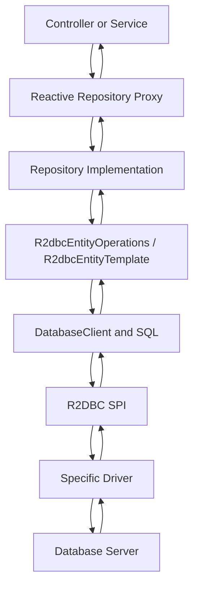
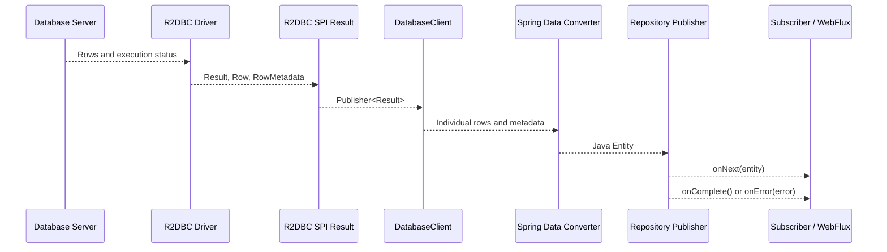

# Path from Repository to Driver and Database

## 1. Looking at the Full Path of a Data Operation

In Spring Data R2DBC, an application typically works with repositories and reactive types such as `Mono<T>` or `Flux<T>`. Underneath, that call passes through components of Spring Data Relational, Spring Framework, and the R2DBC SPI before reaching the specific driver of the database management system.

Each layer has its own responsibility:

| Layer | Typical Component | Responsibility |
| --- | --- | --- |
| Application | Controller, service | Describes business logic and composes publishers |
| Repository | `ReactiveCrudRepository`, repository proxy | Provides a data access API following the domain model |
| Spring Data Relational | Repository implementation, mapping metadata, converter | Parses methods, builds operations, and maps entities |
| Spring Framework R2DBC | `R2dbcEntityTemplate`, `DatabaseClient` | Prepares SQL, acquires connections, binds parameters, executes, and reads results |
| R2DBC SPI | `ConnectionFactory`, `Connection`, `Statement`, `Result`, `Row` | Standard contract between the framework and the driver |
| R2DBC driver | PostgreSQL, H2, MySQL driver, or corresponding driver | Translates SPI operations into the database's specific protocol |
| Database management system | PostgreSQL, H2, MySQL, SQL Server... | Parses SQL, executes statements, and returns results |

This path can be visualized as follows:



The diagram illustrates the logical path. Depending on the API used, some components may be called directly or combined inside another component. For example, an application can use `R2dbcEntityTemplate` without declaring a repository; in that case, the repository part is bypassed, while the `DatabaseClient`, SPI, and driver layers still retain their respective roles.

The key point is that a repository does not open sockets itself and does not directly understand the network protocol of PostgreSQL or MySQL. A repository expresses data access intent at the domain level. The underlying layers translate that intent into statements, execute them through the SPI and driver, and then transform the results back into Java objects.

## 2. The Application Calls the Repository

A reactive repository typically extends `ReactiveCrudRepository`:

```java
@Table("customer")
public class Customer {

    @Id
    private Long id;

    @Column("email_address")
    private String email;

    private String status;

    // Constructors, getters and setters
}
```

```java
public interface CustomerRepository
        extends ReactiveCrudRepository<Customer, Long> {

    Flux<Customer> findByStatus(String status);
}
```

The application can call the repository from a service:

```java
@Service
public class CustomerService {

    private final CustomerRepository repository;

    public CustomerService(CustomerRepository repository) {
        this.repository = repository;
    }

    public Flux<Customer> findActiveCustomers() {
        return repository.findByStatus("ACTIVE");
    }
}
```

The method returns `Flux<Customer>`, representing a source that can emit multiple customers. At this point, the service is building and returning a pipeline. With standard reactive repositories, SQL is executed when the publisher is subscribed to, typically when the web framework or an upper-layer component consumes the results.

### 2.1. A Repository Is a Proxy

A repository interface does not contain implementation bodies for CRUD methods. Spring Data creates the repository bean at application startup. The repository factory creates a proxy to handle method calls and delegate to the appropriate implementation.

For reactive repositories, Spring Data R2DBC provides a default CRUD implementation, typically represented by `SimpleR2dbcRepository`. This implementation uses Spring Data R2DBC's data operation abstraction to perform read, save, and delete operations.

The proxy also handles query methods declared in the interface. Depending on the method type, Spring Data can:

- Recognize a pre-provided CRUD method.
- Parse a method name such as `findByStatus` to generate a derived query by convention.
- Use the SQL statement declared with `@Query`.
- Route the call to a custom implementation if the repository has a custom fragment.

Example with a query declared using an annotation:

```java
public interface CustomerRepository
        extends ReactiveCrudRepository<Customer, Long> {

    @Query("SELECT id, email_address, status FROM customer WHERE status = :status")
    Flux<Customer> searchByStatus(@Param("status") String status);
}
```

The method name, annotations, and return type tell Spring Data what operation the application wants to perform. The repository does not need to contain code for opening connections or calling driver APIs.

### 2.2. Repository Factory and Mapping Metadata

When creating a repository, Spring Data needs to know which entity is managed, which property is the ID, and the corresponding table and column names. That information is built from mapping metadata and annotations such as `@Table`, `@Id`, and `@Column`, combined with naming rules and mapping configuration.

This metadata helps the framework understand that:

- `Customer` corresponds to the `customer` table.
- The `id` property is the identifier of the entity.
- The `email` property maps to the `email_address` column.
- Which properties need to participate in insert, update, or select statements.

Mapping information is also used when converting Java values into SQL parameters and when converting a result row's values into an entity.

## 3. Repository Delegates Operations to the Entity Operations Layer

The repository implementation should not handle all SQL and mapping details itself. Spring Data R2DBC provides an entity operations abstraction, notably `R2dbcEntityOperations`; the common implementation is `R2dbcEntityTemplate`.

`R2dbcEntityTemplate` is a high-level API for working with entities. It supports operations such as select, insert, update, and delete. The template uses metadata, data access strategies, and converters to build statements tailored to the entity.

The template can be used directly without a repository:

```java
public Flux<Customer> findActiveCustomers(R2dbcEntityTemplate template) {
    return template.select(Customer.class)
            .matching(query(where("status").is("ACTIVE")))
            .all();
}
```

The snippet above still returns a publisher. The template accepts the entity type and query criteria, then coordinates with the underlying components to generate and execute SQL.

### 3.1. SQL Generation and Parameter Resolution

For queries derived from method names or from the template API, Spring Data analyzes the conditions and generates the SQL statement. With `@Query`, the SQL statement is declared directly, but parameters still need to be bound safely.

When building a statement, the framework must determine:

- The table and columns to access.
- `WHERE` conditions, sorting, and result limits if present.
- Positions or placeholder names for parameters.
- How to convert Java data types into types accepted by the driver/database.
- How to convert returned columns into entity properties.

The database dialect provides the differences between database management systems, such as placeholder syntax or SQL specifics. Therefore, a query can be represented in a relatively database-independent way at the Spring Data layer and then adapted according to the configured dialect and driver.

For example, an input value such as `status` should be passed as a bind parameter. You should not concatenate input strings directly into SQL:

```java
// Parameterized form: the value is bound separately from the SQL statement.
databaseClient.sql(
        "SELECT id, email_address, status FROM customer WHERE status = :status"
    )
    .bind("status", status)
    .map((row, metadata) -> /* map row to Customer */)
    .all();
```

Binding parameters allows the driver to send values using its parameter mechanism, while preventing input data from being misinterpreted as part of the SQL syntax. Specific marker names can vary by dialect; the `DatabaseClient` API helps the application work with the appropriate markers.

### 3.2. Converters and Data Types

Spring Data R2DBC uses converters to convert between Java types and database data types. Common types can be handled out of the box; the application can also register custom converters when a special domain type needs to be represented.

For example, a `CustomerStatus` enum can be stored as a string or another representation depending on converter configuration. If a Java type is not directly supported by the driver or requires custom representation rules, the converter handles the conversion before binding or after reading results.

Converters and mapping metadata allow repositories to keep an entity-based API, while SQL statements still operate on the tables, columns, and data types of the database management system.

## 4. DatabaseClient Prepares and Executes Statements

`DatabaseClient` belongs to Spring Framework R2DBC and provides a reactive API for executing SQL. It sits closer to the R2DBC SPI than repositories and the entity template.

An operation through `DatabaseClient` typically needs to perform the following tasks:

1. Receive the SQL and bind values.
2. Acquire a connection from `ConnectionFactory` or use a connection already managed within the current transaction.
3. Create a `Statement` on the connection.
4. Bind parameters to the statement.
5. Invoke execution and receive a publisher containing `Result` objects.
6. Read each result row or affected row count.
7. Close or return the connection to the resource management mechanism when the operation finishes, if the connection does not belong to an actively managed transaction.

Example of using `DatabaseClient` directly:

```java
public Flux<Customer> findByEmail(DatabaseClient databaseClient, String email) {
    return databaseClient.sql(
                    "SELECT id, email_address, status " +
                    "FROM customer WHERE email_address = :email")
            .bind("email", email)
            .map((row, metadata) -> new Customer(
                    row.get("id", Long.class),
                    row.get("email_address", String.class),
                    row.get("status", String.class)))
            .all();
}
```

This example illustrates the path at the SQL layer. When using a Spring Data repository or `R2dbcEntityTemplate`, mapping is typically configured centrally and performed via converters rather than manually constructing each entity inside a callback.

### 4.1. Acquiring a Connection

`DatabaseClient` requires a `ConnectionFactory`. This is the R2DBC SPI factory used to create or provide connections to the database. The factory is usually configured with a connection URL, credentials, and driver-specific options.

In a Spring application, `ConnectionFactory` is typically declared as a bean. Spring Boot can auto-configure this bean based on the R2DBC datasource configuration and the driver present on the classpath.

A connection does not necessarily correspond to a new socket for every SQL statement. The driver or application may use a pool to reuse connections. When a connection pool is used, the `ConnectionFactory` seen by the application may be a wrapper factory around the driver-provided factory; acquiring a connection borrows one from the pool, and closing it returns it to the pool.

When inside a reactive transaction, the framework can look up and reuse the connection already bound to the current transaction instead of acquiring a new independent connection. This mechanism ensures that statements within the same transaction participate in a single unit of work.

## 5. R2DBC SPI: The Contract Between Framework and Driver

The R2DBC SPI defines a standard API for the framework to communicate with a driver without depending directly on each database's proprietary protocol.

Key components include:

| SPI Component | Role |
| --- | --- |
| `ConnectionFactory` | Creates or provides connections |
| `Connection` | Represents a connection and provides APIs to create statements, manage transactions, inspect metadata, or close the connection |
| `Statement` | Represents a SQL statement prepared for execution along with its bind values |
| `Result` | Represents statement execution results; may contain data rows or affected row counts |
| `Row` | Represents a single row of data in a query result |
| `RowMetadata` | Provides metadata about the columns in a row |
| `Batch` | Allows grouping multiple SQL statements for execution according to SPI/driver capabilities |

### 5.1. ConnectionFactory and Connection

`ConnectionFactory` is the entry point for connections. The framework requests the factory to provide a connection following the reactive protocol. Once a connection is acquired, the framework can create statements, begin transactions, or read metadata as needed.

`Connection` provides operations such as:

- `createStatement(sql)` to create a statement.
- `beginTransaction()` to start a transaction.
- `commitTransaction()` to commit.
- `rollbackTransaction()` to roll back.
- `close()` to release the connection or return it to the pool.

These SPI operations are designed reactively. Acquiring a connection, executing a statement, and closing a connection are represented as publishers so they can be composed in a pipeline.

### 5.2. Statement and Parameter Binding

`Statement` represents a SQL statement on a connection. The framework or application supplies parameter values via bind methods using the markers supported by the driver.

Example of what binding means:

```text
SQL:       SELECT * FROM customer WHERE id = $1
Parameter: $1 <- value 42
```

This is only an illustration of placeholders; actual marker syntax depends on the driver and database. Applications should use the bind API of `DatabaseClient` or the SPI, and avoid assuming that one database's markers work across all other databases.

A statement may be executed multiple times with different sets of parameters depending on SPI and driver capabilities. The driver is responsible for translating the statement and bound values into messages compatible with the database protocol.

### 5.3. Result, Row, and RowMetadata

When a statement is executed, the driver emits `Result` objects. For a `SELECT` query, the result can provide rows through `Row`. For `INSERT`, `UPDATE`, or `DELETE` statements, the result can provide the affected row count and returned values if supported by the database.

`Row` provides the value of each column; `RowMetadata` describes column names, data types, and corresponding metadata. The framework uses these two components to locate columns to read and convert values into Java types.

One important note is that the lifecycle of `Row` and its values depends on the driver. Applications should read or convert data inside the mapping callback provided by the API, rather than retaining `Row` for arbitrary use after the callback finishes. For large or special data types such as LOBs, follow the consumption and resource-release rules required by the driver.

## 6. Driver Translates SPI into the Database Protocol

The R2DBC SPI is a common contract. A specific driver implements that contract for a specific database management system. For example, the PostgreSQL driver understands PostgreSQL's wire protocol; the H2 driver understands how to communicate with H2; other database drivers implement their corresponding details.

When receiving a request to execute a statement, the driver typically must:

- Prepare or encode the SQL statement according to the database protocol.
- Encode parameter values according to the data types supported by the database.
- Send messages over the network connection or communication channel provided by the database.
- Receive responses from the server.
- Decode execution status, metadata, and result rows.
- Convert results into SPI objects such as `Result`, `Row`, and `RowMetadata`.

The driver is also responsible for specific differences such as authentication, data types, bind markers, protocol error handling, timeouts, and operation cancellation according to database capabilities.

This is why applications usually depend only on the R2DBC SPI and Spring Data R2DBC. If you switch databases, the application may need to change the driver, configuration, dialect, and adjust database-specific SQL statements, without necessarily rewriting the entire repository layer.

Reactive does not mean the driver automatically spawns a new thread for every SQL statement. A driver may use non-blocking I/O, event loops, and various internal mechanisms. What the SPI guarantees at the API level is that operations are represented as publishers and can be coordinated under the reactive protocol.

## 7. Database Server Executes the Statement

When receiving messages from the driver, the database server processes the statement according to the database engine's mechanisms. Depending on the statement and database, the process may include:

1. Parsing SQL syntax and checking access permissions.
2. Resolving tables, columns, data types, and related objects.
3. Building or selecting an execution plan.
4. Reading or modifying data, using indexes and required storage structures.
5. Applying transaction rules, locks, and consistency guarantees.
6. Returning execution status, affected row counts, or result rows.

Specific steps depend on the database management system, statement, execution plan, configuration, and data state. Spring Data R2DBC does not execute these steps directly; it sends requests through the driver and receives results forwarded by the driver.

For a read query, the database may return multiple rows in batches. The driver receives those data chunks and turns them into SPI results. Upper reactive layers consume rows according to subscriber demand, depending on the driver's buffering and prefetch mechanisms along with operators in the pipeline.

For a write operation, the database returns status or affected row counts. If an entity is saved and the database generates an ID, the returned value can be used to update the entity emitted by the publisher, depending on how it is saved and the database's returning capabilities.

## 8. The Return Path: From Row Back to Entity

When the database returns results, data travels back up through the layers:



The main steps:

1. The database sends data rows or execution status back to the driver.
2. The driver decodes the response and exposes R2DBC SPI objects.
3. `DatabaseClient` consumes the results and provides an API to read rows.
4. The Spring Data converter reads columns, converts types, and constructs the entity.
5. The repository publisher emits entities toward the service or controller.
6. The final subscriber receives the elements, or receives a completion or error signal.

For `Customer`, the data row has columns `id`, `email_address`, and `status`. Mapping metadata tells Spring Data that `email_address` corresponds to the Java property `email`. The converter transforms each value into its corresponding Java type and creates or populates the `Customer` object.

Mapping can use a matching constructor, property access, or other mapping rules depending on the entity and configuration. If a column name does not match default naming rules, annotations such as `@Column` or a naming strategy configuration help determine the exact mapping.

If a data type from the database cannot be converted to the target Java type, the mapping process may throw an error. That error is propagated back as a publisher error signal, which can then be handled with Reactor operators such as `onErrorResume`.

## 9. End-to-End Example: Finding Customers by Status

Suppose an application needs to find all active customers. The repository declares:

```java
public interface CustomerRepository
        extends ReactiveCrudRepository<Customer, Long> {

    Flux<Customer> findByStatus(String status);
}
```

The service uses the repository:

```java
public Flux<Customer> findActiveCustomers() {
    return customerRepository.findByStatus("ACTIVE");
}
```

When an HTTP request hits the corresponding endpoint, WebFlux receives `Flux<Customer>` and subscribes to write data to the response. The call path unfolds as follows:

| Step | Component | Work Performed |
| ---: | --- | --- |
| 1 | WebFlux | Subscribes to the publisher returned by the controller |
| 2 | Repository proxy | Receives the `findByStatus("ACTIVE")` call |
| 3 | Query execution | Parses the derived query and the `status` parameter |
| 4 | Entity operations | Prepares the query according to `Customer` mapping metadata |
| 5 | DatabaseClient | Generates SQL and binds the value `ACTIVE` |
| 6 | ConnectionFactory | Provides a connection, possibly via a pool or the current transaction |
| 7 | R2DBC SPI | Creates the statement, binds the parameter, and executes |
| 8 | Driver | Translates the statement into database protocol messages |
| 9 | Database Server | Executes the query and returns matching rows |
| 10 | Driver and SPI | Decodes the response into `Result` and `Row` |
| 11 | Converter | Maps each row into a `Customer` |
| 12 | Publisher | Emits each `Customer` to WebFlux |
| 13 | WebFlux | Writes data to the response and completes or propagates errors |

The generated SQL might look similar to the following; the actual placeholder syntax depends on the dialect and driver:

```sql
SELECT id, email_address, status
FROM customer
WHERE status = ?
```

The key point is that the value `ACTIVE` is bound as a parameter. The framework and driver are responsible for handling markers, data types, and the protocol sent to the database.

## 10. Where Do Transactions Fit in the Path?

A transaction wraps one or more data operations. With Spring Data R2DBC, reactive transactions are typically managed by `R2dbcTransactionManager` or `TransactionalOperator`.

Example using annotations:

```java
@Service
public class CustomerService {

    private final CustomerRepository customerRepository;
    private final AuditRepository auditRepository;

    @Transactional
    public Mono<Void> deactivateCustomer(Long id) {
        return customerRepository.findById(id)
                .flatMap(customer -> {
                    customer.setStatus("INACTIVE");
                    return customerRepository.save(customer);
                })
                .flatMap(customer -> auditRepository
                        .save(new AuditEntry("CUSTOMER_DEACTIVATED", customer.getId())))
                .then();
    }
}
```

The method returns a publisher so that the transaction interceptor can tie the transaction lifecycle to the subscription and completion of that publisher. When the transaction begins, the transaction manager acquires a connection and binds that resource to the reactive context. Database operations participating in the same transaction will use the managed connection.

When the publisher completes normally, the transaction manager commits. When the publisher terminates with an error, the transaction manager rolls back according to transaction rules. Afterward, the connection is released or returned to the pool.

In a reactive transaction, connection binding relies on Reactor Context and reactive resource management, rather than relying solely on `ThreadLocal` as in many imperative transaction flows. Therefore, the pipeline must remain within the same reactive chain so that the transaction context propagates properly.

You should not call `subscribe()` independently inside a transactional method and then return a different publisher. An independent subscription can execute outside the caller's transaction lifecycle. Always return the fully composed publisher so the framework can manage subscription, commit, rollback, and cleanup.

## 11. Backpressure and Resource Management Along the Path

When a repository returns `Flux<T>`, the subscriber at the end of the pipeline requests data according to the Reactive Streams protocol. That demand can be propagated through operators toward the source. The driver and framework coordinate to read, buffer, and emit data according to implementation capabilities.

However, do not assume that every time a subscriber calls `request(1)`, the database server sends strictly one row. The driver may fetch data in batches, prefetch, or buffer to make efficient use of the network protocol. Some Reactor operators also have their own prefetch strategies. Backpressure regulates item emission through the publisher; server fetch details depend on the driver and database engine.

Connection lifecycle is also tied to publisher consumption. For standalone operations, the framework must release the connection when the stream terminates or is canceled. For transactions, the connection is held for the scope of the transaction and then released. When a client cancels a request, the cancellation signal can propagate upstream to stop the query or release resources according to driver capabilities.

This matters for queries returning many rows. If an application reads the entire result into a collection by collecting all elements, memory usage can still grow with the result size. A reactive API does not automatically make a huge query memory-cheap; the application must choose pagination, query limits, streaming processing, or batching suited to the business requirements.

## 12. Error Handling Along the Path

Errors can originate at multiple layers:

| Origin | Example |
| --- | --- |
| Repository/query parsing | Invalid property name or malformed query declaration |
| Mapping/conversion | Type conversion failure or missing required column |
| ConnectionFactory | Unable to acquire connection, exhausted pool, or invalid connection details |
| Driver | Timeout, lost connection, or protocol error |
| Database Server | Invalid SQL, constraint violation, insufficient permissions, or deadlock |
| Transaction manager | Error when starting, committing, or rolling back a transaction |

At the `DatabaseClient` layer, R2DBC errors are typically translated into Spring's exception hierarchy, notably `DataAccessException`, so the application can handle errors more consistently across drivers. Depending on where the error originates, some mapping errors or application-layer errors may retain their own exception types.

Because a publisher terminates with `onError` when an error occurs, the error propagates down the pipeline to the final subscriber if no handling operator is present. The application can use `onErrorResume` to switch streams, `onErrorMap` to transform exception types, or `retryWhen` to retry under an appropriate policy.

Retries must be considered carefully. If a connection drop occurs after the database has executed a write operation but before the application receives acknowledgment, the application may not know whether the operation committed. Retrying a non-idempotent operation can cause duplicate writes or repeated side effects.

## 13. Observability Techniques to Pinpoint the Problem Layer

When a repository operation is slow or fails, you should identify which layer the issue occurs in rather than looking only at the repository method.

- **Repository and query:** Check derived methods, `@Query`, property names, and the actual generated SQL.
- **Mapping:** Check `@Table` and `@Column` annotations, data types, converters, and the columns returned by the query.
- **DatabaseClient:** Check bind values, parameter order, timeouts, and translated exceptions.
- **ConnectionFactory/pool:** Check URL, authentication, active connection counts, connection acquisition wait times, and pool configuration.
- **Driver:** Check driver version, data type support, protocol errors, and database compatibility.
- **Database:** Check server logs, execution plans, indexes, locks, transactions, and SQL execution time.
- **Reactive pipeline:** Check where subscription happens, blocking operators, subscription cancellation, and error handling.

Logging SQL and bind parameters can help identify the actual statement, but be cautious with sensitive data in parameters. When enabling logs in development environments, limit the scope and avoid exposing personal data or access secrets in production logs.

A useful diagnostic signal is distinguishing connection acquisition wait time from database SQL execution time. If waiting for a connection takes long, the issue may lie in the pool or concurrency volume. If a connection is acquired quickly but the query is slow, inspect the SQL, execution plan, and database load. If SQL finishes quickly but the response is still slow, inspect mapping, application-side processing, and subscriber consumption speed.

## 14. Common Misconceptions

### Repositories call the database directly

A repository is a domain-layer abstraction. Calls typically pass through the repository proxy, Spring Data implementation, entity operations, `DatabaseClient`, R2DBC SPI, and driver. Each layer translates information into an abstraction that the next layer understands.

### R2DBC SPI is the driver

The SPI defines the shared contract and API types. The driver is the implementation of that contract for a specific database management system. Having the SPI does not mean the application already has a driver to connect to the database.

### DatabaseClient replaces Repository

`DatabaseClient` allows executing SQL directly at a lower level than a repository. Repositories provide a domain-oriented API and typically reuse entity mapping. `R2dbcEntityTemplate` sits between these two levels, offering flexible entity operations without having to build a repository interface for every query.

### Reactive means everything runs on a different thread

A reactive API describes asynchronous processing and signal propagation. It does not mandate that every operation create a separate thread. A driver may use an event loop or other I/O mechanism; switching schedulers must be intentional and does not automatically make a blocking operation non-blocking.

### `Flux` always loads one row at a time directly from the database on demand

`Flux` represents a data stream and complies with the Reactive Streams protocol. A driver may read in batches or buffer rows. Backpressure limits how many items are emitted based on demand, but it does not dictate how the database or driver fetches data internally.

### Every repository operation creates a new connection

Connections can be reused via a pool. Within a transaction, multiple operations can share the connection managed by the transaction manager. Connection lifecycle depends on pool configuration, transactions, and how the framework executes the operation.

## 15. How to Trace a Repository Call in a Project

When reading a Spring Data R2DBC application, you can trace the path in the following order:

1. Locate the repository interface and the method's return type (`Mono`, `Flux`, or another supported type).
2. Find the service or controller calling that method, and determine whether the publisher is returned or subscribed to locally.
3. Determine whether the method is a default CRUD method, derived query, `@Query`, or custom repository fragment.
4. Locate the associated entity and mapping metadata: `@Table`, `@Id`, `@Column`, converters, and naming strategy.
5. Check the configuration of `R2dbcEntityTemplate`, `DatabaseClient`, and `ConnectionFactory`.
6. Verify the R2DBC driver present on the classpath and the connection configuration.
7. Observe the SQL, bind parameters, connection acquisition time, and database execution time.
8. Trace how `Result` is mapped to an entity and how the publisher terminates.
9. If a transaction is involved, identify the transaction manager, publisher scope, and where commit/rollback occurs.

Understanding this path helps distinguish errors caused by repository declarations, entity mapping, SQL generation, connection acquisition, the driver, or the database itself. It also explains why Spring Data R2DBC can offer a relatively stable repository API while still supporting multiple database management systems through the R2DBC SPI and their respective drivers.
