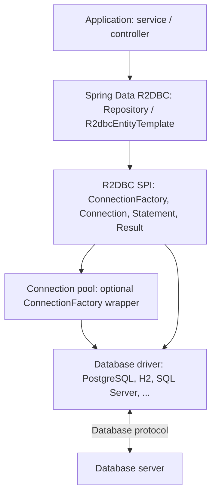
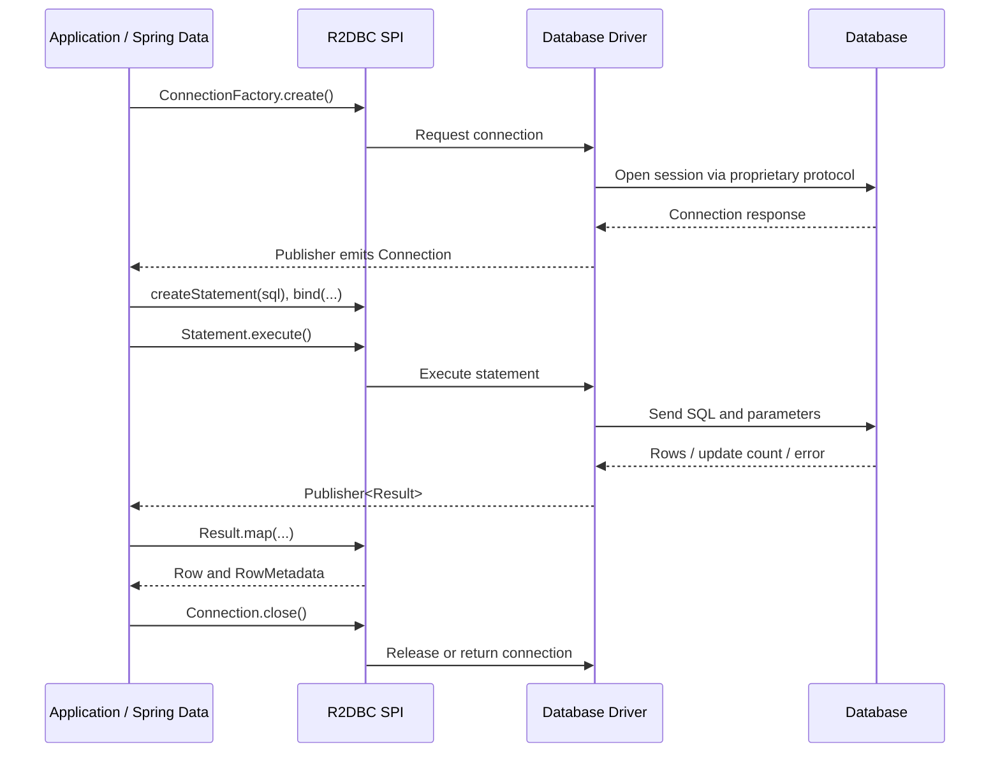

# R2DBC SPI and Driver Responsibilities

R2DBC is a reactive relational database access specification for Java. At the foundation of R2DBC is the **R2DBC SPI (Service Provider Interface)**: a set of interfaces defining how an application requests connections, creates SQL statements, passes parameters, receives results, and controls transactions. Each database management system's driver implements these interfaces to translate Java calls into actual communication with the database.

Spring Data R2DBC sits at a higher layer. It uses the SPI to execute queries, map data rows into entities, and provide reactive repositories. Understanding the boundary between the SPI, driver, and Spring Data helps pinpoint which component is responsible when configuring connections, handling data types, executing SQL, or investigating errors.

## 1. Where Does the R2DBC SPI Sit in the Architecture?

The R2DBC SPI is the shared contract between Java data-access code and the database driver. Thanks to this contract, the application layer can work with standard interfaces without having to implement proprietary network protocols for PostgreSQL, H2, Microsoft SQL Server, or another database engine.

The overall architecture can be visualized as follows:



Each component has a distinct role:

- **Application** decides which business data needs to be read or written.
- **Spring Data R2DBC** provides repositories, derived queries, entity mapping, and higher-level data access APIs.
- **R2DBC SPI** defines connection and SQL execution operations under a unified contract.
- **Driver** implements the SPI contract for a specific database management system, communicates with the database server, and converts data between the server protocol and Java types.
- **Connection pool** is an optional component that manages and reuses connections. It is typically provided as a `ConnectionFactory` wrapping the driver's factory, such as R2DBC Pool.
- **Database server** parses and executes SQL and manages data, locks, and transactions according to the engine's capabilities.

The driver is the technical bridge between the SPI and the database protocol. The SPI does not contain all vendor-specific communication code; the driver is where that work is implemented.

## 2. SPI Is the Contract, Driver Is the Implementation

The SPI declares the interfaces a driver must provide. Those interfaces do not specify details of how a driver opens sockets, encodes packets, reads responses, or manages protocol state. Those decisions belong to the driver's implementation.

For example, code calling `ConnectionFactory.create()` simply requests a connection and receives the result as a reactive publisher. For PostgreSQL, the PostgreSQL driver is responsible for establishing a communication session and using the PostgreSQL protocol. For another database, its corresponding driver performs its own connection procedure and protocol.

Through this layering, upper-layer code can depend on `io.r2dbc.spi.ConnectionFactory` rather than a vendor-specific connection class. However, portability does not mean every database supports the same SQL syntax or the same features. SQL, data types, parameters, generated values, and certain transaction capabilities can still vary by database management system and driver.

Another important point is that the R2DBC SPI returns `org.reactivestreams.Publisher` types. The SPI does not require drivers to return `Mono` or `Flux` directly. Spring Data R2DBC uses Project Reactor and converts SPI publishers into `Mono` or `Flux` when needed. This is why you may see `Publisher` in SPI API signatures and `Mono`/`Flux` in Spring code.

The goal of the SPI is non-blocking database access. A driver needs to implement asynchronous communication aligned with the reactive contract; merely wrapping a blocking JDBC call inside a `Publisher` does not make that operation non-blocking I/O. If database operations still block threads, the application can lose the concurrency benefits of the reactive model.

## 3. Core Interfaces of the R2DBC SPI

### 3.1 ConnectionFactory

`ConnectionFactory` is the entry point for acquiring a connection. It provides the `create()` method returning a publisher containing a `Connection`, along with metadata describing the factory.

```java
Publisher<? extends Connection> publisher = connectionFactory.create();
```

The call above does not synchronously return a `Connection` object. The application subscribes to consume the publisher in order to receive the connection or an error if connection creation fails.

A factory may be created directly by the driver or wrapped by another component such as a connection pool. When using a pool, upper-layer code can still depend on the `ConnectionFactory` interface; the pool acquires physical connections from the driver and manages allocation and reclamation according to its configuration.

### 3.2 Connection

`Connection` represents a connection to the database. It is where statements are created, batches are constructed, transactions are controlled, and the connection is closed or validated.

Common operations include:

- `createStatement(sql)`: creates a SQL statement capable of parameter binding.
- `createBatch()`: creates a batch consisting of multiple SQL statements.
- `beginTransaction()`: starts a transaction.
- `commitTransaction()`: commits a transaction.
- `rollbackTransaction()`: rolls back a transaction.
- `close()`: releases the connection or returns it to the pool.
- `setAutoCommit(...)` and other transaction configuration operations: control transaction mode within driver capabilities.

Asynchronous operations all return publishers. Therefore, the order of operations must be chained within a reactive pipeline. You should not invoke a method and assume the SQL command has already completed the moment you receive the publisher.

### 3.3 Statement

`Statement` represents a SQL statement to be executed. It allows binding values, adding subsequent executions for the same statement template, and calling `execute()`.

Example:

```java
Statement statement = connection
        .createStatement("SELECT id, name FROM customer WHERE id = $1")
        .bind(0, customerId);

Publisher<? extends Result> results = statement.execute();
```

In this example, the `$1` syntax is a PostgreSQL placeholder. Placeholder syntax in the SQL string depends on the driver and database management system, whereas the index passed to `bind(0, customerId)` is the 0-based parameter position according to the SPI API.

For parameters with null values, the SPI provides `bindNull(index, type)` to declare the type to bind:

```java
Statement statement = connection
        .createStatement("INSERT INTO customer (name, nickname) VALUES ($1, $2)")
        .bind(0, "An")
        .bindNull(1, String.class);
```

Parameter binding allows the driver to pass data through its parameter mechanism. Use binding for input values rather than concatenating data directly into SQL. Table names, column names, or dynamic SQL fragments must be validated separately because bind parameters generally represent values, not arbitrary SQL syntax elements.

### 3.4 Batch

`Batch` allows adding multiple independent SQL statements and executing them:

```java
Batch batch = connection.createBatch()
        .add("DELETE FROM expired_session WHERE expires_at < CURRENT_TIMESTAMP")
        .add("UPDATE system_status SET last_cleanup = CURRENT_TIMESTAMP");

Publisher<? extends Result> results = batch.execute();
```

`Batch` is suited for pre-built SQL statements. If you need to pass multiple parameter sets for the same statement template, consider `Statement` and its `add()` operation; `Batch.add(String)` is not a parameter-binding API. Grouping statements into a batch also does not automatically guarantee atomicity across all statements. For atomicity, use an appropriate transaction.

### 3.5 Result

`Result` represents the execution result of a statement. Depending on the statement, the result may contain data rows or an updated row count.

Commonly used operations:

- `map(...)`: maps data rows into Java objects.
- `getRowsUpdated()`: retrieves the affected row count for update operations when provided by the driver.
- `flatMap(...)`: processes result segments as a publisher.

Not every SQL statement produces a list of entities. An `UPDATE` statement is typically inspected via its updated row count; a `SELECT` statement is inspected via its data rows. Choose the consumption method matching the result type.

### 3.6 Row and Metadata

`Row` represents a returned row. The application can read columns by index or name and request a Java type:

```java
Long id = row.get("id", Long.class);
String name = row.get("name", String.class);
```

`RowMetadata` provides metadata for the columns in the row, such as column names and driver-provided column metadata. Metadata is useful when mapping results dynamically or inspecting query result structure.

The `Row` object belongs to the row-processing lifecycle managed by the driver. Read and transform the needed data into application objects directly within the mapping callback; do not retain `Row` for use after the callback completes. The driver may reuse internal buffers or resources when advancing to the next row.

### 3.7 Connection and Driver Metadata

The SPI also provides metadata interfaces such as `ConnectionFactoryMetadata`, `ConnectionMetadata`, and `ColumnMetadata`. They provide information about the factory, database, version, or result columns. Metadata helps libraries and applications recognize the connected environment, though it does not replace documentation on specific driver features.

## 4. Execution Flow of a Query Through the SPI

A data-read query typically passes through the following steps:

1. The application or Spring Data calls `ConnectionFactory.create()`.
2. The driver creates or acquires a database connection and emits it via the publisher.
3. Code calls `Connection.createStatement(sql)` to create a statement.
4. Code binds input parameters with `bind(...)` or `bindNull(...)`.
5. Code calls `Statement.execute()`; the driver translates SQL and parameters into a database-protocol request.
6. The database executes the statement and sends back results.
7. The driver decodes the response and provides `Result`, `Row`, and metadata via a publisher.
8. The mapping layer transforms data rows into the types the application needs.
9. When processing finishes, the connection is closed or returned to the pool; when an error or subscription cancellation occurs, resources must also be released properly.

The diagram below shows the data flow and where the driver participates:



Steps are chained via publishers. Creating a publisher and consuming a publisher happen at two distinct times; a query typically starts when subscribed to. Therefore, merely creating a `Mono` or `Flux` variable does not mean the database has already returned results.

## 5. Main Responsibilities of an R2DBC Driver

The driver implements the SPI contract and is responsible for the details needed to work with a specific database management system.

### 5.1 Creating and Managing Connections

The driver provides `ConnectionFactory` and `Connection`. It establishes connection sessions, performs configured authentication, tracks connection state, and reflects connection errors through publishers. The driver must also handle connection closing and broken-connection scenarios according to the specification and its capabilities.

A driver does not necessarily provide its own connection pool. A pool can wrap the driver's factory to reuse connections, limit concurrent connections, validate connections, and manage wait times. When using a pool, distinguish `close()` on a logical connection—which usually returns it to the pool—from physically closing the underlying socket connection.

### 5.2 Translating SPI Calls into the Database Protocol

Each database engine has its own communication protocol, message format, and state rules. The driver translates operations such as creating statements, binding parameters, executing, and fetching results into messages the server understands. The driver also reads responses and turns them into SPI publishers.

This is why drivers for different databases can vary in maturity and behavior even while implementing the same standard set of interfaces.

### 5.3 Parameter Binding and Data Type Conversion

The driver converts bound Java values into data types and formats appropriate for the database. When reading results, the driver decodes database data into Java types accessible through the SPI.

For example, an integer, timestamp, binary, or vendor-specific column may require different encoding and decoding strategies. The driver handles conversion at the protocol boundary. Spring Data can perform additional conversion between read values and entity properties, but it does not replace the driver's codecs or data type support.

Do not assume every driver maps every database type to the same Java type or supports the same extended types. For JSON, arrays, enums, UUIDs, LOBs, or vendor-specific types, consult the documentation of the driver in use.

### 5.4 Returning Results and Metadata

The driver creates objects implementing `Result`, `Row`, `RowMetadata`, and related metadata. It is responsible for decoding rows, supplying column values in requested types, reporting updated row counts when applicable, and propagating errors during data reading.

The driver must also handle specialized results supported by the database, such as auto-generated values or multiple result segments. How these are requested and the level of support can differ across drivers.

### 5.5 Transactions and Connection State

The SPI provides operations to begin, commit, and roll back transactions. The driver translates these operations into commands or messages suited to the database, and reflects errors if transaction state is invalid or the connection is lost.

The driver performs transaction operations at the connection level. Determining which steps belong to a business operation, when to start a transaction, and when to commit belongs to the application or a higher-level transaction manager. Spring Data R2DBC coordinates with Spring's transaction infrastructure to manage reactive transaction lifecycles.

### 5.6 Reactive Streams, Demand, and Cancellation

The driver implements the SPI reactively and must honor Reactive Streams rules for the publishers it exposes. It must coordinate item emission, completion signals, error signals, and subscription cancellation. When a subscription is canceled, the driver should stop or release related work and resources within the capabilities of the database protocol.

Backpressure allows subscribers to express item demand. However, that does not mean every database sends single rows strictly matching the exact demand count. A protocol or driver may need to read in batches, buffer, or apply its own limits. Consult driver documentation and test with realistic queries; do not infer that using `Flux` automatically yields constant-memory data streaming.

### 5.7 Error Propagation and Invalid State

The driver translates connection, protocol, SQL, or conversion failures into exceptions under the `R2dbcException` hierarchy. Error details may include SQL state or vendor error codes depending on the database. Higher layers can use these exceptions to make handling decisions, rather than relying on error message strings for classification when more stable structured information is available.

## 6. What Is Not the Driver's Responsibility

Clear responsibility boundaries help avoid placing logic in the wrong layer:

| Task | Typically Responsible Component |
| --- | --- |
| Communicating via the database's proprietary protocol | Driver |
| Creating connections per the SPI | Driver and/or wrapped `ConnectionFactory` |
| Reusing, limiting, and validating pooled connections | Connection pool |
| Executing SQL and returning Result/Row | Driver in coordination with database |
| Mapping rows into entities per Spring metadata | Spring Data R2DBC |
| Generating queries from repository method names | Spring Data R2DBC |
| Deciding what business data to read or write | Application/service |
| Defining business transaction boundaries | Application and transaction manager |
| Checking business authorization and validating input data | Application |

The driver is not an ORM. It does not understand domain aggregate relationships, does not decide which entities to cascade, does not generate repositories from method names, and does not perform business validation. It provides SPI-level database access for higher libraries to build those capabilities on top.

Similarly, a connection pool is not synonymous with a driver. The pool manages allocation and reuse of connections; the driver is responsible for creating and operating connections via the database protocol. An application can use a driver without a pool, or use a pool wrapping the driver.

## 7. How Spring Data R2DBC Uses the SPI

In a Spring application, you normally do not need to call individual SPI methods directly. Spring Data R2DBC uses `ConnectionFactory` as an input for its data access components. `DatabaseClient` provides the SQL execution API; `R2dbcEntityTemplate` and repositories add entity-level operations.

The layers can be pictured as follows:

```text
CustomerService
    |
    v
ReactiveCrudRepository<Customer, Long>
    |
    v
Spring Data R2DBC mapping / repository infrastructure
    |
    v
DatabaseClient / R2dbcEntityTemplate
    |
    v
R2DBC SPI (ConnectionFactory, Connection, Statement, Result)
    |
    v
Database driver
    |
    v
Relational database
```

Repository example:

```java
public interface CustomerRepository
        extends ReactiveCrudRepository<Customer, Long> {

    Mono<Customer> findByEmail(String email);

    Flux<Customer> findByStatus(String status);
}
```

Spring Data parses repository declarations, generates the appropriate queries, and uses the R2DBC infrastructure to execute them. The driver receives operations at the SPI layer and communicates with the database. Results then flow back up the layers, get mapped into entities, and are emitted via `Mono` or `Flux`.

If more explicit SQL is needed, the application can use `DatabaseClient`:

```java
public Mono<Customer> findCustomer(Long id) {
    return databaseClient.sql("SELECT id, name FROM customer WHERE id = :id")
            .bind("id", id)
            .map((row, metadata) -> new Customer(
                    row.get("id", Long.class),
                    row.get("name", String.class)
            ))
            .one();
}
```

Here, `DatabaseClient` offers named binding and a convenient mapping API. Underneath, Spring translates those operations into corresponding SPI calls. The driver remains responsible for communicating with the database. The `:id` placeholder in the example is `DatabaseClient`'s bind syntax; do not confuse it with the SQL placeholder syntax used by a specific driver at the SPI layer.

## 8. Direct SPI Access Example

Most Spring applications should use repositories, `DatabaseClient`, or `R2dbcEntityTemplate`. However, a direct SPI example makes it clear where the driver is called and who must manage resources.

The following example uses PostgreSQL placeholder syntax:

```java
import io.r2dbc.spi.ConnectionFactory;
import reactor.core.publisher.Flux;
import reactor.core.publisher.Mono;

public record Customer(Long id, String name) {}

public Mono<Customer> findCustomer(ConnectionFactory factory, Long id) {
    return Mono.usingWhen(
            Mono.from(factory.create()),
            connection -> Flux.from(
                            connection.createStatement(
                                            "SELECT id, name FROM customer WHERE id = $1")
                                    .bind(0, id)
                                    .execute()
                    )
                    .flatMap(result -> Flux.from(
                            result.map((row, metadata) ->
                                    new Customer(
                                            row.get("id", Long.class),
                                            row.get("name", String.class)
                                    )
                            )
                    ))
                    .singleOrEmpty(),
            connection -> Mono.from(connection.close()),
            (connection, error) -> Mono.from(connection.close()),
            connection -> Mono.from(connection.close())
    );
}
```

In this example:

1. `factory.create()` requests a connection from the SPI. The publisher is wrapped in `Mono` for use with Reactor.
2. `createStatement(...)` creates the statement; `bind(0, id)` attaches a value to the first parameter.
3. `execute()` returns a publisher containing execution results.
4. `Result.map(...)` reads columns from each `Row` and creates `Customer` directly inside the mapping callback.
5. `singleOrEmpty()` suits primary-key lookups: no row produces an empty publisher; one row yields the entity; multiple rows raise an error.
6. `Mono.usingWhen(...)` manages closing the connection on completion, on error, and on subscription cancellation.

This code illustrates chaining SPI APIs with Reactor. In real projects, use the exact placeholders, data types, and features supported by the chosen driver. When a pool is used, calling `close()` typically returns the logical connection to the pool.

## 9. Configuring the Driver and ConnectionFactory

An application needs the driver corresponding to the database management system in use. For example, an application connecting to PostgreSQL needs the R2DBC PostgreSQL driver dependency; an application using H2 needs the R2DBC H2 driver. The driver dependency supplies the SPI implementation and registration mechanism so libraries can discover the appropriate driver.

At the SPI layer, finding and creating factories can be done via `ConnectionFactories` and `ConnectionFactoryOptions`. With Spring Boot, you typically configure the URL and credentials in application configuration so auto-configuration creates the `ConnectionFactory`.

Illustrative configuration example:

```yaml
spring:
  r2dbc:
    url: r2dbc:postgresql://localhost:5432/customer_db
    username: app_user
    password: ${DB_PASSWORD}
```

The URL starts with `r2dbc:` and includes the driver name. Specific configuration, SSL options, timeouts, schemas, and other parameters depend on the driver. Do not copy one driver's configuration verbatim to another driver and assume all properties carry the same meaning.

When adding a connection pool, the application needs to configure the pool according to the library in use, such as maximum and minimum connections, acquisition wait timeout, lifetime, and connection validation. These values are operational settings of the pool, not universal responsibilities imposed by the SPI on every driver.

## 10. Portability and Differences Between Drivers

The SPI establishes a common interface, yet applications still need to watch for differences:

- **SQL dialect:** SQL functions, data types, pagination syntax, locking syntax, and placeholders may differ.
- **Data types:** mapping of timestamps, JSON, arrays, enums, UUIDs, binary, or LOBs may vary.
- **Generated values:** availability and retrieval of auto-generated keys depend on the database and driver.
- **Transactions:** isolation levels, savepoints, auto-commit, and certain transaction behaviors depend on the database engine.
- **Batch and results:** batch support, multiple results, updated row counts, or metadata may differ.
- **Performance and resources:** how drivers fetch in batches, buffer, enforce connection limits, and handle cancellation can vary.

If an application must run on multiple database systems, keep SQL and mappings appropriately aligned, test against each target driver, and avoid implicitly relying on proprietary features without a fallback. The fact that a driver compiles against the SPI does not guarantee it supports every feature the application expects.

## 11. Investigating Errors at the Right Layer

When an R2DBC query fails, identify which layer the failure came from:

| Symptom | Component to Check First |
| --- | --- |
| Driver not found or ConnectionFactory cannot be created | Driver dependency, URL, and discovery mechanism |
| Unable to open connection or authenticate | Driver, network config, credentials, and database server |
| Invalid SQL or wrong placeholder | SQL statement, dialect, and driver binding rules |
| Column type conversion failure | Database data type, mapping, and driver support |
| Connections held too long or pool exhausted | Subscription lifecycle, connection closing, and pool config |
| Error on commit or rollback | Transaction manager, connection state, and database transaction support |
| Request canceled but resources remain held | Pipeline cancellation, cleanup, and driver behavior |

Inspect the root cause and exception type rather than looking only at a controller error message. A SQL error may be translated into a Spring exception at a higher layer, while the root cause comes from the driver or database. When investigating, note the driver and version, database type, sanitized SQL statement, operation type, and transaction state.

Do not log passwords, tokens, or personal data. When enabling protocol or detailed SQL logging for investigation, be mindful of sensitive data that may appear in bind parameter information.

## 12. Common Misconceptions

1. **Treating R2DBC SPI as the driver.** The SPI only defines the contract; the driver implements the contract for a specific database.
2. **Assuming the SPI returns Mono and Flux.** The SPI uses Reactive Streams `Publisher`; Reactor provides `Mono` and `Flux` at the application/Spring layer.
3. **Thinking Spring Data R2DBC speaks the database protocol directly.** Spring Data calls the SPI; the driver handles the proprietary protocol.
4. **Considering a connection pool a mandatory part of the driver.** A pool is an optional component typically wrapping `ConnectionFactory`.
5. **Assuming all drivers have identical capabilities.** Implementing the same SPI does not guarantee identical support for all data types, generated values, transactions, or batches.
6. **Retaining Row for use after the callback.** Map data inside the callback because `Row` lifecycle is managed by the driver.
7. **Concatenating input values into SQL.** Use parameter binding to pass values; validate dynamic SQL parts such as table or column names separately.
8. **Forgetting to close connections when using the SPI directly.** Manage cleanup across completion, error, and cancellation; use Spring abstractions when possible to reduce manual resource management.
9. **Assuming Flux always means bounded-memory streaming.** Drivers may buffer or fetch in batches; verify actual behavior.
10. **Thinking the driver defines business transaction boundaries.** The driver performs transaction operations at the connection level; the application or transaction manager determines business boundaries.

## 13. When Do You Need to Work Directly with the SPI?

In typical Spring Data R2DBC applications, repositories or `DatabaseClient` cover most needs. Working directly with the SPI can be appropriate when:

- Building a data access library independent of Spring.
- Studying or developing an R2DBC driver.
- Needing low-level operations not yet exposed by current abstractions.
- Wanting a clear understanding of connection, statement, result, and cancellation lifecycles.
- Investigating driver behavior or bugs at the SPI boundary.

When calling the SPI directly, application code must pay closer attention to connection management, operation ordering, `Result` consumption, and resource release. For Spring business code, prefer higher-level abstractions if they meet your requirements.

## Takeaways

The R2DBC SPI defines a reactive contract for Java to interact with relational databases. Drivers implement that contract, handling database-specific protocols, connections, statements, parameters, results, data types, transactions, and errors. Spring Data R2DBC builds on the SPI to provide repositories and entity mapping; a connection pool can wrap a driver's factory to manage connection reuse.

When encountering an R2DBC issue, determine whether it belongs to the SPI contract, driver implementation, connection pool, database, or Spring abstraction. Placing the right responsibility in the right layer makes configuration and error handling more accurate, while avoiding unintended reliance on a single driver's proprietary features.
