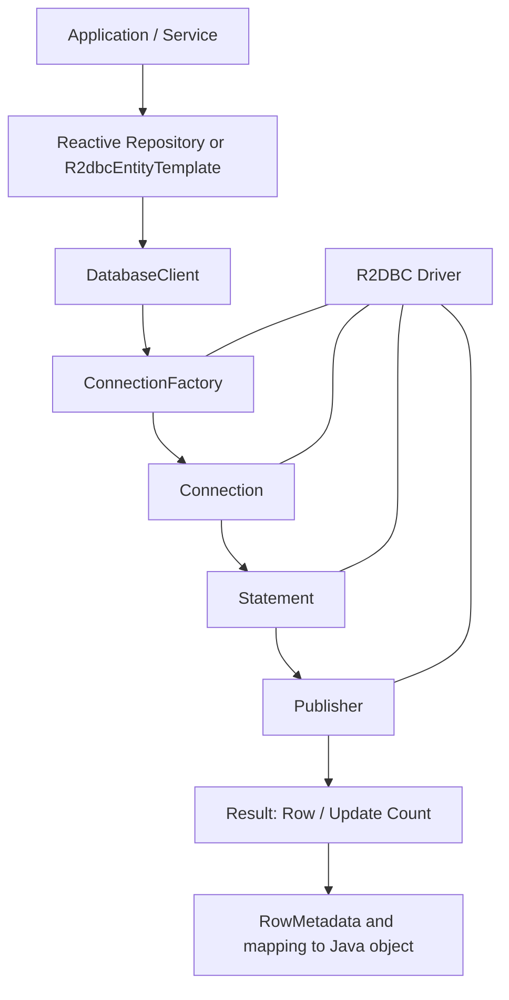

# ConnectionFactory, Connection, Statement, and Result

In the Spring Data Relational R2DBC architecture, the four concepts `ConnectionFactory`, `Connection`, `Statement`, and `Result` form the primary path of a SQL operation. They belong to the R2DBC SPI (Service Provider Interface), the standard communication layer between a reactive application and each database management system's driver.

`ConnectionFactory` creates connections; `Connection` represents a session with the database; `Statement` describes the SQL statement along with its parameters; `Result` represents the execution result. Spring Data R2DBC builds higher-level abstractions on top of this SPI chain to map data rows into entities and integrate with repositories, transactions, and the Spring ecosystem.

## 1. Position of the Four Components in the Architecture

A Spring Data R2DBC application typically does not need to interact directly with each SPI object. A repository or `R2dbcEntityTemplate` calls through Spring abstractions, notably `DatabaseClient`. `DatabaseClient` uses `ConnectionFactory` to acquire connections and coordinate statement execution.



This flow can be read in two directions:

- **Downward path:** the application requests to read or write data; Spring builds the statement, acquires a connection, creates a statement, and executes SQL through the driver.
- **Upward path:** the driver emits results; the application consumes results, reads rows or updated row counts, and then maps them into the types needed by upper layers.

R2DBC operations are typically represented by Reactive Streams `Publisher` and Reactor `Mono`/`Flux`. Publisher creation and I/O execution are decoupled: the database operation usually starts when the pipeline is subscribed to. Therefore, holding a `ConnectionFactory` or `Statement` in a Java variable does not mean the query has already run.

## 2. `ConnectionFactory`: The Connection Factory

`io.r2dbc.spi.ConnectionFactory` is the entry point for an application to obtain a `Connection`. This interface provides two core capabilities:

- `create()` returns a `Publisher` emitting a new connection or a connection allocated from a pool.
- `getMetadata()` returns metadata about the factory, such as the driver name.

`ConnectionFactory` hides how the driver establishes a physical connection. The application works with the common SPI, while the PostgreSQL, H2, MariaDB, or other database driver handles the proprietary protocol and characteristics of its system.

### Creating a factory

One way to create a factory at the R2DBC SPI level is to use `ConnectionFactories` with `ConnectionFactoryOptions`:

```java
ConnectionFactoryOptions options = ConnectionFactoryOptions.builder()
        .option(ConnectionFactoryOptions.DRIVER, "postgresql")
        .option(ConnectionFactoryOptions.HOST, "localhost")
        .option(ConnectionFactoryOptions.PORT, 5432)
        .option(ConnectionFactoryOptions.DATABASE, "appdb")
        .option(ConnectionFactoryOptions.USER, "appuser")
        .option(ConnectionFactoryOptions.PASSWORD, "secret")
        .build();

ConnectionFactory connectionFactory = ConnectionFactories.get(options);
```

This is an illustrative configuration example; in real applications, credentials should be retrieved from secure configuration or environment variables rather than hard-coded in source code. The corresponding driver must be on the classpath for the SPI to locate the implementation.

Some applications configure via an R2DBC URL, such as `r2dbc:postgresql://...`, and then use `ConnectionFactories.get(url)`. Specific URLs and options depend on the driver. Spring Boot typically auto-configures a `ConnectionFactory` bean from `spring.r2dbc.*` properties, so services and repositories only need to receive the bean via dependency injection.

Example of receiving a Spring-managed bean:

```java
@Repository
public class CustomerReader {

    private final DatabaseClient databaseClient;

    public CustomerReader(DatabaseClient databaseClient) {
        this.databaseClient = databaseClient;
    }
}
```

In a Spring Boot application with suitable R2DBC configuration, `DatabaseClient` can be auto-configured from `ConnectionFactory`. If configured manually, `DatabaseClient` can be created using `DatabaseClient.create(connectionFactory)`.

### ConnectionFactory is not synonymous with Connection

`ConnectionFactory` is a shared object used to request connections. `Connection` is a specific session allocated from the factory. Normally, the application retains the factory long-term, whereas a connection is borrowed for the scope of an operation or transaction and then closed/returned.

The factory may create connections directly via the driver or wrap a pool. The application layer still calls `create()` the same way; whether a new physical connection is created or an existing one is borrowed is handled by the factory.

## 3. `Connection`: Session with the Database

`io.r2dbc.spi.Connection` represents an active connection allocated to the application. It provides operations to create statements, manage transactions, and close the connection.

Commonly encountered methods include:

| Method | Role |
| --- | --- |
| `createStatement(sql)` | Creates a `Statement` to execute SQL |
| `createBatch()` | Creates a batch containing multiple non-parameterized SQL statements per the SPI batch API |
| `beginTransaction()` | Starts a transaction |
| `commitTransaction()` | Commits the current transaction |
| `rollbackTransaction()` | Rolls back the current transaction |
| `setAutoCommit(boolean)` | Enables or disables auto-commit mode |
| `setTransactionIsolationLevel(...)` | Sets the transaction isolation level |
| `getMetadata()` | Retrieves metadata about the connection |
| `close()` | Closes or releases the connection according to the implementation |

Operations that change connection state typically return `Publisher<Void>`. Thus, for a transaction to start or a connection to close, the corresponding publisher must also be consumed within the pipeline.

### A Connection has its own lifecycle

General lifecycle of a connection:

1. The application requests a connection via `ConnectionFactory.create()`.
2. The publisher emits the connection once allocation finishes.
3. The application creates statements and performs the required operations.
4. The application commits or rolls back the transaction if one is active.
5. The application calls `close()` when the connection is no longer needed.

Without a pool, `close()` typically releases the physical connection according to the driver. With a connection pool, `close()` typically returns the connection to the pool for later reuse. Therefore, in a pooled application, `close()` should not be assumed to always mean closing the TCP socket to the database.

`Connection` is a stateful resource: active transactions, auto-commit, isolation level, and session attributes can affect subsequent statements. You should not share a single connection across multiple independent execution flows or access it concurrently arbitrarily. Let the framework manage usage scope and ensure the connection is released upon completion, error, or subscription cancellation.

### Safely closing a connection in a reactive pipeline

When interacting directly with the SPI, ensure `close()` runs across all three outcomes: normal completion, error, and subscription cancellation. Reactor provides `usingWhen` to manage asynchronous resources:

```java
Flux<Customer> findActiveCustomers(ConnectionFactory connectionFactory) {
    return Flux.usingWhen(
            Mono.from(connectionFactory.create()),
            connection -> Flux.from(
                    connection.createStatement(
                            "SELECT id, name FROM customer WHERE status = $1"
                    )
                    .bind(0, "ACTIVE")
                    .execute()
            ).concatMap(result -> Flux.from(result.map((row, metadata) ->
                    new Customer(
                            row.get("id", Long.class),
                            row.get("name", String.class)
                    )
            ))),
            connection -> Mono.from(connection.close()),
            (connection, error) -> Mono.from(connection.close()),
            connection -> Mono.from(connection.close())
    );
}
```

The example uses the `$1` marker and `0`-based index binding in PostgreSQL style. Placeholder syntax and binding capabilities depend on the driver; not all database engines use the `$1` marker. `usingWhen` holds the connection throughout result consumption and invokes the corresponding cleanup when the pipeline completes, errors, or is canceled.

In typical Spring Data R2DBC applications, use `DatabaseClient`, `R2dbcEntityTemplate`, or repositories so Spring manages acquiring and releasing connections. Only interact directly with the SPI when there is a specific lower-level requirement.

## 4. `Statement`: SQL Statement and Parameters

`io.r2dbc.spi.Statement` represents a SQL statement created from a `Connection`. A statement allows passing parameters, adding parameter sets for batching, and executing the command.

Common operations:

| Method | Role |
| --- | --- |
| `bind(index, value)` | Binds a value to a parameter by position |
| `bind(name, value)` | Binds a value by name if the driver supports that parameter style |
| `bindNull(index, type)` | Binds a SQL `NULL` value along with the corresponding Java type |
| `bindNull(name, type)` | Binds `NULL` by parameter name if supported |
| `add()` | Adds the current parameter set to execute multiple sets of parameters |
| `returnGeneratedValues(columns...)` | Requests generated values to be returned, if supported by the driver |
| `fetchSize(size)` | Provides a fetch size hint to the driver |
| `execute()` | Executes the statement and returns a publisher of `Result` |

### Binding parameters instead of string concatenation

Example using positional parameters with PostgreSQL:

```java
Statement statement = connection.createStatement(
        "SELECT id, name FROM customer WHERE status = $1 AND age >= $2"
);

statement.bind(0, "ACTIVE");
statement.bind(1, 18);

Publisher<? extends Result> results = statement.execute();
```

Indices in the SPI are `0`-based. SQL markers must follow the driver's convention. Using bind allows the driver to treat values as parameters, avoiding manual data escaping and reducing the risk of SQL injection from concatenating user input into SQL strings.

Bind parameters cannot be used for table names, column names, keywords, or arbitrary SQL syntax fragments. If you need to choose a sort column or table name from input, validate the input against an allowlist before constructing the structural SQL part.

### Binding NULL values

Do not pass Java `null` to `bind`. Use `bindNull` and specify the corresponding Java type so the driver knows the SQL type to send:

```java
Statement statement = connection.createStatement(
        "INSERT INTO customer (name, nickname) VALUES ($1, $2)"
);

statement.bind(0, "Lan");
statement.bindNull(1, String.class);
```

The Java type passed to `bindNull` must match the column type and driver conversion capabilities. When working through `DatabaseClient`, use Spring's corresponding bind API; if the value is null, provide the appropriate data type via the API overload.

### Batching multiple parameter sets

`Statement.add()` appends the current parameter set to the execution list. Example:

```java
Statement statement = connection.createStatement(
        "INSERT INTO customer (id, name) VALUES ($1, $2)"
);

statement.bind(0, 101L).bind(1, "An").add();
statement.bind(0, 102L).bind(1, "Binh").add();
statement.bind(0, 103L).bind(1, "Chi");

Publisher<? extends Result> results = statement.execute();
```

Here the first two sets are added via `add()`, while the last set is the current parameter set. Batch details, emitted result counts, and actual performance depend on the driver/database. To batch multiple non-parameterized SQL commands, the SPI also provides `Connection.createBatch()`; this batch differs from parameterized batching via `Statement.add()`.

### Auto-generated values and fetch size

Some databases support returning generated keys after an insert operation. You can ask the driver to return the desired columns:

```java
Statement statement = connection.createStatement(
        "INSERT INTO customer (name) VALUES ($1)"
).bind(0, "Mai");

statement.returnGeneratedValues("id");
```

Then consume `Result` as a result containing data rows if the driver supports this feature. Column names, SQL syntax, and support for returning generated values vary across database management systems.

`fetchSize` is a hint to the driver for how many rows to retrieve in a single fetch. It is neither a guarantee that the database always returns that exact number of rows nor a replacement for `LIMIT` or SQL pagination. Some drivers may ignore this hint.

## 5. `execute()` and `Result`: Consuming Statement Results

`Statement.execute()` returns `Publisher<? extends Result>`. This publisher emits one or more `Result` objects depending on statement type, batching, and driver behavior. `Result` is not an already materialized Java list; it is an object providing an API to consume results asynchronously.

A result can represent row data, an update count, or result segments depending on the statement and driver. Two common consumption approaches are:

| `Result` API | Use When |
| --- | --- |
| `map((row, metadata) -> value)` | Reading rows and mapping each `Row` into a Java value |
| `getRowsUpdated()` | Reading the number of rows affected by a write operation |
| `flatMap(segment -> ...)` | Processing individual result segments when distinguishing segment types |

Consumption methods return publishers. Therefore, chain them into the pipeline or subscribe at an appropriate boundary so the driver reads the data and releases resources.

### Reading rows with `Result.map`

Example reading customers:

```java
Flux<Customer> customers = Flux.from(
        connection.createStatement(
                "SELECT id, name FROM customer WHERE status = $1"
        )
        .bind(0, "ACTIVE")
        .execute()
).concatMap(result -> Flux.from(result.map((row, metadata) ->
        new Customer(
                row.get("id", Long.class),
                row.get("name", String.class)
        )
)));
```

`Row` provides values by column name or column index. `RowMetadata` describes row structure, such as column metadata. The Java type requested when calling `row.get(...)` must be compatible with the data type returned by the driver or a conversion supported by the driver.

Column names can collide or change due to aliases, so queries should declare explicit aliases when disambiguation is needed:

```sql
SELECT c.id AS customer_id, c.name AS customer_name
FROM customer c
```

When you need to inspect dynamic result structures, read `RowMetadata` and `ColumnMetadata` rather than assuming fixed column names or types.

### Reading the updated row count

For `UPDATE`, `DELETE`, or `INSERT` statements that do not need to read returned rows, you can retrieve the update count:

```java
Mono<Long> updatedRows = Mono.from(
        connection.createStatement(
                "UPDATE customer SET status = $1 WHERE id = $2"
        )
        .bind(0, "INACTIVE")
        .bind(1, 101L)
        .execute()
).flatMap(result -> Mono.from(result.getRowsUpdated()));
```

`getRowsUpdated()` returns a publisher of the updated row count. For a batch or a publisher emitting multiple `Result` objects, consume each result and aggregate if business logic needs the total row count:

```java
Mono<Long> totalUpdated = Flux.from(statement.execute())
        .concatMap(result -> Flux.from(result.getRowsUpdated()))
        .reduce(0L, Long::sum);
```

Not every statement produces the same kind of result. When using `RETURNING` or `returnGeneratedValues`, the result may contain data rows that need to be read via a mapping API instead of only fetching the update count.

### A Result may only be consumed once

An important rule of the R2DBC SPI is that a `Result` is consumed only once. Choose the consumption method suited to the result type. Do not call `getRowsUpdated()` and then call `map()` on the same result expecting both to re-read the same data.

If you need to handle multiple segment types within a single result, the `flatMap` API lets you process each `Segment`, such as distinguishing a row segment from an update-count segment. This approach is better suited when a driver emits mixed results or when preserving segment-type information is needed.

## 6. Connecting the Four Components into a Complete Query

The following example shows the relationship between factory, connection, statement, and result at the SPI level. The method returns `Flux<Customer>`; the caller or framework subscribes to start the query:

```java
public Flux<Customer> findActiveCustomers(ConnectionFactory factory) {
    return Flux.usingWhen(
            Mono.from(factory.create()),
            connection -> Flux.from(
                    connection.createStatement(
                            "SELECT id, name FROM customer WHERE status = $1"
                    )
                    .bind(0, "ACTIVE")
                    .execute()
            ).concatMap(result -> Flux.from(result.map((row, metadata) ->
                    new Customer(
                            row.get("id", Long.class),
                            row.get("name", String.class)
                    )
            ))),
            connection -> Mono.from(connection.close()),
            (connection, error) -> Mono.from(connection.close()),
            connection -> Mono.from(connection.close())
    );
}
```

Sequence upon subscription:

1. `factory.create()` allocates a connection.
2. `connection.createStatement(...)` creates a statement with the SQL.
3. `bind(0, "ACTIVE")` binds the parameter for the statement.
4. `execute()` starts execution and emits `Result`.
5. `result.map(...)` reads each row and constructs `Customer`.
6. When the stream completes, errors, or is canceled, `usingWhen` calls `connection.close()`.

This is a direct SPI example to clarify each layer's responsibility. In a Spring Data R2DBC application, most of this resource management code is handled by Spring's abstractions.

## 7. Using `DatabaseClient` at the Spring Layer

`DatabaseClient` is Spring Framework's abstraction for reactive SQL execution. It uses `ConnectionFactory` underneath while providing APIs for parameter binding, row mapping, and connection management suited to the Spring ecosystem.

Equivalent example at the application layer:

```java
Flux<Customer> customers = databaseClient.sql(
            "SELECT id, name FROM customer WHERE status = :status"
        )
        .bind("status", "ACTIVE")
        .map((row, metadata) -> new Customer(
                row.get("id", Long.class),
                row.get("name", String.class)
        ))
        .all();
```

Here `:status` is a named parameter in the `DatabaseClient` API; Spring translates parameters according to the corresponding dialect and driver. This differs from manually writing `$1` or `?` markers when calling the R2DBC SPI directly.

Commonly used consumption methods:

- `all()` returns `Flux<T>` for result rows.
- `first()` returns `Mono<T>` for the first row if present.
- `one()` returns `Mono<T>` and expects at most one row; if more than one row exists, the publisher errors.
- `rowsUpdated()` returns `Mono<Long>` for the number of affected rows.

Spring Data R2DBC builds `R2dbcEntityTemplate` and reactive repositories on these abstractions. When entity CRUD operations are needed, repositories are usually the convenient choice. When custom SQL is needed, `DatabaseClient` gives control over the query and mapping. Only use the SPI directly when you need connection- or driver-level capabilities that higher-level abstractions do not expose.

## 8. Connection Pool and Transaction

### Connection pool

Creating a new physical connection for every operation can be expensive. A connection pool manages a set of connections for reuse. In R2DBC, a pool can be provided by `r2dbc-pool` and configured as a `ConnectionFactory` wrapping the driver's factory.

From a usage standpoint, code still calls `ConnectionFactory.create()`. The pool picks an available connection or creates a new one within configured limits. When code calls `Connection.close()`, the connection is returned to the pool for reuse after the pool performs any necessary cleanup steps.

Important pool settings to consider:

- Maximum and minimum number of connections.
- Wait timeout to acquire a connection when the pool is full.
- Idle time before a connection is evicted.
- Connection validation before re-allocation, depending on driver capabilities.
- Maximum lifetime a connection is kept in the pool.

A pool that is too small can cause many requests to wait. A pool that is too large can overwhelm the database with too many concurrent sessions. Tune according to database connection limits, actual load, and how long each transaction holds a connection.

### Transactions use the same connection

Transactions are executed on a connection. At the SPI level, an application can call `beginTransaction()`, execute statements on that connection, and then call `commitTransaction()` or `rollbackTransaction()`.

In a Spring application, `R2dbcTransactionManager` coordinates transactions with `ConnectionFactory`. For a reactive method annotated with `@Transactional`, Spring manages the connection within the subscription's reactive context. Database operations within the same transactional pipeline can join the same transaction and use its corresponding connection.

Example at the service layer:

```java
@Transactional
public Mono<Void> transfer(Long fromId, Long toId, BigDecimal amount) {
    return accountRepository.debit(fromId, amount)
            .then(accountRepository.credit(toId, amount));
}
```

It is crucial to chain operations into the same publisher and return that publisher to the framework to manage. If you call `subscribe()` manually inside the service, that operation creates an independent subscription and may detach from the Spring-managed transaction context. Likewise, do not acquire a separate connection for each statement if the business operation requires all statements to belong to the same transaction.

## 9. Separating Responsibilities and Common Errors

| Component | Main Responsibility | Common Misconception |
| --- | --- | --- |
| `ConnectionFactory` | Allocates connections | Thinking the factory itself is an open database session |
| `Connection` | Represents session, state, and transaction | Holding a connection too long or forgetting to close it after use |
| `Statement` | Holds SQL and bind values for execution | Concatenating user input into SQL or using the wrong driver markers |
| `Result` | Exposes consumption of rows, update counts, or segments | Treating a result as a materialized collection or consuming the same result multiple times |

Diagnostic scenarios:

**SQL does not appear to execute.** Check whether the publishers from `ConnectionFactory.create()` and `Statement.execute()` have been subscribed to. Creating a `Statement` or receiving a publisher from `execute()` does not start I/O on its own.

**Connection pool exhausted.** Verify that all completion, error, and cancellation paths release the connection; check whether transactions hold connections too long or if a publisher's subscription was neglected.

**Parameter binding error.** Check whether SQL markers match the driver, indices are `0`-based, parameter counts match, and null values use `bindNull`.

**Unable to read returned data.** Identify whether the statement returns rows or an update count. For rows, use `Result.map` and read the right column names/Java types; for update counts, use `getRowsUpdated()`.

**Connection used after close.** Ensure the pipeline only consumes results while the connection is still held. Use `usingWhen` when calling the SPI directly, or let `DatabaseClient` manage the lifecycle.

**Transaction does not cover all statements.** Ensure all operations participate in the same reactive pipeline and the same transaction context. Do not manually subscribe mid-pipeline.

## 10. Takeaways

- `ConnectionFactory` is the entry point for allocating `Connection` instances; it is typically configured once and shared across the application.
- `Connection` is a stateful resource used to create statements and manage transactions; it must be released after completion.
- `Statement` holds SQL and parameters. Use `bind`/`bindNull` to pass data, paying attention to markers and driver capabilities.
- `Statement.execute()` emits a publisher of `Result`; the query executes when the publisher is subscribed to.
- `Result` provides APIs to consume rows, update counts, or segments. A result can only be consumed once.
- A connection pool is a `ConnectionFactory` implementation/wrapper; calling `close()` typically returns the connection to the pool.
- `DatabaseClient`, `R2dbcEntityTemplate`, and repositories build on top of the SPI to reduce manual resource management.
- In a reactive transaction, keep related operations within the same pipeline and let Spring manage subscriptions and connections.

When tracing an R2DBC query, start from `ConnectionFactory`, identify where the connection is allocated, how the statement is created and bound, and which API consumes the result. These four responsibilities form the foundation for understanding how Spring Data R2DBC communicates with the database and help you select the right abstraction for each task.
