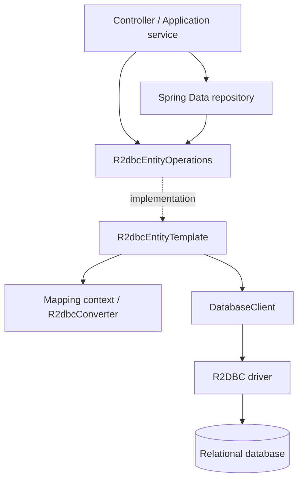
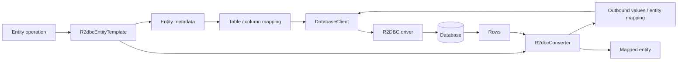

# Role of R2dbcEntityTemplate and R2dbcEntityOperations

In Spring Data Relational R2DBC, `R2dbcEntityTemplate` and `R2dbcEntityOperations` form the central API layer for interacting with entities in a relational database under the reactive model. They provide a higher level of abstraction than writing SQL manually and calling the driver directly: the application can query, insert, update, and delete entities using `Mono` and `Flux` types while leveraging Spring Data's mapping mechanism.

These two names are directly related, yet not synonymous. `R2dbcEntityOperations` is the interface describing the entity operations contract; `R2dbcEntityTemplate` is the concrete implementation class of that contract. Understanding each component's role helps you choose the right API level for repositories, services, and customized business queries.

## 1. Position in the Spring Data R2DBC Architecture

An application often has multiple ways to access data. Repositories fit CRUD operations and method-declared queries. `R2dbcEntityTemplate` fits when more flexible query control is needed via `Query`, `Criteria`, and `Update`. At a lower level, `DatabaseClient` allows working directly with SQL statements and driver results.



The diagram illustrates roles at the architectural level. Repositories can be used directly for common operations; when dynamic queries or fine-grained entity operations are required, services can use `R2dbcEntityOperations`. The template coordinates the mapper and `DatabaseClient`, and then the R2DBC driver performs I/O against the database.

| Component | Main Role | When to Use |
| --- | --- | --- |
| Spring Data repository | Provides CRUD and queries by method naming conventions or declared queries | Business logic with a clear, common set of operations easily expressed by a repository |
| `R2dbcEntityOperations` | API contract for reactive entity operations | When you want services to depend on an abstraction rather than a concrete implementation class |
| `R2dbcEntityTemplate` | Implements the entity operations contract, building and executing operations based on mapping metadata | Dynamic queries, conditional updates, custom CRUD operations, or when a template API is needed |
| `DatabaseClient` | Lower-level API to execute SQL and read results | Vendor-specific SQL, complex queries, or cases requiring direct control over statements and result mapping |
| R2DBC driver | Communicates with the database management system using the R2DBC protocol | Connection and I/O execution layer; applications normally do not call the driver directly |

`R2dbcEntityTemplate` does not replace repositories in every scenario. Both approaches can coexist: repositories handle stable operations, while the template solves flexible querying that repositories cannot express concisely.

## 2. What Is `R2dbcEntityOperations`?

`R2dbcEntityOperations` is the Spring Data R2DBC interface defining operations for working with entities. This contract covers groups of operations such as reading, inserting, updating, deleting, counting, and checking data existence. Operations return reactive publishers, typically `Mono<T>`, `Flux<T>`, or `Mono<Long>` depending on the result type.

Because it is an interface, `R2dbcEntityOperations` allows the business layer to depend on required capabilities rather than coupling tightly to a concrete class. In typical applications, Spring Boot or Spring Data configuration provides the implementing bean; services can receive the interface via constructor injection.

```java
import org.springframework.data.r2dbc.core.R2dbcEntityOperations;
import org.springframework.stereotype.Service;

@Service
public class CustomerService {

    private final R2dbcEntityOperations entityOperations;

    public CustomerService(R2dbcEntityOperations entityOperations) {
        this.entityOperations = entityOperations;
    }
}
```

The example above demonstrates depending on an abstraction. The service does not need to create connections itself, manage `Connection` instances, or know the details of how the template converts entities into SQL statements.

### Benefits of the interface

- **Reduces coupling to implementation:** the service clearly states that it needs reactive entity operations without needing to know which concrete class executes them.
- **Easier testing:** the dependency can be swapped with a test double or mock during service unit testing. For integration tests, use a suitable database to verify both mapping and actual SQL.
- **Cleaner architecture:** multiple services can share a common data operations contract without passing `DatabaseClient` or connection configuration details into the business layer.
- **Preserves reactivity:** contract methods return publishers, letting services compose data operations with other processing steps using Reactor.

The interface does not execute queries itself and does not create transactions. It describes how the application requests operations; the implementing bean and infrastructure components handle mapping, command dispatch, and connection management.

## 3. What Is `R2dbcEntityTemplate`?

`R2dbcEntityTemplate` is the standard implementation of `R2dbcEntityOperations`. It is the template class providing an entity-oriented API for working with R2DBC databases. It coordinates components such as `DatabaseClient`, `R2dbcConverter`, relational mapping metadata, and Spring Data callbacks.

When the application requests to read a `Customer`, the template uses entity metadata to determine the table and columns, executes the query via `DatabaseClient`, and transforms result rows into Java objects. When inserting an entity, the template converts property values into outbound write data and processes database-generated values according to mapping configuration.



The template lets the application work with entities and Java properties. In many scenarios, developers do not need to manually assemble table names, convert individual data types, or read individual columns from `Row`.

### What is the template responsible for?

1. **Creating entity operations:** provides APIs to read, insert, update, and delete by entity type.
2. **Building queries:** translates `Query`, `Criteria`, and `Update` objects into statements suited to the database and mapping metadata.
3. **Mapping data:** coordinates converters to turn entities into outbound values and turn query results into entities.
4. **Integrating with Spring Data:** participates in extension points such as entity callbacks and Spring-managed reactive transaction mechanisms.
5. **Keeping the flow reactive:** returns publishers so callers can compose further operations without synchronous waiting.

The template is an orchestrator at the entity layer. It is not a database, does not enforce business rules by itself, and does not make inefficient SQL fast.

## 4. Mapping Entities Before Operating on Them

The template relies on Spring Data Relational metadata to know which table and columns correspond to a Java class. Commonly used annotations include `@Table`, `@Id`, and `@Column`.

```java
import org.springframework.data.annotation.Id;
import org.springframework.data.relational.core.mapping.Column;
import org.springframework.data.relational.core.mapping.Table;

@Table("customer_account")
public class Customer {

    @Id
    private Long id;

    @Column("given_name")
    private String firstName;

    @Column("family_name")
    private String lastName;

    private String email;

    // Constructor, getters, and required methods.
}
```

In this example, `Customer` maps to the `customer_account` table; the `firstName` property maps to the `given_name` column; the `lastName` property maps to `family_name`. Default naming rules and metadata can be adjusted via annotations or corresponding mapping configuration.

`R2dbcEntityTemplate` uses this metadata when building queries and converting results. Consequently, when writing criteria with the query DSL, use entity property names per the API conventions and let Spring Data perform the column name mapping. With hand-written SQL in `DatabaseClient`, the developer is responsible for specifying table names, column names, and result mapping.

## 5. Reading Data with the Template

A read query typically begins with `select`, specifies the entity class, adds conditions via `Query` and `Criteria`, and then chooses whether to fetch one or multiple results.

```java
import static org.springframework.data.relational.core.query.Criteria.where;
import static org.springframework.data.relational.core.query.Query.query;

import reactor.core.publisher.Flux;
import reactor.core.publisher.Mono;

public Flux<Customer> findCustomersByLastName(String lastName) {
    return entityOperations.select(Customer.class)
            .matching(query(where("lastName").is(lastName)))
            .all();
}

public Mono<Customer> findCustomerByEmail(String email) {
    return entityOperations.select(Customer.class)
            .matching(query(where("email").is(email)))
            .one();
}
```

`all()` returns `Flux<Customer>` to emit found entities. `one()` returns `Mono<Customer>` and fits when the criteria are expected to match at most one record. If a query may match multiple records and code only needs the first element, choose an operator whose semantics match the requirement rather than assuming uniqueness.

Multiple criteria can be combined to build dynamic queries:

```java
import org.springframework.data.relational.core.query.Criteria;
import org.springframework.data.relational.core.query.Query;

public Flux<Customer> search(String lastName, String email) {
    Criteria criteria = Criteria.where("lastName").is(lastName);

    if (email != null && !email.isBlank()) {
        criteria = criteria.and("email").is(email);
    }

    return entityOperations.select(Customer.class)
            .matching(Query.query(criteria))
            .all();
}
```

This example illustrates constructing optional criteria. Clearly define the behavior when no search criteria are provided: return all data, reject the request, or apply default criteria. For search endpoints, bound results or paginate to avoid unbounded queries.

### Selecting results and record counts

| Need | Common Result Type | Meaning |
| --- | --- | --- |
| Fetch one entity by a unique condition | `Mono<Entity>` | Completes empty if no match; multiple matches violating uniqueness must be handled explicitly |
| Fetch multiple entities | `Flux<Entity>` | Emits each entity in a reactive stream |
| Count records | `Mono<Long>` | Returns the number of records matching the criteria |
| Check whether records exist | `Mono<Boolean>` | Returns an existence flag |

The template also provides operations such as `count` and `exists` to express query intent clearly, avoiding loading full entities just to count or check existence.

## 6. Inserting Entities

For an insert operation, the application supplies the entity type and the object to save. The template constructs the insert command based on mapping metadata.

```java
public Mono<Customer> createCustomer(Customer customer) {
    return entityOperations.insert(Customer.class)
            .using(customer);
}
```

The result is `Mono<Customer>`. Use the entity emitted by the publisher as the result of the operation. This is especially important when the database generates primary keys or default values; the returned object reflects the saved state per Spring Data's mapping mechanism.

For entities with auto-generated IDs, primary key column configuration and value generation strategy must match the database management system. Do not assume the ID is already populated on the input object before the operation completes.

## 7. Updating Entities

The template supports conditional updates without requiring the entity to be loaded first. This is useful when only a few columns need updating and update criteria can be expressed with the query DSL.

```java
import static org.springframework.data.relational.core.query.Update.update;

public Mono<Long> changeCustomerLastName(Long id, String newLastName) {
    return entityOperations.update(Customer.class)
            .matching(query(where("id").is(id)))
            .apply(update("lastName", newLastName));
}
```

`matching(...)` identifies target records; `apply(...)` specifies the values to update. The `Mono<Long>` result represents the affected row count from execution. The business layer can use this count to distinguish cases where a record was updated from cases where no matching record existed.

If business logic needs to read an entity, inspect its current state, apply rules, and save it back, you can read the entity and chain the update step in the pipeline. Consider concurrency consistency when multiple requests run concurrently; if an update depends on state, include the state condition in the update statement itself or use appropriate locking/transactions.

## 8. Deleting Entities

Conditional deletion follows a similar style to updating:

```java
public Mono<Long> deleteCustomer(Long id) {
    return entityOperations.delete(Customer.class)
            .matching(query(where("id").is(id)))
            .all();
}
```

The result indicates the number of affected rows. If you need to delete based on a specific entity instance, the template also provides entity-accepting operations; API choice depends on whether the application already holds the object or only query criteria.

Never accept an arbitrary condition string from the user and concatenate it directly into SQL. Construct `Criteria` from validated parameters, explicitly restrict filterable fields, and bound deletion scope. For bulk deletions, enforce clear business rules and authorization checks.

## 9. When to Use `R2dbcEntityTemplate` Instead of a Repository?

Repositories are the natural choice for stable business operations like finding by ID, saving an aggregate, or querying by a known set of conditions. The template shines when more flexible query control is needed.

| Scenario | Commonly Suitable Choice | Reason |
| --- | --- | --- |
| Standard CRUD on an aggregate | Reactive repository | Concise API, readable, and aligned with Spring Data conventions |
| Searches with multiple optional filters | `R2dbcEntityTemplate` via `R2dbcEntityOperations` | Can compose `Criteria` dynamically based on actual inputs |
| Updating specific columns by condition | Template | Directly expresses `Query` and `Update`, avoiding reading entities unnecessarily |
| Counting or checking existence with complex criteria | Repository or template | Pick whichever API expresses the query most clearly and fits the version in use |
| Vendor-specific SQL, CTEs, or queries heavily reliant on proprietary DB features | `DatabaseClient` or suitable SQL API | Requires direct control over the SQL statement and result reading |
| Multiple entity operations composed with other reactive services | Repository or template | Both return publishers for pipeline composition |

There is no rule restricting a service to only one approach. A service can inject a repository for core CRUD and `R2dbcEntityOperations` for dynamic search queries. Keep responsibility boundaries clear so data access logic is not scattered arbitrarily.

## 10. Relationship with `DatabaseClient`

`DatabaseClient` is the lower-level API. It handles executing SQL, binding parameters, and reading results from the driver. `R2dbcEntityTemplate` uses `DatabaseClient` underneath and adds entity-based operations backed by mapping metadata.

For example, with `DatabaseClient`, the developer specifies the SQL statement and column extraction:

```java
public Flux<String> findEmails() {
    return databaseClient.sql("SELECT email FROM customer_account")
            .map((row, metadata) -> row.get("email", String.class))
            .all();
}
```

Meanwhile, the template allows querying by entity type:

```java
public Flux<Customer> findAllCustomers() {
    return entityOperations.select(Customer.class).all();
}
```

The difference lies in abstraction level and mapping responsibility. With the template, Spring Data relies on metadata to map entities. With `DatabaseClient`, the application controls the SQL statement and how a `Row` converts into the result type. Even when using dynamic SQL, always bind values via the parameter API; never concatenate user input into SQL strings.

Choose `DatabaseClient` when explicit SQL is the best tool, such as queries using database-specific syntax or results that do not map directly to an entity. Choose the template when operations primarily revolve around Spring Data–managed entities.

## 11. Entity Callbacks and Data Conversion

During entity save and read lifecycles, Spring Data R2DBC can invoke callbacks allowing the application to hook into specific points. Common callback stages include before converting an entity into outbound data, before saving, after saving, and after converting a row into an entity. Exact names and signatures depend on the Spring Data version in use.

Callbacks are useful for technical persistence-lifecycle concerns, such as normalizing values, assigning metadata, or recording audit info before saving. Major business rules should still reside in services or domain models so they can be controlled and tested independently.

Spring Data R2DBC also supports custom conversions when a Java type cannot map directly to a column type. Converters define how to transform between domain types and data types understood by the driver/database. For instance, an application might store a value object as a string or convert an enum according to a custom convention. Conversion configuration must be consistent across reads and writes.

One important caveat: bulk update operations using `Query` and `Update` typically execute directly at the statement level. Because individual entities are not necessarily loaded into memory, do not assume per-entity callbacks will run identically to single-object insert or update flows. If business logic depends on callbacks, verify the behavior for your specific API and version with integration tests.

## 12. Reactive Transactions When Using the Template

`R2dbcEntityTemplate` returns reactive publishers and can participate in Spring-managed transactions. With R2DBC, the transaction manager is typically `R2dbcTransactionManager`, configured with a `ConnectionFactory`. At the application layer, you can use `@Transactional` on reactive methods or `TransactionalOperator` to wrap a pipeline.

Example using `TransactionalOperator`:

```java
public Mono<Customer> registerCustomer(Customer customer) {
    return transactionalOperator.transactional(
            entityOperations.insert(Customer.class)
                    .using(customer)
                    .flatMap(saved ->
                            auditRepository.save(AuditEntry.forCustomer(saved))
                                    .thenReturn(saved)
                    )
    );
}
```

The insert operation and audit write are chained within the same publisher wrapped by the transaction operator. When the publisher completes successfully, the transaction can commit; when an error occurs, the transaction manager handles rollback according to transaction rules.

With reactive transactions, the transaction context propagates via Reactor Context. Therefore, never call `block()` or manually `subscribe()` mid-pipeline. Doing so can detach operations from the transaction context, disrupting error propagation, cancellation, and commit/rollback coordination.

A transaction only covers operations participating in the same transaction context and transaction manager. A call to an external system such as an HTTP service does not automatically become part of the R2DBC database transaction.

## 13. Reactivity and Execution Lifecycle

Template methods return `Mono` or `Flux`, so operations typically execute when a subscriber subscribes. Calling the method and receiving a publisher does not mean the query has already completed.

```java
public Mono<Customer> findAndUpdate(Long id, String newEmail) {
    return entityOperations.select(Customer.class)
            .matching(query(where("id").is(id)))
            .one()
            .flatMap(customer -> entityOperations.update(Customer.class)
                    .matching(query(where("id").is(customer.getId())))
                    .apply(update("email", newEmail))
                    .then(entityOperations.select(Customer.class)
                            .matching(query(where("id").is(customer.getId())))
                            .one()));
}
```

This example reads an entity, updates a property, and reads back the result. If you only need the updated row count, there is no need to read the entity before and after; you can use the fluent update directly as shown earlier. In applications with concurrent updates, consider including state conditions in the update statement to avoid overwriting newer changes.

Do not call `subscribe()` inside a service just to "trigger" an operation. Return the publisher to the caller, such as a WebFlux controller, so the framework manages subscriptions, errors, and cancellation signals. Also never call `block()` on a reactive processing path because it turns a non-blocking operation into a synchronous call and can stall the event loop.

## 14. Testing Template Operations

Testing with `R2dbcEntityOperations` can be split into two levels:

- **Unit tests for services:** replace the dependency with a mock or test double to verify that the service composes publishers, handles empty cases, and propagates errors properly. Unit tests do not prove that SQL, mapping, or database behavior is correct.
- **Integration tests:** run against an R2DBC-compatible database to verify schemas, table/column names, type conversions, queries, auto-generated IDs, and transactions. Test against the same database management system or compatible setup as the deployment environment, since SQL syntax and data types can differ.

When testing publishers with Reactor Test, `StepVerifier` helps assert emitted signals:

```java
StepVerifier.create(customerService.findCustomerByEmail("a@example.com"))
        .expectNextMatches(customer ->
                customer.getEmail().equals("a@example.com"))
        .verifyComplete();
```

For missing-data cases, verify that the publisher completes empty or that the service maps it to a business error per contract. For updates and deletes, verify affected row counts and non-existent ID cases.

## 15. Common Design Mistakes

### Using the template for every query

The template is flexible but can make services verbose and duplicate query conditions. For simple CRUD or stable queries, repositories are usually easier to read. Choose the abstraction based on query shape and class responsibilities.

### Putting raw SQL where the query DSL suffices

Raw SQL is not wrong, but if the operation is simply finding, updating, or deleting entities under standard conditions, the template leverages mapping metadata and reduces manual conversion code. Use `DatabaseClient` when lower-level SQL control is genuinely needed.

### Concatenating input data into SQL

Never concatenate user-supplied strings directly into SQL statements. With the template, use `Criteria` and parameterized values. With `DatabaseClient`, use bind parameters. Also restrict filterable and sortable fields to an application-controlled allowlist.

### Ignoring the returned entity after insert

The returned entity may contain database-generated IDs or values. For immutable entities, mapping may construct a new instance rather than mutating the input object. Continue the pipeline using the value emitted from `insert`.

### Loading all data just to extract a small detail

Do not fetch all entities just to count them or check if any exist. Use `count` or `exists` operations instead. For large lists, apply filtering and pagination as needed.

### Calling subscribe or block manually in the business layer

Manual `subscribe` detaches work from the caller-managed pipeline; `block` stalls a thread waiting for results. Return `Mono` or `Flux` to preserve error propagation, cancellation, and reactive transactions.

### Assuming every version has identical APIs

Fluent operations and method overloads can change across Spring Data Relational versions. When writing code, consult the Javadoc and documentation for your project's exact dependency version, especially for constructors, callbacks, entity update methods, and operation return types.

## 16. Selection and Usage Guidelines

- Treat `R2dbcEntityOperations` as the reactive entity operations contract; treat `R2dbcEntityTemplate` as the implementation providing the template API.
- Prefer injecting the interface into services if a service only needs the entity operations contract.
- Use repositories for stable CRUD and queries easily expressed by repository methods.
- Use the template for dynamic queries, composite criteria, and set-based conditional updates.
- Use `DatabaseClient` when direct SQL is needed or results do not map naturally to an entity.
- Declare entity metadata accurately so the template maps tables, columns, and data types properly.
- Use `Criteria`, `Query`, and `Update` to express conditions while validating allowed query input fields.
- Continue pipelines with the returned publisher; do not block or manually subscribe inside reactive business logic.
- Use reactive transactions when multiple operations require atomicity and ensure they share the same transaction context.
- Write integration tests against an appropriate database engine to verify mapping and SQL behavior.

## 17. Conclusion

`R2dbcEntityOperations` defines the contract for reactive entity operations in Spring Data R2DBC, while `R2dbcEntityTemplate` is the primary implementation providing a fluent API to read, insert, update, and delete data. The template combines mapping metadata, converters, and `DatabaseClient`, enabling applications to work with entities and a query DSL without manually handling every SQL detail.

Repositories remain ideal for standard CRUD and stable queries; the template excels at dynamic queries and customized operations; `DatabaseClient` fits direct SQL control. By placing each component at the proper layer, keeping publishers reactive end-to-end, and managing transactions consistently, applications can take advantage of Spring Data R2DBC while keeping data access code clear, testable, and maintainable.
