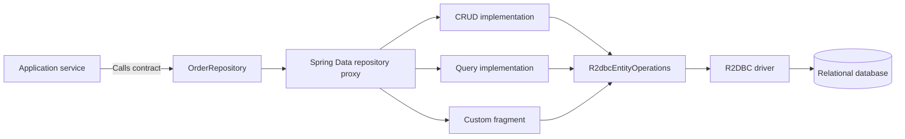
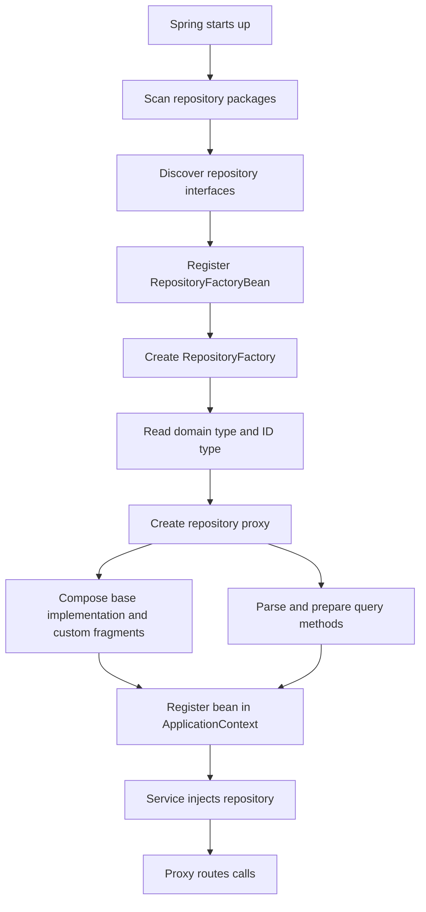

# Role of Repository and Implementation Generation Mechanism

In Spring Data Relational R2DBC, a Repository is the business-level data access entry point. The application declares the required operations through an interface; Spring Data builds an executable bean implementing that interface at application startup. As a result, most repositories do not require hand-written CRUD implementation classes.

This mechanism has two parts to understand clearly. **The role of Repository** is to define a stable data access contract between services and the storage layer. **The implementation generation mechanism** is the process by which Spring discovers the interface, inspects the domain type and methods, creates a proxy object, and routes each call to built-in CRUD operations, declared queries, or custom extensions.

This lesson walks from the Repository contract to how Spring Data creates and uses its implementation in an R2DBC application.

## 1. What Problem Does a Repository Solve?

A business service needs to read and write data, yet it should not have to know details of establishing connections, binding SQL parameters, mapping individual rows, or managing statements. If a service performs all of that itself, business logic becomes tightly coupled to the access mechanics of a particular database engine.

A Repository establishes a clear boundary:

- The service requests an action in the language of the business domain, such as finding orders by customer or saving an order.
- The repository provides the contract for those actions.
- Spring Data performs standard operations based on entity metadata and repository methods.
- When specialized queries are needed, the repository can declare SQL or incorporate a custom implementation component.

For example, the service only needs to know that `findById` returns `Mono<Order>` and `findByCustomerId` returns `Flux<Order>`. The service does not have to manage `Connection`, `Statement`, or `Row`.



A repository is therefore more than a thin wrapper around individual SQL statements. It expresses how a business area needs to access an aggregate and provides a controlled seam when storage details change.

## 2. The Repository Contract in Spring Data

Spring Data provides a shared hierarchy of interfaces for defining repositories. The root interface `Repository<T, ID>` marks a type as a repository and declares the domain type `T` along with the identifier type `ID`. Higher-level interfaces add common operation groups.

With R2DBC, a common choice is `ReactiveCrudRepository<T, ID>`:

```java
import org.springframework.data.repository.reactive.ReactiveCrudRepository;
import reactor.core.publisher.Flux;
import reactor.core.publisher.Mono;

public interface OrderRepository
        extends ReactiveCrudRepository<Order, Long> {

    Flux<Order> findByCustomerId(Long customerId);
}
```

The two generic parameters carry specific meaning:

- `Order` is the entity type managed by the repository.
- `Long` is the type of the primary key annotated with `@Id`.

`ReactiveCrudRepository` provides out-of-the-box CRUD operations with reactive return types. Commonly used methods include:

| Method | Typical Return Type | Meaning |
| --- | --- | --- |
| `save(entity)` | `Mono<S>` | Saves the entity and emits the resulting entity. |
| `findById(id)` | `Mono<T>` | Finds an entity by ID; may complete empty. |
| `findAll()` | `Flux<T>` | Emits found entities. |
| `existsById(id)` | `Mono<Boolean>` | Checks whether an entity exists. |
| `count()` | `Mono<Long>` | Counts entities. |
| `deleteById(id)` | `Mono<Void>` | Deletes an entity by ID and signals completion. |
| `delete(entity)` | `Mono<Void>` | Deletes the supplied entity. |

Operations return `Mono` or `Flux`, so a repository call produces a publisher describing the work. The query usually only executes when the publisher has a subscriber. A WebFlux controller or a component at the application boundary subscribes to the publisher during request processing.

Do not call `block()` on a reactive path just to obtain an entity synchronously. Also do not call `subscribe()` inside a service to run a repository call on its own and discard the result; that breaks the link between errors, completion state, and the request lifecycle.

### Repositories expose only necessary operations

Not every CRUD method needs to be exposed to every business area. You can use `@RepositoryDefinition` to declare a repository on a custom interface or extend only suitable interfaces. In typical usage, an interface extends `ReactiveCrudRepository` and adds methods as needed.

Keep contracts concise and meaningful. For instance, `findOpenOrdersForCustomer` communicates a business intent more clearly than a generic method taking multiple boolean flags to toggle every search variation.

A repository is typically tied to an aggregate root. It does not necessarily map one-to-one with every physical table. If an aggregate spans multiple tables persisted together, a single repository can still represent that aggregate; Spring Data Relational applies mapping according to its relational model.

## 3. Declaring Query Methods by Method Name

One of Spring Data's key features is deriving queries from method names. For example:

```java
import reactor.core.publisher.Flux;
import reactor.core.publisher.Mono;

public interface OrderRepository
        extends ReactiveCrudRepository<Order, Long> {

    Flux<Order> findByCustomerId(Long customerId);

    Flux<Order> findByStatusAndCustomerIdOrderByCreatedAtDesc(
            OrderStatus status,
            Long customerId);

    Mono<Order> findFirstByCustomerIdOrderByCreatedAtDesc(
            Long customerId);

    Mono<Boolean> existsByCustomerIdAndStatus(
            Long customerId,
            OrderStatus status);
}
```

Spring Data parses the method name to identify:

1. **Subject/prefix:** the action such as `find`, `read`, `get`, `exists`, or `count`.
2. **Predicate/conditions:** properties joined by `And`, `Or`, and supported query operators.
3. **Sorting or limiting:** such as `OrderByCreatedAtDesc`, `First`, or `Top`.

Property names must match properties on the entity, such as `customerId`, rather than always matching the `customer_id` column name in the table. Mapping properties to columns is handled by Spring Data Relational's mapping metadata.

Some readable naming patterns:

| Method Name | Intended Meaning |
| --- | --- |
| `findByStatus(status)` | Find orders by status. |
| `findByCustomerIdAndStatus(id, status)` | Combine two conditions with AND. |
| `findByTotalGreaterThan(amount)` | Filter by greater-than condition. |
| `findByCreatedAtAfter(time)` | Filter records after a timestamp. |
| `findFirstByCustomerIdOrderByCreatedAtDesc(id)` | Retrieve the first record ordered by newest first. |
| `existsByCustomerId(id)` | Check whether a matching record exists. |

Specific operators and query forms supported depend on the Spring Data Relational version and R2DBC's expressive capabilities. When a method name becomes long, hard to read, or unable to express the query accurately, switch to `@Query` or a custom repository fragment instead of piling on more keywords.

### How to read a query method

For the method:

```java
Flux<Order> findByStatusAndCustomerIdOrderByCreatedAtDesc(
        OrderStatus status,
        Long customerId);
```

It reads as follows:

- `findBy`: a search query.
- `StatusAndCustomerId`: filter by status and customer ID.
- `OrderByCreatedAtDesc`: sort creation time in descending order.
- `Flux<Order>`: results may contain multiple orders.

Spring Data learns the entity type and parameter types from the interface. It combines that information with mapping metadata to generate a query matching the active database dialect.

## 4. When Is @Query Needed?

Method names fit simple queries with easily expressed structure. For SQL requiring joins, database-specific expressions, aggregations, or complex sorting, you can declare the query explicitly with `@Query`.

```java
import org.springframework.data.r2dbc.repository.Query;
import org.springframework.data.repository.query.Param;
import reactor.core.publisher.Flux;

public interface OrderRepository
        extends ReactiveCrudRepository<Order, Long> {

    @Query("""
        SELECT id, customer_id, total, status, created_at
        FROM orders
        WHERE customer_id = :customerId
        ORDER BY created_at DESC
        """)
    Flux<Order> findRecentOrders(
            @Param("customerId") Long customerId);
}
```

`@Query` places the SQL close to the method contract. Spring Data uses this SQL statement to run the query and maps rows to the corresponding result type. Using `@Param` makes the link between Java parameter names and SQL placeholders explicit, especially when compilation does not preserve parameter-name metadata.

For statements that modify data, `@Modifying` can be combined:

```java
import org.springframework.data.r2dbc.repository.Modifying;
import org.springframework.data.r2dbc.repository.Query;
import org.springframework.data.repository.query.Param;
import reactor.core.publisher.Mono;

@Modifying
@Query("""
    UPDATE orders
    SET status = :status
    WHERE id = :id
    """)
Mono<Integer> updateStatus(
        @Param("id") Long id,
        @Param("status") String status);
```

The return value can indicate the number of affected rows. Choose a return type compatible with the command type and the API of the version in use.

Input values must be bound as parameters. Never concatenate user input directly into SQL strings. Structural elements such as column names or sort directions usually cannot be bound as values; if dynamic selection is required, validate inputs against an allowlist before building the statement.

## 5. How Does Spring Data Generate Implementations?

An application normally declares only an interface, yet when injecting `OrderRepository`, Spring provides a bean implementing that interface. This bean is typically a proxy object created by Spring Data's repository infrastructure.

The process can be divided into stages:



### Stage 1: Interface discovery

Spring Data needs to know which packages contain repositories. In a Spring Boot application with the R2DBC starter and proper configuration, auto-configuration usually configures repository scanning. When explicit control is needed, `@EnableR2dbcRepositories` can be used:

```java
import org.springframework.context.annotation.Configuration;
import org.springframework.data.r2dbc.repository.config.EnableR2dbcRepositories;

@Configuration
@EnableR2dbcRepositories(
    basePackageClasses = OrderRepository.class
)
class R2dbcRepositoryConfiguration {
}
```

`basePackageClasses` identifies the package based on a specific class or interface, avoiding reliance on string package names that break easily during refactoring.

During scanning, Spring Data locates valid repository interfaces and registers corresponding bean definitions. A generic base interface used as a foundation for other repositories usually needs `@NoRepositoryBean` so Spring does not attempt to instantiate a standalone repository for an unresolved domain type.

```java
import org.springframework.data.repository.NoRepositoryBean;
import org.springframework.data.repository.reactive.ReactiveCrudRepository;

@NoRepositoryBean
public interface BaseRepository<T, ID>
        extends ReactiveCrudRepository<T, ID> {
}
```

Concrete repositories can extend this base interface:

```java
public interface OrderRepository
        extends BaseRepository<Order, Long> {
}
```

### Stage 2: RepositoryFactoryBean and RepositoryFactory

For each discovered interface, the Spring Data infrastructure registers a `RepositoryFactoryBean` dedicated to creating that repository. The factory bean coordinates with a `RepositoryFactory` tailored to the storage technology.

In R2DBC, the factory knows how to build repositories using Spring Data Relational and R2DBC components. At the shared architecture layer, `RepositoryFactorySupport` provides proxy creation, fragment composition, and query method preparation. The R2DBC-specific factory adds support for building implementations and queries compatible with R2DBC.

Responsibilities can be summarized as follows:

| Component | Responsibility |
| --- | --- |
| Repository interface | Declares the entity type, ID, and operations the application needs to call. |
| `RepositoryFactoryBean` | Participates in Spring's bean lifecycle and asks the factory to create the repository. |
| Repository factory | Creates the proxy, resolves the base implementation, and composes fragments. |
| Mapping context | Supplies metadata about entities, IDs, properties, and relational mappings. |
| Query lookup strategy | Determines how to locate or create a query for each query method. |
| Repository proxy | Receives application calls and routes them to the corresponding executor. |

Internal class names and implementation details can vary across Spring Data versions. What matters at the usage level is that the interface is backed by the repository infrastructure, rather than Spring turning it into a plain Java class with CRUD code generated at compile time.

### Stage 3: Resolving repository metadata

The factory inspects generic type arguments to learn which entity the repository manages and what type the ID has. It also uses the mapping context to look up entity metadata: table, columns, primary key, data types, and conversions.

For example, from:

```java
public interface OrderRepository
        extends ReactiveCrudRepository<Order, Long> {
}
```

Spring Data determines:

- The domain type is `Order`.
- The ID type is `Long`.
- Metadata maps `Order` to a relational table.
- CRUD operations must use the configured R2DBC infrastructure.

If generic types cannot be resolved, the ID type does not match, or the entity lacks valid mapping, the repository may fail to initialize or queries may fail at execution time. Thus, interface generic arguments are part of the configuration, not just hints for IDE type checking.

### Stage 4: Creating the proxy and composing implementations

The repository proxy is the object injected into services. The proxy implements the repository interface and intercepts method calls. It coordinates previously prepared components to handle each kind of method.

A call such as `save(order)` is routed to the base CRUD implementation. A call to `findByStatus(status)` is routed to the query method handler. A method belonging to a custom fragment is routed to its corresponding implementation.

Thanks to the proxy, the interface can combine multiple implementation sources while callers still see a unified contract. The service does not need to know whether a method is executed by the base CRUD class, a query executor, or a custom fragment.

## 6. Distinguishing Three Types of Methods on a Repository Proxy

A repository typically combines three groups of methods:

| Method Group | Implementation Source | Example |
| --- | --- | --- |
| Base methods | Default CRUD implementation class from Spring Data R2DBC. | `save`, `findById`, `deleteById`. |
| Query methods | Queries derived from method names or declared via annotations. | `findByStatus`, `findRecentOrders`. |
| Custom fragments | Application-provided classes implementing specialized behavior. | `searchWithComplexFilter`. |

### Base methods

CRUD methods are supplied by Spring Data R2DBC's base implementation. That implementation uses Spring Data Relational's entity operation components to generate statements, bind values, and map results.

The application does not need to write an `OrderRepositoryImpl` class just to implement `save`, `findById`, or `deleteById`. Reimplementing these methods without a clear need forces the team to maintain details Spring Data already handles.

### Query methods

Query methods are prepared based on interface metadata and query configuration. Spring Data resolves the query from the method name or from declarations like `@Query`, and creates the corresponding executor.

### Custom fragments

When business logic needs dynamic queries, specialized access algorithms, or coordinated multi-step operations that built-in methods do not express well, you can extend the repository using a fragment. This provides contract-based extensibility while keeping specialized access inside the repository layer.

## 7. Query Lookup Strategy: Finding or Creating Queries

When Spring Data encounters a query method, it must decide how to obtain the query. This mechanism is called the query lookup strategy. General options typically include:

| Strategy | How It Works |
| --- | --- |
| `CREATE` | Generates the query from the method name. |
| `USE_DECLARED_QUERY` | Requires a pre-declared query; does not derive from the method name if none is found. |
| `CREATE_IF_NOT_FOUND` | Prefers a declared query; if none exists, derives it from the method name. |

`CREATE_IF_NOT_FOUND` is the common default in Spring Data infrastructure. With R2DBC, declared queries can come from `@Query` or supported named query mechanisms in the corresponding configuration.

The process flows as follows:

1. The factory collects the list of query methods on the repository interface.
2. The query lookup strategy checks whether a method has a declared query.
3. If the strategy permits deriving a query, Spring Data parses the method name.
4. The query component is built and attached to the repository proxy.
5. When the application invokes the method, the proxy executes the query via R2DBC infrastructure.

Query method preparation normally occurs during repository creation, enabling many property-name or syntax-declaration errors to be caught at startup rather than waiting for the first request. However, SQL errors tied to the database, permissions, schema, or live data may still surface only when the query runs.

## 8. Extending a Repository with a Custom Fragment

A custom fragment is the right way to add behavior that standard CRUD or query methods do not handle well. A fragment consists of an interface describing the behavior and a class implementing that interface.

For example, searching orders by status might require custom query logic:

```java
import reactor.core.publisher.Flux;

public interface OrderSearch {
    Flux<Order> findByStatusWithNewestFirst(OrderStatus status);
}
```

The main repository extends this fragment:

```java
import org.springframework.data.repository.reactive.ReactiveCrudRepository;

public interface OrderRepository
        extends ReactiveCrudRepository<Order, Long>, OrderSearch {
}
```

The fragment implementation class uses `R2dbcEntityTemplate`:

```java
import org.springframework.data.r2dbc.core.R2dbcEntityTemplate;
import org.springframework.data.relational.core.query.Criteria;
import org.springframework.data.relational.core.query.Query;
import org.springframework.data.domain.Sort;
import reactor.core.publisher.Flux;

public class OrderSearchImpl implements OrderSearch {

    private final R2dbcEntityTemplate template;

    public OrderSearchImpl(R2dbcEntityTemplate template) {
        this.template = template;
    }

    @Override
    public Flux<Order> findByStatusWithNewestFirst(OrderStatus status) {
        Query query = Query.query(Criteria.where("status").is(status))
            .sort(Sort.by(Sort.Direction.DESC, "createdAt"));

        return template.select(query, Order.class);
    }
}
```

Spring Data locates implementations using the fragment name convention and default implementation suffix. In this example, `OrderSearch` is implemented by `OrderSearchImpl`. A different suffix can be configured if the project follows a custom naming convention.

Once Spring composes the fragment into the repository, the service can call the method as part of `OrderRepository`:

```java
Flux<Order> orders = orderRepository
    .findByStatusWithNewestFirst(OrderStatus.NEW);
```

A custom fragment can use `R2dbcEntityTemplate`, `DatabaseClient`, or another suitable data access component. Pick the tool according to query complexity and keep business logic in the service/domain when that logic is not a data access concern.

### When should you use a fragment?

Consider a fragment when:

- A query has many optional criteria that are hard to express in a method name.
- Multiple queries or data operations need to be combined into one clearly named behavior.
- A lower-level API is needed to control SQL or mapping.
- A group of repositories needs to share structured custom behavior.

There is no need to create a fragment merely to forward a `findById` call to `ReactiveCrudRepository`. Every extension class should have a concrete responsibility and bring clear value.

## 9. Reusing Repositories via Base Interfaces

A project may have many repositories that share a common set of methods or conventions. You can declare a generic base interface:

```java
import org.springframework.data.repository.NoRepositoryBean;
import org.springframework.data.repository.reactive.ReactiveCrudRepository;
import reactor.core.publisher.Mono;

@NoRepositoryBean
public interface ApplicationRepository<T, ID>
        extends ReactiveCrudRepository<T, ID> {

    default Mono<Boolean> isPresent(ID id) {
        return existsById(id);
    }
}
```

Concrete repositories extend the base interface:

```java
import org.springframework.data.repository.NoRepositoryBean;

@NoRepositoryBean
public interface AuditedRepository<T, ID>
        extends ApplicationRepository<T, ID> {
}

public interface OrderRepository
        extends AuditedRepository<Order, Long> {
}
```

`@NoRepositoryBean` informs Spring Data that this generic interface is a base for inheritance, not a standalone repository requiring bean instantiation. Omitting the annotation on a generic structure without a concrete domain type can cause Spring Data to attempt creating a repository without sufficient type information.

For deeper needs, Spring Data allows customizing the repository base class via repository configuration. This fits when you want to alter core behavior uniformly across many repositories. However, custom fragments are usually easier to scope and test; use a custom base class only when the change genuinely applies to shared base behavior.

## 10. Repositories and Transaction Boundaries

Repositories describe data access operations. Transaction boundaries should generally be placed in the service/application layer, which has enough context to know which operations must succeed or fail together.

For instance, a business workflow may invoke multiple repositories:

```java
import org.springframework.stereotype.Service;
import org.springframework.transaction.annotation.Transactional;
import reactor.core.publisher.Mono;

@Service
public class CheckoutService {

    private final OrderRepository orders;
    private final InventoryRepository inventory;

    public CheckoutService(
            OrderRepository orders,
            InventoryRepository inventory) {
        this.orders = orders;
        this.inventory = inventory;
    }

    @Transactional
    public Mono<Order> checkout(Order order) {
        return inventory.reserve(order)
            .then(orders.save(order));
    }
}
```

This code expresses the intent: keeping inventory reservation and order saving inside the same reactive transaction when both operations participate in the appropriate transaction manager and connection infrastructure. If the second step fails, the transaction can roll back the earlier change.

Do not call `subscribe()` manually inside a repository or service method to run a side operation. Once a publisher is detached from the chain managed by the transaction manager, transactional behavior may no longer work as expected. Reactive transactions use Reactor Context to propagate transaction state down the processing chain.

## 11. Testing Repositories

Repository testing needs to verify two areas:

- **Contract and routing:** the service calls the right method, publishers are composed properly, and results are handled accurately.
- **Data integration:** query methods produce valid statements, declared SQL runs, mapping handles data types properly, and the driver participates in transactions as expected.

Mocking repositories is helpful for service tests. For example, you can mock `OrderRepository` to verify that a service handles `Mono.empty()`, success outcomes, or errors. However, mocks do not validate query methods, SQL, or mapping against a real database.

For integration testing, Spring Boot provides the `@DataR2dbcTest` test slice to configure the necessary data access components. Testcontainers can be used to run the exact database engine deployed by the application.

```java
import org.junit.jupiter.api.Test;
import org.springframework.beans.factory.annotation.Autowired;
import org.springframework.boot.test.autoconfigure.data.r2dbc.DataR2dbcTest;
import reactor.test.StepVerifier;

@DataR2dbcTest
class OrderRepositoryTest {

    @Autowired
    OrderRepository orders;

    @Test
    void findsOrdersForCustomer() {
        StepVerifier.create(orders.findByCustomerId(42L))
            .expectNextMatches(order ->
                order.customerId().equals(42L))
            .verifyComplete();
    }
}
```

The example assumes test data has been loaded and includes at least one order for customer `42`. In real tests, explicitly set up the schema and initial data, then verify both populated and empty result cases.

For custom fragments, test dynamic query behavior directly and verify that the fragment is composed into the repository bean. For `@Query`, run queries against the actual target database engine because SQL syntax and type mappings can differ across drivers.

## 12. Common Mistakes When Using Repositories

| Issue | Cause | Solution |
| --- | --- | --- |
| Repository bean not found | Package was not scanned or repository configuration is not enabled. | Check `@EnableR2dbcRepositories` packages and auto-configuration. |
| Repository fails to initialize | Invalid generic type, entity metadata, or query method. | Check domain type, ID type, property names, and query declarations. |
| Query method cannot find property | Method name uses column name instead of Java property name, or has a typo. | Use the exact property name on the entity. |
| Custom fragment is not composed | Implementation name does not match convention or fragment interface is not extended. | Check interface name, implementation suffix, and scan configuration. |
| SQL in `@Query` fails | SQL is incompatible with the active dialect or current schema. | Test against the real database engine and check column names and bind parameters. |
| Service blocks while accessing repository | Calling `block()` or using synchronous JDBC components in a reactive flow. | Keep publishers end-to-end and define blocking boundaries clearly. |
| Expecting JPA behavior | Assuming R2DBC performs lazy loading, dirty checking, or persistence context management. | Design queries and save aggregates explicitly. |
| Retries duplicate write operations | Non-idempotent write command retried after an error. | Classify errors and design idempotency before retrying. |

## 13. Process for Designing a New Repository

When adding a repository for a new feature, follow this sequence:

1. **Identify the aggregate:** which entity is the root and which data falls within its persistence boundary?
2. **Define the contract:** which read, write, or check operations does the service need?
3. **Choose reactive types:** use `Mono` for at most one element or completion status; use `Flux` for collections of results.
4. **Declare the repository interface:** extend `ReactiveCrudRepository` or a suitable base interface.
5. **Choose how queries are defined:** use method names for simple queries; `@Query` for explicit SQL; custom fragments for specialized query behavior.
6. **Verify scanning setup:** ensure the repository package is discovered by Spring Data R2DBC.
7. **Test:** use mocks for service logic and a real database for queries, mapping, and transactions.
8. **Observe at runtime:** monitor query latencies, errors, connection pool metrics, and result sizes.

When designed well, a Repository serves as a stable contract between services and storage mechanics. Spring Data R2DBC discovers the interface, reads metadata, creates a proxy, and routes calls to the appropriate implementation. CRUD is supplied by the base implementation; query methods are built from names or declared SQL; custom fragments extend behavior when needed. Understanding these pieces lets applications benefit from Spring Data automation while retaining control over boundaries, queries, and layer responsibilities.
