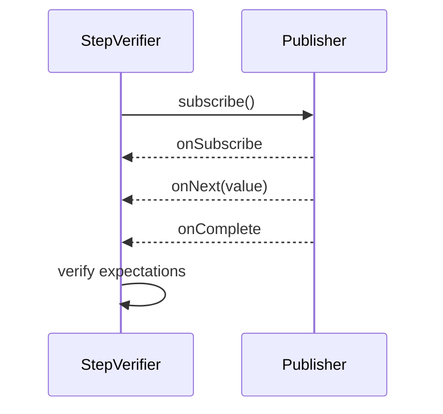

# Verifying Results, Completion, and Errors with StepVerifier

Spring Data R2DBC returns `Mono<T>` and `Flux<T>` instead of synchronous results. A repository method may emit an entity, complete empty, emit multiple entities, or terminate with an error. During testing, simply calling `subscribe()` and observing manually does not tell you exactly which signals the publisher emitted, whether it completed properly, or whether the error was of the expected type.

Reactor provides `StepVerifier` in the `reactor-test` module to test a publisher along its Reactive Streams signal sequence. A test describes what it expects: subscription, `onNext` elements, `onComplete` completion signal, `onError` error signal, backpressure requests, and subscription cancellation. Only when `verify()` or a specialized verify method is called does StepVerifier actually subscribe to the publisher and run the test scenario.

With Spring Data R2DBC, StepVerifier helps verify the contracts of repositories, `R2dbcEntityTemplate`, `DatabaseClient`, and reactive services: returned data is accurate, publishers complete normally on success, missing results are represented properly, and persistence errors are not swallowed.

## 1. Adding reactor-test to the Project

If the project uses Maven, the dependency is typically declared in test scope:

```xml
<dependency>
    <groupId>io.projectreactor</groupId>
    <artifactId>reactor-test</artifactId>
    <scope>test</scope>
</dependency>
```

With Gradle:

```groovy
testImplementation 'io.projectreactor:reactor-test'
```

In a Spring Boot project, let dependency management/BOM manage the Reactor version compatible with the Spring Framework and Reactor Core versions in use. Do not pick a `reactor-test` version from a different line than `reactor-core` without a clear reason.

Common imports:

```java
import org.junit.jupiter.api.Test;
import reactor.test.StepVerifier;
import java.time.Duration;
```

## 2. How Does StepVerifier Check Signals?

A reactive publisher can emit the following signals:

- `onSubscribe`: the consumer receives a subscription.
- `onNext(value)`: the publisher emits an element.
- `onComplete`: the publisher completes normally.
- `onError(error)`: the publisher terminates with an error.
- `cancel`: the consumer cancels the subscription; this is a subscription control action, not a terminal signal emitted by the publisher.

StepVerifier lets you declare a matching chain of expectations. For example:

```java
StepVerifier.create(Flux.just("A", "B"))
    .expectNext("A")
    .expectNext("B")
    .verifyComplete();
```

The scenario requires the publisher to emit `A`, then `B`, and then complete. If the publisher emits `C`, emits an error, or fails to complete, the test fails according to the verification condition.

Diagram of a simple scenario:



`StepVerifier.create(publisher)` creates the test scenario. The `expect...` calls describe the expected signals. The final call such as `verifyComplete()`, `verifyError()`, or `verify()` triggers subscription and awaits the result.

## 3. Verifying a Single Successful Result with expectNext

For a `Mono<T>` with one value, use `expectNext` if the object has an appropriate equality check:

```java
@Test
void findsCustomer() {
    Mono<String> result = Mono.just("an@example.com");

    StepVerifier.create(result)
        .expectNext("an@example.com")
        .verifyComplete();
}
```

`expectNext` compares the emitted element with the expected value. Then `verifyComplete()` confirms the publisher completes normally with no extra unexpected elements.

For entities, `equals` might not be implemented or might compare unrelated fields. In that case, use `assertNext` to inspect properties:

```java
@Test
void readsCustomerFromRepository() {
    StepVerifier.create(customerRepository.findById(10L))
        .assertNext(customer -> {
            assertThat(customer.getId()).isEqualTo(10L);
            assertThat(customer.getEmail()).isEqualTo("an@example.com");
            assertThat(customer.getDisplayName()).isEqualTo("An");
        })
        .verifyComplete();
}
```

`assertNext` accepts a consumer to run assertions on the next element. If an assertion throws an error, the test fails. Use this approach to verify multiple properties without building a full expected object.

## 4. Verifying Elements with expectNextMatches

`expectNextMatches(predicate)` is appropriate when you only need to check a condition:

```java
StepVerifier.create(customerRepository.findById(10L))
    .expectNextMatches(customer ->
        customer.getId().equals(10L)
            && customer.getEmail().endsWith("@example.com"))
    .verifyComplete();
```

The predicate returns `true` if the element satisfies the condition. If it returns `false`, StepVerifier marks the test as failed.

Do not cram too many assertions into a predicate. When you need clear failure messages, use `assertNext` with AssertJ/JUnit so the test report identifies which property failed.

## 5. Verifying Multiple Results from a Flux

For list queries, use `expectNext` for individual values or `expectNextSequence` for a sequence:

```java
@Test
void listsCustomersInExpectedOrder() {
    StepVerifier.create(customerRepository.findByStatusOrderByIdAsc(Status.ACTIVE))
        .expectNextSequence(List.of(customerA, customerB, customerC))
        .verifyComplete();
}
```

The example assumes the repository has an explicit ordering rule. If a query has no `ORDER BY`, do not assert a fixed order because the database does not guarantee row ordering.

If you only care about the number of elements, you can use `expectNextCount`:

```java
StepVerifier.create(customerRepository.findByStatus(Status.ACTIVE))
    .expectNextCount(3)
    .verifyComplete();
```

`expectNextCount(3)` checks for exactly three subsequent elements without inspecting their contents. Combine it with `verifyComplete()` to ensure the publisher does not emit a fourth row.

When you need to inspect a specific element and skip the remaining elements:

```java
StepVerifier.create(customerRepository.findAll())
    .assertNext(first -> assertThat(first.getId()).isNotNull())
    .expectNextCount(2)
    .verifyComplete();
```

If you need to collect emitted elements for a final assertion, you can use `recordWith` and `expectRecordedMatches`:

```java
StepVerifier.create(customerRepository.findByStatus(Status.ACTIVE))
    .recordWith(ArrayList::new)
    .expectNextCount(3)
    .expectRecordedMatches(customers ->
        customers.stream().allMatch(c -> c.getStatus() == Status.ACTIVE))
    .verifyComplete();
```

Only record into memory when the result set is small and bounded. For large results, assert each element inline or test with a bounded query to avoid consuming too much memory in the test.

## 6. Verifying Not-Found Cases

A single-result query that finds no row typically returns `Mono.empty()`. This is normal completion, not an error:

```java
@Test
void returnsEmptyWhenCustomerDoesNotExist() {
    StepVerifier.create(customerRepository.findById(-1L))
        .verifyComplete();
}
```

No `expectNext()` is needed because the publisher emits no value. `verifyComplete()` confirms the publisher ends with `onComplete` without emitting an element.

For a service that turns an empty result into a business error:

```java
@Test
void convertsMissingCustomerToNotFound() {
    StepVerifier.create(customerService.getRequiredCustomer(-1L))
        .expectError(CustomerNotFoundException.class)
        .verify();
}
```

These two tests verify two different contracts:

- Repository: when no row exists, the publisher completes empty.
- Service: when no row exists, it is a business error as required by the use case.

Do not force a repository to return `Mono.error(NotFoundException)` if the persistence layer is designed to represent missing rows with empty; place the not-found decision in the service/API layer if that fits your architecture.

## 7. Verifying Errors with expectError

When a publisher terminates with an error, use `expectError` to verify the exception type:

```java
StepVerifier.create(customerService.getRequiredCustomer(-1L))
    .expectError(CustomerNotFoundException.class)
    .verify();
```

If you need to check the message:

```java
StepVerifier.create(customerService.getRequiredCustomer(-1L))
    .expectErrorMessage("Customer was not found")
    .verify();
```

If you need to verify multiple properties of the exception, use `expectErrorSatisfies`:

```java
StepVerifier.create(customerService.getRequiredCustomer(-1L))
    .expectErrorSatisfies(error -> {
        assertThat(error).isInstanceOf(CustomerNotFoundException.class);
        CustomerNotFoundException notFound =
            (CustomerNotFoundException) error;
        assertThat(notFound.getCustomerId()).isEqualTo(-1L);
    })
    .verify();
```

`expectErrorMatches` works well with a predicate:

```java
StepVerifier.create(service.loadCustomer(-1L))
    .expectErrorMatches(error ->
        error instanceof CustomerNotFoundException
            && ((CustomerNotFoundException) error).getCustomerId().equals(-1L))
    .verify();
```

Choose the check based on your need: class when only the error type matters, message when the message is part of the contract, `expectErrorSatisfies` when detailed assertions are needed. Avoid coupling too tightly to driver-generated messages because messages can change across databases and versions.

## 8. Verifying Database Errors and Exception Translation

Spring typically translates R2DBC errors into appropriate `DataAccessException` types when operations go through Spring Data/`DatabaseClient`. The exact error type depends on the error category, driver, and exception translation.

Example testing an operation that violates a unique constraint:

```java
@Test
void duplicateEmailFails() {
    Mono<Customer> duplicate = customerRepository.save(
        new Customer(null, "existing@example.com"));

    StepVerifier.create(duplicate)
        .expectError(DataIntegrityViolationException.class)
        .verify();
}
```

The test assumes `existing@example.com` already exists and the schema has a unique constraint. In a real test, create the fixture first using reactive setup or the repository, then perform the duplicate operation. Some driver versions may categorize errors differently; when exact verification is needed, assert the exception type and cause actually received by the application.

To verify that a service does not turn a database error into an empty result:

```java
StepVerifier.create(customerService.loadCustomerFromDatabase(id))
    .expectError(DataAccessException.class)
    .verify();
```

Do not write `onErrorResume(error -> Mono.empty())` just to make a test pass. Tests should verify that persistence errors continue to propagate, unless the service has a specific fallback policy for a known error type.

## 9. Verifying rowsUpdated and Mono<Void>

With `DatabaseClient`, update/delete operations typically return a publisher containing the number of affected rows:

```java
Mono<Long> updateCount = databaseClient.sql("""
        UPDATE customer
        SET display_name = :name
        WHERE id = :id
        """)
    .bind("name", "An Nguyen")
    .bind("id", 10L)
    .fetch()
    .rowsUpdated();
```

Verify that exactly one row was updated:

```java
StepVerifier.create(updateCount)
    .expectNext(1L)
    .verifyComplete();
```

If no row matches, `rowsUpdated()` usually emits `0` rather than completing empty:

```java
StepVerifier.create(updateCustomerWithUnknownId())
    .expectNext(0L)
    .verifyComplete();
```

For methods returning `Mono<Void>`, normal completion emits no value:

```java
StepVerifier.create(customerRepository.deleteById(10L))
    .verifyComplete();
```

Do not use `expectNextCount(1)` for `Mono<Void>`. The publisher has no `onNext` element to verify; what needs verification is `onComplete` or `onError`.

## 10. Verifying Signal Order and No Extra Elements

A good test typically verifies both data and the terminal signal. For example:

```java
StepVerifier.create(Flux.just("first", "second"))
    .expectNext("first")
    .expectNext("second")
    .verifyComplete();
```

If you only verify two `expectNext` calls without a terminal call, the scenario has not confirmed that the publisher finishes properly. `verifyComplete()` makes it explicit that normal completion must follow the two values.

If the publisher emits the expected elements and then emits an error, a test with `verifyComplete()` will fail. If the publisher emits an unexpected extra element, the test also fails while waiting for the terminal signal.

When a publisher is expected to end with an error after several elements:

```java
StepVerifier.create(service.streamThenFail())
    .expectNext("A", "B")
    .expectError(ImportFailedException.class)
    .verify();
```

The scenario confirms that the first two values are emitted before the publisher reports an error. This is useful for streaming `Flux` pipelines, where some elements may already have been sent before the database or downstream processing encounters an error.

## 11. Setting Timeouts to Prevent Hanging Tests

`verify...` methods can wait for the publisher to finish. If a publisher never completes, the test may hang for a very long time. You can set a timeout per test:

```java
StepVerifier.create(customerRepository.findById(10L))
    .expectNextMatches(customer -> customer.getId().equals(10L))
    .verifyComplete(Duration.ofSeconds(5));
```

Or call `verify(Duration)` after describing the scenario:

```java
StepVerifier.create(customerRepository.findAll())
    .expectNextCount(3)
    .verify(Duration.ofSeconds(5));
```

You can set a default timeout for StepVerifier in the test suite:

```java
@BeforeAll
static void configureStepVerifierTimeout() {
    StepVerifier.setDefaultTimeout(Duration.ofSeconds(10));
}
```

StepVerifier's timeout limits how long the test waits for signals. It is not the same as a database query timeout or a pool connection-acquire timeout. If a query times out, identify which layer actually emits the error and test the timeout policy at the proper layer.

Do not set timeouts so short that database tests fail intermittently on slower runs. Choose a duration suited to the CI environment and keep timeouts finite so hung publishers are caught.

## 12. Distinguishing thenAwait and expectNoEvent

`thenAwait(duration)` tells StepVerifier to wait for a duration before continuing verification. It does not by itself assert that no signals occur during that period.

`expectNoEvent(duration)` verifies that no signal occurs during that duration. Note that subscription itself counts as an event; if you need to assert no events after subscribing, call `expectSubscription()` first:

```java
StepVerifier.withVirtualTime(() -> delayedPublisher())
    .expectSubscription()
    .expectNoEvent(Duration.ofSeconds(4))
    .thenAwait(Duration.ofSeconds(1))
    .expectNext("ready")
    .verifyComplete();
```

Do not use `expectNoEvent` to check that a database query "emits nothing for a few seconds" if the real goal is query timeout behavior. Database tests should verify the result or error according to an explicitly configured timeout rather than relying on arbitrary sleep windows.

## 13. Verifying Backpressure and Requests

Reactive Streams allows subscribers to request how many elements they are ready to receive. StepVerifier can start with an initial request of 0 to verify that the publisher emits no data before demand arrives:

```java
StepVerifier.create(Flux.range(1, 3), 0)
    .expectSubscription()
    .thenRequest(1)
    .expectNext(1)
    .thenRequest(2)
    .expectNext(2, 3)
    .verifyComplete();
```

The example starts with an initial request of 0, then requests one element and then two elements. This tests that the application's publishers and operators honor demand. Database drivers may have their own fetch/buffering mechanisms, so this test does not prove the database server sends rows strictly one by one per demand; it tests signals at the reactive boundary.

## 14. Verifying Cancellation

A consumer can cancel a subscription when it no longer needs more data. With R2DBC queries, cancellation can stop the pipeline and the driver may send a cancel signal to the database depending on driver support.

You can verify that a publisher receives cancellation:

```java
@Test
void cancelsSubscription() {
    AtomicBoolean cancelled = new AtomicBoolean();

    Flux<Integer> source = Flux.<Integer>never()
        .doOnCancel(() -> cancelled.set(true));

    StepVerifier.create(source)
        .thenCancel()
        .verify();

    assertThat(cancelled).isTrue();
}
```

`thenCancel()` cancels the subscription and `verify()` executes the scenario. With a real repository, cancellation tests can verify that a service stops processing elements after the caller stops. However, do not claim that cancellation always rolls back writes or immediately aborts the query on the database server; that depends on the transaction, driver, and database.

## 15. Testing Time with Virtual Time

Some reactive flows use `delay`, `timeout`, `retryWhen` with backoff, or time-based schedulers. Waiting in real time makes test suites slow. `StepVerifier.withVirtualTime` lets you advance a virtual clock to test operators backed by supported schedulers.

Example testing `Mono.delay`:

```java
@Test
void emitsAfterOneHourWithoutWaitingAnHour() {
    StepVerifier.withVirtualTime(
            () -> Mono.delay(Duration.ofHours(1)))
        .expectSubscription()
        .expectNoEvent(Duration.ofMinutes(59))
        .thenAwait(Duration.ofMinutes(1))
        .expectNext(0L)
        .verifyComplete();
}
```

The publisher must be created inside the supplier passed to `withVirtualTime`. If the publisher is created beforehand and passed in, the operator may already have captured the real scheduler and will not use the virtual scheduler.

Virtual time is well suited for testing retry/backoff or delays in services. It does not virtualize SQL Server/PostgreSQL execution time; do not use virtual time to replace integration tests for database queries, network timeouts, or driver scheduling.

## 16. Verifying Retries and Fallbacks

Suppose a service retries a transient error and then succeeds. You can build a test publisher that explicitly tracks invocation counts:

```java
AtomicInteger attempts = new AtomicInteger();

StepVerifier.withVirtualTime(() -> Mono.defer(() -> {
        int attempt = attempts.incrementAndGet();
        if (attempt < 3) {
            return Mono.error(new TransientStoreException());
        }
        return Mono.just("loaded");
    }).retryWhen(Retry.fixedDelay(2, Duration.ofSeconds(1))))
    .thenAwait(Duration.ofSeconds(2))
    .expectNext("loaded")
    .verifyComplete();

assertThat(attempts).hasValue(3);
```

The retry publisher is created inside the supplier passed to `withVirtualTime`, so the virtual scheduler can be applied to the delay. If you create the publisher beforehand and reference that prebuilt variable inside the supplier, the operator may already have captured the real scheduler and the test will wait in real time.

For `switchIfEmpty` fallbacks, verify that the alternative publisher runs only when the primary source is empty. For `onErrorResume`, verify that the fallback runs only for selected error types and other errors still propagate. Do not check only the final value; check call counts or side-publisher state if that is an important part of the contract.

## 17. Combining StepVerifier with R2DBC Repositories

StepVerifier verifies reactive signals, but it does not create databases or fixtures on its own. Integration tests should prepare schema and data using migrations/test fixtures, then verify the repository through the real driver.

Example verifying insert and read-back:

```java
@Test
void savesAndReadsCustomer() {
    Customer input = new Customer(null, "an@example.com", "An");

    StepVerifier.create(customerRepository.save(input)
            .flatMap(saved -> customerRepository.findById(saved.getId())))
        .assertNext(found -> {
            assertThat(found.getId()).isNotNull();
            assertThat(found.getEmail()).isEqualTo("an@example.com");
            assertThat(found.getDisplayName()).isEqualTo("An");
        })
        .verifyComplete();
}
```

The example assumes the saved entity has a database-generated ID and the repository returns the entity containing that ID. If IDs are assigned by the application, fixtures must match that strategy.

For multi-row queries, assert ordering only when the SQL has `ORDER BY`:

```java
StepVerifier.create(orderRepository
        .findByTenantIdOrderByCreatedAtDescIdDesc(tenantId))
    .assertNext(order -> assertThat(order.getId()).isEqualTo(newestId))
    .assertNext(order -> assertThat(order.getId()).isEqualTo(previousId))
    .verifyComplete();
```

If the repository does not guarantee ordering, check the set of IDs or conditions on each element without assuming emission order.

## 18. Combining StepVerifier with DatabaseClient

`DatabaseClient` returns publishers, so it can be verified the same way:

```java
@Test
void updateReturnsAffectedRowCount() {
    Mono<Long> rowsUpdated = databaseClient.sql("""
            UPDATE customer
            SET display_name = :name
            WHERE id = :id
            """)
        .bind("name", "An Nguyen")
        .bind("id", 10L)
        .fetch()
        .rowsUpdated();

    StepVerifier.create(rowsUpdated)
        .expectNext(1L)
        .verifyComplete();
}
```

For a query finding no match:

```java
StepVerifier.create(databaseClient.sql(
        "SELECT id FROM customer WHERE id = :id")
        .bind("id", -1L)
        .map((row, metadata) -> row.get("id", Long.class))
        .one())
    .verifyComplete();
```

The example verifies that `.one()` completes empty when there is no row. If a query might unexpectedly return multiple rows, write a separate test to assert the cardinality error or adjust the query/contract accordingly.

## 19. Verifying Errors After Partial Flux Emission

A `Flux` can emit several rows and then hit an error on a subsequent read step, such as a driver, mapping, or downstream processing error. In that case, the consumer already received partial data before receiving `onError`.

You can describe this contract in a test:

```java
Flux<Integer> source = Flux.just(1, 2)
    .concatWith(Mono.error(new IllegalStateException("read failed")));

StepVerifier.create(source)
    .expectNext(1, 2)
    .expectErrorMessage("read failed")
    .verify();
```

For database streaming operations, this has practical implications: having received some rows does not mean the entire query succeeded. If the consumer already wrote received rows to another system, you need a transaction/batch or staging strategy to avoid publishing an unintended partial dataset.

## 20. Verifying Transaction Rollback When a Publisher Fails

A service may save multiple entities in a reactive transaction. If a later operation emits an error, the transaction should roll back according to the transaction manager configuration:

```java
@Transactional
public Mono<Void> createOrderWithLines(Order order, List<OrderLine> lines) {
    return orderRepository.save(order)
        .flatMap(saved -> Flux.fromIterable(lines)
            .map(line -> line.withOrderId(saved.getId()))
            .concatMap(orderLineRepository::save)
            .then())
        .then();
}
```

In an integration test, you can create an order line that violates a constraint so the publisher emits an error, then query the database again to confirm the order and earlier lines rolled back. Verify rollback after the transactional publisher has terminated with an error, using an appropriate independent transaction/query.

Do not merely mock the repository to assert `expectError` and conclude that database rollback works. Mocks do not execute real transactions. Run tests against the target database and R2DBC driver to verify transaction boundaries, connection binding, and constraint behavior.

## 21. Verifying Cancellation in a Persistence Pipeline

If a service supports streaming or callers can stop reading early, consider cancellation. For example, a pipeline with cleanup on cancel:

```java
AtomicBoolean cancelled = new AtomicBoolean();

Flux<Customer> result = customerRepository.findAll()
    .doOnCancel(() -> cancelled.set(true));

StepVerifier.create(result)
    .expectNextCount(1)
    .thenCancel()
    .verify();

assertThat(cancelled).isTrue();
```

This test checks that cancellation reaches the operator in the pipeline. With a real database, drivers may handle cancellation differently; do not conclude that the SQL statement was definitely cancelled on the server solely because `doOnCancel` ran.

## 22. Verifying a Publisher Is Subscribed the Right Number of Times

Reactor publishers are typically lazy. Each subscription can re-execute the query or write operation. Therefore, do not call `subscribe()` as a "quick check" beforehand and then pass the same publisher to StepVerifier:

```java
// Avoid: may execute the operation twice.
Mono<Customer> result = customerRepository.save(customer);
result.subscribe();
StepVerifier.create(result).expectNextCount(1).verifyComplete();
```

Instead, let StepVerifier be the test subscriber:

```java
StepVerifier.create(customerRepository.save(customer))
    .assertNext(saved -> assertThat(saved.getId()).isNotNull())
    .verifyComplete();
```

If you need to use a publisher's result across multiple assertions, capture the value using `assertNext`, `recordWith`, or `expectRecordedMatches` in the same scenario. Do not subscribe multiple times to a write publisher unless you are intentionally testing re-execution semantics.

## 23. Using TestPublisher When Signal Control Is Needed

`TestPublisher` belongs to `reactor-test` and lets a test actively emit values, complete, or error. It is useful when testing how a service handles a dependent publisher without needing a real database:

```java
TestPublisher<String> source = TestPublisher.create();

StepVerifier.create(service.transform(source.flux()))
    .then(() -> source.next("customer-1"))
    .expectNext("CUSTOMER-1")
    .then(source::complete)
    .verifyComplete();
```

You can also control errors:

```java
TestPublisher<String> source = TestPublisher.create();

StepVerifier.create(service.transform(source.flux()))
    .then(() -> source.error(new IllegalStateException("source failed")))
    .expectError(IllegalStateException.class)
    .verify();
```

`TestPublisher` helps test reactive service logic, but it does not replace repository integration tests. It does not verify SQL, mapping, transactions, or drivers.

## 24. Naming Scenarios to Make Test Failures Readable

When a suite has many reactive tests, you can attach scenario names with `as(...)` or `StepVerifierOptions`:

```java
StepVerifier.create(customerRepository.findById(10L))
    .as("load existing customer")
    .assertNext(customer -> assertThat(customer.getId()).isEqualTo(10L))
    .verifyComplete();
```

Or:

```java
StepVerifier.create(
        customerRepository.findById(10L),
        StepVerifierOptions.create().scenarioName("load customer by id"))
    .expectNextMatches(customer -> customer.getId().equals(10L))
    .verifyComplete();
```

Scenario names make failure reports easier to identify in suites with many assertions. Names do not need to be long; choose ones that describe the behavior being tested.

## 25. Common Mistakes When Using StepVerifier

| Mistake | Consequence | Fix |
|---|---|---|
| Forgetting to call `verify...()` | The scenario never subscribes to the publisher so the test does not actually run. | End with `verifyComplete`, `verify`, `verifyError`, or an appropriate verify method. |
| Using `expectNext` for `Mono.empty()` | The test waits for an element that does not exist. | Use `verifyComplete()` to verify empty completion. |
| Checking only elements without checking the terminal signal | Misses extra elements or errors occurring after the last element. | End with `verifyComplete()` or `expectError...().verify()`. |
| Using `verifyComplete()` when the publisher should emit an error | The test expects the wrong terminal signal. | Use `expectError`/`expectErrorSatisfies`. |
| Assuming Flux order when SQL lacks `ORDER BY` | Tests become flaky across runs or databases. | Add deterministic ordering or assert as a result set. |
| Calling `subscribe()` before StepVerifier | May execute the query/write twice. | Let StepVerifier manage subscription. |
| Using virtual time for real database queries | The virtual clock does not control driver/server time. | Use virtual time for scheduler-based operators; integration tests use bounded real time. |
| Not setting a timeout on publishers that can hang | The test suite can wait indefinitely. | Use `verify(Duration)` or an appropriate default timeout. |
| Using mocks to conclude transaction rollback works | Mocks do not execute database transactions. | Write integration tests against a real R2DBC driver/database. |
| Asserting vendor-specific exception messages too strictly | Tests break easily when upgrading drivers or databases. | Prefer exception type, SQL state, or contract-stable error codes. |

## 26. Testing Patterns by Repository Contract

For a repository method returning `Mono<Customer>`, include separate scenarios:

| Scenario | How to verify | Expected behavior |
|---|---|---|
| One row found | `assertNext(...)` + `verifyComplete()` | Emits the expected entity and completes. |
| Not found | `verifyComplete()` | Completes empty. |
| Connection or SQL error | `expectError(...)` + `verify()` | Emits error, does not convert to empty. |
| Unexpected multiple rows | `expectError(...)` if API requires at most one | Emits cardinality error. |
| A NULL SQL column | `assertNext(...)` | Entity exists, nullable property is mapped properly. |

For `Flux<Customer>` methods:

- Verify individual elements or count with `expectNextCount`.
- Assert order only when the query has `ORDER BY`.
- Use `verifyComplete()` to confirm normal completion.
- Use `expectError...` if the stream can fail after emitting some rows.
- Test cancellation/backpressure when the service has a streaming contract to protect.

For write methods:

- `Mono<Long>` from `rowsUpdated()` should assert the affected row count.
- `Mono<Void>` should assert completion or error, not wait for `onNext`.
- Transactional operations need integration tests confirming real commit/rollback.

## 27. Workflow for Writing a StepVerifier Test

When starting a reactive test, follow this sequence:

1. Determine whether the publisher is `Mono` or `Flux` and its cardinality contract.
2. Identify the success, empty, and error cases to test.
3. Prepare database data using fixtures/migrations or explicit reactive setup.
4. Create the publisher without calling `subscribe()` or `block()` before the test.
5. Use `expectNext`, `assertNext`, `expectNextMatches`, or `expectNextCount` to verify data.
6. Use `verifyComplete()` for normal completion; use `expectError...().verify()` for errors.
7. Set a finite timeout to avoid hanging tests.
8. For delay/retry/backoff, use `withVirtualTime` and create the publisher inside the supplier.
9. For SQL, mapping, and transactions, run integration tests on the target database/R2DBC driver.
10. Verify that the test does not accidentally subscribe multiple times to a write publisher.

`StepVerifier` is a test subscriber that lets you describe the exact signal sequence of `Mono` and `Flux`. Use `expectNext`/`assertNext` to verify values, `verifyComplete()` to confirm completion, `expectError...` to confirm errors, and request/cancel/virtual-time steps when the contract requires them. With Spring Data R2DBC, combine StepVerifier with integration tests on a real database to verify both reactive signals and SQL, mapping, and transactions. When tests thoroughly verify both data and terminal signals, bugs like unexpected empty publishers, swallowed errors, extra elements, or missing rollbacks are much easier to catch.
