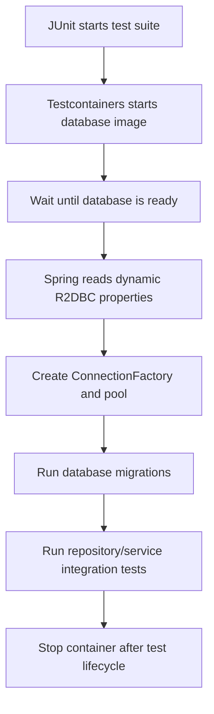

# Using Testcontainers with the Right Target Database

Spring Data R2DBC can work with many relational databases, yet a repository passing on H2 or mocks does not prove the application will work properly on PostgreSQL, MySQL, SQL Server, or Oracle. Each database has its own syntax, data types, transactions, locking, generated keys, and driver behavior. Integration tests should use the exact database engine the application will deploy on, or each engine on its supported list.

Testcontainers starts a real database inside a container for each test suite or test run. The application connects to the container using the real R2DBC driver, runs real migrations, and verifies repositories/services against the real database engine. This enables tests to catch SQL, mapping, constraint, transaction, and driver issues that mocks or substitute databases cannot fully reproduce.

## 1. Why Use Testcontainers for Spring Data R2DBC?

Unit tests are great for checking business rules, pure Java mappings, and how services compose publishers. However, when a test needs to verify that SQL actually runs on a database, you need the target database engine and driver.

Some differences only show up when running against a real database:

- Identity, sequences, generated columns, and how generated keys are returned.
- Data types such as `UUID`, `JSON`, `JSONB`, `BOOLEAN`, `NUMERIC`, timestamps, and arrays.
- Pagination syntax, upserts, JSON operators, identifier quoting, and functions.
- Unique constraints, foreign keys, check constraints, and default values.
- Isolation levels, row locks, deadlocks, lock timeouts, and optimistic locking.
- How the driver binds parameters, maps Java types, cancels statements, and returns exceptions.
- Migration DDL, indexes, triggers, extensions, and generated columns.

For example, a SQL query using `RETURNING` may run on PostgreSQL but will not run verbatim on SQL Server. H2 might accept somewhat similar syntax, yet that does not mean generated key semantics, locking, or data types match PostgreSQL.

Testcontainers solves this by providing a real database engine in a test environment that can be created and destroyed automatically. The application's R2DBC driver remains the real driver, so tests check both sides: the server and how the application communicates with it.

## 2. How Does Testcontainers Work?

Testcontainers uses a container runtime, usually Docker, to launch test dependencies. The test declares the container type and image to use; the library starts the container, waits until the service is ready, exposes dynamic access ports, and stops the container according to its configured lifecycle.

Typical testing flow:



Tests do not require installing a standalone database on developer machines. Each run can use a clean container, making results less dependent on leftover database state from previous runs.

Testcontainers does not replace the database server; it runs the exact database image specified by the test. Therefore, choosing the right image and version matters. If production uses PostgreSQL 16, tests should run PostgreSQL 16 with the matching driver, not just H2 or a different database.

## 3. Choosing the Right Database Image and Version

Choose the image closest to production:

| Production | Commonly used container module/image | What must match |
|---|---|---|
| PostgreSQL | `PostgreSQLContainer` / `postgres` | Major version, extensions, collation, timezone, and server settings |
| MySQL | `MySQLContainer` / `mysql` | Version, character set, collation, SQL mode, and timezone |
| MariaDB | `MariaDBContainer` / `mariadb` | MariaDB-specific version and semantics; do not treat as identical to MySQL |
| SQL Server | `MSSQLServerContainer` / SQL Server image | Version, edition/license acceptance, collation, and compatibility level |
| Oracle | Appropriate Oracle container image | Image, edition, license/registry access, version, and driver |

Do not use the `latest` tag in important tests. Because tags drift over time, the same commit might run on a different database version next week. Pin a specific tag or project-approved digest, and upgrade deliberately.

PostgreSQL example:

```java
static final PostgreSQLContainer<?> POSTGRES =
    new PostgreSQLContainer<>("postgres:16.4-alpine")
        .withDatabaseName("app_test")
        .withUsername("app_test")
        .withPassword("app_test");
```

The `16.4-alpine` tag is only an example. The project should pick a patch version and image matching production/CI policy. If production relies on extensions, collations, or custom server settings, add them to the container setup or a custom test image.

## 4. Required Dependencies

With Gradle Kotlin DSL, a basic PostgreSQL test dependency set might include:

```kotlin
dependencies {
    implementation("org.springframework.boot:spring-boot-starter-data-r2dbc")

    runtimeOnly("org.postgresql:r2dbc-postgresql")

    testImplementation("org.springframework.boot:spring-boot-starter-test")
    testImplementation("io.projectreactor:reactor-test")
    testImplementation("org.testcontainers:junit-jupiter")
    testImplementation("org.testcontainers:postgresql")

    // Only needed if migrations run via Flyway/JDBC.
    testImplementation("org.flywaydb:flyway-core")
    testRuntimeOnly("org.postgresql:postgresql")
}
```

Versions of Spring Boot, Testcontainers, the R2DBC driver, and Flyway should be managed via the project's BOM or dependency management. Do not arbitrarily mix incompatible versions just to get the newest dependency.

The dependencies play different roles:

- `spring-boot-starter-data-r2dbc`: Spring Data R2DBC repositories, templates, and configuration.
- `r2dbc-postgresql`: the R2DBC driver used when the application connects to the container.
- `testcontainers:junit-jupiter`: integrates container lifecycle with JUnit 5.
- `testcontainers:postgresql`: PostgreSQL container module.
- `reactor-test`: `StepVerifier` for testing `Mono`/`Flux`.
- `flyway-core` and JDBC driver: needed if migrations run over Flyway/JDBC.

If using MySQL, MariaDB, or SQL Server, swap in the matching Testcontainers module and R2DBC driver. Do not keep the R2DBC PostgreSQL driver and only change the container image.

## 5. Starting a PostgreSQL Container with JUnit 5

Testcontainers provides `@Testcontainers` and `@Container` to manage container lifecycle:

```java
import org.testcontainers.containers.PostgreSQLContainer;
import org.testcontainers.junit.jupiter.Container;
import org.testcontainers.junit.jupiter.Testcontainers;

@Testcontainers
class PostgreSqlContainerSmokeTest {

    @Container
    static final PostgreSQLContainer<?> POSTGRES =
        new PostgreSQLContainer<>("postgres:16.4-alpine")
            .withDatabaseName("app_test")
            .withUsername("app_test")
            .withPassword("app_test");

    @Test
    void containerIsRunning() {
        assertThat(POSTGRES.isRunning()).isTrue();
    }
}
```

Declaring `static @Container` shares the container across test methods in the same class. The container is started by the Testcontainers JUnit extension before tests run and stopped after the class lifecycle.

If you use `@Container` on a non-static field, Testcontainers may create and stop a container per test method. This provides stronger isolation at the cost of higher startup overhead. Choose the lifecycle based on test goals.

Containers can only run when the machine or CI runner has Docker or a compatible container runtime with appropriate permissions. If no container runtime is available, tests cannot start the database; this is a test environment error, not a repository bug.

## 6. Configuring the R2DBC URL with DynamicPropertySource

`PostgreSQLContainer.getJdbcUrl()` returns a JDBC URL. Spring Data R2DBC requires a URL with the R2DBC scheme and corresponding driver. Therefore, construct the URL from the host and mapped port exposed by Testcontainers:

```java
@SpringBootTest
@Testcontainers
class PersonRepositoryIntegrationTest {

    @Container
    static final PostgreSQLContainer<?> POSTGRES =
        new PostgreSQLContainer<>("postgres:16.4-alpine")
            .withDatabaseName("app_test")
            .withUsername("app_test")
            .withPassword("app_test");

    @DynamicPropertySource
    static void registerDatabaseProperties(DynamicPropertyRegistry registry) {
        registry.add("spring.r2dbc.url", () ->
            "r2dbc:postgresql://" + POSTGRES.getHost() + ":"
                + POSTGRES.getMappedPort(5432) + "/"
                + POSTGRES.getDatabaseName());
        registry.add("spring.r2dbc.username", POSTGRES::getUsername);
        registry.add("spring.r2dbc.password", POSTGRES::getPassword);
    }
}
```

`getMappedPort(5432)` retrieves the host port mapped by the container runtime to PostgreSQL's internal port. Do not hard-code `localhost:5432`, because Testcontainers normally assigns a random port to avoid conflicts with local databases.

Separating username and password into distinct properties keeps the URL readable and avoids URI credential encoding issues. If configuring a pool, you can add `spring.r2dbc.pool.*` properties according to your Spring Boot version.

`@DynamicPropertySource` registers dynamically computed property values for Spring to read when building the ApplicationContext. The method must be static and declared on the test class or an appropriate superclass.

## 7. Complete Repository Integration Test Example

Suppose we have an entity and repository:

```java
@Table("person")
public record Person(
    @Id Long id,
    String name,
    String email
) {}
```

```java
public interface PersonRepository extends ReactiveCrudRepository<Person, Long> {
    Mono<Person> findByEmail(String email);
}
```

Test:

```java
@SpringBootTest
@Testcontainers
class PersonRepositoryIntegrationTest {

    @Container
    static final PostgreSQLContainer<?> POSTGRES =
        new PostgreSQLContainer<>("postgres:16.4-alpine")
            .withDatabaseName("app_test")
            .withUsername("app_test")
            .withPassword("app_test");

    @DynamicPropertySource
    static void databaseProperties(DynamicPropertyRegistry registry) {
        registry.add("spring.r2dbc.url", () ->
            "r2dbc:postgresql://" + POSTGRES.getHost() + ":"
                + POSTGRES.getMappedPort(5432) + "/"
                + POSTGRES.getDatabaseName());
        registry.add("spring.r2dbc.username", POSTGRES::getUsername);
        registry.add("spring.r2dbc.password", POSTGRES::getPassword);
    }

    @Autowired
    PersonRepository personRepository;

    @Test
    void savesAndReadsPersonUsingRealPostgres() {
        String email = "person-" + UUID.randomUUID() + "@example.test";
        Person input = new Person(null, "An", email);

        StepVerifier.create(personRepository.save(input)
                .flatMap(saved -> personRepository.findById(saved.id())))
            .assertNext(saved -> {
                assertThat(saved.id()).isNotNull();
                assertThat(saved.name()).isEqualTo("An");
                assertThat(saved.email()).isEqualTo(email);
            })
            .verifyComplete();
    }
}
```

The test verifies several things on real PostgreSQL:

1. Spring creates a `ConnectionFactory` from the R2DBC URL.
2. The R2DBC PostgreSQL driver connects to the container.
3. Schema migration created the `person` table.
4. The repository executes insert and receives the generated ID.
5. Querying by ID reads back the expected data.
6. `StepVerifier` confirms the publisher completes and emits the expected result.

In the example, a random email is generated to prevent unique constraint collisions across runs. A project can use a dedicated fixture/factory to create test data.

## 8. Running Migrations Before Repository Tests

Integration tests need a schema matching production. Do not rely on manually creating tables from an outdated script or letting tests create a schema that differs from real migrations.

If using Flyway, you can configure Flyway to connect to the same container via its JDBC URL:

```java
@DynamicPropertySource
static void databaseProperties(DynamicPropertyRegistry registry) {
    registry.add("spring.r2dbc.url", () ->
        "r2dbc:postgresql://" + POSTGRES.getHost() + ":"
            + POSTGRES.getMappedPort(5432) + "/"
            + POSTGRES.getDatabaseName());
    registry.add("spring.r2dbc.username", POSTGRES::getUsername);
    registry.add("spring.r2dbc.password", POSTGRES::getPassword);

    registry.add("spring.flyway.url", POSTGRES::getJdbcUrl);
    registry.add("spring.flyway.user", POSTGRES::getUsername);
    registry.add("spring.flyway.password", POSTGRES::getPassword);
    registry.add("spring.flyway.locations", () ->
        "classpath:db/migration/postgresql");
}
```

Flyway usually uses JDBC, so tests need the PostgreSQL JDBC driver alongside the R2DBC driver. Migration and runtime repositories can use two different drivers while connecting to the same database container.

This does not mean the runtime application must use JDBC. Migration is the schema setup/update step; repository operations in tests still use the R2DBC driver.

If the project uses Liquibase, configure the Liquibase datasource/URL over JDBC and ensure migrations run before repository tests begin. If using Spring Boot/R2DBC SQL initialization, verify that scripts run on the target engine and match the production schema.

### Database-Specific Migrations

If each engine has different DDL, split locations or changelogs by dialect:

```text
src/main/resources/db/migration/
├── common/
├── postgresql/
├── mysql/
└── sqlserver/
```

PostgreSQL tests run only PostgreSQL migrations plus common migrations; MySQL tests run the matching MySQL migrations. Do not run another engine's DDL files merely because table names match.

## 9. Managing Container Lifecycle and Spring ApplicationContext

A common pitfall with `@SpringBootTest` is that Spring TestContext caches the ApplicationContext across test classes, whereas the Testcontainers JUnit extension may stop a static container after one class finishes. If a cached context is reused after its container stopped, subsequent tests hold a connection URL pointing to a dead port.

Ways to organize this:

**One container per test class:** use `@Container static` and keep test classes/contexts independent. If a context could be cached and reused beyond the container lifecycle, ensure lifecycles align.

**Singleton container for the test JVM:** declare a static container and start it once manually instead of letting the JUnit extension stop it after each class. The container lives until the test JVM exits. Ensure all tests share the same container safely with isolated data.

**Dedicated context per test:** use distinct context configurations/properties or `@DirtiesContext` when closing the context and its resources is genuinely needed. This can slow down tests.

Simple singleton pattern example:

```java
abstract class SharedPostgresTest {

    static final PostgreSQLContainer<?> POSTGRES =
        new PostgreSQLContainer<>("postgres:16.4-alpine")
            .withDatabaseName("app_test")
            .withUsername("app_test")
            .withPassword("app_test");

    static {
        POSTGRES.start();
    }

    @DynamicPropertySource
    static void databaseProperties(DynamicPropertyRegistry registry) {
        registry.add("spring.r2dbc.url", () ->
            "r2dbc:postgresql://" + POSTGRES.getHost() + ":"
                + POSTGRES.getMappedPort(5432) + "/"
                + POSTGRES.getDatabaseName());
        registry.add("spring.r2dbc.username", POSTGRES::getUsername);
        registry.add("spring.r2dbc.password", POSTGRES::getPassword);
    }
}
```

Test classes extending `SharedPostgresTest` can share the container. In this pattern, omit `@Container`/`@Testcontainers` so the JUnit extension does not stop the container after a class finishes; the container starts once per JVM and the runtime cleans it up when the process exits. Manage carefully when running multiple test suites in parallel or multiple contexts with differing configurations.

Do not arbitrarily mix manual singleton startup with `@Container` automatic lifecycle management, as both mechanisms may try to start/stop the same resource.

## 10. Do Not Hard-Code Ports and Credentials

Testcontainers assigns dynamic mapped ports. Use `getHost()` and `getMappedPort(...)` instead of assuming the container is always at `localhost:5432`.

Similarly, never use production credentials in tests. Containers should have dedicated test users/databases with minimum required privileges. When testing migrations, you can separate a migration user with DDL privileges from a runtime user with only DML privileges to verify permission policies.

Do not commit real passwords into source code. Throwaway credentials for local containers can live in test fixtures; CI secrets are only needed if image registries or test environments require authentication.

## 11. Testcontainers with MySQL

If production uses MySQL, run real MySQL with the R2DBC MySQL driver:

```java
@Container
static final MySQLContainer<?> MYSQL =
    new MySQLContainer<>("mysql:8.4")
        .withDatabaseName("app_test")
        .withUsername("app_test")
        .withPassword("app_test");
```

The R2DBC URL looks like:

```text
r2dbc:mysql://<host>:<mapped-port>/<database>
```

Dynamic properties:

```java
registry.add("spring.r2dbc.url", () ->
    "r2dbc:mysql://" + MYSQL.getHost() + ":"
        + MYSQL.getMappedPort(3306) + "/"
        + MYSQL.getDatabaseName());
registry.add("spring.r2dbc.username", MYSQL::getUsername);
registry.add("spring.r2dbc.password", MYSQL::getPassword);
```

Include the Testcontainers MySQL module and the matching R2DBC MySQL driver. If production relies on specific collations, character sets, SQL modes, or timezones, configure the container/session to match production; default container MySQL settings may differ from live environments.

MariaDB has its own container module and driver. Do not assume MySQL tests substitute for MariaDB tests, even when syntax looks similar.

## 12. Testcontainers with SQL Server

For SQL Server, use `MSSQLServerContainer` and the corresponding R2DBC SQL Server driver. SQL Server images have their own license/acceptance requirements and runtime constraints; use images supported by Testcontainers and the vendor for your testing target.

The driver's R2DBC URL typically looks like:

```text
r2dbc:mssql://<host>:<mapped-port>/<database>
```

Check the exact scheme and options in your driver's documentation. Do not pass the JDBC URL from `getJdbcUrl()` as an R2DBC URL. Also verify that the SQL Server container finishes starting before Spring creates connections; the image may take longer than PostgreSQL to become ready.

SQL Server tests should cover identifiers/schemas, `OUTPUT INSERTED`, `OFFSET/FETCH`, `datetimeoffset`, `bit`, transaction isolation, and lock hints if the application uses them.

## 13. Use the Right R2DBC Driver, Not Just the Right Container

Testcontainers provides the database server; it does not replace the driver. Tests must run through the same driver the production application uses.

For example, with PostgreSQL:

- Container: PostgreSQL server image.
- Runtime connection: `io.r2dbc:r2dbc-postgresql`.
- Spring Data: `R2dbcEntityTemplate`/Repository.
- Migration: may use Flyway JDBC with `org.postgresql:postgresql`.

If a test runs queries with JDBC `JdbcTemplate` and concludes that an R2DBC Repository works, it has not verified R2DBC mapping, bind markers, generated values, or cancellation. JDBC migration/setup may run separately, but the R2DBC behavior under test must pass through the R2DBC driver.

## 14. Testing Generated IDs and Database Defaults

An important test is verifying that a database-generated ID is populated back onto the entity:

```java
@Test
void insertReturnsGeneratedId() {
    Person person = new Person(null, "An", "an-" + UUID.randomUUID() + "@example.test");

    StepVerifier.create(personRepository.save(person))
        .assertNext(saved -> assertThat(saved.id()).isNotNull())
        .verifyComplete();
}
```

If a table has a `created_at` default, insert without supplying that column, read back, and verify the database populated the value. If using `@ReadOnlyProperty`, verify mapping does not attempt to write to database-managed columns.

If the application uses `DatabaseClient` with `RETURNING` or `Statement.returnGeneratedValues`, test it directly through the target driver. Generated values behave differently across engines and drivers; do not assume one API returns the exact same set of columns on every database.

## 15. Testing Data Type Mapping

Create integration tests for the types your domain actually uses:

- `BigDecimal`: verify precision/scale and round-trip.
- `UUID`: write, read, and query by UUID.
- `Instant`/`OffsetDateTime`: verify timezone and precision.
- Nullable booleans: distinguish `true`, `false`, and `null` if allowed by schema.
- JSON/JSONB: write and read documents, test query operators if used.
- Enum: verify string or numeric code storage rules.
- Binary/LOB: test large payloads according to driver support.

Decimal test example:

```java
@Test
void preservesDecimalScaleAndValue() {
    BigDecimal amount = new BigDecimal("123456.7800");
    Invoice invoice = new Invoice(null, amount);

    StepVerifier.create(invoiceRepository.save(invoice)
            .flatMap(saved -> invoiceRepository.findById(saved.id())))
        .assertNext(saved -> {
            assertThat(saved.amount()).isEqualByComparingTo(amount);
        })
        .verifyComplete();
}
```

If scale is part of the contract, check both `scale()` and the schema column definition; `isEqualByComparingTo` compares numerical value only and does not require identical scale.

## 16. Testing Transaction Commit and Rollback

Do not merely test that repositories return results. Verify that multiple operations inside a reactive transaction commit or roll back together.

Example with `TransactionalOperator`:

```java
@Autowired
ReactiveTransactionManager transactionManager;

@Test
void rollsBackWhenPublisherFails() {
    String email = "rollback-" + UUID.randomUUID() + "@example.test";
    AtomicReference<Long> generatedId = new AtomicReference<>();
    TransactionalOperator transactionalOperator =
        TransactionalOperator.create(transactionManager);

    Mono<Person> work = transactionalOperator.transactional(
        personRepository.save(new Person(null, "Rollback", email))
            .doOnNext(saved -> generatedId.set(saved.id()))
            .flatMap(saved -> Mono.<Person>error(
                new IllegalStateException("force rollback")))
    );

    StepVerifier.create(work)
        .expectErrorMessage("force rollback")
        .verify();

    StepVerifier.create(personRepository.findByEmail(email))
        .verifyComplete();
}
```

The test writes one row and then emits an error inside the same transaction. After rollback, querying by email must complete empty. The test uses a unique email to avoid interference from other tests' data.

Transaction tests must use the right `ReactiveTransactionManager` and the same `ConnectionFactory` as the repository. Do not assume imperative `@Transactional` test support automatically wraps reactive publishers as expected; using `TransactionalOperator` in tests makes reactive boundaries explicit.

## 17. Testing Constraints and Driver Exceptions

A real database verifies that constraints work:

- Unique keys reject duplicates.
- Foreign keys reject nonexistent references.
- Check constraints reject out-of-domain values.
- Not-null constraints reject missing values.

Do not only assert that "some exception occurred." If the application classifies errors by SQLSTATE or vendor code, inspect the exception chain actually returned by the R2DBC driver and verify that the classifier maps to the right error category.

For example, PostgreSQL uses SQLSTATE `23505` for unique violations, `23503` for foreign key violations, and `23514` for check violations. These codes are not portable; other databases have their own codes. Tests should verify the adapter per engine.

## 18. Testing Locking and Concurrency

Locking is one of the strongest reasons to use a real database. Mocks cannot accurately simulate lock managers, isolation, and deadlocks.

Valuable tests include:

- Two transactions concurrently updating the same row while confirming balance invariants are preserved.
- Optimistic locking with `@Version` detecting stale entities.
- Pessimistic locking blocking competing transactions according to timeout settings.
- Unique constraints protecting two concurrent requests creating the same business key.
- Deadlocks or serialization failures being classified and retried per policy.

Concurrency tests should synchronize start and end points using latches/reactive sinks or appropriate tools rather than guessing when transactions hold locks via `Thread.sleep()`. Use timeouts in tests to prevent suites from hanging indefinitely.

Do not assume PostgreSQL and MySQL lock semantics are identical. Run dedicated tests on each supported database.

## 19. Testing Pagination, Sorting, and Collation

Create fixtures containing multiple rows with equal sort keys, nulls, and Unicode strings to expose differences across engines.

Pagination test example:

1. Insert multiple rows with the same `created_at`.
2. Query the first page with `ORDER BY created_at DESC, id DESC`.
3. Query the next page.
4. Combine both pages and verify no duplicate or missing IDs.
5. Verify deterministic total ordering across runs.

If the application searches case-insensitively or accent-insensitively, test against the real collation. A `LOWER(name)` query may not have identical Unicode semantics across all engines.

## 20. Testing Timeouts and Cancellation

Testcontainers lets you test query timeouts or lock timeouts against a real server. For example, PostgreSQL can use `pg_sleep` in a test for a controlled slow query:

```sql
SELECT pg_sleep(3);
```

Combine with `statement_timeout` or Reactor `timeout` and verify the publisher emits the expected error. `pg_sleep` is PostgreSQL-specific; MySQL/SQL Server tests need an equivalent delay mechanism.

When testing cancellation, inspect both the application side and database/driver side if possible: whether the publisher was cancelled, the connection returned to the pool, and the statement stopped on the server. Do not conclude the database stopped executing SQL solely because `StepVerifier` observed a timeout.

## 21. Cleaning Data Between Tests

A fresh container provides a clean database at suite startup, but multiple test methods inside the same container still share data. You need an isolation strategy:

**Unique data:** use UUIDs in emails, external IDs, or business keys so tests do not collide.

**Explicit cleanup:** delete test data after completion using Repositories/`DatabaseClient` or fixture helpers.

**Dedicated schemas:** each test class or worker gets its own schema if supported by the database and migrations.

**Dedicated containers:** use a container per class/test when strong isolation is needed, accepting higher startup time.

Do not assume every reactive test rolls back automatically via `@Transactional` on test methods. Traditional Spring TestContext transaction management usually binds to `PlatformTransactionManager`; reactive transactions must be managed via reactive context. Use `TransactionalOperator` or explicit cleanup for R2DBC tests.

If calling `deleteAll()` before each test, do not run tests targeting the same table in parallel on the same database without isolation. One test can delete data currently in use by another test.

## 22. Running Multiple Databases in the Same Test Suite

If an application supports multiple engines, create a shared contract test suite and run it against each container:

```text
DatabaseIntegrationTests
├── PostgreSQLRepositoryTests
├── MySqlRepositoryTests
└── SqlServerRepositoryTests
```

Each test suite needs:

- Its own container image/version.
- Its own R2DBC driver.
- Its own R2DBC URL/credentials.
- Engine-appropriate migrations.
- Matching repository/adapter implementations.
- The same assertions for portable business contracts.
- Dedicated tests for vendor-specific features.

There is no need to run every database if the product supports only one engine. But if you advertise support for three engines, pre-release CI should at least run against all three at their advertised versions.

## 23. CI Matrix

You can configure a job matrix by database:

```yaml
strategy:
  fail-fast: false
  matrix:
    database:
      - postgres
      - mysql
      - sqlserver
```

Each job performs:

1. Prepare Docker/container runtime.
2. Start the target version database image.
3. Wait for health/readiness.
4. Configure dynamic R2DBC URL and credentials.
5. Run migrations.
6. Run repository/service integration tests.
7. Run dialect-specific tests.
8. Save container logs and reports on failure.

This is a conceptual outline; workflow syntax, secrets, and image registries depend on the CI platform. For SQL Server or Oracle, you may need license acceptance, image pull credentials, or higher-resource runners.

If the suite takes too long, you can run a primary database on every pull request and the full matrix on a schedule or before releases. However, changes to SQL, migrations, drivers, or Spring Data versions should run the full matrix before shipping.

## 24. Testcontainers in CI and Environments Without Docker

Testcontainers needs access to a container runtime. In CI, runners must provide a Docker daemon or compatible runtime supported by Testcontainers. Some runners require privileged mode, socket mounting, or a remote Docker endpoint.

If tests fail to run because Docker cannot be found, that is an environment failure. Do not automatically skip integration tests and treat the build as having verified database compatibility. Configure suitable runners or run a dedicated job with container runtime support.

You can use Testcontainers Cloud or a remote container service if configured by your organization; in that case, verify network access, credentials, and lifecycle. Tests must still use the right image/version and R2DBC driver.

## 25. Logging and Debugging When Integration Tests Fail

When a test fails, collect:

- Database image tag/digest and server version.
- R2DBC driver version and Spring Data version.
- R2DBC URL with credentials redacted.
- Database container startup logs.
- Migration version and migration errors.
- SQLSTATE/vendor error codes.
- SQL statement/operation name (without logging sensitive data).
- Full stack trace of the exception chain.
- Pool metrics if the failure involves connection acquisition or validation.

Distinguish between container-not-ready errors, URL configuration errors, authentication failures, migration errors, SQL errors, and mapping errors. A `Connection refused` error at startup is not a query syntax error; do not edit repositories when the database container has not opened its port yet.

Do not enable full logging of sensitive bind parameters in public CI. For debugging, use fake fixture data and redaction.

## 26. Testcontainers Does Not Automatically Make Tests Deterministic

A clean container does not guarantee deterministic tests. Tests can still depend on:

- Test ordering and shared data.
- Container system time/timezone.
- Uncontrolled random IDs or UUIDs.
- Default image collation/locale.
- Parallel execution and race conditions.
- Incomplete transactions when a test exits.
- Container startup timing and healthchecks.

Create explicit fixtures, inject `Clock` when controlling time, use unique keys, await publisher completion with `StepVerifier`, and clean up resources after tests. Do not use `Thread.sleep()` to wait for database startup; Testcontainers has its own wait strategies and container lifecycles.

## 27. Comparing Testcontainers with Embedded Databases

| Criterion | Embedded/in-memory database | Real Testcontainers database |
|---|---|---|
| Startup speed | Usually fast | Slower due to container startup |
| Environment setup | May not require Docker | Requires a container runtime |
| Vendor-specific SQL syntax | Partially simulated or unsupported | Runs on the real engine |
| Production driver | May differ | Uses the production R2DBC driver |
| Lock/transaction semantics | Can differ significantly | Closer to production when version/config match |
| Generated values/types | May differ | Verifies real behavior |
| Best suited for | Unit/fast tests and simple logic | Repository, migration, transaction, and compatibility integration tests |

You do not need to eliminate embedded databases entirely. Use them for appropriate fast tests, and use Testcontainers for engine-dependent behavior.

## 28. Common Pitfalls When Using Testcontainers with R2DBC

| Symptom | Common cause | Solution |
|---|---|---|
| Spring reports driver not found | Missing R2DBC driver or wrong URL scheme | Add the right driver and use `r2dbc:postgresql://`, `r2dbc:mysql://`, etc. |
| Connection to `localhost:5432` fails | Container uses a dynamic mapped port | Use `getHost()` and `getMappedPort()` |
| Container runs but repository reports missing table | Migrations have not run or wrong location | Run migrations before tests and inspect schema |
| JDBC migration succeeds but R2DBC cannot connect | Only JDBC driver present or JDBC URL passed to R2DBC | Configure both the R2DBC driver and R2DBC URL |
| Next test class fails to connect | JUnit stopped container while Spring context cache kept old URL | Use singleton lifecycle or matching context lifecycle |
| Test passes on H2 but fails on PostgreSQL | SQL/type/lock semantics differ | Run Testcontainers with the target engine |
| Generated ID is missing | Driver/SQL path does not return generated values or wrong mapping | Test via repository or driver-appropriate generated values mechanism |
| Parallel tests delete each other's data | Whole-table cleanup while another test runs | Use unique data, separate schemas, or dedicated containers |
| CI fails to start container | Runner lacks Docker/runtime permissions | Configure container runtime on CI |
| Intermittent startup timeouts | Wait strategy or CI resources insufficient | Check container logs, readiness, and resource limits |

## 29. Integration Testing Checklist for Target Databases

Before treating a test suite as representative of production, verify:

1. Container images use the advertised engine and version.
2. The R2DBC driver is the application's actual driver.
3. R2DBC URLs are constructed from dynamic host/mapped port.
4. Dedicated test username/password are used, never production credentials.
5. Real migrations run before repository tests.
6. Required schemas, extensions, collations, timezones, and SQL modes are configured.
7. Generated IDs/defaults/generated columns are tested.
8. Data type mappings and precision are round-tripped.
9. Constraints, transaction rollbacks, and concurrency are tested.
10. Pagination, sorting, JSON, and vendor-specific queries are tested if used.
11. Test data is isolated and cleaned up safely.
12. Container lifecycle aligns with Spring ApplicationContext caching.
13. CI runners have a container runtime and archive logs on failure.
14. The test matrix covers all databases/versions supported by the product.

## 30. Workflow for Implementing Testcontainers in an R2DBC Module

A practical workflow:

**Step 1 — Identify the production database.** Document the engine, version, driver, and database features used by the module.

**Step 2 — Add dependencies.** Install the Testcontainers JUnit module, database module, R2DBC driver, and `reactor-test`; add the JDBC driver if migrations use JDBC.

**Step 3 — Declare the container.** Pin the image version, database name, user, and password for tests.

**Step 4 — Provide R2DBC properties.** Use `@DynamicPropertySource` with the host and mapped port provided by the container.

**Step 5 — Run migrations.** Use Flyway/Liquibase or SQL initialization on the target engine before repositories operate.

**Step 6 — Write repository integration tests.** Use `StepVerifier` to check insert, generated IDs, select, update, delete, and mapping.

**Step 7 — Verify critical semantics.** Test transactions, constraints, locking, pagination, timezones, and vendor-specific queries.

**Step 8 — Isolate data and lifecycles.** Choose per-class or singleton containers, handle context caching, and clean up.

**Step 9 — Integrate into CI.** Configure runners with Docker/runtime support, pin images, and run a matrix across supported databases.

**Step 10 — Capture evidence on failure.** Preserve container logs, migration logs, driver versions, and exception chains for investigation.

## 31. Conclusion

Testcontainers lets you test Spring Data R2DBC against the exact target database by running a real database engine in the test environment. By combining the right image version, the production R2DBC driver, `@DynamicPropertySource`, real migrations, and `StepVerifier`, integration tests can verify SQL, mapping, generated values, constraints, transactions, and locking close to deployment conditions.

Pin images, use dynamic mapped ports, manage lifecycles compatibly with Spring context caching, isolate test data, and run CI matrices for every database your product claims to support. Embedded databases and mocks remain useful for fast tests, but only the target database engine and driver can verify the real-world differences of the database your application runs on.
