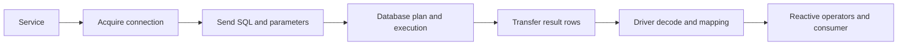

# Reducing Queries, Columns, and Rows Transferred

Data access performance in Spring Data R2DBC depends on more than how fast a single SQL statement executes. A request can be slow because the application issues too many small queries, fetches unnecessary columns, or transfers a large set of rows over the network only to filter them in Java. Every round-trip adds latency; every column and row increases the data the database must read, the driver must transfer, and the application must decode and map.

When optimizing, focus on three quantities of data:

1. **Number of queries:** reduce round-trips between the application and the database, especially repeated queries in loops (N+1).
2. **Number of columns:** fetch only the fields the use case actually needs, avoiding `SELECT *` and unused large payloads.
3. **Number of rows:** let the database filter, aggregate, and limit results before transfer; use pagination or cursors for large datasets.

The goal is to reduce total work from the database to the consumer while preserving exact business semantics. One massive query is not automatically faster than multiple small queries; inspect execution plans, indexes, result sizes, consistency, and mapping capability before deciding.

## 1. The Cost of an R2DBC Query

A single database access typically incurs these cost components:



- **Acquire connection:** obtaining a connection from the pool; when the pool is exhausted, requests may wait.
- **Round-trip:** sending the statement and receiving the response over the network. Even tiny queries pay this latency.
- **Database work:** parsing/planning, reading indexes or tables, joining, sorting, aggregating, and checking constraints.
- **Data transfer:** transmitting columns and rows of the result set back to the application.
- **Decode/mapping:** the driver converts database types into Java types; Spring Data may further map them into entities or DTOs.
- **Downstream processing:** Reactor operators and service logic processing emitted items.

Thus, a request running 100 small sequential queries can be slower than one well-designed query even if the total row count returned is unchanged. Conversely, cramming everything into one giant query can produce complex joins, row multiplication, excessive column reads, and higher database resource consumption.

## 2. Identifying N+1 Queries

N+1 occurs when an application executes one query to fetch N parent records and then executes an additional query per parent record to fetch related data. Total queries equal `1 + N`.

For example, fetching 50 orders and then loading order lines one by one:

```java
Flux<OrderView> loadOrders(UUID tenantId) {
    return orderRepository.findByTenantId(tenantId)
        .concatMap(order ->
            orderLineRepository.findByOrderId(order.getId())
                .collectList()
                .map(lines -> OrderView.from(order, lines))
        );
}
```

With 50 orders, the code typically issues one query for the orders list and 50 queries for order lines. `concatMap` preserves ordering and runs sequentially, but it does not reduce query count. Switching to `flatMap` may run queries concurrently, yet it remains N+1 and can put heavier pressure on the connection pool and database.

### 2.1 Warning Signs

- SQL logs show the same query repeating with different IDs.
- Request duration grows nearly linearly with the number of parent entities.
- Queries per request are unusually high even though the screen shows a small list.
- The database sees many short queries with very high execution counts.
- Code contains repository or `DatabaseClient` calls inside `map`, `flatMap`, or per-row loops.

Not every repeated query is an N+1 bug; some are genuinely independent operations. Identify which queries can be batched or combined without altering business rules.

## 3. Replacing N+1 with a JOIN Query

If a use case needs orders together with their lines, a `JOIN` can fetch the related data in one query:

```sql
SELECT
    o.id AS order_id,
    o.order_number,
    o.created_at,
    l.id AS line_id,
    l.product_code,
    l.quantity
FROM purchase_order o
LEFT JOIN order_line l ON l.order_id = o.id
WHERE o.tenant_id = :tenantId
ORDER BY o.created_at DESC, o.id DESC, l.id;
```

The query returns one row per order line; orders without lines still appear once thanks to `LEFT JOIN`, with `line_*` columns set to SQL `NULL`.

With `DatabaseClient`, you can map results into a flat projection:

```java
Flux<OrderLineView> loadOrderLines(UUID tenantId) {
    return databaseClient.sql("""
            SELECT
                o.id AS order_id,
                o.order_number,
                l.id AS line_id,
                l.product_code,
                l.quantity
            FROM purchase_order o
            LEFT JOIN order_line l ON l.order_id = o.id
            WHERE o.tenant_id = :tenantId
            ORDER BY o.created_at DESC, o.id DESC, l.id
            """)
        .bind("tenantId", tenantId)
        .map((row, metadata) -> new OrderLineView(
            row.get("order_id", Long.class),
            row.get("order_number", String.class),
            row.get("line_id", Long.class),
            row.get("product_code", String.class),
            row.get("quantity", Integer.class)))
        .all();
}
```

`OrderLineView` is an illustrative DTO. Because `LEFT JOIN` may find no matching child rows, `line_id` and `order_line` fields must allow null. Do not fabricate a dummy order line simply because those columns are null.

### 3.1 Joins Can Multiply Rows

A JOIN cuts round-trips but can duplicate parent data. If an order has 10 lines, the order columns appear 10 times in the result set. Across multiple one-to-many relationships, row counts can grow as the Cartesian product of each collection's size.

For example, an order with 5 lines and 3 notes produces 15 rows for the same order when joining both collections simultaneously. Therefore:

- Join only the relationships needed by the use case.
- Avoid joining multiple large collections into a single result set when Cartesian multiplication can occur.
- Key by parent ID when assembling object graphs, handling duplicates intentionally.
- Consider separate batched queries per collection if that shrinks total payload while keeping round-trips reasonable.
- Use aggregates or projections when the screen only needs counts or totals rather than individual child rows.

A single query with fewer round-trips can still be slow and memory-heavy if it transfers massive duplicated rows.

## 4. Replacing N+1 with Batched Queries

A JOIN is not always the best choice. You can fetch the parent list first, then load all child rows for those IDs in a single batched query:

```sql
SELECT id, order_id, product_code, quantity
FROM order_line
WHERE order_id IN (:orderIds)
ORDER BY order_id, id;
```

Then group results by `order_id` in Java and attach them to the orders. This approach usually takes two queries instead of `1 + N`, while avoiding repeating parent columns for every child line.

Collection parameter expansion and binding syntax depend on the Spring/driver version. With `DatabaseClient`, verify how your version expands named collection parameters; if the driver does not support it, generate a safe number of placeholders matching the list size or use a database-specific mechanism such as table-valued parameters where supported. Never concatenate raw input values directly into SQL.

If the ID list is very large, split it into bounded batches. An `IN` clause with tens of thousands of elements can exceed bind parameter limits, create huge SQL statements, or hinder the query planner. Base batch sizes on driver/database limits and real measurements.

## 5. Using EXISTS When You Only Need Related Row Existence

If a screen only needs orders that have at least one pending line, you do not need to join all lines. Use `EXISTS` to filter parents:

```sql
SELECT o.id, o.order_number, o.created_at
FROM purchase_order o
WHERE o.tenant_id = :tenantId
  AND EXISTS (
      SELECT 1
      FROM order_line l
      WHERE l.order_id = o.id
        AND l.status = 'PENDING'
  )
ORDER BY o.created_at DESC, o.id DESC;
```

`EXISTS` only checks whether at least one matching row exists. It avoids producing one output row per child row like an ordinary join, so you do not need `DISTINCT` just to deduplicate orders.

If summary info like the pending line count is needed, use a correlated subquery or aggregate query depending on the database and execution plan. Choose whichever yields a good execution plan on realistic data.

## 6. SELECT Only the Columns Needed

`SELECT *` fetches every accessible column, including columns the use case never uses. An entity may contain long descriptions, large JSON, binary blobs, or extensive metadata; transferring them for a list screen that only displays ID and name inflates payload and mapping work.

Unnecessary example:

```sql
SELECT *
FROM customer
WHERE tenant_id = :tenantId;
```

If the list only displays ID, email, and name:

```sql
SELECT id, email, display_name
FROM customer
WHERE tenant_id = :tenantId
ORDER BY display_name, id;
```

With `DatabaseClient`, map directly to a small DTO:

```java
Flux<CustomerListItem> findCustomerList(UUID tenantId) {
    return databaseClient.sql("""
            SELECT id, email, display_name
            FROM customer
            WHERE tenant_id = :tenantId
            ORDER BY display_name, id
            """)
        .bind("tenantId", tenantId)
        .map((row, metadata) -> new CustomerListItem(
            row.get("id", UUID.class),
            row.get("email", String.class),
            row.get("display_name", String.class)))
        .all();
}
```

DTOs make the data required by the use case explicit. They also prevent accidentally exposing internal fields such as password hashes, tokens, personal data, or large payloads in responses.

## 7. Projections and DTOs in Spring Data Relational

Projections allow a query to retrieve only needed data instead of always returning full aggregates or entities. With Spring Data R2DBC, you can use custom queries and projection/DTO return types as supported by your repository version, or map explicitly via `DatabaseClient`.

Example DTO for an order list:

```java
public record OrderSummary(
    Long id,
    String orderNumber,
    String status,
    BigDecimal totalAmount
) {}
```

The query selects only the four required columns:

```java
@Query("""
    SELECT id, order_number, status, total_amount
    FROM purchase_order
    WHERE tenant_id = :tenantId
    ORDER BY created_at DESC, id DESC
    """)
Flux<OrderSummary> findOrderSummaries(UUID tenantId);
```

This example illustrates repository DTO projection; specific constructor mapping and projection support depend on the Spring Data Relational version. If a DTO type or mapping is not directly supported, use `DatabaseClient.map(...)` for explicit mapping.

Do not instantiate full entities merely to return a summary table. Conversely, if a service needs to update an entity, use the proper aggregate/entity to preserve mapping and persistence semantics.

## 8. Avoid Loading Large Columns Before They Are Needed

Columns such as `nvarchar(max)`, JSON, XML, `varbinary(max)`, or document contents can dominate payload size. A list screen usually only needs metadata; large contents can be loaded when the user opens details.

Example separating metadata and content:

```sql
-- List: small payload
SELECT id, title, content_type, created_at
FROM document
WHERE tenant_id = :tenantId
ORDER BY created_at DESC, id DESC;

-- Detail: load content when needed
SELECT id, title, content_type, content
FROM document
WHERE id = :documentId
  AND tenant_id = :tenantId;
```

These are two queries serving two distinct use cases—not an N+1 issue unless the list automatically invokes the detail query for every document. Avoid loading full payloads only to discard them in Java.

For huge payloads, consider streaming or object storage. When storing files outside the database, metadata and files have separate resource boundaries and need proper error-handling and cleanup workflows.

## 9. Filter Data in the Database Instead of in Java

A common anti-pattern is reading an entire table and filtering in application code:

```java
return customerRepository.findAll()
    .filter(customer -> customer.getStatus() == Status.ACTIVE)
    .filter(customer -> customer.getTenantId().equals(tenantId));
```

If the table has a million rows, the pipeline may transfer and decode huge numbers of rows just to keep a small subset. Push predicates down into SQL:

```java
return customerRepository.findByTenantIdAndStatus(
    tenantId, Status.ACTIVE);
```

Or use `DatabaseClient`/`R2dbcEntityTemplate` with `WHERE` predicates. The database can leverage indexes, read only matching rows, and transfer only needed results.

Filtering, sorting, and aggregation should happen in the database whenever they have clear semantics and the query planner can optimize them. Java remains appropriate for complex domain rules that cannot be cleanly expressed in SQL, but avoid transferring excess data just to evaluate simple filters.

## 10. Limiting Row Counts with Pagination

Large lists should not be loaded completely merely because a repository returns `Flux<T>`. `Flux` enables reactive consumption, yet it does not automatically cap the total rows returned by SQL. If a caller uses `collectList()`, the entire result set can still end up in memory.

With `R2dbcEntityTemplate`, you can set `limit` and `offset` on `Query`:

```java
public Flux<CustomerListItem> findPage(
        UUID tenantId, long offset, int pageSize) {

    Query query = Query.query(Criteria.where("tenantId").is(tenantId))
        .sort(Sort.by(
            Sort.Order.asc("displayName"),
            Sort.Order.asc("id")))
        .offset(offset)
        .limit(pageSize);

    return entityTemplate.select(query, Customer.class)
        .map(CustomerListItem::from);
}
```

Property names in `Criteria`/`Sort` are mapped using entity metadata. Verify that the database dialect generates valid pagination SQL. With `DatabaseClient`, write pagination syntax suited to the database and bind offset and page size.

### 10.1 Ordering Must Be Deterministic

Pagination requires a stable `ORDER BY`. If sorting by a column that may have duplicate values, add a unique tie-breaker such as `created_at DESC, id DESC`. Without a unique ordering, a row can appear on different pages across requests.

### 10.2 Offset vs. Keyset

Offset pagination is convenient when users need to jump to an arbitrary page number. With very large offsets, the database may have to scan through many rows before returning the page. Keyset pagination uses the last row values of the previous page as a cursor, which is often more efficient for large feeds or histories.

Example descending keyset on `(created_at, id)`:

```sql
SELECT id, title, created_at
FROM document
WHERE tenant_id = :tenantId
  AND (
       created_at < :lastCreatedAt
       OR (created_at = :lastCreatedAt AND id < :lastId)
  )
ORDER BY created_at DESC, id DESC
FETCH FIRST :pageSize ROWS ONLY;
```

The trailing row-limit clause depends on the dialect; adapt the example above for your target database. Cursor predicates must match the sort order precisely and handle nullable columns explicitly.

## 11. Count Totals Only When the Use Case Needs Them

A UI may display total result counts, yet `COUNT(*)` on large sets can be expensive, especially with complex filter conditions. If the UI only needs a “load more” button, you can fetch `pageSize + 1` rows to detect whether more data exists instead of running an exact full count.

Example:

```sql
SELECT id, title, created_at
FROM document
WHERE tenant_id = :tenantId
ORDER BY created_at DESC, id DESC
OFFSET :offset ROWS
FETCH NEXT :fetchSize ROWS ONLY;
```

Where `fetchSize = pageSize + 1`. If the query returns more than `pageSize` rows, the application knows there is a next page; drop the extra row from the response and build the next cursor/offset.

If the business requires an exact total, run a count query and measure its cost. You can cache counts or update summary figures if data changes frequently and slight staleness is acceptable. Do not run count queries just because a framework or UI model happens to include a `totalElements` field nobody actually needs.

## 12. Aggregating Data in the Database

If you need order counts, total revenue, or customer counts by status, do not fetch individual entities and sum them in Java:

```sql
SELECT
    status,
    COUNT_BIG(*) AS order_count,
    SUM(total_amount) AS total_amount
FROM purchase_order
WHERE tenant_id = :tenantId
  AND created_at >= :fromDate
  AND created_at < :toDate
GROUP BY status;
```

The database returns one row per status group instead of every order. `COUNT_BIG` suits SQL Server when counts may exceed `int`; choose the corresponding aggregate type on other databases.

Map results into a small DTO:

```java
Flux<OrderStatusSummary> summarize(UUID tenantId,
                                   LocalDateTime from,
                                   LocalDateTime to) {
    return databaseClient.sql("""
            SELECT status, COUNT(*) AS order_count,
                   SUM(total_amount) AS total_amount
            FROM purchase_order
            WHERE tenant_id = :tenantId
              AND created_at >= :fromDate
              AND created_at < :toDate
            GROUP BY status
            """)
        .bind("tenantId", tenantId)
        .bind("fromDate", from)
        .bind("toDate", to)
        .map((row, metadata) -> new OrderStatusSummary(
            row.get("status", String.class),
            row.get("order_count", Long.class),
            row.get("total_amount", BigDecimal.class)))
        .all();
}
```

If `SUM` receives no matching inputs, SQL may return `NULL`; the DTO should allow null or the query should use `COALESCE` per business semantics. Do not assume null always means 0 if the distinction is meaningful.

## 13. Reducing Round-Trips for Multi-Row Writes

When writing many rows, avoid calling `save` sequentially per element when a set-based operation or proper batch is applicable:

```java
return Flux.fromIterable(rows)
    .concatMap(repository::save)
    .then();
```

This code is readable and preserves ordering, yet it typically issues one save operation per entity. Nor should `saveAll` be assumed to produce a single multi-row `INSERT` or a JDBC-style batch; implementation depends on Spring Data, the driver, and entity type.

For homogeneously structured rows, consider:

- A multi-row `INSERT` with multiple value tuples if the database and bind parameter limits permit.
- R2DBC SPI `Statement.add()` to queue multiple parameter sets on the same statement when the driver supports batch semantics.
- A set-based `UPDATE` targeting matching rows instead of updating ID by ID.
- Staging tables or bulk import tools for very large datasets.

Set-based update example:

```sql
UPDATE customer
SET status = :newStatus,
    last_modified_at = :modifiedAt
WHERE tenant_id = :tenantId
  AND status = :oldStatus;
```

One statement can update all matching rows instead of querying each customer and saving back. Check `rowsUpdated()` and ensure the set-based operation satisfies business rules for every matched row.

### 13.1 Splitting into Bounded Batches

Overly large batches increase memory usage, transaction duration, bind marker counts, and rollback costs. You can partition the source into chunks:

```java
return source
    .buffer(500)
    .concatMap(batch -> persistBatch(batch))
    .then();
```

`buffer(500)` only groups 500 elements in the reactive pipeline; it does not automatically generate SQL batching or define transactions. `persistBatch` must execute batched or set-based SQL to actually reduce statement counts.

When batches require atomicity, wrap batch operations in an appropriate transaction. If each batch commits independently, design checkpoints, retries, and idempotency to handle partial completion.

## 14. Avoiding Per-Row Queries in Callbacks

`AfterConvertCallback`, mappers, or service helpers can accidentally introduce N+1 if converting each entity triggers a repository lookup for extra data. For example, a callback receiving each customer and querying a separate profile executes one query per customer.

Callbacks should focus on local object processing such as normalizing strings or computing derived fields from already loaded data. If data from another table is needed:

- Use a JOIN/projection when a combined result set makes sense.
- Use a batched query by ID set if a JOIN multiplies too many rows.
- Use an aggregate query if only counts or sums are needed.
- Place secondary fetch logic in a service where query counts and data boundaries remain visible.

Reactive callbacks do not make N+1 disappear. A thousand asynchronous queries are still a thousand queries; running them concurrently can spike peak load even higher.

## 15. Indexes Supporting Filtering and Pagination

Reducing transferred rows starts with helping the database find the right rows efficiently. Indexes aligned with filters, joins, and sorts can cut pages/rows read:

```sql
CREATE INDEX ix_customer_tenant_status
ON customer (tenant_id, status, id);
```

This example index supports queries filtering on `tenant_id` and `status`, while including `id` as a secondary sort key. Index column order should reflect selectivity, query patterns, and execution plans; do not copy example indexes blindly to every table.

For joins, inspect indexes on foreign keys or join columns such as `order_line.order_id`. For keyset pagination, indexes may need to include filter and sort columns in matching order. For projections, covering indexes can allow queries to read from the index with fewer table lookups, at the expense of storage and write overhead.

Indexes are not always beneficial. Excessive indexes slow down inserts, updates, and deletes while consuming storage. Check execution plans, logical reads, and query statistics before adding or changing indexes.

## 16. Choosing JOIN, Batch Queries, or Separate Queries?

No single strategy fits every case:

| Strategy | Pros | Risks / Limits | Best For |
|---|---|---|---|
| N+1 queries | Simple initial code | Many round-trips; latency scales with parent rows | Avoid for multi-entity lists. |
| JOIN with projection | Fewer round-trips; DB-side filtering | Repeats parent columns; multiple collections can multiply rows | Small/medium relational data displayed together. |
| Batched query by ID set | Few queries while avoiding parent column repetition | Requires grouping in Java and managing ID list sizes | One-to-many with many child rows or when joins bloat payloads. |
| Aggregate SQL | Returns few rows and columns | Aggregate logic tied to SQL/dialect and null semantics | Reports, counts, sums, min/max. |
| Caching | Avoids repeated queries for stable data | Invalidation, stale data, and memory | Rarely changing reference lookups with clear cache policies. |

Evaluate both query count and bytes/rows returned. Two queries returning two small sets can outperform one join generating millions of combinations. One aggregate query can outperform loading thousands of entities to sum in Java.

## 17. Be Careful with DISTINCT and Join Pagination

When joining one-to-many relationships, parent IDs can repeat. Adding `DISTINCT` sometimes removes duplicate rows, yet the database may have to sort or hash a large set; it also fails to fix duplicated payloads when distinct child columns are still selected.

If you need to paginate parents before fetching children, use a CTE/subquery to select parent IDs first:

```sql
WITH page_orders AS (
    SELECT id, created_at
    FROM purchase_order
    WHERE tenant_id = :tenantId
    ORDER BY created_at DESC, id DESC
    OFFSET :offset ROWS FETCH NEXT :pageSize ROWS ONLY
)
SELECT
    o.id AS order_id,
    o.order_number,
    l.id AS line_id,
    l.product_code,
    l.quantity
FROM page_orders p
JOIN purchase_order o ON o.id = p.id
LEFT JOIN order_line l ON l.order_id = o.id
ORDER BY p.created_at DESC, p.id DESC, l.id;
```

Paginating directly over a join result applies the limit to combined rows rather than orders, potentially splitting an order across two pages. Selecting the parent page first limits the exact number of aggregates before joining their child rows.

The `OFFSET/FETCH` syntax in the example matches SQL Server and similar dialects; adapt it for other databases. Query planners and indexes still must be checked.

## 18. Backpressure Does Not Replace SQL Limits

`Flux` and Reactive Streams let consumers request data according to demand, yet backpressure does not guarantee the database reads only the needed rows. Drivers may fetch in batches/cursors, buffer data, or behave according to configuration.

If a service emits `Flux<Customer>` from an unfiltered query without `WHERE` or limits, the total row count can still be massive. Consumer-side element demand is no substitute for pagination, filtering, or business limits.

Do not call `collectList()` on an unbounded query simply because the code is reactive. `collectList()` retains every element in memory. If processing a large dataset completely, use resource-bounded streaming, batch processing, and proper checkpoints.

## 19. Caching for Repeated Lookups

For rarely changing reference data such as product categories, regional configs, or catalogs, caching can cut repeated queries across requests. However, caching should not mask a poorly written query or substitute for missing indexes.

When caching:

- Ensure keys include tenant/permission context if data is scoped by tenant or authorization.
- Set TTLs or invalidation mechanisms matching change frequency.
- Do not cache database errors as empty results.
- Avoid caching shared mutable entity objects across requests.
- Measure hit rates, miss rates, and cache serialization/network overhead.
- If updating the database and publishing invalidation events, consider an outbox so events are not lost after commit.

Caching reduces database queries at the cost of operating another component and risking stale data. Use it only when benefits are measurable and consistency policies are clear.

## 20. Measuring Query Counts, Row Counts, and Payload Sizes

You cannot optimize effectively without knowing how many queries a request actually triggers and how much data it transfers. Track:

| Metric | Question to Answer |
|---|---|
| Query count/request | How many times does one request hit the database? |
| Query duration | Which queries take most of the time? |
| Rows returned/affected | How many rows do queries return or modify? |
| Columns/row width | Are there large or unused columns? |
| Bytes received | How much data flows from database to application? |
| Connection acquire latency | Are requests waiting on the pool? |
| Mapping/CPU time | How expensive is decoding and mapping entities/DTOs? |
| Pool active/pending | Does rising concurrency exhaust the pool? |
| Database logical reads | How many pages/rows must queries read to produce results? |

Tools can include controlled SQL logging, datasource/driver metrics, connection pool metrics, tracing, database query stores, and execution plans. Do not log all bind values in production if sensitive data could be exposed.

Measure under identical data and load conditions before and after changes. Compare p50/p95 latency, query count, payload size, and database CPU/reads; a query that runs faster on a tiny dataset is not guaranteed to win at production scale.

## 21. Writing Tests to Catch N+1 and Excess Queries

An integration test can seed N parent entities, invoke the use case, and check query counts using instrumentation suited to the driver or data-access layer. Do not assert only the final output, because both N+1 and batched queries can return identical results.

Example test assertions:

- For a page of 20 orders, query count does not jump from 2 to 21 when adding parent rows.
- List DTOs exclude large payloads and unnecessary fields.
- Queries return at most the configured page size.
- Count queries only execute when the endpoint requires an exact total.
- Batched child queries only fetch IDs belonging to the current page.
- Paginated queries enforce deterministic ordering.

You can wrap `ConnectionFactory`/`Connection` or use a client-level proxy to count statements in tests. Instrumentation must match the driver and preserve reactive semantics. Without a query counter, inspect SQL logs or adapter test spies, keeping tests focused on key performance contracts rather than brittle internal details.

## 22. End-to-End Example: From N+1 to Paginated Projection

Suppose an admin screen displays a list of orders with line counts and total quantities. Easy-to-write but query-heavy code:

```java
Flux<OrderDashboardRow> loadDashboard(UUID tenantId) {
    return orderRepository.findByTenantId(tenantId)
        .concatMap(order -> orderLineRepository.findByOrderId(order.getId())
            .collectList()
            .map(lines -> new OrderDashboardRow(
                order.getId(),
                order.getOrderNumber(),
                lines.size(),
                lines.stream().mapToInt(OrderLine::getQuantity).sum()
            )));
}
```

For N orders, this triggers one parent query and N child queries, while loading full line entities only to compute count and sum.

Aggregation can be pushed down to the database, returning one row per order:

```sql
SELECT
    o.id,
    o.order_number,
    COUNT(l.id) AS line_count,
    COALESCE(SUM(l.quantity), 0) AS total_quantity
FROM purchase_order o
LEFT JOIN order_line l ON l.order_id = o.id
WHERE o.tenant_id = :tenantId
GROUP BY o.id, o.order_number, o.created_at
ORDER BY o.created_at DESC, o.id DESC
OFFSET :offset ROWS FETCH NEXT :pageSize ROWS ONLY;
```

Map directly to the DTO:

```java
Flux<OrderDashboardRow> loadDashboard(
        UUID tenantId, long offset, int pageSize) {

    return databaseClient.sql("""
            SELECT
                o.id,
                o.order_number,
                COUNT(l.id) AS line_count,
                COALESCE(SUM(l.quantity), 0) AS total_quantity
            FROM purchase_order o
            LEFT JOIN order_line l ON l.order_id = o.id
            WHERE o.tenant_id = :tenantId
            GROUP BY o.id, o.order_number, o.created_at
            ORDER BY o.created_at DESC, o.id DESC
            OFFSET :offset ROWS FETCH NEXT :pageSize ROWS ONLY
            """)
        .bind("tenantId", tenantId)
        .bind("offset", offset)
        .bind("pageSize", pageSize)
        .map((row, metadata) -> new OrderDashboardRow(
            row.get("id", Long.class),
            row.get("order_number", String.class),
            row.get("line_count", Long.class),
            row.get("total_quantity", Integer.class)))
        .all();
}
```

The SQL example uses SQL Server pagination syntax; adapt the row-limiting clause to your database dialect. `COUNT(l.id)` returns the child row count, and `COALESCE` converts null sums to 0 as required for display. If `quantity` can exceed `Integer` range, select a wider Java/SQL type.

The updated version transfers only displayed columns, avoids loading `OrderLine` entities, and lets the database perform count/sum. Inspect indexes on `purchase_order.tenant_id` and `order_line.order_id`, execution plans, and group-by cost before concluding the new query performs better.

## 23. Anti-Patterns That Increase Data Transfer

| Anti-Pattern | Impact | Alternative |
|---|---|---|
| Repository calls inside entity loops | N+1 round-trips | JOIN, `EXISTS`, or batched query by ID set. |
| Switching `concatMap` to `flatMap` to “fix” N+1 | Still N+1, higher concurrent load | Reduce query count before tuning concurrency. |
| `SELECT *` for lists | Transfers large/unused columns | Projections or DTOs with explicit column lists. |
| Fetching all rows then `.filter()` in Java | Transfers unnecessary rows | Push predicates into `WHERE`. |
| `.collectList()` on unbounded sets | Holds all data in heap | Pagination or streaming/batch processing. |
| Joining multiple large collections | Multiplies rows and parent columns | Batched queries or separate aggregates. |
| `DISTINCT` hiding bad joins | Expensive sort/hash without fixing root payload bloat | Fix query shape and pick proper projections. |
| Full count on every page | Adds potentially expensive query | Fetch `pageSize + 1` if only next-page availability is needed. |
| Fetching large payloads in lists | Increases network and mapping cost | Separate detail endpoint/query. |
| Saving entities one by one when set-based works | Many round-trips | Bulk SQL, `Statement.add()`, or appropriate staging. |

## 24. Process for Optimizing a Use Case

When an R2DBC endpoint or job is slow, follow this sequence:

1. Measure query count/request and identify repeated SQL statements.
2. Locate repository/client calls inside loops or callbacks.
3. Determine what data the response truly needs: entity types, columns, and row counts.
4. Replace N+1 with JOIN, `EXISTS`, aggregates, or batched queries by ID set.
5. Push filters, sorts, limits, and aggregates down to the database where semantics permit.
6. Use projections/DTOs and drop unnecessary large columns from list queries.
7. Bound result sets using pagination or cursors with deterministic ordering.
8. Inspect indexes, execution plans, logical reads, and join/group-by costs.
9. Re-measure payload sizes, query counts, latency, and pool metrics under equivalent data and load.
10. Add integration tests protecting critical contracts such as row limits, ordering, and query counts.

Reducing the number of queries, columns, and rows transferred are three complementary optimization directions. Eliminating N+1 cuts round-trips; projections shrink payloads and mapping; filtering, aggregation, and pagination reduce rows the database must return. Choose query shapes based on real data and use cases, check execution plans, and measure before and after. Reactive programming handles data streams efficiently, yet it does not automatically fix redundant queries or bound results; SQL, projections, and batch boundaries still require intentional design.
