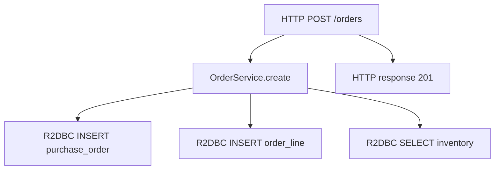
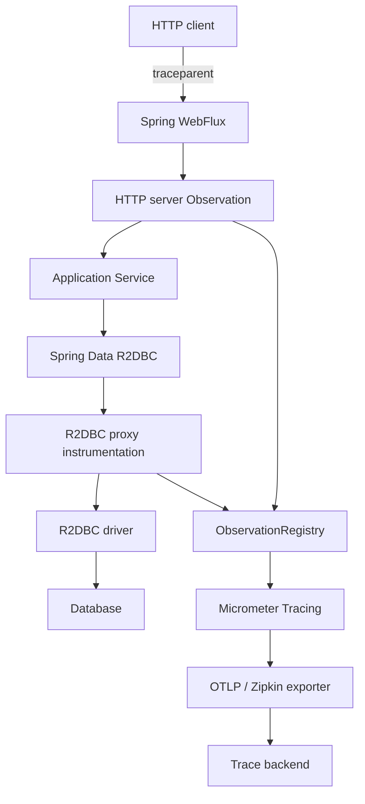

# Correlating HTTP Traces with Data Access Operations

## 1. Why Correlate HTTP Traces with R2DBC?

An HTTP request typically passes through multiple layers before returning a response:

1. The web server receives the request.
2. The controller calls the application service.
3. The service executes business rules.
4. The repository or `DatabaseClient` accesses the database via R2DBC.
5. The application maps the results and returns the response.

When a request is slow or fails, controller logs alone are often not enough to find the root cause. The request may be waiting on the connection pool, running a slow database query, calling another HTTP service, or processing data in the service layer.

Distributed tracing represents these operations as a trace tree. Each operation has a span with start/end timestamps, status, attributes, and parent-child relationships. When the HTTP server instrumentation and R2DBC instrumentation share the same tracing context, database queries appear under the trace of the request that initiated them.

Example of an order creation request:



In a trace viewer, spans can be displayed on a timeline:

```text
HTTP POST /orders                 180 ms
  OrderService.create             165 ms
    r2dbc.query INSERT order        24 ms
    r2dbc.query INSERT order_line   41 ms
    r2dbc.query SELECT inventory    72 ms
```

The numbers are illustrative. The goal is to see which request triggered which queries, how long each query took, and which span failed.

## 2. Three Pillars of Observability

Spring Boot uses Micrometer Observation to connect instrumentation to metrics and traces. The three pillars are commonly used together:

| Component | Question Answered | Example |
| --- | --- | --- |
| Logs | What happened and what details are available? | Exception, SQL state, operation name |
| Metrics | How is the system behaving over time? | Request rate, latency histogram, pool usage |
| Traces | Which operations did a request go through? | HTTP span with child R2DBC query spans |

Metrics are suited for spotting trends and alerting; traces are suited for following a specific request; logs hold error details and needed context.

### 2.1. Observation as the Instrumentation Layer

Micrometer Observation is an abstraction wrapping an operation. When an Observation is created, `ObservationHandler`s registered with `ObservationRegistry` can produce timers, spans, or logs depending on configuration.

This allows the same instrumentation to emit multiple forms of telemetry:

- With only a metrics handler, the operation produces metrics.
- With a tracing handler, the operation produces spans.
- With both, the operation produces both metrics and spans.

Spring Boot auto-configures many Observations for web requests and supported integrations. Applications can add Observations for custom business steps.

## 3. Traces, Spans, and Parent-Child Relationships

A **Trace** represents the end-to-end journey of a request or distributed workflow. A trace has a unique trace ID linking its spans together.

A **Span** represents a single operation with start and end times, such as:

- Receiving an HTTP request.
- Invoking an application service.
- Executing an R2DBC query.
- Calling another service over HTTP.
- Processing a message from a broker.

A span can hold a trace ID, span ID, parent span ID, operation name, timing, status, attributes, and events.

Parent-child relationships let trace viewers display nesting and execution order. A query span belongs to an HTTP request's trace when the query executes within the same execution context propagated from that request.

### 3.1. Example Span Tree

```text
Trace: 4bf92f3577b34da6a3ce929d0e0e4736
|
+-- HTTP POST /orders
    |
    +-- order.create
    |   |
    |   +-- r2dbc.query INSERT purchase_order
    |   |
    |   +-- r2dbc.query INSERT order_line
    |   |
    |   +-- r2dbc.query SELECT inventory
    |
    +-- HTTP POST inventory-service/reserve
```

Child spans share the same trace ID but have distinct span IDs. The parent ID identifies the immediate parent span. If the request calls another service, tracing instrumentation can propagate the trace context via HTTP headers so the receiving service creates spans under the same trace.

### 3.2. Do Not Generate a New Trace ID per Query

Never generate a new trace ID inside a repository or before each SQL statement. Doing so detaches the query from the originating request and breaks the parent-child hierarchy.

HTTP server instrumentation creates or continues the trace context. R2DBC instrumentation creates child spans from the active context. The application only needs to keep the reactive pipeline intact and context propagation working properly.

## 4. Overall Architecture in Spring Boot

A Spring Boot WebFlux and Spring Data R2DBC application typically involves these components:



Key parts:

- Spring WebFlux creates an Observation for the HTTP server request.
- Micrometer Tracing turns Observations into spans when a tracing bridge is configured.
- R2DBC proxy instrumentation observes queries and creates Observations for database operations.
- Reactor Context preserves the active Observation across the reactive chain.
- An exporter sends spans to a trace backend such as OpenTelemetry Collector, Jaeger, Tempo, or Zipkin depending on your setup.

If any piece is missing, traces may show only the HTTP request without query spans, or create spans that never reach the backend.

## 5. Required Dependencies

In Spring Boot, start with Actuator and a tracing bridge. Example using OpenTelemetry:

Gradle:

```groovy
dependencies {
    implementation("org.springframework.boot:spring-boot-starter-actuator")

    runtimeOnly("io.micrometer:micrometer-tracing-bridge-otel")
    runtimeOnly("io.opentelemetry:opentelemetry-exporter-otlp")

    runtimeOnly("io.r2dbc:r2dbc-proxy")
}
```

Spring Boot dependency management should govern compatible versions. Do not pick Micrometer, OpenTelemetry, and R2DBC proxy versions piecemeal when the project already uses the Spring Boot BOM.

Roles:

- `spring-boot-starter-actuator`: provides the observability infrastructure and Actuator.
- `micrometer-tracing-bridge-otel`: connects Micrometer Tracing to OpenTelemetry.
- `opentelemetry-exporter-otlp`: exports traces over OTLP when using a compatible collector.
- `r2dbc-proxy`: allows Spring Boot to enable observability for R2DBC queries via the supported mechanism.

If your system uses Brave/Zipkin, choose the corresponding tracing bridge and exporter instead of OpenTelemetry. Do not install multiple bridges simultaneously in the same application without an explicit design.

### 5.1. R2DBC Observability in Spring Boot

Spring Boot supports observability for R2DBC. In Spring Boot versions with R2DBC observation auto-configuration, adding the `io.r2dbc:r2dbc-proxy` dependency enables query instrumentation.

This tracks queries executed through R2DBC without writing manual spans for each repository method. Exact capabilities and configuration details depend on Spring Boot, R2DBC proxy, and driver versions.

Do not confuse this with JDBC datasource instrumentation. JDBC uses a separate integration; R2DBC requires R2DBC-compatible instrumentation.

### 5.2. Verifying Runtime Dependencies

If the application has `r2dbc-proxy` added yet no query spans appear:

- Check that the dependency is on the runtime classpath.
- Check that your Spring Boot version includes R2DBC observation auto-configuration.
- Check that the `ConnectionFactory` used by repositories passes through the proxy instrumentation.
- Check that the tracing bridge and exporter are active and healthy.
- Check that sampling is not dropping the trace.

## 6. Configuring Service Name and Sampling

A basic configuration:

```yaml
spring:
  application:
    name: order-service
  reactor:
    context-propagation: auto

management:
  tracing:
    sampling:
      probability: 1.0
```

Meaning:

- `spring.application.name` sets the service name to distinguish span sources in the trace backend.
- `spring.reactor.context-propagation: auto` enables automatic context propagation across Reactor as supported by Spring Boot and Context Propagation.
- `management.tracing.sampling.probability` controls the fraction of traces sampled according to tracing configuration.

Sampling 1.0 suits local development or testing where you want to observe every request. Avoid defaulting to 100% in high-traffic production environments.

Example production configuration:

```yaml
management:
  tracing:
    sampling:
      probability: 0.1
```

`0.1` is just an example. Choose sampling based on traffic volume, storage cost, diagnostic needs, and tracing system policy.

### 6.1. Sampling Is Not a Log Level

Sampling decides which traces/spans are recorded and exported. It does not turn SQL logging on or off.

- SQL DEBUG controls statement logging at the logger.
- Trace sampling controls the proportion of recorded traces.
- Metrics are generally collected independently of trace sampling.

Therefore, enabling SQL DEBUG does not guarantee every query appears in the trace backend; setting sampling to 100% does not enable parameter logging either.

## 7. HTTP Server Instrumentation

Spring Boot automatically instruments HTTP requests when the application uses a supported web stack and observability is configured.

With WebFlux, an HTTP request can create a server Observation/span. The span covers request processing time, including waiting for reactive publishers to complete before the response finishes.

Example controller:

```java
@RestController
@RequestMapping("/orders")
public class OrderController {

    private final OrderService orderService;

    public OrderController(OrderService orderService) {
        this.orderService = orderService;
    }

    @PostMapping
    public Mono<ResponseEntity<OrderResponse>> create(
            @RequestBody CreateOrderRequest request) {

        return orderService.create(request)
                .map(order -> ResponseEntity
                        .status(HttpStatus.CREATED)
                        .body(OrderResponse.from(order)));
    }
}
```

You do not need to create trace IDs manually in controllers. HTTP instrumentation and the tracing bridge manage the root span for the request.

### 7.1. Server Span Covers the Reactive Response

Controllers return `Mono` or `Flux`; server instrumentation tracks the request while the publisher executes. Therefore:

- Never call `block()` to wait for a repository inside a controller.
- Never call `subscribe()` to detach a query from the response.
- Return the publisher for WebFlux to manage.
- Chain operations using Reactor operators.

Creating an independent subscription can cause the query to run outside the HTTP request's trace context, and errors will no longer be reflected properly in the response lifecycle.

### 7.2. HTTP Requests Arriving from Other Services

When an incoming request carries a valid trace context in a standard header such as W3C `traceparent`, tracing instrumentation can extract that context and create a child server span within the existing trace.

If the request has no trace context, server instrumentation starts a new trace. Do not read headers manually and stuff an arbitrary trace ID into Reactor Context; let the tracing propagator validate and parse header formats.

## 8. R2DBC Query Instrumentation

Spring Data R2DBC typically uses `R2dbcEntityTemplate` and `DatabaseClient` to run SQL. When R2DBC observability is enabled, query execution can create its own Observation/span.

Example repository:

```java
public interface OrderRepository
        extends ReactiveCrudRepository<Order, Long> {

    Flux<Order> findByCustomerIdOrderByCreatedAtDesc(UUID customerId);
}
```

Service:

```java
@Service
public class OrderService {

    private final OrderRepository orderRepository;

    public OrderService(OrderRepository orderRepository) {
        this.orderRepository = orderRepository;
    }

    public Flux<Order> findForCustomer(UUID customerId) {
        return orderRepository.findByCustomerIdOrderByCreatedAtDesc(customerId);
    }
}
```

When the repository executes SQL through the instrumented R2DBC path, the query span can become a child span of the active HTTP server span.

### 8.1. A Single Request Can Produce Multiple Query Spans

A single service method may perform:

- A query checking data.
- An `INSERT` for the primary record.
- `INSERT`s for an aggregate's collection.
- An `UPDATE` for status.
- A `SELECT` for returned data.

Each statement execution can produce its own span. Do not assume one repository method always corresponds to a single query or a single span.

### 8.2. Database Spans Do Not Necessarily Span the Whole Transaction

A transaction can contain multiple statements. Query instrumentation typically observes each individual statement execution; the transaction manager handles connection and transaction lifecycles.

Thus, a trace may show multiple query spans under the same HTTP request. If you want to observe the transaction boundary itself, you can add a separate business Observation at the service layer, while avoiding duplicate spans for repository methods already instrumented automatically.

## 9. Preserving Trace Context Across the Reactor Pipeline

Reactive pipelines are not bound to a single fixed thread. A request can hop across multiple schedulers or threads during processing.

Reactor Context carries metadata per subscription. Micrometer Context Propagation bridges this context with `ThreadLocal`-based components when needed.

In Spring Boot, you can enable:

```yaml
spring:
  reactor:
    context-propagation: auto
```

Auto mode enables integrated context propagation across Reactor operators according to your Spring Boot/Reactor versions.

### 9.1. Do Not Manage Traces Manually with ThreadLocal

Do not correlate queries to requests like this:

```java
TraceHolder.setCurrentTraceId(traceId);
return orderRepository.findAll();
```

If `TraceHolder` uses `ThreadLocal`, the value may not exist on the thread executing the query, or it risks leaking across requests when threads are reused.

Let tracing instrumentation manage Observations/Spans and Reactor Context. If application code needs access to metadata, use Micrometer Tracing APIs or Reactor Context as supported by the framework.

### 9.2. Do Not Call subscribe() Manually

The following creates an independent subscription:

```java
public Mono<Void> processOrder(Order order) {
    auditRepository.save(toAudit(order)).subscribe();
    return orderRepository.save(order).then();
}
```

The audit subscription does not necessarily share the lifecycle/context of the returned publisher. The HTTP request's trace may finish before the audit query completes.

Instead, chain the operations:

```java
public Mono<Void> processOrder(Order order) {
    return orderRepository.save(order)
            .flatMap(saved -> auditRepository.save(toAudit(saved)))
            .then();
}
```

The single resulting publisher keeps execution flow and context intact end-to-end.

### 9.3. Do Not Block in Reactive Flows

`block()` introduces a synchronous boundary and can negate the benefits and context handling of a reactive pipeline. In WebFlux, return `Mono`/`Flux` and compose operations rather than blocking threads for results.

If you must call a blocking library, offload it to an appropriate scheduler and ensure context propagation is configured. Do not use blocking JDBC or ad-hoc threads as a substitute for R2DBC instrumentation.

## 10. Linking with HTTP Client Spans

A request may call another service before or after accessing the database. If using a Spring Boot-configured `WebClient`, HTTP client instrumentation can create client spans and propagate trace context in headers.

Example:

```java
@Service
public class InventoryClient {

    private final WebClient webClient;

    public InventoryClient(WebClient.Builder builder) {
        this.webClient = builder
                .baseUrl("http://inventory-service")
                .build();
    }

    public Mono<InventoryResponse> reserve(ReserveRequest request) {
        return webClient.post()
                .uri("/reservations")
                .bodyValue(request)
                .retrieve()
                .bodyToMono(InventoryResponse.class);
    }
}
```

Prefer injecting the Spring Boot-managed `WebClient.Builder`. Instantiating `WebClient` directly without going through the configured builder can bypass application customizations and instrumentation.

When the target service also has tracing enabled and receives trace headers, its server span continues the same trace. The trace viewer will display both database queries and HTTP calls in one unified journey.

## 11. Adding Observations for Business Steps

HTTP spans and R2DBC query spans show how the request and database performed. Sometimes an intermediate span is needed to measure a business step involving multiple operations:

- Creating an order.
- Calculating pricing.
- Reserving inventory.
- Confirming payment.

Micrometer Observation supports custom instrumentation.

### 11.1. Observation for Synchronous Operations

For synchronous code, you can use:

```java
Observation.createNotStarted("order.calculate", observationRegistry)
        .lowCardinalityKeyValue("operation", "calculate")
        .observe(() -> pricingService.calculate(order));
```

`observe(...)` manages the Observation lifecycle around the synchronous block. When a tracing handler is present, the Observation becomes a child span of the active Observation.

### 11.2. Observation for Reactor Publishers

For `Mono` or `Flux`, do not mechanically wrap with `Observation.observe(() -> publisher)` assuming the span will stay open until the publisher completes. That method may only wrap publisher creation, while actual work runs at subscription time.

Reactor provides the `reactor-core-micrometer` module with `Micrometer.observation(...)` to observe a reactive chain using `tap`:

```java
return orderRepository.save(order)
        .name("order.persist")
        .tap(Micrometer.observation(observationRegistry));
```

Ensure the project includes `io.projectreactor:reactor-core-micrometer` compatible with your Reactor version. `name(...)` names the observed pipeline; `tap(...)` manages the Observation across the subscription lifecycle.

### 11.3. Add Spans Only When They Provide Useful Information

Do not add a new span for every getter or every repository method. Spans should represent operations meaningful during investigation:

- Have notable duration.
- Can fail independently.
- Represent a clear business boundary.
- Require latency comparison across steps.

If a controller or repository is already auto-instrumented, adding `@Observed` on the same method can create duplicate observations. Check existing instrumentation before adding more.

## 12. Distinguishing Trace Context and Correlation IDs

A Trace ID identifies a distributed trace. A Correlation ID is an identifier created by the application or integration layer to link business events or logs.

| Identifier | Purpose | Scope |
| --- | --- | --- |
| Trace ID | Links spans within a distributed trace | One trace |
| Span ID | Identifies a specific operation | One span |
| Parent Span ID | Links a span to its parent span | Span tree |
| Correlation ID | Finds logs/events belonging to the same business workflow | Per application convention |
| Request ID | Identifies a single HTTP request in one system | One request |

Trace IDs and correlation IDs may differ. Do not treat a client-supplied correlation ID as a valid trace ID or overwrite the trace context validated by the propagator.

If the application needs a separate correlation ID, store it in context/log metadata per policy and do not use it in place of tracing propagation.

## 13. Log Correlation with Trace ID and Span ID

Trace viewers show spans; logs usually hold error details. When logs include trace ID and span ID, operators can jump straight to the corresponding trace from a log line.

With Spring Boot and Micrometer Tracing, trace context can be populated into MDC so logging patterns display trace ID/span ID. Illustrative format example:

```text
2026-11-15 10:30:12.420 INFO
[order-service,4bf92f3577b34da6a3ce929d0e0e4736,00f067aa0ba902b7]
Order created
```

Exact formatting depends on Spring Boot version and logging configuration. Inspect real log output instead of assuming every starter or pattern uses the same format.

### 13.1. MDC in Reactive Applications

Many logging frameworks' MDCs rely on `ThreadLocal`. In a reactive pipeline, `ThreadLocal` does not automatically follow a request across threads.

For reliable correlation:

- Keep trace context in Reactor Context.
- Enable context propagation per your Spring Boot configuration.
- Use Micrometer Tracing integration to sync context with MDC.
- Never call `MDC.put()` manually without clearing it.
- Test with two concurrent requests and pipelines that switch schedulers.

### 13.2. Do Not Log the Entire Trace Context

Log only necessary fields such as trace ID, span ID, operation, and outcome. Do not log baggage, authentication headers, or full request contexts if they contain sensitive data.

## 14. Attributes, Tags, and Cardinality

Span attributes help filter traces by service, database, operation, or error type. However, distinguish low-cardinality from high-cardinality values.

| Category | Example | Appropriate Place |
| --- | --- | --- |
| Low cardinality | `operation=create-order`, `db.system=postgresql`, `outcome=success` | Metrics and traces |
| High cardinality | Order ID, customer ID, request ID | Traces when permitted |
| Sensitive | Email, token, password, payment data | Do not record values |

Low-cardinality tags have a finite, stable value set, making them suitable as metric dimensions. High-cardinality values can vary on every request; putting them into metric tags can explode time-series counts.

Never use the following as metric tags:

- Trace ID.
- Span ID.
- Order ID or customer ID.
- URLs with per-request path parameters.
- Raw SQL containing literals or dynamic values.

High-cardinality identifiers may be placed in span attributes when justified for troubleshooting and permitted by data policy, but should not be collected indiscriminately just because the tracing backend allows them.

## 15. Never Put Sensitive Data into Spans

Database queries can bind emails, addresses, tokens, account numbers, or business content. Some instrumentation can record queries or parameters into span attributes.

Before enabling R2DBC observation, check the conventions and attributes of your exact proxy/instrumentation version:

- Are SQL statements stored?
- Are parameter values placed into spans?
- Is there a mechanism to omit or mask parameters?
- Could query strings contain literals from string concatenation?
- Does the trace backend have appropriate retention and access controls?

Do not assume trace metadata is inherently safer than logs. Spans are also exported, stored, and shared across observability systems.

If instrumentation records parameter values by default, configure a convention, filter, or listener to drop or mask data before export. If it cannot be controlled, disable parameter value collection.

## 16. Monitoring Database Duration and Connection Pool

A long query span does not guarantee the database server spent that time executing SQL. Observed duration may include:

- Waiting to acquire a connection from the pool.
- Statement preparation and parameter binding.
- Network latency.
- Database execution time.
- Reading and decoding results.
- Backpressure from a slow subscriber.

To distinguish causes, monitor alongside it:

- Connection pool active/idle connections.
- Pending acquire and acquire duration.
- Query duration.
- Database server slow query logs.
- Query execution plans.
- Application processing time.

If a query span is slow while the database server reports brief execution time, the bottleneck may be the pool, network, or result consumption.

## 17. Sampling and Trace Costs

Traces can generate many spans. For requests running dozens of queries, span volume scales with traffic and business complexity.

Strategies:

- Dev/test: sample 100% for easy visibility.
- Staging: sample high enough to verify behavior, bounded by load.
- Production: sample an appropriate ratio; optionally use a collector supporting tail-based sampling to prioritize error or slow traces.

Do not reduce sampling too aggressively without complementary metrics and logs. Relying solely on traces leaves unsampled requests without diagnostic data.

### 17.1. Application Sampling vs. Tail Sampling

Head-based sampling decides at the start of a trace before the outcome is known. Tail-based sampling decides after the collector receives the trace's spans, allowing it to keep traces with errors or high latency.

Tail sampling requires collector infrastructure and matching configuration; it does not happen simply by setting sampling probability in Spring Boot.

## 18. HTTP Traces Across Multiple Services

When one service calls another over HTTP, tracing instrumentation uses a propagator to inject trace context into request headers. The target service extracts the context and creates a server span under the same trace.

W3C Trace Context typically uses headers:

- `traceparent`: trace ID, parent span ID, and trace flags.
- `tracestate`: optional vendor-specific data.

Do not construct `traceparent` headers manually with string concatenation or pass trace IDs via query parameters. Use HTTP client instrumentation and Micrometer Tracing propagators.

Example:

```text
API Gateway
  |
  +-- order-service HTTP server span
        |
        +-- order-service R2DBC query span
        |
        +-- HTTP client span
              |
              +-- inventory-service HTTP server span
                    |
                    +-- inventory-service R2DBC query span
```

When every service uses the same trace propagation standard without breaking context, the trace backend can display the complete end-to-end journey.

## 19. Transactions and Traces

R2DBC transactions and trace spans are independent concepts:

- A transaction defines the database commit/rollback scope.
- A trace span measures an operation and its relationship within a request.

A single transaction can include multiple query spans. A single request can also involve multiple transactions or database operations outside any transaction.

If a transaction rolls back:

- Query spans may already have been recorded.
- Spans can be marked as errors if instrumentation observes the exception.
- Rolling back does not erase already-exported traces.

Do not treat a successful span as proof that the transaction committed. Observe transaction outcomes and exceptions at the appropriate layer.

## 20. Background Tasks and Message Processing

Some R2DBC work does not originate from an HTTP request:

- Scheduled jobs.
- Message consumers.
- Retry jobs.
- Batch imports.

When a message carries trace context from a producer, consumer instrumentation can continue the trace from message headers. When no external context exists, the application starts a new trace for the job.

For tasks triggered by an HTTP request that continue asynchronously after the response, do not leave child spans open indefinitely under a finished HTTP span. Define semantics clearly:

- If the work is part of the response, keep the publisher inside the HTTP lifecycle.
- If the work runs independently in the background, start a new trace/span or connect via span links per appropriate messaging conventions.

Never call `subscribe()` in a controller to launch a background job expecting R2DBC spans to remain cleanly parented to the HTTP request. Use queues/executors with explicit context propagation and clear lifecycles.

## 21. Context Propagation Across @Async and Executors

Reactor Context does not automatically cross every boundary into executors or `@Async`.

If using Spring Boot's auto-configured `AsyncTaskExecutor`, enable context propagation via the property supported by your Boot version. For custom executors, register a `ContextPropagatingTaskDecorator` when appropriate:

```java
@Configuration(proxyBeanMethods = false)
public class AsyncConfiguration {

    @Bean
    ContextPropagatingTaskDecorator contextPropagatingTaskDecorator() {
        return new ContextPropagatingTaskDecorator();
    }
}
```

Then ensure the executor actually uses this decorator. Merely declaring the bean does not cause custom executors to pick it up automatically.

For pure reactive workloads, prefer staying within Reactor operators and integrated context propagation instead of switching unnecessarily to imperative executors.

## 22. Creating Manual Observations Intentionally

When you need to add a business step to a trace, inject `ObservationRegistry`:

```java
@Component
public class PricingService {

    private final ObservationRegistry observationRegistry;

    public PricingService(ObservationRegistry observationRegistry) {
        this.observationRegistry = observationRegistry;
    }

    public Price calculateSynchronously(Order order) {
        return Observation.createNotStarted(
                        "order.price.calculate",
                        observationRegistry)
                .lowCardinalityKeyValue("operation", "price-calculate")
                .observe(() -> calculate(order));
    }

    private Price calculate(Order order) {
        // Synchronous calculation
        return new Price(order.total());
    }
}
```

The Observation can create metrics/spans depending on registered handlers. Do not put the order ID into a low-cardinality tag.

For reactive code, use Reactor Micrometer `tap(Micrometer.observation(...))` or framework-supported reactive instrumentation so the Observation spans the exact subscription lifecycle.

## 23. Testing HTTP and R2DBC Trace Correlation

An integration test should verify the full path:

1. Start the Spring Boot application with a tracing bridge and R2DBC observation enabled.
2. Start a test database, e.g., PostgreSQL Testcontainers.
3. Send an HTTP request using `WebTestClient`.
4. Let the controller call the service and repository through the reactive chain.
5. Collect spans via an in-memory exporter or test observation handler.
6. Verify the HTTP span and query spans share the same trace ID.
7. Verify query spans have the expected parent within the trace.
8. Verify database errors reflect the right outcome.

### 23.1. Testing Observations with TestObservationRegistry

For code creating custom Observations, use `TestObservationRegistry` from Micrometer observation test support to assert lifecycles, names, and key-values.

Conceptual example:

```java
TestObservationRegistry registry = TestObservationRegistry.create();

Observation.createNotStarted("order.calculate", registry)
        .lowCardinalityKeyValue("operation", "calculate")
        .observe(() -> calculatePrice());

// Assert observation was started and stopped with expected context.
```

Exact assertion APIs depend on Micrometer version. For real trace exports, use an in-memory span exporter compatible with your tracing bridge to verify parent/child relationships.

### 23.2. Testing with WebTestClient

Test skeleton example:

```java
@SpringBootTest(webEnvironment = SpringBootTest.WebEnvironment.RANDOM_PORT)
class OrderTraceIntegrationTest {

    @Autowired
    WebTestClient webTestClient;

    @Test
    void shouldCreateOrderAndAccessDatabase() {
        webTestClient.post()
                .uri("/orders")
                .bodyValue(new CreateOrderRequest(/* test data */))
                .exchange()
                .expectStatus().isCreated();

        // Inspect captured spans from the configured in-memory exporter.
        // Assert HTTP and R2DBC spans share the same trace.
    }
}
```

This is an illustrative skeleton. Configure the test database, tracing exporter, and fixtures appropriately. Avoid hardcoding assertions on internal span names that may change across Spring Boot or proxy versions; prefer verifying trace IDs, parent relationships, and stable span attributes per your convention.

## 24. Diagnosing Missing R2DBC Spans When HTTP Spans Exist

If the trace backend displays only the HTTP server span:

| Possible Cause | How to Check |
| --- | --- |
| Missing `r2dbc-proxy` | Check runtime dependencies |
| Boot version lacks matching auto-configuration | Check docs for your exact version |
| `ConnectionFactory` bypasses instrumentation | Inspect actual bean used by repository/template |
| Missing tracing bridge or exporter | Check dependencies and exporter health |
| Query executed via a different access path | Check for JDBC, native driver, or another factory |
| Trace not sampled | Check sampling probability and collector |
| Query ran in an independent subscription | Look for `subscribe()` or fire-and-forget publishers |
| Lost context propagation | Check Reactor Context and scheduler/executor boundaries |
| Query finished after HTTP response | Check publisher lifecycle and background tasks |

## 25. Diagnosing Query Spans in a Different Trace

If query spans exist but have a different trace ID:

- Check whether a new span was created without linking to the parent observation.
- Check whether the query ran in a new detached subscription.
- Check for `block()` or `subscribe()` calls mid-pipeline.
- Check whether executors, `@Async`, or message boundaries propagate context.
- Check that the `ObservationRegistry`/tracing bridge used by R2DBC instrumentation belongs to the same application context.
- Check whether a custom `ConnectionFactory` or `DatabaseClient` bypassed proxy/auto-configuration.

Never fix this by manually copying a trace ID onto the query span. Restore proper context propagation and parent-child linkage instead.

## 26. Common Design Pitfalls

| Symptom | Cause | Fix |
| --- | --- | --- |
| HTTP span ends before query | Calling `subscribe()` or launching background work detached from response | Return and chain publishers within request lifecycle |
| Query span has different trace ID | Context not propagated or independent span created | Use Reactor Context and tracing instrumentation |
| Missing query spans | Missing R2DBC proxy instrumentation | Add dependency and check auto-configuration |
| Too many spans | Manually instrumenting already auto-instrumented methods | Avoid duplicate observations; add spans only where meaningful |
| Traces lack clear service name | Missing application name/resource service name | Configure `spring.application.name`/resource attributes |
| Logs missing trace ID | MDC/context propagation not configured | Check Micrometer Tracing and Reactor propagation |
| Query span exposes email/token | Instrumentation records parameter values | Mask or omit parameter attributes |
| Metrics cardinality explosion | Using IDs or dynamic SQL as tags | Move high-cardinality values out of metric tags |
| Traces missing randomly | Sampling or exporter/collector drops | Check sampling and export pipeline |
| Span duration differs from DB time | Span includes pool/network/row consumption | Combine query metrics, pool metrics, and DB slow logs |
| Downstream HTTP call not in same trace | `WebClient` bypasses instrumentation or propagation | Use configured `WebClient.Builder` and W3C propagator |
| `@Async` loses parent span | Executor does not propagate context | Configure `ContextPropagatingTaskDecorator` or matching propagation |

## 27. Step-by-Step Implementation Workflow

To correlate HTTP traces with R2DBC operations:

1. Add Spring Boot Actuator.
2. Choose a compatible tracing bridge and exporter.
3. Set a clear service name.
4. Configure environment-appropriate sampling.
5. Add `io.r2dbc:r2dbc-proxy` if your Spring Boot version uses this R2DBC observation mechanism.
6. Verify HTTP server instrumentation creates traces.
7. Send a real request that hits a repository.
8. Verify query spans appear in the same trace.
9. Enable Reactor context propagation if required by your stack and test async boundaries.
10. Use `WebClient` instrumentation for downstream HTTP calls.
11. Add business Observations only for steps needing separate breakdown.
12. Check trace attributes and masking before export.
13. Verify logs contain trace ID/span ID.
14. Run integration tests against a real database and assert parent-child relationships.
15. Tune sampling, retention, and cardinality for production.

## 28. References

- [Spring Boot Observability](https://docs.spring.io/spring-boot/reference/actuator/observability.html) — Observation, tracing, context propagation, and R2DBC observability.
- [Spring Framework Data Access with R2DBC](https://docs.spring.io/spring-framework/reference/data-access/r2dbc.html) — `DatabaseClient` and R2DBC integration.
- [Micrometer Observation](https://docs.micrometer.io/micrometer/reference/observation.html) — `ObservationRegistry`, `Observation`, and handlers.
- [Micrometer Tracing](https://docs.micrometer.io/tracing/reference/) — tracing bridges, spans, and context propagation.
- [Reactor Reference Guide](https://projectreactor.io/docs/core/release/reference/) — Reactor Context and Micrometer integration.
- [R2DBC Proxy](https://r2dbc.io/r2dbc-proxy/docs/current/docs/html/) — R2DBC query instrumentation and observations.

Correlating HTTP traces with data access operations relies on HTTP server instrumentation and R2DBC instrumentation participating in a shared tracing context. Spring Boot/Micrometer creates Observations for requests; R2DBC proxy creates Observations for queries; Reactor Context carries this link across the reactive pipeline. When dependencies, exporters, and context propagation are properly configured, trace viewers show every query as a child span of the request, making it easy to pinpoint which request caused slow or failing queries.
