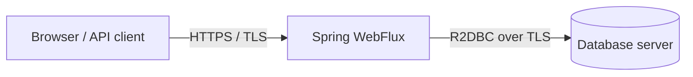
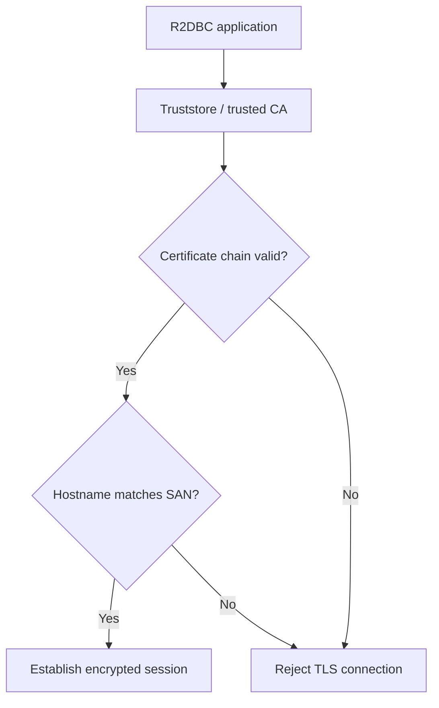
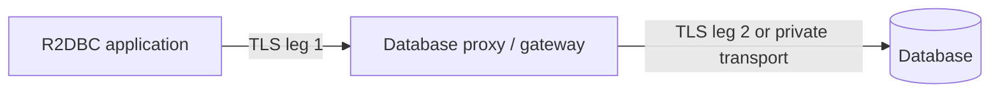

# Protecting Data in Transit with TLS

Spring Data R2DBC applications often run on one host or container while the database runs on another server, cluster, or cloud service. When the application sends usernames, passwords, SQL statements, bind parameters, and returned rows over the network, the connection must be protected so others cannot read or alter data in transit.

TLS (Transport Layer Security) encrypts and authenticates the connection between the R2DBC client and the database server. A secure configuration must accomplish both tasks: enable encryption and verify the server's identity using its certificate chain and hostname. Enabling SSL/TLS while skipping certificate verification can still leave the application connecting to an imposter server.

In Spring Data R2DBC, TLS is configured at the R2DBC driver/`ConnectionFactory` layer, not by adding an annotation to a Repository. Each driver has its own options, truststore handling, and certificate configuration. Therefore, configure TLS according to the exact database and driver in use, test both valid connections and bad certificates, and plan certificate rotation without disrupting the pool.

## 1. What Does TLS Protect?

TLS establishes an encrypted communication channel between client and server. In an R2DBC connection, that channel can protect:

- Authentication credentials sent to the database.
- SQL statements and bind parameters.
- Row data returned by the database.
- Protocol information and certain session metadata.

TLS also provides integrity checking to detect data tampering in transit. When server certificate verification is enabled, the client can verify that it is talking to the server holding the identity issued in the certificate.

TLS does not replace other security controls. It does not protect data stored on disk, does not grant table access rights, does not prevent SQL injection, and does not encrypt data once the application has received it into memory. Database roles, least privilege, secret management, encryption at rest, network segmentation, and application-layer access control are still required.

## 2. Distinguishing Database TLS from API HTTPS

A WebFlux application can have two independent TLS connections:

1. A browser or service calling HTTPS into the Spring Boot API.
2. The Spring Boot application opening a TLS-enabled R2DBC connection to the database.

Configuring HTTPS on the WebFlux server port does not automatically enable TLS for database connections. Likewise, R2DBC TLS does not protect requests from the browser to the API.



Each network leg must be protected individually. If a proxy, service mesh, or database gateway sits between the application and the database, determine where TLS terminates and whether the proxy-to-database hop is also encrypted.

## 3. TLS Handshake in an R2DBC Connection

When an R2DBC driver opens a secure connection, the TLS handshake generally includes these steps:

1. Client and server negotiate a supported TLS version and cipher suite.
2. The server presents its certificate chain to prove its identity.
3. The client verifies the certificate chain against configured trust anchors.
4. The client checks whether the hostname the application is connecting to matches a Subject Alternative Name (SAN) in the certificate, if hostname verification is enabled.
5. Both sides establish session keys and complete the handshake.
6. The R2DBC/database protocol continues exchanging messages inside the TLS channel.

The TLS handshake happens when a physical connection is created. With a connection pool, subsequent requests reuse the already-handshaked connection; not every SQL query performs a new handshake.

## 4. Encryption and Certificate Verification Are Two Different Things

A configuration may encrypt the connection without fully verifying the server certificate. This is an important distinction:

| Conceptual mode | Encrypts transit | Verifies CA chain | Verifies hostname |
|---|---:|---:|---:|
| TLS disabled | No | No | No |
| TLS enabled, skip certificate validation | Yes | No | No |
| Verify CA | Yes | Yes | Not necessarily |
| Verify full/identity | Yes | Yes | Yes |

In production, select a mode that verifies both the certificate chain and the hostname. If you only require TLS while accepting any certificate, an attacker can stand up a rogue server and the application will still establish an encrypted connection to it.

Exact option names vary by driver. For example, R2DBC PostgreSQL offers `sslMode` options such as `VERIFY_CA` and `VERIFY_FULL`; MySQL drivers may offer similar modes like `VERIFY_CA`/`VERIFY_IDENTITY`; SQL Server drivers have separate encryption and trust-certificate options. Never assume one driver's option names are universal R2DBC syntax.

## 5. Certificate Chains and Truststores

A server certificate is normally signed by a Certificate Authority (CA). The client must trust the appropriate root CA or intermediate CA to verify the chain.



A truststore is where the client retrieves trusted CAs. In Java, trust material can be supplied through a JSSE truststore or driver-specific SSL configuration. Not every R2DBC driver reads the same truststore in the same way; verify your driver's documentation and version.

Key terms to distinguish:

- **Server certificate:** the certificate presented by the server to the client.
- **Private key:** the secret key corresponding to the server certificate; must be protected on the server.
- **CA certificate:** the certificate used as a trust anchor or intermediate to verify the chain.
- **Truststore:** where the client stores trusted CAs.
- **Keystore/client key material:** where the client's certificate and private key are stored when using mutual TLS.
- **SAN:** the list of hostnames/IPs for which the certificate is valid.

Applications normally only need the CA certificate in the truststore to verify the server. When using mutual TLS, the client also needs its own certificate and private key.

## 6. Hostname Verification and Subject Alternative Name

The certificate must be valid for the hostname the application uses to connect. If the application connects to `db.prod.example.internal`, the server certificate needs a matching SAN, such as `DNS:db.prod.example.internal`.

Common failure causes:

- The application connects by IP while the certificate only has a DNS SAN.
- The application uses a DNS alias different from the hostname in the certificate.
- A load balancer presents a certificate for another hostname.
- The certificate is expired or not yet valid.
- The certificate chain is missing an intermediate CA.

In production, prefer connecting via a stable DNS name present in the certificate's SAN. Never disable hostname verification just to make IP or alias connections work. Issue a certificate with the right identity or configure a valid hostname according to the driver's guidance.

Hostname verification prevents a client from connecting to the wrong endpoint. Verifying only the CA without checking the hostname can accept a valid certificate issued by a trusted CA for a completely different server.

## 7. Choosing TLS Versions and Cipher Suites

The application and database must share at least one common TLS version and cipher suite. For modern systems, follow your organization's security baseline, typically preferring TLS 1.2 or higher and TLS 1.3 when both sides support it.

Do not hardcode an arbitrary cipher suite list without verifying compatibility across the JDK, R2DBC driver, database server, and operating system. An overly narrow configuration can break handshakes; an outdated one can permit weak algorithms.

Manage TLS policies at the appropriate layer:

- Database server or managed database configuration.
- JDK/JSSE security policy.
- R2DBC driver, if the driver exposes TLS protocol/cipher options.
- Proxy or service mesh, if TLS terminates at that layer.

Do not assume properties like `tlsVersion` or `cipherSuites` are identical across all drivers. Check the official documentation for the exact version deployed.

## 8. Configuring TLS for Spring Data R2DBC

Spring Boot reads R2DBC connection settings through the `spring.r2dbc.*` namespace. The URL and TLS options are passed to the R2DBC driver. Example PostgreSQL configuration structure:

```yaml
spring:
  r2dbc:
    url: "r2dbc:postgresql://db.prod.example.internal:5432/app_db?sslMode=VERIFY_FULL"
    username: ${DB_USERNAME}
    password: ${DB_PASSWORD}
```

`sslMode=VERIFY_FULL` is specific to the R2DBC PostgreSQL driver. It illustrates a mode requiring both certificate and hostname verification; confirm exact options and how to supply the CA certificate for your project's driver version.

Never embed real usernames/passwords in URLs or source code. Use a secret manager, mounted secrets, or securely managed environment variables. If credentials contain special characters, avoid manual URI string concatenation that could misparse characters or expose secrets in logs.

There is no single portable TLS query parameter across all R2DBC drivers. PostgreSQL configuration cannot be copied verbatim to MySQL or SQL Server.

## 9. Configuring the Java Truststore

Some drivers use Java Secure Socket Extension (JSSE) and can use the default truststore or one specified via JVM properties. For example, when the organization provides a PKCS12 truststore:

```text
-Djavax.net.ssl.trustStore=/run/secrets/db-truststore.p12
-Djavax.net.ssl.trustStoreType=PKCS12
```

If the truststore has a password, pass the password via your runtime environment's secret/configuration mechanism as supported by the driver/JDK; never commit passwords to repositories or write them to logs. Avoid putting sensitive passwords directly on the command line if process arguments are visible in the environment.

JSSE system properties are JVM-wide settings and can affect all TLS connections in the same process, not just R2DBC. If the application connects to multiple services with different CAs, consider per-factory truststores or custom SSL contexts if supported by the driver, rather than altering the global truststore without impact assessment.

Some drivers provide their own options for a CA file, certificate, private key, or truststore. When a driver has its own mechanism, follow the driver's documentation instead of assuming it reads JSSE properties.

## 10. Configuring R2DBC PostgreSQL

R2DBC PostgreSQL has its own TLS options, where `sslMode` controls the verification level. Common modes:

| `sslMode` | General meaning |
|---|---|
| `DISABLE` | Do not use TLS |
| `ALLOW` | Allow non-TLS connections depending on driver/server negotiation |
| `PREFER` | Prefer TLS, but may fall back depending on mode |
| `REQUIRE` | Require a TLS connection, though not equivalent to full hostname verification |
| `VERIFY_CA` | Require TLS and verify the certificate chain against a CA |
| `VERIFY_FULL` | Verify the certificate chain and server hostname |

Confirm exact names and behavior with your R2DBC PostgreSQL driver version. In production, choose full verification mode, for example:

```yaml
spring:
  r2dbc:
    url: "r2dbc:postgresql://postgres.internal.example:5432/app_db?sslMode=VERIFY_FULL"
```

The driver must be able to locate the trusted CA. You can configure the CA via a Java truststore or driver-specific certificate options per version documentation. Never assume `VERIFY_FULL` automatically trusts every CA or downloads CAs from the server.

The PostgreSQL server must also be configured with TLS and a valid certificate/key. Server configuration normally holds the certificate/key paths with appropriate file permissions. If the server does not support TLS under the required policy, the client will fail to connect.

To confirm a PostgreSQL session is using TLS, you can query:

```sql
SELECT ssl, version, cipher
FROM pg_stat_ssl
WHERE pid = pg_backend_pid();
```

`ssl = true` confirms the current session uses SSL/TLS; `version` and `cipher` report session details. Permission to view certain stats may depend on the role and PostgreSQL version.

## 11. Configuring R2DBC MySQL

MySQL R2DBC drivers have their own SSL options, and mode representation depends on the driver and version. Modes are typically distinguished by meaning:

- Disable TLS.
- Require TLS without full server identity verification.
- Verify CA chain.
- Verify CA chain and server hostname.

For drivers supporting `VERIFY_CA` and `VERIFY_IDENTITY`, identity verification is the option to consider for production. The URL below only illustrates configuration form; verify option names against the exact R2DBC MySQL driver in use:

```yaml
spring:
  r2dbc:
    url: "r2dbc:mysql://mysql.internal.example:3306/app_db?sslMode=VERIFY_IDENTITY"
    username: ${DB_USERNAME}
    password: ${DB_PASSWORD}
```

Do not treat that URL as portable configuration for MariaDB or other MySQL drivers. Drivers differ in option names, truststore support, certificate paths, and default TLS modes.

If the MySQL server requires a client certificate, configure client key/certificate material per the driver and server mechanisms. Configuring only the server CA does not mean mutual TLS is enabled.

You can check TLS status on a MySQL session with:

```sql
SHOW SESSION STATUS LIKE 'Ssl_cipher';
SHOW SESSION STATUS LIKE 'Ssl_version';
```

Non-empty cipher/version values typically indicate the session negotiated TLS. Verify syntax/metadata against your MySQL version and privileges.

## 12. Configuring R2DBC SQL Server

The SQL Server driver has dedicated options to control encryption and certificate trust. In the Microsoft ecosystem, two core concepts apply:

- Encryption is enabled for the connection.
- The client verifies the server certificate instead of trusting any certificate.

A secure configuration generally requires encryption enabled and `trustServerCertificate` disabled, while the client trusts the signing CA and the certificate hostname matches the endpoint. The following illustrates option intent; exact URI/option syntax must follow your Microsoft R2DBC SQL Server driver version:

```text
encrypt=true
trustServerCertificate=false
```

Do not confuse Microsoft JDBC driver settings with R2DBC driver settings. Both may use similar terms, but how options, types, and truststores are passed can differ.

Never set `trustServerCertificate=true` in production to bypass certificate errors. Depending on the driver, that option may encrypt traffic while skipping server identity verification, losing a critical TLS safeguard.

If the server uses an internal certificate, install the corresponding CA in the truststore used by the driver/JVM. Ensure the SAN contains the hostname the application uses to connect.

## 13. Mutual TLS (mTLS)

Standard one-way TLS authenticates the server to the client. Mutual TLS requires both client and server to verify each other's certificates:

1. The client verifies the server certificate.
2. The server requests a client certificate.
3. The client presents its certificate and proves possession of the matching private key.
4. The server verifies the client certificate against CAs trusted by the server.

mTLS is useful when a database or gateway requires certificate-based workload identity in addition to username/password. However, not every database, R2DBC driver, or managed service supports mTLS in the same way.

The client must protect its private key and configure its certificate chain and any key password protection. The server must configure trusted CAs for client certificates and policies mapping certificate identities to database privileges.

Never pass private keys through repositories, image build logs, or plaintext environment variables when safer secret mounts or keystores are available. Read permissions on private key files must be restricted to the process that needs them.

## 14. TLS with Multiple `ConnectionFactory` Beans

An application may connect to multiple databases or R2DBC clusters. Each `ConnectionFactory` must have TLS settings suited to its endpoint.

Example property structure:

```yaml
app:
  databases:
    orders:
      r2dbc-url: ${ORDERS_R2DBC_URL}
      username: ${ORDERS_DB_USERNAME}
      password: ${ORDERS_DB_PASSWORD}
    inventory:
      r2dbc-url: ${INVENTORY_R2DBC_URL}
      username: ${INVENTORY_DB_USERNAME}
      password: ${INVENTORY_DB_PASSWORD}
```

Each URL must carry the right TLS options for its driver and endpoint. If the databases use different CAs, separate truststores or SSL contexts may be needed if supported by the driver. Never assume TLS settings on `ordersConnectionFactory` automatically apply to `inventoryConnectionFactory`.

When constructing beans with `ConnectionFactoryOptions` or `ConnectionFactories`, attach the proper SSL options and driver-specific options to each factory. Then bind each factory to its corresponding `R2dbcEntityTemplate`, repository package, and transaction manager. Make sure repositories do not accidentally use a factory without TLS enabled.

## 15. TLS When Using a Connection Pool

R2DBC pools manage already-opened physical connections. TLS handshakes occur when the pool creates connections; subsequent operations reuse the secured connections.

This has several implications:

- A pooled connection opened before a certificate change can continue using its existing TLS session.
- Replacing a truststore file on the filesystem does not necessarily reload an SSL context already created in the JVM.
- Replacing a server certificate does not immediately force all pooled connections to re-handshake.
- New connections created after trust/certificate configuration updates will use the updated settings if the driver/SSL context is reinitialized appropriately.

Therefore, certificate rotation must coordinate the server, truststore, and pool lifecycle. You can drain/close pools or perform a rolling restart of application instances so new connections handshake against the new certificate. Avoid closing all connections simultaneously when availability must be maintained; roll out instance by instance.

Pool `maxLifeTime` can bound connection age and gradually replace connections, but it does not replace a controlled certificate rotation workflow. Verify that the pool actually opens new connections and that the new certificate is verified.

## 16. Rotating CAs and Server Certificates

A safe rotation workflow typically follows these steps:

1. Distribute the new CA into the application's truststore while the old CA remains trusted.
2. Roll out the application so running instances trust both the old and new CAs.
3. Replace the server certificate with one signed by the new CA.
4. Confirm new TLS connections succeed and hostname verification passes.
5. Drain or recycle connection pools instance by instance to establish new TLS sessions.
6. Monitor handshake errors, connection creation, and certificate validation.
7. Once no server or connection uses the old certificate, remove the old CA from the truststore as planned.

If you replace the server certificate before all clients trust the new CA, some instances will lose connectivity. If you remove the old CA too early, new connections to servers not yet rotated will fail.

Track certificate `notBefore`, `notAfter`, SANs, and issuers. Alert far enough ahead of expiration to complete rollout, testing, and troubleshooting.

## 17. TLS Termination at a Proxy or Service Mesh

Some architectures place a proxy or service mesh between the application and the database:



If the proxy terminates TLS, the link from application to proxy is protected, but the proxy-to-database leg may be a separate connection. Determine whether the second hop uses TLS and which component verifies its certificate.

Some proxies use TLS passthrough, letting the handshake travel directly to the database. Others terminate TLS and open a new connection. Both models have distinct security boundaries.

Do not claim "database connections use TLS" merely because the client connects to a proxy over TLS. Verify every hop and configure end-to-end encryption or TLS on both legs according to your threat model.

## 18. TLS and Network Security Complement Each Other

TLS protects content and endpoint identity in transit, yet you should still:

- Place databases in private networks or non-public subnets whenever architecture permits.
- Allow inbound database ports only from required application subnets/security groups.
- Use firewalls/network policies to restrict connection sources.
- Never expose database ports to the public Internet merely because TLS is enabled.
- Use per-service credentials with least privilege.
- Limit connection counts and monitor anomalous connections.
- Enable encryption at rest when stored data requires protection.

TLS and network segmentation address two distinct risk layers: TLS protects the session and verifies the endpoint; network policies reduce the chance an unauthorized source can reach the endpoint at all.

## 19. Never Disable Certificate Verification to Fix Connection Errors

Common dangerous workarounds include:

- Choosing an encryption-only mode without CA/hostname verification.
- Setting `trustServerCertificate=true` or an equivalent option.
- Using a trust-all `TrustManager`.
- Disabling hostname verification.
- Using self-signed certificates without distributing a trusted CA.
- Ignoring expired certificate or hostname mismatch errors.

These make the connection succeed at the cost of losing the ability to detect a spoofed server. Fix the root cause instead:

| Error | Proper fix |
|---|---|
| `PKIX path building failed` | Install the right CA/intermediate CA in the truststore or driver trust config |
| Hostname mismatch | Connect using a hostname in the SAN or issue a certificate matching the endpoint |
| Certificate expired | Renew and deploy a new certificate; check system clocks |
| Missing intermediate | Configure the server to send the complete certificate chain |
| TLS protocol/cipher mismatch | Align TLS policies across JDK, driver, proxy, and database |
| Client certificate rejected | Check client certificate chain, EKU, validity, private key, and server-trusted CAs |
| Connecting via IP fails | Use a valid DNS SAN or issue a certificate with an IP SAN as required |

If a local test requires self-signed certificates, create a dedicated test CA and trust that CA in the test truststore. Never put trust-all settings in production code or let test configurations leak into production.

## 20. Protecting Secrets and Private Keys

TLS cannot protect you if credentials or private keys leak elsewhere. Follow these principles:

- Never commit passwords, keystore passwords, private keys, or client certificate secrets to Git.
- Retrieve credentials from a secret manager or mounted secrets.
- Restrict filesystem permissions on truststores/keystores and private keys.
- Never log R2DBC URLs if URLs contain credentials.
- Redact passwords, tokens, and certificate private material from exceptions and config dumps.
- Use distinct credentials per service/database with rotation and least privilege.
- Avoid putting secrets on the command line if process lists or diagnostic tools can read them.
- Never bake secrets into Docker image layers.

Public CA certificates are normally not secret; private keys and keystore passwords are secret. Even though public CAs are less sensitive than private keys, control their distribution source to prevent trusting a rogue CA.

## 21. Verifying TLS Is Actually Used

Do not inspect property configuration alone and assume connections are encrypted. Verify session state on the database or via driver telemetry.

### PostgreSQL

```sql
SELECT ssl, version, cipher
FROM pg_stat_ssl
WHERE pid = pg_backend_pid();
```

Expect `ssl = true` and a version/cipher compliant with organizational policy.

### MySQL

```sql
SHOW SESSION STATUS LIKE 'Ssl_cipher';
SHOW SESSION STATUS LIKE 'Ssl_version';
```

### SQL Server

SQL Server exposes connection metadata such as `encrypt_option` in the DMV `sys.dm_exec_connections`; viewing it may require appropriate grants. Match the current session by `connection_id` or session ID rather than looking at an arbitrary connection.

Verification queries are vendor-specific. Use them in matching diagnostics/tests rather than placing one vendor-specific SQL query in a generic health check across all databases.

## 22. Testing Successful TLS Connections

TLS integration tests should run against a database container or test environment with real certificates matching production configuration style. Tests should confirm:

1. The container/database server starts with TLS enabled.
2. The server certificate has a SAN matching the hostname the client uses.
3. The signing CA is in the test client's truststore.
4. The R2DBC driver connects successfully in full verification mode.
5. Repositories can run queries and receive results.
6. The database confirms the current session uses TLS.

Testcontainers does not necessarily enable database TLS by default. Using plain `PostgreSQLContainer` or `MySQLContainer` alone does not verify TLS. Configure server certificates/keys, CAs, and client truststores using custom test images or container configuration.

Test certificates should be issued for the hostname the container client actually uses. If Testcontainers assigns dynamic hosts/ports, configure a stable hostname/SAN or network alias included in the SAN and connect via that alias. Never disable hostname verification to work around container host vs. certificate mismatches.

## 23. Testing Intentional TLS Failures

A security suite should confirm the client rejects connections when:

- The CA signing the server certificate is not in the truststore.
- The certificate is expired or not yet valid.
- The hostname does not match the SAN.
- The server requires a client certificate and the client presents none or an invalid one (with mTLS).
- The server only allows TLS versions/ciphers unsupported by the client.
- The server requires TLS while the client attempts plaintext.

These negative tests are just as important as positive connection tests. If a bad certificate still passes, the client may be running in trust-all mode or skipping server identity verification.

Tests can assert that the connection factory fails to open a connection or that a query fails with a TLS handshake/certificate error. Do not rely purely on exception message text because drivers/JDKs can wrap exceptions differently; inspect exception causes and connection states at a stable level.

## 24. Testing Truststores and Certificate Chains in Java

In test environments, you can create a private test CA, sign a server certificate for the test hostname, and create a truststore holding only that CA. The test client uses that truststore to verify the server.

A test fixture layout might look like:

```text
src/test/resources/tls/
├── test-ca.crt
├── db-server.crt
├── db-server.key
├── wrong-ca.crt
└── db-truststore.p12
```

Private keys in fixtures are for tests only and must never be used in production. Do not store real truststore passwords in repositories; tests can use dummy fixture passwords or generate truststores at test runtime.

If using self-signed certificates, load the CA/certificate into the test truststore. Never enable skip-verification modes. For mTLS, include test client certificates/keys and configure the database to require client certificates.

## 25. Testing Pools and Certificate Rotation

Because TLS handshakes attach to physical connections, test the pool lifecycle too:

- The first connection opens and completes the handshake.
- Connections are reused across multiple queries.
- New connections opened after truststore/certificate updates use the new material.
- Old connections drain/recycle according to policy.
- The pool recovers after an invalid certificate or server restart.
- One instance rolls out without dropping connections across the entire service.

Never modify a truststore file while the application is running and assume every SSL context updated automatically. Many drivers create their SSL context when initializing `ConnectionFactory`; in that case, recreate the factory/pool or restart instances via a supported rollout mechanism.

## 26. Monitoring TLS Errors in Production

Metrics and logs should distinguish:

- TLS handshake failures.
- Certificate chain validation failures.
- Hostname verification failures.
- Connection timeouts/network resets.
- Database authentication failures after TLS succeeded.
- Pool acquire/create connection failures.
- Upcoming certificate expirations.

Do not lump every error into "database unavailable." An authentication failure is not the same as a certificate failure; a pool acquire timeout is not a handshake failure.

Logs should include a redacted database endpoint, driver/version, timestamp, connection creation phase, and exception cause. Never log private keys, passwords, or full URLs containing secrets.

Track certificate expiration dates via certificate inventory/monitoring systems. Never wait until the connection pool tries to open a new connection to discover a certificate has expired.

## 27. TLS and Health Checks

Readiness/health checks should verify the application can open or use database connections under the configured TLS policy. However, avoid opening fresh connections continuously just to test certificates, as that creates unnecessary handshakes and load.

A health check can run a lightweight query on the existing pool, while recognizing:

- Existing connections may keep working even if the server certificate just changed.
- New certificate errors may appear only when the pool creates a new connection.
- Health checks must not leak certificate or private configuration details to public clients.
- Process liveness differs from database dependency readiness.

During rotation, run an active check that opens a new connection with the new trust material, rather than only querying an old pooled connection.

## 28. Common TLS Configuration Mistakes

| Symptom | Possible cause | Resolution |
|---|---|---|
| Connection succeeds without verifying server | Encryption-only mode or trust-all enabled | Select CA and hostname verification mode |
| `PKIX path building failed` | Missing CA/intermediate in truststore | Install the full chain or configure driver CA |
| Hostname verification failed | SAN does not match endpoint | Use the right DNS name or reissue certificate |
| TLS handshake failure | Incompatible version/cipher/protocol | Align JDK, driver, and server TLS policies |
| New connections fail after rotation | Truststore/SSL context stale or old CA removed too early | Deploy new CA first, recycle pool safely |
| Old connections still work after cert expiry | Pool reuses established TLS sessions | Test new connections and rotation procedure |
| JDBC uses TLS while R2DBC does not | JDBC and R2DBC configured independently | Configure `spring.r2dbc.*` and the R2DBC driver |
| Testcontainers passes while production TLS fails | Test container lacks TLS or uses trust-all | Use test server certificates and negative tests |
| Proxy connection encrypted on one leg only | TLS terminates at proxy, second leg plaintext | Secure and verify each hop |
| Secret exposed in logs | URL has credentials or debug config dump | Redact and fetch secrets from secret manager |

## 29. R2DBC TLS Deployment Checklist

Before shipping an R2DBC connection to production, verify:

1. The database server has TLS enabled and a valid certificate.
2. The application connects using a hostname listed in the certificate SAN.
3. The R2DBC driver is configured to require TLS.
4. The client verifies both certificate chain and hostname.
5. Truststore/CA material is distributed securely.
6. Trust-all and skip-hostname-verification modes are disabled.
7. TLS protocols/ciphers follow organizational policy.
8. If using mTLS, client private keys are protected and the server verifies client certificates.
9. Each `ConnectionFactory` has a TLS policy tailored to its endpoint.
10. JDBC migration datasources and R2DBC runtime factories are configured separately.
11. Pool lifecycle includes a drain/recycle plan for certificate rotation.
12. Both positive and negative certificate tests run against the real R2DBC driver.
13. Metrics/logs distinguish TLS, network, authentication, and pool errors.
14. Certificate expiry is monitored and rotation has an established procedure.
15. TLS is verified on every hop when proxies or service meshes are present.

## 30. Configuration and Operations Workflow

A practical workflow may include:

**Step 1 — Identify endpoints and drivers.** Document the database engine, R2DBC driver/version, hostname, port, and proxy/network path.

**Step 2 — Issue server certificates.** Ensure the certificate has a SAN matching the DNS name the application uses, a complete chain, and appropriate validity.

**Step 3 — Configure database TLS.** Enable TLS, install the certificate/private key, and set protocol/cipher policies to organizational standards.

**Step 4 — Distribute trust material.** Deliver the CA into the truststore or driver-specific trust configuration via secret/config management.

**Step 5 — Configure R2DBC.** Enable TLS and full verification mode per driver documentation; use `spring.r2dbc.*` or the matching `ConnectionFactory` configuration.

**Step 6 — Verify the handshake.** Confirm the connection succeeds, hostname matches, and the database session reports TLS active.

**Step 7 — Test failures.** Test with a wrong CA, wrong hostname, or expired certificate to verify the client rejects them.

**Step 8 — Test the pool.** Confirm connection reuse, new connection creation, and recycling work properly.

**Step 9 — Establish rotation.** Deploy the new CA first, replace the server certificate, drain pools instance by instance, and remove the old CA last.

**Step 10 — Monitor.** Track handshake failures, connection creation failures, TLS versions/ciphers, and certificate expiration.

## 31. Conclusion

TLS protects data exchanged between Spring Data R2DBC and the database over the network by encrypting and authenticating connections. Production configuration must enable TLS, trust the right CAs, and verify the hostname against the certificate SAN. Enabling encryption alone or skipping certificate validation is insufficient against spoofed servers.

TLS is configured on the R2DBC driver/`ConnectionFactory`; exact options vary across PostgreSQL, MySQL, SQL Server, and other drivers. Use the right driver options, truststores or certificate material, manage secrets securely, and verify that sessions actually use TLS. Because connection pools hold already-handshaked connections, certificate rotation must distribute the new CA first, recycle connections in a controlled manner, and verify new connections. Combining positive integration tests, negative certificate tests, monitoring, and protection of every network hop keeps R2DBC data protected throughout transit.
