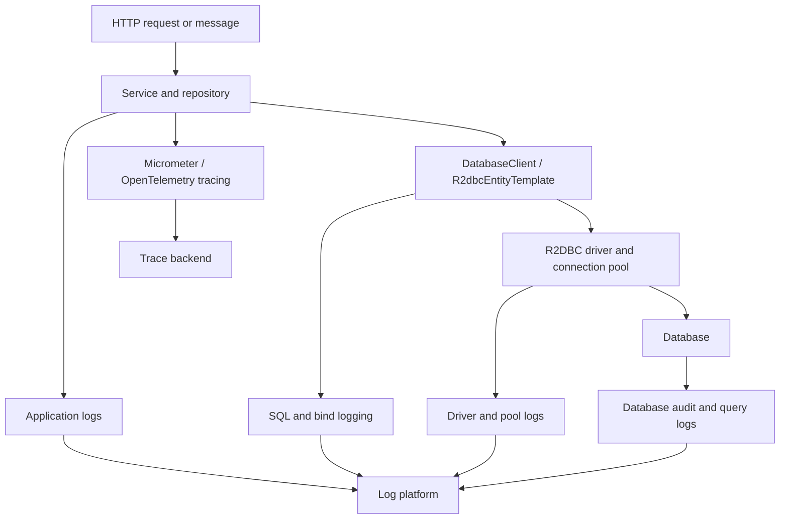

# Masking Sensitive Data in SQL Logs and Traces

Spring Data R2DBC applications generate many kinds of observability data: service logs, SQL logs from Spring or the driver, connection pool logs, traces/spans, metrics, and database-side logs. These signals help investigate slow queries, connection errors, and anomalous behavior. However, if full SQL statements along with bind values, entity contents, or requests are written into logs and traces, the system can inadvertently store passwords, tokens, emails, phone numbers, payment data, or personal information in locations with broader access than the operational database.

The goal is not to turn off observability altogether. You need enough information to know which operation ran, where it ran, how long it took, how many rows it returned, and what error category failed, while removing or masking unnecessary data before it leaves the application. Data masking must occur at the source where logs and traces are emitted; merely configuring a dashboard or storage backend to hide fields after ingestion is already too late.

## 1. Where Sensitive Data Can Leak

During an R2DBC request, data passes through several observability layers:



Sources to inspect include:

- **Application logs:** services logging requests, commands, entities, or exceptions via SLF4J/Logback/Log4j2.
- **Spring SQL logs:** Spring Framework/Spring Data loggers that can output SQL statements, execution details, or errors depending on category and version.
- **R2DBC driver logs:** drivers that can log protocol frames, statements, or parameter details at verbose log levels.
- **Connection pool/proxy logs:** pooling libraries, proxies, or listeners that can record SQL and bind values for debugging.
- **Traces/spans:** instrumentation that may attach query text, database names, operations, error messages, or application-added attributes to spans.
- **Database-side logs/audits:** SQL Server, PostgreSQL, and other engines that can log statements, sessions, errors, or audit events server-side.
- **Error reporting:** exception trackers, dead-letter messages, or failure logs that may retain raw payloads.
- **Test/diagnostic artifacts:** CI output, dump files, heap dumps, and incident support bundles that may also capture real data.

Never inspect only the repository logger and conclude data is safe. A driver interceptor or database server logger can capture the exact same statement through another path.

## 2. Identifying What Data Must Be Protected

Before configuring masking, classify information according to application and organizational policy. For example:

| Data category | Examples | Handling in logs/traces |
|---|---|---|
| Authentication secrets | Passwords, API keys, access tokens, refresh tokens, private keys | Never log values; never attach to spans, baggage, or exception messages. |
| Payment data | PAN, CVV, payment account details | Never log payment credentials; use only approved reference IDs. |
| Personal data | Emails, phone numbers, addresses, dates of birth, personal identifiers | Omit or mask per purpose and policy; restrict access. |
| Sensitive business data | Credit limits, balances, contract prices, HR details | Log only with approved need; prefer reference IDs and statuses. |
| Technical identifiers | Request ID, trace ID, statement name, error code | Generally safe to log if free of user data and properly controlled. |
| System metadata | Host, schema, table names, topology, versions | Log only to the needed extent; avoid exposing internal details publicly. |

Classification must evaluate both direct fields and combinations that can identify a person or transaction. For example, a tenant code, an exact timestamp, and an IP address can become sensitive in combination even if none is an authentication secret on its own.

Define an allowlist of attributes permitted for logging. An allowlist approach is safer than trying to detect every secret with regexes after an entire object has been serialized.

## 3. Prefer Bind Parameters Over Concatenating Values into SQL

Input values must be bound via R2DBC/Spring APIs rather than concatenated directly into SQL statements. This keeps SQL structure separate from data, reduces SQL injection risk, and makes statements easier to identify and cache.

Example using `DatabaseClient`:

```java
Mono<Customer> findByEmail(String email) {
    return databaseClient.sql("""
            SELECT id, display_name
            FROM customer
            WHERE email = :email
            """)
        .bind("email", email)
        .map((row, metadata) -> new Customer(
            row.get("id", UUID.class),
            row.get("display_name", String.class)))
        .one();
}
```

Never build SQL by concatenating data:

```java
// Unsafe: values appear directly inside SQL text and open the door to injection.
String sql = "SELECT id FROM customer WHERE email = '" + email + "'";
```

Parameter binding does not guarantee values will stay out of logs. A logger, proxy, or driver in debug mode can log both the statement and bound values. Parameterization protects SQL structure; logging policy must still prevent writing sensitive values.

Table names, column names, and SQL keywords cannot be bound as value parameters. When dynamic sort fields or identifiers are required, use a fixed allowlist in code; never insert client-supplied strings directly into SQL.

## 4. Never Log Bind Values or Entire Entities

A common mistake is logging statements together with parameters for debugging convenience:

```java
// Avoid: email can be personal data.
log.debug("Executing customer lookup with email={}", email);

// Avoid: entity/record toString() can include tokens or personal information.
log.debug("Saving customer {}", customer);
```

Do not call `toString()` on entities, request DTOs, commands, or parameter maps when objects can hold sensitive data. Java records automatically generate `toString()` from their components; using a record does not make its contents safe to log.

Instead, log minimal allowlisted details:

```java
log.info("customer.lookup completed operation={} durationMs={} found={}",
    "customer.lookupByEmail", duration.toMillis(), found);
```

This example logs only the operation name, elapsed time, and whether a result was found. To correlate log lines, attach a server-generated request ID or trace ID—not emails or tokens.

## 5. Mask Data at the Source of Log Creation

Redaction should occur before log events reach appenders, exporters, or agents. Masking only in dashboards leaves raw records sitting in buffers, queues, archives, or intermediate systems.

Guidelines:

1. Never pass secrets into log messages or arguments in the first place.
2. When a user-identifying attribute must be logged, use a policy-approved masked form or a less sensitive reference ID.
3. Use dedicated log DTOs/loggers containing only permitted fields.
4. Add centralized redaction filters as defense in depth, without relying solely on regexes.
5. Inspect data after formatting and before sending to appenders/exporters.
6. Apply the same policy to error logs, traces, baggage, metric labels, and message queues.

Redaction requires context. Replacing every phone-number-like string in every message can corrupt technical identifiers; conversely, a regex looking for `password=` misses tokens inside JSON or differently named fields. Explicit schema allowlists are easier to govern.

## 6. Create Safe Log DTOs

A good practice is defining dedicated types for logging rather than passing entities or requests to loggers:

```java
public record CustomerLookupLog(
    String operation,
    String requestId,
    boolean found,
    long durationMs
) {}
```

Then log only the chosen fields:

```java
CustomerLookupLog event = new CustomerLookupLog(
    "customer.lookupByEmail",
    requestId,
    customerFound,
    elapsed.toMillis());

log.info("customer lookup {}", event);
```

The log DTO contains no email, password, or row payload. If you need to know which tenant a query targeted, verify whether tenant IDs are safe to log and whether they could reveal customer topology. Never add every field to a log DTO merely because it is available.

For errors, construct a safe error event holding the operation, exception type, internal error code, SQL state/vendor code if permitted, and correlation ID. Never include the full request or command inside error events.

## 7. Masking, Redaction, Tokenization, and Hashing Are Not the Same

Data protection techniques serve distinct purposes:

| Technique | Example | Characteristics |
|---|---|---|
| Redact | `email=[REDACTED]` | Removes the value completely; safe when distinguishing records is unnecessary. |
| Mask | `a***@example.com` | Retains a partial view to aid authorized operator recognition. |
| Tokenize | `customerRef=tok_8f...` | Replaces with a reference token; requires a separately protected mapping store. |
| Keyed hash/HMAC | `subjectHash=...` | Links the same value across logs without revealing the original; requires key protection and rotation. |
| Encryption | Ciphertext | Decryptable with a key; not redaction and adds key management overhead. |

Masking does not automatically anonymize data. A partially masked email can still identify someone when combined with other fields. Unkeyed hashes are also unsafe for small value domains such as phone numbers or emails due to dictionary guessing. When stable correlation is required, consider HMAC with a securely managed secret key, restricted usage scope, and a rotation schedule.

Never log encrypted secret values and assume they are safe. If the log platform can reach the decryption key or ciphertext can later be decrypted, the logged content remains sensitive.

## 8. Configuring SQL Logging in Spring and Drivers

In development, verbose logging may be needed to debug SQL statements or mapping errors. However, logger categories and verbosity vary across Spring Framework, Spring Data R2DBC, drivers, and proxy libraries.

Configuration rules:

- Enable `DEBUG`/`TRACE` only for targeted categories in development or during tightly bounded incident investigations.
- Never enable global bind-parameter logging in production.
- Audit Spring loggers, driver loggers, pools, proxies, and tracing libraries; disable or configure each source explicitly.
- Keep passwords and connection URLs with credentials out of startup logs and config error dumps.
- Use environment profiles to prevent debug settings from leaking into production.
- When temporarily enabling verbose logs, set an expiration, an owner, and a post-incident disable/verify checklist.

Do not copy logger names from random online examples without confirming they match your exact dependency versions. Check version documentation or observe actual logger output in a test environment with dummy data.

Illustrative profile logging configuration:

```yaml
logging:
  level:
    root: INFO
    com.example.orders: INFO
```

During investigations, raise the level only for a specific category after verifying it does not log bind values or has proper redaction. Setting a logger to `DEBUG` is not a masking strategy.

## 9. Controlling Logs from R2DBC Proxies and Connection Pools

Proxy/observer libraries can record statements and parameters to measure timings or inspect queries. Some pools also log acquire, release, timeout, and connection lifecycle events.

When adding `r2dbc-proxy` or similar libraries:

- Read carefully which callbacks/listeners receive SQL and bind parameters.
- Log only query fingerprints or operation names when actual values are unnecessary.
- Disable parameter-value logging listeners in production.
- If a listener provides redaction, test that it handles both positional and named binds, null values, binary data, JSON, and multiple data types.
- Never log full `ConnectionFactoryOptions`, as options can include usernames, passwords, or sensitive connection URLs.
- Check logs when connection acquisition fails; exception messages may contain hosts, databases, or connection settings.

Measuring query duration does not require knowing bind values. You can record operation, duration, rows affected, and outcome category without logging parameters.

## 10. Redacting SQL Statements in Tracing

Tracing follows a request across services, repositories, drivers, and databases. Database spans can capture operation names, database systems, database names, query text, or instrumentation-added attributes. Attribute names and semantics vary across OpenTelemetry semantic convention versions and instrumentation libraries.

Never assume tracing records only timings. Inspect the actual spans generated by your agent/instrumentation, especially:

- SQL text or query text.
- Bind parameters or query values attached by custom instrumentation.
- Error messages and exception events.
- Database/schema/table/collection names.
- User-defined span attributes.
- Baggage propagated across services.

If SQL contains literals concatenated in code, recorded query text in spans will contain raw user data. Even with bind parameters, instrumentation or proxies may record bind values separately. Disable value capture or configure redaction before the exporter.

## 11. Using Allowlisted Span Attributes

Instead of attaching an entire request to a span, add only non-sensitive diagnostic attributes:

```java
Observation.createNotStarted("customer.lookup", observationRegistry)
    .lowCardinalityKeyValue("operation", "customer.lookupById")
    .lowCardinalityKeyValue("result", "found")
    .observe(() -> performLookup(customerId));
```

This illustrates the Observation API; how observations are created and attached to reactive context depends on your Micrometer/Spring versions. Never attach `email`, tokens, passwords, or entity contents as span attributes.

High-cardinality values such as user IDs, emails, order IDs, or request IDs are generally unsuitable as metric tags. In traces, a reference ID can sometimes be useful, but evaluate privacy policies, user linkability, and retention first. Never use a sensitive value as a tag merely because the tracing backend supports search.

Keep metric labels low-cardinality—such as operation, outcome, database system, or error category. Place request identifiers in controlled trace/log correlation fields rather than metric labels.

## 12. Never Put Secrets in Baggage or Cross-Service Context Propagation

OpenTelemetry baggage and other propagation mechanisms transmit attributes across service boundaries. Baggage is forwarded with request contexts and can appear in intermediaries or be copied into spans by instrumentation.

Never place the following into baggage:

- Access tokens, refresh tokens, API keys, or session cookies.
- Passwords or database credentials.
- Emails, phone numbers, or personal data without an approved purpose.
- Request/response payloads or entity contents.
- Payment details or business secrets.

Propagate only correlation IDs or allowlisted technical attributes. If actor context is required, prefer a low-sensitivity internal identifier and ensure proper trace access controls. Baggage is not a secure vault.

## 13. Handling Exceptions Without Exposing SQL and Parameters

Exceptions from Spring or drivers may include SQL states, vendor codes, table/column names, query text, or driver-generated messages. Application-thrown exceptions can also embed emails, IDs, or payloads in their messages.

Never unconditionally log both requests and exceptions:

```java
// Avoid: request.toString() and exception messages can expose sensitive data.
log.error("Failed to save request {}", request, error);
```

Instead, log the operation and a classified error code:

```java
log.error(
    "customer.save failed operation={} errorType={} requestId={}",
    "customer.save",
    error.getClass().getSimpleName(),
    requestId);
```

When stack traces are needed for investigation, verify that exception chains do not contain secrets or personal data. You can emit sanitized stack traces through a dedicated error handler while recording SQL state/vendor codes in separate fields when policy permits. Never construct exception messages by concatenating bound values.

Never return SQL, stack traces, or database internals to HTTP clients. APIs should return public error codes and correlation IDs; internal logs retain controlled diagnostics.

## 14. Separating Query Fingerprints from Full SQL Statements

In most cases, operators only need to know which query is slow and how often it runs. Log a stable query name or a normalized SQL fingerprint:

```text
operation=order.findByTenantAndStatus
queryFingerprint=orders.lookup.v2
durationMs=84
rowsReturned=25
outcome=success
```

Query fingerprints should come from code-defined templates or operation names, not from SQL concatenated with literals. Never include bind values in fingerprints; hashing full SQL with literals can still allow brute-force guessing when the value space is small.

Stable operation names are usually more helpful than storing raw SQL in every trace. When exact SQL is needed for tuning, inspect it in controlled development environments using anonymized data and restricted access.

## 15. Minimize Sensitive Data Before Querying

One way to reduce exposure is avoiding fetching sensitive columns when a use case does not need them. For example, a customer list should not select `password_hash`, `reset_token`, or payment details just to display names and statuses.

```sql
SELECT id, display_name, status
FROM customer
WHERE tenant_id = :tenantId;
```

Instead of:

```sql
SELECT *
FROM customer
WHERE tenant_id = :tenantId;
```

Small projections/DTOs reduce payload size and lower the chance of sensitive fields appearing in debuggers, `toString()` output, exceptions, or custom traces. This is a complementary mitigation; it does not replace logging and tracing policies.

## 16. Controlling Data in Metrics

Metrics are typically retained long-term and aggregated across many users. Never use emails, user IDs, order IDs, SQL text, or tokens as metric labels/tags. High cardinality inflates storage and backend costs while risking identity exposure.

Safer labels are restricted via allowlists:

- Stable operation names like `customer.findById`.
- Outcomes like `success`, `empty`, `error`.
- Error categories like `timeout`, `constraint`, `connection`.
- Controlled database system or pool names.
- Result size buckets instead of specific IDs.

Never put SQL bind values into metrics. To measure latency distributions, use histograms per operation; per-record labels are unnecessary.

## 17. Sampling Is Not Redaction

Sampling reduces the number of stored traces, yet sampled traces can still contain full sensitive data. Never treat sampling as a data-masking control.

The protection order should be:

1. Avoid collecting sensitive data unless necessary.
2. Redact/mask at the source before export.
3. Apply attribute allowlists to spans and logs.
4. Restrict access, retention, and export destinations.
5. Apply sampling to manage trace volume after data has been made safe.

If redaction runs only in the trace backend after ingestion, the data has already traversed agents, collectors, or networks. Apply processors as early as possible and verify whether pre-processor copies are stored anywhere.

## 18. Configuring Logs and Traces by Environment

Development environments may need richer diagnostics than production, yet should still use dummy or anonymized data. Never assume staging is safe: staging may hold copies of production data and ship logs to the same centralized backend.

| Environment | Recommended configuration |
|---|---|
| Local development | Controlled SQL logging allowed; prefer synthetic fixtures and never log secrets. |
| Automated tests | Use synthetic data; assert logs/traces contain no canary secrets. |
| Staging | Apply the same redaction policy as production if data resembles production. |
| Production | Restrictive default log levels; no bind-value logging; allowlisted trace attributes; controlled access and retention. |
| Incident investigation | Enable extra observability for a bounded duration and narrow scope, checking data before export. |

Prevent debug profiles from activating via misconfigured environment variables or unintended config file merges. Verify effective logging levels and instrumentation options at application startup.

## 19. Securing Log Backends and Trace Backends

Source-side redaction is the priority, yet storage backends still require controls:

- Enforce role-based, purpose-scoped access control; do not let every developer read all production logs.
- Encrypt data in transit and at rest per platform capabilities.
- Set appropriate retention policies to delete or archive records on schedule.
- Control exports, downloads, and dashboard sharing.
- Monitor anomalous access to logs holding sensitive data.
- Separate environments and tenants when security requires isolation.
- Restrict permissions of log agents/collectors and shipping accounts.
- Never ship production logs to personal services or unapproved endpoints.

If a secret is discovered in logs, treat it as an exposure incident: determine scope, restrict access, delete/expire records through approved procedures, and rotate potentially exposed credentials/tokens. Deleting from a dashboard view does not guarantee copies, archives, or collector buffers were purged.

## 20. Layered Redaction Configuration and Implementation

A practical architecture splits protections across layers:

1. **Code:** log only allowlisted event DTOs; never log entities, request bodies, or bind values.
2. **Spring/driver:** configure appropriate categories and levels; disable parameter-value capture in production.
3. **Observation/tracing:** add only approved span attributes; strip SQL text/exception details where instrumentation supports it.
4. **Collector/exporter:** apply redaction processors as defense in depth before shipping to backends.
5. **Backend:** RBAC, retention, encryption, and access auditing.

No single generic Spring property guarantees parameter masking across every driver and instrumentation library. Option names and redaction capabilities vary by library. Identify every emission source in your dependency graph and configure each against its version documentation.

## 21. Example of a Safe-Logging Service

The following example logs operation, outcome, and duration without logging the email or full entity:

```java
public Mono<CustomerView> findCustomer(String email, String requestId) {
    long startedAt = System.nanoTime();

    return customerRepository.findByEmail(email)
        .map(CustomerView::from)
        .doOnNext(view -> log.info(
            "customer.lookup completed operation={} requestId={} outcome={} durationMs={}",
            "customer.findByEmail",
            requestId,
            "found",
            elapsedMillis(startedAt)))
        .switchIfEmpty(Mono.defer(() -> {
            log.info(
                "customer.lookup completed operation={} requestId={} outcome={} durationMs={}",
                "customer.findByEmail",
                requestId,
                "empty",
                elapsedMillis(startedAt));
            return Mono.empty();
        }))
        .doOnError(error -> log.error(
            "customer.lookup failed operation={} requestId={} errorType={}",
            "customer.findByEmail",
            requestId,
            error.getClass().getSimpleName()));
}

private long elapsedMillis(long startedAt) {
    return TimeUnit.NANOSECONDS.toMillis(System.nanoTime() - startedAt);
}
```

This illustrates logging only outcome, duration, and request ID. In production, prefer the application's standard observation/metrics tools rather than hand-rolling timers in every method; ensure `requestId` is server-generated and free of personal information. If stack traces are logged, apply the exception-logging policies described earlier.

`doOnError` is a side effect in the reactive chain. Do not use it to convert failures into successes; to transform errors, use `onErrorMap` or `onErrorResume` selectively per your service contract. Logs must never contain the `email` value even though the query uses parameter binding.

## 22. Testing Redaction with Canary Data

Do not simply read configuration files and assume data is masked. Create test data containing unique canary strings, such as:

```text
password = CANARY_SECRET_PASSWORD_9f3a
email = canary.person@example.invalid
token = CANARY_ACCESS_TOKEN_7b21
```

Execute operations likely to emit logs or traces:

- Repository queries binding an email.
- Inserting/updating entities containing sensitive fields.
- Triggering unique constraint or mapping errors.
- Triggering timeouts or connection failures in the test environment.
- Running through the active driver/pool proxy and instrumentation stack.
- Creating spans with baggage/context to confirm data does not propagate.

Then inspect every relevant output:

1. Application logs and console output.
2. Spring/driver/pool/proxy logs.
3. Trace span attributes and exception events.
4. Metric labels/tags.
5. Collector/exporter output or test exporters.
6. Error trackers and dead-letter payloads if present.

Assert tests by searching for every canary string; tests must fail if any canary appears where disallowed. At the same time, verify required operational fields such as operation, duration, outcome, and correlation ID remain intact for troubleshooting.

## 23. Checking Exceptions and SQL Logging on Upgrades

Upgrading Spring Framework, Spring Data, R2DBC drivers, pools, tracing agents, or collectors can change logger categories, span attributes, or how exceptions are constructed. Therefore:

- Maintain an inventory of enabled dependencies and instrumentation.
- Review release notes and documentation for the exact versions.
- Re-run canary tests before deployment.
- Diff span schemas and log fields before and after upgrades.
- Verify production configuration is actually applied at runtime, not just in repository config files.
- Confirm no `TRACE` loggers or protocol debug flags were accidentally turned on.

Never rely on a mock test showing no leaked secrets to conclude the real driver also suppresses secrets. Test with the real R2DBC driver, connection pool, and exporter in a test environment.

## 24. Incident Response When Sensitive Data Appears in Logs

When passwords, tokens, or personal data are found in logs or traces:

1. Identify the data type, timeframe, operation, and all systems that received the records.
2. Restrict access or pause export from the leaking source if needed.
3. Rotate/revoke potentially exposed secrets; assess impact per security policy.
4. Locate copies across collectors, queues, archives, backups, and trace backends.
5. Purge or shorten retention through approved workflows; never assume deleting from one dashboard suffices.
6. Fix the log/trace emission source and instrumentation configuration.
7. Run canary tests to confirm the data no longer appears.
8. Document root cause and preventive measures.

If the leaked data can be used for authentication or system access, prioritize rotation/revocation under incident response policy. For personal data, follow applicable regulatory and organizational notification/assessment procedures.

## 25. Anti-Patterns to Avoid

| Anti-pattern | Risk | Alternative |
|---|---|---|
| Logging entire requests/commands/entities | May capture passwords, tokens, PII, or huge payloads | Use allowlisted log DTOs. |
| Enabling global `DEBUG`/`TRACE` SQL in production | Drivers/proxies may log bind values and sensitive SQL | Enable narrowly, time-bound, with verified redaction. |
| Concatenating user values into SQL | SQL injection and literals logged verbatim | Use bind parameters. |
| Assuming bind parameters hide logs | Instrumentation can still log bound values | Audit and disable bind-value capture. |
| Masking only in dashboards | Raw data already reached collectors/backends | Redact before exporters. |
| Putting tokens/emails in spans or baggage | Data propagates across multiple services | Use only allowlisted technical attributes. |
| Using plain hashes for emails/phone numbers | Vulnerable to dictionary guessing | Redact, or use keyed HMAC if correlation is truly required. |
| Using sampling instead of redaction | Sampled traces still contain secrets | Redact before sampling/exporting. |
| Logging full exception messages unchecked | Messages/causes can include SQL, hosts, or parameters | Log error types/codes and stack traces per policy. |
| Putting user IDs into metric tags | High cardinality and identity exposure | Use operation/outcome/error category. |

## 26. Safe Logging and Tracing Design Checklist

Before releasing an R2DBC use case, verify:

1. Which entities, commands, and bind parameters contain sensitive data?
2. Which loggers can emit SQL or bind values: Spring, driver, pool, proxy, or database server?
3. What SQL text, exception events, or custom attributes does trace instrumentation capture?
4. Is any baggage or context propagating user data?
5. Do log events use allowlists instead of serializing entities/requests?
6. Does redaction run before appenders/exporters rather than only in the backend?
7. Do metric tags contain IDs, emails, SQL, or high-cardinality values?
8. Do log and trace backends enforce proper RBAC, encryption, retention, and access audits?
9. Do canary tests scan logs, traces, metrics, and error outputs for secrets?
10. Are procedures clear for enabling temporary debug logging, turning it off, and handling leaked data?

## 27. Implementation Principles

In Spring Data R2DBC, logging safety must be designed end-to-end from services down to database drivers and observability backends. Use bind parameters to keep SQL separate from data; log only approved operations, timings, outcomes, row counts, and correlation IDs; never serialize entities/requests or log bind values; audit Spring, driver, pool, and proxy loggers; restrict span attributes and baggage; redact before export; and verify with canary secrets against the real stack.

Logs and traces must remain useful for operations. Preserve diagnostic technical metadata, consistent error classification, and safe correlation IDs while stripping unnecessary data right at the source. Combining redaction with access controls, retention limits, encryption, and incident response procedures prevents SQL logs and traces from turning into an unintended store of secrets.
