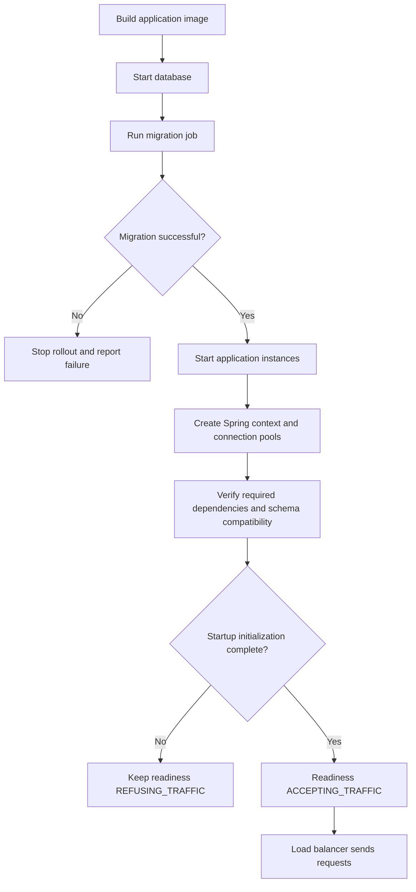
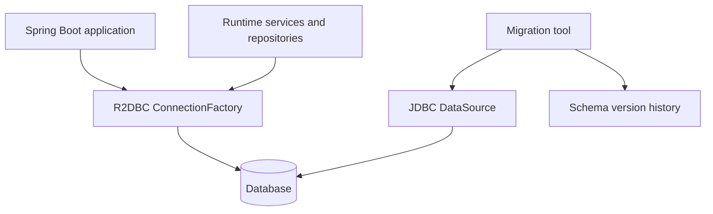
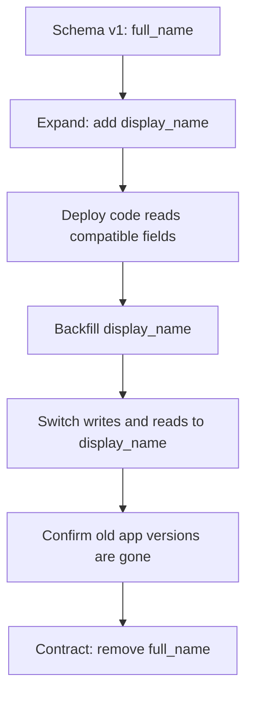

# Coordinating Application Startup, Migrations, and Readiness Checks

A Spring Data R2DBC application should only receive traffic once the prerequisites for serving requests are complete. Those prerequisites typically include loaded configuration, an accessible database, a schema at a version compatible with the code, and completed mandatory initialization steps. If the application opens its HTTP port before migrations finish or marks a pod ready too early, requests can fail with missing table/column errors right after deployment.

Application startup, schema migrations, and readiness are three related concerns with distinct responsibilities:

- **Startup:** creating the application context, connection factory, repositories, services, and web server.
- **Migration:** bringing the database schema to the target version through ordered, trackable changes.
- **Readiness:** signaling to the load balancer/orchestrator that the instance can currently accept traffic.

With Spring Data R2DBC, the runtime application uses R2DBC for asynchronous database access. Common migration tools such as Flyway or Liquibase typically connect to the database via JDBC. You can use JDBC solely for migrations while keeping R2DBC for runtime, or run migrations in a standalone job before deploying the application. The key is coordinating them so migrations finish and the schema is compatible before an instance is put into service.

## 1. Deployment lifecycle and readiness

A typical deployment sequence:



This diagram shows a typical deployment model. Some applications run migrations during startup instead of a separate job; in that case, readiness must still remain in a traffic-refusing state until migrations and required steps complete.

Do not conflate these three concepts:

| Concept | Question answered | Example |
|---|---|---|
| Process started | Has the process/JVM started? | The container has spawned the Java process. |
| Liveness | Is the application still alive and able to continue running? | The application context has no fatal failure, and the event loop is active. |
| Readiness | Can the instance accept business requests right now? | Migrations are done, the schema is compatible, and required dependencies are ready. |

A process may be running and healthy on liveness while still not ready. For example, the database may be undergoing migration or a service may be loading required configuration data. This is a valid state; the load balancer should avoid routing business requests to that instance.

## 2. Migrations are versioned schema changes

A migration is an ordered set of schema changes, usually managed by version or changelog. Examples:

- Creating a `customer` table.
- Adding a `status` column.
- Creating an index for search queries.
- Adding a constraint after legacy data has been normalized.
- Transforming data into a new structure.

Do not rely on a single `CREATE TABLE IF NOT EXISTS` script as a production migration mechanism. As a schema evolves across versions, the application needs to know which migrations have run, which are missing, which failed, and which schema version the current code is compatible with.

Tools like Flyway and Liquibase manage versions/changelogs, execution history, and locking mechanisms to coordinate migrations. Choose a tool suited to your database, release workflow, and team operational capability; avoid letting multiple mechanisms modify the same schema without clear ownership rules.

## 3. R2DBC runtime and JDBC migrations can coexist

R2DBC is a reactive database access API. Flyway and Liquibase traditionally use JDBC to run migrations. Therefore, a single application can hold two types of connections to the same database:



R2DBC serves business queries once the application is ready. JDBC is used only during the migration phase or inside a migration job. Both connections can target the same database/schema while using separate pools, drivers, and credentials.

Example Maven dependencies for PostgreSQL using Flyway over JDBC and R2DBC at runtime:

```xml
<dependency>
    <groupId>org.springframework.boot</groupId>
    <artifactId>spring-boot-starter-data-r2dbc</artifactId>
</dependency>

<dependency>
    <groupId>org.postgresql</groupId>
    <artifactId>r2dbc-postgresql</artifactId>
</dependency>

<dependency>
    <groupId>org.flywaydb</groupId>
    <artifactId>flyway-core</artifactId>
</dependency>

<dependency>
    <groupId>org.flywaydb</groupId>
    <artifactId>flyway-database-postgresql</artifactId>
</dependency>

<dependency>
    <groupId>org.postgresql</groupId>
    <artifactId>postgresql</artifactId>
    <scope>runtime</scope>
</dependency>
```

Flyway database module dependencies and the JDBC driver depend on the Flyway/database versions. The snippet above illustrates a modern PostgreSQL setup; check the dependency guide for the exact versions you use before applying it. For SQL Server or other databases, include the corresponding modules/drivers.

Adding a JDBC driver does not mean the application must convert all repositories to JDBC. The two stacks can coexist for separate purposes.

## 4. Configuring Flyway in an R2DBC application

Spring Boot can configure R2DBC for runtime and a separate JDBC URL for Flyway:

```yaml
spring:
  r2dbc:
    url: r2dbc:postgresql://${DB_HOST:localhost}:5432/orders
    username: ${APP_DB_USER}
    password: ${APP_DB_PASSWORD}

  flyway:
    enabled: true
    url: jdbc:postgresql://${DB_HOST:localhost}:5432/orders
    user: ${MIGRATION_DB_USER}
    password: ${MIGRATION_DB_PASSWORD}
    locations: classpath:db/migration
```

`spring.r2dbc.*` configures runtime connections. `spring.flyway.*` configures JDBC migrations. Separating `APP_DB_USER` and `MIGRATION_DB_USER` ensures the runtime user only has privileges needed for application operations, while the migration user has appropriate DDL privileges.

If you do not configure a separate URL for Flyway, Spring Boot may expect an auto-configured JDBC `DataSource` based on available properties. When the application only declares R2DBC, explicitly configure Flyway JDBC properties and ensure the driver is on the classpath. Property names and auto-configuration conditions may vary by Spring Boot version; check metadata and documentation for your project's version.

Flyway typically runs migrations during application context initialization when auto-configuration is enabled. When a migration fails, startup typically fails rather than letting the application continue as if the schema were ready. This is the right behavior when the schema is a required dependency.

## 5. Liquibase and other migration tools

Liquibase also typically connects over JDBC and stores change-set history in its own management tables. You can configure `spring.liquibase.url`, `user`, `password`, and `change-log` separately from `spring.r2dbc.*`.

Other options include:

- Migration tools run within the CI/CD pipeline.
- A dedicated container/job solely responsible for migrations.
- Versioned migration scripts controlled by the deployment platform.
- Dedicated R2DBC migration mechanisms if the project has specific requirements and suitable tooling.

The key is having a single source of truth for schema history, a clear release workflow, and a way to verify that migrations succeeded. Never let Flyway, Liquibase, `schema.sql`, and table-creating application code modify the same schema without clear boundaries.

## 6. Running migrations in the app or in a standalone job?

There are two main models.

| Model | Advantages | Risks/conditions |
|---|---|---|
| Migration at app startup | Simple configuration; app verifies schema before serving | Multiple replicas may start concurrently; startup time increases; runtime image needs migration privileges. |
| Separate migration job before rollout | Separates DDL privileges, logs, and migration duration from app; easy to gate deployment | Pipeline must wait for job completion; requires job failure and retry handling. |

For development environments or small single-instance applications, startup migrations can be convenient. For multi-replica production systems, it is more common to run a separate migration job, wait for success, and then roll out the application.

If individual replicas still run migrations at startup, the tool must have proper locking/serialization and migrations must be safe when multiple processes start concurrently. Even with migration locks, multiple instances may still wait simultaneously, contend for connections, or make startup times unpredictable. A single migration job is usually easier to operate.

## 7. Orchestrating migration jobs in CI/CD

A pipeline should have clear steps:

1. Build and test the application image.
2. Start the database or verify the target database is reachable.
3. Run the migration job using the released artifact/schema version.
4. Wait for the job to finish and check its exit code.
5. If the migration fails, halt the rollout and preserve logs safely for investigation.
6. If the migration succeeds, deploy the new application version.
7. Wait for new instances to reach readiness before shifting full traffic.
8. Monitor query errors, latency, and database state after rollout.

In Docker Compose, you can use a dependency condition that waits for a service to finish successfully, if your Compose version supports it:

```yaml
services:
  db:
    image: postgres:16
    healthcheck:
      test: ["CMD-SHELL", "pg_isready -U orders"]
      interval: 5s
      timeout: 3s
      retries: 20

  migrate:
    image: example/orders-migrations:1.4.0
    depends_on:
      db:
        condition: service_healthy

  app:
    image: example/orders-app:1.4.0
    depends_on:
      migrate:
        condition: service_completed_successfully
```

This is a structural Compose example; the healthcheck command, migration image, and `service_completed_successfully` support must match your Compose version. In Kubernetes, a `Job` and a `Deployment` are independent resources; the pipeline or release controller must wait for the Job to reach `Complete` before rolling out the Deployment. Kubernetes does not infer ordering dependencies between two resources simply because they are applied together.

Do not run migrations from an init container on every application pod without a clear reason. When rolling out multiple replicas, every pod could execute migrations concurrently. If you use that approach, you must ensure tool locking, timeouts, DDL permissions, and error handling are strictly controlled.

## 8. Migration locks and multiple replicas

When multiple processes attempt migrations simultaneously, there are risks:

- Two processes both observe that a version has not yet been applied.
- Two processes run DDL on the same table concurrently.
- One process holds the lock while others wait.
- Pod startup times out before the migration completes.
- A migration job is retried after a pipeline timeout even though the database already completed part or all of the changes.

Flyway and Liquibase provide their own state/lock management mechanisms. Do not add a second custom lock table when the tool already manages concurrency, unless your architecture requires it and it is explicitly designed.

Operational rules:

- Only one active migration job per database/schema for a release.
- Use the tool's lock and verify behavior if a process dies mid-migration.
- Never edit a migration that has already been applied in a shared environment; create a new migration to fix forward.
- Monitor lock wait times and the duration of each migration.
- Have a plan for handling stuck migrations or failed states; never arbitrarily delete migration history.
- Do not run two independent release pipelines modifying the same schema concurrently without serialization.

A migration job must have appropriate timeouts and resource limits. A long-running DDL lock can disrupt business queries or rollouts even if the application itself is not running the migration directly.

## 9. Separating migration and runtime permissions

The runtime application usually only needs read/write permissions on business data. Migrations require additional privileges to create or alter tables, indexes, constraints, sequences, or schemas. Sharing one high-privilege database user for both increases the impact if the application is compromised or logs leak credentials.

Permissions should be separated:

| Principal | Typical privileges |
|---|---|
| Migration user | DDL required for migrations and read/write access to migration history tables. |
| Runtime user | SELECT/INSERT/UPDATE/DELETE required for use cases; no DDL unless necessary. |
| Read-only/reporting user | SELECT on permitted tables/views. |
| Health-check user (if separated) | Minimal privileges to verify connectivity or run a lightweight query. |

Do not grant `SUPERUSER`, `db_owner`, or equivalent administrative privileges to the runtime user just to make migrations convenient. Migration secrets should only be supplied to the job or deployment stage that needs them and must not appear in application logs.

## 10. Designing migrations compatible with multiple application versions

During a rolling deployment, old and new versions can run side by side. If a migration immediately drops or renames a column as the new app starts, still-running old pods can suffer SQL errors.

The **expand–migrate–contract** strategy reduces this risk:

1. **Expand:** add new columns/tables in a backward-compatible way, such as nullable columns or columns with appropriate defaults.
2. **Deploy compatible code:** the new version can read/write both old and new structures in stages; the old version continues working.
3. **Migrate/backfill:** copy legacy data into the new structure in resumable batches.
4. **Switch:** switch primary reads/writes to the new structure once data is ready.
5. **Contract:** drop the old column/table only after every old instance and job has stopped using it.

Example renaming `full_name` to `display_name`:



Do not bundle adding a new column, backfilling all data, changing code, and dropping the old column into a single migration if the application requires rolling deployments. Schema migrations and large data backfill jobs should generally be separated.

## 11. Large data backfills need checkpoints

A schema-change migration often finishes quickly; backfilling millions of rows can take minutes or hours and generate heavy load. Design backfills as resumable jobs:

- Process in bounded batches.
- Order by a stable key to store checkpoints.
- Only update rows that have not yet been migrated.
- Make runs idempotent so re-running does not corrupt data.
- Measure progress, errors, and processing rate.
- Limit concurrency and transaction duration.
- Avoid holding one giant transaction across the entire backfill unless required.

Conceptual example updating by ID range:

```sql
UPDATE customer
SET display_name = full_name
WHERE id > :lastProcessedId
  AND id <= :batchEndId
  AND display_name IS NULL;
```

This is an illustrative example; you must define keys, conditions, and handling for newly created rows during backfill. Checkpoints should be persisted durably and only advanced after a batch commits successfully.

Do not use individual pod readiness to represent the progress of a long-running backfill if the application can still serve valid requests during that phase. Backfill is job state; app readiness should reflect the ability to serve traffic under the current contract.

## 12. Migration ordering and schema compatibility checks

A solid migration workflow distinguishes between:

- **Migration applied:** the tool has recorded successful execution of the change set/version.
- **Schema compatible:** the current schema satisfies what the running code requires.
- **Data ready:** data has been backfilled or normalized sufficiently for the new use case to operate.

These three states do not always occur at the same time. For example, a migration adding a column may be applied while backfill is still running. New code should not switch to reading exclusively from the new column until data is ready.

You can check the schema version at startup via the migration tool or a lightweight metadata query. However, avoid running migration history queries on every readiness probe. Probes run continuously; querying schema version history every few seconds adds load and couples health checks to unnecessary logic.

If the code requires a minimum schema version, verify it once at startup or during the deployment step. If the schema version is incompatible, fail startup/readiness and surface an investigable error.

## 13. Spring Boot startup and initialization hooks

Spring Boot has multiple lifecycle milestones:

- Beans are instantiated and the application context is refreshed.
- The web server is initialized/started per application configuration.
- `ApplicationRunner` and `CommandLineRunner` run after the context is prepared.
- `ApplicationReadyEvent` is published when the application has completed startup according to Boot's lifecycle.

Auto-configured migrations like Flyway typically run during context initialization. Runners can be used for mandatory verification or warm-up steps after beans are ready but before startup finishes.

Example checking schema compatibility using `ApplicationRunner` with a reactive service:

```java
@Bean
ApplicationRunner verifyRequiredSchema(SchemaCompatibilityService schemaService) {
    return args -> schemaService.verifyRequiredVersion()
        .block(Duration.ofSeconds(15));
}
```

`ApplicationRunner` is an imperative API, so this example awaits the publisher with a bounded `block` timeout on the startup thread so startup only completes after verification succeeds. Never call `block()` on a Reactor event-loop thread inside a request handler. If the schema check fails or times out, startup fails and the instance is not marked ready.

Do not call fire-and-forget `subscribe()` in a runner:

```java
// Avoid: the runner finishes immediately, and startup may mark ready before the query completes.
schemaService.verifyRequiredVersion().subscribe();
```

If asynchronous warm-up is required, explicitly design how readiness stays `REFUSING_TRAFFIC` until completion and how errors are handled. Do not assume that merely subscribing to a publisher makes startup wait for it.

`@DependsOn` only controls bean initialization order; it is not a general mechanism for waiting on a remote migration job or asynchronous workflow to finish. Use it for actual bean dependencies, not as a substitute for deployment orchestration.

## 14. Avoid running async migrations and letting the app continue

A dangerous pattern is creating a startup bean, invoking a migration publisher with `subscribe()`, and letting Spring Boot continue startup. The web server can begin accepting requests before migrations have finished.

If using a synchronous migration tool like Flyway via auto-configuration, let the tool finish or fail before startup completes. If using a custom reactive migration, the runner must wait for the result with a finite timeout or explicitly manage `ReadinessState`.

Do not run large migration scripts on the event loop. Migrations often involve DDL, locks, and potentially long-running operations; use an appropriate tool/job, bound execution time, and track progress. Being reactive does not make a long DDL lock cheap.

## 15. Liveness, readiness, and startup probes

Spring Boot Actuator supports health groups for liveness and readiness. Enable health probes:

```yaml
management:
  endpoint:
    health:
      probes:
        enabled: true
```

Common endpoints:

- `/actuator/health/liveness`
- `/actuator/health/readiness`

Readiness reflects the ability to receive traffic. Liveness reflects whether the process is healthy enough to keep running. Do not include every external dependency in liveness; if the database temporarily loses connectivity, continuously restarting all pods can worsen the outage.

Kubernetes can configure three probe types:

```yaml
startupProbe:
  httpGet:
    path: /actuator/health/liveness
    port: http
  periodSeconds: 10
  timeoutSeconds: 3
  failureThreshold: 30

livenessProbe:
  httpGet:
    path: /actuator/health/liveness
    port: http
  periodSeconds: 10
  timeoutSeconds: 3
  failureThreshold: 3

readinessProbe:
  httpGet:
    path: /actuator/health/readiness
    port: http
  periodSeconds: 5
  timeoutSeconds: 3
  failureThreshold: 2
```

These timings and thresholds are examples and should be adjusted for your startup time and SLOs. `startupProbe` allows the application a longer startup window without `livenessProbe` restarting it prematurely. `readinessProbe` checks a separate endpoint so the pod only receives traffic when readiness passes.

If Actuator is placed under a context path or separate management port, update the URLs/ports accordingly and ensure health endpoints are not unintentionally exposed publicly.

## 16. Should readiness include the database?

If the database is a required dependency for handling all requests, readiness should generally reflect database connectivity. If a database only serves an optional feature, you may not want to remove the entire instance from the load balancer when that secondary database goes down.

Example health group configuration including a database health contributor:

```yaml
management:
  endpoint:
    health:
      probes:
        enabled: true
      group:
        readiness:
          include: readinessState,db
        liveness:
          include: livenessState
```

`db` here is an example contributor name; the actual ID may differ depending on auto-configuration, JDBC/R2DBC, and the number of connection factories. Check your application's list of contributors before configuring. With multiple databases, decide which databases are mandatory and consider a custom `ReactiveHealthIndicator` or dedicated health groups.

A readiness check should:

- Perform a lightweight operation with a short timeout.
- Check dependencies actually required for requests.
- Never run migrations or large count queries.
- Never include credentials or SQL bind values in health details.
- Avoid generating heavy load when the orchestrator polls probes continuously.
- Distinguish between mandatory database failures and optional dependency failures.

If readiness depends on the database, when the database goes down, pods are removed from service endpoints without necessarily being restarted. When the database recovers, readiness can turn healthy again and pods are brought back into rotation.

## 17. Liveness should not directly depend on the database

Liveness answers: "Does this process need to be restarted to recover?" Temporary database unavailability is rarely a reason to restart the JVM. If liveness fails along with database health, every replica can be restarted simultaneously, destroying connection pools, increasing reconnect load, and creating an outage loop.

Typically:

- Liveness relies on internal application state and unrecoverable process failures.
- Readiness can include the database or mandatory dependencies.
- A startup probe allows a longer startup/migration window before liveness takes effect.

If the application has an internal deadlock or an essential worker stops unrecoverably, liveness may need a custom indicator. Do not use liveness as a catch-all signal for external dependency failures.

## 18. Managing ReadinessState during custom initialization

Spring Boot provides `ApplicationAvailability` and readiness states. The application can publish an `AvailabilityChangeEvent` to change readiness when a mandatory condition changes:

```java
AvailabilityChangeEvent.publish(
    applicationEventPublisher,
    this,
    ReadinessState.REFUSING_TRAFFIC);
```

Once initialization finishes and all required dependencies are ready, the application can transition to `ACCEPTING_TRAFFIC` according to the appropriate lifecycle. In practice, Spring Boot manages several readiness transitions around `ApplicationReadyEvent`; if managing it manually, understand event ordering so `REFUSING_TRAFFIC` is not inadvertently overwritten.

Whenever possible, complete synchronous/bounded initialization steps in migration auto-configuration or an `ApplicationRunner` before `ApplicationReadyEvent` is published. Use custom readiness states for genuinely necessary asynchronous warm-up workflows, and write integration tests verifying the readiness endpoint does not return `UP` prematurely.

## 19. Health checks do not replace migrations

A successful `SELECT 1` query only proves the database can execute a simple query at that moment. It does not prove:

- Tables and columns required by the code exist.
- The latest migration has run.
- The runtime user has permissions on all necessary tables.
- Data backfills have completed.
- Required indexes or constraints have been created.
- The schema is compatible with the deployed application version.

A migration tool or schema compatibility check must verify these conditions. Health checks only confirm current serving capability under the defined contract; do not use a ping query as a substitute for schema version management.

## 20. Handling migration failures

If a migration fails, halt the rollout and keep the application out of traffic by design. Never catch a migration error and continue startup assuming the schema might already be fine.

When handling a failure:

1. Identify the migration version/change set and the failing statement.
2. Check whether the database applied partial changes or rolled back the DDL transaction according to the DBMS's semantics.
3. Inspect migration history and the tool's lock state.
4. Check for locks or transactions held by other sessions.
5. Fix using a new migration or a tool-supported recovery procedure; never arbitrarily edit history.
6. Re-run validation and test on a suitable data copy.
7. Only resume rollout after migration status and schema compatibility are confirmed.

Not all databases support transactional DDL in the same way. A migration can leave partial changes if the database does not roll back all DDL or if the script contains non-transactional statements. Understand your DBMS's semantics before designing recovery procedures.

## 21. Rolling back the application does not roll back the schema

Once a migration has run, reverting to an older application image does not automatically restore the old schema. If a migration dropped a column or changed a data type needed by the old code, rolling back the app can break the system further.

For rolling deployments, prefer backward-compatible migrations and expand–contract. If a code rollback is needed, the expanded schema should still support both old and new versions during the transition window.

Some migrations may have undo scripts, but data rollbacks are rarely straightforward and can lose new data. For production, a forward fix or compensating migration is usually safer than an unverified automatic schema rollback.

## 22. Connection pools and when the database is checked

Creating a `ConnectionFactory` or initializing a pool does not necessarily prove the database is ready. Many pools create connections on demand; an actual connection attempt may only happen on the first query.

If the application needs to verify the database at startup:

- Run a lightweight query with an explicit timeout.
- Check the required database/schema, not merely DNS or TCP port reachability.
- Do not open many connections concurrently just for probing.
- Size the pool and acquire timeout to match database limits.
- Distinguish connection acquisition failures, authentication failures, and query failures.
- Cleanly close/release resources through the reactive pipeline.

Do not hold long transactions open just to keep connections "warm." Pool warm-up can be useful for some workloads, but it must be measured and bounded; it does not replace readiness or migrations.

## 23. Warm-up and cache initialization

Some applications need to load catalogs, tenant configurations, or reference data into caches before accepting traffic. If this data is mandatory, warm-up must complete before readiness transitions to accepting traffic.

Warm-up design should:

- Have bounded duration and retry counts.
- Have a clear data source and handle empty results.
- Avoid loading entire large tables into memory if only a subset is needed.
- Have a post-startup refresh mechanism if data changes.
- Prevent transient warm-up failures from causing continuous process restarts.
- Record metrics for duration, record count, and success/failure outcome.

If a cache is not strictly required to serve requests, the app can become ready and load lazily, provided the code has proper fallbacks while the cache is uninitialized. This decision is a business contract, not just a startup optimization.

## 24. Multiple databases and composite readiness

If an application connects to multiple databases, do not assume every database is a mandatory dependency. For example:

| Database | Role | Impact when unavailable |
|---|---|---|
| Orders | Core order reads/writes | Instance cannot serve most requests; may fail readiness. |
| Reporting | Optional dashboards | Can return reporting-specific errors or cached data; no need to take down the entire instance. |
| Audit | Mandatory logging per business compliance | May need to reject certain write operations if audit logs cannot be stored. |

Readiness may need to reflect core dependencies rather than every connection. For optional features, services should handle errors per capability and return appropriate responses. For an audit database required for one command type, you can reject just that use case instead of marking the entire application unready if other features remain safe.

If a custom health indicator checks multiple databases, configure timeouts for each individual check as well as an overall timeout. Avoid unbounded `zip` over health queries that causes the readiness probe to hang when one database is unresponsive.

## 25. Observing startup and migrations

Useful operational telemetry includes:

- Application version and current migration version.
- Migration job ID, release ID, or commit/artifact version.
- Total migration duration and per-change-set duration.
- Migration success/failure and error category.
- Lock wait duration and retry count.
- Connection pool creation duration and database check query duration.
- Cache warm-up or reference data load duration.
- Timestamp when readiness transitions from refusing to accepting.
- Count of readiness failures after the app begins serving.

Never log credentials, connection strings containing passwords, SQL bind values, or real data payloads in migration logs. If DDL errors must be logged, follow a controlled logging policy and restrict log access.

## 26. Testing startup order, migrations, and readiness

Unit tests for a single service are not enough to verify deployment ordering. Integration/deployment tests should cover scenarios such as:

| Scenario | Expected outcome |
|---|---|
| Database not ready | Migration job waits or fails on timeout; app does not receive traffic. |
| Migration succeeds | App starts with compatible schema and passes readiness. |
| Migration fails | Rollout stops; app is not marked ready. |
| Migration takes a long time | Startup/readiness does not flip early; startup probe has an adequate threshold. |
| Two migration jobs run concurrently | Lock/serialization prevents unsafe concurrent execution. |
| New and old pods run together | Expanded schema is compatible with both versions during rollout. |
| Database disconnects after app is ready | Readiness reflects required dependencies; liveness does not trigger a restart storm. |
| Database recovers | Readiness becomes healthy again and the instance returns to traffic. |
| Backfill incomplete | New code does not switch to relying on un-backfilled data yet. |
| Runtime user lacks permissions | Startup/schema check or affected use case fails clearly, rather than assuming a high-privilege migration user masks the issue. |

Test migrations on a real database engine or equivalent environment. Testcontainers can spin up disposable databases, but image configuration, server version, and drivers should closely mirror production. H2 is no substitute for testing DDL, locking, types, and transaction semantics of PostgreSQL or SQL Server.

## 27. Pre-release checklist

Before deploying a release with database changes, verify:

1. Migrations are versioned and packaged in an identifiable artifact/job.
2. The database engine and driver used by migrations match the target environment.
3. The migration user is separated from the runtime user and supplied only to the necessary job/stage.
4. The pipeline waits for the migration job to finish before rolling out the app.
5. Migrations have proper lock/concurrency control and timeouts.
6. The new schema is compatible with the old app during rolling deployments.
7. Large backfills have checkpoints, retries, and load limits.
8. Startup only completes after required steps finish; no fire-and-forget `subscribe()`.
9. Readiness accepts traffic only once the schema and mandatory dependencies are ready.
10. Liveness does not depend on every external database; startup probes allow sufficient time for valid startup.
11. Health checks are lightweight, have timeouts, and do not run migrations.
12. Integration tests cover migration success/failure, readiness, and schema compatibility.
13. A forward-fix or app-rollback plan exists without assuming automatic schema rollback.
14. Logs and metrics do not leak credentials or sensitive data.

## 28. Recommended workflow for Spring Data R2DBC

A production workflow can be organized as follows:

1. Build the application image and migration artifact from the same release.
2. Run a single migration job using Flyway/Liquibase over JDBC or your chosen tool.
3. Use migration history to verify applied versions and halt the rollout on error.
4. Run backfills only after the expanded schema is compatible; store checkpoints and measure progress.
5. Deploy the new app version with a least-privilege runtime R2DBC user.
6. During startup, verify mandatory dependencies/schema compatibility with bounded timeouts; await completion before reporting ready.
7. Configure readiness to reflect databases required for requests; keep liveness independent of transient database failures.
8. Wait for new instances to pass readiness before shifting full traffic.
9. Monitor migration versions, readiness, pool metrics, query errors, and latency after rollout.
10. Execute contract migrations (removing old structures) only after all old apps/jobs have stopped using them.

Application startup, migrations, and readiness must be orchestrated as one unified release process. Migrations bring the schema to a versioned state; startup verifies mandatory prerequisites; readiness decides whether an instance can accept traffic. With Spring Data R2DBC, you can use R2DBC at runtime and JDBC for Flyway/Liquibase, or run migrations via a standalone job before rollout. In multi-replica production deployments, a separate migration job, separated DDL privileges, backward-compatible schemas, and readiness probes with timeouts typically produce a much more controllable workflow. Never let an app accept traffic before the schema is compatible, and never use liveness to trigger mass restarts just because the database experiences a temporary outage.
