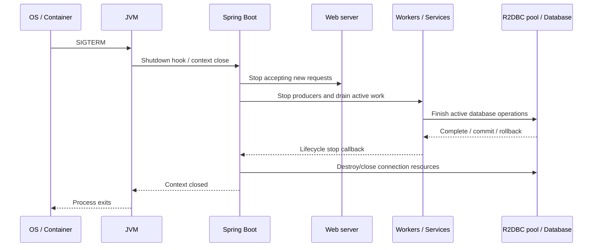

# Graceful Application Shutdown and Awaiting In-Flight Operations

In a Spring Data Relational R2DBC application, a request may be awaiting a query, processing multiple publishers, or executing inside a transaction when the process receives a stop signal. If the application terminates immediately, requests can be cut off mid-flight, transactions left incomplete, messages unacknowledged, or connections not properly released.

Graceful shutdown is the process of stopping new work intake, allowing in-flight work to finish within a bounded window, and then closing resources such as schedulers, message consumers, connection pools, and the web server. In reactive applications, special care is required around subscriptions, cancellation, Reactor Context, and connection lifecycles. Returning a `Mono`/`Flux` allows work to be managed via publishers, but it does not automatically guarantee every operation completes if the process is forcefully killed or a timeout expires.

## 1. Why is graceful shutdown necessary?

A running application can be stopped due to:

- Deploying a new version and replacing old instances.
- Scaling down containers or pods.
- An administrator intentionally restarting the service.
- The JVM receiving a `SIGTERM` signal.
- Server or node maintenance.
- Application shutdown triggered by error or resource exhaustion.

Stopping immediately can cause several issues:

- Clients sent requests but never received responses.
- Transactions executed some SQL statements without committing.
- Messages were pulled from a broker without being processed/acknowledged.
- Background jobs writing data were aborted mid-way.
- R2DBC queries were still consuming results when the connection pool closed.
- An external service executed a side effect before the application persisted the outcome.

Graceful shutdown reduces the likelihood of half-finished states by giving the application a window to complete in-flight work. It does not provide exactly-once guarantees or cross-system atomicity; critical operations still require transactions, idempotency, and recovery mechanisms.

## 2. Goals of a controlled shutdown sequence

A shutdown sequence should follow a deliberate order:

1. Signal to the orchestration platform that the instance is about to stop accepting traffic.
2. Stop accepting new requests or work.
3. Stop background work producers such as schedulers, pollers, and message listeners.
4. Wait for in-flight requests, transactions, and tasks to complete within the allowed deadline.
5. Cancel any remaining publishers once the deadline expires and record the outcome.
6. Close connection pools, clients, schedulers, and other resources after work has drained.
7. Allow the JVM to exit.

The exact ordering between the web server and workers depends on the application. For example, a system might stop consumers first so no new messages arrive while the web server initiates graceful shutdown. The critical rule is never closing the database pool before operations needing the database have been drained or gracefully cancelled.

## 3. Distinguishing immediate shutdown and graceful shutdown

| Stop mode | Behavior | Risk |
|---|---|---|
| Immediate shutdown | Stops the process quickly without waiting for running work | Requests/messages/jobs may be interrupted |
| Graceful shutdown | Stops taking new work, waits for current work within a deadline | Remaining work may still be cancelled on timeout |
| Forced termination | OS/container kills the process after a deadline | No guarantee of Java cleanup or timely rollback |

Graceful shutdown is always time-bounded. Never wait indefinitely, because a hung request or never-completing publisher could keep the process alive forever. Once the timeout expires, the application must accept cancelling remaining work and rely on retries/idempotency to recover.

## 4. Spring Boot graceful shutdown for the web server

Spring Boot supports graceful shutdown for embedded web servers. Enable it via configuration:

```yaml
server:
  shutdown: graceful

spring:
  lifecycle:
    timeout-per-shutdown-phase: 30s
```

`server.shutdown: graceful` instructs the web server to stop accepting new requests and give active requests an opportunity to finish. `spring.lifecycle.timeout-per-shutdown-phase` sets the maximum duration for a Spring-managed shutdown phase.

The `30s` value is an example. Choose a limit based on real latency, request types, database timeouts, and deployment platform constraints. A short synchronous API may need less time than a large export endpoint; long-running streaming endpoints need a separate policy and should not hold shutdown indefinitely.

Server shutdown support and behavior depend on the Spring Boot version and embedded server. Verify behavior for your version, especially when using custom server configurations, multiple server ports, or a separate management server.

## 5. Graceful shutdown does not guarantee every request completes

The web server may wait for running requests, yet a request can still be terminated when:

- The shutdown phase times out.
- The container is forcefully killed before Spring completes.
- The client closes the connection.
- A query or external service times out.
- A publisher emits an error.
- The server/driver cannot complete cleanup within the deadline.

Therefore, APIs must handle interrupted responses. For critical write operations, the client may not know whether the transaction committed if the connection drops right as the response is sent. Use an idempotency key or unique business key so clients can safely retry and look up the outcome.

## 6. Lifecycle when Spring receives a stop signal

In JVM/container environments, the typical flow is:



This is a conceptual diagram. Actual ordering is governed by Spring lifecycle phases, bean dependencies, the web server, and the container. Do not assume every bean stops in the exact order shown unless you have configured and tested the lifecycle.

Spring manages the lifecycle of the embedded web server and beans. When closing the application context, lifecycle components are stopped by phase, followed by bean destruction per container rules. Database resources must remain alive until work depending on them has finished.

## 7. Shutdown phases and `SmartLifecycle`

`SmartLifecycle` lets beans participate in Spring context start/stop. It provides `stop(Runnable callback)` so a component can stop asynchronously and invoke the callback once finished.

Spring lifecycle phases follow ordering rules: lower phases typically start first, and higher phases stop first. This lets you order producers, consumers, and dependent resources. However, inspect the phases used by framework components in your specific Spring Boot version before picking phase numbers.

Example worker coordinator:

```java
public interface DrainableWorker {
    void stopAcceptingNewWork();
    Mono<Void> drainInFlightWork();
}
```

A lifecycle component can stop accepting new work and await all workers:

```java
@Component
public class WorkerDrainLifecycle implements SmartLifecycle {

    private final List<DrainableWorker> workers;
    private final Duration drainTimeout = Duration.ofSeconds(20);
    private final AtomicBoolean running = new AtomicBoolean(false);

    public WorkerDrainLifecycle(List<DrainableWorker> workers) {
        this.workers = workers;
    }

    @Override
    public void start() {
        running.set(true);
    }

    @Override
    public void stop(Runnable callback) {
        if (!running.compareAndSet(true, false)) {
            callback.run();
            return;
        }

        workers.forEach(DrainableWorker::stopAcceptingNewWork);

        Mono.whenDelayError(workers.stream()
                        .map(DrainableWorker::drainInFlightWork)
                        .toList())
                .timeout(drainTimeout)
                .doOnError(error -> log.error(
                        "Worker drain did not complete cleanly", error))
                .doFinally(signal -> callback.run())
                .subscribe(null, error -> {
                    // The failure has been logged; do not leave it unhandled.
                });
    }

    @Override
    public void stop() {
        stop(() -> { });
    }

    @Override
    public boolean isRunning() {
        return running.get();
    }

    @Override
    public boolean isAutoStartup() {
        return true;
    }

    @Override
    public int getPhase() {
        return 100;
    }
}
```

This is an illustrative skeleton; add a logger, inject the timeout from configuration, and pick a phase appropriate for your application. Because `SmartLifecycle.stop(Runnable)` is an imperative callback, the coordinator subscribes once to the drain publisher so work executes and invokes the callback on completion, error, or timeout. This is a managed lifecycle boundary; do not apply ad-hoc `subscribe()` calls like this inside business services.

`Mono.whenDelayError` waits for all publishers to finish and aggregates errors instead of stopping immediately when one worker fails. `.timeout(...)` bounds the wait. When a timeout occurs, upstream may receive cancellation; workers must handle that signal and clean up their resources.

## 8. Choosing the right phases for workers and database resources

Suppose an application has:

- An HTTP server handling requests.
- Message consumers creating database writes.
- Schedulers running periodic jobs.
- An R2DBC connection pool serving repositories.

A sensible sequence is usually:

1. Stop producers generating new work (schedulers, pollers, message listeners) per application policy.
2. Have the web server stop accepting new requests and drain active requests.
3. Wait for current consumers/jobs/requests to finish or reach the deadline.
4. Close resources used by those publishers, including the R2DBC pool.

Web server graceful shutdown has a lifecycle phase managed by Spring Boot. Do not guess worker phases. Inspect the phase and behavior of your Spring Boot version, and test that workers stop at the right point. If multiple components depend on one another, group them into a single coordinator to make ordering explicit.

The connection pool must remain alive long enough for in-flight operations to commit/rollback and release connections. If the pool is disposed before requests finish draining, operations can fail because connections cannot be acquired or active connections are closed.

## 9. Stop accepting new work before waiting for active work

Simply waiting for current publishers to finish is not enough if a scheduler or consumer keeps spawning new publishers. A component needs two capabilities:

- **Stop admission:** reject or stop creating new work.
- **Drain:** wait for already accepted work to finish.

Example interface:

```java
public interface DrainableWorker {
    void stopAcceptingNewWork();
    Mono<Void> drainInFlightWork();
}
```

`stopAcceptingNewWork()` should be idempotent because lifecycle may invoke stop multiple times or overlapping stop signals may arrive. `drainInFlightWork()` should complete when the active task count reaches 0 and no new tasks are accepted.

Do not create a `Mono` awaiting active tasks while omitting admission closure. If new work keeps arriving, the drain condition may never be reached.

## 10. Tracking in-flight work for custom-managed workers

For a custom worker, you can track work that has been accepted but not yet finished. Conceptual example:

```java
public final class ActiveWorkTracker {

    private final AtomicInteger active = new AtomicInteger();
    private final AtomicBoolean accepting = new AtomicBoolean(true);
    private final Sinks.One<Void> drained = Sinks.one();

    public <T> Mono<T> track(Mono<T> work) {
        return Mono.defer(() -> {
            if (!accepting.get()) {
                return Mono.error(new RejectedExecutionException(
                        "Application is shutting down"));
            }

            active.incrementAndGet();

            return work.doFinally(signal -> {
                if (active.decrementAndGet() == 0 && !accepting.get()) {
                    drained.tryEmitEmpty();
                }
            });
        });
    }

    public void stopAccepting() {
        accepting.set(false);
        if (active.get() == 0) {
            drained.tryEmitEmpty();
        }
    }

    public Mono<Void> drain() {
        return drained.asMono();
    }
}
```

This snippet illustrates the principle rather than a race-free general implementation. In production code, checking `accepting` and incrementing `active` must be atomic to avoid a race where shutdown flips to not accepting right after the worker checks the flag but before it registers the task. You can use a short lock, an atomic state machine, or a library-provided admission gate.

A tracker must ensure:

- Each task increments the active count once per subscription.
- `doFinally` decrements the count on complete, error, and cancel.
- Closing admission and registering work cannot race and let a task slip in after draining starts.
- Drain completes only when admission is closed and active count is 0.
- Timeouts are managed at the coordinator rather than waiting forever.

If the worker uses a message listener or scheduler framework, prefer built-in pause/stop/drain APIs over building a custom tracker.

## 11. Using `Mono.defer` to count by subscription

Reactive publishers are lazy and can be subscribed to multiple times. Incrementing the active count when calling a method instead of on subscription can count a publisher that never runs or miscount when a publisher is reused.

`Mono.defer` registers work as soon as subscription starts:

```java
public Mono<Result> execute(Command command) {
    return Mono.defer(() -> {
        Admission admission = tracker.tryEnter();
        if (admission == null) {
            return Mono.error(new RejectedExecutionException("Stopping"));
        }

        return performReactiveWork(command)
                .doFinally(signal -> admission.close());
    });
}
```

`Admission` is a handle guaranteeing exactly-once decrement across complete, error, or cancel. Creating the handle inside `defer` ties the lifecycle to each subscription. With retries, each resubscription is tracked as a new execution attempt while preserving the business idempotency key where appropriate.

## 12. WebFlux graceful shutdown and in-flight requests

In a WebFlux application, controllers return `Mono`/`Flux` and the web server manages subscriptions over the HTTP exchange lifecycle. When graceful shutdown starts, the server stops accepting new requests and waits for current exchanges within the configured deadline.

Example controller:

```java
@RestController
@RequestMapping("/orders")
public class OrderController {

    private final OrderService orderService;

    @PostMapping
    public Mono<OrderResponse> create(@RequestBody CreateOrderRequest request) {
        return orderService.create(request);
    }
}
```

When services return publishers properly, WebFlux tracks the publisher as part of the HTTP exchange. Never call `subscribe()` inside a controller/service and return a response early before the work finishes; the server will no longer know secondary work needs waiting on.

A request cancelled by the client or terminated by the server after timeout can deliver cancellation to the publisher. Reactive transactions can roll back on publisher cancellation per transaction manager semantics, though the driver/database may take time to cancel the statement and clean up. Test actual behavior.

## 13. Do not arbitrarily use `@PreDestroy` to await publishers

`@PreDestroy` is a synchronous callback. It works for short synchronous cleanup, but does not automatically know how to subscribe to and await a `Mono`:

```java
@PreDestroy
void shutdown() {
    worker.stopAndDrain(); // Returns a Mono without subscribing: never runs.
}
```

Calling `.block()` inside `@PreDestroy` can await a publisher, but use caution: the callback runs on a lifecycle thread, timeouts must be explicit, and you must never block an event loop. It is also hard to coordinate across multiple beans' lifecycle ordering.

For reactive tasks that must be awaited, `SmartLifecycle.stop(Runnable)` is usually a better fit because the callback lets components signal completion asynchronously. If using `@PreDestroy` for synchronous resources, do not make it the sole coordinator for draining requests or workers.

## 14. Stopping schedulers and periodic jobs

A scheduler that keeps firing jobs during shutdown continually creates new work, preventing drain from ever finishing. Stop triggers first and then wait for runs that have already started.

With `@Scheduled`, Spring manages the scheduler through the application context lifecycle. If jobs require custom drain sequencing, use a lifecycle-managed scheduler bean or worker coordinator to:

1. Prevent new trigger firings.
2. Track subscriptions of currently active runs.
3. Wait for active runs to complete/error/cancel.
4. Close the scheduler and resources used by jobs afterward.

Reactive `@Scheduled` methods have version-specific semantics in Spring Framework: publishers are created and subscribed to per trigger; read your version's documentation to understand cancellation and shutdown. Never assume that merely returning `Mono` makes every running job drain indefinitely.

Example job returning a publisher:

```java
@Scheduled(fixedDelayString = "PT30S")
public Mono<Void> refreshReferenceData() {
    return refreshService.refresh();
}
```

Do not call `subscribe()` manually inside a scheduled method. Return the publisher for the scheduler to manage. If you need to prevent concurrent runs or provide custom draining, configure the scheduler and tracking appropriately.

## 15. Stopping message consumers before closing the database pool

Message consumers typically pull messages, process them with R2DBC, and then acknowledge them. During shutdown:

1. Pause or stop the consumer so the broker stops delivering new messages to this instance.
2. Wait for already-received messages to be processed and their transactions committed.
3. Acknowledge per broker semantics only after durable work completes.
4. If the deadline expires before processing completes, let the broker redeliver per its policy.
5. Close the connection pool after consumers have stopped and handlers have drained.

Never acknowledge a message before the database transaction commits if you want the broker to redeliver when the app crashes mid-way. Conversely, if the database commits but the acknowledgement is lost, the broker may redeliver the message; handlers must be idempotent using an event ID or unique business key.

Pause/stop APIs differ across Kafka, RabbitMQ, and other brokers. Use your integration framework's lifecycle hooks and verify timeout/ack behavior for your version. Do not assume an application `SmartLifecycle` stops every listener in the same order when custom container factories are used.

## 16. Waiting for R2DBC transactions to finish

A reactive transaction completes when the publisher inside the transaction boundary emits a terminal signal and the transaction manager executes commit/rollback. Example:

```java
public Mono<Order> createOrder(Order order) {
    return transactionalOperator.transactional(
            orderRepository.save(order)
                    .flatMap(saved -> auditRepository.save(
                                    AuditEntry.created(saved.getId()))
                            .thenReturn(saved))
    );
}
```

The publisher covers both saving the order and saving the audit entry. When shutdown begins, if the request is allowed to continue, the transaction has a chance to finish. Do not split out the audit save via `subscribe()`, as the request lifecycle would no longer represent the full unit of work.

If the publisher completes normally, the transaction typically commits. If the publisher errors or is cancelled, the transaction manager can roll back per reactive transaction semantics. However, a connection error right during commit can leave the outcome uncertain from the application's perspective: the database may have committed while the response never arrived. For critical operations, use idempotency so clients can retry and look up state.

## 17. Do not close the R2DBC pool too early

The R2DBC connection pool is a shared resource. If the pool closes while requests or workers still need connections, new operations fail and active connections can be disrupted depending on the implementation.

A sensible sequence:

- Stop request/worker admission.
- Wait for active publishers and transactions to complete or hit the deadline.
- Ensure connections are released per Spring/driver lifecycle.
- Only then dispose of the pool or close custom resources.

For pools auto-configured and managed as beans by Spring Boot, let the Spring container handle destruction per configured lifecycle. Never arbitrarily call dispose from a service while the application is still accepting traffic.

If the application creates a `ConnectionPool` manually via R2DBC Pool, integrate disposal into an appropriate bean lifecycle. R2DBC Pool exposes disposal APIs depending on version; some versions provide `disposeLater()` to await asynchronous cleanup. Check your dependency's API and call it once after work has drained. Do not assume every `ConnectionFactory` exposes a dispose API, as the base SPI does not require all factories to close like a pool.

## 18. Closing resources in dependency order

Resources can depend on one another:

| Component | When to stop |
|---|---|
| Scheduler/producer | Early, so no new work is generated |
| Message listener/poller | Stop receiving new messages before draining handlers |
| HTTP server | Stop accepting new requests, drain active exchanges |
| Business worker | Wait for accepted tasks to finish |
| R2DBC repository/template | No separate close needed if Spring-managed; must stay active during drain |
| Custom R2DBC pool/ConnectionFactory | After all dependent database operations complete |
| HTTP client/broker client | After workers/requests no longer use them |
| Custom scheduler/event loop | After all dependent publishers have finished |

Do not rely solely on bean declaration order. Use dependencies/lifecycle phases and integration tests to prove resources are not closed while publishers are still active.

## 19. Shutdown timeouts and operation timeouts

Shutdown timeout, request timeout, query timeout, transaction timeout, and pool acquire timeout are distinct limits:

| Timeout | What it bounds |
|---|---|
| Request timeout | Time the server allows for a single HTTP request |
| Query/statement timeout | SQL execution time per driver/database |
| Transaction timeout | Transaction duration per manager/driver capabilities |
| Pool acquire timeout | Time spent waiting to acquire a connection |
| Shutdown phase timeout | Time Spring waits for a lifecycle phase to stop |
| Container termination grace period | Total time the platform gives the process before forced kill |

Do not mechanically set every timeout to the same value. For instance, the shutdown timeout must be long enough for allowed requests to finish yet shorter than the container's termination window, accounting for `preStop` and JVM cleanup time.

If the request timeout exceeds the shutdown deadline, a valid request can still be cancelled when the instance runs out of shutdown time. For long-running work, use durable asynchronous jobs instead of holding an HTTP request open for minutes.

## 20. Configuration in Kubernetes

Kubernetes sends a stop signal to containers when a pod is deleted or replaced, then waits `terminationGracePeriodSeconds` before sending a hard kill signal. Configure a sufficiently large grace period:

```yaml
spec:
  terminationGracePeriodSeconds: 45
  containers:
    - name: application
      image: example/order-service:latest
```

45 seconds is an example. Total time must account for:

- `preStop` hook duration, if present.
- Time for endpoints to be removed from traffic/load balancers.
- Spring Boot graceful web server shutdown.
- Stopping consumers and schedulers.
- Draining requests/transactions/jobs.
- Closing resources and the JVM.

If Spring Boot needs 30 seconds to drain while Kubernetes only gives 20 seconds, the container may be killed before Spring finishes. Conversely, setting the grace period excessively long can unnecessarily slow down deployments and scale-downs.

## 21. Readiness and stopping new traffic

When an instance is about to shut down, new requests must stop being routed to it. In Kubernetes, readiness probes and endpoint routing remove the pod from service endpoints. However, endpoint updates and proxy propagation can lag; never assume all load balancers stop sending traffic at the exact instant `SIGTERM` arrives.

Spring Boot Actuator provides application availability state. An application can switch readiness to `REFUSING_TRAFFIC` when stopping if explicit control is needed:

```java
AvailabilityChangeEvent.publish(
        applicationContext,
        ReadinessState.REFUSING_TRAFFIC);
```

This example requires importing the availability API and having an `ApplicationContext`. Spring Boot also manages readiness state during shutdown lifecycle depending on version; check current behavior before adding manual logic to avoid duplicate or late events.

Readiness only affects health checks and traffic routing. It does not stop schedulers, message listeners, or running publishers. Background work sources must be stopped separately.

## 22. `preStop` hooks and drain time

A Kubernetes `preStop` hook can call an internal endpoint or run a command before the container receives the lifecycle stop signal. This hook is commonly used to tell the application to stop taking traffic or wait for load balancers to update endpoints.

When using `preStop`, hook execution time counts against `terminationGracePeriodSeconds`. Do not configure a hook that sleeps 30 seconds and expect Spring to still have a full 45 seconds to drain if the total grace period is only 45 seconds.

Never rely on `preStop` as the sole mechanism to drain transactions. The application still needs internal graceful shutdown and clear deadlines. Any shutdown control endpoint, if exposed, must be secured and restricted to platform/operational identities.

## 23. Shutdown in applications without a web server

An R2DBC application may only run consumers or schedulers with no HTTP server. In that case, `server.shutdown` has no effect on background work.

The application needs a lifecycle component to:

1. Stop polling/consuming new work.
2. Wait for active handlers to finish.
3. Commit transactions and acknowledge messages in the right order.
4. Cancel remaining handlers when the deadline expires so the broker can redeliver if possible.
5. Close the pool after consumers have stopped.

`SmartLifecycle` is well suited for integrating this component into the Spring context. Broker libraries often have their own container lifecycles; use container APIs to pause/stop and wait for active listeners to finish.

## 24. Handling incomplete work on timeout

When the deadline expires, not every task can finish. Define behavior per work type:

| Work type | Behavior on deadline expiration |
|---|---|
| HTTP read request | Cancel publisher, close response; client can retry |
| HTTP write request | Commit outcome may be uncertain; use idempotency/business key |
| Uncommitted R2DBC transaction | Transaction manager/driver attempts rollback on cancellation/close; verify actual behavior |
| Unacknowledged message | Let broker redeliver per its semantics; handler must be idempotent |
| Checkpointed background job | Persist checkpoint durably and resume on another instance |
| Payment/provider call | Query status via provider reference/idempotency key before retrying |
| Export stream | Terminate connection; client resumes from cursor/checkpoint if API supports it |

Never record a job as completed simply because its subscription was cancelled. Persist durable states distinguishing `COMPLETED`, `FAILED`, `CANCELLED`, and `UNKNOWN` where reconciliation requires it.

## 25. Idempotency when clients retry after shutdown

A critical scenario: the database committed, but the application stopped before the response reached the client. The client sees a network error and retries the request. If the server executes a new operation, duplicate data can be created.

For write operations with side effects, use a stable idempotency key:

```http
POST /orders
Idempotency-Key: 0f2a8a5e-6f2e-4b1b-8e3f-3d44f2d6d0d1
```

The server stores the key along with the request hash and business outcome in the same transaction as the order. Retries with the same key and payload receive the stored result. If the same key is sent with a different payload, return a conflict error.

Graceful shutdown reduces interrupted requests, but it cannot eliminate uncertain outcomes at the commit/response boundary. Idempotency enables safe recovery after restarts, timeouts, or network failures.

## 26. Do not call `System.exit()` in normal lifecycle flows

`System.exit()` terminates the JVM and can bypass the intended Spring context shutdown sequence if invoked from business code. Never use it as a way to stop a worker or end a request.

To shut down cleanly, let Spring Boot receive the shutdown signal from the JVM/container and close `ApplicationContext`, or use intentional context closing in administrative applications. Let Spring's JVM shutdown hook handle lifecycle orchestration.

`Runtime.halt()` is even more drastic and bypasses shutdown hooks entirely; it should only be used in extraordinary operational emergencies, never in normal application paths.

## 27. Logging and metrics during shutdown

Shutdown should emit logs/metrics sufficient to track drain progress:

- Shutdown start timestamp and signal source.
- Readiness transition to refusing traffic.
- Number of in-flight requests when drain starts (if tracked).
- Number of in-flight jobs/messages.
- Number of workers that stopped accepting new work.
- Drain duration per component.
- Number of publishers completed, errored, or cancelled.
- Number of transactions committed/rolled back during shutdown, if measurable.
- Pool acquired/pending counts before closing.
- Which components timed out and had to be force-stopped.
- Timestamp when `ApplicationContext` finished closing.

Logs should include a correlation ID or worker name for investigation. Never log sensitive payloads, access tokens, passwords, or full SQL bind values.

Metrics should use low-cardinality tags such as `component`, `outcome`, and `phase`. Never attach request IDs, user IDs, or message IDs as metric tags.

## 28. Testing graceful shutdown

Service unit tests are not enough to prove the entire application shuts down properly. You need lifecycle tests and at least one scenario against a real database/driver.

Scenarios to cover:

1. Send a short request and trigger shutdown: response completes normally.
2. Send a request with an active R2DBC query: server waits for the request within the configured deadline.
3. Start a multi-statement transaction and trigger shutdown: transaction commits if the publisher completes within deadline.
4. Make the publisher emit an error: transaction rolls back and error is recorded.
5. Client disconnects: subscription is cancelled and connection is cleaned up per driver behavior.
6. Periodic job running: no new triggers fire after admission closes; current job drains.
7. Message consumer processing: consumer stops receiving new messages, handler finishes or message is redelivered.
8. A worker that never finishes: timeout triggers and shutdown still progresses.
9. Pool closes only after dependent publishers have finished.
10. Retrying a request after shutdown with the same idempotency key creates no duplicates.

End-to-end tests can start the app on a random port, send requests with controlled durations, trigger context close or send `SIGTERM` to a child process, and assert responses/logs/database state. For process-level tests, set test timeouts so the suite cannot hang.

## 29. Example test for an in-flight request

You can create a test endpoint returning a controlled slow publisher:

```java
@GetMapping("/slow")
public Mono<String> slow() {
    return Mono.delay(Duration.ofSeconds(2))
            .thenReturn("finished");
}
```

Test scenario:

1. Send a request to `/slow`.
2. Wait for the server to begin handling the request.
3. Trigger graceful shutdown.
4. Verify the request completes if remaining time is sufficient.
5. Verify the server rejects new requests.

This example tests web lifecycle, not database transactions. To test R2DBC, the endpoint/service must run real queries/transactions and the test must verify commit/rollback and connection cleanup.

## 30. Testing worker drain

For a custom-managed worker, you can use `Sinks.One` in tests to control when work finishes:

```java
Sinks.One<Void> workGate = Sinks.one();

Mono<Void> activeWork = workGate.asMono();

worker.startWork(activeWork);
worker.stopAcceptingNewWork();

StepVerifier.create(worker.drainInFlightWork())
        .then(() -> workGate.tryEmitEmpty())
        .verifyComplete();
```

This illustrates the concept: drain does not complete until running work finishes. A real implementation needs a reliable admission gate and tracker; tests should also check races between `startWork` and `stopAcceptingNewWork`.

## 31. Testing R2DBC transactions during shutdown

An integration test can use `TransactionalOperator` and a controlled publisher to verify a transaction stays alive while draining:

```java
Mono<Void> writeAndWait = transactionalOperator.transactional(
        repository.save(entity)
                .then(workGate.asMono()));
```

When `workGate` completes before the shutdown deadline, the transaction can commit. If the gate does not complete and shutdown timeout triggers cancellation, the transaction manager/driver can roll back. Always inspect the database after the transaction boundary ends; do not only assert that the publisher was cancelled.

Never use a test gate to hold transactions open in production. This is strictly a timing control mechanism for lifecycle integration tests.

## 32. Common pitfalls

| Pitfall | Consequence | Fix |
|---|---|---|
| Not enabling web server graceful shutdown | In-flight requests may be dropped immediately on stop | Configure `server.shutdown=graceful` and an appropriate timeout |
| Shutdown timeout longer than container grace period | Container gets killed before Spring finishes draining | Sum total times and set consistent deadlines |
| Waiting for workers while still accepting new work | Drain may never finish | Close admission first, then await active work |
| Closing the R2DBC pool too early | In-flight queries/transactions fail | Drain requests/workers before disposing the pool |
| Calling `subscribe()` ad hoc in services | Lifecycle is unaware background work is still running | Return and chain publishers within the same reactive pipeline |
| Returning `Mono` in `@PreDestroy` without subscribing | Reactive cleanup never executes | Use `SmartLifecycle.stop(Runnable)` or async lifecycle hooks |
| Calling `block()` carelessly during shutdown | Can block the event loop or exceed deadlines | Orchestrate asynchronously, bound timeouts, and block only at controlled imperative boundaries if truly necessary |
| Not stopping schedulers/consumers | New work keeps arriving during shutdown | Pause producers/listeners before draining |
| Acknowledging messages before commit | Messages can be lost before durable DB write | Ack after commit; handle duplicates via idempotency |
| Assuming cancellation always rolls back instantaneously | Driver/database cleanup may lag or commit outcome be unclear | Test real drivers and use idempotency/reconciliation |
| Holding transactions across HTTP calls or long SSE streams | Connection pool stays occupied too long | Short transactions, outbox/saga, or background jobs |
| Calling `System.exit()` in business services | Bypasses intended lifecycle orchestration | Let Spring context/JVM shutdown hooks manage exit |
| Running only unit tests without real shutdown triggers | Fails to catch wrong lifecycle ordering or timeouts | Run integration/process-level tests with SIGTERM |

## 33. Process for designing graceful shutdown in R2DBC apps

When implementing controlled shutdown, follow this sequence:

1. Inventory work sources: HTTP, schedulers, message listeners, pollers, and internal workers.
2. Identify resources used by each source: R2DBC pools, HTTP clients, broker clients, schedulers.
3. Enable web server graceful shutdown and configure shutdown phase timeouts.
4. Design readiness/admission so instances stop receiving new work.
5. Stop producers, schedulers, and consumers via appropriate lifecycle APIs.
6. Track and drain in-flight requests/jobs/messages.
7. Keep connection pools alive until dependent transactions/publishers finish or the deadline expires.
8. On timeout, cancel remaining work, record state, and let brokers/clients retry per policy.
9. Close resources in dependency order; use async lifecycle hooks for reactive cleanup.
10. Align shutdown timeout with container grace period, `preStop`, request timeouts, and query timeouts.
11. Test commit, rollback, cancellation, redelivery, idempotency, and pool cleanup.
12. Monitor logs/metrics to verify whether shutdown completed cleanly or was force-stopped.

## 34. Practical principles

- Stop accepting new work before waiting for current work to complete.
- Enable `server.shutdown=graceful` for Spring Boot applications with a web server.
- Configure `spring.lifecycle.timeout-per-shutdown-phase` and align it with the container termination grace period.
- Use `SmartLifecycle.stop(Runnable)` for components needing asynchronous draining.
- Check framework lifecycle phases before choosing phases for workers.
- Count work by subscription and decrement active counts on complete, error, or cancel.
- Stop schedulers, pollers, and message listeners before closing resources they depend on.
- Wait for R2DBC transactions to finish before disposing the connection pool.
- Never call ad-hoc `subscribe()` in business services; return publishers for callers/frameworks to manage.
- Do not use `@PreDestroy` to bypass reactive lifecycles; avoid `block()` on event loops.
- Acknowledge messages after transaction commit and make handlers idempotent for redelivery.
- Accept that timeouts may force-cancel publishers; use idempotency/checkpoints to recover.
- Never hold transactions while waiting on users, HTTP calls, or unbounded streams.
- Do not rely on `System.exit()` to orchestrate normal shutdown.
- Test real shutdowns, timeouts, cancellation, rollbacks, and connection cleanup on production-compatible drivers/databases.

## 35. Conclusion

Graceful shutdown in Spring Data Relational R2DBC is an ordered lifecycle process: stop accepting new work, drain running requests and workers, give reactive transactions a chance to commit or roll back, and only then close connection pools and dependent resources. Spring Boot supports graceful shutdown for embedded web servers via `server.shutdown=graceful`, while `SmartLifecycle.stop(Runnable)` allows reactive workers to signal completion asynchronously.

Graceful shutdown always has a deadline. When the deadline expires, publishers may be cancelled and write outcomes at the commit/response boundary can become uncertain. Applications therefore still need sensible timeouts, idempotency, safe message redelivery, and checkpoints/compensation for long-running work. Testing with real stop signals, the target R2DBC driver, and the target database confirms that requests drain properly, transactions resolve cleanly, and pools close only after active operations no longer depend on them.
