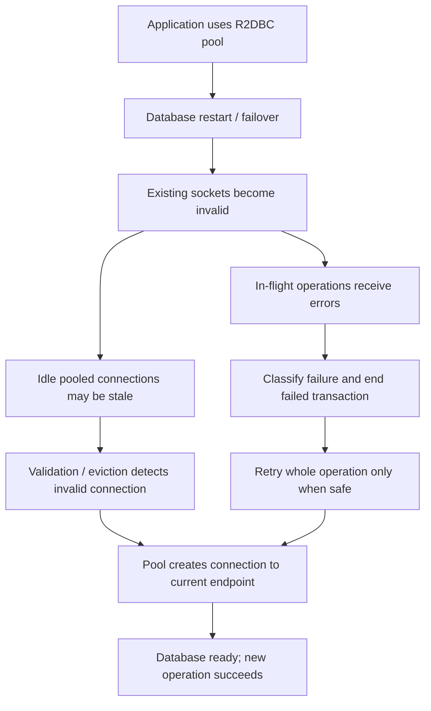
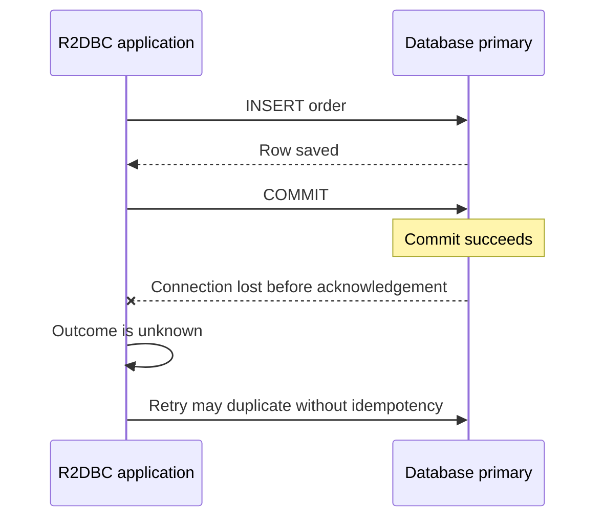
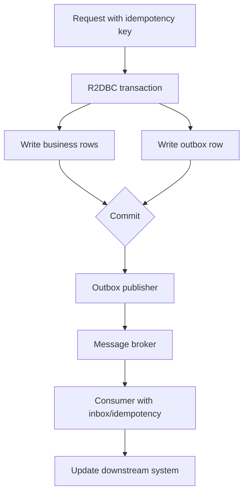

# Handling Database Restarts or Role Failovers

A Spring Data R2DBC application may be handling requests normally when the database restarts, the primary node fails, the cluster promotes a replica to primary, or the connection endpoint shifts to a new host. During those moments, open TCP connections can close, the connection pool may retain unusable connections, in-flight requests may fail mid-execution, and transactions can end up in an uncertain state from the client's perspective.

R2DBC does not make database connections transparently self-healing. Drivers and pools manage connections, yet an in-flight operation can still fail when a server stops or switches roles. The application must distinguish transient errors from business errors, discard broken connections, open new connections against the current endpoint, perform bounded retries at the right transaction boundary, and protect writes with idempotency when it is unclear whether a commit occurred.

## 1. What events can occur?

"Database restart" and "failover" are often used interchangeably in conversation, but they have distinct failure modes:

| Event | What happens? | Typical impact on R2DBC |
|---|---|---|
| Planned database restart | Server stops and restarts on the same node | Existing connections close; in-flight requests may fail; new connections succeed only once the server is ready |
| Unexpected crash/restart | Process or host stops abruptly | Socket resets/timeouts, interrupted transactions, commit outcomes may be uncertain |
| Primary failover | A replica/standby is promoted to primary | Connections to the old primary drop; the writer endpoint may change IP/host; running transactions fail |
| Planned switchover | Primary role transitions controllably | Brief interruption window; old connections must be replaced |
| Network partition | Application cannot reach the database even though the server is up | Connection timeouts, pool acquire/create failures, unknown transaction state |
| DNS/endpoint change | Logical endpoint points to a new node | Already-open connections remain tied to the old node; new connections must resolve the new endpoint |
| Database switches to read-only | Node is up but refuses writes | Reads may continue; writes fail with permission/role or read-only errors |
| Replica lag or unready replica | New node has not caught up with data | Replica reads may return stale data; never use a replica as a writer before promotion completes |

Applications should treat these as distinct scenarios in operational design. Retrying a transient network error may make sense; retrying a permission error or malformed SQL rarely helps. Reading from a replica after failover also has different semantics than writing to a primary.

## 2. Connection lifecycle during a database restart

An R2DBC connection represents a physical session to the database. The connection pool holds and reuses those sessions to avoid creating a new connection per query.

When the database restarts:

1. The database stops accepting or closes existing sessions.
2. Pool sockets may receive FIN/RST, I/O errors, or detect disconnection only when the next operation is sent.
3. Connections actively used by requests emit errors.
4. Idle pooled connections can become stale.
5. Once the server is back up, the pool/driver must establish new physical connections.
6. New requests succeed once the endpoint and database are ready.

Never assume all stale connections are detected at the exact instant the server restarts. An idle connection may have no traffic to reveal a dead socket. Validation on acquire, eviction, and connection max-lifetime limits reduce the chance of handing out a stale connection, though they cannot eliminate race conditions: the server can still go down right after validation finishes.



## 3. A connection pool cannot rescue a transaction that lost its connection

`r2dbc-pool` manages leasing, reusing, validating, and releasing connections. It cannot resume a transaction on a socket closed by the database. When a connection breaks inside a transaction, the application must usually treat that transaction as failed and re-run the entire unit of work in a new transaction if business rules allow.

Distinguish three moments:

- **Before acquiring a connection:** the pool can wait, validate, or create a new connection.
- **After acquiring a connection but before sending SQL:** connection errors can usually be handled by discarding the connection and starting a fresh attempt.
- **After SQL has executed or during commit:** the client may not know whether the database applied the changes; retries require idempotency or a status-verification step.

Never reuse a `Connection` or `Statement` that suffered a connection error. Never attempt to run the next statement in a broken transaction. Let the transaction end/roll back per driver behavior, then open a new transaction for the next attempt.

## 4. Configuring the pool to detect stale connections

R2DBC Pool offers options to bound connection age and validate connections. Common properties include:

| Property | Purpose |
|---|---|
| `max-size` | Maximum number of connections |
| `max-acquire-time` | Maximum wait time to acquire a connection |
| `max-create-connection-time` | Maximum time to create a new connection |
| `max-validation-time` | Maximum time to validate a connection |
| `validation-query` | Query used to check a connection when query-based validation is configured |
| `max-idle-time` | Duration a connection may sit idle before eviction per policy |
| `max-life-time` | Maximum lifetime of a connection |
| `background-eviction-interval` | Interval for background eviction if configured |

Illustrative configuration with Spring Boot and `r2dbc-pool`:

```yaml
spring:
  r2dbc:
    url: r2dbc:postgresql://db-writer.internal:5432/app_db
    username: ${DB_USERNAME}
    password: ${DB_PASSWORD}
    pool:
      enabled: true
      initial-size: 5
      max-size: 20
      max-acquire-time: 1s
      max-create-connection-time: 3s
      max-validation-time: 1s
      max-idle-time: 5m
      max-life-time: 30m
      validation-query: SELECT 1
```

Property names and binding support depend on Spring Boot and `r2dbc-pool` versions. Check your project version's metadata/configuration reference before applying. `SELECT 1` is a common example across many databases, but the validation query must fit your engine and runtime user privileges.

### Why is max-life-time needed?

A finite connection lifetime helps the pool gradually replace long-lived sessions. This helps when infrastructure has load balancers, NATs, firewalls, or database services with idle/lifetime connection limits.

However, `max-life-time` is not an instant failover mechanism. If a connection is in use when it expires, the pool may only evict it upon return depending on policy. It also does not guarantee the server is ready when a new connection is created.

### Why is validation needed?

Validation can catch dead connections before leasing them to requests. If the driver/pool only checks local state, an apparently open socket whose peer disappeared may still pass. Remote validation or a validation query checks more thoroughly, but costs a round trip and still has a race window right after validation.

Do not enable overly heavy validation queries or run them excessively. Balance connection reliability against validation overhead.

## 5. The pool does not automatically discover a new primary endpoint unless configured to

After failover, the writer endpoint may move to a new node. If the application uses a logical hostname like `db-writer.internal`, DNS or a proxy can point that hostname to the current primary. Yet already-open physical connections stay pinned to the old node address; a DNS update does not migrate an existing TCP session to a new host.

To reconnect to the right node:

1. Old connections must be detected as broken or evicted from the pool.
2. The driver/connection factory opens a new physical connection.
3. DNS/endpoint discovery must return the current writer address.
4. Authentication and TLS handshake must succeed against the new node.
5. The new database must be ready to serve traffic in its role.

If the application hardcodes the old primary's IP, the pool may keep opening connections to a demoted or offline node. Prefer a stable writer endpoint managed by the database cluster/service, or discovery mechanisms supported by the driver/proxy.

## 6. DNS caching and connection failover

DNS can switch addresses once a primary is promoted. However, the JVM, DNS resolvers, container runtimes, sidecars, or connection pools may cache addresses for varying durations.

Factors to check:

- DNS TTL published by the endpoint provider.
- JVM/JDK DNS cache policy.
- DNS resolver inside the container/host.
- Whether the driver resolves hostnames per new connection or caches addresses longer.
- Whether a proxy/load balancer holds connections to the old node or re-routes automatically.
- Whether network policies permit connections to the new node.

Never hardcode an IP observed during testing. Use logical endpoints and verify DNS cache behavior in the actual runtime. Changing DNS does not fix existing connections; new connections must be created after failover.

## 7. Using writer/read endpoints according to role

A cluster may expose separate writer and reader endpoints. The writer endpoint routes to the writable node; the reader endpoint may route to one or more replicas.

| Endpoint type | Purpose | Notes |
|---|---|---|
| Writer/primary endpoint | Inserts, updates, deletes, and write transactions | Must point to the new primary after failover |
| Reader/replica endpoint | Read queries tolerant of stale data | May return data not yet replicated |
| Cluster/proxy endpoint | Routes to the appropriate node | Failover behavior depends on proxy/provider |
| Instance endpoint | Connects directly to a specific node | May not follow role changes after promotion |

Do not use a reader endpoint for operations needing read-after-write consistency if replica lag could hide newly written data. Also do not assume a reader endpoint only returns healthy nodes or shares the primary's snapshot unless the provider guarantees it.

## 8. Failover is not always a transparent reconnect

Some managed databases provide a stable hostname and update DNS/routes automatically after failover. Some clusters require clients to use a proxy or multi-host discovery drivers. Some systems require the application to open new connections after the new node is ready.

The R2DBC SPI does not prescribe a uniform failover mechanism across all databases. Node discovery, endpoint switching, and connection retries depend on:

- Database engine and cluster topology.
- Managed service/provider.
- R2DBC driver and version.
- Proxy/load balancer or service discovery.
- DNS and TLS certificate configuration.

Always consult your driver/provider documentation and test failover in staging. Never infer that an R2DBC driver supports failover merely because the same vendor's JDBC driver does.

## 9. Configuring ConnectionFactory with a stable endpoint

For a managed PostgreSQL primary endpoint, Spring Boot can use an R2DBC URL such as:

```yaml
spring:
  r2dbc:
    url: r2dbc:postgresql://db-writer.internal.example:5432/app_db
    username: ${DB_USERNAME}
    password: ${DB_PASSWORD}
    pool:
      enabled: true
      max-size: 20
      max-acquire-time: 1s
      max-create-connection-time: 3s
```

This URL illustrates a logical DNS endpoint; it does not provide failover by itself unless infrastructure DNS/proxies update to the new primary. Ensure the endpoint actually tracks topology changes.

If you configure `ConnectionFactory` manually, keep the endpoint in externalized configuration so it can change without code edits. When changing endpoints, recreate the pool/factory or roll out instances properly rather than mutating a Java variable and expecting open connections to move hosts.

## 10. Handling connection failures in reactive pipelines

When a query errors due to a database restart, the publisher emits an error that downstream must handle. Never swallow all errors with `onErrorResume` and return a fake empty result:

```java
// Avoid: disguises a database outage as "not found".
return repository.findById(id)
    .onErrorResume(error -> Mono.empty());
```

This prevents callers from distinguishing "does not exist" from "database unreachable." Propagate the error or map it to an explicit business/infrastructure exception:

```java
public Mono<Customer> findCustomer(Long id) {
    return customerRepository.findById(id)
        .onErrorMap(this::isConnectionFailure,
            error -> new DatabaseUnavailableException("Customer store unavailable", error));
}
```

`isConnectionFailure` should inspect the exception chain, SQLSTATE, or vendor code per driver; avoid matching message strings. Also distinguish timeouts, authentication failures, constraint violations, and SQL syntax errors.

## 11. Retries should apply only to transient failures

After a restart or failover, some failures are transient:

- Connection reset or connection closed.
- Connect timeout while the endpoint is not yet ready.
- Certain SQLSTATE codes in the connection exception class.
- Serialization failures or deadlocks under concurrent transactions, if the entire operation can be safely retried.

Failures that should generally not be retried as-is:

- SQL syntax errors.
- Missing table/column errors.
- Authentication/authorization failures.
- Data validation errors.
- Unique constraint conflicts from duplicate requests.
- Business rule violations.
- Read-only database errors when sending writes without a promotion-wait strategy.

Not every connection error should be retried immediately. If the pool is exhausted and the database is booting up, aggressive retries add load, create connection storms, and prolong the outage.

## 12. Retrying with backoff and jitter

Reactor provides `retryWhen` and `Retry` for bounded retries. Example:

```java
Retry databaseRetry = Retry.backoff(3, Duration.ofMillis(200))
    .maxBackoff(Duration.ofSeconds(2))
    .jitter(0.5)
    .filter(this::isTransientDatabaseFailure)
    .onRetryExhaustedThrow((spec, signal) -> signal.failure());

public Mono<Customer> loadCustomer(Long id) {
    return customerRepository.findById(id)
        .retryWhen(databaseRetry);
}
```

In this example, `Retry.backoff(3, ...)` allows up to three retries after the initial attempt. Exponential backoff avoids hammering an unready database; jitter prevents multiple instances from retrying in lockstep.

`isTransientDatabaseFailure` must classify based on your specific driver/database. Never use `filter(error -> true)` for all exceptions. When retries are exhausted, preserve the original cause for logging and error responses.

## 13. Retries must wrap outside the transaction to be re-run

When a connection drops mid-transaction, the old transaction is no longer safe to continue. Retrying usually requires re-executing the whole unit of work inside a fresh transaction.

With `TransactionalOperator`, place the transaction inside `Mono.defer` and attach retry outside:

```java
public Mono<Order> createOrder(CreateOrder command) {
    Mono<Order> oneAttempt = Mono.defer(() ->
        transactionalOperator.transactional(
            orderRepository.save(toOrder(command))
                .flatMap(order -> orderLineRepository.saveAll(
                    toLines(order.id(), command.lines())
                ).then(Mono.just(order)))
        )
    );

    return oneAttempt.retryWhen(databaseRetry);
}
```

Each resubscription to `oneAttempt` triggers `Mono.defer` to create a fresh transactional publisher. Placing retry outside the transaction operator gives every attempt its own transaction boundary.

Never retry a single statement inside a broken transaction and continue on the old connection. Never swallow exceptions so the transaction manager thinks the publisher completed normally.

When using reactive `@Transactional`, understand proxy ordering and subscription timing. Placing a retry operator inside a proxied method can cause retries to execute within the same transaction context depending on composition. When you need a guaranteed new transaction per attempt, `TransactionalOperator` inside `defer` makes boundaries explicit.

## 14. The hardest problem: uncertain commit outcomes

Suppose the application sends `COMMIT` to the database. The database persists the transaction successfully, then immediately crashes before sending the commit acknowledgement back to the client. The client only sees a connection reset.

The application cannot deduce from the connection error whether the transaction rolled back. Two possibilities exist:

1. The database had not committed yet and rolled back the transaction when the connection dropped.
2. The database committed, but the client never received acknowledgement.

If the application blindly retries an order creation command without idempotency, it can create two orders. That is why write retries must be designed around business semantics, not exceptions alone.



## 15. Using idempotency keys for write operations

An idempotency key represents a unique business request. The client sends the key with the request; the server stores the key alongside the outcome or business record in the same transaction.

Example schema:

```sql
CREATE TABLE order_request (
    id BIGINT GENERATED BY DEFAULT AS IDENTITY PRIMARY KEY,
    idempotency_key UUID NOT NULL UNIQUE,
    request_hash VARCHAR(64) NOT NULL,
    order_id BIGINT,
    status VARCHAR(30) NOT NULL,
    created_at TIMESTAMP WITH TIME ZONE NOT NULL DEFAULT CURRENT_TIMESTAMP
);
```

Workflow:

1. Receive the idempotency key.
2. Check if the request key already exists.
3. If already completed, return the stored result.
4. If not present, create the request record and business rows in the same transaction.
5. If two concurrent requests use the same key, the unique constraint picks one winner; the other reads the existing outcome.
6. If a timeout occurs, retries reuse the same key to look up or complete based on state.

`request_hash` detects clients reusing a key with a different payload. Never return a previous result for a request carrying the same key but different content; return a conflict error per API contract.

Idempotency must encompass related side effects. If the transaction also sends emails or calls an external payment provider, use an outbox or idempotency on that dependency; a database unique key cannot prevent off-database side effects on its own.

## 16. Read retries and write retries carry different risks

| Operation | Retry risk | Recommendation |
|---|---|---|
| Pure SELECT | Usually creates no side effects, though it may observe a different snapshot | Safe to retry transient failures within deadline |
| INSERT without idempotency | Can create duplicate records if commit succeeded | Never retry blindly; use an idempotency key/unique business key |
| UPDATE setting a fixed value | May be idempotent given the same conditions and clear semantics | Check optimistic locking, auditing, and side effects before retrying |
| UPDATE incrementing/decrementing values | Can apply twice | Use operation IDs/ledgers or idempotent transactions |
| DELETE | Retries may return different row counts or delete newer data if predicates are broad | Define semantics and verify versions/keys |
| Stored procedure with side effects | Hard to tell partial vs complete execution | Use idempotency/operation logs and clear retry contracts |
| Multi-statement transaction | Part of it may have run before connection loss | Retry the entire fresh transaction, only if the whole use case is safe |

## 17. Classifying errors by driver and SQLSTATE

Database errors should be classified by exception hierarchy, SQLSTATE, and vendor code where available. Avoid relying on message text, which can vary across versions or locales.

PostgreSQL examples:

| SQLSTATE | Common meaning | Handling approach |
|---|---|---|
| `08xxx` | Connection exception class | Potentially transient; check endpoint health and retry with bounds |
| `57P01` | Admin shutdown | Can occur during restarts/failover; wait for endpoint readiness and retry if safe |
| `40001` | Serialization failure | Safe to retry entire fresh transaction |
| `40P01` | Deadlock detected | Safe to retry fresh transaction with backoff |
| `23505` | Unique violation | Usually a business conflict; do not retry as-is |
| `28xxx` | Invalid authorization | Fix credentials/privileges; retries generally do not help |

These codes illustrate PostgreSQL and are not portable. MySQL, SQL Server, and Oracle have their own vendor codes/SQLSTATE mappings. Inspect the exact exception chain returned by your R2DBC driver and build a classifier for the errors your application handles.

Some drivers wrap errors in `R2dbcTransientResourceException`, `R2dbcNonTransientResourceException`, `R2dbcTimeoutException`, or specific subclasses. These are useful signals, though inspecting deeper causes is still needed to distinguish connection resets, authentication failures, and server shutdowns.

## 18. Do not retry pool acquire timeouts indefinitely

When a database goes down, the pool may fail to open connections. Many requests retrying acquires simultaneously can trigger a retry storm:

- Thousands of requests wake up after the same backoff window.
- Simultaneous connection attempts flood the booting database.
- Pending acquire counts and queues swell.
- Threads/schedulers and memory are consumed by waiting retry publishers.
- An unstable database struggles even more to recover.

Cap retry attempts, use exponential backoff with jitter, enforce total deadlines, limit concurrency, and apply circuit breakers where appropriate. Under pool overload, failing cleanly with controlled overload errors is usually better than holding requests indefinitely.

Never retry `maxAcquireTime` errors dozens of times with zero backoff. Investigate the root cause: undersized pool, long-held connections, unready database, or wrong endpoint.

## 19. Circuit breakers and bulkheads

A circuit breaker tracks failures and temporarily stops calling a dependency when error rates exceed a threshold. As the database recovers, the breaker transitions to half-open to test a few requests before reopening traffic.

A bulkhead bounds concurrent operations toward a database or workload group. Both complement timeouts and retries:

| Mechanism | Goal |
|---|---|
| Timeout | Bound how long an operation waits |
| Retry | Conditionally retry transient failures |
| Backoff/jitter | Space out retries and prevent synchronization |
| Circuit breaker | Stop calling a persistently failing dependency |
| Bulkhead | Cap concurrent operations/connections |
| Pool | Reuse and cap physical connections |

Do not set circuit breaker thresholds so low that isolated errors trip the breaker. Also do not let breakers blindly retry everything; retries and breakers serve distinct roles and must be composed in a clear order.

With R2DBC, you can use Resilience4j Reactor operators if already in your stack. Verify operator wrapping order across `timeout`, `retry`, `circuitBreaker`, and `bulkhead`, as composition order determines what counts as one call, total latency, and the final exception.

## 20. Health checks, readiness, and liveness

Never rely on a single health check to govern every application state.

- **Liveness:** is the process still alive and able to keep running? A temporary database outage rarely means the JVM must restart immediately.
- **Readiness:** is the instance ready to receive database-backed requests?
- **Startup:** has the application completed mandatory initialization steps, such as migrations or connecting to required dependencies?

If liveness depends directly on the database, a brief database restart can force the orchestrator to restart every application instance simultaneously. That wipes caches, triggers connection storms, and impedes recovery.

Readiness can flip false when the database is unavailable so the load balancer stops sending traffic to the instance. When the database recovers, readiness updates back to healthy once connections succeed.

Spring Boot health group configuration depends on version and Actuator dependencies. Never copy a property without verifying your Actuator version and how the R2DBC health indicator is registered.

## 21. Health checks should not overload the database

A readiness check can execute a lightweight query like `SELECT 1` through the pool, with bounded frequency and timeout. If every instance probes too aggressively, a cluster of hundreds of instances can generate heavy load right as the database boots.

Health checks must also distinguish:

- Whether the pool already holds usable connections.
- Whether new connections can be opened to the current endpoint.
- Whether the database is in a role permitting required operations.
- Whether a replica has caught up if read-after-write consistency depends on it.

A successful query on an old pooled connection does not prove the new writer endpoint works. In some failover flows, you need to actively test creating a new connection or inspect role/cluster state via a provider-supported API.

Never let public health endpoints expose internal hostnames, credentials, SQL errors, or sensitive topology details.

## 22. Handling read-only windows during primary promotion

In some failovers, a replica is promoted but goes through a brief window where it cannot yet accept writes. The application may receive read-only or role errors.

Do not blindly treat every read-only error as transient and retry continuously. Verify:

- Has the cluster finished promotion?
- Does the writer endpoint already point to the new node?
- Does the connection pool still hold sessions to the old node?
- Does the pool need to reconnect or be recycled?
- Did the write transaction fail or leave an uncertain commit?
- Can operation status be checked via an idempotency key?

If the provider offers an API/health signal reporting primary readiness, integrate that signal rather than probing by repeatedly issuing test writes. Never write dummy rows to production tables just to check writability.

## 23. Read-after-write and replica lag after failover

After promotion, old replicas or new nodes may not be fully caught up depending on replication mode and topology. If the application writes to the writer and immediately reads from a reader endpoint, the new changes may not appear yet.

Strategies:

- Read from the writer for flows requiring read-after-write consistency.
- Route to replicas only once data is confirmed caught up per provider semantics.
- Return a version/commit marker and check replica position if supported by the database/provider.
- Accept eventual consistency for views or reports that do not require immediate freshness.
- Never assume `Mono.zip` or a single reactive chain guarantees two endpoints observe the same snapshot.

Read/write splitting belongs at the routing repository/connection factory layer. After failover, reader/writer endpoints can swap roles; do not cache node roles indefinitely.

## 24. Transactions in flight during a database restart

An R2DBC transaction holding a connection can fail at any step:

1. Before the first statement.
2. After some statements but before commit.
3. While waiting on a lock or query result.
4. While sending commit.
5. After the database commits but before the client receives acknowledgement.

Cases 1–3 typically result in rollback when the connection drops, yet the application must still handle the error and never continue using that transaction. Cases 4–5 can leave the outcome uncertain to the client.

Do not attempt to call `rollback()` on a lost connection and assume rollback succeeded. The driver/pool handles broken resources per implementation; the application should record transaction failure, release publishers, and verify business state via keys/operation logs when needed.

## 25. Retrying the whole business unit instead of individual statements

If a transaction includes:

1. Creating an order.
2. Creating order lines.
3. Updating reservation quantities.
4. Writing an outbox event.

When a connection fails between step 3 and commit, never retry only step 3 inside the old transaction. Re-run the entire transaction on a new connection, using idempotency/unique constraints to guard against duplicates.

Example:

```java
public Mono<Order> placeOrder(PlaceOrder command) {
    return Mono.defer(() -> transactionalOperator.transactional(
        orderRepository.save(toOrder(command))
            .flatMap(order -> orderLineRepository.saveAll(
                toLines(order.id(), command.lines())
            ).thenReturn(order))
            .flatMap(order -> inventoryRepository.reserve(
                command.items()
            ).thenReturn(order))
            .flatMap(order -> outboxRepository.save(
                OrderCreatedEvent.from(order, command.idempotencyKey())
            ).thenReturn(order))
    )).retryWhen(databaseRetry);
}
```

This example assumes all repositories share the same `ConnectionFactory` and transaction manager. If `inventoryRepository` hits a different database, this transaction does not span inventory; you need a Saga/outbox design or separate transaction boundaries.

Retries are only safe when internal side effects have proper idempotency and errors are classified as transient. Never automatically retry a transaction containing non-idempotent email or payment API calls.

## 26. Outbox when workflows coordinate multiple systems

If a database operation must publish events to other systems after commit, a transactional outbox avoids scenarios where the database committed without sending the message or vice versa.

Within the same R2DBC transaction, write both business rows and the outbox record. A worker then publishes the event, and consumers use idempotency/inbox patterns to handle duplicates.



An outbox does not eliminate failover. If the database restarts before commit, both business and outbox rows roll back. If commit succeeds before the publisher sends the event, the outbox row remains and the worker delivers it once the database recovers.

Consumers must tolerate at-least-once delivery. Never assume a message arrives only once.

## 27. Graceful shutdown and application restarts

During planned database maintenance or planned failover, the application can be prepared to reduce impact:

1. Stop accepting new requests or flip readiness false when appropriate.
2. Let in-flight requests finish within a bounded drain window.
3. Cancel or terminate operations exceeding the deadline.
4. Close the connection pool/`ConnectionFactory` cleanly during application shutdown.
5. Once the database endpoint stabilizes, new instances create fresh connection pools.

Spring Boot and container lifecycles manage many resources automatically, yet custom `ConnectionPool`/`ConnectionFactory` beans must be closed explicitly. When creating manual pools, declare destroy methods or lifecycle beans so connections are released on context stop.

Never restart the entire application just because a transient query fails. Process restarts are no substitute for retries and can wipe in-memory state or trigger connection storms.

## 28. Bounding recovery time with deadlines

Retries must stay within the request's time budget. For a 3-second request deadline, retrying 3 times with 2-second backoffs exceeds the deadline and holds resources unnecessarily.

Account for:

- Connection acquire time per attempt.
- Connect/handshake time.
- Query/transaction execution time.
- Backoff between attempts.
- Processing and response serialization time.

Illustrative budget:

| Component | Budget |
|---|---:|
| Request deadline | 3.0 s |
| One database attempt | max 700 ms |
| Backoff 1 | 100–200 ms |
| Backoff 2 | 200–400 ms |
| Remaining time | mapping, response, and overhead |

Values must reflect SLAs and real latency. If the database is expected to take 30 seconds to recover, a 3-second HTTP request should not hold publishers waiting 30 seconds; return a transient error and let clients/jobs retry with an idempotency key.

## 29. Observability and alerting during database restarts/failovers

Metrics should expose both the incident and the recovery trajectory:

| Metric | Meaning |
|---|---|
| Pool acquired/idle/pending connections | Pool state and connection wait pressure |
| Acquire timeout count | Requests failing to acquire a connection within deadline |
| Connection create failure | Driver failing to open new sessions |
| Connection validation failure | Pool detecting invalid connections |
| Query errors by SQLSTATE/vendor code | Distinguishes shutdowns, network errors, constraints, and SQL errors |
| Transaction rollback/failure count | Number of transactions failing during the outage |
| Retry attempts/exhausted count | Whether retries are helping or causing storms |
| Circuit breaker state | Whether dependency is open, half-open, or closed |
| Request latency/error rate | User-facing impact |
| DNS/connect latency | Slow endpoint discovery or network delays |
| Database role/replication lag | Primary/replica state if exposed by provider |

Incident logs should capture correlation ID, operation name, attempt number, redacted database endpoint, exception class, SQLSTATE/vendor code, wait duration, and retry status. Never log credentials, sensitive bind parameters, or full connection URLs containing passwords.

When failover occurs, record the start timestamp, when the new writer endpoint became ready, and when the application pool successfully reconnected. These milestones measure true recovery time objective (RTO).

## 30. Testing database restarts with Testcontainers

Testcontainers can test several failure modes by stopping and starting containers. Note that restarting a container does not fully simulate managed cluster failover, though it is valuable for testing connection loss and basic recovery.

A test can:

1. Start a PostgreSQL container.
2. Create an R2DBC pool and verify a query succeeds.
3. Hold a connection or start an active operation.
4. Stop the database container.
5. Verify the running operation errors or times out within bounds.
6. Restart the container via supported test lifecycle APIs.
7. Verify the pool discards broken connections and opens new ones.
8. Issue a new query and verify the application recovers.

Manage container lifecycle carefully in tests. Not every Testcontainers database module supports stop/start while keeping the exact same mapped port/endpoint semantics; check the API and module version in use. If a container is recreated with a new mapped port, the old `ConnectionFactory` may still point to the old port. In that case, recreate the factory/pool or use a fixed endpoint within a test network.

## 31. Testing failures inside transactions

An integration test should verify:

- Queries fail when the server stops.
- An open transaction cannot continue after connection loss.
- Broken connections are released/evicted from the pool.
- Retry publishers create a fresh transaction.
- Data is not duplicated when commit outcome is uncertain and requests supply an idempotency key.
- New requests succeed once the server returns.

Do not merely assert that an exception was thrown. Inspect database state after restart and verify pool behavior.

For commit uncertainty, timing a container stop at the exact commit instant is hard to reproduce deterministically. Supplement container tests with proxy/network fault injection or a test harness that severs the connection at a controlled point. Separate tests verifying idempotency logic from timing-sensitive tests.

## 32. Testing failover and endpoint promotion

A single database container has no primary/replica failover. Testing real promotion requires a cluster environment or staging environment configured like production.

Failover tests should verify:

- The writer endpoint switches to the new primary.
- New connections open against the new endpoint.
- Certificate hostnames remain valid after node switch.
- Read endpoints are not mistakenly used for writes.
- Retries/backoff do not overload the recovering node.
- In-flight transactions fail with expected semantics.
- Idempotency lets clients resend writes without creating duplicates.
- Read-after-write routes to the writer or waits for replica catch-up per policy.

If the provider offers failover simulation or maintenance window testing, use it in staging. Never perform chaos failover tests in production without a plan, approval, and appropriate operational rollback capability.

## 33. Chaos testing and fault injection

Fault injection can simulate:

- Database process termination.
- TCP connection resets.
- Packet drops or added latency.
- Stale DNS responses for a period.
- Connection pool exhaustion.
- Database rejecting new connections.
- Primary turning read-only or endpoint returning a replica node.

The goal is not proving the application never fails. The goal is proving failures are detected, time-bounded, produce no duplicate side effects, and recover when dependencies return.

Run fault injection in blast-radius-limited environments with telemetry and test data. Set clear experiment windows, ensure cleanup, and prevent fault proxies from impacting unrelated services.

## 34. Do not retry authentication or TLS errors as transient failures

After failover, new connections can fail because:

- Credentials were not yet synced to the new node.
- The new endpoint's CA/certificate differs from the truststore.
- The new node's hostname mismatches the certificate.
- The new database role lacks required privileges.
- DNS points to the wrong endpoint.

These errors must not be retried repeatedly like connection resets. Classify and alert on them so configuration, certificates, or permissions can be fixed. Backoff slows retry frequency, but it cannot fix a mismatched certificate or invalid password.

In clusters, ensure all nodes/endpoints present certificate chains and SANs matching the logical hostname used by the application. If each node has a distinct certificate hostname while clients connect via a writer alias, configure SANs or proxy TLS properly by design.

## 35. Common pitfalls and fixes

| Symptom | Possible cause | Fix |
|---|---|---|
| In-flight requests fail immediately on DB restart | Active connection socket was closed | End the failed transaction; retry the whole operation if safe |
| Pool keeps handing out broken connections | Stale connections undetected or validation too weak | Configure appropriate validation/eviction/lifetime and test with real driver |
| DB is up but app still has not reconnected | Stale endpoint/DNS cache, old pool/factory config, or wrong credentials | Check DNS, open fresh connections, verify endpoint and auth |
| Retries overload database after restart | Many instances retry together without jitter/limits | Use exponential backoff, jitter, bulkheads, circuit breakers, and deadlines |
| Duplicate writes after timeout | Commit succeeded but client missed ACK | Idempotency keys, unique constraints, and status lookup |
| Transactions keep failing after reconnect | Code reuses the old transaction/connection | Retry a fresh transaction |
| Writes fail after promotion | Endpoint still points to old node/replica or promotion incomplete | Use writer endpoint and check role readiness |
| Reads miss recently written data | Queries hit a lagging replica | Read from writer or wait for replication per policy |
| Certificate error after failover | New node has different cert chain/SAN | Standardize certificates and trust chains for the writer endpoint |
| Liveness restarts entire app when DB is down | Liveness coupled to database dependency | Separate liveness from readiness |
| Prolonged pool acquire timeouts after recovery | Old connections not evicted, connections held, or concurrency too high | Inspect pool metrics, release and recreate connections |

## 36. Process for application recovery during database restarts or failovers

An applicable recovery flow:

**Step 1 — Detect the failure.** Collect connection exceptions, timeouts, SQLSTATE codes, and pool metrics to identify database/network disruption.

**Step 2 — Stop unbounded retries.** Cap attempts, apply backoff/jitter and deadlines; trip circuit breakers if dependency fails persistently.

**Step 3 — Update readiness appropriately.** Stop taking database-dependent requests while the dependency is unready; keep process liveness independent.

**Step 4 — Discard broken connections.** Let the driver/pool evict failed connections; never reuse failed connections or transactions.

**Step 5 — Verify the current endpoint.** Validate the writer endpoint, DNS, proxy, TLS certificates, and database role.

**Step 6 — Open fresh connections.** Let the pool/`ConnectionFactory` establish sessions to the current endpoint; check validation and authentication.

**Step 7 — Safely retry operations.** Start a fresh transaction for the whole unit of work, using idempotency keys for writes.

**Step 8 — Verify consistency.** Check whether writes committed when outcomes were uncertain; route read-after-write properly.

**Step 9 — Gradually reopen traffic.** Once the database is ready, ease circuit breakers and readiness; avoid connection bursts from all instances at once.

**Step 10 — Post-incident review.** Record recovery times, retry errors, pool behavior, data consistency, and update runbooks.

## 37. Production design checklist

Before deploying an R2DBC application to an environment subject to restarts/failovers, verify:

1. The application uses role-appropriate writer/reader endpoints and never hardcodes temporary node IPs.
2. The driver/provider supports cluster topology and failover in a tested manner.
3. DNS TTL/caching and endpoint update behavior are understood.
4. The pool has appropriate acquire/create/validation/lifetime settings.
5. Broken connections are never reused in subsequent transactions.
6. Retries apply only to transient failures with limits, backoff, and jitter.
7. Retries wrap fresh transactions rather than resuming connection-lost transactions.
8. Writes have idempotency or commit-outcome verification mechanisms.
9. Liveness is decoupled from database readiness.
10. Health checks do not trigger connection storms or leak sensitive topology.
11. Read-after-write and replica lag have explicit policies.
12. TLS certificates/SANs remain valid for endpoints after failover.
13. Pools have lifecycle drain/recycle handling when endpoints or certificates change.
14. Metrics and logs distinguish network, pool, authentication, TLS, and SQL errors.
15. Restarts/failovers are tested in a suitable environment before production.

## 38. Conclusion

When a database restarts or switches roles, existing physical connections can drop, in-flight transactions can fail, and the writer endpoint can change addresses. An R2DBC pool helps manage connection lifecycles and open new connections, yet it cannot continue a socket-lost transaction or guarantee every driver automatically discovers a new primary.

Use logical endpoints managed by your cluster/provider, understand DNS and driver failover behavior, configure pool validation and lifetimes, classify errors, and perform bounded retries. Retries must create fresh transactions and execute only when business semantics allow; for write operations, idempotency keys provide vital protection when commit outcomes are uncertain. Combining proper readiness/liveness probes, backoff/jitter, pool observability, and restart/failover testing helps the application recover controllably without creating duplicates or overloading the database after an outage.
