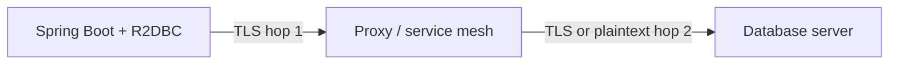
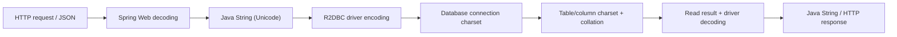

# Verifying TLS, Timezone, and Encoding Configuration for Deployment

A Spring Data Relational R2DBC application can run smoothly on a developer's machine yet fail in production due to three often-overlooked configuration groups: transport security, time interpretation, and text encoding. TLS governs whether traffic is encrypted and the server is authenticated. Timezone governs whether a timestamp is interpreted as an absolute instant or local wall time. Encoding governs whether Unicode strings are transmitted, stored, and read back without character corruption.

These concerns span multiple layers: the JVM, Spring Boot, the R2DBC driver, the connection pool, the database session, the schema, HTTP clients, and the deployment environment. Getting one layer right does not guarantee the rest are correct. For example, the JVM may run in UTC while the database session uses another timezone; the database may support UTF-8 while a MySQL column uses an unsuitable charset/collation; a URL may enable TLS encryption without verifying the database hostname.

When deploying, verify using real connections created by the actual R2DBC driver, pool, and production configuration. A unit test or a `SELECT 1` health check cannot prove certificates are verified, timestamps round-trip accurately, or Unicode data remains intact.

## 1. The three configuration groups and common risks

| Group | What must be ensured | Common failures |
| --- | --- | --- |
| TLS | Transport encryption, certificate and hostname verification, trust/key management | Unencrypted connections, accepting untrusted certificates, hostname mismatches, expired certificates |
| Timezone | Consistent time conventions across JVM, driver, database session, and SQL types | Hour shifts, lost offsets, wrong instants around DST, timestamps shifting on read-back |
| Encoding | End-to-end Unicode charset from request through driver to database columns | Corrupted Vietnamese/emoji characters, characters replaced with `?`, unexpected collation comparisons |

These three groups can interact. For instance, JDBC migrations may use a different timezone than the R2DBC runtime; string columns may have different collations between MySQL and MariaDB; a TLS proxy may terminate encryption mid-path rather than at the database.

## 2. How does TLS protect R2DBC connections?

TLS (Transport Layer Security) establishes an encrypted channel between client and server. For an R2DBC application, the client is the driver opening connections to the database or a database proxy.

TLS typically provides three properties:

- **Confidentiality:** SQL statements, bind parameters, and results transmitted over TLS are encrypted.
- **Integrity:** in-transit tampering can be detected via TLS integrity protection.
- **Server authentication:** the client verifies the server holds a trusted certificate and, when hostname verification is enabled, that the certificate matches the connected hostname.

Some environments also enforce mutual TLS (mTLS), where the client presents a certificate for the server to authenticate the client's identity. mTLS does not replace username/password authentication or database privileges; it adds a connection-layer authentication factor.

### Encryption does not equal full authentication

TLS modes that require encryption while skipping certificate verification protect against passive eavesdropping, yet do not prove the client is talking to the real database. A rogue proxy could terminate TLS using an unverified certificate if the client accepts any certificate.

In production, prefer modes that verify both the certificate chain and hostname—commonly named `VERIFY_FULL`, `VERIFY_IDENTITY`, or equivalent depending on the driver. Never infer semantics from option names alone; read driver documentation and confirm with negative tests.

## 3. Verifying certificate chains and hostnames

To verify a server certificate, the client needs a matching trust anchor—typically the CA certificate that signed the database or proxy certificate. Verification checks:

1. The server presents its certificate and required chain.
2. The client verifies signatures and chains up to a trusted CA.
3. The client checks `Not Before`/`Not After` validity dates.
4. The client verifies the connected hostname matches a Subject Alternative Name (SAN) on the certificate.
5. Client and server negotiate an allowed TLS version and cipher suite.

Hostname verification is vital. If the application connects to `db.prod.internal`, the certificate must list a matching SAN. A certificate listing only another node name or IP can fail verification even when the CA chain is valid.

### Use stable hostnames

In Kubernetes or cloud environments, database endpoints are usually stable DNS names like `db-primary.internal.example`. Connect using the DNS name listed in the certificate's SAN rather than ephemeral IPs if the certificate omits those IPs.

When connecting through a proxy, service mesh, or database gateway, verify the certificate of the endpoint the driver directly connects to. If TLS terminates at the proxy and the proxy opens a plaintext connection to the database, evaluate the proxy-to-database hop separately; client-side TLS does not encrypt the second hop automatically.

### Never disable hostname checks to fix certificate errors

If you hit a hostname mismatch, fix the DNS/endpoint or issue a certificate with the proper SAN. Never switch to a hostname-skipping mode just to make connections succeed. Likewise, never use a trust-all certificate verifier in production.

## 4. TLS configuration depends on the R2DBC driver

The R2DBC SPI defines a common connection API, while enabling TLS, choosing trust stores, client certificates, protocols, and hostname verification are implemented per driver. Hence, no single URL query parameter set works across all databases.

Common option categories:

| Option category | Purpose |
| --- | --- |
| SSL/TLS mode | Disable, prefer, require, or verify TLS |
| CA/root certificate | Specify trusted CA to verify the server |
| Client certificate | Client certificate when using mTLS |
| Client private key | Private key matching the client certificate |
| Key password | Passphrase protecting the private key, if encrypted |
| TLS protocol/cipher | Restrict allowed protocols/cipher suites if driver-supported |
| Hostname verification | Validate endpoint name against certificate SANs |

Option names and certificate file passing differ across `r2dbc-postgresql`, `r2dbc-mysql`, MariaDB R2DBC, and other drivers. Always follow documentation for the exact artifact and version in use.

### Conceptual Spring Boot configuration example

Spring Boot reads R2DBC driver URLs and properties under `spring.r2dbc`:

```yaml
spring:
  r2dbc:
    url: ${R2DBC_URL}
    username: ${DB_USERNAME}
    password: ${DB_PASSWORD}
    properties:
      # Keys below are placeholders for driver-specific options.
      # Exact key/value names depend on the driver in use.
      sslMode: ${DB_SSL_MODE}
```

This structure is illustrative only. Never copy PostgreSQL `sslMode` names or enums to MySQL/MariaDB if that driver expects different names/values. Some drivers accept options via URL query parameters, some via `ConnectionFactoryOptions`, and some accept certificate file paths via dedicated properties.

If creating a `ConnectionFactory` manually, ensure TLS options reach the exact factory used by Spring Data repositories, `DatabaseClient`, and `R2dbcTransactionManager`. Configuring TLS on a factory used for health checks while repositories use another factory creates inconsistent security settings.

## 5. Common TLS modes

Names vary by driver, while semantics generally fall into these levels:

| Level | General behavior | Production suitability |
| --- | --- | --- |
| Disabled | No TLS used | Only if network/architecture has explicit justification and equivalent protections |
| Prefer/Allow | Negotiates or prefers TLS depending on server/driver | Do not assume encryption is guaranteed; understand fallback behavior |
| Require | Enforces encryption without full server identity verification | Insufficient when defending against server spoofing |
| Verify CA | Enforces TLS and verifies certificate chain | Better than require; verify whether hostname is checked |
| Verify full/identity | Enforces TLS, verifies chain and hostname | Usually the desired choice for client-server production |

Not every driver exposes every level. One driver may call it `VERIFY_IDENTITY`, another `VERIFY_FULL`. Confirm exact semantics rather than guessing from a strong-sounding name.

### Negative tests to prove TLS is actually enforced

Besides testing successful connections with valid certificates, verify connections fail when:

- The CA is absent from the trust store.
- The certificate is expired.
- The hostname mismatches the SAN.
- The server requires a client certificate and the client omits it (under mTLS).
- The client certificate is not trusted by the server's CA.

Negative tests prove the client does not silently accept invalid certificates. Run them in isolated test environments—never swap production certificates to test failures.

## 6. Managing CA certificates and client keys

Never hardcode private keys or passwords in source code, Docker images, or committed config files. Use a secret manager or properly managed Kubernetes Secrets/volumes.

A common layout:

```text
/run/secrets/database/
  ca.pem
  client-cert.pem
  client-key.pem
```

The application only needs read permissions on required files. Private keys should have restricted permissions and be mounted from a secret store. CA certificates are usually non-secret, yet still require integrity protection because altering a CA changes which servers are trusted.

### JVM trust store vs. driver trust store

Not all R2DBC drivers use the Java default trust store in the same way. One driver may rely on JSSE/JVM trust stores while another uses its own TLS stack or custom options. Thus, adding a CA to `$JAVA_HOME/lib/security/cacerts` may not resolve errors if the driver uses a separate trust source.

Check driver documentation for:

- Whether the driver uses JSSE.
- Whether it supports trust store path/type/password options.
- Whether it accepts a standalone CA certificate via connection options.
- Whether it supports client certificates/private keys and which PEM/PKCS#8 formats it expects.
- Whether hostname verification is on by default or must be enabled explicitly.

Never pass trust store passwords on command lines or in logs. If using JVM system properties, supply them via secure secrets/config and control process scope.

## 7. Certificate rotation and the connection pool

R2DBC Pool keeps open connections for reuse. When a server certificate rotates, existing TLS connections may keep running on established sessions while new connections verify the new certificate. Errors can occur when:

- The new CA has not yet been added to every instance's trust store.
- The server switched certificates while clients still trust only the old CA.
- Client certificates expire or are revoked.
- The pool holds old connections long-term without cycling to pick up updated config/certificates.
- Some pods received updated secrets while others still mount old contents.

### Safe rotation workflow

A typical two-phase CA rotation:

1. Distribute a trust bundle containing both old and new CAs to clients.
2. Confirm all instances can connect with the updated trust bundle.
3. Rotate server certificates to the new chain.
4. Monitor new connections, TLS handshakes, and certificate errors.
5. Once no server/connection needs the old CA, remove it from the trust bundle.
6. Recycle/restart pools on schedule if required so new connections pick up updated config.

For mTLS, coordinate client certificate and server trust policy rotations similarly. Never remove the old CA until all affected clients and servers have migrated.

### Pool lifetime and secret reloads

Never assume the pool automatically reloads certificate files when secrets update on disk. Depending on the driver, the TLS context may be built once when creating `ConnectionFactory`, per new connection, or elsewhere. Verify driver behavior and how secret volumes update.

If the driver does not reload safely, perform rolling restarts or recreate the connection factory/pool via supported mechanisms. Setting `maxLifeTime` helps phase out old connections gradually, though it does not replace a rotation plan or reload TLS contexts if the factory caches them.

## 8. TLS and connections through proxies/service meshes

In proxied environments, map each hop:



Verify:

- Whether TLS terminates at the client-side proxy or at the database.
- Whether the proxy-to-database hop uses TLS.
- Whether the client verifies the proxy's certificate or the database's certificate.
- Whether the proxy authenticates client identity/mTLS.
- Which endpoint's hostname matches the certificate SAN.
- Whether health checks and metrics observe proxy connections or direct database connections.

TLS from the app to a proxy does not prove the proxy-to-database leg is encrypted. If policy demands end-to-end encryption, configure TLS on each leg or adopt an architecture where proxies cannot inspect plaintext per your threat model.

## 9. Timezones span multiple layers

Timezones can be configured at:

1. **Operating system/container:** timezone of the host running the process.
2. **JVM:** `user.timezone` and `ZoneId.systemDefault()`.
3. **Java type:** `Instant`, `OffsetDateTime`, `LocalDateTime`, `LocalDate`, `ZonedDateTime`.
4. **R2DBC driver:** how temporal types are encoded/decoded.
5. **Database session:** timezone of the connection/session.
6. **Database column type:** `TIMESTAMP`, `TIMESTAMP WITH TIME ZONE`, `DATETIME`, `DATE`, etc.
7. **Business timezone:** timezone used to interpret opening hours, billing dates, schedules, or reporting days.

These layers do not automatically align. An application running in UTC can connect to a database session set to `Asia/Ho_Chi_Minh`; using `LocalDateTime` and a timezone-less SQL column leaves it ambiguous whether a value is UTC or local time unless the data contract explicitly defines it.

## 10. Choosing Java temporal types by data meaning

| Java type | Meaning | Suitable use cases |
| --- | --- | --- |
| `Instant` | Absolute point on the UTC timeline | Created/updated timestamps, event times, audit timestamps |
| `OffsetDateTime` | Date and time with a UTC offset | APIs or data needing to preserve a supplied offset |
| `ZonedDateTime` | Date and time with timezone region and rules | Local schedules requiring regional DST/rules |
| `LocalDateTime` | Date and time without offset/timezone | Local wall-clock time without an attached zone |
| `LocalDate` | Calendar date without time | Birth dates, effective dates, business dates |
| `LocalTime` | Time of day without date/zone | Opening hours or local time windows |
| `Duration` | Linear time span | Timeouts, processing durations |
| `Period` | Calendar-based span | Adding months/years by calendar rules |

### Use `Instant` for technical timestamps

Fields such as `createdAt`, `lastModifiedAt`, and `processedAt` should typically represent an absolute instant:

```java
@CreatedDate
@Column("created_at")
private Instant createdAt;
```

You can provide `Clock.systemUTC()` as the time source:

```java
@Bean
Clock applicationClock() {
    return Clock.systemUTC();
}
```

UTC ensures instances across regions produce timestamps under one convention. When rendering to users, convert `Instant` to the user's or business's timezone at the presentation layer.

### Never attach fake timezones to `LocalDateTime`

`LocalDateTime` carries no offset or zone. The value `2026-11-15T09:00` does not say whether it means 09:00 UTC, 09:00 in Ho Chi Minh City, or 09:00 in London. When representing an absolute point in time, `LocalDateTime` drops crucial context.

If a business requirement genuinely stores "09:00 local time" such as store opening hours, also store a zone ID or derive the zone from the location. Never blindly attach the server's default timezone when reading values.

## 11. JVM and container timezones

You can set the JVM timezone to UTC with:

```text
-Duser.timezone=UTC
```

Or via container environment variable:

```text
TZ=UTC
```

`TZ` sets the OS/container timezone if the image includes tzdata and the runtime honors it; `-Duser.timezone` sets the JVM default timezone. Still, never rely on default timezones to generate business timestamps. Use `Instant`/`Clock` and specify an explicit `ZoneId` whenever interpreting local time.

Runtime check:

```java
log.info("JVM default zone: {}", ZoneId.systemDefault());
log.info("Current instant: {}", Instant.now());
```

Never log full environment variables or system properties, as they can leak secrets. Log only the required timezone/locale values.

### Never mutate the default timezone while running

`TimeZone.setDefault(...)` or changing the runtime system timezone affects all libraries and threads concurrently. Configure timezones consistently at process startup, and use explicit-zone Java time APIs per business rule.

## 12. Database session timezone

Even when the JVM uses UTC, a database session may use a different timezone. Inspect sessions opened by the R2DBC driver and pool, not merely global database settings.

### PostgreSQL

Check:

```sql
SHOW TimeZone;

SELECT
    current_setting('TimeZone') AS session_timezone,
    now() AS transaction_timestamp,
    clock_timestamp() AS wall_clock_timestamp,
    localtimestamp AS local_timestamp;
```

In PostgreSQL, `now()`/`current_timestamp` reflects transaction start time, while `clock_timestamp()` reflects wall clock at call time. `localtimestamp` returns a timezone-less timestamp under session semantics.

Set session timezone for a connection with:

```sql
SET TIME ZONE 'UTC';
```

With a connection pool, `SET` affects only the current session/connection. Ensure every new connection is configured or that the server/database role defines the right default. Avoid running `SET TIME ZONE` once on a random connection and assuming the entire pool is configured.

### MySQL and MariaDB

Check:

```sql
SELECT
    @@global.time_zone AS global_timezone,
    @@session.time_zone AS session_timezone,
    @@system_time_zone AS system_timezone,
    NOW(6) AS session_now,
    UTC_TIMESTAMP(6) AS utc_now;
```

Set session timezone:

```sql
SET time_zone = '+00:00';
```

A value of `SYSTEM` means the session uses the server's system timezone. In production, setting explicit UTC is usually much more predictable. Using named timezones like `Asia/Ho_Chi_Minh` requires populated and updated timezone tables on the server; the `+00:00` offset does not depend on timezone tables.

### SQL Server and other databases

Each database has its own timestamp types and timezone syntax. Never run PostgreSQL's `SHOW TimeZone` or MySQL's `@@session.time_zone` on other engines. Use session inspection queries from your running database's documentation.

## 13. SQL types with and without timezones

SQL column types determine how the database stores and interprets temporal data.

### PostgreSQL

- `timestamp without time zone`: stores date/time fields without storing zone or offset.
- `timestamp with time zone` (`timestamptz`): represents an absolute instant; PostgreSQL normalizes internally and formats per session timezone.
- `date`: calendar date only.
- `time with/without time zone`: time of day with corresponding semantics; unsuitable for storing absolute instants without a date.

Example:

```sql
CREATE TABLE audit_event (
    id BIGINT GENERATED BY DEFAULT AS IDENTITY PRIMARY KEY,
    occurred_at TIMESTAMPTZ NOT NULL,
    local_schedule TIMESTAMP WITHOUT TIME ZONE
);
```

`occurred_at` pairs naturally with `Instant`. `local_schedule` requires an external zone convention if it represents local wall time.

### MySQL/MariaDB

- `TIMESTAMP`: server/session converts timezones on write/read per engine/version semantics.
- `DATETIME`: stores date/time components without storing timezone.
- `DATE`: calendar date.
- `TIME`: time/duration per database semantics; not a substitute for an instant.

Example:

```sql
CREATE TABLE audit_event (
    id BIGINT NOT NULL AUTO_INCREMENT PRIMARY KEY,
    occurred_at TIMESTAMP(6) NOT NULL,
    local_schedule DATETIME(6)
) ENGINE = InnoDB;
```

When using `TIMESTAMP`, check session timezone and server type range limits. When using `DATETIME`, the application must standardize whether stored values are UTC or local time; the database cannot infer the zone on its own.

### Do not assume one mapping across all databases

A Java `Instant` can map differently across drivers and dialects. Test codecs and round-trips on the real database. Never assume `Instant` always maps to `TIMESTAMP WITH TIME ZONE` on every DBMS or that `LocalDateTime` is automatically converted to UTC.

## 14. Daylight Saving Time (DST) and local time

Some timezones shift clocks seasonally, creating two edge cases:

- **Gap:** a local time interval that does not exist when clocks spring forward.
- **Overlap:** a local time interval that occurs twice when clocks fall back.

For instance, a scheduled event at 01:30 in a DST-observing zone can correspond to two distinct instants on an overlap day. `LocalDateTime` alone cannot distinguish those two 01:30 occurrences.

When storing location-based schedules, store both `LocalDateTime` and `ZoneId` (e.g., `Europe/Paris`), or store the resolved instant alongside business rules. If a schedule must preserve "local wall time" when DST rules change, decide whether to recompute instants under updated rules or preserve the original instant.

Vietnam does not currently observe DST in `Asia/Ho_Chi_Minh`, yet systems may store schedules for users across many countries. Never hardcode a `+07:00` offset for all data simply because a deployment is hosted in Vietnam.

### Testing DST

Include tests for:

- Moments just before and after DST transitions.
- Local times falling inside a gap.
- Local times falling inside an overlap.
- Rendering the same instant in two different timezones.
- Timezone database (tzdb) updates across JDK releases if business logic relies on local schedules.

## 15. Encoding: from HTTP to the database

To store Vietnamese, emoji, and other Unicode characters consistently, inspect the entire data path:



Java `String` represents text as UTF-16 code units; on the wire, drivers encode strings into bytes per charset/protocol. The database must accept and store those characters in a supporting charset. On read, the driver decodes bytes back into a Java `String`.

A misconfiguration at any point causes mojibake, lost characters, conversion errors, or broken string comparisons. Never call `new String(bytes)` or `String.getBytes()` without an explicit charset when handling raw bytes.

### Explicitly use UTF-8 for text data

When converting between bytes and text manually:

```java
byte[] bytes = text.getBytes(StandardCharsets.UTF_8);
String decoded = new String(bytes, StandardCharsets.UTF_8);
```

Never rely on the JVM/OS default charset. For `String` values bound through R2DBC, let the driver encode per protocol/connection settings; do not convert strings to byte arrays manually unless binary format is specifically required.

### JSON and HTTP

Modern JSON is exchanged in UTF-8. Ensure requests/responses carry appropriate content types and charsets such as `application/json`, and avoid decoding bodies with platform default charsets. Spring WebFlux/Jackson handles JSON via codecs; if overriding codecs, verify encoding settings.

## 16. Charset and collation in MySQL/MariaDB

In MySQL/MariaDB, `utf8mb4` is the standard choice for full Unicode support, including supplementary characters outside the BMP and emoji. The legacy `utf8` charset in older MySQL versions is an alias for a 3-byte UTF-8 subset that cannot store all Unicode code points. Never use `utf8` without confirming your server/version semantics.

Example database/table creation:

```sql
CREATE DATABASE app_db
    CHARACTER SET utf8mb4
    COLLATE utf8mb4_unicode_ci;

CREATE TABLE customer (
    id BIGINT NOT NULL AUTO_INCREMENT PRIMARY KEY,
    display_name VARCHAR(200) NOT NULL
) CHARACTER SET utf8mb4
  COLLATE utf8mb4_unicode_ci;
```

Available collation names differ across MySQL and MariaDB versions. MySQL 8 offers `utf8mb4_0900_*` collations; MariaDB has its own set. Choose a collation matching required case/accent sensitivity and verify it exists on the target server.

### Verifying actual charsets

```sql
SHOW VARIABLES LIKE 'character_set%';
SHOW VARIABLES LIKE 'collation%';

SELECT
    @@character_set_client,
    @@character_set_connection,
    @@character_set_results,
    @@collation_connection;
```

Inspect database, table, and column levels:

```sql
SHOW CREATE TABLE customer;

SELECT
    column_name,
    character_set_name,
    collation_name
FROM information_schema.columns
WHERE table_schema = DATABASE()
  AND table_name = 'customer';
```

Connection charsets can be negotiated or overridden by the driver. Never inspect only the default database setting and assume connections use the same charset.

## 17. Encoding in PostgreSQL and other databases

PostgreSQL typically uses server encoding `UTF8` for Unicode applications. Check with:

```sql
SHOW server_encoding;
SHOW client_encoding;
```

Client encoding is normally managed by the driver over the wire protocol and set to `UTF8`. If the database cluster/database was created with an encoding incapable of representing required characters, changing `client_encoding` cannot make the server store them.

Check database encoding:

```sql
SELECT datname, pg_encoding_to_char(encoding)
FROM pg_database
WHERE datname = current_database();
```

Never run PostgreSQL inspection commands on MySQL/MariaDB. Each database exposes its own metadata, charsets, and collations.

## 18. Charsets, collations, and comparison semantics

Charset defines which characters can be encoded. Collation defines how strings are compared and sorted—such as:

- Case sensitivity.
- Accent/diacritic sensitivity.
- Unicode sort rules.
- Which two strings are considered equal by unique constraints.

Two columns with the same charset but different collations can produce different results for `ORDER BY`, `LIKE`, `=`, and unique constraints.

For example, a case-insensitive collation treats `Lan@example.com` and `lan@example.com` as equal. If business logic requires distinguishing them, pick an appropriate collation or store a separate normalized key.

### Unicode normalization

A visually identical character can have multiple Unicode representations—such as a precomposed character versus a base character plus combining mark. If the application needs canonical equivalence comparisons, define a normalization policy (NFC/NFD) at data boundaries or use database/collation support.

Java provides `Normalizer`:

```java
String normalized = Normalizer.normalize(
        input,
        Normalizer.Form.NFC
);
```

Normalize only when business semantics allow. Never normalize passwords, tokens, digital signatures, or inputs whose exact byte representation must be preserved.

### Character length vs. byte length

`VARCHAR(200)` typically limits characters/code points or follows database-specific semantics, whereas UTF-8 byte length can be larger. Never assume 200 characters occupy 200 bytes. Emoji and non-ASCII characters require multiple bytes.

Verify:

- Column character limits.
- Index/row/database byte limits.
- Driver/server packet size limits.
- Java and API validation rules.
- How the database counts length under its charset/collation.

## 19. Never rely on default charsets in code

Common mistakes:

```java
// Unspecified charset depends on the environment.
byte[] bytes = text.getBytes();
String value = new String(bytes);
```

Always specify explicitly:

```java
byte[] bytes = text.getBytes(StandardCharsets.UTF_8);
String value = new String(bytes, StandardCharsets.UTF_8);
```

When data is already a `String`, bind it directly through R2DBC rather than encoding to bytes and decoding back. Use `byte[]` only for binary data or protocols requiring raw bytes.

Never convert passwords, secrets, or tokens into text logs to debug encoding issues. Use safe test fixtures containing representative Unicode characters.

## 20. Binary data is not text encoding

Columns like `BLOB`, `BYTEA`, `VARBINARY`, or binary types store raw bytes. Do not apply text collations or charsets to binary data. When storing files or encrypted payloads, preserve raw byte sequences alongside separate content-type/encoding metadata.

Example:

```java
byte[] payload = Files.readAllBytes(path);
```

When reading/writing `byte[]`, check driver codecs and size limits. Never convert binary payloads to `String` unless the format is genuinely text with a known charset.

## 21. R2DBC drivers and temporal/string codecs

Drivers encode Java values onto the wire and decode database values back into Java types. Common types such as `String`, `Integer`, `Long`, `BigDecimal`, `LocalDate`, `LocalDateTime`, `Instant`, `OffsetDateTime`, and `UUID` vary in support across drivers and databases.

When mapping fails or values shift, inspect:

- Driver version and registered codecs.
- Actual SQL column type.
- Java type in the entity/DTO.
- Session timezone and server encoding.
- Column precision/scale or fractional seconds.
- Whether custom converters perform extra transformations.
- Whether raw SQL casts types unexpectedly.

Never work around broken type mappings by changing global timezones or charsets when the root cause is an incompatible Java/SQL type pair.

### Custom conversions

Spring Data R2DBC supports custom conversions to translate Java types into driver-supported types. If a custom converter is needed for a temporal type or UUID representation, register it via `R2dbcCustomConversions` matching your Spring Data version.

Converters should have clear semantics, round-trip tests, and zero reliance on machine default timezones. Avoid converters that blindly convert every `LocalDateTime` to UTC without knowing which local zone the input originated in.

## 22. Setting timezone when creating connections

Some drivers offer connection options to configure session timezones/properties. Others require session initialization SQL or server/role defaults. Option names and mechanisms depend on the driver.

When using initialization SQL with a connection pool, ensure it executes for every newly created connection, not just once. Hooks like `postAllocate`/`preRelease` or connection initialization hooks vary by pool and version; check official APIs.

PostgreSQL session command example:

```sql
SET TIME ZONE 'UTC';
```

MySQL/MariaDB example:

```sql
SET time_zone = '+00:00';
```

Never run a single `SET` on one arbitrary connection assuming the whole pool shares it. Configure defaults at the database/user/session template level if supported, or use the pool's official initialization hook.

### Session state and pool reuse

A connection returned to the pool can retain session state such as timezone, SQL mode, schema/search path, or session variables. If a request mutates session state and returns the connection without resetting it, the next request inherits the previous request's settings.

Principles:

- Avoid arbitrary session-state mutations during requests.
- If mutation is unavoidable, reset to baseline before release or use transaction-local settings where supported.
- Establish baseline state on every newly created connection.
- Test behavior across connection reuse.
- Never assume every request gets a brand-new connection.

## 23. JDBC migrations and R2DBC runtime must align

Many applications run schema migrations via Flyway/Liquibase over JDBC while runtime uses R2DBC. These are two distinct connection stacks that can diverge in configuration:

- JDBC URL vs. R2DBC URL.
- Driver TLS/trust stores.
- Session timezone.
- Client encoding.
- Default schema/database.
- SQL modes and connection initialization.
- Temporal type mappings.

For instance, a migration may create `TIMESTAMP WITHOUT TIME ZONE` while runtime maps it to `Instant` assuming UTC. Without an explicit convention, values can be misinterpreted. Likewise, migrations creating columns with non-standard charsets/collations can break Unicode inserts or comparisons at runtime.

Run migrations and runtime integration tests against the same database engine and version. Confirm JDBC migrations and R2DBC runtime enforce matching schemas, timezone policies, and encoding policies. Never assume identical hostname/database names guarantee identical session settings.

## 24. Verifying TLS from real connections

After configuring TLS, confirm connections created by the R2DBC pool actually use TLS and verify certificates properly.

### PostgreSQL

Inspect the current connection with:

```sql
SELECT
    ssl,
    version,
    cipher,
    bits
FROM pg_stat_ssl
WHERE pid = pg_backend_pid();
```

`ssl = true` confirms the current connection uses SSL/TLS according to PostgreSQL metadata. `version` and `cipher` show the negotiated protocol and cipher. This query does not prove the client verified the hostname; verify that via driver configuration and negative tests.

### MySQL/MariaDB

Inspect the session:

```sql
SHOW SESSION STATUS LIKE 'Ssl_cipher';
SHOW SESSION STATUS LIKE 'Ssl_version';
```

An empty `Ssl_cipher` typically indicates the session is not using TLS; check per server version and driver. Also check server policy—such as `require_secure_transport` in MySQL if supported, or the equivalent setting in MariaDB.

### Verify hostname checks with failure tests

SQL queries cannot show whether the client verified the hostname. Write tests connecting to a mismatched hostname or untrusted CA and verify the handshake fails. That confirms client-side verification behavior.

## 25. Verifying timezones with round-trip tests

Do not just log `ZoneId.systemDefault()`. Write a timestamp through the real R2DBC driver and read it back.

Example test with `Instant`:

```java
Instant expected = Instant.parse("2026-11-15T03:30:45.123456Z");

StepVerifier.create(repository.save(new AuditEvent(null, expected)))
        .assertNext(saved ->
                assertThat(saved.occurredAt()).isEqualTo(expected)
        )
        .verifyComplete();
```

This assumes microsecond column precision and matching driver codec support. If Java `Instant` carries nanoseconds while the database stores only microseconds or milliseconds, read-back values may be truncated or rounded. Tests should align expected precision with the SQL column type.

### Testing session timezone

In integration tests, run session timezone checks on connections acquired directly from the runtime connection factory/pool. Repeat across multiple connections or under concurrency to verify every pooled connection shares the same baseline.

Never test using a standalone connection created outside the pool and assume the pool shares its timezone. Test through the same `DatabaseClient`/repositories used by the application.

## 26. Verifying encoding with a representative character set

An encoding test should cover multiple character classes:

```java
String sample = "Vietnamese: Trường, Nguyễn, Đặng; emoji: 😀; "
        + "combining: e\u0301; symbol: €";
```

Round-trip through R2DBC:

```java
StepVerifier.create(repository.save(new Message(null, sample)))
        .assertNext(saved -> assertThat(saved.content()).isEqualTo(sample))
        .verifyComplete();
```

Verify:

- Accented Vietnamese characters at the beginning, middle, and end of strings.
- Emoji and code points outside the BMP.
- Combining marks.
- Special characters such as quotes, dashes, and currency symbols.
- Strings near column length limits.
- Equality and uniqueness comparisons under the target collation.
- JSON payloads containing Unicode if JSON columns are used.

Reading back the exact string is necessary but insufficient for testing collation. Add tests for equality queries, sorting, and unique constraints per expected semantics.

## 27. Verifying encoding and timezones over HTTP

A string can be corrupted before reaching the database or after reading from it. To isolate the failing layer, an end-to-end test can:

1. Send UTF-8 JSON containing Vietnamese/emoji characters.
2. Let WebFlux deserialize into a Java `String`.
3. Persist via the service and R2DBC.
4. Read back from the database.
5. Serialize the JSON response.
6. Compare the response against input by code point/string semantics.

If repository round-trips pass while HTTP responses fail, inspect HTTP codecs, content types, reverse proxies, and clients. If the Java string is intact before saving yet reads back corrupted, inspect the R2DBC driver, connection charset, column charset, and collation.

### Do not rely on visual inspection alone

Different Unicode sequences can render identically. Use exact string/code-point assertions or normalization policies rather than eyeballing screenshots. When debugging, you can log code points/hex of non-sensitive fixtures, but never dump real user data.

## 28. Observing and diagnosing TLS errors

Common TLS errors:

| Error | Possible cause | Fix |
| --- | --- | --- |
| Unknown CA / unable to find valid certification path | CA missing from driver/JVM trust source | Update CA trust bundle where the driver reads it |
| Hostname verification failed | SAN does not match connected hostname | Use correct DNS name or issue certificate with matching SAN |
| Certificate expired/not yet valid | Certificate expired or system clock skewed | Rotate certificate and synchronize system clocks |
| Handshake failure | Incompatible protocol/cipher, wrong cert/key, or server policy | Inspect TLS versions/ciphers and server logs |
| Client certificate required | mTLS enabled but client sent no valid certificate | Configure valid client cert/key and CA trust |
| Connection reset during handshake | Proxy/firewall/server closed connection or protocol mismatch | Check network path and server/proxy logs |
| Some pods fail while others succeed | Inconsistent secrets/certs/config across replicas | Check rollout, secret mounts, and pool recreation |

Never log private keys, passwords, full connection URLs containing credentials, or TLS session secrets. Log exception class, sanitized endpoint, certificate fingerprint/expiry if permitted by policy, and correlation ID.

## 29. Observing and diagnosing timezone errors

| Symptom | Possible cause | Fix |
| --- | --- | --- |
| Timestamps shifted by a fixed number of hours | Mismatched JVM/session timezones | Check JVM zone, session zone, and SQL type |
| Values shift when read from another session | SQL type converts per session timezone | Standardize on UTC or use matching type/contract |
| Offset lost after saving | `OffsetDateTime` mapped to column without offset | Store instant plus zone/offset separately if needed |
| `LocalDateTime` interpreted as UTC | Missing zone in data while code assumes UTC | Define business timezone and convert explicitly |
| Wrong times around DST | Local time gap/overlap or different tzdb | Use `ZoneId` and test DST edge cases |
| Microseconds/nanoseconds altered | SQL precision lower than Java precision | Normalize precision or increase column fractional precision |
| Jobs fire at different hours across hosts | Reliance on host default timezone | Use `Clock` and explicit zones |
| Some requests shift hours after pool reuse | Unreset session state | Enforce connection baseline and prevent session leaks |

## 30. Observing and diagnosing encoding errors

| Symptom | Possible cause | Fix |
| --- | --- | --- |
| Vietnamese turns into `?` | Charset/column cannot represent characters or conversion loss | Use full Unicode charset, e.g., `utf8mb4` in MySQL/MariaDB |
| Mojibake like `Ã...` | Bytes decoded with wrong charset or double-encoded | Inspect every hop: HTTP, Java, driver, and database |
| Emoji insert fails | Legacy/3-byte UTF-8 charset or unsupported driver/column | Check Unicode range and schema charset |
| Inserts succeed but searches behave unexpectedly | Collation case/accent semantics differ from expectations | Check collation and normalized keys |
| Unique constraint treats two strings as equal | Case/accent-insensitive collation | Choose suitable collation or canonicalization rules |
| Trailing characters lost on round-trip | Column length, byte limit, or conversion truncation | Check column type, length, and codec |
| JDBC migration stores fine while R2DBC corrupts | Divergent session/driver charsets | Inspect connection settings of both drivers |
| Vietnamese JSON corrupted | Mismatched JSON codec or client/server encoding | Test JSON round-trip through real driver and server |

## 31. Deployment checklist for TLS, timezone, and encoding

### TLS

- [ ] Use an R2DBC driver supporting TLS for your database/version.
- [ ] Enforce TLS wherever network policy requires it.
- [ ] Verify CA chain and hostname; never use trust-all verifiers.
- [ ] Certificate SANs match the DNS name the application connects to.
- [ ] TLS protocols/ciphers comply with security policy.
- [ ] mTLS client certificates/keys are securely mounted if needed.
- [ ] Secrets/keys are absent from source code, images, and logs.
- [ ] Certificate rotation has a plan for updating trust bundles and pools.
- [ ] TLS is verified on connections from the real R2DBC pool.
- [ ] Negative tests prove invalid CAs/hostnames fail connection attempts.

### Timezone

- [ ] UTC convention established for technical timestamps.
- [ ] `Instant` used for absolute instants; `LocalDateTime` only when data truly represents zoneless local wall time.
- [ ] JVM timezone verified and not relied on for business calculations.
- [ ] Database session timezone verified on pooled connections.
- [ ] SQL column types match semantics and driver codecs.
- [ ] Columns have sufficient fractional precision.
- [ ] Every pooled connection shares a consistent session baseline.
- [ ] Round-trip, session reuse, and DST edge cases tested when local schedules apply.
- [ ] JDBC migrations and R2DBC runtime share a unified timezone policy.

### Encoding

- [ ] HTTP/JSON contracts use UTF-8.
- [ ] Java code specifies `StandardCharsets.UTF_8` when converting bytes/text.
- [ ] Database server/database/table/columns use an appropriate Unicode charset.
- [ ] MySQL/MariaDB uses `utf8mb4` when full Unicode is needed.
- [ ] Collations match case/accent/sorting/uniqueness semantics.
- [ ] Driver connection encoding verified via session metadata.
- [ ] Tested with Vietnamese, emoji, combining marks, non-BMP characters, and long strings.
- [ ] Tested for equality/sorting/uniqueness, not only round-trip.
- [ ] Binary payloads are never accidentally converted to text.

## 32. Key takeaways

- TLS encryption and certificate verification are distinct; production should verify CA chains and hostnames per driver capabilities.
- TLS options, trust stores, client certificates, and hostname verification are driver-specific; never copy URL properties across R2DBC drivers.
- Ensure certificate SANs match actual hostnames, manage secrets/keys securely, and plan certificate rotations.
- Connection pools can retain old TLS connections; secret reloads do not guarantee pools/drivers rebuild TLS contexts automatically.
- JVM timezone, database session timezone, Java temporal types, and SQL column types are separate layers.
- Use `Instant` for absolute timestamps; use `LocalDateTime` for zoneless local wall time and store `ZoneId` whenever DST rules matter.
- Check session timezone on connections leased from the R2DBC pool; a single `SET` on one connection does not configure the whole pool.
- PostgreSQL `timestamptz` and MySQL/MariaDB `TIMESTAMP` have distinct semantics; `timestamp without time zone`/`DATETIME` do not store timezones.
- Standardize on UTC for technical timestamps and round-trip test against column precision.
- Charset governs representable characters; collation governs comparison, sorting, and uniqueness semantics.
- In MySQL/MariaDB, `utf8mb4` supports full Unicode; check collations per server version.
- Always specify `StandardCharsets.UTF_8` when converting bytes/text; never rely on default charsets.
- Test Vietnamese text, emoji, combining marks, JSON, non-BMP characters, and length limits against real databases.
- JDBC migrations and R2DBC runtime are two separate connection stacks; verify consistent TLS/timezone/encoding policies across both.
- A `SELECT 1` health check proves neither certificate verification, timezone mapping, nor encoding round-trips; test each property explicitly.

Safe and consistent R2DBC deployments require verifying transport security, time interpretation, and text encoding end to end. Enable TLS with server identity verification, standardize technical timestamps on UTC while preserving business zones where required, and configure Unicode charsets/collations matching data semantics. Finally, run integration tests through the exact driver, connection pool, and production-equivalent database to prove certificates are verified, temporal values round-trip accurately, and Unicode text stays intact.
