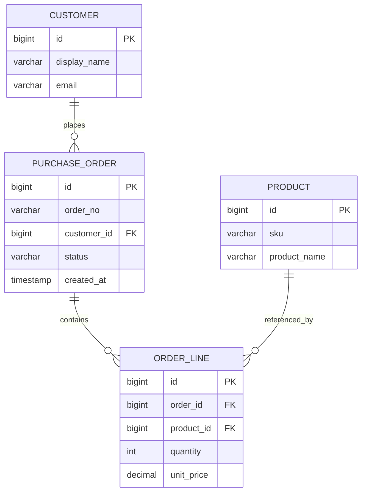

# Reading Multi-Table Relationships with Dedicated Read Models

In a Spring Data R2DBC application, business data often spans multiple related tables. An order screen may require the order number, customer name, payment status, list of products, and total line count. If you use a single entity per table and call repositories repeatedly to assemble the data, the code easily produces extra round trips, N+1 queries, and an object graph poorly suited to reading.

A clear approach is to create a **dedicated read model** (read model/DTO/projection) for each read use case. This model represents the exact data the screen or API needs, which does not have to match the entities stored in the database. SQL can `JOIN` multiple tables, select only the needed columns, define clear aliases, and map each row into a DTO using `DatabaseClient` or an appropriate Spring Data projection mechanism.

For one-to-many relationships, remember that a `JOIN` query can return multiple rows for the same parent. When returning a nested DTO, the application must group rows by the parent key or batch-fetch children and assemble them. R2DBC provides reactive data access and does not automatically turn a joined result set into an object graph like an ORM with lazy/eager relationship mapping.

## 1. Why use a dedicated read model?

Entities represent stored data managed under the domain/persistence model. Read DTOs represent data returned for a specific read use case. The two models can differ completely.

For example, the `Order` entity only stores `customerId`, yet the list view needs `customerName`. The `OrderLine` entity stores `productId`, yet the response needs `sku` and `productName`. Using raw entities forces the service to query each relation separately or load unnecessary columns.

Dedicated read models help you:

- Fetch only the columns required by the screen or API.
- Combine data from multiple tables in one query or a controlled set of batch queries.
- Avoid coupling to persistence entity structures.
- Avoid exposing internal or sensitive columns outside the API contract.
- Provide explicit result types for projections, aggregates, and reports.
- Reduce query count compared to calling repositories per item.

| Model | Role | Example |
|---|---|---|
| Entity | Maps a persistence table or aggregate | `Order`, `Customer`, `OrderLine` |
| DTO/read model | Data tailored to a read use case | `OrderListItem`, `OrderDetailView` |
| Projection | A restricted view over data | `OrderNameProjection` |
| Aggregate response | Nested DTO assembled from multiple rows | `OrderDetailView` containing `List<OrderLineView>` |

You do not need a separate DTO for every simple CRUD lookup. Use a dedicated model when results are aggregated, span multi-table joins, project partial fields, or diverge from the entity contract.

## 2. Example multi-table data model

Suppose a sales application has these tables:

```sql
CREATE TABLE customer (
    id BIGINT PRIMARY KEY,
    display_name VARCHAR(200) NOT NULL,
    email VARCHAR(255) NOT NULL
);

CREATE TABLE purchase_order (
    id BIGINT PRIMARY KEY,
    order_no VARCHAR(40) NOT NULL,
    customer_id BIGINT NOT NULL REFERENCES customer(id),
    status VARCHAR(30) NOT NULL,
    created_at TIMESTAMP NOT NULL
);

CREATE TABLE product (
    id BIGINT PRIMARY KEY,
    sku VARCHAR(80) NOT NULL,
    product_name VARCHAR(200) NOT NULL
);

CREATE TABLE order_line (
    id BIGINT PRIMARY KEY,
    order_id BIGINT NOT NULL REFERENCES purchase_order(id),
    product_id BIGINT NOT NULL REFERENCES product(id),
    quantity INTEGER NOT NULL,
    unit_price DECIMAL(19, 4) NOT NULL
);
```

Relationships:



A list view may only need `orderNo`, `customerName`, `status`, `lineCount`, and `totalAmount`. There is no need to load full `Customer`, `Product`, and `OrderLine` entities when the API does not use all of their attributes.

## 3. Designing DTOs by use case

DTOs should describe the read contract rather than copying full entities. Example list view item:

```java
public record OrderListItem(
    Long orderId,
    String orderNo,
    String customerName,
    String status,
    Long lineCount,
    BigDecimal totalAmount
) {}
```

A detail view may need a nested model:

```java
public record OrderLineView(
    Long lineId,
    Long productId,
    String sku,
    String productName,
    Integer quantity,
    BigDecimal unitPrice
) {}

public record OrderDetailView(
    Long orderId,
    String orderNo,
    String status,
    String customerName,
    String customerEmail,
    Instant createdAt,
    List<OrderLineView> lines
) {}
```

`record` types fit immutable DTOs well, especially when results are constructed purely for return values. Plain classes can be used if builders, validation, or framework mappers require specific constructors or setters.

Avoid reusing the `Order` entity as a DTO by adding `customerName` or `lineCount` fields to it. Non-table aggregate fields confuse persistence mapping and couple the entity to a specific screen.

## 4. Reading multi-table data with JOIN

For multi-table relationships, SQL `JOIN` lets the database combine rows by link keys. For example, fetching one row per order with its customer and aggregated line counts/totals:

```sql
SELECT o.id AS order_id,
       o.order_no AS order_no,
       o.status AS order_status,
       c.display_name AS customer_name,
       COUNT(l.id) AS line_count,
       COALESCE(SUM(l.quantity * l.unit_price), 0) AS total_amount
FROM purchase_order o
JOIN customer c ON c.id = o.customer_id
LEFT JOIN order_line l ON l.order_id = o.id
WHERE o.id = :orderId
GROUP BY o.id,
         o.order_no,
         o.status,
         c.display_name;
```

`JOIN` retrieves customer details; `LEFT JOIN` keeps the order even when it has no lines yet. `COUNT(l.id)` returns `0` for an order with no lines, whereas `COUNT(*)` after a `LEFT JOIN` would return `1` because the parent row is present. `COALESCE` turns a `NULL` sum into `0`.

These SQL function names and syntax are common, though data types and aliases may need adjustment per database. When queries rely on vendor-specific functions, JSON operators, or pagination syntax, place the implementation behind a dialect-specific adapter.

## 5. Using DatabaseClient to map JOINs to DTOs

`DatabaseClient` is well suited when custom SQL is needed and you want explicit control over mapping each row into a result model.

```java
@Repository
public class OrderReadRepository {

    private final DatabaseClient databaseClient;

    public OrderReadRepository(DatabaseClient databaseClient) {
        this.databaseClient = databaseClient;
    }

    public Mono<OrderListItem> findOrderListItem(Long orderId) {
        return databaseClient.sql("""
                SELECT o.id AS order_id,
                       o.order_no AS order_no,
                       o.status AS order_status,
                       c.display_name AS customer_name,
                       COUNT(l.id) AS line_count,
                       COALESCE(SUM(l.quantity * l.unit_price), 0) AS total_amount
                FROM purchase_order o
                JOIN customer c ON c.id = o.customer_id
                LEFT JOIN order_line l ON l.order_id = o.id
                WHERE o.id = :orderId
                GROUP BY o.id, o.order_no, o.status, c.display_name
                """)
            .bind("orderId", orderId)
            .map((row, metadata) -> new OrderListItem(
                row.get("order_id", Long.class),
                row.get("order_no", String.class),
                row.get("customer_name", String.class),
                row.get("order_status", String.class),
                row.get("line_count", Long.class),
                row.get("total_amount", BigDecimal.class)
            ))
            .one();
    }
}
```

In this example:

- `.sql(...)` takes a SQL query with named parameters.
- `.bind("orderId", orderId)` binds the value rather than concatenating input into SQL.
- `.map((row, metadata) -> ...)` converts each database row into a DTO.
- `.one()` returns `Mono<OrderListItem>`: completes empty if no row matches, and errors if the query returns more than one row.

`RowMetadata` can inspect column names and types when debugging mappings. In `JOIN` queries, assign distinct aliases to every colliding column name so `id`, `status`, or `created_at` from different tables are never confused.

## 6. Distinguishing one(), first(), and all()

`DatabaseClient` offers different ways to retrieve results:

| Method | Result | Behavior |
|---|---|---|
| `.one()` | `Mono<T>` | Expects at most one row; errors if multiple rows match |
| `.first()` | `Mono<T>` | Takes the first row if present and discards subsequent rows |
| `.all()` | `Flux<T>` | Emits all rows in the order returned by the database |

Choose the method matching query cardinality. When querying by primary key or aggregating with `GROUP BY` for a single parent, `.one()` helps catch queries that unexpectedly return multiple rows. When a query can return multiple rows, use `.all()`.

Never use `.first()` to hide a `JOIN` that unintentionally multiplies rows. If a query is meant to return one row and returns several, fix the SQL or group the rows properly.

## 7. Aliases are the contract between SQL and DTO

When joining multiple tables, column names often collide. For instance, both `customer` and `purchase_order` may have `id`, `created_at`, or `status`. Define meaningful aliases:

```sql
SELECT o.id AS order_id,
       c.id AS customer_id,
       l.id AS line_id,
       p.id AS product_id
FROM purchase_order o
JOIN customer c ON c.id = o.customer_id
LEFT JOIN order_line l ON l.order_id = o.id
LEFT JOIN product p ON p.id = l.product_id;
```

Keep alias conventions consistent:

- Prefix by table role: `order_`, `customer_`, `line_`, `product_`.
- Use simple `snake_case` to minimize case-handling differences across drivers.
- Avoid SQL reserved words as aliases unless necessary.
- SQL aliases must match the keys read by `Row.get(...)`.
- Avoid relying on column position in the result set when alias names can be used.

Aliases are not just for readability; they form the mapping contract. Whenever an alias changes in SQL, update the mapper and its tests accordingly.

## 8. Handling NULLs from LEFT JOIN

With a `LEFT JOIN`, columns from the right-hand table can be `NULL` when no related row exists. DTOs and mappers must reflect this.

Example:

```sql
SELECT o.id AS order_id,
       l.id AS line_id,
       l.quantity AS line_quantity
FROM purchase_order o
LEFT JOIN order_line l ON l.order_id = o.id
WHERE o.id = :orderId;
```

Mapper:

```java
.map((row, metadata) -> {
    Long lineId = row.get("line_id", Long.class);
    Integer quantity = row.get("line_quantity", Integer.class);

    return new OrderLineRow(
        row.get("order_id", Long.class),
        lineId,
        quantity
    );
})
```

DTO:

```java
public record OrderLineRow(
    Long orderId,
    Long lineId,
    Integer quantity
) {}
```

Use boxed wrappers `Long`, `Integer`, and `Boolean` when values can be `null`. Using primitive `long` or `int` risks unboxing failures when the mapper encounters `null`.

Never convert every `null` into `0` or an empty string automatically. Distinguish "no related row", "related row with unset value", and "value is zero". Use `COALESCE` only when business rules explicitly treat `null` as a default value.

## 9. Java types and SQL types in mappers

`Row.get(column, type)` requires the driver to convert the column value to the requested Java type. Common mappings:

| SQL type/meaning | Common Java type |
|---|---|
| BIGINT | `Long` |
| INTEGER | `Integer` |
| VARCHAR/TEXT | `String` |
| BOOLEAN | `Boolean` |
| DECIMAL/NUMERIC | `BigDecimal` |
| DATE | `LocalDate` |
| TIME | `LocalTime` |
| Timestamp/instant | `LocalDateTime`, `OffsetDateTime`, or `Instant` depending on driver/schema |
| UUID | `UUID` if directly supported by the driver |
| JSON/JSONB | Driver JSON type, `String`, or DTO via an appropriate converter |

Never assume every driver returns timestamps or JSON as the same Java class. Verify mappings against your real database and driver, and register converters if needed. For nullable columns, the mapper must tolerate `null`.

For aggregates, `COUNT(*)` typically yields a wide integer corresponding to `Long`, and `SUM(DECIMAL)` typically yields `BigDecimal`. Expression result types can differ from source column types, so test against the target driver.

## 10. Reading one-to-one and many-to-one with JOIN

One-to-one and many-to-one relationships map cleanly to a flat DTO because each parent has at most one row from the related table.

Example of order and customer:

```sql
SELECT o.id AS order_id,
       o.order_no,
       o.status,
       c.id AS customer_id,
       c.display_name AS customer_name
FROM purchase_order o
JOIN customer c ON c.id = o.customer_id
WHERE o.id = :orderId;
```

DTO:

```java
public record OrderCustomerView(
    Long orderId,
    String orderNo,
    String status,
    Long customerId,
    String customerName
) {}
```

The mapper reads each alias and constructs the record. No separate customer query is needed if only a few customer columns are required.

If the relation is optional, use `LEFT JOIN` and nullable DTO fields. If the relation is mandatory per foreign key, `INNER JOIN` reflects the contract and filters out invalid rows.

## 11. Reading one-to-many: why does JOIN return multiple rows?

When an order has multiple order lines, a `JOIN` query returns one row per line. Order and customer columns repeat:

| order_id | order_no | customer_name | line_id | sku |
|---:|---|---|---:|---|
| 10 | ORD-10 | An | 101 | SKU-A |
| 10 | ORD-10 | An | 102 | SKU-B |
| 10 | ORD-10 | An | 103 | SKU-C |

You cannot map each row directly into an `OrderDetailView` with a `List<OrderLineView>` without a grouping step. Creating one DTO per row repeats the parent information three times in the response.

Two common strategies exist:

1. A flat `JOIN` followed by grouping rows by parent ID in the application.
2. Querying parents first, collecting IDs, batch-fetching children, and assembling the DTOs.

The second strategy is usually easier to manage when a parent has multiple collections or when parents must be paginated. The first strategy can fit a small aggregate or a single detail page.

## 12. Strategy A: flat JOIN followed by grouping by parent ID

Define an intermediate row type representing each SQL row:

```java
public record OrderDetailRow(
    Long orderId,
    String orderNo,
    String status,
    String customerName,
    Instant createdAt,
    Long lineId,
    Long productId,
    String sku,
    String productName,
    Integer quantity,
    BigDecimal unitPrice
) {}
```

Query:

```sql
SELECT o.id AS order_id,
       o.order_no,
       o.status AS order_status,
       o.created_at,
       c.display_name AS customer_name,
       l.id AS line_id,
       p.id AS product_id,
       p.sku,
       p.product_name,
       l.quantity,
       l.unit_price
FROM purchase_order o
JOIN customer c ON c.id = o.customer_id
LEFT JOIN order_line l ON l.order_id = o.id
LEFT JOIN product p ON p.id = l.product_id
WHERE o.id = :orderId
ORDER BY l.id;
```

Mapper:

```java
private OrderDetailRow mapOrderDetailRow(Row row) {
    return new OrderDetailRow(
        row.get("order_id", Long.class),
        row.get("order_no", String.class),
        row.get("order_status", String.class),
        row.get("customer_name", String.class),
        row.get("created_at", Instant.class),
        row.get("line_id", Long.class),
        row.get("product_id", Long.class),
        row.get("sku", String.class),
        row.get("product_name", String.class),
        row.get("quantity", Integer.class),
        row.get("unit_price", BigDecimal.class)
    );
}
```

The `created_at` type here illustrates a driver mapping to `Instant`; if your driver returns `LocalDateTime` or `OffsetDateTime`, adjust the mapper/converter according to your schema and timezone policy.

### Grouping with an accumulator

```java
final class OrderDetailAccumulator {

    private final Long orderId;
    private final String orderNo;
    private final String status;
    private final String customerName;
    private final Instant createdAt;
    private final Map<Long, OrderLineView> lines = new LinkedHashMap<>();

    OrderDetailAccumulator(OrderDetailRow row) {
        this.orderId = row.orderId();
        this.orderNo = row.orderNo();
        this.status = row.status();
        this.customerName = row.customerName();
        this.createdAt = row.createdAt();
        addLine(row);
    }

    void addLine(OrderDetailRow row) {
        if (row.lineId() == null) {
            return;
        }

        lines.putIfAbsent(row.lineId(), new OrderLineView(
            row.lineId(),
            row.productId(),
            row.sku(),
            row.productName(),
            row.quantity(),
            row.unitPrice()
        ));
    }

    OrderDetailView toView() {
        return new OrderDetailView(
            orderId,
            orderNo,
            status,
            customerName,
            null,
            createdAt,
            List.copyOf(lines.values())
        );
    }
}
```

This accumulator example leaves `customerEmail` as `null` because the illustrative query did not select an email column; if the DTO needs it, add `c.email AS customer_email` and the corresponding field to the row/accumulator. In real applications, a dedicated builder can avoid mutable accumulators across layers.

Assembling the result:

```java
public Mono<OrderDetailView> findOrderDetail(Long orderId) {
    return databaseClient.sql(ORDER_DETAIL_SQL)
        .bind("orderId", orderId)
        .map((row, metadata) -> mapOrderDetailRow(row))
        .all()
        .collectList()
        .map(rows -> {
            if (rows.isEmpty()) {
                return null;
            }

            OrderDetailAccumulator accumulator =
                new OrderDetailAccumulator(rows.get(0));

            rows.stream().skip(1).forEach(accumulator::addLine);
            return accumulator.toView();
        })
        .flatMap(view -> view == null ? Mono.empty() : Mono.just(view));
}
```

In production code, it is cleaner to use `collectList().flatMap(...)` to avoid returning `null` from `map`:

```java
public Mono<OrderDetailView> findOrderDetail(Long orderId) {
    return databaseClient.sql(ORDER_DETAIL_SQL)
        .bind("orderId", orderId)
        .map((row, metadata) -> mapOrderDetailRow(row))
        .all()
        .collectList()
        .flatMap(rows -> {
            if (rows.isEmpty()) {
                return Mono.empty();
            }

            OrderDetailAccumulator accumulator =
                new OrderDetailAccumulator(rows.get(0));
            rows.stream().skip(1).forEach(accumulator::addLine);
            return Mono.just(accumulator.toView());
        });
}
```

`LinkedHashMap` preserves line ordering as returned by the query; `putIfAbsent` prevents duplicate children if another joined table duplicates lines. However, if a query joins multiple one-to-many collections, row multiplication can grow very large; batch-fetching each collection separately is usually better then.

## 13. Strategy B: query parent then batch-fetch children

For a detail page, you can query the header first:

```java
public record OrderHeader(
    Long orderId,
    String orderNo,
    String status,
    String customerName,
    String customerEmail,
    Instant createdAt
) {}
```

```sql
SELECT o.id AS order_id,
       o.order_no,
       o.status,
       c.display_name AS customer_name,
       c.email AS customer_email,
       o.created_at
FROM purchase_order o
JOIN customer c ON c.id = o.customer_id
WHERE o.id = :orderId;
```

Then query all lines for the order at once:

```sql
SELECT l.id AS line_id,
       l.order_id,
       l.product_id,
       p.sku,
       p.product_name,
       l.quantity,
       l.unit_price
FROM order_line l
JOIN product p ON p.id = l.product_id
WHERE l.order_id = :orderId
ORDER BY l.id;
```

The service combines both publishers:

```java
public Mono<OrderDetailView> findOrderDetail(Long orderId) {
    Mono<OrderHeader> header = findOrderHeader(orderId);
    Flux<OrderLineView> lines = findOrderLines(orderId);

    return header.flatMap(order ->
        lines.collectList()
            .map(orderLines -> new OrderDetailView(
                order.orderId(),
                order.orderNo(),
                order.status(),
                order.customerName(),
                order.customerEmail(),
                order.createdAt(),
                orderLines
            ))
    );
}
```

This runs a fixed two queries for a detail page, not N+1. If the header does not exist, `flatMap` does not execute and the publisher completes empty; the lines query is never executed if the publisher is constructed lazily and only subscribed inside `flatMap` as shown.

Batch fetching is often easier to read when assembling multiple child lists. However, the two queries can observe data from different points in time unless run inside an appropriate transaction/snapshot.

## 14. Batch-fetching children for an entire page of parents

For a list page with multiple orders, never query lines separately per order. Fetch the parent page first, collect the order IDs, then fetch all lines in one query:

```java
public Mono<List<OrderDetailView>> findOrderPage(String status, int limit, long offset) {
    return findOrderHeaders(status, limit, offset)
        .collectList()
        .flatMap(headers -> {
            if (headers.isEmpty()) {
                return Mono.just(List.of());
            }

            List<Long> orderIds = headers.stream()
                .map(OrderHeader::orderId)
                .toList();

            return findOrderLinesByOrderIds(orderIds)
                .collectMultimap(OrderLineWithOrderId::orderId)
                .map(linesByOrder -> headers.stream()
                    .map(header -> {
                        Collection<OrderLineWithOrderId> lines =
                            linesByOrder.getOrDefault(header.orderId(), List.of());

                        List<OrderLineView> views = lines.stream()
                            .map(OrderLineWithOrderId::line)
                            .toList();

                        return new OrderDetailView(
                            header.orderId(),
                            header.orderNo(),
                            header.status(),
                            header.customerName(),
                            header.customerEmail(),
                            header.createdAt(),
                            views
                        );
                    })
                    .toList());
        });
}
```

`findOrderLinesByOrderIds` can use a named collection parameter:

```java
public Flux<OrderLineWithOrderId> findOrderLinesByOrderIds(List<Long> orderIds) {
    return databaseClient.sql("""
            SELECT l.order_id,
                   l.id AS line_id,
                   l.product_id,
                   p.sku,
                   p.product_name,
                   l.quantity,
                   l.unit_price
            FROM order_line l
            JOIN product p ON p.id = l.product_id
            WHERE l.order_id IN (:orderIds)
            ORDER BY l.order_id, l.id
            """)
        .bind("orderIds", orderIds)
        .map((row, metadata) -> new OrderLineWithOrderId(
            row.get("order_id", Long.class),
            new OrderLineView(
                row.get("line_id", Long.class),
                row.get("product_id", Long.class),
                row.get("sku", String.class),
                row.get("product_name", String.class),
                row.get("quantity", Integer.class),
                row.get("unit_price", BigDecimal.class)
            )
        ))
        .all();
}
```

Spring `DatabaseClient` named parameter expansion can expand collections into corresponding bind markers. Verify behavior with your Spring and driver versions. Never invoke this query with an empty list; handle `headers.isEmpty()` first as shown. For very large ID lists, split into smaller batches to stay within database bind parameter limits.

## 15. Choosing JOIN or batch fetch?

Neither strategy is universally superior. Choose based on cardinality and the required payload:

| Scenario | Typically suitable approach |
|---|---|
| Parent has a single customer | JOIN with a flat DTO |
| Need a few fields from a related table | JOIN projection |
| Parent has one small collection | Flat JOIN then group, or batch fetch |
| Parent has multiple one-to-many collections | Query parent then batch-fetch each collection |
| Page of parents with many children | Page parents first, fetch children by ID set |
| Summary report | SQL `GROUP BY` aggregate, projection DTO |
| Very large/streaming data | Flat query or key-based batching, avoid collecting all rows |

`JOIN` reduces round trips but can multiply row counts. Batch fetching increases the fixed query count but keeps cardinality and mapping easier to control. Measure query plans, bytes transferred, and memory allocations on production-like data.

## 16. Avoiding Cartesian multiplication when joining multiple collections

Suppose an order has 4 lines and 3 payment attempts. Joining both collections directly can produce 12 rows for the same order:

\[
4 \text{ lines} \times 3 \text{ payments} = 12 \text{ joined rows}
\]

If the mapper sums line amounts across every joined row, the total can be tripled. If lines are grouped into a list without deduplication, each line appears three times.

Ways to avoid this:

- Aggregate each collection in a subquery before joining.
- Query the parent first, then batch-fetch each collection separately.
- Use `DISTINCT` only when semantics are valid and you understand the cost; `DISTINCT` is not a universal fix for row multiplication.
- Group by each child's own key and deduplicate when needed.
- Avoid joining multiple large collections in one query if the response does not need everything at once.

Example pre-aggregating lines:

```sql
SELECT o.id AS order_id,
       o.order_no,
       COALESCE(lines.line_count, 0) AS line_count,
       COALESCE(lines.total_amount, 0) AS total_amount
FROM purchase_order o
LEFT JOIN (
    SELECT order_id,
           COUNT(*) AS line_count,
           SUM(quantity * unit_price) AS total_amount
    FROM order_line
    GROUP BY order_id
) lines ON lines.order_id = o.id
WHERE o.id = :orderId;
```

The subquery emits at most one row per `order_id`, so it does not multiply the order when combined with another one-to-one table.

## 17. Using projections with Spring Data Repositories

For simple queries, Spring Data can map results into projections instead of returning full entities. Example interface projection:

```java
public interface CustomerNameView {
    Long getId();
    String getDisplayName();
}
```

```java
public interface CustomerRepository
        extends ReactiveCrudRepository<Customer, Long> {

    Flux<CustomerNameView> findByDisplayNameContaining(String text);
}
```

Projections limit the read data to declared properties, depending on the query/mapping mechanism and Spring Data version. Property and alias names must align with mapping metadata.

For custom queries with `JOIN`, you can declare `@Query` returning a DTO/projection if your Spring Data R2DBC version supports that projection and constructor mapping:

```java
public interface OrderRepository
        extends ReactiveCrudRepository<Order, Long> {

    @Query("""
        SELECT o.id AS orderId,
               o.order_no AS orderNo,
               c.display_name AS customerName
        FROM purchase_order o
        JOIN customer c ON c.id = o.customer_id
        WHERE o.status = :status
        """)
    Flux<OrderCustomerView> findOrderCustomers(String status);
}
```

Verify alias and constructor mapping behavior against your Spring Data version and driver naming strategy. When fine-grained control over columns, nullable values, grouping, or multiple collections is needed, `DatabaseClient` with an explicit mapper is usually more predictable.

## 18. When to use R2dbcEntityTemplate?

`R2dbcEntityTemplate` is useful for entity-metadata queries, `Query`, `Criteria`, and CRUD operations more flexible than a repository:

```java
Query query = Query.query(
    Criteria.where("status").is("PAID")
).sort(Sort.by(Sort.Order.desc("createdAt")));

Flux<Order> orders = r2dbcEntityTemplate.select(query, Order.class).all();
```

The template fits queries targeting a single entity/table that need dynamic criteria based on entity mapping. It is not an automatic ORM relationship loader for building arbitrary multi-table `JOIN` graphs like JPA. When custom `JOIN`s, aggregates, or complex read models are needed, use `DatabaseClient` within the same repository module.

You can combine them:

- `ReactiveCrudRepository` for basic CRUD.
- `R2dbcEntityTemplate` for entity criteria/queries.
- `DatabaseClient` for SQL `JOIN`s, projections, and custom aggregates.

There is no need to force every query into a single abstraction if doing so makes SQL harder to understand or mapping harder to control.

## 19. Distinguishing aggregate mapping from DTO JOIN

Spring Data Relational centers on aggregate boundaries. The aggregate root is the entry point for mutating a related cluster of domain objects. `@MappedCollection` can describe child collections persisted within an aggregate, but it is not equivalent to JPA `@OneToMany` lazy loading and is not a general-purpose auto-join mechanism for every read use case.

DTO `JOIN` serves a different purpose:

- Selecting data from multiple tables for a screen or API.
- Without requiring those tables to form a mutually mutable aggregate.
- Allowing aggregation, renaming, or computed fields.
- Without mapping results into persistence entities.

Keep entity/domain models aligned with business invariants, and keep read models aligned with query needs. In systems with complex read workloads, separating command models from query models makes the design clearer.

## 20. Naming and organizing read repositories

One usable structure:

```text
order/
├── domain/
│   ├── Order.java
│   └── OrderLine.java
├── repository/
│   ├── OrderRepository.java
│   └── OrderReadRepository.java
├── query/
│   ├── OrderListItem.java
│   ├── OrderDetailView.java
│   ├── OrderLineView.java
│   └── OrderReadMapper.java
└── service/
    └── OrderQueryService.java
```

`OrderRepository` can be a `ReactiveCrudRepository` for entity operations. `OrderReadRepository` holds multi-table read SQL. `OrderQueryService` coordinates repositories/read repositories and enforces use case rules.

Name methods after their read intent, such as `findOrderDetail`, `searchOrderList`, and `findCustomerBalanceSummary`. Avoid generic names like `getData1` or `queryJoin` that obscure the result contract.

## 21. Separating SQL and mappers for maintainability

For long queries, separate SQL constants and mapper methods:

```java
private static final String FIND_ORDER_DETAIL = """
    SELECT o.id AS order_id,
           o.order_no,
           o.status AS order_status,
           c.display_name AS customer_name
    FROM purchase_order o
    JOIN customer c ON c.id = o.customer_id
    WHERE o.id = :orderId
    """;

private OrderHeader mapOrderHeader(Row row) {
    return new OrderHeader(
        row.get("order_id", Long.class),
        row.get("order_no", String.class),
        row.get("order_status", String.class),
        row.get("customer_name", String.class),
        null,
        null
    );
}
```

Keeping SQL and mappers in the same class makes alias cross-checking easy. If queries grow very complex, extract a dedicated mapper and write mapping tests with fixture data.

Never place long SQL strings in controllers or services. Controllers handle HTTP; services coordinate use cases; read repositories own SQL and persistence result mapping.

## 22. Safe parameter binding and dynamic filters

Filter values must be bound:

```java
databaseClient.sql("""
        SELECT id, order_no
        FROM purchase_order
        WHERE status = :status
          AND customer_id = :customerId
        """)
    .bind("status", status)
    .bind("customerId", customerId)
    .map((row, metadata) -> ...)
    .all();
```

Never concatenate input strings into SQL:

```java
// Unsafe.
String sql = "SELECT * FROM purchase_order WHERE status = '" + status + "'";
```

Bind parameters do not work for column names, table names, or SQL keywords. If the API allows dynamic sorting, use an allowlist:

```java
Map<String, String> sortColumns = Map.of(
    "createdAt", "o.created_at",
    "orderNo", "o.order_no",
    "status", "o.status"
);

String sortColumn = Optional.ofNullable(sortColumns.get(request.sortBy()))
    .orElseThrow(() -> new IllegalArgumentException("Unsupported sort field"));
```

Only insert the allowlist-mapped identifier into the SQL. Sort direction must also be validated to accept only `ASC` or `DESC`; never concatenate raw client strings.

## 23. Pagination when reading multiple tables

When a parent list must show data from related tables, paginate the parents first. If you `JOIN` parents with a collection and apply `LIMIT`, the database limits the joined rows rather than the number of parents.

Example parent page query:

```sql
SELECT o.id,
       o.order_no,
       c.display_name AS customer_name
FROM purchase_order o
JOIN customer c ON c.id = o.customer_id
WHERE o.status = :status
ORDER BY o.created_at DESC, o.id DESC
LIMIT :limit OFFSET :offset;
```

Then batch-fetch lines for the `order_id`s on that page. This preserves the exact page size in orders and avoids parent duplication from one-to-many joins.

If total pages are needed, the count query must count parents matching the filter, not rows after joining collections. If the UI only needs to know whether more data exists, fetch `limit + 1` for a slice and skip exact counting.

## 24. Consistency when assembling data from multiple queries

With batch fetching, headers and children are read in separate statements. If data changes between the two queries, the response can combine state from two different points in time.

Example:

1. Header query reads the order in status `NEW`.
2. Another transaction adds or deletes an order line.
3. Child query reads the updated line list.

For ordinary views, this level of consistency may be acceptable. If headers and children must reflect the same snapshot, run the queries in a reactive transaction with a suitable isolation level and verify your database's semantics.

Never keep a transaction open while the user views or interacts with a page. Transactions should span only the queries needing a shared snapshot within a short request.

## 25. TransactionalOperator when reading in the same transaction

You can use `TransactionalOperator` to wrap a chain of R2DBC queries:

```java
public Mono<OrderDetailView> findConsistentOrderDetail(Long orderId) {
    return transactionalOperator.transactional(
        findOrderHeader(orderId)
            .flatMap(header -> findOrderLines(orderId)
                .collectList()
                .map(lines -> toDetail(header, lines)))
    );
}
```

Both queries must use the same `ConnectionFactory` and transaction manager to participate in the same reactive transaction. The database's default isolation level might not provide a consistent snapshot across all statements; if snapshot consistency is required, select an appropriate isolation level and weigh lock/MVCC overhead.

Never use a single transaction manager across repositories connected to different databases expecting the transaction to span both. When data lives across multiple databases, design consistency at the workflow level.

## 26. Handling aggregates and computed values in DTOs

Read DTOs can include values computed in SQL:

```sql
SELECT o.id AS order_id,
       COUNT(l.id) AS line_count,
       COALESCE(SUM(l.quantity), 0) AS total_quantity,
       COALESCE(SUM(l.quantity * l.unit_price), 0) AS total_amount
FROM purchase_order o
LEFT JOIN order_line l ON l.order_id = o.id
WHERE o.id = :orderId
GROUP BY o.id;
```

The advantage is that the database computes close to the data and returns a single result row. Still, verify:

- `COUNT(l.id)` counts children accurately.
- `SUM` can return `NULL` when no rows match; use `COALESCE` when the contract expects `0`.
- Result type and precision of `SUM` match `BigDecimal`/`Long`.
- Joining extra one-to-many tables does not multiply rows prior to aggregation.
- `GROUP BY` includes all columns required by the dialect.

If a complex calculation is a domain rule reused in many places, consider a domain service or dedicated read model rather than scattering SQL expressions across queries.

## 27. Do not let read DTOs hold write logic

Read models should serve querying and presentation. Never take `OrderDetailView` as an update payload and persist it back directly to tables.

A DTO can combine aggregates or columns from multiple tables with no single backing table. It has no persistence identity or entity lifecycle. When updates are needed, accept a dedicated command DTO, authorize the action, and mutate the aggregate/entity via a write repository.

Separating read DTOs and command DTOs also prevents mass assignment, such as a client sending `customerName`, `lineCount`, or `totalAmount` to overwrite server-computed fields.

## 28. Testing dedicated read model mappings

Integration tests should run against the target database and verify:

- SQL aliases map to the right DTO fields.
- Nullable columns from `LEFT JOIN` are handled properly.
- Parents without children still appear with left joins or batch fetching.
- Parents with multiple children are grouped accurately without duplicates.
- Joining multiple collections does not inflate totals or duplicate rows.
- `COUNT`, `SUM`, and `COALESCE` yield expected types and values.
- Sorting and pagination apply to parents, not joined child rows.
- Queries use bind parameters for all values.
- Transactions/snapshots meet required consistency.

Example test using `StepVerifier`:

```java
@Test
void mapsOrderWithCustomerAndLines() {
    StepVerifier.create(orderReadRepository.findOrderDetail(existingOrderId))
        .assertNext(view -> {
            assertThat(view.orderId()).isEqualTo(existingOrderId);
            assertThat(view.customerName()).isEqualTo("An Nguyen");
            assertThat(view.lines()).hasSize(2);
            assertThat(view.lines())
                .extracting(OrderLineView::sku)
                .containsExactly("SKU-A", "SKU-B");
        })
        .verifyComplete();
}
```

Fixtures should create orders, customers, products, and lines with explicit relationships. Tests should also cover orders without lines and missing order IDs.

## 29. Testing to detect N+1 and abnormal query counts

A test can count statements executed in a use case:

1. Seed a page of 10 orders.
2. Reset the query counter/instrumentation.
3. Invoke the read service.
4. Verify DTOs contain full customer and line-count details.
5. Record the query count.
6. Increase the fixture to 50 orders and verify the query count does not grow linearly with the number of orders.

With batch fetching, query count can increase by batch count if IDs exceed bind parameter limits; that is controlled behavior. The goal is avoiding a separate query per parent.

Do not rely solely on wall-clock timing on a single machine, since timing fluctuates. Query counts and execution plans are much steadier signals for catching N+1 bugs.

## 30. Observing read model performance

Metrics worth tracking:

- Number of SQL statements per request/use case.
- Query duration p50/p95/p99.
- Rows and bytes returned.
- Pool acquire latency and pending acquires.
- Mapping/grouping overhead and in-memory buffer size.
- Count query duration vs. content query duration.
- Execution plans of key `JOIN`/aggregate queries.
- Cache hit rate if the read model is cached.

A single `JOIN` query is not automatically faster than three batch queries. If a `JOIN` produces millions of combinations due to cardinality, batch queries can save CPU and memory. Measure both round trips and total bytes transferred.

## 31. Common pitfalls when reading multiple tables

| Symptom | Cause | Fix |
|---|---|---|
| Service calls repository inside `flatMap` per parent | N+1 queries | Use JOIN projections or batch fetch by ID set |
| DTO receives wrong ID or status | Colliding column names in JOIN | Assign distinct table-prefixed aliases |
| Failure when no child exists | Mapper unboxes a null value | Use wrapper types and handle nulls from LEFT JOIN |
| Parent repeats in response | One-to-many JOIN emits multiple rows | Group by parent ID or batch-fetch children |
| Totals get multiplied | Joining multiple collections multiplies cardinality | Pre-aggregate collections or query separately |
| Orders without lines disappear | Using INNER JOIN instead of LEFT JOIN | Use LEFT JOIN or batch fetch |
| Wrong count after JOIN | Counting joined rows instead of parents | Use `COUNT(DISTINCT parent.id)` or `EXISTS` |
| Page has fewer parents than limit | LIMIT applied after joining collection | Paginate parents first, then fetch children |
| SQL runs but DTO field is null | Alias mismatches mapper/constructor | Check aliases and RowMetadata |
| Timestamp mapping fails across drivers | Assuming a Java type unsupported by the driver | Use converters and test against target DB |
| Response mixes state from two points in time | Batch queries outside a shared snapshot | Use an appropriate transaction/isolation level |
| `IN` query too large | ID list exceeds bind parameter limit | Chunk batches or use dialect array/temp table |

## 32. Design workflow for a multi-table read model

When building a multi-table read use case, follow these steps:

**Step 1 — Define the response data.** List the exact fields required and their source tables.

**Step 2 — Choose the DTO.** Create a dedicated record/class for the read result; use nested DTOs if the API requires nesting.

**Step 3 — Identify cardinality.** Distinguish one-to-one, many-to-one, and one-to-many; estimate row counts after joins.

**Step 4 — Choose the query strategy.** Use JOIN projections for flat views, SQL aggregates for counts/sums, and batch fetching for multiple collections.

**Step 5 — Define clear aliases.** Use unique column names matching the mapper.

**Step 6 — Write explicit mappers.** Handle nulls, numeric types, timestamps, and JSON according to the driver.

**Step 7 — Group if needed.** Group rows by parent key or map fetched children onto parent pages.

**Step 8 — Bound the data.** Paginate parents first, cap page sizes, and chunk ID lists when needed.

**Step 9 — Define consistency.** Use reactive transactions/isolation when queries must observe the same snapshot.

**Step 10 — Test and measure.** Test mappings, cardinality, and query counts against a real database, and inspect execution plans.

## 33. Conclusion

Reading multi-table relationships with dedicated read models decouples query needs from persistence entity structures. In Spring Data R2DBC, use Repository projections for simple queries, `R2dbcEntityTemplate` for entity criteria, and `DatabaseClient` for `JOIN`s, aggregates, or custom read models. DTOs should hold only required fields; SQL needs explicit aliases, and mappers must handle `null`s and driver data types correctly.

For one-to-many relationships, a `JOIN` typically produces multiple rows per parent. Group by parent key or query parents first and batch-fetch children instead of querying per item. When paginating, limit parents before joining collections; when multiple queries need the same snapshot, wrap them in an appropriate reactive transaction. Combining query counts, integration tests, and execution plans keeps read models performant and semantically sound as data grows.
