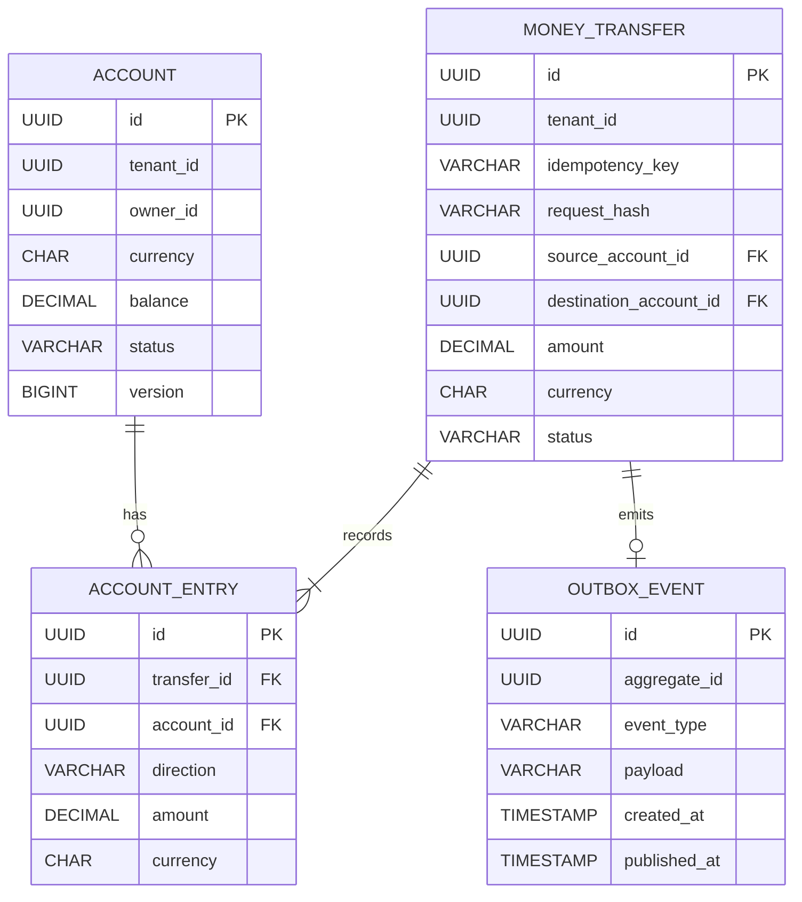

# Building Money Transfers with Transactions and Data Invariants

A money transfer is a classic example showing why database operations must be designed around **transactions** and **data invariants**. When transferring funds from account A to account B, the system must ensure that if money is debited from A, it is also credited to B; an account must never go negative if business rules forbid overdrafts; the same request must never be recorded twice when a client retries; and a success notification must never be emitted when the transaction has rolled back.

With Spring Data R2DBC, database operations are represented as `Mono`/`Flux`. A transaction must span the entire reactive pipeline involved, using the proper `ReactiveTransactionManager` and the same `ConnectionFactory`. Never call `subscribe()` or `block()` between transfer steps just to "get it done", because doing so detaches work from the transaction context and can cause the service to return before the work completes.

A safe transfer flow typically consists of:

1. Authenticating the requester and validating input data.
2. Ensuring the request carries an idempotency key so retries do not create duplicate transfers.
3. Verifying both accounts are valid and use the same currency.
4. Debiting the source account with an `UPDATE` conditioned on sufficient balance.
5. Crediting the destination account.
6. Recording the transfer and corresponding ledger entries.
7. Writing an outbox event if post-commit notifications are needed.
8. Committing all changes in the same transaction.

If any mandatory step fails, the transaction must roll back so balances, transfer records, the ledger, and the outbox never end up in a half-applied state.

## 1. Defining business invariants before writing code

Before designing repositories or SQL, write down the rules that must always hold after every successful transfer.

For a domestic, zero-fee transfer, invariants typically include:

- The transfer amount must be greater than 0.
- The source and destination accounts must be distinct.
- Both accounts must exist, be active, and belong to the proper tenant/business scope.
- The actor must be authorized to transfer funds from the source account.
- The source account must have sufficient available balance.
- Both accounts must use the same currency unless currency conversion is performed.
- No account balance may become negative if business rules disallow overdrafts.
- An idempotency key represents a single request with identical content.
- A successful transfer must have its full set of corresponding ledger entries.
- Balance updates, the transfer record, ledger entries, and outbox events must commit atomically.

Without fees or currency conversion, the combined balance of both accounts remains constant:

\[
Balance_A^{after} + Balance_B^{after}
= Balance_A^{before} + Balance_B^{before}
\]

For a transfer amount (x > 0):

\[
Balance_A^{after} = Balance_A^{before} - x
\]

\[
Balance_B^{after} = Balance_B^{before} + x
\]

These are use-case invariants, not merely UI display rules. They must be enforced at the service layer, in SQL statements, and in database constraints wherever possible.

## 2. Minimal data model

A simple example has three core data groups:

- `account`: current balance state.
- `money_transfer`: details of a transfer request.
- `account_entry`: debit/credit ledger entries recording balance movements.

An `outbox_event` table can be added to publish events to external systems after transaction commit.



Columns and data types should be adapted to your database. `UUID`, `DECIMAL`, and `TIMESTAMP` in the diagram are conceptual types; SQL Server, PostgreSQL, and other RDBMS engines have their own type names and semantics.

### 2.1 The account table

Example DDL:

```sql
CREATE TABLE account (
    id UUID PRIMARY KEY,
    tenant_id UUID NOT NULL,
    owner_id UUID NOT NULL,
    currency CHAR(3) NOT NULL,
    balance DECIMAL(19, 4) NOT NULL,
    status VARCHAR(20) NOT NULL,
    version BIGINT NOT NULL DEFAULT 0,
    created_at TIMESTAMP NOT NULL,
    modified_at TIMESTAMP NOT NULL,
    CONSTRAINT ck_account_balance_nonnegative CHECK (balance >= 0),
    CONSTRAINT ck_account_status CHECK (status IN ('ACTIVE', 'FROZEN', 'CLOSED'))
);
```

`CHECK (balance >= 0)` is the final safeguard for the non-negative invariant. If the system permits overdrafts, model explicit credit limits instead of dropping the constraint with no replacement rule.

`DECIMAL(19,4)` is an example of exact decimal storage. Actual scale depends on the currency and storage policy. Some currencies have 0 decimal places while others have 2 or 3; the system must define clear normalization and rounding rules.

### 2.2 The money_transfer table

```sql
CREATE TABLE money_transfer (
    id UUID PRIMARY KEY,
    tenant_id UUID NOT NULL,
    idempotency_key VARCHAR(120) NOT NULL,
    request_hash VARCHAR(64) NOT NULL,
    source_account_id UUID NOT NULL REFERENCES account(id),
    destination_account_id UUID NOT NULL REFERENCES account(id),
    amount DECIMAL(19, 4) NOT NULL,
    currency CHAR(3) NOT NULL,
    status VARCHAR(20) NOT NULL,
    created_at TIMESTAMP NOT NULL,
    completed_at TIMESTAMP,
    CONSTRAINT ck_transfer_amount_positive CHECK (amount > 0),
    CONSTRAINT ck_transfer_different_accounts
        CHECK (source_account_id <> destination_account_id),
    CONSTRAINT uq_transfer_idempotency UNIQUE (tenant_id, idempotency_key)
);
```

The unique constraint on `(tenant_id, idempotency_key)` enables the database to prevent two transactions from recording the same request within the same tenant. If idempotency keys are scoped per user or per account, choose a unique key matching the API contract, such as `(tenant_id, actor_id, idempotency_key)`.

Do not rely solely on clients promising to send unique keys. The database must enforce uniqueness because two requests can arrive concurrently on different instances.

### 2.3 The account_entry table for the ledger

```sql
CREATE TABLE account_entry (
    id UUID PRIMARY KEY,
    transfer_id UUID NOT NULL REFERENCES money_transfer(id),
    account_id UUID NOT NULL REFERENCES account(id),
    direction VARCHAR(10) NOT NULL,
    amount DECIMAL(19, 4) NOT NULL,
    currency CHAR(3) NOT NULL,
    created_at TIMESTAMP NOT NULL,
    CONSTRAINT ck_entry_direction CHECK (direction IN ('DEBIT', 'CREDIT')),
    CONSTRAINT ck_entry_amount_positive CHECK (amount > 0),
    CONSTRAINT uq_transfer_account_direction
        UNIQUE (transfer_id, account_id, direction)
);
```

For a domestic, zero-fee transfer, the system writes one `DEBIT` entry on the source account and one `CREDIT` entry on the destination account. Both entries store a positive `amount`; the `direction` field establishes accounting semantics. This is easy to read and avoids negative numbers with ambiguous semantics.

Ledgers are typically designed as append-only: never edit or delete old entries to "fix a balance". When adjustments are needed, create a compensating transaction (reversal/adjustment) referencing the original transfer.

## 3. Using BigDecimal for money

Never use `double` or `float` to represent monetary amounts because binary floating-point numbers cannot represent many decimal fractions accurately. Use `BigDecimal` in Java and `DECIMAL`/`NUMERIC` in the database.

```java
BigDecimal amount = new BigDecimal("125.50");
```

Never construct monetary values from `double` literals:

```java
// Avoid this.
BigDecimal amount = new BigDecimal(125.50);
```

Amounts should be created from validated strings or exact decimal types. Do not allow clients to send monetary values as JSON floating-point numbers and convert them loosely without defining scale.

### 3.1 Normalizing scale and rounding

The application must determine scale per currency or product rule. Example using Java's `Currency`:

```java
BigDecimal normalizeAmount(BigDecimal amount, Currency currency) {
    if (amount == null || amount.signum() <= 0) {
        throw new InvalidTransferAmountException();
    }

    int scale = currency.getDefaultFractionDigits();
    if (scale < 0) {
        throw new UnsupportedCurrencyException(currency.getCurrencyCode());
    }

    try {
        return amount.setScale(scale, RoundingMode.UNNECESSARY);
    } catch (ArithmeticException error) {
        throw new InvalidTransferAmountException(error);
    }
}
```

`RoundingMode.UNNECESSARY` rejects values with more decimal places than the currency allows instead of silently rounding them. If the product permits rounding, choose an explicit rounding rule and apply it consistently across API, service, ledger, and database.

`Currency.getDefaultFractionDigits()` is a standard baseline, not a substitute for product currency policy. Certain asset types, internal units, or special currencies follow custom rules. Manage supported currencies and scales explicitly in your domain.

### 3.2 Comparing BigDecimal

`BigDecimal.equals()` checks scale as well, so `10.0` and `10.00` are not equal under `equals`. When comparing numeric magnitudes, use `compareTo`:

```java
if (amount.compareTo(BigDecimal.ZERO) <= 0) {
    throw new InvalidTransferAmountException();
}
```

When persisting and reading values, verify the database does not round unexpectedly and column precision accommodates maximum balances. If a credit overflows column precision, the database must raise an error and the transaction must roll back.

## 4. Separating requests, commands, and authenticated actors

An HTTP request may contain:

```json
{
  "sourceAccountId": "...",
  "destinationAccountId": "...",
  "amount": "125.50",
  "currency": "USD",
  "idempotencyKey": "client-generated-unique-key"
}
```

Never trust an actor or owner sent in the request body. The server extracts the actor ID from the authenticated security context and passes it into the use case. The service must verify the actor has permission to transfer from the source account while enforcing tenant boundaries.

An internal command can look like:

```java
public record TransferCommand(
    UUID tenantId,
    UUID actorId,
    UUID sourceAccountId,
    UUID destinationAccountId,
    BigDecimal amount,
    Currency currency,
    String idempotencyKey,
    String requestHash
) {}
```

`tenantId` and `actorId` in the command come from the trusted server context. Never let clients specify a tenant or actor to bypass authorization. `requestHash` is a deterministic fingerprint of the normalized business payload, not a password or token.

Before opening a transaction, you can validate pure checks such as:

- `amount` is valid and normalized to the currency scale.
- `source` and `destination` are distinct.
- `currency` is in the supported list.
- `idempotencyKey` has valid length and format.
- `reason` or metadata respects size limits if required by the API.

Existence, ownership, and account status checks still must be verified from the database inside the appropriate transaction.

## 5. Configuring the reactive transaction manager

Spring Data R2DBC uses `R2dbcTransactionManager` to manage transactions for a `ConnectionFactory`:

```java
@Configuration
public class R2dbcTransactionConfiguration {

    @Bean
    ReactiveTransactionManager r2dbcTransactionManager(
            ConnectionFactory connectionFactory) {
        return new R2dbcTransactionManager(connectionFactory);
    }

    @Bean
    TransactionalOperator transactionalOperator(
            ReactiveTransactionManager transactionManager) {
        return TransactionalOperator.create(transactionManager);
    }
}
```

In applications with multiple `ConnectionFactory` beans, specify explicit qualifiers for each factory and transaction manager. A reactive transaction manager only manages transactions on the connection factory it is configured with.

Spring Boot often auto-configures these beans based on dependencies and properties. When using multiple databases or custom configuration, inspect the active beans to avoid defining two transaction managers ambiguously.

## 6. How do reactive transactions differ from imperative transactions?

In reactive transactions, Spring propagates the transaction context through the Reactor Context. All database operations participating in the transaction must belong to the same reactive chain and use the same `ConnectionFactory`.

Never do this:

```java
// Wrong: subscribe detaches work from the caller-managed pipeline.
accountRepository.debit(sourceId, amount).subscribe();
return accountRepository.credit(destinationId, amount);
```

Never do this:

```java
// Wrong: blocking mid-chain breaks reactive composition
// and can cause deadlocks or blocking on an inappropriate thread.
Account source = accountRepository.findById(sourceId).block();
```

Chain publishers using `flatMap`, `then`, `zip`, or other reactive operators and return the composed publisher to Spring/the caller:

```java
return debit(sourceId, amount)
    .then(credit(destinationId, amount));
```

The snippet above only chains execution order; to be atomic, the entire chain must execute inside a transaction boundary.

## 7. Choosing @Transactional or TransactionalOperator

There are two common approaches.

### 7.1 @Transactional annotation

```java
@Service
public class TransferService {

    @Transactional(transactionManager = "r2dbcTransactionManager")
    public Mono<TransferReceipt> transfer(TransferCommand command) {
        return executeTransfer(command);
    }
}
```

Spring wraps the returned reactive publisher in a transaction when the method is invoked through a Spring proxy. Keep in mind:

- The method must be called through the transaction-managing proxy.
- Self-invocation within the same object bypasses the proxy and skips the annotation.
- The method must return `Mono`/`Flux` so the transaction interceptor manages the reactive lifecycle.
- Never subscribe internally and return a different publisher.
- Select the right transaction manager when multiple databases exist.

### 7.2 TransactionalOperator

`TransactionalOperator` fits well when you want the transaction boundary explicit inside the reactive chain:

```java
Mono<TransferReceipt> result = transactionalOperator.transactional(
    executeTransfer(command));
```

This composes cleanly with transaction-wide retries, idempotency handling, and dynamically constructed pipelines. Avoid wrapping the same operation in both `@Transactional` and `TransactionalOperator` without a clear reason; nested transactions complicate semantics.

## 8. Do not rely on read-then-save to protect balances

An easy-to-write pattern that suffers from race conditions:

```java
return accountRepository.findById(sourceId)
    .flatMap(source -> {
        if (source.getBalance().compareTo(amount) < 0) {
            return Mono.error(new InsufficientFundsException());
        }

        source.setBalance(source.getBalance().subtract(amount));
        return accountRepository.save(source);
    });
```

Two requests can concurrently read a balance of `100`. Each tries to transfer `80`; both see sufficient funds, and both then write a balance of `20` or overwrite each other depending on the update mechanism. Without appropriate locking or a version predicate, the system can allow two transfers exceeding the balance.

Reading the balance for display or preliminary validation does not replace an atomic update. The rule "balance is still sufficient at the exact moment of update" must live in the SQL statement or be enforced by a lock/version mechanism.

## 9. Debiting with a conditional UPDATE

A safer pattern lets the database check and subtract in a single statement:

```sql
UPDATE account
SET balance = balance - :amount,
    version = version + 1,
    modified_at = :now
WHERE id = :sourceAccountId
  AND tenant_id = :tenantId
  AND owner_id = :actorId
  AND currency = :currency
  AND status = 'ACTIVE'
  AND balance >= :amount;
```

The database evaluates the predicate and applies the update atomically on the row. If two requests contend on the same account, they cannot both succeed against a stale read balance: the second update must evaluate its predicate against the updated row state under the database's concurrency semantics.

With `DatabaseClient`:

```java
Mono<Long> debit(
        TransferCommand command,
        Instant now) {

    return databaseClient.sql("""
            UPDATE account
            SET balance = balance - :amount,
                version = version + 1,
                modified_at = :now
            WHERE id = :sourceAccountId
              AND tenant_id = :tenantId
              AND owner_id = :actorId
              AND currency = :currency
              AND status = 'ACTIVE'
              AND balance >= :amount
            """)
        .bind("amount", command.amount())
        .bind("now", now)
        .bind("sourceAccountId", command.sourceAccountId())
        .bind("tenantId", command.tenantId())
        .bind("actorId", command.actorId())
        .bind("currency", command.currency().getCurrencyCode())
        .fetch()
        .rowsUpdated();
}
```

If `rowsUpdated` is `1`, the debit updated exactly one row. If it is `0`, at least one condition failed: missing account, wrong tenant/owner, inactive status, currency mismatch, or insufficient funds. You can return a generic error to avoid leaking account state; if business rules require a detailed error, perform a controlled check within the transaction while still keeping `balance >= :amount` in the `UPDATE`.

Never pull the balance into Java and write a precomputed `SET balance = :newBalance`; that easily overwrites concurrent updates. Always apply relative updates against the current database value: `balance = balance - :amount`.

## 10. Crediting the destination account in the same transaction

After the debit succeeds, credit the destination account:

```sql
UPDATE account
SET balance = balance + :amount,
    version = version + 1,
    modified_at = :now
WHERE id = :destinationAccountId
  AND tenant_id = :tenantId
  AND currency = :currency
  AND status = 'ACTIVE';
```

Java example:

```java
Mono<Long> credit(
        TransferCommand command,
        Instant now) {

    return databaseClient.sql("""
            UPDATE account
            SET balance = balance + :amount,
                version = version + 1,
                modified_at = :now
            WHERE id = :destinationAccountId
              AND tenant_id = :tenantId
              AND currency = :currency
              AND status = 'ACTIVE'
            """)
        .bind("amount", command.amount())
        .bind("now", now)
        .bind("destinationAccountId", command.destinationAccountId())
        .bind("tenantId", command.tenantId())
        .bind("currency", command.currency().getCurrencyCode())
        .fetch()
        .rowsUpdated();
}
```

If the credit updates `0` rows, emit an error so the transaction rolls back the debit as well. Never return success merely because the source account was debited.

Database precision/range constraints can also cause the credit to fail—for instance, if the destination balance exceeds column precision. That failure must roll back the entire transfer.

## 11. Verifying affected row counts

Every critical update must verify the affected row count against the contract. You can write a helper:

```java
Mono<Void> requireExactlyOne(Mono<Long> rowsUpdated,
                             Supplier<? extends RuntimeException> error) {
    return rowsUpdated.flatMap(count -> {
        if (count == 1L) {
            return Mono.empty();
        }
        return Mono.error(error.get());
    });
}
```

If the source update returns `0`, emit the appropriate business exception. If the destination update returns `0`, emit an error indicating the destination account is ineligible to receive funds. If the driver reports a count other than `1`, treat it as an abnormal failure for a by-ID update.

Never use `onErrorComplete()` or `onErrorResume(error -> Mono.empty())` to swallow update errors. Suppressing the exception lets the pipeline continue writing ledger entries or returning a receipt even though balances were not updated properly.

## 12. Transfer records and idempotency keys

A client can submit a transfer, have the server process and commit it, and then lose the HTTP response to a timeout. Not knowing the outcome, the client retries. If the server treats it as a brand-new request, funds can be debited twice.

Idempotency keys solve this problem:

- The client generates a unique key for one transfer intent.
- Every retry of that intent reuses the same key.
- The database enforces a unique constraint over the chosen key scope.
- The server stores a fingerprint of the request payload alongside the key.
- If the key already exists with the same fingerprint, return the recorded result.
- If the key is reused with different content, return a conflict error.

Never generate a new idempotency key on each retry, and never reuse one key across independent actions.

### 12.1 Request fingerprint

Generate the fingerprint from normalized business data, such as tenant, actor, source, destination, scale-normalized amount, and currency:

```java
String canonical = String.join("|",
    command.tenantId().toString(),
    command.actorId().toString(),
    command.sourceAccountId().toString(),
    command.destinationAccountId().toString(),
    command.amount().toPlainString(),
    command.currency().getCurrencyCode());

String requestHash = sha256Hex(canonical);
```

`sha256Hex` is a SHA-256 helper. If fingerprints include low-entropy data or require probing resistance, consider an HMAC with a securely managed key. Never log raw requests or secrets when computing fingerprints.

Canonicalization must be deterministic: the same monetary amount must not yield different hashes due to scale differences (`10.0` vs. `10.00`) or field ordering. Normalize before hashing.

## 13. Recording the idempotency reservation inside the transaction

At the start of the transaction, insert `money_transfer` with status `PROCESSING`:

```sql
INSERT INTO money_transfer (
    id, tenant_id, idempotency_key, request_hash,
    source_account_id, destination_account_id,
    amount, currency, status, created_at
)
VALUES (
    :id, :tenantId, :idempotencyKey, :requestHash,
    :sourceAccountId, :destinationAccountId,
    :amount, :currency, 'PROCESSING', :createdAt
);
```

The reservation record participates in the same transaction as debit and credit. When all steps succeed, update the status to `COMPLETED`. If any step fails and the transaction rolls back, the reservation rolls back too, allowing the request to be retried per business policy.

If you also want to persist failed transfer attempts, design a separate attempt/failure history mechanism. You cannot roll back an entire transaction and expect a `FAILED` row written inside that same transaction to survive. You can write failure audits in an independent transaction after rollback, taking care that failure records are never mistaken for executed transfers.

## 14. Handling duplicate requests after the transaction ends

When two requests with the same idempotency key arrive concurrently, the unique constraint ensures only one transaction succeeds in reserving it. The other receives a duplicate/unique constraint error. After the duplicate request's transaction ends and rolls back, the service reads the transfer committed by the winning request:

```java
Mono<TransferReceipt> transfer(TransferCommand command) {
    Mono<TransferReceipt> attempt = Mono.defer(() ->
        transactionalOperator.transactional(executeOnce(command)));

    return attempt
        .retryWhen(deadlockRetry())
        .onErrorResume(error -> {
            if (!isIdempotencyKeyConflict(error)) {
                return Mono.error(error);
            }

            return findByIdempotencyKey(
                    command.tenantId(), command.idempotencyKey())
                .switchIfEmpty(Mono.error(error))
                .flatMap(existing -> {
                    if (!existing.requestHash().equals(command.requestHash())) {
                        return Mono.error(new IdempotencyKeyReuseException());
                    }
                    return Mono.just(toReceipt(existing));
                });
        });
}
```

Crucially, `onErrorResume` handles the duplicate error **outside** the publisher wrapped by `TransactionalOperator`. The failing transaction must finish and roll back before querying the existing record. On some databases, once a constraint error occurs, the current transaction enters an aborted state and cannot run further queries; therefore, never query the existing record inside the aborted transaction.

`isIdempotencyKeyConflict` must match only the idempotency constraint rather than swallowing every integrity error. A foreign key or check constraint violation does not mean the request was duplicated. Exception types, SQL states, and constraint names vary by driver and database; classify based on your actual system behavior.

If the stored record for the key has a different request hash, return a conflict instead of returning the earlier transfer's receipt. Never allow a client to reuse a key to change request contents while receiving an old result.

## 15. Composing the transfer flow in a reactive transaction

A service can orchestrate all steps with `TransactionalOperator`:

```java
Mono<TransferReceipt> executeOnce(TransferCommand command) {
    UUID transferId = UUID.randomUUID();
    Instant now = clock.instant();

    return validateAccounts(command)
        .then(insertTransferReservation(transferId, command, now))
        .then(requireExactlyOne(
            debit(command, now),
            InsufficientFundsOrSourceUnavailableException::new))
        .then(requireExactlyOne(
            credit(command, now),
            DestinationAccountUnavailableException::new))
        .then(insertDebitEntry(transferId, command, now))
        .then(insertCreditEntry(transferId, command, now))
        .then(markTransferCompleted(transferId, now))
        .then(insertTransferOutboxEvent(transferId, command, now))
        .thenReturn(new TransferReceipt(
            transferId,
            TransferStatus.COMPLETED,
            command.amount(),
            command.currency()));
}
```

This illustrates the orchestration structure. Helpers like `validateAccounts`, `insertTransferReservation`, `insertDebitEntry`, `insertCreditEntry`, `markTransferCompleted`, and `insertTransferOutboxEvent` must all return composable publishers without subscribing manually or creating separate transactions. `UUID` and timestamps can be generated per logical attempt; if a transaction retries, decide explicitly whether IDs/timestamps stay fixed or are regenerated. The idempotency key is the stable identifier across client retries.

Wrap the transaction and retry at the call boundary:

```java
Mono<TransferReceipt> executeTransaction(TransferCommand command) {
    return Mono.defer(() -> transactionalOperator.transactional(
        executeOnce(command)));
}
```

`Mono.defer` builds a fresh transactional publisher for each subscription/retry. When `executeOnce` emits an error before completion, `TransactionalOperator` rolls back the participating operations.

## 16. A more complete service example

The snippet below shows boundaries and ordering; DTOs, SQL mapping, and exception classification are delegated to helpers for clarity:

```java
@Service
public class MoneyTransferService {

    private final TransactionalOperator transactions;
    private final TransferPersistence persistence;
    private final Clock clock;

    public MoneyTransferService(
            TransactionalOperator transactions,
            TransferPersistence persistence,
            Clock clock) {
        this.transactions = transactions;
        this.persistence = persistence;
        this.clock = clock;
    }

    public Mono<TransferReceipt> transfer(TransferCommand command) {
        validateCommand(command);

        Mono<TransferReceipt> attempt = Mono.defer(() ->
            transactions.transactional(executeOnce(command)));

        return attempt
            .retryWhen(deadlockRetry())
            .onErrorResume(error ->
                handleIdempotencyConflict(error, command));
    }

    private Mono<TransferReceipt> executeOnce(TransferCommand command) {
        UUID transferId = UUID.randomUUID();
        Instant now = clock.instant();

        return persistence.validateAccounts(command)
            .then(persistence.insertReservation(transferId, command, now))
            .then(persistence.debit(command, now))
            .flatMap(count -> requireOne(count,
                new InsufficientFundsOrSourceUnavailableException()))
            .then(persistence.credit(command, now))
            .flatMap(count -> requireOne(count,
                new DestinationAccountUnavailableException()))
            .then(persistence.insertLedgerEntries(transferId, command, now))
            .then(persistence.completeTransfer(transferId, now))
            .then(persistence.insertOutboxEvent(transferId, command, now))
            .thenReturn(new TransferReceipt(
                transferId,
                TransferStatus.COMPLETED,
                command.amount(),
                command.currency()));
    }

    private Mono<Void> requireOne(Long count, RuntimeException error) {
        return count == 1L ? Mono.empty() : Mono.error(error);
    }
}
```

`TransferPersistence` is an adapter using a single `DatabaseClient`/`ConnectionFactory` to execute SQL statements. `handleIdempotencyConflict` reads the committed result only after the transaction fails due to the idempotency unique constraint. `deadlockRetry()` retries only transient deadlock/serialization errors.

In production code, `validateCommand` should emit clear errors for invalid amounts, currencies, keys, or account IDs. Ownership checks must live in persistence predicates or trusted queries; never rely on client-supplied owner values.

## 17. Checking accounts inside the transaction

Before updating, you can query metadata for both accounts to differentiate failure reasons:

```sql
SELECT id, tenant_id, owner_id, currency, status
FROM account
WHERE tenant_id = :tenantId
  AND id IN (:sourceAccountId, :destinationAccountId);
```

The service verifies:

- Both accounts exist.
- The source account belongs to the current actor.
- Both accounts are active.
- Currencies match the command's currency.
- Both IDs are distinct.

This pre-check improves business error reporting, but does not replace conditions inside `UPDATE`. An account can be frozen or altered between the check and the update; therefore, debit and credit statements must still keep `status = 'ACTIVE'`, currency, tenant, and owner predicates.

If ownership or currency is immutable after account creation, constraints and update permissions can enforce that. If they can change concurrently, use locks or re-check them in the update predicates.

## 18. Choosing a transaction isolation level

The isolation level governs how concurrent transactions see and lock rows. The default is often `READ_COMMITTED`, depending on the database and configuration. For money transfers, conditional `UPDATE` statements and database constraints form the foundation protecting balances.

Do not blindly upgrade every transfer to `SERIALIZABLE` without measuring. Higher isolation increases locking, blocking, or serialization failures, and the application must retry those errors properly if used.

Questions to verify:

- Does the conditional update prevent overdrawing on the target database?
- Can both accounts be updated concurrently by multiple threads or other services?
- Are there complex multi-row invariants needing locks or serializable isolation?
- Is transaction duration short and free of external network calls?
- How are deadlocks and serialization failures detected and handled?

When using `TransactionalOperator` with custom isolation, configure the `TransactionDefinition` before creating the operator. Never alter isolation via ad-hoc SQL mid-transaction unless your database explicitly supports those semantics.

## 19. Pessimistic locking and SELECT FOR UPDATE

One option is locking both account rows before reading balances, then validating and updating inside the transaction. On PostgreSQL, you can use:

```sql
SELECT id, balance, currency, status
FROM account
WHERE id IN (:sourceAccountId, :destinationAccountId)
ORDER BY id
FOR UPDATE;
```

`FOR UPDATE` holds row locks until the transaction ends. `ORDER BY id` acquires locks in a deterministic order, helping reduce deadlocks when concurrent transfers touch the same pair of accounts.

Locking syntax varies across databases. SQL Server often uses table hints like `UPDLOCK`/`ROWLOCK` depending on the situation; MySQL/InnoDB has its own semantics. Never assume one `FOR UPDATE` query behaves identically across every dialect.

Even with row locks, you still need:

- Proper transaction boundaries.
- Short lock hold times.
- Consistent lock ordering across all use cases.
- Balance and currency checks inside the transaction.
- Database constraints protecting invariants.
- Deadlock and timeout handling.

Never hold locks while making HTTP calls, sending emails, or waiting for user confirmation.

## 20. Optimistic locking with @Version

Spring Data Relational supports optimistic locking via `@Version` in Spring Data–managed entity operations:

```java
@Table("account")
public class Account {

    @Id
    private UUID id;

    private BigDecimal balance;

    @Version
    private Long version;
}
```

When saving a versioned entity, Spring Data includes the current version in the update predicate and increments it on success. If another transaction modified the row in the meantime, zero rows match and Spring Data throws `OptimisticLockingFailureException`.

Optimistic locking fits scenarios where contention is low and updates go through version-aware entity mappings. If you write custom `UPDATE account SET balance = ...` SQL via `DatabaseClient`, `@Version` does not automatically inject predicates or increment versions; you must write `WHERE version = :expectedVersion` and check `rowsUpdated()` manually.

For financial balances, a direct SQL conditional update `balance >= :amount` remains essential whether or not optimistic versioning is used. `@Version` does not replace balance checks.

## 21. Deadlocks when two transfers run in opposite directions

Suppose two transactions run concurrently:

- T1 transfers from A to B: locks/updates A first.
- T2 transfers from B to A: locks/updates B first.
- T1 next needs a lock on B.
- T2 next needs a lock on A.

Both transactions wait on each other until the database detects a deadlock and aborts one. This is not necessarily a logic bug; it is a concurrency outcome the application must handle.

Ways to reduce deadlocks:

- Lock both accounts in a deterministic ID order before updating.
- Keep transactions short and avoid unnecessary queries while holding locks.
- Index update predicates to minimize lock footprints.
- Never make network calls inside a transaction.
- Apply bounded retries for recognized deadlock/serialization failures.

Never retry every error. Insufficient funds, frozen accounts, invalid currencies, and permission denials will not succeed upon retry.

## 22. Retry the entire transaction, not a single step

If a transaction is rolled back by the database due to a deadlock, open a new transaction and rerun the entire workflow. Never retry only the credit statement after the debit rolled back or after the current transaction aborted.

Reactor example:

```java
Retry deadlockRetry() {
    return Retry.backoff(3, Duration.ofMillis(100))
        .maxBackoff(Duration.ofSeconds(1))
        .filter(this::isRetryableConcurrencyFailure);
}
```

Wrap the retry outside the transactional publisher:

```java
Mono.defer(() -> transactionalOperator.transactional(executeOnce(command)))
    .retryWhen(deadlockRetry());
```

Each resubscription starts a new transaction. `isRetryableConcurrencyFailure` must detect deadlock/serialization failures by exception type, SQL state, or database vendor code. Never blindly retry ambiguous timeouts where the operation might already have committed; use idempotency keys to resolve unknown outcomes.

Cap retry attempts and use backoff to avoid amplifying load when the database is saturated. Emit metrics for retry counts and concurrency-induced transfer failures.

## 23. Writing double-entry ledger records

After debit and credit succeed, write two ledger entries in the same transaction:

```java
Mono<Void> insertLedgerEntries(
        UUID transferId,
        TransferCommand command,
        Instant now) {

    return insertEntry(
            transferId,
            command.sourceAccountId(),
            "DEBIT",
            command.amount(),
            command.currency(),
            now)
        .then(insertEntry(
            transferId,
            command.destinationAccountId(),
            "CREDIT",
            command.amount(),
            command.currency(),
            now));
}
```

Each entry must reference the transfer ID. A unique constraint on `(transfer_id, account_id, direction)` prevents duplicate entries for the same transfer. Both entries must be written in the same transaction as the balance updates.

In a general accounting ledger, debits and credits are typically modeled against ledger accounts with balanced debit/credit totals. The example here models a transfer between two customer accounts. If fees, taxes, clearing accounts, or currency conversions exist, add the corresponding entries and define explicit accounting invariants per currency.

## 24. Current balance and the ledger serve different roles

`account.balance` can serve as a materialized balance for fast reads, while `account_entry` stores movement history. The system must enforce rules keeping them consistent:

- Every balance change must have a corresponding ledger entry.
- Ledger entries are never arbitrarily edited or deleted.
- Balances can be reconciled against summed ledger entries given opening balances and entry directions.
- Adjustments are recorded as new entries rather than silently rewriting history.
- A reconciliation job detects discrepancies and raises alerts.

If the ledger is the source of truth, the current balance is a projection/snapshot maintained synchronously inside the transaction. Never update `balance` in one transaction and write ledger entries asynchronously without an outbox or consistency mechanism.

## 25. Writing to an outbox instead of sending messages inside the transaction

After a successful transfer, the system may need to send emails, push notifications, or events to other services. Never send them directly inside the transaction:

```java
// Avoid: the message may be sent even if the database transaction later rolls back.
return debit(...)
    .then(credit(...))
    .then(notificationClient.sendTransferCompleted(...));
```

An HTTP call or broker publish does not roll back with the database. If publishing succeeds and the commit fails, downstream systems see a transfer that never happened. If the commit succeeds and publishing fails, the notification is lost.

The transactional outbox solves this by writing an event into an outbox table in the same transaction:

```sql
INSERT INTO outbox_event (
    id, aggregate_id, event_type, payload, created_at, published_at
)
VALUES (
    :id, :transferId, 'TransferCompleted', :payload, :createdAt, NULL
);
```

A separate worker reads unpublished events, sends them to the broker, and marks them published. The worker must handle at-least-once delivery; consumers must be idempotent by event ID because an event can be re-sent if the worker crashes after publishing but before marking it published.

Never use `AfterSaveCallback` or `doOnSuccess` to trigger side effects assuming the transaction committed. Save callbacks do not mean after-commit.

## 26. Transactions do not span multiple databases automatically

`R2dbcTransactionManager` manages a single `ConnectionFactory`. If accounts live in database A, the ledger in database B, and the outbox in database C, a standard R2DBC transaction will not atomically commit or roll back across all three as a distributed transaction.

When transfers require atomicity, place all mandatory tables for the transaction in the same transactional database/bounded context if architecture permits. If coordinating across multiple databases or services is unavoidable, design a supported distributed transaction or a saga with compensating steps, outbox events, and explicit workflow states.

Never call an external service to "credit destination" while the source database holds locks expecting a local transaction to protect both. Network calls can time out, the destination service can commit while the response is lost, and the source transaction cannot roll back that remote commit.

## 27. Handling fees and currency conversion

The basic example assumes same-currency accounts and no fees. With fees, the sum of the two customer account balances is no longer conserved by a simple formula. Identify the fee-receiving account and record the corresponding ledger entries.

With currency conversion, you cannot debit one amount and credit the exact same numeric amount across two different currencies. Store:

- Source amount and currency.
- Destination amount and currency.
- Exchange rate and rate source/timestamp.
- Fees, spread, and rounding rules.
- Ledger postings per currency and account.
- Rules handling rate expiration or changes after a quote is accepted.

Each currency has its own invariant. Never sum USD and EUR balances to claim conservation of funds without a clear valuation rule.

## 28. Transfer states and state transition rules

A simple model can use:

| Status | Meaning |
|---|---|
| `PROCESSING` | Reservation created inside the active transaction. |
| `COMPLETED` | Debit, credit, ledger, and mandatory outbox written and committed. |
| `FAILED` | A failed attempt persisted via a separate flow if failure history is required. |
| `REVERSED` | A completed transfer offset by a reversal transaction. |

When `PROCESSING` is inserted and updated to `COMPLETED` in the same transaction, other transactions typically never see the uncommitted intermediate state. If a workflow involves long-running external steps outside the database, `PROCESSING` becomes a durable state requiring leases, timeouts, retries, reconciliation, and explicit completion rules. Never conflate the semantics of those two models.

Never mutate a completed transfer to `FAILED` to hide an error. When a transfer must be undone, create a reversal record and offsetting ledger entries linked to the original transfer.

## 29. Protecting against concurrent updates and lost updates

Beyond conditional debits, audit every code path capable of changing `balance`. If another job executes `SELECT balance` followed by `save` on a stale entity, it can overwrite a balance updated by a concurrent transfer.

Enforce these rules:

- Route all balance changes through a single persistence adapter/use case sharing the same concurrency rules.
- Never let admin scripts update balances directly while bypassing the ledger.
- Use relative SQL updates or version predicates rather than overwriting with stale balances.
- When using optimistic locking, treat conflicts as concurrency outcomes.
- Restrict database permissions so outside tools cannot bypass application rules.
- Reconcile the ledger against balances periodically.

An invariant is only as strong as every write path touching the data. One safe transfer method cannot protect balances if another endpoint sets `balance = 0` without writing a ledger entry.

## 30. Testing with StepVerifier

Because the service returns `Mono<TransferReceipt>`, use `StepVerifier` to verify reactive outputs:

```java
StepVerifier.create(transferService.transfer(command))
    .assertNext(receipt -> {
        assertThat(receipt.status()).isEqualTo(TransferStatus.COMPLETED);
        assertThat(receipt.amount()).isEqualByComparingTo("25.00");
    })
    .verifyComplete();
```

This tests reactive signals and the returned receipt. It does not prove balances, ledger rows, or transaction behavior; query the database after the publisher completes to verify side effects.

## 31. Integration test for the happy path

Seed two accounts in the test database:

- A starts with 100.00 USD.
- B starts with 20.00 USD.
- Transfer 30.00 USD from A to B.

After the transfer completes, verify:

- A has 70.00 USD.
- B has 50.00 USD.
- One `COMPLETED` transfer is persisted.
- Exactly two ledger entries exist: one `DEBIT` and one `CREDIT`.
- One corresponding outbox event exists if required by the use case.
- The combined balance of both accounts before and after is identical.

Use a real database or Testcontainers with the same engine and driver to verify transactions and constraints. Mock repositories cannot prove row locking, isolation, or database rollbacks behave properly.

## 32. Testing rollback when credit fails

Set up a reproducible scenario where the destination account is invalid or closed mid-flow. After the service emits an error:

- Source balance remains unchanged.
- Destination balance remains unchanged.
- No committed `COMPLETED` transfer exists.
- No one-sided ledger entry exists.
- No outbox event exists for the failed transfer.

This is the single most important test proving debit and credit share the same transaction. If the source balance drops despite a credit failure, your transaction boundary, connection, or transaction manager configuration is broken.

## 33. Testing insufficient funds

Given A with 10.00, request a transfer of 15.00. Expected outcome:

- The publisher emits `InsufficientFunds...` or the service's rejection error.
- Balance of A is unchanged.
- Balance of B is unchanged.
- No ledger entries are written.
- The transfer reservation rolls back if inside the same transaction.
- No success outbox event is written.

Specifically verify that `UPDATE ... WHERE balance >= :amount` returns `rowsUpdated = 0` and the service does not proceed to credit.

## 34. Testing idempotency

Submit the same command twice with the same idempotency key:

1. The first call completes and returns transfer ID X.
2. The second call returns X or the stored receipt per API contract.
3. Balances change only once.
4. Only one transfer and two ledger entries exist for that transfer.
5. Only one logical outbox event exists for that transfer.

Next, send the same key with a different amount or account. The system must return a conflict without altering balances.

Critical concurrency test: fire two requests with the same key simultaneously on two subscriptions and verify the unique constraint allows only one reservation. The duplicate request can retrieve the receipt of the committed transfer after handling the conflict.

## 35. Testing two transfers competing for the same balance

Suppose A has 100.00 and two independent requests each try to transfer 80.00 from A to different destination accounts.

Correct outcome:

- Exactly one transfer succeeds.
- The other is rejected for insufficient funds or encounters a conflict handled per policy.
- A retains 20.00.
- Total credited across both destinations is 80.00, not 160.00.
- No negative balance occurs.

You can run both publishers concurrently via `Mono.whenDelayError` or `Flux.merge`, depending on how the test collects successes and errors. Ensure both requests actually run concurrently; sequential execution does not test race conditions.

## 36. Testing deadlocks and retries

Trigger opposing transfers between A and B or use controlled concurrency tests to provoke a deadlock on a supporting database. Verify:

- The database aborts one transaction according to deadlock semantics.
- The service retries only recognized deadlock errors.
- Each retry starts a new transaction and reruns the full workflow.
- Idempotency prevents duplicate transfers or ledger rows.
- Upon completion, balance and ledger invariants remain intact.
- Retries are bounded and never loop infinitely when the database is overloaded.

Do not merely mock a deadlock exception and assume database lock ordering works. Run integration tests against a real database to verify locking behavior.

## 37. Testing transactions with the same ConnectionFactory

All of these operations must join the same transaction when atomicity is required:

- Inserting the transfer reservation.
- Debiting the source account.
- Crediting the destination account.
- Inserting both ledger entries.
- Updating the transfer status.
- Inserting the outbox event.

If a repository or `DatabaseClient` is wired to a different `ConnectionFactory`, its work may run outside the active transaction. Verify bean wiring, qualifiers, and transaction manager configuration in integration tests.

Never assume two `DatabaseClient` instances pointing to the same URL share a transaction resource. They must participate in the same Spring-managed connection/transaction context and typically share the same `ConnectionFactory` bean.

## 38. Handling HTTP outcomes

The API can map outcomes according to the contract:

| Case | Suggested HTTP response |
|---|---|
| Transfer completed | `201 Created` or `200 OK` with transfer receipt. |
| Invalid request, non-positive amount | `400 Bad Request`. |
| Insufficient funds | `422 Unprocessable Content` or API-defined business code. |
| Idempotency key reused with different payload | `409 Conflict`. |
| Account missing or unauthorized | `404` or `403` per account-disclosure policy. |
| Deadlock retries exhausted | Transient error such as `503` or appropriate server error. |
| Database unavailable | Typically `503 Service Unavailable`. |

Never expose SQL, constraint names, stack traces, or balances of accounts the actor is unauthorized to inspect. Log internally with controlled request/trace IDs, omitting tokens and authentication credentials.

## 39. Anti-patterns to avoid

| Anti-pattern | Consequence |
|---|---|
| Debit and credit in separate transactions | Source can be debited without crediting destination. |
| Reading balance and writing a new value from Java | Race conditions and lost updates. |
| Using `double` for amounts | Decimal precision errors. |
| Missing unique idempotency constraint | Retries or concurrent requests can transfer funds twice. |
| Catching all exceptions and returning success | Masks persistence failures and corrupts state. |
| Calling `subscribe()` inside the service | Detaches work from the transaction and caller lifecycle. |
| Calling `block()` mid-reactive chain | Blocks threads, risks deadlocks, or drops transaction context. |
| Sending emails/messages before commit | Side effects persist even if the database rolls back. |
| Retrying only credit after debit | Can double-credit or leave inconsistent state. |
| Retrying all errors | Repeats business rejections and adds database load. |
| Writing ledger to a separate DB without coordination | Balance and ledger can diverge. |
| Checking only in the service without constraints | Other write paths can violate invariants. |
| Trusting client-supplied actor/tenant | Risks unauthorized transfers. |
| Holding row locks across network calls | Long transactions, deadlocks, and lock contention. |

## 40. Checklist for a money transfer use case

Before releasing, verify:

1. Amounts use `BigDecimal`, scale/currency are normalized, and amounts are positive.
2. Source and destination are distinct, belong to the same tenant, and share the same currency.
3. Actor comes from a trusted security context; source ownership is enforced server-side/database-side.
4. Debit enforces `balance >= amount` in the same `UPDATE` statement.
5. Credit failures emit errors and roll back the debit.
6. The account table enforces a non-negative balance constraint if required by business rules.
7. Transfers require a unique idempotency key and request fingerprint.
8. Duplicate keys are resolved after the failing transaction finishes; differing payloads return conflict.
9. Ledger debit/credit entries, transfer status, and outbox events are written in the same transaction.
10. All operations share the same `ConnectionFactory` and reactive transaction manager.
11. Deadlock retries are bounded and rerun the entire transaction.
12. Notifications are never sent directly before commit; use an outbox if needed.
13. Happy path, rollback, insufficient funds, idempotency, and concurrency are tested on a real database.
14. All other balance write paths obey the same invariants and write ledger entries.
15. Logs and traces never leak account credentials or sensitive data.

## 41. Layer-by-layer implementation sequence

You can build the use case in this order:

1. Define invariants and valid transfer states.
2. Design account, transfer, ledger, and outbox schemas with constraints and indexes.
3. Write pure validation for amount, currency, account IDs, and idempotency key.
4. Create a SQL persistence adapter with conditional debit/credit and `rowsUpdated` checks.
5. Configure `ReactiveTransactionManager`/`TransactionalOperator` bound to the right `ConnectionFactory`.
6. Compose reservation, debit, credit, ledger, completion, and outbox in a single transaction.
7. Handle idempotency duplicates and deadlocks outside the transaction boundary.
8. Build the API extracting the actor from the security context and ignoring client-supplied owner IDs.
9. Write rollback and concurrency integration tests before serving real traffic.
10. Add metrics for transfer success/failure, deadlock retries, duplicate keys, and transaction duration.

A safe money transfer is much more than two `UPDATE` statements. It is a business workflow backed by explicit invariants, database constraints, atomic updates, idempotency, and a reactive transaction encompassing every mandatory change. Spring Data R2DBC provides `R2dbcTransactionManager` and `TransactionalOperator` to compose steps within one transaction context, while `DatabaseClient` enables concurrency-safe conditional updates. A ledger and outbox provide durable auditability and event delivery. Combined with selective retries, testing on a real database, and strict access control, the system can handle concurrent requests, timeouts, and mid-flight failures while keeping balances and transaction history consistent.
