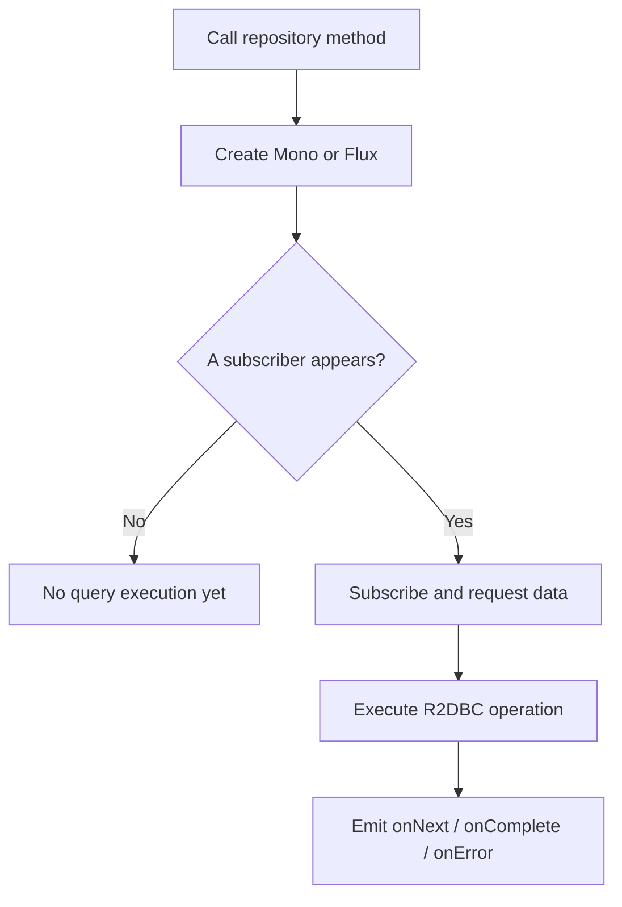

# Queries Not Running or Running Multiple Times Due to Subscription Handling

In Spring Data Relational R2DBC, repositories typically return `Mono<T>` or `Flux<T>`. These are reactive publishers: calling a method usually only builds a pipeline describing the work; the database query runs when a subscriber subscribes and requests data. Consequently, a query may never execute if its publisher is ignored, or execute multiple times if the same publisher is subscribed multiple times.

Common mistakes include calling `subscribe()` inside a service while still returning a publisher to WebFlux, calling `block()` to inspect results and then returning the same query, creating a publisher inside `map` without flattening, or calling a repository inside `doOnNext` while discarding the returned publisher. Conversely, multiple subscriptions can be intentional when using `retry`, `repeat`, multiple subscribers, or hot/cold publishers. Always identify who owns the subscription and how many times the publisher is subscribed before concluding the database or Spring Data is misbehaving.

## 1. A Reactive Publisher Is Not a Precomputed Result

A repository method returning `Mono`/`Flux` does not directly return an entity or a list of entities. It returns an asynchronous description of work to be performed:

```java
Mono<Customer> customerPublisher = customerRepository.findById(42L);
Flux<Customer> allCustomersPublisher = customerRepository.findAll();
```

Those two lines create publishers. In the standard reactive model, the database is not queried merely because a variable was assigned. The pipeline executes only when a subscriber subscribes and requests data.

Visualized:



A publisher is called cold when each subscription starts an independent execution. Spring Data R2DBC query publishers usually have cold semantics like this: each subscription can run the database operation again.

## 2. Who Subscribes in a WebFlux Application?

In an HTTP request handled by Spring WebFlux, the framework manages the subscription for the publisher returned by the controller. Controllers should return `Mono`/`Flux` so WebFlux binds the publisher to the HTTP exchange lifecycle:

```java
@RestController
@RequestMapping("/customers")
public class CustomerController {

    private final CustomerRepository repository;

    public CustomerController(CustomerRepository repository) {
        this.repository = repository;
    }

    @GetMapping("/{id}")
    public Mono<Customer> findById(@PathVariable Long id) {
        return repository.findById(id);
    }

    @GetMapping
    public Flux<Customer> findAll() {
        return repository.findAll();
    }
}
```

There is no need to call `subscribe()` in the controller. WebFlux subscribes to the publisher to produce the response, forwards errors to HTTP error handling, and cancels the subscription if the exchange is cancelled according to server lifecycle.

If a service is called from a component that does not subscribe to publishers automatically, that caller is responsible for subscribing or composing the publisher into another pipeline. Creating a publisher without a subscriber never triggers the query.

## 3. Queries Not Running Because the Publisher Was Discarded

A classic mistake is calling a repository without returning or composing its publisher:

```java
public Mono<Void> createCustomer(Customer customer) {
    customerRepository.save(customer); // Publisher is ignored.
    return Mono.empty();
}
```

`save()` returns a `Mono<Customer>`, but the code never uses it. Without a subscription, the insert never executes. Meanwhile, the method returns `Mono.empty()`, so the caller sees the request complete normally even though no data was saved.

Return the operation's publisher:

```java
public Mono<Customer> createCustomer(Customer customer) {
    return customerRepository.save(customer);
}
```

Or if only completion matters:

```java
public Mono<Void> createCustomer(Customer customer) {
    return customerRepository.save(customer).then();
}
```

`then()` still subscribes and waits for the upstream publisher to complete when the resulting publisher is subscribed; it simply discards the `Customer` value and emits `Mono<Void>`.

## 4. Calling `subscribe()` Manually Inside a Service Detaches the Flow

Anti-pattern:

```java
public Mono<Customer> createCustomer(Customer customer) {
    customerRepository.save(customer).subscribe();
    return Mono.just(customer);
}
```

Calling `subscribe()` starts an independent subscription. The service returns `Mono.just(customer)` almost immediately without waiting for the insert to finish. The caller may receive a success response before the database finishes writing or before an insert error occurs.

Consequences can include:

- The HTTP response does not reflect the database write outcome.
- SQL errors occur on a side flow and never reach the WebFlux error handler.
- Cancelling the HTTP request does not cancel the separately subscribed write.
- The caller's reactive transaction does not cover the detached flow as expected.
- Tests finish before the insert completes.
- Retries or shutdowns lose control over the detached work.

Let the caller/framework manage the subscription by returning the publisher:

```java
public Mono<Customer> createCustomer(Customer customer) {
    return customerRepository.save(customer);
}
```

In WebFlux applications, controllers return publishers; in services, compose publishers using Reactor operators. Only subscribe directly at boundaries that genuinely own independent work, such as a lifecycle coordinator or a command-line application managing its own subscriptions and shutdown.

## 5. Why Can the Same Publisher Run Multiple Times?

Cold publishers usually repeat their work for each subscription. Example:

```java
Mono<Customer> customer = customerRepository.findById(42L);

StepVerifier.create(customer)
        .expectNextCount(1)
        .verifyComplete();

StepVerifier.create(customer)
        .expectNextCount(1)
        .verifyComplete();
```

Two `verifyComplete()` calls create two subscriptions. `findById(42L)` can be sent to the database twice. Storing a publisher in a variable does not turn it into a cached result.

If only one read is needed, build a single pipeline and share the result within that pipeline:

```java
return customerRepository.findById(42L)
        .flatMap(customer -> buildResponse(customer));
```

Do not subscribe once to log/inspect and then subscribe again to return the result. Use observation operators like `doOnNext`, `doOnSuccess`, `doOnError`, or tracing inside the same pipeline.

## 6. `block()` Is Also a Subscription

`block()` subscribes to the publisher and waits synchronously for the result. If the same publisher is subsequently returned to WebFlux, WebFlux creates another subscription:

```java
public Mono<Customer> findCustomer(Long id) {
    Mono<Customer> publisher = customerRepository.findById(id);

    Customer customer = publisher.block(); // First subscription.

    return publisher; // WebFlux subscribes a second time.
}
```

This code both blocks a thread and runs the query twice. Calling `block()` on a WebFlux event-loop thread can also trigger blocking errors or degrade concurrency.

Process results with reactive operators:

```java
public Mono<CustomerResponse> findCustomer(Long id) {
    return customerRepository.findById(id)
            .map(CustomerResponse::from);
}
```

APIs like `blockOptional()`, `toFuture()`, or manual `subscribe` also trigger subscriptions. Treat them as execution entry points, not as reading an already-populated publisher.

## 7. `Mono.just()` Does Not Flatten an Inner Publisher

`Mono.just(value)` emits the exact value passed to it. If that value is a publisher, the result is a nested publisher:

```java
Mono<Mono<Customer>> nested = Mono.just(
        customerRepository.findById(42L));
```

Subscribing to `nested` only emits the inner `Mono<Customer>` object; it does not subscribe to the inner publisher, so the query may never execute.

Return the publisher directly:

```java
Mono<Customer> customer = customerRepository.findById(42L);
```

Or use `flatMap` when a step produces the next publisher:

```java
return Mono.just(42L)
        .flatMap(customerRepository::findById);
```

If a fresh publisher must be built for each subscription, use `defer`:

```java
return Mono.defer(() -> customerRepository.findById(42L));
```

`Mono.fromSupplier(() -> customerRepository.findById(id))` also creates `Mono<Mono<Customer>>` because the supplier returns a publisher. `fromSupplier` fits synchronous values; for another reactive source, use `defer` or `flatMap`.

## 8. `map` or `flatMap` When Calling Another Repository?

`map` transforms values synchronously. If the mapping function returns a publisher, the result becomes a nested publisher:

```java
Mono<Mono<Order>> wrong = customerRepository.findById(customerId)
        .map(customer -> orderRepository.findLatestByCustomerId(customer.id()));
```

The `orderRepository.findLatestByCustomerId(...)` publisher is merely emitted as a value; it is never subscribed.

Use `flatMap` to chain publishers:

```java
Mono<Order> latestOrder = customerRepository.findById(customerId)
        .flatMap(customer ->
                orderRepository.findLatestByCustomerId(customer.id()));
```

With `Flux`, `flatMap` can subscribe to multiple inner publishers concurrently; if ordering must be preserved, use `concatMap`:

```java
Flux<Order> orders = customerRepository.findAll()
        .concatMap(customer ->
                orderRepository.findByCustomerId(customer.id()));
```

`flatMap`/`concatMap` solve publisher chaining. They do not magically make a publisher invoked elsewhere run only once; each subscription to a cold pipeline still re-runs the entire source.

## 9. `doOnNext` Is Only for Synchronous Side Effects

`doOnNext` receives a value and runs a synchronous callback. If the callback calls a repository and ignores the returned publisher, the database operation is not attached to the pipeline:

```java
return customerRepository.save(customer)
        .doOnNext(saved ->
                auditRepository.save(AuditEntry.created(saved.id())));
```

In this example, `auditRepository.save(...)` returns `Mono<AuditEntry>`, yet nothing subscribes to it. The audit insert does not run.

Use `flatMap` or `then`:

```java
return customerRepository.save(customer)
        .flatMap(saved -> auditRepository.save(
                        AuditEntry.created(saved.id()))
                .thenReturn(saved));
```

If you only need logging, `doOnNext` is appropriate:

```java
return customerRepository.save(customer)
        .doOnNext(saved -> log.info("Customer saved: {}", saved.id()));
```

Rule of thumb: `doOn...` observes signals; `map` transforms values synchronously; `flatMap` chains another reactive operation.

## 10. Choosing Correctly Among `then`, `thenReturn`, and `when`

`then` subscribes to the upstream publisher, discards its values, and runs the next publisher only after the first completes:

```java
return customerRepository.save(customer)
        .then(auditRepository.save(auditEntry))
        .then();
```

`thenReturn` discards the upstream value and emits a fixed value upon completion:

```java
return customerRepository.save(customer)
        .thenReturn("saved");
```

`Mono.when` subscribes to multiple completion-only publishers and waits for all to finish:

```java
return Mono.when(
        cleanupRepository.deleteExpired(),
        metricsRepository.refreshCounters());
```

Publishers inside `when` may run concurrently. If one publisher errors, others may be cancelled per operator semantics. Do not use `when` when operations require sequential dependency or when result values are needed; use `flatMap`/`then`/`zip` instead.

## 11. `zip` May Not Finish Every Query When One Source Is Empty

`Mono.zip` requires each source to emit a value to form a tuple. If one source completes empty, `zip` can complete empty and cancel the remaining sources:

```java
return Mono.zip(
        customerRepository.findById(customerId),
        settingsRepository.findForCustomer(customerId));
```

If the customer does not exist, the zipped result can be empty; the settings query is not guaranteed to be consumed to completion. This is `zip` semantics, not a driver bug.

If business logic needs a default value when a source is empty, express it explicitly:

```java
Mono<Customer> customer = customerRepository.findById(customerId);
Mono<CustomerSettings> settings = settingsRepository.findForCustomer(customerId)
        .defaultIfEmpty(CustomerSettings.defaults());

return Mono.zip(customer, settings);
```

If the customer must exist, use `switchIfEmpty(Mono.error(...))` to signal a clear error. If both operations only need to complete, use `Mono.when` instead of zipping results.

## 12. `switchIfEmpty` and Building Fallback Publishers

`switchIfEmpty` subscribes to an alternate publisher when the primary source completes without emitting a value:

```java
return customerRepository.findByEmail(email)
        .switchIfEmpty(customerRepository.save(new Customer(email)));
```

With cold R2DBC repositories, the `save` publisher is normally subscribed only when the first branch is empty, so the SQL insert runs only in that case. However, the Java expression `customerRepository.save(...)` is evaluated eagerly at pipeline assembly time. If constructing that publisher has side effects outside the reactive contract, they still happen eagerly.

To defer creating the fallback publisher until the alternate branch is chosen:

```java
return customerRepository.findByEmail(email)
        .switchIfEmpty(Mono.defer(() ->
                customerRepository.save(new Customer(email))));
```

`defer` is especially helpful when creating requests, timestamps, IDs, or fallback publishers that must be freshly constructed per subscription. Do not use `switchIfEmpty` to replace a database error; an error is not the same as an empty source.

## 13. Distinguishing a Query Not Running from a Query Returning Empty

A `Mono` completing with `onComplete` and no `onNext` does not automatically mean the query never ran. Example:

```java
Mono<Customer> result = customerRepository.findById(999999L);
```

Once subscribed, the query may run normally and find no matching row, causing the `Mono` to complete empty. Distinguish:

| Observation | Meaning |
| --- | --- |
| Publisher never subscribed | Query was never triggered |
| Publisher subscribed, query errored | `onError` occurred; query may have been sent or failed pre-send |
| Query ran, no matching row | `Mono` completes empty |
| Query ran, row found | `onNext` followed by `onComplete` |
| `filter` dropped element | Source emitted a value, yet downstream received nothing |
| `onErrorResume` turned error into empty | Original error was masked as an empty result |

When investigating, observe `doOnSubscribe`, `doOnNext`, `doOnSuccess`, `doOnError`, and `doFinally`; combine with SQL/driver logging or database monitoring to verify whether SQL was actually sent.

## 14. Multiple Subscriptions Can Come from `retry`

`retry` resubscribes to upstream on error. On transient errors, the same publisher can run again:

```java
return customerRepository.findById(id)
        .retry(2);
```

`retry(2)` allows up to two retries after the initial subscription, so the query can execute up to three times if each attempt fails under the retry condition. For read queries, re-reading may be acceptable; for writes, consider side effects and transactions.

`retryWhen` enables retry policies with backoff and error filtering:

```java
return customerRepository.findById(id)
        .retryWhen(Retry.backoff(2, Duration.ofMillis(100))
                .filter(this::isTransientFailure));
```

Do not retry every exception. Validation, unique constraint, or optimistic locking conflicts usually require business handling rather than blind retries. Retries can make a query appear multiple times in logs even though the code called the repository only once at assembly time.

## 15. Retrying Write Operations Requires Idempotency

If a publisher performs an insert and an error occurs at the commit/connection boundary, the application may not know whether the database committed. Retrying can create duplicate records if the operation is not idempotent.

For example, inserting an order needs a unique business key or idempotency key:

```java
return orderRepository.save(order)
        .retryWhen(Retry.backoff(2, Duration.ofMillis(200))
                .filter(this::isTransientFailure));
```

You cannot look only at `retryWhen` and conclude it is safe. Design database constraints and duplicate handling around a stable key. With reactive transactions, placing retry outside the transaction boundary usually means each retry creates a fresh transaction; operator placement affects semantics and must be tested.

Do not retry optimistic locking conflicts by resending an old snapshot with an old version. Re-read and merge/recalculate per business rules, or return a conflict to the client.

## 16. `repeat` Intentionally Re-Runs a Publisher After Completion

`repeat` resubscribes when a publisher completes normally:

```java
return jobRepository.findPendingJobs()
        .repeat(3);
```

This code can run the query multiple times after each completion. `repeat()` is not the same as `retry()`: retry re-runs on error; repeat re-runs on completion.

Variants like `repeatWhen` can create pollers or loops. If a query runs periodically, define clear intervals, stop conditions, and shutdown lifecycles. Do not use infinite repeat inside a standard HTTP request unless the endpoint is genuinely a continuous stream.

## 17. Multiple Subscribers on the Same Cold Publisher

One publisher may be consumed by multiple branches:

```java
Mono<Customer> customer = customerRepository.findById(id);

Mono<String> name = customer.map(Customer::name);
Mono<Boolean> active = customer.map(Customer::active);

return Mono.zip(name, active);
```

Both `name` and `active` subscribe to the same `customer` publisher when `zip` subscribes. Because a cold publisher does not share execution automatically, `findById` may run twice.

Read once and transform the value:

```java
return customerRepository.findById(id)
        .flatMap(customer -> Mono.zip(
                Mono.just(customer.name()),
                Mono.just(customer.active())));
```

Or use `cache()` when sharing a result across multiple subscribers is truly needed and you understand the cache lifecycle. Usually, writing a single pipeline is easier to read than splitting one cold publisher into multiple independent branches.

## 18. Sharing Results with `cache()`

`Mono.cache()` turns a source into a publisher that shares terminal results with subsequent subscribers:

```java
Mono<Customer> cachedCustomer = customerRepository.findById(id)
        .cache();
```

Multiple subscribers can consume the cached result instead of re-running the query. However, note:

- Cache can retain values, errors, or empty states depending on overload/version semantics.
- Cache does not automatically know when database data changes.
- `Flux.cache()` can buffer many elements in memory.
- Caching without appropriate TTL/invalidation can serve stale data.
- Never cache tenant/user/security-context-dependent publishers in a way that shares across different requests.
- Do not use cache to mask flawed service code that subscribes repeatedly by mistake.

When caching is needed, choose clear TTLs and invalidation rules, bound memory, and scope by key. For frequently changing data, consider a cache abstraction with eviction/invalidation rather than calling `.cache()` indefinitely.

## 19. `share()`, `publish()`, and Hot Publishers

Reactor provides subscription-sharing operators such as `share()`, `publish()`, `refCount()`, or `autoConnect()`. They have different semantics from normal cold publishers:

- `share()` shares a single upstream subscription across concurrent subscribers; late subscribers arriving after the stream ends may not replay previous data.
- `publish()` creates a `ConnectableFlux`; it requires connecting or using `refCount`/`autoConnect` to start the source.
- `refCount(n)` connects once enough subscribers arrive and can disconnect upstream when subscriber count drops below threshold.
- `autoConnect(n)` connects after reaching the subscriber threshold and may keep running per operator semantics.

Example:

```java
Flux<Customer> shared = customerRepository.findAll()
        .share();
```

Two concurrent subscribers can share one upstream query. Yet if the first subscriber finishes before the second subscribes, the second will not necessarily receive the entire list again. If replay is required, select explicit replay/cache semantics.

Do not add `share()` just to cut down queries without analyzing subscriber lifetimes, cancellation, and replay. A departing subscriber can affect the upstream subscription depending on the operator.

## 20. `cache()` Is Not the Default Fix for Multiple Subscriptions

If the same query runs twice, first find out why there are two subscriptions. Caching can hide the symptom while introducing stale data or retaining data too long.

Example where caching a write is dangerous:

```java
Mono<Customer> saveOnce = customerRepository.save(customer)
        .cache();
```

This publisher may retain the first save's result and replay it to later subscribers without running the insert again. While occasionally useful for a very specific workflow, it can be surprising if the object/publisher is stored in a singleton service or reused across requests. It can also cache an error and cause subsequent requests to fail with the stale error.

For write operations needing cross-request idempotency, use an idempotency key and database constraint at the business layer. Do not rely on in-memory `.cache()` to guarantee deduplication across multiple instances.

## 21. Multiple Queries Due to N+1 Are Not Duplicate Subscriptions

Another scenario is a query intentionally running repeatedly per item. Example:

```java
return customerRepository.findAll()
        .flatMap(customer ->
                orderRepository.findByCustomerId(customer.id()));
```

With 100 customers, the pipeline can execute 1 query for customers and 100 queries for orders. This is an N+1 query pattern, not necessarily the same publisher being subscribed multiple times.

Remediation:

- Query by a list of customer IDs using `IN` with bind parameters.
- Use joins/projections when data resides in the same database.
- Fetch data in bounded batches.
- Use read models if aggregations are needed frequently.
- Cap `flatMap` concurrency to avoid launching too many concurrent queries.

Distinguishing the patterns:

| Pattern | Symptom |
| --- | --- |
| Duplicate subscription | Same publisher/query subscribed multiple times, usually with identical parameters close in time |
| N+1 query | One root query emits many items, each triggering another query with different parameters |
| Retry/repeat | Same query re-runs per error or completion policy |
| Client sending multiple requests | Multiple distinct HTTP requests, each creating a new pipeline |

## 22. Clients or Gateways May Send Requests Multiple Times

Not every repeated query originates in Reactor. Clients may send two requests due to double-clicks, network retries, retry interceptors, UI prefetching, or page refreshes. Gateways/load balancers may also retry certain requests per configuration.

Check:

- HTTP access logs and request/correlation IDs.
- How many times the controller was invoked.
- Client retry policies and timeouts.
- Whether a submit button can be clicked twice.
- Whether a gateway retries that HTTP method/request.
- Whether a message broker redelivered a message.

If each request is valid yet the write must not repeat, use an idempotency key or unique business key. Do not use `Mono.cache()` in a singleton to try to merge requests from different users.

## 23. `@Transactional` and Detached Subscriptions

Reactive transactions propagate via Reactor Context and bind to a subscription. Example service returning a publisher:

```java
@Transactional
public Mono<Order> createOrder(Order order) {
    return orderRepository.save(order)
            .flatMap(saved -> auditRepository.save(
                            AuditEntry.created(saved.id()))
                    .thenReturn(saved));
}
```

The transaction interceptor wraps the publisher returned by the method. If code calls `subscribe()` separately:

```java
@Transactional
public Mono<Order> createOrder(Order order) {
    orderRepository.save(order).subscribe();
    return Mono.just(order);
}
```

the save operation is not attached to the publisher managed by the transaction interceptor. It may run outside the transaction context, errors will not reach the caller, and the method returns before the save completes.

If multiple subscriptions occur against a publisher returned by a transactional method, each subscription can start its own transaction. Do not hold a transactional publisher in a field and subscribe to it repeatedly expecting them to share one transaction.

## 24. Creating Publishers in Constructors or `@PostConstruct`

Calling a repository in a constructor or `@PostConstruct` and discarding the publisher will not execute the query:

```java
@Component
public class StartupComponent {

    public StartupComponent(CustomerRepository repository) {
        repository.findAll(); // Publisher is ignored.
    }
}
```

If startup work is required, use an appropriate lifecycle hook and manage subscription/completion explicitly. For instance, `ApplicationRunner` is an imperative API; if reactive work is needed, subscribe at a managed startup boundary and await completion appropriately for the application, or use `SmartLifecycle` to signal asynchronous completion.

Do not call `block()` arbitrarily in constructors or `@PostConstruct`, especially on event-loop threads. Never create a startup publisher and forget it.

## 25. Creating Publishers with Side Effects Outside Subscription

Reactive APIs should defer side effects until subscription. However, Java code executed while assembling the pipeline runs immediately. Example:

```java
Mono<Customer> publisher = buildPublisher();
```

The call to `buildPublisher()` happens immediately when that line executes. If that method logs, increments counters, creates files, or makes synchronous API calls before returning the `Mono`, those side effects happen immediately even if the publisher is never subscribed.

Use `defer` to defer work until subscription:

```java
Mono<Customer> publisher = Mono.defer(() -> {
    log.debug("Starting customer lookup");
    return customerRepository.findById(42L);
});
```

Each subscription executes the `defer` body and creates a fresh source publisher. That also means each subscription can run a fresh query; `defer` postpones execution, it does not cache or guarantee single execution.

## 26. Calling a Repository in `doOnSuccess` Also Fails to Chain the Publisher

`doOnSuccess` is a callback observing a `Mono`'s outcome; any return value from the callback is ignored. Do not use it to perform secondary reactive operations:

```java
return customerRepository.save(customer)
        .doOnSuccess(saved ->
                notificationRepository.save(
                        Notification.created(saved.id())));
```

The notification publisher is never subscribed. If the secondary operation must finish before the pipeline completes, use `flatMap`/`then`:

```java
return customerRepository.save(customer)
        .flatMap(saved -> notificationRepository.save(
                        Notification.created(saved.id()))
                .thenReturn(saved));
```

If notification is an external side effect that should happen after commit, consider an outbox. Do not send emails/HTTP calls inside a transaction just to enforce ordering; analyze atomicity and retry requirements carefully.

## 27. `doOnSubscribe` and `doFinally` for Observing Subscriptions

When investigating queries running multiple times, add logging inside the same pipeline:

```java
public Mono<Customer> findCustomer(Long id) {
    return Mono.defer(() -> {
        String executionId = UUID.randomUUID().toString();

        return customerRepository.findById(id)
                .doOnSubscribe(subscription ->
                        log.debug("Customer query subscribed: executionId={}", executionId))
                .doOnNext(customer ->
                        log.debug("Customer query emitted: executionId={}", executionId))
                .doOnError(error ->
                        log.warn("Customer query failed: executionId={}", executionId, error))
                .doFinally(signal ->
                        log.debug("Customer query finished: executionId={}, signal={}",
                                executionId, signal));
    });
}
```

Because `defer` creates a per-subscription execution ID, logs help distinguish two executions of the same method. In production, you do not need to generate a UUID for every query if tracing already provides trace/span IDs; choose instrumentation with acceptable overhead.

`doOnSubscribe` shows that a subscriber subscribed at that operator's position. It does not prove SQL reached the database by itself. Combine it with SQL logging, R2DBC observation, or database activity to confirm query execution.

## 28. Using `checkpoint()` and Reactor `log()` When Debugging

`checkpoint()` attaches an identifier to the assembly trace to help locate error origins:

```java
return customerRepository.findById(id)
        .flatMap(this::loadOrders)
        .checkpoint("load-customer-and-orders");
```

`log()` logs Reactive Streams signals such as `subscribe`, `request`, `onNext`, `onComplete`, `onError`, and `cancel`:

```java
return customerRepository.findById(id)
        .log("customer-query")
        .map(CustomerResponse::from);
```

Use `log()` selectively because output can be verbose and contain sensitive data. `Hooks.onOperatorDebug()` can add assembly information but incurs overhead; do not enable it globally in production without evaluating impact.

## 29. Reading SQL Logs and Database Activity to Count Executions

Reactor-layer logs show subscriptions; SQL/driver logs show statements sent; database activity/statistics show what the database actually received and executed. All three views complement one another.

During investigation, record:

- HTTP request ID or trace ID.
- How many times the controller/service method was called.
- How many subscriptions the publisher received.
- Query name or SQL fingerprint.
- Bind parameters with sensitive data masked.
- Start time, end time, errors, and cancellations.
- Rows returned and rows updated.

Do not log passwords, tokens, or full personal data. Use SQL fingerprints/operation names instead of logging every bind value.

If the controller was called once yet the same query appears twice, investigate multiple subscriptions, retries, or publisher branching. If the controller was called twice with two request IDs, investigate the client/gateway. If one customer query triggers many order queries with different customer IDs, it may be N+1.

## 30. Testing How Many Times a Publisher Is Subscribed

You can use `doOnSubscribe` with `AtomicInteger` to verify subscription counts in unit tests:

```java
AtomicInteger subscriptions = new AtomicInteger();

Mono<String> publisher = Mono.defer(() -> {
    subscriptions.incrementAndGet();
    return Mono.just("value");
});

StepVerifier.create(publisher)
        .expectNext("value")
        .verifyComplete();

assertThat(subscriptions).hasValue(1);
```

If subscribed a second time, the counter increments to 2. This tests publisher semantics, not actual repository statement counts.

To verify real query counts, use integration tests against a production-compatible database. You can record query counts via instrumentation/driver or a dedicated test table. Do not use a mock repository to conclude the driver executed only one statement.

## 31. `StepVerifier` Also Subscribes on Verify

`StepVerifier.create(publisher)` configures a test scenario; subscription happens when calling `verify()`, `verifyComplete()`, `verifyError()`, or the corresponding terminal method.

Example:

```java
StepVerifier.FirstStep<Customer> scenario =
        StepVerifier.create(customerRepository.findById(id));

scenario.expectNextCount(1).verifyComplete();
```

If you call `verifyComplete()` again on a new verifier built from the same cold publisher, the query may run again. Avoid running verify multiple times just to check another assertion; place all expectations inside a single scenario.

In tests, also avoid calling `.block()` to inspect a result and then passing the same publisher to `StepVerifier`; those two calls are two separate subscriptions.

## 32. Using `cache()` or `share()` Intentionally

When a single read genuinely needs to be shared across multiple branches, consider:

```java
Mono<Customer> sharedCustomer = customerRepository.findById(id)
        .cache(Duration.ofSeconds(2));
```

A TTL bounds cache lifetime, though subscribers within that window may receive stale results. For data requiring strong consistency, caching may be inappropriate.

`share()` typically suits concurrent subscribers of an active stream, whereas `cache()` suits replaying emitted results per cache policy. Neither replaces write idempotency and neither should be placed carelessly in a singleton bean if results depend on user/tenant.

## 33. Multiple Queries from `flatMap` and N+1

Example:

```java
return customerRepository.findAll()
        .flatMap(customer ->
                orderRepository.findByCustomerId(customer.id()));
```

With N customers, there may be 1 customer query and N order queries. To reduce query count, collect IDs first and query in bulk:

```java
return customerRepository.findAll()
        .map(Customer::id)
        .collectList()
        .flatMapMany(ids -> {
            if (ids.isEmpty()) {
                return Flux.empty();
            }

            return orderRepository.findByCustomerIdIn(ids);
        });
```

Collecting IDs into a list works when the customer count is bounded. For large datasets, use bounded batches or joins/projections instead of collecting all IDs in memory.

N+1 is not always solved with `cache()`: each customer has a different ID and each child query does distinct work. Optimize query shape or batching strategy instead.

## 34. Avoiding Duplicate Queries from Calling a Repository Twice in a Controller or Service

A simple assembly mistake:

```java
public Mono<CustomerResponse> get(Long id) {
    Mono<Customer> first = customerRepository.findById(id);
    Mono<Customer> second = customerRepository.findById(id);

    return Mono.zip(first, second)
            .map(tuple -> CustomerResponse.from(tuple.getT1()));
}
```

Two repository calls create two distinct publishers; `zip` subscribes to both, causing two queries. If only one entity is needed, call the repository once:

```java
public Mono<CustomerResponse> get(Long id) {
    return customerRepository.findById(id)
            .map(CustomerResponse::from);
}
```

If two transformations are needed from the same entity, perform them in one `map` or `flatMap` after a single read. Do not make two identical repository calls just because two branches need different attributes.

## 35. Separating Query Assembly from Query Execution

In code reviews and debugging, distinguish three phases:

1. **Assembly:** invoking methods and building the operator chain.
2. **Subscription:** subscriber subscribes; cold sources begin work.
3. **Signal processing:** data, errors, or completions flow through the pipeline.

Example:

```java
Mono<Customer> customer = Mono.defer(() -> {
    log.debug("Assembly source for customer lookup");
    return customerRepository.findById(42L);
});

log.debug("Publisher has been created");
```

`Publisher has been created` logs during assembly. The log inside `defer` appears when subscription starts. Actual SQL is sent afterward along Spring Data/driver execution paths.

Placing logs at the right phase avoids falsely concluding a query ran merely because the repository method was called.

## 36. Errors from Publishers Cancelled Before Query Completion

A query may be subscribed yet not finish because downstream cancels:

- HTTP client closes the connection.
- `take(1)` needs only the first item and cancels the source.
- `timeout` emits an error and cancels upstream.
- `zip` finishes early when one source is empty.
- `switchMap` switches to a new publisher and cancels the old one.
- One failing branch causes an operator to cancel remaining branches.

Example:

```java
return customerRepository.findAll()
        .take(1);
```

The query was executed, but downstream requested one item and cancelled the rest. This is not an unsubscribed query. With R2DBC, the driver may cancel the statement/result as supported; observe cancellation and cleanup.

## 37. `take`, `next`, `first`, and Data-Limiting Operators

Operators like `next()`, `take(n)`, or `takeWhile(...)` can terminate a subscription early:

```java
Mono<Customer> firstCustomer = customerRepository.findAll().next();
```

`findAll()` is subscribed, and after the first element downstream cancels the remainder. Without `ORDER BY`, "first" is not guaranteed to be consistent across runs.

If the goal is to fetch one row matching a predicate, prefer a repository method/SQL with an explicit limit and ordering rather than streaming the whole table and calling `.next()`:

```java
Mono<Customer> customer = customerRepository.findFirstByActiveTrueOrderByIdAsc();
```

Derived query names must fit the entity and Spring Data version capabilities. Limiting queries at the database is usually far cheaper than cancelling a stream after the first element.

## 38. `onErrorResume` Can Make a Query Look Like It Never Ran

A pipeline may catch errors and return empty:

```java
return customerRepository.findById(id)
        .onErrorResume(error -> Mono.empty());
```

If the query fails due to connection, SQL, or mapping issues, the caller only sees an empty completion. This is easily mistaken for missing data or an unexecuted query.

During diagnosis, log errors before transforming them:

```java
return customerRepository.findById(id)
        .doOnError(error -> log.error("Customer lookup failed", error))
        .onErrorResume(CustomerNotFoundException.class, error -> Mono.empty());
```

Handle only exceptions understood by business logic. Never swallow every database error into `Mono.empty()`.

## 39. Checking Whether the Controller Was Called Multiple Times

When a query appears multiple times, check the HTTP request count first. Each request typically creates one subscription to the controller's publisher. If there are two requests, two queries may be completely by design.

You can add request correlation IDs and log at the controller:

```java
@GetMapping("/{id}")
public Mono<Customer> get(
        @PathVariable Long id,
        ServerWebExchange exchange) {

    String requestId = exchange.getRequest().getId();

    return customerRepository.findById(id)
            .doOnSubscribe(subscription ->
                    log.debug("get customer subscribed: requestId={}", requestId));
}
```

The request ID API depends on the Spring WebFlux version; you can also use tracing MDC/context or a gateway-provided correlation ID header. Do not use request IDs as high-cardinality metric tags.

## 40. Do Not Store a `Mono` in a Singleton Service Field to Share Request State

Dangerous example:

```java
@Service
public class CustomerService {

    private final Mono<Customer> customer = customerRepository.findById(42L);
}
```

The publisher is built when the bean initializes and shared across all requests. If cold, every subscription still re-runs the query; if `.cache()` is added, the result can leak across users/tenants and become stale. Both semantics are likely wrong if data depends on the request.

Create publishers per request:

```java
public Mono<Customer> findCustomer(Long id) {
    return customerRepository.findById(id);
}
```

Cache shared data only when scope, key, TTL, invalidation, and access rules are explicitly designed.

## 41. Query Called Once, Yet Subscriptions Repeat Due to `retry` or `repeat`

When assembly logs show only one method call while the database records multiple queries, check operators that can resubscribe:

- `retry`, `retryWhen`.
- `repeat`, `repeatWhen`.
- `cacheInvalidateIf` or related cache/invalidation operators if present.
- `refCount`/reconnect logic on hot publishers.
- `Flux.defer` inside polling loops.

Add subscription logging at the source and retry signal logging to confirm. With `retryWhen`, log retry counts and exception classes without logging sensitive data.

## 42. Reactive Transactions and Retries Need Proper Boundaries

When an operation runs multiple SQL statements in a transaction, place retry according to intent:

```java
Mono<Order> oneTransaction = transactionalOperator.transactional(
        orderRepository.save(order)
                .flatMap(saved -> auditRepository.save(
                                AuditEntry.created(saved.id()))
                        .thenReturn(saved)));

return oneTransaction.retryWhen(retryPolicy);
```

Here, retry wraps the transactional publisher; each subscription runs a fresh transaction boundary. If retry is placed inside the operator, resubscriptions can occur within the same transaction context depending on chain construction, and the database may already have marked the transaction aborted after a statement failure.

Do not apply one blanket retry placement to all errors. Test on the real transaction/driver, cap retries, filter for transient errors, and keep writes idempotent. When commit outcome is uncertain, query by idempotency key before writing again.

## 43. Tracing Repeated Queries Layer by Layer

A helpful diagnostic sequence:

1. Count HTTP requests/messages/job invocations at the entry boundary.
2. Count how many times the controller/service method is invoked.
3. Count subscriptions using `doOnSubscribe`/tracing.
4. Record `retry`/`repeat` signals and cancellations.
5. Record SQL fingerprints and redacted bind parameters.
6. Compare query count against upstream item count to spot N+1.
7. Check whether multiple branches subscribe to the same cold publisher.
8. Check for `block()`, `toFuture()`, and manual `subscribe()`.
9. Check `cache`/`share` operators and subscriber timing.
10. Use integration tests to verify actual statement counts on the database.

Do not start by slapping on `.cache()` or enlarging the connection pool. First identify which publisher is subscribed and why.

## 44. Common Mistakes

| Mistake | Symptom | Fix |
| --- | --- | --- |
| Calling repository and discarding publisher | Query does not run | Return publisher or chain with `then`/`flatMap` |
| Calling `subscribe()` inside service and returning another publisher | Query runs detached, errors lost, may run twice | Return publisher and let caller/framework subscribe |
| Calling `block()` and returning publisher again | Blocking and query may run twice | Use `map`/`flatMap` in the same chain |
| Wrapping publisher in `Mono.just()` | Creates `Mono<Mono<T>>`; inner publisher never subscribed | Return publisher directly or use `flatMap`/`defer` |
| Calling repository inside `map` | Creates nested publisher | Use `flatMap` or `concatMap` |
| Calling repository inside `doOnNext`/`doOnSuccess` | Secondary publisher ignored | Use `flatMap`/`then` |
| Subscribing to same cold publisher twice | Query runs twice | Use a single pipeline or share results intentionally |
| Using `retry`/`repeat` inadvertently | Query re-executes | Cap, filter errors, and measure retry/resubscription |
| Splitting one publisher into branches and zipping | Cold source may be subscribed multiple times | Read once and transform within one branch, or cache intentionally |
| `zip` with an empty source | Other branch may be cancelled | Use explicit default/error semantics or `when` |
| `onErrorResume` converting all errors to empty | Failed query looks like no data | Log and handle only classified exceptions |
| `flatMap` querying per row | N+1 queries | Use joins, projections, or batch by ID |
| Client/gateway sending duplicate requests | Each request starts a new query | Check request IDs and use write idempotency |
| Global `.cache()` | Stale data or tenant scope leak | Define explicit cache key/TTL/invalidation |

## 45. Procedure for Writing Reactive Services Correctly

When a service performs multiple R2DBC operations:

1. Decide what result the service should return and have the method return the corresponding `Mono`/`Flux`.
2. Never call `subscribe()` or `block()` inside business services.
3. Use `map` for synchronous transforms; use `flatMap` for operations returning publishers.
4. Use `then` when only waiting for prior completion and discarding values.
5. Use `zip` when every source must emit a value; handle empty sources explicitly.
6. Use `Mono.defer` when publisher creation or per-subscription state must be deferred.
7. Do not create two cold publisher branches when only one read is needed.
8. Treat `retry`/`repeat` as mechanisms that create new subscriptions.
9. Use `cache`/`share` only when sharing results is required and lifetime/invalidation are designed.
10. Bound queries via batching to avoid N+1 and excessive concurrent subscriptions.
11. Keep all operations needing the same transaction inside the same reactive chain.
12. Observe subscriptions, SQL execution, and terminal signals with controlled logging/tracing.

## 46. Practical Guidelines

- Calling a repository method normally creates a publisher; subscription triggers execution.
- In WebFlux, return `Mono`/`Flux` so the framework manages HTTP exchange subscriptions.
- Never discard a publisher returned by a repository.
- Never call `subscribe()` or `block()` in standard reactive services/controllers.
- `Mono.just(publisher)` creates a nested publisher; return the publisher directly or use `defer`.
- Use `flatMap`/`concatMap` when a function returns a publisher; `map` is only for synchronous transforms.
- Never call repositories in `doOnNext`/`doOnSuccess` when completion must be awaited; use composition operators.
- Each subscription to a cold publisher can re-run the query.
- `retry` and `repeat` actively resubscribe; writes require idempotency.
- `zip` requires every source to emit; an empty source can cancel sibling branches.
- Use `cache`/`share` intentionally with explicit TTL, invalidation, scope, and memory bounds.
- Distinguish duplicate subscriptions, retries, N+1 queries, and multiple HTTP requests.
- Use `doOnSubscribe`, `doFinally`, tracing, and SQL fingerprints for diagnostics.
- Test subscription semantics with `StepVerifier` and statement counts with integration tests.
- Keep reactive transactions and dependent database operations inside the same pipeline.

## 47. Conclusion

In Spring Data Relational R2DBC, publishers describe work; subscriptions trigger queries. Queries do not run when publishers are discarded, wrapped into nested publishers without flattening, or secondary reactive operations are invoked inside synchronous callbacks and ignored. Queries run multiple times when cold publishers are subscribed repeatedly, when code calls `block()`/`subscribe()` redundantly, or when `retry`/`repeat`, branching, or multiple HTTP requests create new subscriptions.

Let WebFlux or an appropriate boundary caller manage subscriptions, compose operations with `flatMap`, `then`, `zip`, or operators with matching semantics, and avoid detaching business work with manual `subscribe()`. When investigating, separate assembly, subscription, SQL execution, and result signals; distinguish duplicate subscriptions from N+1 and repeated requests. Test both publisher behavior and real database execution, and apply retry/idempotency and cache/invalidation intentionally to keep query behavior predictable.
