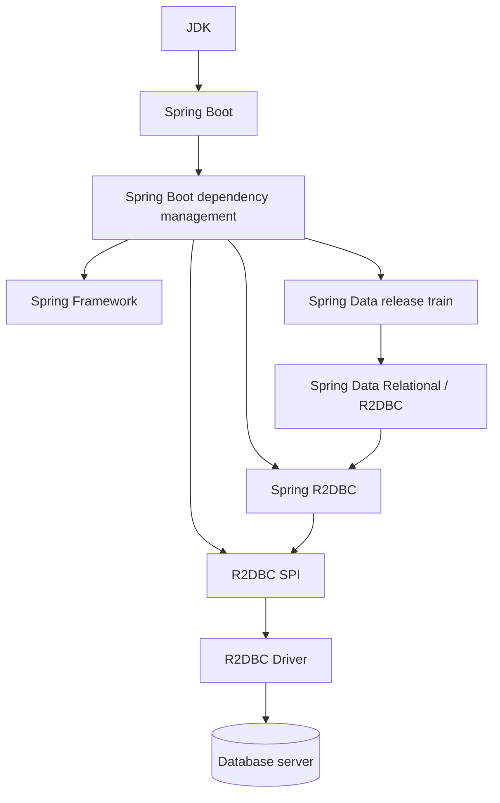

# Choosing Compatible Spring Boot, Spring Data, and Driver Versions

When initializing a Spring Data R2DBC application, choosing versions is not just about picking the latest version of each library. Spring Boot, Spring Framework, Spring Data Relational, Spring R2DBC, the R2DBC SPI, and the database driver form an interdependent group of dependencies. Upgrading or downgrading individual components without considering this group can lead to compilation errors, startup failures, or errors that only surface at query execution time.

The safe approach for a Spring Boot application is to choose a Spring Boot line compatible with your JDK and deployment requirements, and then let Spring Boot's dependency management provide the versions of Spring Framework, Spring Data, and other managed libraries. Next, choose the R2DBC driver matching your database management system and verify that it is compatible with the R2DBC SPI, JDK, and database server version in use.

## 1. Understanding the Version Layers That Must Work Together

An R2DBC application has multiple dependency layers. Not every layer can be upgraded independently.

| Component | Role in the application | How to choose the version |
|---|---|---|
| JDK | Java compilation and runtime environment | Choose a version within the supported range of the selected Spring Boot line |
| Spring Boot | Provides auto-configuration, starters, and dependency management | Choose a stable release aligned with the project's support policy |
| Spring Framework | Provides the container, transaction support, and reactive integration | Let the Spring Boot BOM manage it |
| Spring Data Relational / R2DBC | Provides mapping, templates, and Repositories | Use the version from the Spring Data release train managed by Spring Boot |
| Spring R2DBC and R2DBC SPI | Provides connection abstraction and reactive SQL execution | Keep versions compatible with Spring Data and the driver; prefer the BOM-managed versions |
| R2DBC driver | Connects to PostgreSQL, H2, or another DBMS | Check SPI, JDK, and server version support; prefer the version managed by the Boot BOM |
| Database | Stores data and executes SQL | Choose a server version supported and tested with the driver |

You can visualize the dependency relationships as follows:



This diagram shows the primary relationships, not the full dependency tree for every version. Actual dependencies also include Reactor, logging, pooling, and other supporting libraries. The key point is that the Spring Boot BOM selects a set of versions tested together; overriding one link can break that alignment.

## 2. Starting from the JDK and Spring Boot Line

The JDK is the first constraint because Spring Boot specifies the minimum Java version and supported range for each release. For example, Spring Boot 3 requires Java 17 or later. Older Spring Boot lines have different Java requirements, so you should not infer runtime compatibility solely from the Spring Data or driver version.

Before choosing versions, identify:

- The JDK installed in development, CI, and production environments.
- Whether the project can upgrade the JDK or must stay on an existing Java version.
- Whether the Maven or Gradle version in use is compatible with the Spring Boot Gradle/Maven plugin.
- Any internal libraries or Spring Cloud dependencies the project needs that have their own compatibility matrix.
- Whether the planned Spring Boot line will still receive bug fixes and security updates for the duration the project must be maintained.

Then choose a stable Spring Boot release that satisfies those constraints. For new projects, use a currently supported Spring Boot line and a stable release within that line. Avoid choosing milestone, release candidate, or snapshot versions for production unless the project is intentionally testing unreleased features.

Do not pick Spring Framework or Spring Data separately first and then try to pair them with an arbitrary Spring Boot version. Spring Boot already defines the baseline versions it is built and tested against.

## 3. How Spring Boot Manages Spring Data Versions

Spring Data R2DBC belongs to the Spring Data Relational ecosystem. It uses shared components from Spring Data, Spring Framework, and Spring R2DBC. Spring Data modules are released as coordinated release trains to preserve compatibility across modules, such as Spring Data Commons and Spring Data Relational.

When using Spring Boot, Boot's dependency management selects the corresponding Spring Data release train. As a result, an application usually only needs to declare the starter:

```text
org.springframework.boot:spring-boot-starter-data-r2dbc
```

This starter brings the Spring components required for Spring Data R2DBC into the dependency graph. In standard configurations, the application does not need to specify separate versions for `spring-data-r2dbc`, `spring-data-relational`, `spring-data-commons`, or `spring-r2dbc`.

For example, if a project is using a specific Spring Boot line, check Spring Boot's dependency versions or dependency management report to see which Spring Data release train is managed. Do not pull the latest Spring Data version from Maven Central and attach it to an older Boot version without checking the compatibility matrix.

**Key principle:** in a Spring Boot application, treat the Spring Boot version as the anchor for selecting baseline versions. Only override a Spring Data version when there is a clear technical reason, verified compatibility, and test coverage across the entire group of related modules.

## 4. Distinguishing Spring Data R2DBC, Spring R2DBC, and R2DBC SPI

These dependency names look similar and are easy to confuse:

| Component | Scope of responsibility |
|---|---|
| Spring Data R2DBC (`spring-data-r2dbc`) | Reactive repositories, entity mapping, query derivation, and integration with Spring Data Relational |
| Spring Data Relational (`spring-data-relational`) | Relational metadata, mapping context, and shared abstractions for Spring Data's relational data model |
| Spring R2DBC (`spring-r2dbc`) | Integration of the R2DBC SPI with Spring, including `DatabaseClient` and transaction support |
| R2DBC SPI (`r2dbc-spi`) | Low-level contract implemented by R2DBC drivers, including `ConnectionFactory`, `Connection`, `Statement`, `Result`, and related types |
| R2DBC driver | Concrete implementation for communicating with a specific database management system |

These components depend directly on one another. Spring Data R2DBC uses Spring R2DBC to execute data operations; Spring R2DBC operates on top of the SPI; the driver provides the SPI implementation. Therefore, upgrading only `spring-data-r2dbc` while keeping an incompatible `spring-r2dbc` or `r2dbc-spi` can cause errors at both compile time and runtime.

In a Spring Boot application, let the BOM choose versions for the whole group. You do not need to declare `r2dbc-spi` directly just because the application uses R2DBC. Only add a direct dependency when your code actually uses SPI APIs or has a specific integration requirement.

## 5. Choosing an R2DBC Driver for Your Database Management System

The R2DBC SPI is a common specification; each DBMS needs a corresponding driver. The driver is responsible for low-level communication, handling data types, and mapping results according to the database's characteristics.

Some common drivers:

| DBMS | Common R2DBC driver | Notes |
|---|---|---|
| PostgreSQL | `org.postgresql:r2dbc-postgresql` | R2DBC driver for PostgreSQL; not the JDBC driver `org.postgresql:postgresql` |
| H2 | `io.r2dbc:r2dbc-h2` | Commonly used in tests or applications requiring an H2 database |
| MySQL | R2DBC driver maintained by the `asyncer` project | Check the artifact name and version range in the chosen driver's documentation |
| MariaDB | R2DBC driver maintained by the MariaDB project | Check support for your server version and required SQL features |
| Microsoft SQL Server | R2DBC driver for SQL Server | Check the driver's support matrix for SQL Server and SPI versions |
| Oracle Database | Oracle R2DBC driver | Check JDK requirements, Oracle Database version, and supported features |

Artifact names and support scopes can change over time. Before adding a dependency, verify the official Maven coordinates, maintainer, stable release, and compatibility documentation from the driver project itself. Do not pick a library solely because its name contains `r2dbc`.

### Criteria to Check on a Driver

**R2DBC SPI compatibility.** The driver must implement an SPI version compatible with what Spring R2DBC and dependency management are using. A newer driver may require a newer SPI; an older driver may lack APIs expected by the framework.

**JDK compatibility.** Check the driver's minimum Java version. An application running on a JDK supported by Spring Boot can still fail if the driver requires a newer JDK.

**Database server compatibility.** Read the driver's support matrix to see which PostgreSQL, MySQL, SQL Server, or Oracle versions are supported. Specifically check features such as TLS, authentication, specialized data types, and connection protocols.

**Required business features.** Check support for generated keys, transactions, batching, JSON, arrays, large objects, timezones, isolation levels, and cancellation if your application relies on them. Do not assume every driver supports every feature in the same way.

**Maintenance status.** Prefer drivers with stable releases, clear documentation, and active maintenance aligned with your application's lifecycle.

## 6. Using Spring Boot Starters and the BOM to Avoid Version Drift

Spring Boot provides starters and a BOM (Bill of Materials) to reduce manual version declarations. A BOM is a curated set of dependencies with pre-selected versions. When a dependency is covered by the BOM, Maven or Gradle can resolve the BOM-managed version without specifying a version on each dependency.

### Gradle Example

With Gradle and the Spring Boot plugin, you can configure it as follows:

```groovy
plugins {
    id 'java'
    id 'org.springframework.boot' version '<spring-boot-version>'
    id 'io.spring.dependency-management' version '<dependency-management-plugin-version>'
}

group = 'com.example'
version = '1.0.0'

java {
    toolchain {
        languageVersion = JavaLanguageVersion.of(17)
    }
}

dependencies {
    implementation 'org.springframework.boot:spring-boot-starter-data-r2dbc'

    runtimeOnly 'org.postgresql:r2dbc-postgresql'

    testImplementation 'org.springframework.boot:spring-boot-starter-test'
}
```

Replace `<spring-boot-version>` with the Spring Boot version chosen by the project and `<dependency-management-plugin-version>` with a plugin version compatible with your build configuration. The example uses Java 17 because it is the minimum required by Spring Boot 3; if you choose another Boot line, set the toolchain to match its requirements.

`runtimeOnly` is appropriate for the driver when application code does not directly reference driver-specific classes. If the driver is not covered by the dependency management of your Spring Boot version, declare a compatible version according to the driver's official documentation.

### Maven Example

If the project does not use `spring-boot-starter-parent`, you can import the Spring Boot BOM directly. Example of the relevant section in `pom.xml`:

```xml
<properties>
    <spring-boot.version>REPLACE_WITH_SELECTED_VERSION</spring-boot.version>
</properties>

<dependencyManagement>
    <dependencies>
        <dependency>
            <groupId>org.springframework.boot</groupId>
            <artifactId>spring-boot-dependencies</artifactId>
            <version>${spring-boot.version}</version>
            <type>pom</type>
            <scope>import</scope>
        </dependency>
    </dependencies>
</dependencyManagement>

<dependencies>
    <dependency>
        <groupId>org.springframework.boot</groupId>
        <artifactId>spring-boot-starter-data-r2dbc</artifactId>
    </dependency>

    <dependency>
        <groupId>org.postgresql</groupId>
        <artifactId>r2dbc-postgresql</artifactId>
        <scope>runtime</scope>
    </dependency>
</dependencies>
```

Replace `REPLACE_WITH_SELECTED_VERSION` with the specific Spring Boot version. If the project uses `spring-boot-starter-parent`, you can use the parent instead of importing the BOM as shown above; you do not need both mechanisms just to get dependency management.

You do not need to declare `<version>` for the starter or driver when the corresponding version is already managed by the BOM. If the driver is not managed by the BOM, add a verified driver version to that dependency.

## 7. When Do You Need to Declare a Driver Version Manually?

Not every driver has a managed version in every Spring Boot release. In some cases, a project needs a newer driver to support a new feature or DBMS, or the driver is not yet included in the BOM of the Boot line in use.

Before overriding, follow this order:

1. Check Spring Boot's dependency management to see whether the driver is already managed.
2. Read the driver documentation to identify the supported R2DBC SPI, JDK, and database server versions.
3. Check the actual SPI version used by Spring R2DBC and other dependencies.
4. Read the driver's release notes for compatibility or behavioral changes.
5. Run integration tests against the exact database type and server version planned for deployment.

If an override is necessary, override only the dependency that truly needs it and document the reason in the build configuration or project documentation. Avoid forcing a separate `r2dbc-spi` version just to make a driver compile without proving that the entire framework is compatible with that SPI.

## 8. Do Not Confuse an R2DBC Driver with a JDBC Driver

Driver names and connection URLs are a common source of confusion. JDBC and R2DBC are two different APIs:

| Purpose | PostgreSQL example |
|---|---|
| R2DBC driver | `org.postgresql:r2dbc-postgresql` |
| JDBC driver | `org.postgresql:postgresql` |
| R2DBC URL | `r2dbc:postgresql://localhost:5432/customer_db` |
| JDBC URL | `jdbc:postgresql://localhost:5432/customer_db` |

Spring Data R2DBC needs an R2DBC driver to access the database. Adding a JDBC driver will not make `ConnectionFactory` work, nor does it replace an R2DBC driver.

A project may still need a JDBC driver for a migration tool or another component that runs over JDBC, such as when the migration tool is configured to use JDBC. In that case, both drivers can appear in the dependency graph because they serve two different purposes. Configure the right URL and tool for each connection path.

## 9. Common Errors Caused by Incompatible Versions

| Symptom | Possible cause | How to inspect and resolve |
|---|---|---|
| Build reports missing class or method | Version mismatch among Spring Data, Spring Framework, or Spring R2DBC | Inspect the dependency tree; remove unnecessary overrides and use Boot BOM versions |
| `NoSuchMethodError` or `NoClassDefFoundError` at startup | Runtime classpath contains incompatible or duplicate versions | Identify which dependency pulls in the different version; use dependency insight to trace the source and adjust dependency management |
| Cannot create `ConnectionFactory` | Missing driver, driver not discovered, or wrong URL scheme | Verify the driver is on the runtime classpath and the URL uses the appropriate `r2dbc:` scheme |
| Driver reports SPI incompatibility | Driver and `r2dbc-spi` belong to incompatible generations | Check the driver's SPI requirement and the actual resolved version |
| Connects successfully but fails when reading/writing a data type | Driver or server does not support the data type/feature as the application expects | Check driver documentation, mapping, and test against the exact database version |
| Works locally but fails in production | JDK, database server, TLS, authentication, or pool configuration differs across environments | Align runtime versions and test against a production-like configuration |

Do not treat `NoSuchMethodError`-style errors by randomly adding a new dependency. First find which dependency introduced the incompatible version onto the runtime classpath before fixing it.

## 10. Inspecting the Dependency Tree After Configuration

After adding the starter and driver, verify the actual versions chosen by the build tool. The dependencies declared in the build file may not reflect the final resolved dependencies because BOMs, transitive dependencies, constraints, and exclusions can alter the result.

### With Gradle

View the runtime dependency graph:

```bash
./gradlew dependencies --configuration runtimeClasspath
```

Find the version of Spring Data R2DBC:

```bash
./gradlew dependencyInsight \
  --dependency spring-data-r2dbc \
  --configuration runtimeClasspath
```

Check the SPI and driver:

```bash
./gradlew dependencyInsight \
  --dependency r2dbc-spi \
  --configuration runtimeClasspath

./gradlew dependencyInsight \
  --dependency r2dbc-postgresql \
  --configuration runtimeClasspath
```

The `dependencyInsight` command shows the selected version and why it appears, such as via the BOM, a constraint, or a transitive dependency.

### With Maven

View the entire dependency tree:

```bash
./mvnw dependency:tree
```

Filter relevant dependency groups:

```bash
./mvnw dependency:tree \
  -Dincludes=org.springframework.boot,org.springframework.data,org.springframework,io.r2dbc,org.postgresql
```

If resolved versions are not as expected, check `dependencyManagement`, the parent POM, imported BOMs, and dependencies declaring versions directly. You can inspect the effective POM to see the final managed configuration after Maven merges POMs.

## 11. Testing Compatibility in a Realistic Environment

The dependency tree tells you which versions the build tool chose, but it does not prove that the driver works properly with the database server. Integration tests should be run against the exact DBMS and version planned for deployment.

A basic test suite should include:

- Creating a `ConnectionFactory` and opening a connection successfully with the R2DBC URL.
- Executing a query with bound parameters and reading results.
- Inserting data with generated keys, then reading the entity back.
- Testing data types used by the business domain, especially dates/times, decimals, JSON, or database-specific types.
- Performing commit and rollback to verify transactions work.
- Testing connection errors, timeouts, and publisher cancellation behavior if the application needs to handle those scenarios.
- Testing TLS, authentication mechanisms, and pool settings matching the deployment environment.

You can use Testcontainers or a dedicated test database to run integration tests. If you use H2 for tests while production runs PostgreSQL, passing H2 tests cannot substitute for testing on PostgreSQL: SQL dialects, data types, and driver behavior can differ.

When upgrading the Boot or driver version, rerun the integration test suite against the actual database version. A version change can affect mapping, parameter binding, generated values, transactions, or connection behavior even when application code does not change.

## 12. Version Selection Workflow for a New Project

You can apply the following workflow to arrive at a consistent configuration:

**Step 1 — Record the environment.** Identify the JDK, build tool, database management system, server version, and other foundational libraries the project must use.

**Step 2 — Choose Spring Boot.** Pick a stable Boot line matching the JDK and project support policy. Check Maven/Gradle version requirements and compatibility matrices of related libraries.

**Step 3 — Use the official starter.** Add `spring-boot-starter-data-r2dbc` to get the Spring Data R2DBC components and baseline configuration managed by Boot.

**Step 4 — Choose the driver for your database.** Add the R2DBC driver maintained by the official driver project. Check the SPI, JDK, database server, and required features.

**Step 5 — Keep the BOM consistent.** Let Boot manage Spring Framework, Spring Data, Spring R2DBC, Reactor, and dependencies already in the BOM. Only specify a custom version when a dependency is unmanaged or has a verified override requirement.

**Step 6 — Inspect the dependency graph.** Use `dependencies`, `dependencyInsight`, or `mvn dependency:tree` to verify the resolved runtime versions.

**Step 7 — Run integration tests.** Connect to the exact database type and version, and verify queries, mapping, transactions, and specialized features.

**Step 8 — Document the chosen configuration.** Record the JDK, Spring Boot, driver, database server versions, and test results in project documentation. Use this configuration as a baseline when upgrading.

## 13. Example of a Controlled Selection Setup

Suppose a new project uses Java 17 and PostgreSQL. The development team selects a stable Spring Boot 3.x release aligned with the project's maintenance window. From the chosen Boot version, the team uses the corresponding dependency management to receive Spring Framework, the Spring Data release train, Spring R2DBC, Reactor, and the R2DBC SPI.

Next, the team adds `spring-boot-starter-data-r2dbc` and the PostgreSQL R2DBC driver. If the driver is already in the Boot BOM, no separate version is declared. If a newer driver version is needed to support the PostgreSQL server in use, the team checks release notes, SPI, and JDK requirements before overriding. Finally, the team runs dependency insight to confirm there is only one compatible version of the core libraries and runs integration tests against the exact PostgreSQL version planned for deployment.

This example does not hardcode specific version numbers because stable releases, support policies, and compatibility matrices change over time. When setting up a real project, consult the dependency versions table and compatibility documentation of the exact Spring Boot and driver versions you selected.

## 14. Principles for Maintaining Versions Once the Project Is Stable

Once the configuration is working, maintain dependencies through a controlled upgrade process:

- Track patch releases for the Spring Boot line in use and update within the same line when appropriate.
- When upgrading major versions or switching Boot lines, read the migration guides and check changes in Spring Framework, Spring Data, and the JDK.
- Do not upgrade a single Spring Data module on its own without checking the release train of related modules.
- Monitor driver releases and database server compatibility announcements.
- Use dependency locking or your build tool's version-locking mechanism if the project requires reproducible dependency graphs across environments.
- Run integration tests before promoting dependency changes to production.

Choosing the right versions gives the application a consistent foundation: Spring Boot manages Spring libraries via the BOM, Spring Data Relational and Spring R2DBC operate on a compatible SPI version, and the driver connects properly to the DBMS and server version. Once you understand these relationships, initializing, verifying, and upgrading an R2DBC application becomes predictable and far less prone to dependency errors.
