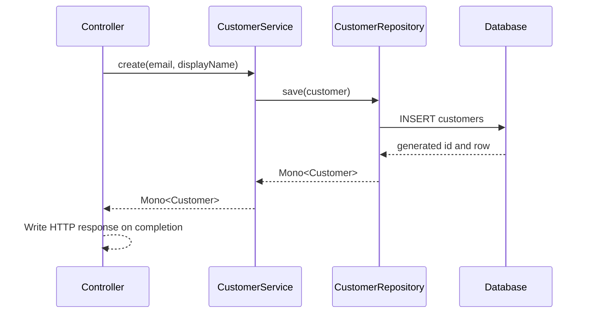

# Organizing Configuration, Entity, Repository, and Service Classes

When building an application with Spring Data R2DBC, organize source code into parts with clear responsibilities: R2DBC connection and infrastructure configuration, entity classes mapped to tables, repositories performing data operations, and services coordinating business logic. This structure keeps the application readable, testable, and allows queries or database configuration to change without spreading changes across the entire codebase.

Keep in mind that Spring Data R2DBC uses a reactive model. Repositories typically return `Mono<T>` or `Flux<T>`, so services should preserve reactive return types and compose operations with Reactor. Avoid turning results into synchronous objects by calling `.block()` between layers.

## 1. Role of Each Layer

A typical processing flow can be represented as follows:

```text
HTTP Controller / Message Handler
                |
                v
          Service layer
        (business rules)
                |
                v
        Repository interface
    (querying and writing data)
                |
                v
        Spring Data R2DBC
                |
                v
          R2DBC driver
                |
                v
        Relational database

Configuration
  |-- ConnectionFactory and connections
  |-- Mapping, converters (when needed)
  |-- Transaction manager
  `-- Repository scanning (when customization is needed)
```

| Component | Primary responsibility | Example |
|---|---|---|
| Configuration | Declaring and customizing shared infrastructure | R2DBC connection, transaction manager, converters |
| Entity | Describing data stored in tables | `Customer`, `Order` |
| Repository | Providing read, write, and query operations | `CustomerRepository` |
| Service | Enforcing business rules and coordinating Repositories | `CustomerService` |
| Controller / Handler | Receiving input and writing results to an external protocol | REST endpoint or message handler |

The Controller is included in the diagram to clarify the call flow, although the focus of this lesson is on the four parts: Configuration, Entity, Repository, and Service.

## 2. Package Organization in a Project

For a small application, you can start with a layer-based structure like this:

```text
com.example.store
├── StoreApplication.java
├── config
│   └── R2dbcConfiguration.java
├── entity
│   └── Customer.java
├── repository
│   └── CustomerRepository.java
├── service
│   └── CustomerService.java
└── controller
    └── CustomerController.java
```

As the application grows, you can group by feature so related components sit close together:

```text
com.example.store
├── StoreApplication.java
├── config
│   └── R2dbcConfiguration.java
└── customer
    ├── CustomerController.java
    ├── CustomerService.java
    ├── CustomerRepository.java
    ├── Customer.java
    └── CustomerRequest.java
```

Both approaches work well. A layer-based layout fits small projects with few features. A feature-based layout keeps a single `service` or `repository` package from turning into a dumping ground for dozens of unrelated classes as the system grows. Pick one convention and apply it consistently across the project.

Place the Spring Boot startup class in the root package so default component scanning covers subpackages. If you place Configuration, Service, or Controller outside the scan scope, Spring may not create beans as expected.

## 3. R2DBC Configuration Classes

### 3.1. Declaring Dependencies

The application needs Spring Data R2DBC and the driver matching the database management system. Example with Gradle Kotlin DSL and PostgreSQL:

```kotlin
dependencies {
    implementation("org.springframework.boot:spring-boot-starter-data-r2dbc")
    runtimeOnly("org.postgresql:r2dbc-postgresql")
}
```

If using Maven, declare the corresponding artifacts in `pom.xml`. Let Spring Boot dependency management manage compatible library versions rather than picking individual dependency versions yourself.

If the application exposes a reactive HTTP API, you can add `spring-boot-starter-webflux`. WebFlux is not mandatory for using Spring Data R2DBC; R2DBC can also be invoked from other components in the application.

### 3.2. Configuring Connections with application.yml

In standard cases, Spring Boot auto-configures `ConnectionFactory`, Spring Data R2DBC components, and repositories based on dependencies and configuration properties. Example:

```yaml
spring:
  r2dbc:
    url: r2dbc:postgresql://${DB_HOST:localhost}:${DB_PORT:5432}/${DB_NAME:store}
    username: ${DB_USERNAME}
    password: ${DB_PASSWORD}
```

Key properties:

- `spring.r2dbc.url` specifies the driver and database address using a URL with the `r2dbc:` scheme.
- `spring.r2dbc.username` and `spring.r2dbc.password` provide authentication credentials.
- `${...}` placeholders allow injecting environment-specific values via environment variables instead of hardcoding passwords in source code.

For PostgreSQL, the URL has the form `r2dbc:postgresql://host:port/database`. For other databases, the scheme and driver must match, such as the R2DBC driver for Microsoft SQL Server or MySQL. JDBC URLs starting with `jdbc:` belong to JDBC and cannot directly substitute for an R2DBC URL.

When using standard Spring Boot configuration, you usually do not need to create `ConnectionFactory`, `DatabaseClient`, `R2dbcEntityTemplate`, or repository beans yourself. The framework creates these components from configuration and dependencies. Avoid redeclaring beans already provided by auto-configuration unless you have a specific customization need.

### 3.3. When Do You Need a @Configuration Class?

Create a Java configuration class when you need to override default behavior or register custom beans. For example, if you need to declare a transaction manager explicitly:

```java
package com.example.store.config;

import io.r2dbc.spi.ConnectionFactory;
import org.springframework.context.annotation.Bean;
import org.springframework.context.annotation.Configuration;
import org.springframework.r2dbc.connection.R2dbcTransactionManager;
import org.springframework.transaction.ReactiveTransactionManager;

@Configuration
public class R2dbcConfiguration {

    @Bean
    public ReactiveTransactionManager reactiveTransactionManager(
            ConnectionFactory connectionFactory) {
        return new R2dbcTransactionManager(connectionFactory);
    }
}
```

In many Spring Boot applications, the R2DBC transaction manager is also auto-configured. Only add a bean like this example when you need explicit configuration or when the application lacks a suitable transaction manager; do not create duplicate beans mechanically.

Other needs that may call for custom configuration:

- **Custom conversions:** converting specialized Java data types to database types and back.
- **Naming or mapping:** customizing how properties map to columns, schemas, or tables.
- **ConnectionFactory:** specialized connection setups, multiple databases, or driver-specific parameters.
- **Repository scanning:** specifying repository packages when default scanning does not fit.

`@EnableR2dbcRepositories` lets you specify the repository scan scope in manual configuration. In a Spring Boot application using standard auto-configuration, you usually do not need this annotation. If you configure repository scanning explicitly, make sure the same set of repositories is not registered from two different configurations.

### 3.4. Distinguishing Application Configuration from Schema Configuration

`application.yml` declares how the application connects and runs; it does not replace schema design and management. Tables, primary keys, foreign keys, indexes, and structural data changes should be managed via versioned migrations, such as Flyway or Liquibase according to the project's workflow.

Do not rely on automatic schema creation in production environments. While the application uses R2DBC to access data at runtime, a migration tool can still use JDBC to update the schema during deployment. These are two separate responsibilities.

## 4. Entity Classes Mapped to Tables

Entities represent data persisted by Spring Data Relational. Mapping annotations are declared in `org.springframework.data.relational.core.mapping` and `org.springframework.data.annotation`.

### 4.1. Commonly Used Annotations

| Annotation | Meaning |
|---|---|
| `@Table("customers")` | Maps the class to the `customers` table |
| `@Id` | Marks the identifier property of the entity |
| `@Column("display_name")` | Maps the property to a column with a specific name |
| `@Transient` | Excludes the property from persistence mapping |
| `@Version` | Marks a version property to support optimistic locking |

If default naming rules already match the schema, you do not have to annotate every property with `@Column`. When database column names differ from Java property names, explicit declarations make the code clearer.

### 4.2. Customer Entity Example

```java
package com.example.store.entity;

import org.springframework.data.annotation.Id;
import org.springframework.data.relational.core.mapping.Column;
import org.springframework.data.relational.core.mapping.Table;

@Table("customers")
public record Customer(
        @Id Long id,
        String email,
        @Column("display_name") String displayName
) {
}
```

In this example:

- `Customer` maps to the `customers` table.
- `id` is the identifier key. If the database generates keys automatically, the input value may initially be absent; `save` returns the persisted entity with the database-generated identifier.
- `email` maps using default column naming rules.
- `displayName` maps explicitly to the `display_name` column.

Spring Data Relational supports immutable entities and Java records. When updating a record, create a new instance with the retained values and updated fields. If the project uses mutable classes, provide constructors and properties in a way Spring Data can materialize the entity; do not assume JPA mechanisms such as a persistence context or dirty checking will work automatically.

### 4.3. Entities Are Not DTOs

Entities exist for mapping and persistence. DTOs exist for exchanging data over APIs or between components. Both may share similar fields, but they do not have to share the same class.

Example request to create a customer:

```java
package com.example.store.customer;

public record CreateCustomerRequest(
        String email,
        String displayName
) {
}
```

The request does not need to include the database-generated `id`. Separating DTOs from entities keeps the API from coupling directly to the storage schema and prevents external input from dictating internal fields such as primary keys or versions.

### 4.4. Designing Entities for the Relational Model

Spring Data R2DBC belongs to Spring Data Relational, not a full ORM like JPA/Hibernate. Do not expect `@OneToMany`, `@ManyToOne`, lazy loading, or a persistence context to behave as they do in JPA. For data spanning multiple tables, design aggregates and queries explicitly; you can run separate queries or use custom SQL to fetch combined data.

Some useful principles:

- Use `@Id` for the identifier and define primary key constraints in the database.
- Declare `UNIQUE`, `NOT NULL`, and foreign key constraints in the schema to protect data integrity.
- Choose Java types compatible with database column types and the driver.
- Include only fields that truly belong to the entity in the mapping; computed temporary data can live in DTOs or be marked `@Transient` when appropriate.
- Define aggregate roots and rules for saving related data before implementing multi-table writes.

## 5. Repository Layer

Repositories are the data access entry point for the application layer. In Spring Data R2DBC, a repository is typically an interface extending `ReactiveCrudRepository` or another suitable reactive interface. Spring Data creates the implementation at runtime based on this declaration.

### 5.1. Basic CRUD Repository

```java
package com.example.store.repository;

import com.example.store.entity.Customer;
import org.springframework.data.repository.reactive.ReactiveCrudRepository;
import reactor.core.publisher.Flux;
import reactor.core.publisher.Mono;

public interface CustomerRepository
        extends ReactiveCrudRepository<Customer, Long> {

    Mono<Customer> findByEmail(String email);

    Flux<Customer> findByDisplayNameContaining(String keyword);
}
```

The two generic parameters of `ReactiveCrudRepository<Customer, Long>` are the entity type and the primary key type, respectively. The interface provides operations out of the box such as `save`, `findById`, `findAll`, `existsById`, `count`, `deleteById`, and `delete`.

Query methods inferred from method names are called *derived query methods*. For example, `findByEmail` builds a query on the `email` property; `findByDisplayNameContaining` finds records whose `displayName` contains the given substring. Method names must match entity properties and Spring Data Relational's supported keywords.

If `email` must be unique, enforce a unique constraint in the schema. Then `Mono<Customer>` accurately expresses at most one result. If data uniqueness is not guaranteed, design the return type and handling rules accordingly.

### 5.2. Writing Custom SQL Queries

When a derived query cannot express the requirement or you need control over the SQL, you can use `@Query`:

```java
package com.example.store.repository;

import com.example.store.entity.Customer;
import org.springframework.data.r2dbc.repository.Query;
import org.springframework.data.repository.query.Param;
import org.springframework.data.repository.reactive.ReactiveCrudRepository;
import reactor.core.publisher.Flux;

public interface CustomerRepository
        extends ReactiveCrudRepository<Customer, Long> {

    @Query("SELECT * FROM customers " +
           "WHERE display_name LIKE :pattern ORDER BY id")
    Flux<Customer> searchByDisplayName(@Param("pattern") String pattern);
}
```

The `pattern` value is passed as a parameter, such as `%An%` to search for strings containing `An`. Parameter binding separates input data from SQL structure. Never concatenate user input directly into SQL strings to build query conditions.

Column and table names in custom SQL must match the actual schema. SQL syntax, functions, and feature support can differ across database management systems; test queries against your target database.

### 5.3. When to Use DatabaseClient?

`DatabaseClient` provides a lower-level SQL query API than repositories. It is useful when you need to:

- Run custom SQL that is hard to express with derived queries.
- Execute aggregate queries or queries returning specialized projections.
- Explicitly control parameter binding and result mapping.
- Work with data that does not fit cleanly into a standard repository method.

Repositories remain the clearest choice for CRUD operations and queries tied to an aggregate. You can use `DatabaseClient` inside a dedicated data access class when SQL becomes complex; avoid scattering SQL across multiple Services.

### 5.4. Reactive Return Types

| Return type | Common meaning |
|---|---|
| `Mono<Customer>` | Zero or at most one customer |
| `Flux<Customer>` | Stream of zero or more customers |
| `Mono<Void>` | Completion of an operation that emits no value |
| `Mono<Long>` | A single numeric value, such as a count result |

Publishers are typically lazy: calling a repository method constructs a pipeline; the operation runs when subscribed to. Therefore, do not call a repository method and discard its publisher without composing it into the application's processing flow.

## 6. Service Layer

Services contain business rules and coordinate one or more Repositories. Controllers should not run multiple queries directly and decide business rules themselves; placing logic in Services gives a clear place for testing and reuse.

### 6.1. Basic Service

```java
package com.example.store.service;

import com.example.store.entity.Customer;
import com.example.store.repository.CustomerRepository;
import org.springframework.stereotype.Service;
import reactor.core.publisher.Flux;
import reactor.core.publisher.Mono;

@Service
public class CustomerService {

    private final CustomerRepository customerRepository;

    public CustomerService(CustomerRepository customerRepository) {
        this.customerRepository = customerRepository;
    }

    public Mono<Customer> create(String email, String displayName) {
        Customer customer = new Customer(null, email, displayName);
        return customerRepository.save(customer);
    }

    public Mono<Customer> findById(Long id) {
        return customerRepository.findById(id)
                .switchIfEmpty(Mono.error(
                        new IllegalArgumentException("Customer not found: " + id)));
    }

    public Flux<Customer> searchByName(String keyword) {
        return customerRepository.findByDisplayNameContaining(keyword);
    }

    public Mono<Customer> rename(Long id, String newDisplayName) {
        return customerRepository.findById(id)
                .switchIfEmpty(Mono.error(
                        new IllegalArgumentException("Customer not found: " + id)))
                .flatMap(current -> {
                    Customer updated = new Customer(
                            current.id(), current.email(), newDisplayName);
                    return customerRepository.save(updated);
                });
    }

    public Mono<Void> delete(Long id) {
        return customerRepository.deleteById(id);
    }
}
```

The example above illustrates how the Service preserves the Repository's reactive types:

- `create` instantiates a new entity and returns the publisher from `save`.
- `findById` turns an empty result into a business error.
- `searchByName` returns a `Flux` so callers can process the result stream.
- `rename` uses `flatMap` because the inner operation itself returns a `Mono<Customer>`.
- `delete` returns `Mono<Void>` representing when the deletion finishes.

In real applications, use domain-specific exceptions instead of `IllegalArgumentException`, validate input data, and map errors to appropriate responses at the transport layer. Also define clearly how deleting a nonexistent ID should behave: some business flows treat it as idempotent success, while others require an error.

### 6.2. Constructor Dependency Injection

The example uses constructor injection to receive `CustomerRepository`. This is the preferred style because dependencies are explicit in the constructor, fields can be `final`, and Services are easy to instantiate in unit tests.

Avoid instantiating repositories with `new CustomerRepositoryImpl(...)` or accessing the ApplicationContext directly. Spring manages bean lifecycles and supplies the configured repository implementation.

You do not have to create an interface and a `CustomerServiceImpl` class for every Service. A separate interface is useful when there are multiple implementations, when a contract is shared across modules, or when enforcing clear architectural boundaries. For straightforward business logic, a single `@Service` class is usually easier to read.

### 6.3. Combining Multiple Repositories

A business operation may require several data steps. Compose publishers using Reactor operators to preserve ordering and error handling within the same pipeline.

Example illustrating saving a customer before creating a dependent record:

```java
public Mono<Customer> registerCustomer(String email, String displayName) {
    Customer customer = new Customer(null, email, displayName);

    return customerRepository.save(customer)
            .flatMap(saved -> profileRepository.save(
                    new CustomerProfile(null, saved.id(), "BASIC"))
                    .thenReturn(saved));
}
```

`flatMap` chains saving the profile after the customer has been saved. `thenReturn(saved)` waits for the second operation to complete and then re-emits the saved customer. If both operations must succeed or fail together, place them within a reactive transaction.

Do not call `subscribe()` inside a Service to trigger operations manually. Doing so detaches the pipeline from the caller's flow, making it difficult for outer layers to know when work completes or to receive errors. Return the publisher to the caller instead.

## 7. Transactions in Services

When a business flow involves multiple writes that require atomicity, use the R2DBC transaction manager. You can annotate a Service method returning `Mono` or `Flux` with `@Transactional`:

```java
import org.springframework.stereotype.Service;
import org.springframework.transaction.annotation.Transactional;
import reactor.core.publisher.Mono;

@Service
public class OrderService {

    private final OrderRepository orderRepository;
    private final InventoryRepository inventoryRepository;

    public OrderService(
            OrderRepository orderRepository,
            InventoryRepository inventoryRepository) {
        this.orderRepository = orderRepository;
        this.inventoryRepository = inventoryRepository;
    }

    @Transactional
    public Mono<Order> placeOrder(Order order) {
        return inventoryRepository.reserve(order)
                .then(orderRepository.save(order));
    }
}
```

This example illustrates transaction boundaries; inventory checks, quantity updates, and concurrency handling must be designed to match your specific schema and business rules.

Reactive transactions use the Reactor Context to pass transaction state down the pipeline. Therefore:

- Return the publisher from the transactional method so the framework can control execution.
- Operations participating in the transaction must remain inside a properly composed reactive pipeline.
- Do not manually call `subscribe()` or fork an independent asynchronous branch if that branch must share the transaction.
- Do not call `.block()` to chain steps inside the pipeline.
- Test both success and failure paths to confirm rollback works.

If you need programmatic transaction control in code, look into `TransactionalOperator`. For standard cases, `@Transactional` on a reactive Service method is a clean, readable declaration.

## 8. Call Flow Between Layers

When a client requests customer creation, the processing flow can proceed as follows:

1. The Controller receives the request and validates input structure.
2. The Controller calls `CustomerService.create(...)`.
3. The Service applies business rules and creates a `Customer`.
4. The Service calls `CustomerRepository.save(...)`.
5. Spring Data R2DBC maps the entity to the appropriate statement and sends it to the database through the driver.
6. The result is mapped back into an entity and emitted via `Mono`.
7. The Service returns the publisher to the Controller; the HTTP layer writes the response when the pipeline completes.

Interaction diagram:



Configuration is used during application startup to create and wire infrastructure beans. It is not a business layer invoked on every request.

## 9. Testing Each Layer

Clear layer separation helps you pick the right test scope:

| Component | Appropriate test approach | What to verify |
|---|---|---|
| Configuration | Application context or integration test | Connection, repository, and transaction manager beans are created properly |
| Entity | Mapping/integration test | Table names, columns, data types, and keys map correctly |
| Repository | `@DataR2dbcTest` and a suitable database | SQL, derived queries, mapping, and data constraints |
| Service | Unit test with mocked repositories and `StepVerifier` | Business rules, empty cases, errors, and pipeline ordering |
| Transaction | Integration test with database | Commit and rollback behave properly when an operation fails |

Example of testing a Service with Reactor Test:

```java
StepVerifier.create(customerService.findById(10L))
        .expectNextMatches(customer -> customer.id().equals(10L))
        .verifyComplete();
```

`StepVerifier` subscribes to the publisher and asserts the signals emitted by the pipeline. When testing repositories, use the same database type or a database compatible with your deployment environment, as SQL syntax, data types, and driver behavior can differ.

## 10. Common Organizational Mistakes

### Declaring Every Bean Manually

Spring Boot already auto-configures many R2DBC components when dependencies and properties are valid. Recreating `ConnectionFactory`, `DatabaseClient`, templates, or repositories manually can cause conflicts or make configuration hard to follow. Only add Java configuration when there is a concrete need.

### Putting Business Logic in Repositories

Repositories should focus on queries and persistence operations. Rules such as checking order eligibility, calculating fees, coordinating multiple aggregates, or deciding state belong in a Service or a dedicated domain component.

### Putting SQL in Controllers

Controllers should coordinate protocol I/O. Keeping SQL and data mapping inside Repositories or dedicated data access components ensures endpoint changes do not bleed into how database queries are written.

### Using Entities as Request/Response Models for Every API

Exposing entities directly can leak storage structure and couple the API to schema changes. Use DTOs for input and output when clear API boundaries matter.

### Treating Reactive Code Like Synchronous Code

Calling `.block()` to fetch an entity before invoking the next repository defeats the benefits of reactive pipelines and can block the event loop. Use `map`, `flatMap`, `then`, `switchIfEmpty`, and appropriate operators to compose work.

### Assuming Entity Relationships Behave Automatically Like JPA

R2DBC does not provide JPA's full ORM behavior. Explicitly write queries for related data, define aggregates, and use transactions when a business flow requires multiple atomic writes.

## 11. Checklist When Setting Up Project Structure

- [ ] Spring Data R2DBC dependency and driver match the target database.
- [ ] `application.yml` uses an `r2dbc:` URL and reads credentials from environment variables.
- [ ] Spring Boot startup package covers all bean packages.
- [ ] Java Configuration declares only what needs customization, avoiding overlap with auto-configuration.
- [ ] Entities have `@Table`, `@Id`, and column mappings matching the schema.
- [ ] Schema is managed with migrations and defines necessary constraints.
- [ ] Repositories extend an appropriate reactive repository and use `Mono` / `Flux` return types.
- [ ] Custom queries bind parameters instead of concatenating input strings into SQL.
- [ ] Services use constructor injection and encapsulate business rules.
- [ ] Multi-step operations are composed with Reactor and wrapped in transactions when needed.
- [ ] No arbitrary `subscribe()` or `.block()` calls inside reactive processing paths.
- [ ] Repository, service, and transaction tests exist against an appropriate database.

When components are separated with clear responsibilities, a Spring Data R2DBC application has a clean dependency flow: Configuration sets up infrastructure, Entities describe data, Repositories provide data access, and Services implement business logic. This creates a solid foundation for adding Controllers, tests, transactions, and complex queries without tightly coupling layers together.
