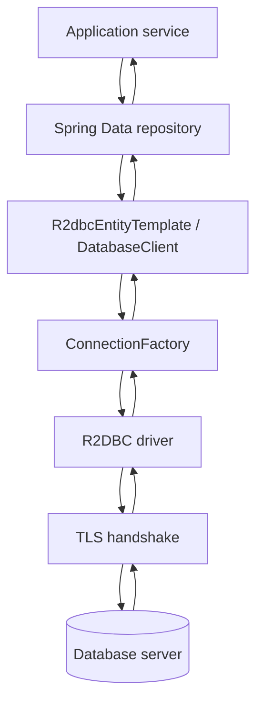
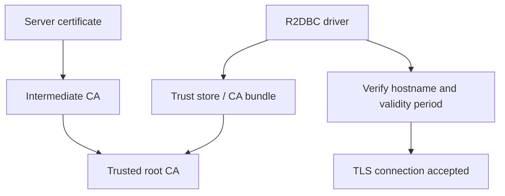

# Configuring TLS and Driver-Specific Options

Spring Data Relational R2DBC accesses the database through an R2DBC driver and a `ConnectionFactory`. TLS is configured at this connection layer. Repositories and services continue using `Mono`, `Flux`, and Spring Data APIs as usual; they do not need to create TLS sockets manually or manage certificates.

TLS configuration must address three things: encrypting data in transit, verifying that the application is connecting to the right database server, and, if required by the system, verifying the application's identity using a client certificate. Drivers also expose options such as timeouts, keepalive, application name, schema, and query limits. These options must be chosen based on the database engine, driver, and actual workload.

## 1. Where Does TLS Sit in the R2DBC Architecture?



`ConnectionFactory` creates the connections that Spring Data uses. The driver understands URLs, proprietary options, the database engine's protocol, and how to establish TLS. When opening a physical connection, the driver performs a handshake with the server, negotiates the TLS version and cipher suite, and then uses the established channel to transmit database protocol data.

Therefore:

- TLS configuration belongs to the driver or `ConnectionFactory`, not individual repositories.
- SQL and query data are transmitted over an encrypted connection once TLS is enabled and the handshake succeeds.
- Each driver has its own option names, defaults, and ways of reading trust material.
- Using R2DBC does not mean connections are already encrypted. You must explicitly configure and verify the TLS mode.

TLS protects data in transit between the application and the server. It does not replace encryption at rest on disk, SQL access control, secret management, or network segmentation.

## 2. Three Goals of TLS Configuration

### Encrypting data in transit

TLS encrypts data exchanged between client and server, preventing network observers from reading SQL contents, query results, or credentials sent over the connection. Encryption is only effective if both ends actually establish TLS and there is no mechanism allowing a downgrade to a plaintext connection.

### Verifying server identity

The client needs to verify the certificate sent by the server. This includes checking the certificate chain up to a trusted CA and checking the validity period. The client also needs to verify that the hostname requested by the application matches a name in the certificate, typically in the Subject Alternative Name (SAN).

If the connection is configured with the DNS name `db.internal.example`, the certificate must be valid for that name. Connecting by IP address requires the certificate to have a corresponding IP SAN. Encrypting without verifying the server can cause the application to establish an encrypted channel to an impostor server.

### Verifying client identity

In mutual TLS (mTLS), the server also requires the client to present a certificate. The server verifies the client certificate against its CA and policies. The database may combine certificate identity with account authentication mechanisms, depending on the product and configuration.

mTLS adds authentication at the connection level. It does not automatically replace username/password or database authorization mechanisms if the database engine still requires them.

## 3. Common SSL/TLS Modes

Mode names vary across drivers, but their general meanings are typically as follows:

| Mode | Behavior | Notes |
| --- | --- | --- |
| Disabled | Do not use TLS. | Only suitable for controlled environments with a clear justification. |
| Preferred / Allow | Prefer TLS but may allow an unencrypted connection. | Risk of downgrade; need to understand the driver's connection attempt order. |
| Required | Require TLS encryption. | May not verify CA or hostname, depending on the driver. |
| Verify CA | Require TLS and verify the certificate chain up to a trusted CA. | May not verify the hostname. |
| Verify Full / Verify Identity | Require TLS, verify CA, and verify hostname. | Usually appropriate for production connections requiring server authentication. |

Do not assume two drivers using the same mode name behave identically. For example, PostgreSQL R2DBC may use `VERIFY_FULL`, whereas a MySQL driver may use `VERIFY_IDENTITY`. Read the documentation for the exact driver version being deployed.

Some `REQUIRE` or `PREFERRED` modes have historical meanings specific to each database engine. Do not choose a mode just because its name sounds safe enough; know clearly whether that mode verifies the CA and hostname.

## 4. Certificates and the Trust Chain

In TLS, the server sends its certificate and usually includes the required intermediate certificates. The client needs an appropriate trust anchor to verify this chain.

- **Server certificate:** the server's certificate, containing its public key and server identity.
- **Intermediate CA:** an intermediate CA that signs the server certificate or subordinate CAs.
- **Root CA:** the root CA trusted by the client.
- **Client certificate:** the certificate the application sends to the server in mTLS.
- **Client private key:** the private key corresponding to the client certificate; must be protected as a secret.



The client needs to trust the CA that signed the server certificate. If an enterprise uses a private CA, that CA must be placed in the trust store or configured in a way the driver supports. Do not put a single server's leaf certificate directly into the trust store as a long-term solution if the system has a proper CA process; pinning leaf certificates can make certificate renewal hard to operate.

A certificate with a valid signature can still be rejected if it has expired, is not yet valid, is missing an intermediate certificate, or does not match the hostname. An inaccurate system clock can also cause validity checks to fail.

## 5. Configuring PostgreSQL R2DBC

The PostgreSQL R2DBC driver has dedicated options for TLS mode and certificate paths. A configuration can require full server identity verification:

```yaml
spring:
  r2dbc:
    url: "r2dbc:postgresql://db.internal.example:5432/orders?sslMode=VERIFY_FULL&sslRootCert=%2Frun%2Fsecrets%2Fpostgres-root-ca.crt"
    username: ${DB_USERNAME}
    password: ${DB_PASSWORD}
```

In this example:

- `r2dbc:postgresql` selects the PostgreSQL R2DBC driver.
- `sslMode=VERIFY_FULL` requires TLS and verifies both the certificate chain and the hostname.
- `sslRootCert` points to the trusted CA used to verify the server certificate.
- Username and password are supplied from secret configuration, separate from the URL.

Parameter names and path formats should be checked against the version of `r2dbc-postgresql` in use. URL values must be URL-encoded when they contain special characters. If the driver or platform provides configuration via `ConnectionFactoryOptions`, equivalent options can be passed through that API.

### mTLS with PostgreSQL

When PostgreSQL is configured to require a client certificate, the driver may need paths to the client certificate and private key. Common options in the PostgreSQL R2DBC driver include `sslCert`, `sslKey`, and `sslPassword` alongside the TLS mode and CA.

Illustrative example:

```yaml
spring:
  r2dbc:
    url: "r2dbc:postgresql://db.internal.example:5432/orders?sslMode=VERIFY_FULL&sslRootCert=%2Frun%2Fsecrets%2Fpostgres-root-ca.crt&sslCert=%2Frun%2Fsecrets%2Fapp-client.crt&sslKey=%2Frun%2Fsecrets%2Fapp-client.key"
    username: ${DB_USERNAME}
    password: ${DB_PASSWORD}
```

If the private key is encrypted, the driver may also require the private key password according to the option supported by that version. Do not put the key password in source code or committed configuration files.

Adding a client certificate on the application side alone is not enough. The PostgreSQL server must also be configured with TLS and an appropriate authentication policy, such as rules in `pg_hba.conf` when using certificate authentication. Check server configuration, trusted CAs, certificate identity, and user mapping according to PostgreSQL guidance.

## 6. Configuring MySQL R2DBC

MySQL R2DBC drivers may provide TLS modes and ways to specify a CA or client certificate according to each project's API. With the `io.asyncer:r2dbc-mysql` driver, a configuration can use server identity verification mode in the URL:

```yaml
spring:
  r2dbc:
    url: "r2dbc:mysql://db.internal.example:3306/orders?sslMode=VERIFY_IDENTITY"
    username: ${DB_USERNAME}
    password: ${DB_PASSWORD}
```

`VERIFY_IDENTITY` is a mode name commonly used in MySQL drivers that supports CA and hostname verification. Check the documentation for the driver version in use to learn where the default CA is loaded from and the exact names of additional options if you need to supply a CA bundle or client certificate.

Do not copy PostgreSQL options like `sslRootCert`, `sslCert`, or `sslKey` verbatim to MySQL if the driver documentation does not define those names. Another driver may use different names, different value types, or configure trust stores differently.

If deploying a different MySQL R2DBC driver, first identify the actual artifact and version in your dependency tree. The `r2dbc:mysql` scheme name alone is not enough to conclude that the entire set of TLS options is identical across implementations.

## 7. Driver-Specific Options and the R2DBC SPI

The R2DBC SPI defines how an application creates a `ConnectionFactory` and passes common connection details such as driver, host, port, database, user, and password. Drivers can extend the option set with proprietary properties to express database engine features.

| Group | Example meanings | What to verify |
| --- | --- | --- |
| TLS | Enable TLS, verification mode, CA, client certificate. | Option name, verification level, and file format. |
| Timeout | Time allowed for connecting or executing. | Units, scope of application, and default value. |
| Network | TCP keepalive, socket timeout, proxy if supported. | Whether the driver exposes options or uses JVM/OS settings. |
| Session | Database, schema, application name, default isolation. | Option name and when it is applied. |
| Query | Statement timeout, fetch size, prepared statement cache. | May be a driver option, statement API, or server setting. |
| Pool | Pool size, connection borrow wait time, connection lifetime. | Usually outer pool configuration, not a driver TLS option. |

Not every option is a standard R2DBC SPI property. Some are read by the driver from the URL, some are passed via `ConnectionFactoryOptions`, and others belong to `ConnectionPoolConfiguration` or server configuration.

When using Spring Boot, `spring.r2dbc.url` is a common connection configuration entry point. Query parameters in the URL are parsed by the driver according to its own syntax. Spring Boot also supports additional R2DBC properties depending on version; check the metadata and documentation for your project's Spring Boot version rather than assuming a property name is always available.

If creating a `ConnectionFactory` in Java, you can build `ConnectionFactoryOptions` with standard options and then add options recognized by the specific driver. Option names, data types, and construction methods must be taken from that driver's documentation or constants. Avoid creating a shared configuration string across multiple database vendors when the options do not share the same semantics.

## 8. Separating Connection Configuration from Pool Configuration

A connection pool manages the reuse of physical connections. The driver establishes TLS when creating a physical connection; the pool holds and re-issues already established connections for subsequent operations.

Example pool configuration in Spring Boot:

```yaml
spring:
  r2dbc:
    pool:
      enabled: true
      initial-size: 2
      max-size: 20
      max-idle-time: 30m
```

The values above merely illustrate configuration structure. Pool size must be based on concurrent requests, query duration, database connection limits, and total number of application instances. Do not increase `max-size` arbitrarily because too many connections can overload the database.

Distinguish between:

- `sslMode`, CA, and client certificate are driver TLS configuration.
- `initial-size`, `max-size`, `max-idle-time` are connection pool lifecycle configuration.
- `connect-timeout` or statement timeout may belong to the driver, SPI, or pool depending on the API and version.

The TLS handshake normally happens when creating a new physical connection, not every time an existing connection is borrowed from the pool. Consequently, an active pool may continue using previously established connections after a certificate is replaced on the server. To apply a new certificate, plan to recreate connections and refresh the pool safely.

## 9. Managing Certificates and Secrets

CA certificates may be deployed alongside the application as configuration if organizational policy allows. Client private keys, private key passwords, and database credentials must be managed as secrets.

- Retrieve passwords and private keys from a secret manager or the platform's secret-mounting mechanism.
- Restrict read permissions on private key files to the user running the application.
- Do not commit private keys, passwords, tokens, or secret contents into Git.
- Avoid putting credentials into URLs if logs or exceptions might record the full URL.
- Avoid printing `ConnectionFactoryOptions` or connection configurations containing sensitive information to logs.
- Set appropriate permissions and lifetimes for certificates; monitor expiration dates.
- Have a process to renew and rotate certificates before they expire.

If the URL contains path parameters or values with special characters, URL-encode them properly. However, URL-encoding is not a secret-protection mechanism. An encoded string can still be logged or displayed in diagnostics.

Do not create production configuration files containing real passwords and rely solely on those files not being committed. Secrets should be delivered through a dedicated management channel and be rotatable.

## 10. TLS Versions, Hostnames, and Network Environments

TLS is negotiated between client and server. A driver typically relies on its TLS library or the JVM's TLS provider. The actual TLS version and cipher suite depend on the driver, runtime, server, and security policy.

Points to check:

- Whether server and client share at least one mutually permitted TLS version.
- Whether the server certificate has a SAN matching the configured hostname.
- Whether the client receives all required intermediate certificates.
- Whether the configured CA matches the CA that signed the current certificate.
- Whether DNS resolves to the intended endpoint.
- Whether an intermediate firewall or proxy disrupts the handshake.
- Whether the server requires SNI or special client certificate policies, if the architecture uses those features.

In container environments, CA or client key paths in configuration must exist inside the container with appropriate read permissions. Paths on the host machine do not automatically exist inside the container. When using Kubernetes or similar orchestration platforms, secret mounts and volume configurations must match the paths the driver reads.

If connections pass through a proxy, service mesh, or TLS termination gateway, identify where TLS terminates and where connections are re-encrypted. An encrypted hop from application to proxy does not mean the hop from proxy to database is automatically encrypted as well.

## 11. Testing TLS Configuration

Do not merely check that the application starts successfully. A configuration may succeed in connecting while still running in a mode that skips server identity verification. Test both valid cases and cases that must be rejected.

| Scenario | Expected outcome |
| --- | --- |
| Trusted CA, matching hostname, valid certificate | Connection succeeds. |
| Untrusted CA | Handshake fails. |
| Expired certificate | Handshake fails. |
| Hostname does not match SAN | Identity verification mode must reject the connection. |
| Server does not support TLS while client requires TLS | Connection fails. |
| Server requires client certificate while client has no valid certificate | Connection fails. |
| Valid client certificate trusted by server | mTLS handshake can succeed if other auth conditions are also met. |

You can use an integration database environment with TLS configured similarly to production for testing. With Testcontainers, prepare the appropriate server configuration, CA, and certificates; default images do not necessarily enable TLS or mTLS.

Testing repositories with mocks does not verify TLS. Create real R2DBC connections using the exact driver, configuration, and database type intended for deployment. When verification behavior must be confirmed, test wrong certificates or wrong hostnames as well in a controlled test environment.

## 12. Diagnosing Common TLS Errors

| Symptom | Possible cause | What to check |
| --- | --- | --- |
| `PKIX path building failed` | Could not find a certificate chain leading to a trusted CA. | Check the CA bundle, intermediate certificates, and trust store used by the driver. |
| Hostname verification failed | Connected DNS name or IP does not match any SAN in the certificate. | Use a hostname present in the certificate or reissue the certificate with the right SAN. |
| Certificate expired / not yet valid | Certificate expired or system clock is wrong. | Check certificate validity dates and synchronize system time. |
| `handshake_failure` | Both sides could not agree on protocol, cipher, or authentication requirements. | Check TLS version, server configuration, client certificate, and TLS logs. |
| Connection refused / timeout | Endpoint, network, firewall, or server not listening. | Check DNS, port, routing, and database status before investigating certificates. |
| Client certificate rejected | Server does not trust the client CA or certificate violates policy. | Check client CA, key pair, file permissions, and server authentication rules. |

Logs can help identify the failing stage, but do not enable broad TLS debug logging in production if it can expose sensitive details or generate excessive log volume. Do not log private keys, passwords, or secret contents during diagnosis.

## 13. Choices to Avoid

Some configurations can make a connection work quickly while weakening protection:

- Disabling TLS in production just to bypass certificate errors.
- Accepting all certificates or enabling options equivalent to `trustServerCertificate` without a risk assessment.
- Using an encryption-only mode that skips server identity verification when security requirements call for protection against endpoint spoofing.
- Allowing fallback to plaintext on networks that can be observed or intercepted.
- Using a hostname that does not match the certificate and then disabling hostname verification to fix the error.
- Sharing the same private key across multiple applications without a rotation process.
- Placing passwords or key passwords directly in source code, URLs, or logs.
- Treating TLS configuration on one network hop as proof that all remaining hops are encrypted.

In development environments, if using an internal CA or self-signed certificates, create a dedicated trust chain for that environment and configure the client to trust the corresponding CA. This preserves the verification step while still allowing development with certificates not issued by a public CA.

## 14. Process for Rolling Out TLS for R2DBC

1. **Identify the actual driver:** check the artifact, version, and database vendor.
2. **Define the security policy:** TLS requirement, CA verification, hostname verification, and whether mTLS is needed.
3. **Prepare certificates:** CA bundle, server certificate, client certificate, and private key if needed.
4. **Configure the driver:** use the right options and URL syntax per the driver version's documentation.
5. **Provision secrets:** mount or inject passwords and keys securely; control file access permissions.
6. **Configure the pool:** choose connection limits and timeouts based on load; consider connection lifecycle during certificate rotation.
7. **Run integration tests:** verify connections succeed with valid certificates and fail with invalid certificates or hostnames.
8. **Monitor operations:** track handshake errors, connection creation time, connection count, and certificate expiration.
9. **Plan rotation:** renew CAs and certificates, update trust material, and recreate connections on schedule.

## 15. Connecting TLS with Other Operational Options

TLS is one part of connection configuration, while R2DBC drivers also offer many options affecting stability.

### Connection timeout

The time allowed to establish a connection must accommodate network latency and the TLS handshake. If set too short, connections may fail while the server is busy or processing handshakes. If set too long, requests may wait excessively when the endpoint is unavailable.

### Statement timeout

A statement timeout limits how long a statement may execute at the driver or database level. It differs from connection timeout and differs from a publisher timeout. Clarify which layer enforces the timeout and whether the server cancels the query when the client times out.

### Keepalive and connection lifetime

TCP keepalive can help detect dead network connections after a period of time. Connection lifetime in the pool helps refresh connections according to policy. These options do not replace TLS verification, though they affect broken-connection detection and applying certificate rotation.

### Application name and session options

Some drivers allow attaching an application name or setting schema/session options. These values help observe queries by service and control session context. They should not be confused with TLS options.

Operational options must be set according to the capabilities of the specific driver. Do not add a property just because it exists in the JDBC driver for the same vendor; JDBC and R2DBC are two separate drivers and may have different option sets.

Good TLS configuration places responsibility properly at the `ConnectionFactory` and driver layer: encrypting connections, verifying CA and hostname, and adding client certificates when required. Combined with secret management, connection pooling, negative-case testing, and a certificate rotation process, a Spring Data R2DBC application can maintain secure connections without complicating repository or service code.
