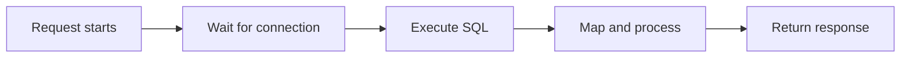

# Configuring Connection Timeouts and Execution Timeouts

In a Spring Data R2DBC application, a database access operation may have to wait at multiple stages: waiting to acquire a connection from the pool, waiting to establish a physical connection, waiting for connection validation, waiting for the database to execute SQL, and waiting for data to be transmitted back to the application. These durations serve different purposes and are usually configured at different layers.

Setting timeouts properly prevents the application from holding resources for too long when the database is slow, disconnected, or the pool has no available connections left. However, a timeout at the application layer does not automatically guarantee that the SQL statement has stopped on the server. You must understand which timeout is being applied, which component enforces it, and what happens when the deadline expires.

## 1. Distinguishing Timeout Types

A data access flow typically has the following wait points:

| Timeout type | When it applies | Component usually managing it |
|---|---|---|
| Connection acquire timeout | Waiting for an available connection from the pool | R2DBC Connection Pool |
| Connection creation/connect timeout | Opening a physical connection to the database, including network steps and handshake | R2DBC SPI or driver |
| Connection validation timeout | Checking a connection before issuing it to the application | R2DBC Connection Pool and driver |
| Statement/query timeout | Limiting how long the database executes an SQL statement | Driver or database |
| Reactive timeout | Limiting how long to wait for a publisher to emit a signal | Reactor in the application |
| Transaction timeout | Limiting the duration of a transaction | Spring transaction manager and driver capabilities |
| Request timeout | Limiting total processing time for a caller's request | Web server, gateway, or API layer |

These timeouts do not substitute for one another. For example, a query timeout does not help when a request is waiting for a connection in the pool. Conversely, an acquire timeout does not limit SQL execution time once a connection has been granted.

## 2. Connection Acquire Timeout: Waiting for a Connection from the Pool

When an application uses a connection pool, each operation needs to borrow an idle connection. If all connections are already in use by other requests and the pool cannot issue another connection yet, the new operation must wait.

**Connection acquire timeout** bounds this waiting period. If no connection becomes available within the deadline, the pool terminates the acquire operation with an error. This is a protective mechanism when load spikes or connections are held too long.

For example, suppose a pool has `max-size` of 10. If all 10 connections are in use, the 11th request must wait. When the wait exceeds `max-acquire-time`, that request receives an error instead of remaining in an unbounded queue.

### Pool configuration in Spring Boot

When the application has R2DBC Pool on the classpath and pooling is enabled, properties can be configured in `application.yml`:

```yaml
spring:
  r2dbc:
    url: r2dbc:postgresql://localhost:5432/app_db
    username: app_user
    password: change_me
    pool:
      enabled: true
      initial-size: 5
      max-size: 20
      max-acquire-time: 2s
      max-create-connection-time: 5s
      max-validation-time: 1s
      max-idle-time: 30m
      max-life-time: 60m
```

In this example:

- `initial-size` is the initial number of connections the pool creates.
- `max-size` limits the maximum number of connections in the pool.
- `max-acquire-time` limits how long to wait to acquire a connection.
- `max-create-connection-time` limits how long creating a new connection may take.
- `max-validation-time` limits how long validating a connection may take.
- `max-idle-time` limits how long a connection can stay idle.
- `max-life-time` limits the maximum lifetime of a connection in the pool.

`max-idle-time` and `max-life-time` manage connection lifecycle; they are not query timeouts. Pool configuration only takes effect when the R2DBC Pool dependency and auto-configuration are present and the pool is enabled. Property names and support must be verified against the project's Spring Boot and R2DBC Pool versions.

Do not set `max-size` excessively large to avoid acquire timeouts without considering database connection limits. If the application has multiple replicas, total open connections can be roughly the number of replicas multiplied by `max-size`. Account for connections reserved for migration tools, background jobs, and other applications as well.

## 3. Connection Creation Timeout: Opening a Physical Connection

When the pool has no idle connections and still has capacity to open a new connection, it asks the driver to create a physical connection to the database. This process may include DNS resolution, opening a TCP socket, TLS handshake, authentication, and session initialization.

**Connection creation timeout** limits the time spent creating a new connection. It helps the application fail fast when the database is unreachable, the network is disrupted, or the handshake hangs.

The R2DBC SPI has standard connection options, including `CONNECT_TIMEOUT` in SPI versions that support it. The driver decides how to apply the option and may provide additional proprietary properties. When configuring with Spring Boot, driver properties are usually passed via the R2DBC URL or `spring.r2dbc.properties.*`, depending on the driver and version.

There is no single URL parameter name shared across all drivers. For example, the name and units of the connect timeout property in PostgreSQL, MySQL, or SQL Server may differ. Check the documentation for the driver in use and verify whether the driver supports the `CONNECT_TIMEOUT` option.

When using a pool, distinguish `max-create-connection-time` from `max-acquire-time`. An acquire operation may wait for an idle connection or wait for the pool to create a new connection. The acquire timeout bounds overall connection acquisition; the create timeout bounds specifically the connection creation step. Configure both values with a sensible relationship so an operation does not wait longer than the application's allowed budget.

## 4. Connection Validation Timeout

The pool can validate a connection before lending it to the application to detect connections that have become invalid or unusable. Validation may use the driver's validation mechanism or a configured validation query.

`max-validation-time` limits the time spent on this validation step. If validation takes too long or fails, the pool can discard that connection and look for another according to pool policy.

Validation helps avoid handing broken connections to requests, but it also adds work. Do not choose a heavy validation query or run unnecessary validation on every borrow if the driver already has an appropriate validation mechanism. Consider database load, connection frequency, and driver behavior.

## 5. Statement Timeout and Query Timeout

Once a connection is granted, the application sends an SQL statement to the database. **Statement timeout** or **query timeout** limits how long the statement is allowed to execute. When the deadline is exceeded, the driver or database may cancel the statement and return an error to the application.

The R2DBC SPI defines common abstractions for `Connection`, `Statement`, and `Result`, but exact timeout configuration depends on the SPI version, driver, and database engine. Do not look for a method like JDBC's `Statement.setQueryTimeout()` and assume every R2DBC driver has the same API.

There are three places where execution limits can typically be set:

1. **Driver:** the driver provides a proprietary property or API to set statement timeout, socket timeout, or response wait limit.
2. **Database server:** the database engine itself limits SQL execution time, lock wait time, or session time in a given state.
3. **Application:** Reactor sets a deadline on the publisher so the calling layer does not wait indefinitely.

Driver- or server-side timeouts are generally necessary when you want to bound execution resources on the database. Application-side timeouts are useful for controlling request experience, but should not be treated as proof that the server stopped the SQL statement.

### Example of limiting statements in PostgreSQL

PostgreSQL supports `statement_timeout`, which limits the total duration a statement is allowed to run. A default can be configured for a role:

```sql
ALTER ROLE app_user SET statement_timeout = '5s';
```

This setting applies to new sessions for that role. If you want to limit execution within a specific transaction, you can use:

```sql
SET LOCAL statement_timeout = '5s';
```

`SET LOCAL` only applies to the current transaction and is restored when the transaction ends. This is PostgreSQL-specific syntax; other database engines have different mechanisms and setting names.

PostgreSQL also has `lock_timeout` to limit how long to wait for locks. `statement_timeout` and `lock_timeout` serve different purposes: an SQL statement might wait for a lock for a long time even though the actual work after acquiring the lock is very fast. Configuring a separate lock timeout helps control lock contention scenarios.

## 6. Reactive Timeout with Project Reactor

At the application layer, you can use the `timeout` operator to limit how long to wait for a publisher to emit a signal. Example with `DatabaseClient`:

```java
public Mono<Long> updatePersonName(Long id, String name) {
    return databaseClient.sql("""
            UPDATE people
            SET first_name = :name
            WHERE id = :id
            """)
        .bind("name", name)
        .bind("id", id)
        .fetch()
        .rowsUpdated()
        .timeout(Duration.ofSeconds(3));
}
```

If the publisher has not emitted a signal within three seconds, Reactor emits a timeout error and cancels the upstream subscription. The error produced by the Reactor operator is typically `java.util.concurrent.TimeoutException`; timeouts from the driver or database may have different exception types.

Cancelling the subscription lets the driver and framework receive the cancellation signal. However, whether the SQL statement stops immediately on the server depends on the driver's and database's cancellation capabilities. If you need stricter enforcement of SQL execution limits, configure a statement timeout on the driver or database alongside the reactive timeout.

### Notes on Mono and Flux

`Mono.timeout(Duration)` limits the wait time for a single publisher's result. With `Flux.timeout(Duration)`, Reactor tracks the interval between signals. If the Flux is emitting items steadily, the publisher can run longer than the total elapsed time without timing out, because each signal restarts the wait interval.

Therefore, clarify whether your goal is to:

- Limit the wait time for the next item in a data stream.
- Limit the wait time for a single result.
- Limit the total duration of the entire request or transaction.

Do not use `Flux.timeout(Duration)` as an overall duration cap for an entire data stream if your intent is an absolute deadline. An overall deadline should be managed at the request layer or by structuring the publisher to match business requirements.

You can supply a fallback publisher to the `timeout` operator, but consider the business semantics. For example, returning an empty list when the database times out may mislead users into thinking no data exists. In many cases, propagating a clear error so the API layer maps it to an appropriate response is safer.

## 7. Transaction Timeout

A business operation may execute multiple SQL statements within the same transaction. In that case, limiting individual queries is not enough if the total duration of the transaction also needs a bound.

Spring supports declaring a timeout on transaction boundaries, for example:

```java
@Transactional(timeout = 10)
public Mono<Void> transfer(Long sourceId, Long targetId, BigDecimal amount) {
    return accountRepository.debit(sourceId, amount)
        .then(accountRepository.credit(targetId, amount))
        .then();
}
```

The `timeout` value in the annotation is specified in seconds. How transaction timeout is applied depends on the transaction manager, R2DBC SPI version, and driver capabilities. Some drivers support applying statement timeout or lock timeout on the connection; do not assume every driver enforces it the same way.

A transaction timeout does not replace a connection acquire timeout or a request timeout. Nor should a long-lived transaction wrap operations that wait on user input, make external HTTP calls, or perform work unrelated to the database. Long transactions hold connections and may hold locks for extended periods, reducing capacity for other requests.

With reactive transactions, operations must belong to the same publisher chain within the transaction boundary. Calling `subscribe()` manually inside the method or detaching operations onto an independent subscription may prevent them from participating in the transaction as expected.

## 8. Request Timeout and Time Budget Allocation

Request timeout is the overall deadline that the calling layer allocates to a request. It may be configured at an API gateway, load balancer, WebFlux server, or client layer. A request can spend time across multiple steps:



The request budget needs enough room for internal steps plus a reserve for mapping, business logic, and sending the response. Internal deadlines should be chosen so failures are detected before the outer layer times out.

For example, a request with a three-second budget might allocate up to roughly half a second to acquire a connection, two seconds for SQL operations, and the remaining time for response processing. This is only an illustrative example; actual numbers must be based on measured latency, system load, and business requirements.

If the request timeout is shorter than the query timeout, the HTTP layer may return an error before the database receives a request to cancel the SQL statement. Conversely, if the query timeout is shorter than the request timeout, the application can receive the SQL error and handle it within the remaining request time. Design the timeout ordering intentionally.

A useful rule of thumb is to set internal operation deadlines shorter than the overall deadline while leaving sufficient buffer for error handling and response completion. For pools, consider both acquire time and create connection time so requests do not wait too long before SQL even begins.

## 9. Handling Timeout Errors and Retries

Timeouts can occur at multiple layers, so they do not always surface as the same exception type. A Reactor timeout may be `TimeoutException`; a timeout from the driver or database may be wrapped in an R2DBC exception or a vendor-specific exception.

When handling errors, record clearly which operation and stage timed out—for instance, acquiring a connection, opening a connection, validation, SQL execution, or request deadline. This information helps distinguish pool exhaustion from slow database query processing.

Do not automatically retry every timeout. If a write statement was already executed by the database but the response was lost, the application may not know whether the transaction committed. Retrying a non-idempotent write operation can create duplicate data or execute business logic twice.

Retry only when:

- The error is classified as transient and recoverable.
- The operation is idempotent or protected by deduplication mechanisms.
- Retry count and total retry duration fit within the request deadline.
- Backoff is used to avoid a stampede of concurrent requests hitting the database again.
- Any prior transaction has ended or its commit state is clearly determined.

For errors while waiting for a connection, retrying immediately can lengthen the pool queue further. Consider database load and health before selecting a retry strategy.

## 10. Choosing Timeouts Based on Operational Goals

No single set of timeout values fits every application. Base decisions on normal latency, p95/p99, resource limits, query types, and user-acceptable deadlines.

| Need | Timeout to consider | Question to answer |
|---|---|---|
| Database unresponsive when opening connection | Connect/create timeout | How long should it take to decide an endpoint is unreachable? |
| Pool frequently runs out of connections | Acquire timeout | How long should a request wait before reporting overload? |
| Connection may have been closed server-side | Validation timeout | How long at most should checking a connection take? |
| Queries may run too long | Statement/query timeout | How much time and resources may SQL consume at most? |
| Publisher does not emit signals | Reactor timeout | How long can the application layer wait for a result? |
| Business operation spans multiple SQL statements | Transaction timeout | How long at most is a transaction allowed to last? |
| User or client waits for a response | Request timeout | What is the maximum total processing time for a request? |

Do not set timeouts too short just to make latency charts look better. A timeout lower than legitimate processing time creates false failures, increases retries, and adds load to the system. Conversely, overly long timeouts hold connections, requests, and memory longer than necessary.

## 11. Monitoring Timeouts in Production

In operations, observe timeouts alongside pool and database metrics:

- Active connections, idle connections, and max connections.
- Acquire wait times, acquire timeout counts, and connection creation failures.
- Validation duration and evicted connection counts.
- Query latency by operation group, query timeout counts, and slow queries.
- Long-running transactions, transaction rollbacks, and lock timeout errors.
- Request latency at p50, p95, and p99 along with request timeout rates.

Logs should include operation name, timeout type, elapsed wait duration, correlation ID, and necessary error details. Avoid logging passwords, URLs with credentials, or sensitive user data.

If acquire timeouts rise while query latency remains normal, the pool may be too small, connections may be held too long, or requests may be creating traffic spikes. If acquire time is normal while query timeouts rise, investigate SQL execution plans, indexes, locks, database load, or data changes. Classifying accurately avoids blindly increasing pool size when the real cause is slow queries.

## 12. Testing Different Timeout Types

Test each layer separately rather than only verifying that a single request times out:

1. **Test connect timeout:** use an unreachable database address or simulated network failure environment to verify connection creation time is bounded.
2. **Test acquire timeout:** use a small pool, hold all connections in one operation, and issue another operation to verify pool wait duration.
3. **Test validation timeout:** simulate an invalid connection or slow validation query if the driver and pool support testing this.
4. **Test statement timeout:** use an intentionally slow SQL statement on a test database and confirm the driver/server returns an error within configured limits.
5. **Test reactive timeout:** create a delayed publisher to verify Reactor emits a timeout error and handles cancellation as expected.
6. **Test transaction timeout:** perform multiple operations in a test transaction to verify commit, rollback, and timeout behavior.
7. **Test request deadline:** make a request slower than the overall budget to confirm the API layer responds properly and resources are released.

With PostgreSQL, you can use `SELECT pg_sleep(10)` in a test environment to simulate a slow query. Never run this delay-simulation statement on a production database.

After a timeout occurs, verify whether the connection is returned to the pool or evicted properly, whether the transaction rolls back when required, and whether the SQL statement actually stops on the server. These behaviors depend on the driver and database, so test on the same database engine intended for deployment.

## 13. Process for Setting Up Timeouts in an R2DBC Application

You can roll out timeouts in the following sequence:

**Step 1 — Measure current timings.** Collect query latency, connection acquisition time, request latency, and error rates. Do not pick timeouts based on guesswork.

**Step 2 — Define the request budget.** Clarify the maximum duration a client or business process allows a request to take.

**Step 3 — Configure the pool.** Choose `max-size`, `max-acquire-time`, `max-create-connection-time`, and `max-validation-time` based on database limits and connection latency.

**Step 4 — Configure the driver.** Set connect timeout and network/statement options supported by the driver. Check the documentation for the exact driver version.

**Step 5 — Configure the database.** Set statement timeout or lock timeout at a scope appropriate for the database engine and business logic. Prefer server-side limits when you need to control SQL resource usage.

**Step 6 — Add reactive deadlines.** Use Reactor `timeout` on operations or streams that need application-side wait limits; understand the difference between `Mono` and `Flux`.

**Step 7 — Configure transaction and request timeouts.** Ensure deadlines coordinate with one another so an outer timeout does not terminate prematurely while inner operations are still running.

**Step 8 — Test and monitor.** Verify each timeout layer, cancellation, rollback, connection release, and metrics after deployment.

Effective timeout configuration requires distinguishing connection wait times from SQL execution time and request deadlines. The pool controls connection allocation, the driver and database control connections and statements, and Reactor bounds publisher wait times in the application. When these limits are coordinated under a clear time budget, a Spring Data R2DBC application can respond better to network issues, pool saturation, and slow queries while preserving transaction consistency.
