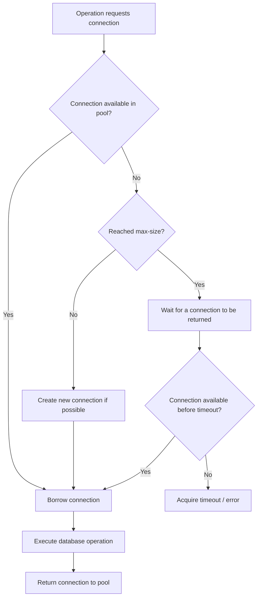

# Configuring Initial Size and Maximum Connections

## 1. Why Configure Connection Pool Size?

In Spring Data R2DBC, database access operations require a connection. If every operation creates a new physical connection and closes it immediately after finishing, the application can waste time establishing connections and place extra load on the database. A connection pool solves this by managing a group of connections that multiple operations borrow and return in turn.

When using R2DBC Pool, two key properties control pool sizing:

- `initial-size`: the initial number of connections the pool is configured to create at initialization.
- `max-size`: the maximum number of connections the pool is allowed to manage and allocate.

`initial-size` affects how many connections the pool prepares during initialization. `max-size` sets an upper limit so the pool does not grow without bound during concurrent operations. These two values have different effects and should be chosen alongside database connection limits, application instance counts, and how long each operation holds a connection.

## 2. Prerequisites for Using R2DBC Pool

R2DBC Pool is a connection management component dedicated to the R2DBC ecosystem. The application needs the R2DBC driver for the target database and a compatible `r2dbc-pool` dependency. With Gradle, a PostgreSQL example is:

```kotlin
dependencies {
    implementation("org.springframework.boot:spring-boot-starter-data-r2dbc")
    runtimeOnly("org.postgresql:r2dbc-postgresql")
    runtimeOnly("io.r2dbc:r2dbc-pool")
}
```

Spring Boot can auto-configure a pooled `ConnectionFactory` when the pool dependency is present and pooling is enabled for the Boot version in use. Check the documentation or configuration metadata for your exact Spring Boot version to verify supported properties. If not using a pool, the application can use only the driver-provided `ConnectionFactory` and does not need `spring.r2dbc.pool.*` properties.

## 3. Configuring `initial-size` and `max-size`

PostgreSQL configuration example in `application.yml`:

```yaml
spring:
  r2dbc:
    url: r2dbc:postgresql://localhost:5432/customer_db
    username: app_user
    password: ${DB_PASSWORD}
    pool:
      enabled: true
      initial-size: 2
      max-size: 10
```

In this example, the pool is configured with 2 initial connections and can expand up to a maximum of 10 connections. When load is low, the pool does not need to use the full limit of 10. When many operations require connections concurrently, the pool can create additional connections up to `max-size`, provided the database and driver permit it.

`initial-size` must be consistent with `max-size`. Set the initial connection count less than or equal to the maximum limit. For example, `initial-size: 12` with `max-size: 8` is an invalid configuration and may be rejected when the pool is created, depending on how the library version validates it.

The values `2` and `10` only illustrate syntax. They are not optimal defaults for every application. Appropriate sizing depends on concurrent requests, connection hold time, replica count, database limits, and other workloads sharing the database.

### 3.1. `initial-size` — Initial Connection Count

`initial-size` specifies the number of connections the pool is asked to initialize initially. The goal is to have a set of connections ready when work begins, instead of always waiting to create the first connection after a request arrives.

Example:

```yaml
spring:
  r2dbc:
    pool:
      initial-size: 3
      max-size: 15
```

With this configuration, the pool starts with an initial size of 3 connections and can grow up to 15 as demand increases. How and when the pool performs this initialization depends on the pool lifecycle and how the application starts it.

Important clarifications:

- `initial-size` is not the maximum connection count. As load grows, the pool can expand beyond the initial value.
- `initial-size` is not necessarily the number of connections retained throughout the entire application lifecycle. Idle connections can be evicted according to pool policy.
- `initial-size` is not `min-idle`. If you want to configure a minimum number of idle connections to maintain, check the `min-idle` property if your pool and Spring Boot versions support it.
- Setting `initial-size` too high can cause many connections to open right away, even before the application receives matching traffic.

For local environments or low-traffic services, you can start with a small value such as 1 or 2. For production systems with steady traffic, measure actual demand and consider startup duration, replica counts, and database connection limits before raising this value.

### 3.2. `max-size` — Connection Limit

`max-size` defines the maximum number of connections the pool can manage. This limit protects the database from a single application instance continuously opening more connections under concurrent load.

Example:

```yaml
spring:
  r2dbc:
    pool:
      initial-size: 2
      max-size: 20
```

The pool starts with 2 connections and can grow as needed, but never exceeds 20 connections. This number includes both connections currently borrowed by operations and connections sitting idle in the pool; do not interpret `max-size` as 20 active connections plus another separate group of idle connections.

When all connections are assigned to operations and the pool reaches `max-size`, new requests must wait for a connection to be returned. If no connection is returned within the allowed wait time, the acquisition attempt can fail with an acquire timeout error. Thus, `max-size` both caps database resource usage and affects the application's concurrent serving capacity.

Do not increase `max-size` solely to eliminate timeout errors. If connections are held too long by slow queries, long transactions, or non-terminating application flows, raising the limit can force the database to handle even more concurrent queries and worsen overload.

## 4. Distinguishing Related Properties

Pool properties serve different purposes. The following table helps avoid confusion:

| Property | Question Answered | Effect |
| --- | --- | --- |
| `initial-size` | How many connections does the pool start with? | Initial connection capacity |
| `max-size` | How many connections at most may the pool hold? | Upper bound of the pool |
| `min-idle` | What is the minimum number of idle connections to keep? | Minimum idle connection level, if supported |
| `max-idle-time` | How long may a connection remain idle? | Time before idle connection eviction |
| `max-acquire-time` | How long may an operation wait to obtain a connection? | Acquire wait timeout |
| `max-life-time` | How long may a connection exist in total? | Maximum connection lifespan |

Extended configuration example:

```yaml
spring:
  r2dbc:
    pool:
      enabled: true
      initial-size: 2
      min-idle: 2
      max-size: 12
      max-idle-time: 30m
      max-acquire-time: 5s
```

Here, `initial-size` and `min-idle` can share the value 2 without having the same meaning. One property relates to initial connection count, while the other describes the idle level to maintain under pool policy. Specific support and behavior of `min-idle` depend on the R2DBC Pool version and how Spring Boot binds the configuration.

## 5. Choosing `max-size` Based on Database Limits

A pool lives inside a single application instance. If the application runs multiple instances, each instance has its own pool. Therefore, you must calculate the total connections that can be created across all instances rather than looking only at `max-size` in one YAML file.

Suppose:

- The application runs 3 replicas.
- Each replica configures `max-size: 12`.
- Other applications or tools accessing the same database are not yet counted.

The maximum total connections these three pools can request is:

\[
3 \times 12 = 36\text{ connections}
\]

If the database allows only a finite number of connections, the budget allocated to the application must subtract administrative connections, background jobs, other services, and a reserve. For example, if the database allows 100 connections and 20 must be kept for administration and other workloads, the remaining theoretical budget for this application is 80. Three replicas with `max-size: 12` yield a combined limit of 36, below that budget.

This is only an upper-bound calculation. In real deployments, you must also factor in additional replicas during autoscaling, migration processes, batch jobs, background workers, shared-database applications, and connections opened during new-version rollouts.

### 5.1. Connection Budget Formula

You can use the following simple formula to estimate the limit:

\[
N_{app} \times P_{max} + C_{other} \leq C_{db} - C_{reserve}
\]

Where:

- \(N_{app}\): maximum number of application instances that can run concurrently.
- \(P_{max}\): `max-size` per instance.
- \(C_{other}\): maximum expected connections from other applications, jobs, and tools.
- \(C_{db}\): connection limit of the database.
- \(C_{reserve}\): reserved connections for administration, maintenance, and load fluctuations.

This is a budget allocation method, not a formula for finding the exact optimal connection count. The `P_max` value still needs validation against actual load and concurrent operations.

### 5.2. Autoscaling Example

Suppose a service normally runs 3 replicas but can scale up to 6 replicas. If each replica sets `max-size: 20`, the pools can create up to:

| Replicas | `max-size` per replica | Total limit |
| ---: | ---: | ---: |
| 3 | 20 | 60 |
| 4 | 20 | 80 |
| 6 | 20 | 120 |

If the database only allocates 90 connections to the service, configuring 20 connections per replica can exceed the budget when autoscaling to 6 replicas. In that case, you need to lower `max-size`, lower maximum replicas, raise the database budget if possible, or reallocate connections among workloads.

Rollouts can also temporarily raise the number of concurrently running instances above the desired replica count. Calculate using the actual peak instance count during rollout, not just the steady-state replica count after deployment.

## 6. Choosing Values Based on Application Load

The required number of connections depends on how many concurrent operations access the database and how long each operation holds a connection. Having many HTTP requests does not mean all requests need a connection simultaneously; some requests only hit cache or run in-memory logic. Conversely, an operation can hold a connection for a long time inside a transaction or when reading a large result stream.

Factors to consider:

- **Actual concurrency:** how many database operations typically run at once and during peak hours.
- **Connection hold time:** duration from borrowing a connection until returning it to the pool.
- **Query latency:** slow queries keep connections occupied longer.
- **Transactions:** long-running transactions usually hold connections longer than standalone queries.
- **Result consumption:** reading or processing a slow data stream can extend resource hold times.
- **Database limits:** the database may have lower connection, CPU, memory, or concurrency capacity than the pool's theoretical limit.

An initial estimation approach uses Little's Law for in-flight work:

\[
L = \lambda \times W
\]

Where \(L\) is the average number of operations in progress, \(\lambda\) is the operation completion rate per second, and \(W\) is the average time an operation holds the resource in seconds. For example, if the system executes an average of 40 database operations per second and each holds a connection for 0.1 seconds on average, the estimated average number of connections in use is:

\[
40 \times 0.1 = 4
\]

The number 4 is the average usage under those assumptions, not a recommendation to set `max-size` to 4. Traffic spikes, query latency distributions, long transactions, and latency targets all require headroom. Measure at peak load and run load tests before deciding on limits.

### 6.1. Do Not Use a Large Pool to Mask Slow Queries

Suppose a query takes 3 seconds due to a missing index and holds a connection the entire time. Increasing `max-size` may allow more queries to run concurrently, but the database has to handle heavier work. The system can shift from connection waiting to CPU, I/O, or lock overload on the database.

Before enlarging the pool, inspect:

- The actual SQL and execution plan.
- Whether indexes support filter and sort conditions.
- Whether transactions contain non-database work that keeps connections held longer.
- Whether the application reads all data or processes slowly while holding a connection.
- Whether any operation opens a subscription without terminating or cancelling cleanly.

Optimizing queries and shortening connection hold times can improve throughput without increasing connection counts.

## 7. Choosing `initial-size` Based on Startup and Baseline Load

`initial-size` governs the initial scale of the pool. A higher value ensures connections are ready if traffic arrives immediately after startup, but it also increases connections created during startup.

When multiple replicas start simultaneously, they can create initial connections all at once. For instance, 8 replicas with `initial-size: 10` can create an initialization burst of up to 80 connections. If the database is starting up or multiple services deploy together, this connection wave can cause an unnecessary load spike.

Considerations:

- Use a small `initial-size` if the service receives little traffic right after startup or has many replicas.
- Use a higher value if the service needs immediate readiness and steady initial load, after confirming the database can handle it.
- Avoid setting `initial-size` equal to `max-size` just to keep the pool at full capacity.
- Combine with staggered rollout or startup strategies if many instances connect to one database together.

`initial-size` also does not replace application warm-up. Successfully creating connections does not prove that all business queries, schemas, or permissions work properly.

## 8. How Does the Pool Behave When Reaching `max-size`?

Suppose a pool has `max-size: 5` and all 5 connections are in use by operations. When a sixth operation requests a connection, the pool is not permitted to create a sixth connection. It puts the request into a waiting state until a connection is returned or the acquire timeout expires.



Waiting for a connection does not mean allocating an extra thread per request. The R2DBC API models acquisition reactively. However, if too many requests wait, application latency still rises and can trigger timeouts at upstream layers.

`max-acquire-time` is commonly used to limit the wait time to acquire a connection. This property governs behavior when the pool is full, but it does not increase pool capacity. Choose a wait time aligned with request and network timeouts so requests do not wait longer than callers allow.

## 9. Sample Configurations by Environment

### 9.1. Local Development

Local environments typically have a single instance and low load. You can start with a small pool:

```yaml
spring:
  r2dbc:
    url: r2dbc:postgresql://localhost:5432/customer_db
    username: app_user
    password: ${DB_PASSWORD}
    pool:
      enabled: true
      initial-size: 1
      max-size: 5
      max-acquire-time: 5s
```

The goal is providing enough connections for development and manual testing without occupying many connections on the local database.

### 9.2. Staging

Staging should resemble production configuration to test behavior under load. Example:

```yaml
spring:
  r2dbc:
    url: ${R2DBC_URL}
    username: ${R2DBC_USERNAME}
    password: ${R2DBC_PASSWORD}
    pool:
      enabled: true
      initial-size: 2
      max-size: 12
      max-acquire-time: 5s
```

Values should be tuned based on staging replica count, staging database connection budget, and load test results. Do not blindly copy production `max-size` if the staging database has a lower limit.

### 9.3. Production

In production, URLs and credentials are usually supplied via environment variables or a secret manager. Pool values must be calculated from peak replica counts and the total connection budget:

```yaml
spring:
  r2dbc:
    url: ${R2DBC_URL}
    username: ${R2DBC_USERNAME}
    password: ${R2DBC_PASSWORD}
    pool:
      enabled: true
      initial-size: ${R2DBC_POOL_INITIAL_SIZE:2}
      max-size: ${R2DBC_POOL_MAX_SIZE:12}
      max-acquire-time: 5s
```

Allowing pool sizes to be overridden via environment variables makes it possible to deploy the same artifact across environments with different connection budgets. Restrict who can modify these values and record the effective configuration on each deployment.

## 10. Observing to Tune the Pool

Do not pick `initial-size` and `max-size` once and forget them. Observe the pool under normal load, peak hours, and when scaling replicas.

Useful metrics, depending on what the pool and monitoring system expose, include:

| Metric | Meaning When Monitored |
| --- | --- |
| Allocated connections | Total connections managed or allocated by the pool |
| Acquired / active connections | Connections currently borrowed by operations |
| Idle connections | Connections sitting idle and available for reuse |
| Pending acquire | Number of requests waiting for a connection |
| Acquire duration | Time waited to obtain a connection |
| Acquire timeout count | Number of times a connection could not be acquired within the timeout |
| Connection creation time | Time required to create a new connection |
| Database active sessions | Active sessions observed from the database side |

Interpreting common scenarios:

- **Low active, high idle:** the pool may be larger than routine demand. Consider reducing `initial-size` or `max-size` after checking peak hours.
- **Active frequently hits `max-size`, pending rises:** the pool may lack capacity, or queries/transactions may be holding connections too long. Check the database and hold times before raising the limit.
- **Acquire timeouts rise while the database has ample capacity:** inspect the pool, held connections, release errors, and per-instance limits.
- **Database has too many sessions:** recalculate total `max-size` across all replicas and other workloads; reduce limits or reallocate budget.
- **Startup creates many connections at once:** review `initial-size`, simultaneously starting replicas, and rollout strategy.

If using Spring Boot Actuator, Micrometer, and an R2DBC Pool version with metrics support, you can integrate pool metrics into your monitoring system. Exact metric names and how they are enabled depend on library versions and observability setup. Do not assume one fixed metric name applies across all versions; check the application's actual metrics endpoint or registry.

## 11. Common Configuration Mistakes

### `initial-size` Greater Than `max-size`

A pool cannot simultaneously initialize more connections than allowed and respect `max-size`. Set `initial-size` less than or equal to `max-size` and verify the effective values after Spring Boot binds configuration.

### Confusing `initial-size` with `min-idle`

`initial-size` specifies the starting connection count. `min-idle` specifies the minimum idle count to maintain if supported by the pool. If you want the pool to keep a baseline of ready connections during low traffic, check `min-idle` and the idle eviction policy of your version.

### Per-Instance `max-size` Exceeding the System-Wide Budget

A configuration can work on a single instance yet exceed limits when deployed across multiple replicas. Always multiply `max-size` by the maximum instance count, then add connections from other workloads.

### Increasing `max-size` When the Database Is Already Overloaded

A larger pool can push more queries to the database. If the database is short on CPU, I/O, or experiencing lock contention, this can lengthen query times and keep connections held even longer. Identify the bottleneck before tuning.

### Setting `initial-size` Equal to `max-size` Without Justification

Doing so can force every instance to open many connections immediately on startup. Only do this when there is a clear operational reason and sufficient database budget.

### Testing Configuration Only Locally

Local setups usually have one instance, low request volume, and a dedicated database. Production has autoscaling, multiple services sharing the database, rollouts, and batch jobs. Validate total limits under realistic deployment conditions.

## 12. Process for Choosing and Tuning Both Values

You can follow this sequence when configuring a pool for a service:

1. Identify the database connection limit and the budget required for administration, migrations, jobs, and other applications.
2. Identify the maximum replica count, including autoscaling and rollout surges.
3. Divide the remaining budget across instances to pick an initial `max-size` per pool.
4. Estimate concurrent database operations and connection hold time to verify whether the chosen limit handles the load.
5. Choose a small `initial-size` suited to post-startup load and the database's ability to accept connections.
6. Run load tests and monitor active, idle, pending acquire, acquire duration, timeouts, and database sessions.
7. Adjust one value at a time and re-measure, avoiding changing multiple parameters simultaneously which obscures cause and effect.
8. Re-verify whenever replica counts, workload patterns, transaction durations, or database limits change.

When configuring `initial-size` and `max-size`, treat the pool as a connection budget shared across application instances. `initial-size` determines the initial connections prepared; `max-size` caps the total connections the pool can use. Combining both values with replica counts, connection hold times, and database capacity enables an R2DBC application to handle concurrent load without opening excessive connections to the database management system.
