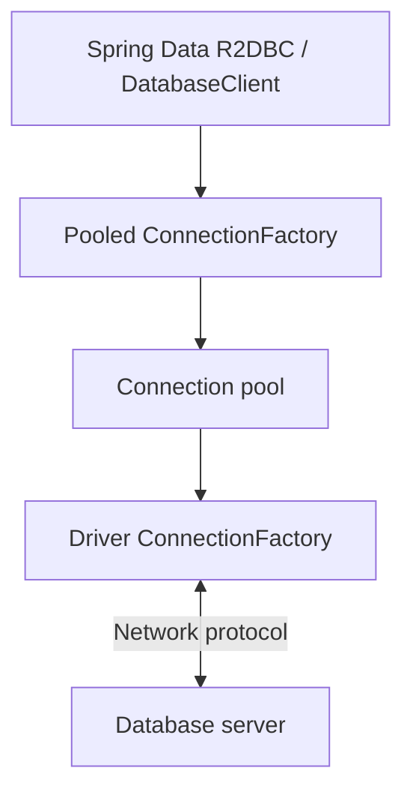
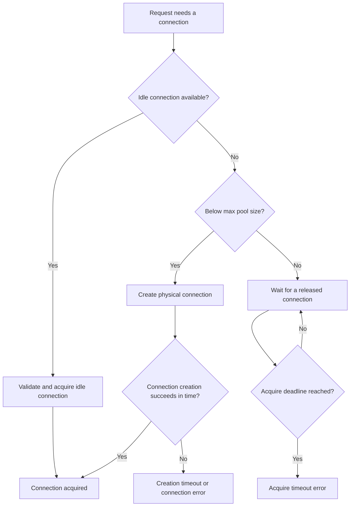

# Connection Acquisition Timeout and Creation Policies

In a Spring Data R2DBC application, each database access operation needs a connection. If a new physical connection is created for every query, the application wastes time on session setup, authentication, and network resources. A connection pool solves this by keeping a group of reusable connections and issuing them to operations as needed.

Two critical pool policies are **connection acquisition timeout** and **connection creation policy**. The acquisition timeout specifies how long a request is allowed to wait to receive a connection. The creation policy governs when the pool opens new physical connections, the maximum number opened, and limits on connection creation time. Configuring these two parts properly lets the application respond within bounded time when the database is slow while avoiding opening too many connections.

## 1. What Does a Connection Pool Manage?

The R2DBC SPI defines `ConnectionFactory` to create connections. An R2DBC driver provides a factory that communicates with a specific database management system. A connection pool can wrap this factory and itself expose a `ConnectionFactory`, adding connection lifecycle management.

The architecture can be visualized as follows:



A pool typically manages:

- Connections currently borrowed by the application to execute queries.
- Idle connections that have been returned and can be reissued.
- The number of physical connections created.
- The queue of requests waiting for a connection.
- Connection acquisition wait times and connection creation times.
- Validation, eviction, and recreation of connections that are no longer suitable.

When the application calls a repository or `DatabaseClient`, Spring Data uses the underlying `ConnectionFactory`. If that factory is wrapped by a pool, the pool decides whether to issue an idle connection, create a new connection, or hold the request in a queue. The application generally does not pick a specific connection itself.

The pool does not execute SQL on behalf of the database, nor does it make a SQL query run faster. It reduces repeated connection creation overhead and throttles concurrent connections.

## 2. Lifecycle of a Connection Acquisition Request

When a reactive operation needs a connection, the pool generally follows this flow:

1. Look for a usable idle connection.
2. If found, validate the connection per configured policy and issue it to the request.
3. If no idle connection exists and total connections are below the limit, the pool can ask the driver to create a new physical connection.
4. If the connection limit has been reached, the request must wait for a borrowed connection to be returned.
5. When a connection is returned, the pool can assign it to a waiting request or place it into the idle pool.
6. If the wait timeout or connection creation timeout is exceeded, the operation receives an error rather than waiting indefinitely.

Simplified diagram:



This is a conceptual model. Details regarding queuing, connection validation, retry attempts, and how the pool initializes connections depend on the pool library version and driver. What matters is distinguishing the wait time to obtain a connection from the time the driver needs to create a new connection.

## 3. Connection Acquisition Timeout (`maxAcquireTime`)

`maxAcquireTime` is the time limit a request is permitted to wait to obtain a connection from the pool. If the pool cannot issue a connection within this duration, the acquisition publisher terminates with a timeout error.

Common scenarios:

- All connections are currently in use by other requests.
- A slow query is holding a connection for a long duration.
- The application has more concurrent requests than the pool can serve.
- A connection has not been returned because a reactive pipeline has not terminated or resources are held too long.

For example, suppose a pool has `maxSize = 10` and all 10 connections are borrowed. The 11th request cannot immediately get a new connection because the pool is at capacity. That request must wait for a connection to be returned. If `maxAcquireTime` is 2 seconds and no connection is returned within the allowed window, the acquisition operation fails due to timeout.

Configuration example:

```yaml
spring:
  r2dbc:
    pool:
      enabled: true
      max-size: 10
      max-acquire-time: 2s
```

The `2s` duration is illustrative only. Choose it based on acceptable application response time, load level, and normal query execution times.

### Why Limit Wait Time?

If requests wait too long, upstream resources may also be held longer: HTTP requests, memory, processing contexts, and pending work. Under increasing load, growing queues can cause response times to degrade rapidly.

A practical limit lets the application fail in a controlled manner and lets callers choose an appropriate response. However, a timeout that is too short can fail requests even when a connection is about to be returned. Configuration must be grounded in actual latency and the request's time budget.

## 4. Connection Creation Timeout (`maxCreateConnectionTime`)

`maxCreateConnectionTime` limits how long the pool waits for the driver to create a new physical connection. Creating a connection can include hostname resolution, opening the network connection, protocol handshakes, authentication, and establishing the database session.

Connection creation can drag on or fail when:

- The database is starting up or overloaded.
- The hostname cannot be resolved or the network path is unstable.
- A firewall or security group blocks the database port.
- TLS handshake or authentication takes too long.
- The database has reached its connection limit.
- Credentials or database configuration are invalid.

Example:

```yaml
spring:
  r2dbc:
    pool:
      max-create-connection-time: 5s
```

If the driver cannot establish a connection within this deadline, the creation attempt fails and the error propagates through the publisher. A pool cannot make an unreachable database ready simply by increasing the timeout.

### Distinguishing the Two Timeouts

| Property | What It Bounds | Typical Scenario |
| --- | --- | --- |
| `maxAcquireTime` | Wait time to receive a connection from the pool | Pool is full and requests must wait for a connection to be returned |
| `maxCreateConnectionTime` | Time to create a new physical connection | Driver takes too long to connect and authenticate with the database |

Both limits can be configured together. A request may fail because it could not acquire a connection in time, or because creating a new connection failed or exceeded the allowed creation time. When investigating, check the root error and pool state to identify which phase timed out.

## 5. Connection Creation Policies: Initial, On-Demand, and Maximum Limit

Pools typically combine several parameters to decide how many connections are created and retained.

### initialSize

`initialSize` specifies the initial number of connections the pool is configured to create. Having a starting set of connections helps early requests avoid waiting for new connection creation. In exchange, the application may open connections even when few requests have arrived yet.

Example:

```yaml
spring:
  r2dbc:
    pool:
      initial-size: 2
      max-size: 20
```

The initial value should fit expected load and database connection limits. Actual initialization may occur when the pool is created or when first used, depending on integration and library version.

### maxSize

`maxSize` sets the cap on total connections the pool is allowed to manage. This limit usually counts both borrowed connections and idle connections.

For example, if `maxSize = 20`, the pool cannot expand to 21 connections just because one more request arrives. Requests beyond current capacity must wait for a connection to be returned or fail on timeout.

Do not set `maxSize` too high just to reduce timeouts. Every connection consumes resources in both the application and database: sockets, memory, session state, buffers, and server concurrency capacity.

### On-Demand Connection Creation

When the pool has no idle connections but still has room below `maxSize`, it can ask the driver to create additional connections. This is on-demand scaling: connection count grows when load requires it without exceeding the configured limit.

When a request finishes and returns the connection, the pool can keep that connection idle for reuse. New creation and reuse are balanced according to the pool's idle, lifetime, and eviction settings.

### Minimum Connections and Retaining Idle Connections

Some pools or library versions offer a policy to maintain a minimum number of idle connections. If you use that feature, be aware it can cause the pool to keep connections open even during low traffic. Do not assume every version or Spring Boot setup shares the exact same property; verify configuration metadata and documentation for your active version.

## 6. Spring Boot Pool Configuration Example

With the PostgreSQL driver and R2DBC Pool on the runtime classpath, an illustrative configuration might look like:

```yaml
spring:
  r2dbc:
    url: r2dbc:postgresql://localhost:5432/customer_db
    username: ${DB_USERNAME:app_user}
    password: ${DB_PASSWORD}
    pool:
      enabled: true
      initial-size: 2
      max-size: 20
      max-acquire-time: 2s
      max-create-connection-time: 5s
      max-idle-time: 30m
      max-life-time: 2h
```

Meaning:

| Property | Meaning |
| --- | --- |
| `enabled` | Enables pool configuration when supported by the Spring Boot version and dependencies |
| `initial-size` | Initial number of connections to initialize |
| `max-size` | Maximum total number of connections in the pool |
| `max-acquire-time` | Wait time limit to acquire a connection |
| `max-create-connection-time` | Time limit to create a new connection |
| `max-idle-time` | Duration a connection can stay idle before eviction under pool policy |
| `max-life-time` | Maximum lifetime limit for a connection |

This is an example configuration, not a default value set suited for every application. Property names and support can vary by Spring Boot and R2DBC Pool versions. Inspect your project's configuration metadata before applying.

The pool dependency must be present at runtime. Gradle example when using Spring Boot dependency management:

```groovy
dependencies {
    implementation 'org.springframework.boot:spring-boot-starter-data-r2dbc'
    runtimeOnly 'org.postgresql:r2dbc-postgresql'
    runtimeOnly 'io.r2dbc:r2dbc-pool'
}
```

Do not confuse the driver with the pool: the PostgreSQL driver handles communication with PostgreSQL; R2DBC Pool manages allocating and reusing the connections created by the driver.

## 7. Configuring the Pool Directly via the R2DBC Pool API

When not using Spring Boot auto-configuration, you can wrap a driver `ConnectionFactory` using `ConnectionPool`:

```java
import io.r2dbc.pool.ConnectionPool;
import io.r2dbc.pool.ConnectionPoolConfiguration;
import io.r2dbc.spi.ConnectionFactory;

import java.time.Duration;

public ConnectionFactory createPooledFactory(ConnectionFactory driverFactory) {
    ConnectionPoolConfiguration configuration =
            ConnectionPoolConfiguration.builder(driverFactory)
                    .initialSize(2)
                    .maxSize(20)
                    .maxAcquireTime(Duration.ofSeconds(2))
                    .maxCreateConnectionTime(Duration.ofSeconds(5))
                    .maxIdleTime(Duration.ofMinutes(30))
                    .maxLifeTime(Duration.ofHours(2))
                    .build();

    return new ConnectionPool(configuration);
}
```

The method returns `ConnectionFactory` because `ConnectionPool` exposes the same abstraction that Spring Data components use. The application can pass this wrapped factory to `DatabaseClient` or repository infrastructure configuration.

When creating a pool manually, the application must also manage closing the pool on shutdown. With Spring Boot auto-configuration, Spring typically manages the bean lifecycle per its configuration; do not close the pool from a service while the application is still running.

## 8. Choosing Timeout Values Based on Time Budgets

There is no single `maxAcquireTime` or `maxCreateConnectionTime` value suited for all systems. Start from the request's time budget and actual latency.

For example, an endpoint has a 3-second response budget and needs to query the database:

- Acquisition wait time must be short enough to leave time for SQL execution and building the response.
- Connection creation time must accommodate normal network latency and authentication.
- Query timeouts, pool timeouts, and HTTP timeouts must be coordinated so one layer does not keep waiting after an upstream layer has already expired.

If `maxAcquireTime` is set to 10 seconds while the HTTP request only has 3 seconds remaining, most of the pool wait time is wasted. If `maxCreateConnectionTime` is shorter than a valid TLS handshake in that environment, healthy connections can still be rejected.

A practical approach:

1. Measure connection acquisition times under normal and high load.
2. Determine the maximum request time budget.
3. Set the acquisition timeout below the remaining budget allocated to database work.
4. Set the connection creation timeout based on real connection setup time, including DNS, TLS, and authentication.
5. Monitor timeouts in operation and refine with metrics.

Timeouts are wait-limiting mechanisms, not a way to increase processing capacity. If timeouts happen frequently, investigate root causes such as slow queries, an undersized pool, long connection hold times, or insufficient database capacity.

## 9. Pool Size and Database Connection Limits

Pool size must be calculated across all application instances. If one instance has `maxSize = 20` and the system runs 5 instances, the theoretical maximum connections from those pools can reach 100.

The database must also reserve connections for:

- Other applications or services.
- Administrative and monitoring tools.
- Migrations, backups, or background tasks.
- Spare connections during deployments or application scaling.

For example, if the database allows up to 150 connections and there are 5 application instances, setting each instance's pool to 40 creates a ceiling of 200, exceeding the database limit before counting other clients. Allocate an overall budget rather than looking only at a single instance's configuration.

A larger pool does not always yield higher throughput. When the database is saturated on CPU, I/O, or locks, adding concurrent connections can increase contention and worsen latency. Increase gradually, benchmark performance, and watch database load.

## 10. Why Are Connections Held Too Long?

The pool can only reuse a connection after the application returns it. If a pipeline holds a connection too long, other requests may have to wait even when individual queries are not heavy.

Common causes:

- Queries reading too many rows with slow result consumption.
- The application making an HTTP call or non-database work while still holding a transaction.
- Transactions spanning too much work.
- Acquiring connections directly via SPI without closing them on all completion, error, and cancellation paths.
- Using `block()` or manual `subscribe()`, detaching the processing lifecycle from framework-managed flow.
- A processing stream getting cancelled without proper resource release.

With Spring Data R2DBC, keep transactions scoped to what is strictly necessary and return publishers across reactive layers. If calling the SPI directly, manage cleanup for every outcome. On a pooled connection, calling `close()` normally returns the logical connection to the pool for reuse rather than immediately closing the physical socket.

## 11. Idle Connections, Lifetime, and Validation

Beyond acquire and create times, pools commonly enforce policies for idle and long-lived connections:

- `maxIdleTime` limits how long a connection can sit idle before the pool evicts it according to policy.
- `maxLifeTime` limits the overall lifespan of a connection, even if it is reused.
- Validation can check a connection before issuing it to a request or per pool policy.
- Background eviction can periodically sweep idle or expired connections.

These policies are useful when a database, proxy, or network closes inactive connections after some interval. If the pool holds a connection already closed by the server, the next request may encounter an error using it. Idle timeout and validation configuration should account for database or network infrastructure timeouts.

Do not set `maxIdleTime` so low that the pool continually closes and recreates connections under steady load. Nor should connections be kept indefinitely if the database or proxy enforces its own lifetime limits.

Validation also carries cost. A test query or validation check before every borrow can add latency and extra traffic. Choose validation suited to the driver and environment, and avoid enabling redundant checks without reason.

## 12. Monitoring Pool Activity

To tell whether timeouts stem from connection scarcity or a slow database, monitor pool metrics if supported by your library and setup:

| Metric | Meaning When Investigating |
| --- | --- |
| Active connections | Number of connections currently borrowed |
| Idle connections | Number of connections waiting to be reused |
| Pending acquisitions | Number of requests waiting to acquire a connection |
| Acquire latency | Time from request to receiving a connection |
| Acquire timeout count | Number of times a connection could not be acquired in time |
| Connection creation latency | Time taken by the driver to create a new connection |
| Connection creation failures | Number of failed new connection attempts |
| Connection lifetime / idle duration | How long connections are held and stay idle |

Key indicators:

- Active consistently hits `maxSize`, pending rises, and idle is 0: the pool may lack capacity or connections are held too long.
- Acquire timeouts increase while database queries are fast: inspect pool size, connection hold time, and concurrency.
- High creation latency or rising creation failures: check network, authentication, database health, and connection limits.
- Idle remains high while active is low: the pool may be oversized for demand; consider tuning down if database resources need conserving.

Metrics must be read alongside query latency, database CPU, I/O, and connection limits. A single pool chart alone is not enough to isolate the cause.

## 13. Handling Timeout Errors and Retries

When a connection cannot be acquired, the publisher terminates with an error. The service or web layer can translate the error into an appropriate response, log it, and emit metrics. Preserve the root cause to distinguish an acquire timeout from a connection creation failure or SQL error.

Do not blindly retry every timeout error without limits. Immediately retrying when a pool is already full can add even more waiting requests, making overload worse. If business logic permits retries:

- Bound the number of attempts.
- Use backoff and jitter so multiple requests do not retry in lockstep.
- Only retry errors likely to be transient and operations safe to repeat.
- Keep total retry duration within the request budget.
- Do not retry write operations that may already have succeeded if commit status is unknown.

For connection creation errors caused by wrong passwords, bad URLs, or a missing database, retries generally will not resolve the issue. Fix the configuration or restore the infrastructure.

## 14. Testing Acquire and Creation Policies

You can test pool behavior using a test database and a small pool configuration. For example, create a pool with `maxSize = 1`, borrow a connection, and hold it without returning it. A second acquire request will have to wait; with a short acquire deadline, it will terminate with a timeout. Then return the first connection and verify a new request can acquire a connection again.

An integration test should cover:

1. Creating a pool with a small limit, such as one or two connections.
2. Acquiring all permitted connections and holding them for a controlled duration.
3. Sending an additional acquire request and verifying it waits or times out as configured.
4. Returning borrowed connections and verifying new requests can proceed.
5. Testing a scenario where the database cannot create connections to confirm creation errors propagate.
6. Closing the pool after the test to release resources.

Reactor Test can be used to verify publishers and timeouts. When testing timeouts, control timing carefully and avoid long, flaky sleeps. A test backed by a real database or container verifies driver and pool integration; pure mocks do not prove pool policies work with a real driver.

## 15. Common Configuration Mistakes

1. **Setting `maxAcquireTime` too long.** Requests hold resources and wait too long with no time left for HTTP layer processing.
2. **Setting `maxAcquireTime` too short.** Requests fail even though a connection would soon be returned under normal load.
3. **Confusing acquire timeout with create timeout.** One occurs while waiting for a connection to be returned; the other occurs while the driver is opening a new connection.
4. **Setting `maxSize` above the database budget.** Total connections across multiple instances can exceed the server limit.
5. **Increasing `maxSize` to hide slow queries.** Higher connection concurrency can overload the database further.
6. **Forgetting the pool dependency.** Pool configuration has no effect if the required library is absent from the runtime classpath or auto-configuration is not enabled.
7. **Failing to return connections to the pool.** Held connections drive active up, idle down, and trigger acquire timeouts.
8. **Holding transactions too long.** A connection can stay occupied for the entire transaction, even while the app performs non-database work.
9. **Ignoring database or proxy timeouts.** Connections can be closed by infrastructure before the pool detects and evicts them.
10. **Unbounded retries.** Retried requests can keep filling the queue while the pool or database is overloaded.

## Quick Selection Rules

- Use `maxAcquireTime` to limit how long a request waits to borrow a connection from the pool.
- Use `maxCreateConnectionTime` to limit how long the driver takes to create a new physical connection.
- Use `initialSize` to control the initial number of connections created.
- Use `maxSize` to cap the total number of connections managed by the pool.
- Use idle time, lifetime, and validation to manage idle or aging connections.
- Choose timeouts and pool size based on request budgets, actual load, instance counts, and database limits.
- Monitor active, idle, pending, acquire latency, and creation failures to tune using metrics.

Connection acquisition timeout and creation policies jointly determine how a pool responds when the application accesses the database. A sound configuration sets clear bounds on wait times and connection counts while returning connections promptly once work finishes. When timeouts appear, identify whether the pool is waiting for connections to be returned or the driver cannot create new connections, then fix the cause at the right layer.
