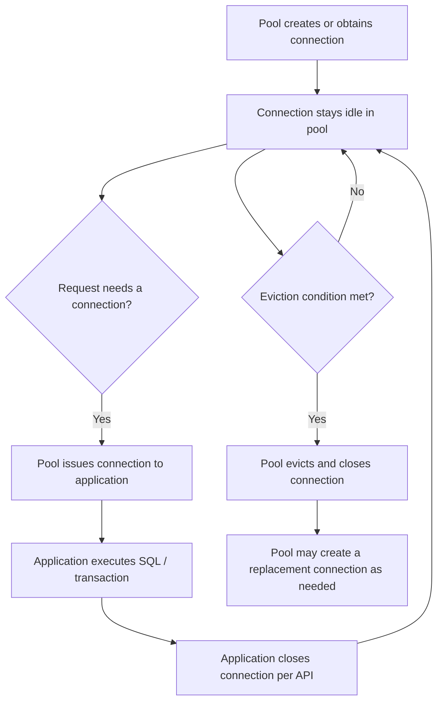

# Idle Time, Lifetime, and Connection Eviction

The connection pool in Spring Data Relational R2DBC retains a set of established connections for reuse across operations. When an operation completes, the application returns the connection to the pool; the connection can wait there to be issued to the next request. If idle connections are kept too long or a connection is used beyond an appropriate lifespan, the application may hit errors because a database, proxy, or network layer closed the connection on the other side.

R2DBC Pool provides time bounds to manage this lifecycle. Two key limits are **maximum idle time** (`maxIdleTime`) and **maximum lifetime** (`maxLifeTime`). The **eviction** mechanism checks connections eligible for removal and releases them from the pool. Understanding when these timers start, when the pool inspects them, and how connections are returned helps keep the pool stable without opening excessive new connections.

## 1. Connection Lifecycle in the Pool

A connection is created by the driver and managed by the pool. When the application needs to access the database, the pool issues an available connection or creates a new one if within limits. After the operation finishes, the connection is returned to the pool for reuse.



In a pool, calling `Connection.close()` usually means returning the connection to the pool after use is complete. The pool can clean up session state, transactions, or related resources before placing the connection back on the idle list. When the pool actually evicts a connection, it closes the managed connection and removes it from the allocatable resource set.

An important distinction is between a connection borrowed by the application (acquired/in use) and a connection waiting in the pool (idle). Idle time is measured while the connection resides in the pool ready to be reissued. A connection currently in use is not an idle resource, even if it was created a long time ago.

## 2. Maximum Idle Time (`maxIdleTime`)

`maxIdleTime` defines the maximum duration a connection may sit idle in the pool before becoming eligible for eviction. This timer applies to the idle state and typically starts when the connection is returned to the pool after the application finishes using it.

For example, configuring `maxIdleTime` to 10 minutes means a connection should not sit waiting in the pool beyond that interval. Once idle time crosses the threshold, the pool can remove the connection during a suitable eviction check. The pool does not necessarily close the connection at the exact 10-minute mark; actual timing depends on check intervals and connection state.

### When Are Idle Limits Useful?

- The database has a policy that closes inactive sessions after a period of time.
- A firewall, NAT gateway, load balancer, or proxy drops idle TCP connections.
- The application has uneven traffic with long quiet periods and does not need to keep all old connections open.
- The system needs to release resources after low-traffic periods.

For example, if a proxy closes inactive connections after 20 minutes, the pool can set `maxIdleTime` lower than that threshold to proactively evict connections before the proxy closes them. Leave a buffer rather than setting both values equal, since timeout timing and eviction schedules do not necessarily align.

### Idle Time Is Not Total Lifetime

Suppose a connection is created at 09:00, used from 09:01 to 09:03, and then returned to the pool. If `maxIdleTime` is 10 minutes, the idle interval for that wait begins when the connection returns to the pool, not at 09:00. If the connection is issued again at 09:08, it leaves the idle state and is no longer eligible for eviction just because it sat idle for almost 10 minutes during that wait.

After the next use, the connection begins a fresh idle interval when returned to the pool. This limit manages inactivity wait time, not the total age of the connection.

## 3. Maximum Lifetime (`maxLifeTime`)

`maxLifeTime` caps the age of a connection measured from when it was created. Unlike `maxIdleTime`, lifetime does not reset each time the connection is acquired or returned to the pool. A frequently used connection still ages in real time.

For example, a connection created at 09:00 with a `maxLifeTime` of 2 hours reaches its lifetime threshold around 11:00, regardless of how many times it was used or how long it remained idle during those two hours. When the connection becomes eligible for reclamation and the pool checks it in an evictable state, the pool removes it to avoid reusing a connection past its configured age.

### Why Limit Lifetime?

- Some databases or intermediary services enforce a maximum age limit on sessions or connections.
- Network infrastructure may impose a lifespan on long-lived connections.
- Credentials, certificates, or security policies can change over time; rotating connections allows new connections to pick up updated configuration.
- Long-lived connections can drift out of sync with the current infrastructure state, even if they worked when created.

`maxLifeTime` gives the pool an opportunity to replace old connections with new ones. It does not automatically rotate credentials or certificates; the application still needs to refresh configuration and ensure new connections use effective settings.

### Connections in Use When Reaching Maximum Lifetime

Maximum lifetime is a pool lifecycle criterion and should not be treated as a forced abort command on an active query the instant the threshold is reached. The pool can usually only evict safely once the connection has been returned or is in an idle, evictable state. A currently borrowed connection may continue serving the active operation and then be discarded upon return to the pool, depending on implementation and version.

Therefore, `maxLifeTime` does not replace query or transaction timeouts. If an operation holds a connection too long, examine dedicated timeouts and transaction design. Nor should you rely on `maxLifeTime` to guarantee an active connection will be cut off immediately.

## 4. Comparing `maxIdleTime` and `maxLifeTime`

| Property | Start of Measurement | Primary Condition | Goal |
| --- | --- | --- | --- |
| `maxIdleTime` | When the connection is returned to the pool and enters idle state | Idle duration exceeds configured duration | Avoid holding waiting connections too long |
| `maxLifeTime` | When the connection is created | Total age exceeds configured duration | Avoid reusing connections that are too old |

Both limits can apply to the same connection simultaneously. A connection becomes eligible for eviction when either configured criterion calls for removal and the pool inspects it in an evictable state.

Configuration example:

```java
ConnectionPoolConfiguration configuration =
        ConnectionPoolConfiguration.builder(connectionFactory)
                .maxIdleTime(Duration.ofMinutes(10))
                .maxLifeTime(Duration.ofHours(2))
                .build();
```

In this configuration, a new connection has a maximum lifetime of 2 hours. Each time it is returned to the pool, it can sit idle for at most 10 minutes. If the connection hits the 2-hour lifetime before a 10-minute idle window ends, the lifetime limit can also trigger eviction at the appropriate check.

## 5. What Is Eviction?

Eviction is the process by which the pool removes a connection from the reusable set and releases its resources. The pool evaluates criteria such as idle time, lifetime, or validity; connections meeting eviction criteria are closed and will not be issued to future requests.

Eviction does not delete data in the database, remove rows, or roll back a business transaction. It manages connection resources at the pool layer.

### Periodic Checks via `backgroundEvictionInterval`

R2DBC Pool offers a `backgroundEvictionInterval` option to set the interval of a background task that checks whether idle connections qualify for eviction. For example, if the interval is one minute, the pool can inspect idle connections in sweeps roughly one minute apart.

The check interval affects the delay between when a connection crosses its threshold and when the pool actually reclaims it. If `maxIdleTime` is 10 minutes and the eviction interval is 1 minute, a connection may be removed on the first sweep after expiration rather than at the exact 10-minute mark.

If the check interval is too long, expired connections can linger in the pool until the next sweep. If it is too short, the pool runs background checks more frequently. Choose an interval suited to the connection count, resource-release requirements, and checking overhead.

Do not assume that only background eviction can detect expired connections. The pool may also evaluate conditions during acquisition handling or other state transitions depending on version and implementation. Consult the documentation for your exact `r2dbc-pool` version to determine behavior when no background interval is configured.

### Idle Connections vs. Borrowed Connections

Pools typically perform eviction on idle resources because connections currently used by the application cannot be closed safely without disrupting active operations. When a connection is returned to the pool, the pool can re-evaluate lifetime and eviction conditions before allowing it back into the allocatable idle state.

Thus, a connection exceeding `maxLifeTime` during an active transaction does not mean the pool immediately aborts the transaction. Once returned, however, that connection can be discarded instead of reused.

### Eviction and Replacement Connections

Eviction lowers the current number of available connections. When new requests arrive, the pool can create replacement connections if needed and within the `maxSize` limit. Some pool configurations also use an initial size or minimum idle target to keep connections ready; exact count maintenance depends on pool configuration and version.

Do not treat eviction as a mechanism that automatically keeps the exact same connection count at all times. The pool balances borrowed connections, idle connections, size limits, and demand for creating new connections.

## 6. Configuring Limits in R2DBC Pool

R2DBC Pool provides `ConnectionPoolConfiguration` to configure connection limits and management policies. Example:

```java
import io.r2dbc.pool.ConnectionPool;
import io.r2dbc.pool.ConnectionPoolConfiguration;
import io.r2dbc.spi.ConnectionFactory;

import java.time.Duration;

ConnectionPoolConfiguration configuration =
        ConnectionPoolConfiguration.builder(connectionFactory)
                .initialSize(5)
                .maxSize(20)
                .maxIdleTime(Duration.ofMinutes(10))
                .maxLifeTime(Duration.ofHours(2))
                .backgroundEvictionInterval(Duration.ofMinutes(1))
                .build();

ConnectionPool pool = new ConnectionPool(configuration);
```

This example illustrates setting durations and sizes. The application needs an `r2dbc-pool` dependency compatible with the R2DBC SPI and driver versions in use. Time durations should be chosen according to database and deployment infrastructure timeouts rather than copied blindly.

Related properties:

| Property | Meaning |
| --- | --- |
| `initialSize` | Initial number of connections prepared by the pool |
| `maxSize` | Maximum number of connections the pool is allowed to manage |
| `maxIdleTime` | Maximum idle duration before a connection becomes eligible for eviction |
| `maxLifeTime` | Maximum age measured from when the connection was created |
| `backgroundEvictionInterval` | Interval of the background task checking idle connections for eviction |
| `maxAcquireTime` | Maximum time to wait to acquire a connection from the pool |
| `maxCreateConnectionTime` | Maximum time to wait to create a new connection |
| `maxValidationTime` | Maximum time for validation operations if configured |

`maxAcquireTime` and `maxCreateConnectionTime` are timeouts for acquiring or creating connections, not lifetimes or idle times. Distinguishing them helps avoid misusing one timeout to solve a problem belonging to another.

### Configuring with Spring Boot

If a project uses Spring Boot and pooling is enabled through the appropriate dependency and auto-configuration, some limits can be declared in `application.yml`:

```yaml
spring:
  r2dbc:
    url: r2dbc:postgresql://localhost:5432/appdb
    username: ${DB_USERNAME}
    password: ${DB_PASSWORD}
    pool:
      enabled: true
      initial-size: 5
      max-size: 20
      max-idle-time: 10m
      max-life-time: 2h
      max-acquire-time: 5s
      max-create-connection-time: 5s
```

Pool properties supported by Spring Boot depend on the Boot version. If you need to set `backgroundEvictionInterval` or an option not exposed by auto-configuration properties, you may need to declare `ConnectionPool`/`ConnectionPoolConfiguration` manually. Verify configuration metadata and project-version documentation before using YAML properties.

When creating a pool manually, ensure beans—including `DatabaseClient` and the reactive transaction manager—use the pool-wrapped factory. If a repository uses an unpooled factory, the idle/lifetime limits configured here will not apply to that repository's queries.

## 7. Choosing Durations Based on Database and Infrastructure Timeouts

The pool is not the only component governing connection lifespan. Databases, proxies, firewalls, NAT gateways, load balancers, and cloud platforms can enforce their own limits. If an infrastructure component closes a socket before the pool recognizes the connection has expired, subsequent usage may encounter connection reset or connection closed errors.

A practical configuration principle is to have the pool proactively evict connections before the shortest external infrastructure timeout, with a sufficient buffer.

Hypothetical example:

| Component | Timeout |
| --- | ---: |
| Proxy closes idle connections | 20 minutes |
| Pool `maxIdleTime` | 15 minutes |
| Background eviction interval | 1 minute |

In this example, the pool begins considering idle connections for eviction ahead of the proxy's 20-minute mark. The buffer reduces the chance of the pool handing out a connection already closed by the proxy. These are illustrative numbers; obtain actual timeouts from your running database and infrastructure.

For `maxLifeTime`, inspect connection age caps imposed by database services or proxies. If infrastructure enforces a maximum connection age, setting `maxLifeTime` lower lets the pool replace connections before infrastructure cuts them. Even without such an external cap, lifetime can still be used to rotate connections by operational policy while weighing connection creation overhead.

### Do Not Set Limits Too Low

`maxIdleTime` or `maxLifeTime` values that are too short can force the pool to repeatedly close and open connections. Setting up a connection typically takes time for DNS, TCP, TLS, authentication, session initialization, and driver steps. Consequences can include:

- Increased handshake counts and load on the database.
- Higher latency when requests must wait for new connections to be created.
- More transient errors when the database or network is under load.
- Connection pool churn oscillating continuously between creation and eviction.

### Do Not Set Limits Too Long

Limits that are too long can retain stale connections after a proxy or database has closed the other side. Old connections can also outlive security policies or credential rotation windows. If the pool only discovers a broken connection when used, the first request after a quiet period may fail or require application-level retry.

The aim is choosing thresholds long enough for effective reuse, yet shorter than external limits that invalidate connections.

## 8. Validation and Eviction Are Two Distinct Mechanisms

Eviction removes connections based on lifecycle policies such as idle time and maximum lifetime. Validation checks whether a connection is still valid before or during pool allocation, depending on configuration and implementation.

Validation can help catch connections closed by the database or network. However:

- Validation does not replace `maxIdleTime` or `maxLifeTime`; valid connections may still need rotation per policy.
- Validation carries a cost and may involve driver or database round trips depending on validation depth/query.
- A connection can drop immediately after validation succeeds due to a subsequent network failure. This is a race condition that validation alone cannot eliminate completely.
- Validation queries and validity checks depend on the driver, database, and pool version.

Therefore, combine sensible time bounds with appropriate validation. If an environment has a proxy closing idle connections, setting `maxIdleTime` below the proxy's timeout is usually more proactive than relying solely on validation after a long idle period.

## 9. Monitoring the Pool to Tune Configuration

Do not pick `maxIdleTime`, `maxLifeTime`, or eviction intervals purely by guesswork. Monitor connection counts and wait times to see how the pool actually behaves.

Useful metrics include:

| Metric | What to Observe |
| --- | --- |
| Connection acquired | Number of connections currently borrowed by the application |
| Connection idle | Number of connections waiting in the pool |
| Connection allocated | Total connections managed or allocated by the pool per metric definition |
| Pending acquire | Number of requests waiting for a connection |
| Acquire duration | Time requests wait to acquire a connection |
| Connection creation time | Time to establish a new connection |
| Eviction/close count | Rate at which connections are evicted or closed |
| Connection errors | Errors occurring while acquiring, validating, or using connections |

Exact metric names depend on the pool version and Micrometer/observability integration in use. When reading dashboards, check metric descriptions to see whether they count borrowed connections, allocated connections, or physical connections.

Signs suggesting misconfiguration:

- Evictions and connection creations rising steadily: idle/lifetime thresholds may be too low or the pool is experiencing churn.
- Connection closed errors after quiet periods: proxy/database timeouts may be shorter than pool policies, or validation is not catching stale connections.
- Pending acquire rising while the pool hits `maxSize`: the pool may be too small for the load, connections may be held too long, or queries/transactions are slow.
- Prolonged high idle connection counts: the pool may be retaining more connections than needed or idle time is too long.

Cross-check pool metrics with database logs, proxy timeouts, and request load. Increasing `maxSize` alone will not solve issues caused by connections being held too long or a database unable to accept new sessions.

## 10. Illustrative Scenarios

### Application with Time-of-Day Traffic

A service gets heavy traffic during business hours and very little at night. Keeping connections idle in the pool for hours may be unnecessary, especially if the database or network drops inactive sessions. You can set `maxIdleTime` so the pool reclaims connections after a reasonable quiet window; when new requests arrive, the pool creates fresh connections within configured bounds.

Do not set idle timeout so short that every burst of requests has to recreate the entire pool. Observe traffic patterns and connection setup costs to choose an appropriate threshold.

### Database Proxy Limiting Connection Age

A proxy allows connections to exist for at most 4 hours. The pool sets `maxLifeTime` around 3 hours and 30 minutes to replace connections ahead of the proxy limit, leaving an operational buffer. A connection currently borrowed when hitting the threshold is handled per pool lifecycle; this limit does not replace timeouts for running transactions.

### Stale Connections After Idle Periods

The application receives no requests for a long stretch. A proxy closes idle sockets, yet the pool still holds references to those connections. When the next request arrives, if the pool hands out an old connection without detecting the stale state, the operation may fail. You can set `maxIdleTime` below the proxy timeout, configure suitable validation, and handle transient connection errors at the application layer according to operation safety.

### Long-Running Transaction Exceeding Max Lifetime

A transaction holds a connection for a long duration. The connection reaches `maxLifeTime` while still borrowed. Do not expect the pool to interrupt the transaction immediately; review why the transaction takes so long, check business timeouts, and inspect database lock contention. Once the connection is returned, the pool can discard it instead of placing it back on the idle list.

## 11. Configuration and Verification Process

When implementing idle, lifetime, and eviction policies, you can follow this sequence:

1. Identify your driver, `r2dbc-pool` version, and Spring Boot version.
2. Gather idle and lifetime timeouts from the database, proxy, firewall, NAT, and load balancer.
3. Choose `maxIdleTime` lower than external idle timeouts with an adequate buffer.
4. Choose `maxLifeTime` based on infrastructure connection age limits and rotation requirements.
5. Choose `backgroundEvictionInterval` so checks are neither too delayed nor overly frequent.
6. Review validation, `maxSize`, `maxAcquireTime`, and `maxCreateConnectionTime` so the overall configuration is consistent.
7. Monitor acquired, idle, pending acquire, connection creation time, and errors in a test environment.
8. Test long idle periods, proxy-closed connections, traffic spikes, and long-running transactions.

When testing eviction, distinguish between when a connection crosses its threshold, when the background task runs, and when the connection is actually closed. This gap is normal if the pool checks periodically or only evicts when a connection is in an appropriate state.

## 12. Key Takeaways

- `maxIdleTime` limits how long a connection waits in the pool after being returned; it is not total lifetime.
- `maxLifeTime` limits age measured from connection creation, even when the connection is frequently used.
- `backgroundEvictionInterval` controls the interval of the background task inspecting idle connections eligible for eviction.
- Eviction removes and closes connections from the pool; it does not delete data and usually does not interrupt an operation actively using a connection.
- With pooling, `Connection.close()` normally returns the connection to the pool; the pool decides whether to keep or evict it.
- Validation checks connection validity; eviction manages lifecycle. Both mechanisms complement rather than replace each other.
- Set idle/lifetime thresholds lower than external limits that may close connections, leaving an appropriate buffer.
- Limits that are too short cause constant connection creation/closure churn; limits that are too long increase the risk of reusing stale connections.
- Monitor idle, acquired, pending acquire, creation times, and errors to tune configuration against real load.

When designing an R2DBC pool, be clear about when idle time begins, where lifetime is measured from, and when the pool checks eviction. Those three points explain why a connection is kept, reissued, or closed, and help set bounds aligned with database and network infrastructure timeouts.
