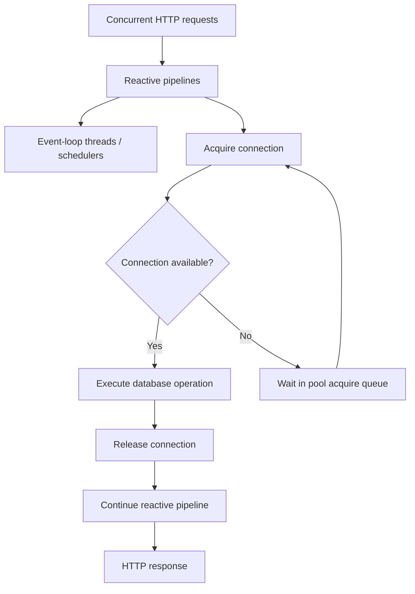

# Relationship Between Thread Concurrency and Pool Limits

In a Spring Data Relational R2DBC application, the number of running threads does not directly determine how many database connections the application can use. R2DBC is built for non-blocking I/O: a small group of event-loop threads can coordinate many requests and many operations waiting on data. A connection pool, meanwhile, bounds how many database connections are issued concurrently. These two limits control different resources and must be configured and observed together.

When more requests query the database concurrently than the pool allows, excess operations wait for a connection to be assigned. In a reactive application, waiting for a connection can be non-blocking: the event loop keeps handling other events while the publisher waits. Even so, requests still wait, queues can grow, and latency can exceed timeouts. Adding threads does not create additional connections; raising the pool limit does not guarantee the database can handle more concurrent queries.

## 1. Distinguishing Levels of Concurrency

To understand how threads and pools relate, distinguish at least five concepts:

| Concept | Meaning | Related Resource or Limit |
| --- | --- | --- |
| HTTP request concurrency | Number of requests being handled at the same time | Request intake capacity, memory, gateway and app limits |
| Thread concurrency | Number of threads executing code at a given moment | Event loop, schedulers, CPU, and thread pools |
| Reactive operation concurrency | Number of publishers or async operations currently in flight | Backpressure, operator concurrency, queues, and memory |
| Database operation concurrency | Number of database operations actively executing or holding a connection | Available connections, driver, and database capacity |
| Connection pool size | Maximum connections the pool can issue concurrently | Pool `max-size`, plus database and system-wide limits |

These quantities are related but not equal. For example, 500 requests may be active in the application while only 15 requests hold database connections at any instant. Some requests may be processing in-memory data, waiting on another HTTP service, or waiting for a connection. A single event-loop thread can also coordinate many requests without dedicating one thread per request.



This diagram shows the conceptual flow. The pool either issues an available connection or holds the acquire request in a waiting state. Once the operation completes and returns the connection to the pool, a waiting request can receive it. Inside a transaction, a connection is typically held for the duration of the transaction rather than a single SQL statement.

## 2. An Event Loop Is Not a Connection Pool

In common WebFlux setups using Reactor Netty, event-loop threads process network events and dispatch callbacks. When an R2DBC publisher sends a query and awaits a response, the driver uses non-blocking I/O so the event loop does not sit blocked waiting for the database to reply. When data arrives, the driver signals continuation of the pipeline.

Consequently, there is no rule requiring one dedicated thread or one connection held end-to-end per request. One request can execute multiple sequential reactive steps while a small pool of threads serves many requests. A connection is used only when an operation needs the database and is returned according to the operation or transaction lifecycle.

For instance, if a pool has `max-size: 10`, the application can still have hundreds of active requests. At any moment, at most 10 connections from that pool are issued concurrently. Other requests may be doing other work or waiting for a connection. They do not need 100 threads simply because 100 requests exist.

That does not mean event-loop threads can do anything. If a callback on an event loop runs `block()`, JDBC, `Thread.sleep()`, or heavy CPU computation, that thread is occupied. Non-blocking I/O only avoids tying up threads while waiting on non-blocking I/O; it does not make blocking calls or CPU-bound work free.

## 3. The Pool Limits Concurrently Issued Connections

A connection pool maintains and reuses a set of connections to the database. The `max-size` property caps how many connections the pool can create or issue simultaneously. Once all connections are in use, the next acquire request must wait for a connection to be returned or fail if the wait timeout expires.

Illustrative Spring Boot configuration example:

```yaml
spring:
  r2dbc:
    url: r2dbc:postgresql://${DB_HOST:localhost}:${DB_PORT:5432}/${DB_NAME:orders}
    username: ${DB_USERNAME:orders_app}
    password: ${DB_PASSWORD}
    pool:
      enabled: true
      initial-size: 5
      max-size: 20
      max-acquire-time: 5s
      max-idle-time: 30m
      max-life-time: 30m
```

In this example, the pool can issue up to 20 connections. `max-acquire-time` limits wait time to borrow a connection as supported by your Spring Boot and pool versions. If the pool is busy and no connection is returned in that window, the acquire operation can raise a timeout error. Specific properties and defaults vary by version; a compatible R2DBC pool dependency is required on the classpath.

Pool size is not thread count. A connection is a database session resource; a thread is an execution context. One thread can run callbacks for many connections over time, and one connection may be used by reactive steps executing on different threads during a pipeline's lifespan. Do not bind connections rigidly to threads as in some synchronous JDBC models.

## 4. What Happens When Operations Exceed Pool Size?

Suppose an application has a pool capped at 10 connections and 50 operations need the database at once:

1. Up to 10 operations receive connections and start using them concurrently, if connections are ready.
2. Remaining operations submit acquire requests and wait for a connection to be returned.
3. When an operation finishes, its connection returns to the pool; a waiting operation can proceed.
4. If wait time exceeds `max-acquire-time`, the waiting operation can fail with a timeout.
5. If operations hold connections long or the database responds slowly, the acquire queue grows and request latency rises.

In reactive apps, waiting to acquire is represented via publishers and does not necessarily block an event-loop thread. Still, non-blocking waiting is still waiting: the request cannot finish database-dependent work, memory for request state remains held, and upstream timeouts can still trigger.

A small pool is not automatically a bug. If traffic is low and queries are fast, a small pool can suffice while protecting database load. Trouble arises when incoming demand exceeds processing capacity over sustained periods, or when long connection hold times cause queues to grow continuously.

## 5. Relationship Between `flatMap` Concurrency and Pool Size

Reactor lets you bound how many inner publishers are subscribed concurrently via the concurrency parameter of `flatMap`. This throttles how many business operations launch at once within one stage of a pipeline.

```java
public Flux<Customer> loadCustomers(List<Long> ids) {
    return Flux.fromIterable(ids)
            .flatMap(customerRepository::findById, 8);
}
```

The `8` parameter limits how many `findById` publishers this `flatMap` processes simultaneously. If each publisher runs a single simple query, that cap helps pace database demand emitted at once. With a 10-connection pool, concurrency 8 leaves headroom for other operations in the same application.

However, `flatMap` concurrency is not a formal connection limit. An inner publisher might use zero connections, run multiple sequential queries, or hold a transaction across several steps. Other pipelines also share the same pool. Thus, concurrency 8 on one `flatMap` does not guarantee the entire application uses at most 8 connections.

If sequential execution is desired, you can use `concatMap`:

```java
public Flux<Customer> loadCustomersSequentially(List<Long> ids) {
    return Flux.fromIterable(ids)
            .concatMap(customerRepository::findById);
}
```

`concatMap` processes inner publishers one by one in order without running multiple inner publishers from that source concurrently. This reduces simultaneous pool pressure, though it can lower throughput when queries are independent and the database has spare capacity.

Another option is `flatMapSequential`, which runs inner publishers concurrently while emitting results in source order. It may buffer completed results in memory while waiting for earlier items. Choose operators based on ordering, concurrency, and memory requirements—not pool size alone.

## 6. Why Adding Threads Does Not Fix a Full Pool

Suppose a pool capped at 10 connections is fully occupied. Increasing event-loop threads or adding scheduler threads still leaves 10 connections. New operations still wait for the pool to issue a connection. Adding threads may let the application accept or spawn even more concurrent work, growing the acquire queue without speeding up the database.

This is especially easy to misunderstand when moving from JDBC to R2DBC. In synchronous JDBC, a thread can sit blocked waiting for a connection or query result. In R2DBC, a thread does not block the same way, yet connection caps and database capacity still apply. Non-blocking I/O uses threads more efficiently; it does not remove database limits.

Conversely, raising `max-size` does not fix every thread issue either. If the event loop is blocked by JDBC, `block()`, or heavy CPU work, adding connections only adds contending queries while event-loop threads remain stalled. Identify which resource is actually saturated before tuning.

## 7. How Long Is a Connection Held?

Connection hold duration directly drives how many concurrent connections are needed. A single query usually acquires a connection to execute and returns it upon completion. In a reactive transaction, the connection typically stays bound to the transaction context until commit or rollback.

Example:

```java
public Mono<Order> createOrder(Order order) {
    return transactionalOperator.transactional(
            orderRepository.save(order)
                    .flatMap(saved -> auditRepository.save(AuditEntry.forOrder(saved))
                            .thenReturn(saved))
    );
}
```

Both save operations run inside the same transaction. The participating connection can remain held throughout all steps of the transaction. If the application calls a slow HTTP service between the two saves, the transaction may keep holding the connection while waiting on that service, reducing connections available to other requests.

Keep transactions scoped narrowly and avoid waiting on external systems inside transactions unless necessary. Do not call `block()` or manually `subscribe()` inside a transaction, as that detaches operations from the transaction context and Spring-managed lifecycle.

## 8. Estimating Connection Usage

A useful way to reason about connection demand is Little's Law:

\[
L = \lambda \times W
\]

Where:

- `L` is the average number of operations in the system or currently being served within the measured scope.
- `λ` is the arrival/completion rate of operations, such as database operations per second.
- `W` is the average duration each operation occupies the measured resource, in seconds.

If an application generates an average of 100 database operations per second and each holds a connection for 0.05 seconds on average, the simple steady-state average of connections in use is:

\[
L = 100 \times 0.05 = 5
\]

The figure 5 is a theoretical steady-state average, not a recommendation to set `max-size` to 5. Traffic arrives in bursts, query times vary, transactions can hold connections longer, and other requests share the pool. Leave headroom for peak bursts and measure under a representative workload.

Duration `W` must be the time the connection is actually occupied, not necessarily total HTTP request time. A request taking 500 ms that only holds a connection for 30 ms has very different connection demand from a request holding a connection for the entire 500 ms inside a transaction.

## 9. Calculating Pool Limits Across Multiple Instances

`max-size` usually applies to one pool inside one application instance. When deploying multiple instances, total potential connections to the database equal the sum of all pools plus other clients.

For example, four application instances, each with `max-size: 20`, can use up to roughly:

\[
4 \times 20 = 80 \text{ connections}
\]

The database may also need connections for migrations, admin tools, background jobs, other services, monitoring, or replicas/workers depending on architecture. Never look only at one instance's `max-size` to infer total system connections.

A straightforward budgeting approach:

1. Determine the database connection limit and connections needed for admin, migrations, and other services.
2. Determine the peak application instance count during autoscaling or rolling deployments. During rollouts, instance counts can temporarily exceed steady-state replicas.
3. Compute the remaining budget for the application and divide by peak instances.
4. Set `max-size` so total capacity across all instances stays within budget, while verifying the database has enough CPU, I/O, and query capacity.
5. Validate with load tests and real metrics; the connection budget is a safety ceiling, not a target to saturate.

Illustrative example: if the database allows up to 150 connections and 30 are reserved for other tasks, 120 remain for the application service. With up to 6 instances, a simple split limits each instance to no more than 20 connections. Factor in rolling deployments and additional pools before finalizing values.

## 10. Why Not Make the Pool as Large as Possible?

Each active connection consumes resources on the database: memory, session state, scheduling overhead, locks, and query execution capacity. Adding connections helps run more concurrent operations while the database has headroom. Past a tipping point, however, more concurrent queries heighten CPU, I/O, lock, and memory contention, making individual queries slower.

As queries slow down, connections are held longer. That drives active connections higher, lengthens acquire queues, and raises latency. An oversized pool pushes extra work onto an already overloaded database, worsening performance. The goal is finding the concurrency level the database handles efficiently—not ensuring the pool can immediately hand a connection to every incoming request.

Too small a pool also has a cost: if the database has spare capacity yet operations queue up behind an overly low pool limit, throughput is unnecessarily throttled. Choosing the right size balances hold time, traffic, database capacity, and instance count.

## 11. Distinguishing Pool Saturation from Thread Starvation

Both problems can appear together, yet their symptoms differ:

| Symptom | Pool Saturation | Thread Starvation or Event-Loop Blocking |
| --- | --- | --- |
| Active connections | Often near `max-size` | Can be low or high depending on cause |
| Pending acquire | Usually rises as DB-bound operations wait for connections | Does not necessarily rise |
| Event-loop threads | May remain responsive and process other requests | May be blocked in synchronous calls or long CPU work |
| Thread dump | Event loops are not necessarily stuck | May show `block()`, JDBC, `Thread.sleep()`, or long synchronous code on event loops |
| Investigation focus | Connection hold time, queries, pool size, and database capacity | Thread dumps, blocking calls, schedulers, and CPU usage |

If the pool has plenty of idle connections while requests are still slow, the bottleneck likely sits in threads, network, locks, queries, or another dependency. If active connections constantly hit the limit and pending acquires rise, inspect connection hold times, queries, and database load before enlarging the pool.

## 12. Monitoring Key Metrics

When operating a Spring Data R2DBC application, monitor the pool, database, and runtime together:

| Metric | What to Look For |
| --- | --- |
| Active connections | How many connections are issued by the pool? Does it often hit `max-size`? |
| Idle connections | Does the pool have free connections for new requests? |
| Pending acquire | How many requests are waiting for a connection? Is the queue growing steadily? |
| Acquire latency and timeouts | How long does acquiring take? Are `max-acquire-time` errors occurring? |
| Connection creation and validation | Are new creations slow or failing? Are connections evicted too often? |
| Query latency | Which queries hold connections longest? How are p95/p99 latencies trending? |
| Database CPU, I/O, and lock waits | Does the database have headroom or is it saturated? Are queries waiting on locks? |
| Event-loop and scheduler metrics | Are threads blocked, scheduler queues growing, or CPU overutilized? |

With Micrometer and Spring Boot Actuator, available metrics depend on versions, the pool library, and metric bindings. Check actual exported metric names rather than assuming identical names across versions. Combine pool dashboards with database metrics and tracing to see which requests hold connections longest.

## 13. Throttling Load at the Reactive Layer

The pool is the final guardrail for connection counts, yet applications should also bound concurrency before work piles into the acquire queue.

Batch throttling example:

```java
public Flux<OrderSummary> summarizeOrders(Flux<Long> orderIds) {
    return orderIds
            .flatMap(orderId -> orderRepository.findById(orderId)
                    .map(OrderSummary::from), 12);
}
```

Here, at most 12 inner publishers from `flatMap` execute concurrently. Choose that value based on the shared pool, queries per publisher, and database load. If other publishers access the same pool, account for their combined concurrency.

For very large input streams, combine batch limits, pagination, or backpressure so you do not create massive concurrent work at once. Avoid loading millions of IDs into an in-memory list and spawning publishers for all of them unnecessarily.

To cap incoming requests to the application, apply gateway concurrency limits, bulkheads, or admission control. Limiting at the request layer prevents accumulating excess pipelines and waiting state. Pool `max-size` still stays configured as the protective fence for the database.

## 14. Timeouts and Retries When the Pool Saturates

Acquire timeouts stop a request from waiting forever for a connection. However, a timeout that is too short fails requests during brief spikes; one that is too long holds many waiting requests, consumes memory, and cascades latency.

Retries also require restraint. If many requests time out and immediately retry together, new requests surge right when the database is overloaded. This causes a retry storm and prolongs recovery. When retrying is appropriate, bound attempts, use backoff with jitter, filter to suitable transient errors, and verify idempotency for writes.

Timeouts across layers must align: acquire wait time, query timeout, transaction timeout, HTTP client timeout, and overall request deadline. Total wait time must not exceed the deadline permitted by the client or gateway.

## 15. Multiple Pools or Multiple Databases

An application can connect to multiple databases or configure multiple `ConnectionFactory` beans. Each pool then carries its own limits. Sum connections per database and per pool, including separate read/write pools if the system splits them.

If a service uses two pools targeting the same database, the sum of both `max-size` values represents the potential connection ceiling from that service. If read and write pools point to separate servers, budget each server separately. One pool filling up does not necessarily fill the other, though business operations using both will stall on the saturated pool.

For transactions, ensure operations participate in the matching transaction manager and connection factory. Do not assume a single simple R2DBC transaction automatically spans multiple databases or independent connection factories.

## 16. Process for Tuning Pool and Concurrency

When scaling processing capacity, follow this sequence:

1. **Measure the workload:** determine request rate, database operations per request, query durations, and connection hold times including transactions.
2. **Determine system-wide limits:** calculate peak instances, `max-size` across every pool, and the database's allowed connection budget.
3. **Observe pool state:** check active, idle, pending acquire, acquire latency, and timeouts under peak load.
4. **Inspect the database:** look for slow queries, lock waits, or CPU/I/O saturation. Optimize queries and indexes if they are the bottleneck.
5. **Throttle concurrency:** bound `flatMap`, batches, or request admission so demand does not exceed serving capacity.
6. **Tune the pool incrementally:** adjust `max-size` within the system-wide budget, then re-run load tests to compare throughput, latency, and database resources.
7. **Adjust timeouts:** pick acquire timeouts aligned with request deadlines and error policies; monitor timeouts after each change.
8. **Verify during scale and rollouts:** confirm total connections remain safe when replicas scale up or old and new versions overlap.

Never change multiple limits at once without before-and-after measurements. If enlarging the pool fails to increase throughput while database CPU, lock waits, or latency climb, the database is likely saturated and needs lower concurrency or query optimization.

## 17. Common Misconceptions

### A Reactive Request Always Needs One Thread and One Connection

False. A request can traverse reactive stages across several threads; a connection is acquired only when database access is needed and follows its own lifecycle. Inside a transaction, the connection can be held longer than a single operation.

### Adding Event-Loop Threads Increases Connections

False. Threads and connections are separate resources. The pool still caps connections at `max-size`.

### R2DBC Is Non-Blocking So No Connection Pool Is Needed

False. R2DBC avoids blocking threads during I/O waits, yet the database still enforces connection limits, CPU, I/O, and query execution capacity. Pooling enables reuse and caps connection counts.

### Pool Size Must Equal the Number of Event-Loop Threads

There is no such rule. Appropriate connection counts depend on hold time, query speed, traffic volume, transactions, and database capacity—not event-loop thread count.

### Bigger Pools Always Yield Higher Throughput

Not in all cases. Beyond saturation, adding connections increases database contention and slows queries down. Large pools also multiply across instances.

### Each Unit of `flatMap` Concurrency Equals One Connection

Inaccurate. Concurrency caps inner publishers in one pipeline stage. Each inner publisher may use zero connections, one connection for some window, or multiple sequential operations; other pipelines also share the pool.

## 18. Practical Guidelines

- Distinguish request concurrency, thread concurrency, reactive operation concurrency, and issued connections.
- Use pool `max-size` to bound connections; do not derive pool size from thread counts.
- Recognize that reactive acquire waiting may not hold an event-loop thread, yet still delays requests and consumes state/memory.
- Keep transactions short and avoid waiting on external services while holding a connection unless strictly needed.
- Use `flatMap` concurrency, batching, pagination, or admission control to throttle load at the application layer.
- Sum connections across all instances and all pools, including autoscaling and rolling deployment overlaps.
- Size the pool from hold durations, throughput, database capacity, and connection budgets rather than matching thread counts by intuition.
- Monitor active, idle, pending acquire, acquire latency, query latency, and database metrics.
- Enlarge the pool only when the database has spare capacity; if saturated, prioritize query optimization or lower concurrency.
- Coordinate timeouts and retries to prevent long queues and retry storms.

## 19. Conclusion

Thread concurrency and connection pool limits govern two distinct parts of the application. R2DBC lets a small set of threads coordinate many pipelines and requests while database I/O is in flight. The connection pool bounds concurrently issued database sessions; operations beyond that cap wait or time out. As a result, reactive applications can handle far more requests than the pool size without dedicating a thread per request, yet database throughput remains bounded by connection limits and server capacity.

Pool sizing should be derived from connection hold time, operation rate, transactions, instance counts, and the database connection budget. Pairing reactive-layer concurrency controls with pool and database metrics keeps load steady, avoiding both under-sized pools and overwhelming the database with too many connections.
